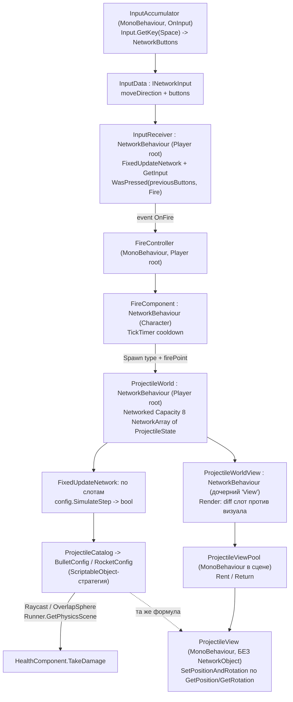

# Глава 04. Экстраполяция снарядов: снаряд как строка в `[Networked]`-массиве

> **TL;DR для агента**
> - Перестань делать снаряд `NetworkObject`. Реплицируй только «паспорт» выстрела — `(type, tick, origin, rotation)` — одной записью в `[Networked] NetworkArray<T>`, а позицию в любой момент считай детерминированной аналитической функцией времени. Трафик в полёте — ноль байт.
> - Держи один `NetworkBehaviour`-контейнер (`ProjectileWorld`) на **игрока**, а не на сцену: тогда стрелок выводится из `Object.InputAuthority` контейнера, а выстрел клиента предсказывается локально и ощущается мгновенно.
> - Поведение снаряда (скорость, гравитация, урон, форма траектории) выноси в `ScriptableObject`-стратегию: один и тот же ассет на всех пирах — это и есть гарантия детерминизма без репликации параметров.
> - Весь визуал — несетевой, выводится из состояния и реконсилируется по индексу слота **в `Render()`**, не в `FixedUpdateNetwork()`. Тогда откат предсказания не требует никакой компенсации.
> - Две шкалы времени: симуляция считает по тикам (`(tick - projectile.tick) * Runner.DeltaTime`), рендер — по непрерывному `LocalRenderTime + DeltaTime` для своих и `RemoteRenderTime` для чужих снарядов.

Проект главы: Unity **2022.3.42f1**, Photon Fusion **2.0.5** (build 920), режим **Host/Client** (`GameMode.AutoHostOrClient`), тикрейт клиента **30**, Lag Compensation **выключена**.

---

## Какую проблему решает

В главе 03 каждая пуля была полноценным сетевым объектом: префабы `Bullet (Kinematic)` и `Bullet (Physics)` несли `NetworkObject` + `NetworkTransform` (или `Rigidbody` + `NetworkRigidbody`) + `LifetimeComponent` + `CollisionComponent` + `KinematicBullet`/`PhysicsBullet`. Один выстрел = 1 `NetworkObject` и 3–4 `NetworkBehaviour`. Отсюда четыре системных проблемы.

1. **Трафик пропорционален времени полёта.** `NetworkTransform` реплицирует позицию каждый тик. Пуля с `_lifetime = 3` при 30 Hz — это порядка 90 обновлений трансформа на один выстрел, и это при том, что траектория была известна целиком уже в момент нажатия.
2. **Стоимость жизненного цикла.** `Runner.Spawn`/`Runner.Despawn` — это сообщение, выделение `NetworkId`, инстанцирование префаба (в 03 для этого даже пришлось написать `PoolableNetworkObjectProvider`). Для короткоживущих массовых объектов это худший возможный профиль.
3. **Задержка отклика = RTT.** В 03 в `FireComponent.Fire()` первой строкой стояло `if (!this.Runner.IsServer) return;`. Клиент узнавал о собственной пуле только из пакета хоста.
4. **Позицию нельзя восстановить из состояния.** `MovementComponent.MoveStep` интегрировал `position += direction * (_speed * deltaTime)`. При ресимуляции Fusion это надо прокручивать заново шаг за шагом, накапливая ошибку округления.

Глава 04 убирает все четыре проблемы одним решением: **снаряд перестаёт быть объектом и становится данными**. Оба префаба пули уехали в `Assets/Archive/`, а на их место пришли четыре слоя, описанные ниже.

---

## Модель мира: кто чем владеет

Это **Host/Client** (`PeerMode: 0`, `GameMode.AutoHostOrClient`). Разбор того, кто что исполняет, здесь важнее обычного, потому что в коде раздела **нет ни одной проверки авторитета** — ни `HasStateAuthority`, ни `HasInputAuthority`, ни `Runner.IsServer` — ни в `ProjectileWorld.Spawn`, ни в `ProjectileWorld.FixedUpdateNetwork`, ни в `FireComponent.Fire`, ни в `HealthComponent.TakeDamage`. Это сознательное решение, и его надо понять буквально.

- **`NetworkObject` в системе один на игрока** — это новый `Player.prefab`. `Character` — вложенный (`NestedObjects`) сетевой объект внутри него. `ProjectileWorld` и `ProjectileWorldView` — это `NetworkBehaviour`'ы, а не сетевые объекты; `ProjectileWorldView` физически висит на **дочернем** GameObject `View`, и это работает потому, что корневой `NetworkObject` собирает `NetworkedBehaviours` со всей своей иерархии: в YAML `Player.prefab` список корня — `[InputReceiver, ProjectileWorld, ProjectileWorldView]`.
- **`InputAuthority` принадлежит `NetworkObject`** (`Player`), а не массиву снарядов. Важно: `InputAuthority` **не даёт права записи** в сетевое состояние. То, что клиент пишет в `_projectiles`, — это **предсказание**: Fusion даёт локальной записи жить до прихода снапшота хоста, после чего снапшот её перетирает (вывод о поведении Fusion, не факт из кода).
- **`ProjectileWorld.FixedUpdateNetwork` исполняется на всех пирах для всех `Player`-объектов**, включая чужие, где локальный пир — прокси. То есть клиент симулирует и чужие снаряды, и безусловно вызывает `HealthComponent.TakeDamage` на чужом `Health`. На клиенте это тоже предсказание, которое сойдётся со снапшотом хоста.

**Отсюда главный инженерный вывод главы: детерминированная аналитическая траектория здесь не оптимизация, а условие корректности.** Поскольку гейта по авторитету нет, рассинхрон между пиром и хостом гасится только тем, что из одного и того же `(tick, position, rotation)` плюс одного и того же ассета конфига все пиры получают **тот же результат**. Замените формулу на интегрирование по кадрам или на `Time.deltaTime` — и предсказание перестанет сходиться с хостом, появятся «фантомные» попадания и дёргающиеся снаряды.

Два потока времени:

| Поток | Формула | Кто пользуется |
|---|---|---|
| Симуляционное (дискретное) | `(tick - projectile.tick) * runner.DeltaTime` | `SimulateStep`, `DrawGizmos` |
| Рендерное (непрерывное) | `renderTime - projectile.tick * runner.DeltaTime`, где `renderTime = IsProxy ? RemoteRenderTime : LocalRenderTime + DeltaTime` | `ProjectileView.UpdateTransform` |

---

## Архитектура раздела



**Слой 1 — сетевое состояние.** `ProjectileState : INetworkStruct`: четыре поля и ни одного лишнего.
**Слой 2 — контейнер.** `ProjectileWorld : NetworkBehaviour` с `NetworkArray` фиксированной ёмкости; единственная точка мутации.
**Слой 3 — поведение как данные.** `ProjectileConfig : ScriptableObject` — абстрактная стратегия; `BulletConfig` (прямая) и `RocketConfig` (парабола с AoE); `ProjectileCatalog` — реестр `ProjectileType -> config`.
**Слой 4 — визуал вне сети.** `ProjectileWorldView` (реконсиляция в `Render`), `ProjectileViewPool`, `ProjectileView` — обычные `MonoBehaviour`/`GameObject`, Fusion о них не знает вовсе (в `.meta` префабов `Bullet (View)` и `Rocket (View)` нет метки `FusionPrefab`).

---

## Реализация по шагам

### Шаг 1. Состояние: минимальная `INetworkStruct`

`Assets/Game/Scripts/Projectiles/Core/ProjectileState.cs`

```csharp
[Serializable]
public struct ProjectileState : INetworkStruct
{
    public ProjectileType type;
    public int tick;
    public Vector3 position; 
    public Quaternion rotation;

    public bool IsActive => this.tick > 0;
    public void SetInactive() => this.tick = 0;
}
```

**Почему именно так.** Каждое поле структуры умножается на `Capacity` **и** на число игроков, поэтому состав полей — это бюджетное решение, а не вопрос вкуса. Здесь нет текущей позиции (она выводится), нет скорости и гравитации (они в конфиге, одинаковом на всех пирах), нет урона (там же), нет таймера жизни (вычисляется из `tick`), нет владельца (выводится из того, в чьём `ProjectileWorld` лежит слот), и нет флага «жив».

Флага «жив» нет намеренно: `tick` **перегружен** — это и точка отсчёта экстраполяции, и признак занятости слота. В учительской версии (`Assets/[Teacher]/ProjectileWorld.txt`) было отдельное поле `IsAlive` рядом с `startTick`. Финальный код его убрал: минус одно сетевое поле × Capacity × игроков и, что важнее, минус второй источник истины, который можно рассинхронизировать с первым. Допущение, которое вы принимаете вместе с этим приёмом: снаряд, выпущенный ровно на тике 0, будет потерян.

### Шаг 2. Контейнер и публикация выстрела

`Assets/Game/Scripts/Projectiles/Core/ProjectileWorld.cs`

```csharp
using System.Collections.Generic;
using Fusion;
using Sirenix.OdinInspector;
using UnityEngine;

public sealed class ProjectileWorld : NetworkBehaviour
{
    private const int MAX_PROJECTILES = 8;

    [SerializeField]
    private ProjectileCatalog _catalog;

    [Networked, Capacity(MAX_PROJECTILES)]
    private NetworkArray<ProjectileState> _projectiles { get; }

    public int Length => MAX_PROJECTILES;

    [ShowInInspector, Sirenix.OdinInspector.ReadOnly]
    public IEnumerable<ProjectileState> Projectiles => _projectiles;

    public bool Spawn(ProjectileType type, Vector3 position, Quaternion rotation)
    {
        if (!this.FindFreeSlot(out int index))
            return false;

        ProjectileState projectile = new ProjectileState
        {
            type = type,
            tick = this.Runner.Tick,
            position = position,
            rotation = rotation
        };

        _projectiles.Set(index, projectile);
        return true;
    }

    public ProjectileState GetProjectile(int index)
    {
        return _projectiles[index];
    }
```

**Почему именно так.** `Capacity` обязателен и обязан быть константой: сетевое состояние Fusion имеет фиксированный размер, который кодогенерация (weaving) вычисляет на этапе сборки. Менять длину в рантайме нельзя, поэтому переполнение — штатная ситуация, которую обрабатывают руками: `Spawn` возвращает `bool`, а не пишет предупреждение в лог (в учительской версии `Spawn` был `void` плюс `Debug.LogWarning`). Этот `bool` потом работает в `FireComponent` — см. шаг 7.

Свойство объявлено **без сеттера и без инициализации**: weaver подставляет туда доступ к сетевой памяти. Следствие: читать `_projectiles` до того, как объект получил состояние, нельзя — отсюда проверка `StateBufferIsValid` в `OnDrawGizmos` (шаг 10).

`Capacity(8)` — это 8 снарядов **на игрока**, потому что контейнер лежит на `Player.prefab`. У учителя было 32 глобально. Версия «на игрока» масштабируется линейно с числом игроков и заодно бесплатно даёт владельца снаряда.

Строка `[ShowInInspector, Sirenix.OdinInspector.ReadOnly] public IEnumerable<ProjectileState> Projectiles` — третий отладочный инструмент раздела (рядом с гизмо и цветовой раскраской): сетевой массив видно в инспекторе в рантайме только для чтения. Учтите проектную зависимость: `Assets/Plugins/Sirenix` обязателен, без Odin раздел не компилируется.

### Шаг 3. Единственная точка мутации — `FixedUpdateNetwork`

`Assets/Game/Scripts/Projectiles/Core/ProjectileWorld.cs`

```csharp
    public override void FixedUpdateNetwork()
    {
        NetworkRunner runner = this.Runner;
        PlayerRef player = this.Object.InputAuthority;

        for (int i = 0; i < _projectiles.Length; i++)
        {
            ref ProjectileState projectile = ref _projectiles.GetRef(i);
            if (!projectile.IsActive)
                continue;

            ProjectileType type = projectile.type;
            ProjectileConfig config = _catalog.GetConfig(type);

            if (!config.SimulateStep(in projectile, in runner, in player))
                projectile.SetInactive();
        }
    }

    private bool FindFreeSlot(out int index)
    {
        for (int i = 0; i < _projectiles.Length; i++)
        {
            ProjectileState projectile = _projectiles[i];
            if (!projectile.IsActive)
            {
                index = i;
                return true;
            }
        }

        index = -1;
        return false;
    }
```

**Почему именно так.** Разделение «решение / мутация»: `SimulateStep` возвращает `bool` «жив ли», а гасит слот только контейнер. Если бы каждый конфиг сам писал в состояние, точек записи стало бы столько, сколько типов снарядов, и каждую пришлось бы аудировать отдельно. Конфиг остаётся чистым решателем и не знает о сети ничего, кроме чтения `Runner`.

`PlayerRef player = this.Object.InputAuthority` берётся **один раз из контейнера** — так владелец снаряда не занимает места в `ProjectileState`.

`_projectiles.GetRef(i)` даёт `ref` прямо в сетевую память слота, чтобы `projectile.SetInactive()` мутировал структуру на месте, без цикла «прочитать копию — изменить — `Set` обратно». Нюанс: в `FindFreeSlot` используется индексатор `_projectiles[i]` (чтение копии) — и это правильно, потому что поиск ничего не пишет.

Фиксированные слоты с «дырками» — это не небрежность, а приём: индекс слота не меняется за всю жизнь снаряда и работает **бесплатным сетевым идентификатором**. Компактный список со сдвигом элементов при удалении заставил бы визуалы перескакивать между снарядами каждый раз, когда умирает любой из них.

### Шаг 4. Поведение как `ScriptableObject`-стратегия

`Assets/Game/Scripts/Projectiles/Core/ProjectileConfig.cs`

```csharp
public abstract class ProjectileConfig : ScriptableObject
{
    [field: SerializeField]
    public ProjectileType Type { get; private set; }
    
    [field: SerializeField]
    public ProjectileView Prefab { get; private set; }
    
    public abstract bool SimulateStep(in ProjectileState projectile, in NetworkRunner runner, in PlayerRef player);

    public abstract void DrawGizmos(in ProjectileState projectile, in NetworkRunner runner, in PlayerRef player);
    
    public abstract Vector3 GetPosition(in ProjectileState projectile, in float time);
    
    public abstract Quaternion GetRotation(in ProjectileState projectile, in float time);
}
```

**Почему именно так.** У снаряда больше нет `GameObject`, значит некуда положить `MonoBehaviour` с его правилами. Стратегия в `ScriptableObject` решает сразу три задачи: два принципиально разных снаряда без `switch` в контейнере; параметры (`_speed`, `_gravity`, `_damage`) живут в ассете и поэтому одинаковы на всех пирах **без репликации**; конфиг доступен и симуляции, и визуалу.

Контракт базы сведён к **одной шкале времени** — чистому `float time` (возраст снаряда в секундах). У учителя в базе было четыре дополнительных невиртуальных перегрузки `GetPosition`/`GetRotation` (по `Tick` и по абсолютному времени, каждая с параметром `deltaTime`). Финальная версия их выбросила, а пересчёт перенесла туда, где известен контекст: тиковый — приватно в каждый конфиг, рендерный — в `ProjectileView`. Цена: приватный `GetPosition(projectile, runner, tick)` продублирован в `BulletConfig` и `RocketConfig` (регресс по DRY). Выгода: у базы ровно один контракт времени, и невозможно случайно передать несогласованные `tick` и `deltaTime`.

`DrawGizmos` объявлен **`abstract`**, а не `virtual` с пустым телом (как у учителя): отладочная визуализация стала обязательной частью контракта каждого типа снаряда.

`ProjectileCatalog` (`Core/ProjectileCatalog.cs`) — массив конфигов с линейным поиском по `Type` и `throw new Exception($"Projectile config of type {type} is not found!")` при промахе. Исключение, а не `null`: несконфигурированный каталог обязан падать на первом же выстреле, а не выдавать `NullReferenceException` внутри цикла симуляции.

### Шаг 5. Пуля: аналитическая прямая плюс сегментный raycast

`Assets/Game/Scripts/Projectiles/Content/BulletConfig.cs`

```csharp
    public override bool SimulateStep(in ProjectileState projectile, in NetworkRunner runner, in PlayerRef player)
    {
        if (this.IsExpired(in projectile, in runner))
            return false;

        Vector3 previousPosition = this.GetPosition(in projectile, runner, runner.Tick - 1);
        Vector3 currentPositon = this.GetPosition(in projectile, runner, runner.Tick);
        Vector3 distance = currentPositon - previousPosition;

        PhysicsScene physicsScene = runner.GetPhysicsScene();
        if (!physicsScene.Raycast(previousPosition, distance.normalized, out RaycastHit hit, distance.magnitude,
                _layerMask, _triggerInteraction))
            return true;

        if (!this.DealDamage(in hit, in player))
            return true;

        return false;
    }

    private bool IsExpired(in ProjectileState projectile, in NetworkRunner runner)
    {
        int lifetime = Mathf.Max(1, (int) (_lifetime / runner.DeltaTime));
        return projectile.tick + lifetime < runner.Tick;
    }

    private Vector3 GetPosition(in ProjectileState projectile, in NetworkRunner runner, in Tick tick)
    {
        float time = (tick - projectile.tick) * runner.DeltaTime;
        return this.GetPosition(projectile, time);
    }
    
    public override Vector3 GetPosition(in ProjectileState projectile, in float time)
    {
        if (time <= 0)
            return projectile.position;

        Vector3 direction = projectile.rotation * Vector3.forward;
        return projectile.position + direction * (_speed * time);
    }

    public override Quaternion GetRotation(in ProjectileState projectile, in float time)
    {
        return projectile.rotation;
    }
    
    private bool DealDamage(in RaycastHit hit, in PlayerRef player)
    {
        Collider collider = hit.collider;
        if (!collider.CompareTag(GameObjectTags.Character))
            return false;

        NetworkObject other = collider.GetComponent<NetworkObject>();
        if (other.InputAuthority == player)
            return false;

        HealthComponent healthComponent = other.GetComponent<HealthComponent>();
        return healthComponent.TakeDamage(_damage);
    }
```

**Почему именно так.** `GetPosition(state, time)` — **чистая функция времени**, а не шаг интегрирования. Следствия: ни один пир не накапливает ошибку; любое время (тиковое или дробное render-время) даёт корректную точку; ресимуляция Fusion бесплатна, потому что пересчёт не зависит от предыдущего кадра; интерполировать позицию снаряда не нужно вообще.

Попадание проверяется **по отрезку** между позициями `tick - 1` и `tick`, вычисленными той же формулой. Это анти-туннелирование: дискретная проверка «есть ли кто-то в текущей точке» на 30 Hz систематически промахивается сквозь игрока, если за тик снаряд пролетел дальше его толщины. При `_speed = 5` и `DeltaTime` около 0.033 шаг — 16 см; с ростом скорости сегментная проверка становится обязательной.

**Clamp `if (time <= 0)` — не косметика.** Отрицательный `time` возникает в двух местах. Первое — факт из кода: на тике рождения `SimulateStep` берёт выборку `runner.Tick - 1`, то есть `time = -DeltaTime`. Без clamp'а `previousPosition` уехала бы **за стрелка**, и самый первый raycast проверил бы отрезок позади дула. Второе (вывод о поведении Fusion, не факт из кода) — у прокси `RemoteRenderTime` отстаёт от тика рождения снаряда, поэтому на первых кадрах `renderTime - tick * DeltaTime` тоже отрицателен.

Время жизни — **арифметика от стартового тика**, а не сетевой таймер: `tick` уже есть в состоянии, поэтому хранить `TickTimer` на снаряд (как делал `LifetimeComponent` в 03) не нужно. `Mathf.Max(1, ...)` защищает от `_lifetime` меньше одного шага симуляции: без него снаряд умирал бы в тик рождения.

**⚠️ Честная оговорка, которую надо знать: пуля пролетает сквозь геометрию.** `SimulateStep` гасит пулю только если raycast попал **и** `DealDamage` вернул `true`. `DealDamage` возвращает `false`, если коллайдер не с тегом `Character`, если это свой стрелок, и если `HealthComponent.TakeDamage` вернул `false` (цель уже мертва, `Health == 0`). Во всех этих случаях `SimulateStep` возвращает `true` и пуля летит дальше. При этом `_layerMask.m_Bits = 1` (Default) включает землю и препятствия — то есть пуля физически просвистывает сквозь стены и пол и живёт до истечения `_lifetime`. «Попадание как терминатор» здесь реализовано только для живых персонажей. **Рекомендация:** разделите «есть ли препятствие» и «нанесён ли урон» — гасите снаряд при любом попадании по маске, а урон применяйте только к `Character`.

### Шаг 6. Ракета: парабола, ориентация как производная, AoE

`Assets/Game/Scripts/Projectiles/Content/RocketConfig.cs`

```csharp
    public override bool SimulateStep(in ProjectileState projectile, in NetworkRunner runner, in PlayerRef player)
    {
        Vector3 position = this.GetPosition(in projectile, in runner, runner.Tick);
        if (position.y <= _radius)
        {
            this.ApplyDamage(in runner, in position);
            return false;
        }

        if (this.HasCollision(in runner, in position, in player))
        {
            this.ApplyDamage(in runner, in position);
            return false;
        }

        return true;
    }

    public override Vector3 GetPosition(in ProjectileState projectile, in float time)
    {
        return time <= 0
            ? projectile.position
            : projectile.position +
              projectile.rotation * Vector3.forward * (_speed * time) +
              Vector3.down * (0.5f * _gravity * time * time);
    }

    public override Quaternion GetRotation(in ProjectileState projectile, in float time)
    {
        Vector3 direction = projectile.rotation * Vector3.forward;
        Vector3 velocity = direction * _speed;
        Vector3 acceleration = Vector3.down * _gravity;

        Vector3 currentVelocity = velocity + acceleration * time;
        return Quaternion.LookRotation(currentVelocity.normalized);
    }
```

**Почему именно так.** Экстраполяция не ограничена прямой линией — достаточно, чтобы траектория была **замкнутой формулой**. Парабола `p0 + v*t + 0.5*g*t^2` полностью заменяет `Rigidbody` плюс `NetworkRigidbody` из главы 03: физика выброшена, поведение сохранено и при этом стало детерминированным.

`GetRotation` — тоже производная состояния: вектор скорости в момент `t` получен аналитическим дифференцированием (`v + a*t`), поэтому ракета сама разворачивается носом по траектории **без репликации rotation**. `.normalized` перед `LookRotation` добавлен специально (у учителя его не было) — `LookRotation` от ненормализованного вектора менее устойчив численно.

Три точечных исправления краевых случаев относительно учительской версии: `position.y <= _radius` вместо `y <= 0` (подрыв по касанию оболочки, а не по провалу центра под пол), `.normalized`, и clamp `time <= 0` в `GetPosition`. Деталь, которая делает первое исправление наглядным: в `RocketConfig.asset` `_radius: 0.125`, а дочерний `<Visual>` на `Rocket (View).prefab` — единичная сфера со `scale 0.25`, то есть радиус ровно 0.125. **Оболочка коллизии совпадает с видимым мешем.** Заодно оговорка по арту: `Rocket (View)` использует тот же сферический меш, что и `Bullet (View)`, поэтому аккуратно выведенный `GetRotation` на текущем арте визуально не виден.

Проверка попадания у ракеты объёмная (`OverlapSphere`), а не сегментная: ракета медленная и «толстая», туннелирование ей не грозит, а объёмный тест даёт честное касание.

```csharp
    [SerializeField]
    private Collider[] _colliderBuffer = new Collider[8];
```

Переиспользуемый буфер в самом ассете: `OverlapSphere` без буфера аллоцирует массив на каждый вызов, а вызовов столько же, сколько живых ракет × тиков, **включая ресимуляцию** — прямой путь к GC-спайкам на тикрейте. Буфер общий для всех ракет всех игроков, и это безопасно **только** потому, что `HasCollision` (радиус `_radius`) и `ApplyDamage` (радиус `_damageRadius`) вызываются строго последовательно внутри одного `SimulateStep`, и результат первого не переживает второй вызов. Отсюда же поправка к формулировке: конфиг **не stateless вообще** — он не хранит состояния *снаряда*, а разделяемый буфер является временным скрэтчем внутри одного синхронного вызова.

**⚠️ В `ApplyDamage` фильтра по стрелку нет:**

```csharp
    private void ApplyDamage(in NetworkRunner runner, in Vector3 position)
    {
        PhysicsScene scene = runner.GetPhysicsScene();
        int count = scene.OverlapSphere(position, _damageRadius, _colliderBuffer, _layerMask, _triggerInteraction);
        for (int i = 0; i < count; i++)
        {
            Collider collider = _colliderBuffer[i];
            if (collider.CompareTag(GameObjectTags.Character))
            {
                HealthComponent healthComponent = collider.GetComponent<HealthComponent>();
                healthComponent.TakeDamage(_damage);
            }
        }
    }
```

Фильтр `otherObject.InputAuthority != player` стоит только в `HasCollision` (срабатывание), а AoE-урон бьёт **всех** с тегом `Character` в `_damageRadius` (2 метра при `_radius` 0.125), включая самого стрелка. Это поведение кода: стрелок получает урон от собственной ракеты, если оказался в радиусе взрыва. Решайте осознанно — для гранат это обычно желаемое поведение, для ракеты в упор чаще нет.

**Значения ассета перекрывают дефолты кода.** В коде `_radius = 0.25f`, `_speed = 5f`, `_damageRadius = 1`; в `RocketConfig.asset` — `_radius: 0.125`, `_speed: 6`, `_damageRadius: 2`. Игру определяет ассет. Никогда не читайте баланс из полей класса.

### Шаг 7. Вход, edge-детект и кулдаун

`Assets/Game/Scripts/System/Input/InputAccumulator.cs`

```csharp
    private void AccumulateFire(ref NetworkButtons buttons)
    {
        buttons.Set(InputKeys.Fire, Input.GetKey(KeyCode.Space));
    }
```

`Assets/Game/Scripts/Player/InputReceiver.cs`

```csharp
    [Networked]
    private NetworkButtons previousButtons { get; set; }

    public override void FixedUpdateNetwork()
    {
        if (!this.GetInput(out InputData input)) 
            return;
        
        float deltaTime = this.Runner.DeltaTime;
        
        this.ProcessMove(input, deltaTime);
        this.ProcessFire(input);
        
        this.previousButtons = input.buttons;
    }

    private void ProcessFire(InputData input)
    {
        if (input.buttons.WasPressed(this.previousButtons, InputKeys.Fire))
            this.OnFire?.Invoke();
    }
```

**Почему именно так.** Аккумулятор сознательно отдаёт в сеть **состояние** кнопки (`Input.GetKey`), а не событие (`GetKeyDown`). Сырой ввод фронта не содержит, поэтому фронт детектируется уже в симуляции — и именно поэтому `previousButtons` обязано быть `[Networked]`, а не локальным полем. Fusion может ресимулировать один и тот же тик многократно; при откате локальное поле уже затёрто, и выстрел либо продублируется, либо пропадёт. В сетевом состоянии `previousButtons` откатывается вместе со всем остальным.

`Assets/Game/Scripts/GameObject/Core/FireComponent.cs`

```csharp
public sealed class FireComponent : NetworkBehaviour
{
    [SerializeField]
    private Transform _firePoint;

    [SerializeField]
    private float _cooldown = 1;

    [Networked]
    private TickTimer timer { get; set; }

    [SerializeField]
    private ProjectileType _type;

    [SerializeField]
    private ProjectileWorld _projectileWorld;

    public void Fire()
    {
        if (!this.timer.ExpiredOrNotRunning(this.Runner))
            return;

        if (!_projectileWorld.Spawn(_type, _firePoint.position, _firePoint.rotation))
            return;

        this.timer = TickTimer.CreateFromSeconds(this.Runner, _cooldown);
    }
}
```

**Почему именно так.** Это самое концентрированное место диффа с главой 03. Исчезли `NetworkPrefabRef _bulletPrefab` и весь блок `Runner.Spawn(..., onBeforeSpawned: ...)` с ручной инициализацией `LifetimeComponent`/`PhysicsBullet`. И — критично — **исчезла строка `if (!this.Runner.IsServer) return;`**. Теперь `Fire()` исполняется и у клиента: запись в `[Networked]`-массив предсказывается локально, снаряд появляется мгновенно, без ожидания RTT.

Порядок трёх шагов содержателен: **таймер → `Spawn` → перезапуск таймера**. Неудачный выстрел (слоты кончились) не тратит кулдаун — иначе игрок терял бы такт стрельбы из-за внутреннего лимита, которого он не видит. Ровно для этого `Spawn` и возвращает `bool`.

**Назовём прямо ещё одну особенность:** `FireComponent` висит на вложенном `Character` (своём `NetworkObject`), а `_projectileWorld` указывает на `ProjectileWorld` **родителя**. То есть сетевое состояние одного `NetworkObject` мутируется из `FixedUpdateNetwork`-пути другого. Технически это обычный вызов метода и работает, но это нарушает интуицию «каждый пишет только своё состояние». В `Character.prefab` поле `_projectileWorld` равно `{fileID: 0}`, а закрывается **оверрайдом** на уровне `Player.prefab` (в YAML видна модификация `propertyPath: _projectileWorld` с `objectReference` на `ProjectileWorld` родителя). Это штатный приём композиции: вложенный префаб оставляет «дырку», которую заполняет родитель.

### Шаг 8. Иерархия: `Player` как долгоживущий корень

`Assets/Game/Scripts/System/Players/PlayerJoinController.cs`

```csharp
    private void OnPlayerJoined(NetworkRunner runner, PlayerRef player)
    {
        if (!runner.IsServer)
            return;

        Transform spawnPoint = _spawnPointService.NextPoint();
        NetworkObject playerObject = runner.Spawn(_playerPrefab, Vector3.zero, Quaternion.identity, player);
        runner.SetPlayerObject(player, playerObject);

        Character character = playerObject.GetComponentInChildren<Character>();
        character.transform.SetPositionAndRotation(spawnPoint.position, spawnPoint.rotation);
    }
```

**Почему именно так.** Спавнится не `Character`, а новый `Player.prefab`, и обязательно в `Vector3.zero`: на корне `Player` **нет `NetworkTransform`** (проверено по YAML — в `NetworkedBehaviours` только `InputReceiver`, `ProjectileWorld`, `ProjectileWorldView`), его трансформ не реплицируется вовсе. Позиция спавна поэтому задаётся уже после `Spawn` напрямую дочернему `Character`, у которого `NetworkTransform` остался (`SyncScale: 0`, `SyncParent: 1`).

Зачем вообще такая реструктуризация. Если `ProjectileWorld` повесить на `Character`, то его смерть/респавн уничтожат снаряды в полёте, а Interest Management начнёт выгружать снаряды вместе с персонажем. Если сделать один глобальный `ProjectileWorld` в сцене со `StateAuthority` у хоста, клиент не сможет предсказать свой выстрел — отклик снова станет равен RTT. Контейнер на долгоживущем `Player` с `InputAuthority` игрока решает оба случая.

**Оговорка:** в самом разделе 04 этот аргумент кодом **не демонстрируется**. Респавна и `Despawn` персонажа здесь нет: по `Assets/Game/Scripts` ровно один `runner.Spawn` (`Player` в `PlayerJoinController`) и один `runner.Despawn` (`Player` в `PlayerLeftController`), а смерть выражается только в `Health == 0` и `_collider.enabled = _healthComponent.Exists()` в `Character.FixedUpdateNetwork`. Это задел на будущее и дидактический аргумент, а не наблюдаемое поведение главы.

`MoveController` и `FireController` остались на `Player` root (рядом с `InputReceiver`, от которого подписываются), а компоненты персонажа получают через сериализованное поле:

`Assets/Game/Scripts/Player/FireController.cs`

```csharp
    private InputReceiver _inputReceiver;
    
    [SerializeField]
    private GameObject _character;
    
    private FireComponent _fireComponent;

    private void Awake()
    {
        _inputReceiver = this.GetComponent<InputReceiver>();
        _fireComponent = _character.GetComponent<FireComponent>();
    }
```

### Шаг 9. Визуал: два таймфрейма и реконсиляция в `Render`

`Assets/Game/Scripts/Projectiles/View/ProjectileWoldView.cs` (имя файла действительно с опечаткой `Wold`)

```csharp
    public override void Render()
    {
        NetworkRunner runner = this.Runner;
        float renderTime = this.Object.IsProxy 
            ? this.Runner.RemoteRenderTime 
            : this.Runner.LocalRenderTime + this.Runner.DeltaTime;
        
        PlayerRef player = this.Object.InputAuthority;

        for (int i = 0; i < _world.Length; i++)
        {
            ProjectileState projectile = _world.GetProjectile(i);
            bool hasProjectile = projectile.IsActive;

            ProjectileView projectileView = _projectileViews[i];
            bool hasView = projectileView != null;

            if (hasProjectile && !hasView)
            {
                //Spawn view
                projectileView = _viewPool.Rent(projectile.type, _container);
                projectileView.OnSpawn(in projectile, in runner, in player, in renderTime);
                _projectileViews[i] = projectileView;
            }
            else if (hasView && !hasProjectile)
            {
                //Unspawn view:
                projectileView.OnUnspawn(in runner, in player);
                _viewPool.Return(projectileView);
                _projectileViews[i] = null;
            }
            else if (hasProjectile)
            {
                //Update view:
                projectileView.OnUpdate(in projectile, in runner, in player, in renderTime);
            }
        }
    }
```

**Почему именно так — две техники в одном методе.**

*Выбор таймфрейма.* Собственный снаряд рисуется в `LocalRenderTime + DeltaTime` — в предсказанном времени с опережением на тик, чтобы выстрел ощущался мгновенно и визуально шёл впереди подтверждённого состояния. Чужой — в `RemoteRenderTime`, отстающем подтверждённом времени. Поменяйте местами, и вы получите либо «залипание» выстрела на RTT (свои в remote), либо телепорты чужих снарядов при каждой коррекции (чужие в local). У учителя стояло `float renderTime = Object.RenderTime` — Fusion выбирает таймфрейм сам; финальная версия выписывает выбор явно и добавляет осознанный сдвиг `+ DeltaTime`. `IsProxy` проверяется у `Object`, которому принадлежит `ProjectileWorld` (то есть у `Player`), а не у снаряда — снаряда как объекта больше не существует.

*Реконсиляция по diff состояния именно в `Render`.* `Render()` вызывается ровно раз на кадр и всегда по итоговому состоянию, а `FixedUpdateNetwork` — ноль или много раз для одного и того же тика. `Instantiate`/`Return`/VFX/звук внутри FUN размножились бы и оставили мусор при откате. Массив `_projectileViews[i]` строго параллелен `_projectiles[i]`, и на каждый индекс решается один из трёх переходов. Поскольку визуал не хранит ничего своего, **откат предсказанного выстрела обрабатывается сам собой**: слот опустел — визуал ушёл в пул, никакой компенсации не требуется.

`Assets/Game/Scripts/Projectiles/View/ProjectileView.cs`

```csharp
    private void UpdateTransform(in ProjectileState projectile, in NetworkRunner runner, in float renderTime)
    {
        float time = renderTime - projectile.tick * runner.DeltaTime;
        Vector3 position = _config.GetPosition(in projectile, in time);
        Quaternion rotation = _config.GetRotation(in projectile, in time);
        this.transform.SetPositionAndRotation(position, rotation);
    }
```

Мост между дискретным сетевым временем и непрерывным рендером: абсолютное render-время переводится в **возраст снаряда**, после чего ту же позицию выдаёт та же функция, что считает попадания. `ProjectileView` — обычный `MonoBehaviour`; `Bullet (View).prefab` и `Rocket (View).prefab` не содержат `NetworkObject`, коллайдера и `Rigidbody`, и в их `.meta` нет метки `FusionPrefab`. Один снаряд в полёте имеет **нулевую сетевую стоимость** и локальный визуал из пула.

**⚠️ Ловушка, которую надо знать:** функция траектории берётся из **двух независимых ссылок**. `ProjectileWorld` получает конфиг из `_catalog` по `type`, а `ProjectileView` — из собственного сериализованного поля `_config` на префабе визуала (`Rocket (View)._config` → `RocketConfig.asset`, guid `9d666056...`; `Bullet (View)._config` → `BulletConfig.asset`, guid `967836e3...`). Согласованность симуляции и картинки держится только на ручной двусторонней связи `config.Prefab` ↔ `view._config`. Перепутанный `_config` на префабе даст визуал, едущий по чужой формуле, **без единой ошибки в рантайме**. **Рекомендация:** инжектируйте конфиг в `ProjectileView` при `Rent`/`OnSpawn` из каталога, а не храните его второй ссылкой на префабе.

`Assets/Game/Scripts/Projectiles/View/ProjectileViewPool.cs`

```csharp
            public void Return(in ProjectileView view)
            {
                view.gameObject.SetActive(false);
                
                if (!_stack.Contains(view))
                    _stack.Push(view);
                else
                    Debug.LogWarning($"View {view.Type} already contains in pool!", view);
            }
```

Защита от двойного возврата закрывает самый коварный баг пулов: один `ProjectileView` достался бы двум слотам, один снаряд стал бы невидимым, другой задублированным — поймать это в рантайме почти невозможно. `O(n)` на возврат допустим при `n` порядка единиц. `Debug.LogWarning` получает `view` вторым аргументом, чтобы клик в консоли подсветил виновника в иерархии. Пул чисто локальный — он не проходит через `NetworkObjectProvider`, потому что визуал не является сетевым объектом.

**⚠️ Жизненный цикл визуалов при despawn не закрыт.** В `Assets/Game/Scripts/Projectiles` нет ни одного `Despawned`/`OnDisable`/`OnDestroy`, а `_projectileViews` — обычный несетевой массив, заполняемый в `Render`. Если `Player` деспавнится с занятыми слотами, арендованные визуалы останутся детьми `Character/<Visual>` и будут уничтожены вместе с ним, не вернувшись в стек пула: инстансы пула молча теряются. «Визуал не хранит ничего своего» верно для отката предсказания, но не для despawn владельца. **Рекомендация:** переопределите `Despawned(NetworkRunner, bool)` в `ProjectileWorldView` и верните все непустые `_projectileViews` в пул.

### Шаг 10. Отладка: гизмо, Odin, `IsForward`

`Assets/Game/Scripts/Projectiles/Core/ProjectileWorld.cs`

```csharp
    private void OnDrawGizmos()
    {
        if (!this.StateBufferIsValid)
            return;

        NetworkRunner runner = this.Runner;
        PlayerRef player = this.Object.InputAuthority;

        for (int i = 0; i < _projectiles.Length; i++)
        {
            ref ProjectileState projectile = ref _projectiles.GetRef(i);
            if (projectile.IsActive)
            {
                ProjectileType type = projectile.type;
                ProjectileConfig config = _catalog.GetConfig(type);
                config.DrawGizmos(in projectile, in runner, in player);
            }
        }
    }
```

**Почему именно так.** Главный класс ошибок в экстраполяции — рассогласование симуляционной и рендерной позиции: игрок видит попадание, а урона нет (или наоборот). На глаз это неотличимо от лага. Гизмо рисует **тиковую (симуляционную)** позицию, а меш стоит в **рендерной** — любое расхождение становится видимым. Цвет синий/красный по `player == runner.LocalPlayer` сразу отличает свои снаряды от чужих, то есть локальное предсказание от remote-таймфрейма. `StateBufferIsValid` обязателен: `OnDrawGizmos` вызывается и на префабе в редакторе, и на кадре до `Spawned()`, где обращение к `[Networked]`-памяти упало бы. (Мелкое замечание по стилю: `GetRef` здесь используется для чтения — технически он открывает `ref` на запись в сетевое состояние вне FUN; безопаснее был бы индексатор, как в учительской версии.)

`Assets/Game/Scripts/GameObject/Core/HealthComponent.cs`

```csharp
    [Networked]
    [OnChangedRender(nameof(InvokeHealthChanged))]
    [UnityNonSerialized]
    public int Health { get; private set; }

    public bool TakeDamage(int damage)
    {
        if (this.Health == 0)
            return false;

        Debug.Log($"TAKE DAMAGE {Object.Name} {Health} {Runner.Tick} {this.Runner.IsForward}");
        this.Health = Mathf.Max(0, this.Health - damage);
        // Debug.Log($"DAMAGE TAKEN {Object.Name} {Health} {Runner.Tick} {this.Runner.IsForward}");
        return true;
    }
```

Две вещи, которые нужно унести из этого фрагмента. Первая: `[OnChangedRender]` — Fusion 2-способ реагировать на изменение сетевого поля **в `Render`** (замена Fusion 1 `[Networked(OnChanged = ...)]` и альтернатива `ChangeDetector`); `[UnityNonSerialized]` убирает поле из сериализации Unity. Это единственное место в разделе, где визуал обновляется по событию, а не по diff'у, как у снарядов. Вторая: `Runner.IsForward` в логе — это **встроенный в раздел зонд ресимуляции**. Лог намеренно оставлен в FUN-пути, чтобы вы увидели, как один и тот же тик печатается несколько раз, и `IsForward` — ровно тот флаг, которым отличают первый (forward) прогон тика от повторного.

---

## Fusion API этой главы

| API | Что делает | Где вызывается | Подводный камень |
|---|---|---|---|
| `[Networked, Capacity(N)] NetworkArray<T> { get; }` | Массив фиксированной длины в сетевом состоянии `NetworkBehaviour` вместо N отдельных `NetworkObject` | `ProjectileWorld` | `Capacity` обязателен и фиксируется кодогенерацией (weaving); в рантайме не меняется. Свойство без сеттера — weaver подставляет доступ к сетевой памяти, читать до `Spawned()` нельзя. Переполнение обрабатывай сам |
| `NetworkArray<T>.Set(index, value)` | Публикация нового снаряда в слот | `ProjectileWorld.Spawn` | Копирует всю структуру; по сети уйдут только изменившиеся words, то есть запись при спавне стоит один раз, а не каждый тик |
| `NetworkArray<T>.GetRef(index)` → `ref T` | `ref` прямо в сетевую память слота для мутации на месте | `ProjectileWorld.FixedUpdateNetwork`, `OnDrawGizmos` | Это ссылка **на запись**; для чистого чтения (поиск слота, гизмо) правильнее индексатор `_projectiles[i]` |
| `INetworkStruct` | Разрешает использовать `struct` как элемент сетевого состояния | `ProjectileState` | Все поля должны быть поддерживаемыми Fusion типами (enum, int, Vector3, Quaternion). Каждое лишнее поле умножается на `Capacity` × число игроков |
| `NetworkRunner.Tick` | Момент рождения снаряда и текущий момент симуляции | `Spawn`, оба конфига | Тик одинаков у всех пиров для одного шага симуляции — это и делает траекторию общей истиной. Абсолютное время хранить нельзя: у клиентов разные часы |
| `NetworkRunner.DeltaTime` | Единственный конвертер тиков в секунды в обе стороны | `BulletConfig.IsExpired`, оба `GetPosition`, `ProjectileView` | Это фиксированный шаг симуляции (тикрейт 30), а не `Time.deltaTime`. Подставьте `Time.deltaTime` — и траектория станет разной на машинах с разным FPS |
| `NetworkRunner.LocalRenderTime` / `RemoteRenderTime` | Два таймфрейма рендера: предсказанный локальный и отстающий подтверждённый | `ProjectileWorldView.Render` | Перепутаете — свои снаряды отстанут на RTT, чужие начнут дёргаться при коррекциях |
| `NetworkBehaviour.Render()` | Точка, где состояние превращается в визуал | `ProjectileWorldView` | Вызывается ровно раз на кадр; `FixedUpdateNetwork` — ноль или много раз. Любой невосстановимый побочный эффект (`Instantiate`, VFX, звук) обязан быть здесь |
| `NetworkObject.IsProxy` | Различает «мой» и «чужой» объект для выбора таймфрейма | `ProjectileWorldView.Render` | Проверяется у владельца `ProjectileWorld` (`Player`), не у снаряда |
| `NetworkObject.InputAuthority` (`PlayerRef`) | Идентификатор стрелка | `ProjectileWorld.FixedUpdateNetwork`, оба конфига, `ProjectileView` | Принадлежит `NetworkObject`, а не массиву, и **права записи в сетевое состояние не даёт**. Локальная запись клиента — предсказание |
| `NetworkRunner.GetPhysicsScene()` → `PhysicsScene` | Физическая сцена конкретного раннера для `Raycast`/`OverlapSphere` | `BulletConfig`, `RocketConfig` | Вывод (не факт из кода): при нескольких раннерах в одном процессе глобальный `Physics.Raycast` спутал бы коллайдеры разных пиров |
| `NetworkBehaviour.StateBufferIsValid` | Страховка перед чтением `[Networked]` вне обычного жизненного цикла | `ProjectileWorld.OnDrawGizmos` | Без неё гизмо на префабе в редакторе или на кадре до `Spawned()` обратится к несуществующей сетевой памяти |
| `TickTimer.CreateFromSeconds` / `ExpiredOrNotRunning` | Кулдаун выстрела — единственный `TickTimer` в системе | `FireComponent.Fire` | Порядок: проверка → `Spawn` → перезапуск. Иначе неудачный выстрел съест кулдаун |
| `NetworkButtons.WasPressed(previous, key)` плюс `[Networked] previousButtons` | Edge-детект, устойчивый к ресимуляции | `InputReceiver.ProcessFire` | Предыдущее состояние кнопок **обязано** лежать в сетевом состоянии; в локальном поле при откате выстрел продублируется или пропадёт |
| `[OnChangedRender(nameof(...))]`, `[UnityNonSerialized]` | Fusion 2-реакция на изменение `[Networked]`-поля в `Render` | `HealthComponent.Health` | Fusion 2-замена `[Networked(OnChanged = ...)]` из Fusion 1; вызывается в рендер-фазе, не в FUN |
| `NetworkRunner.IsForward` | Отличает первый прогон тика от ресимуляции | `HealthComponent.TakeDamage` (лог) | Используй как гейт для одноразовых эффектов, если их всё же приходится делать в FUN |
| `NetworkObject.NestedObjects` (структура префаба) | Вложенные сетевые объекты, собранные редактором | `Player.prefab` (YAML) | Это **сериализованное поле**, заполняемое редактором, а не рантайм-API — не искать такой метод. Fusion инстанцирует вложенные объекты вместе с корневым префабом |
| `NetworkObjectProviderDefault.InstantiatePrefab` / `DestroyPrefabInstance` | Пул сетевых объектов, унаследованный из главы 03 | `PoolableNetworkObjectProvider` | В 04 фактически не задействован: `Player.prefab` в каталоге пула отсутствует, а `Character` — `NestedObject` и отдельно не спавнится |

---

## Настройки, без которых не работает

**`NetworkProjectConfig.fusion` — байт-в-байт тот же, что в главе 03.** Это самостоятельная часть урока: новая модель снарядов **не потребовала ни одной настройки Fusion**. Ни увеличения heap, ни включения Lag Compensation, ни регистрации новых сетевых префабов. Снаряды просто перестали быть сетевыми объектами.

- `PeerMode: 0`, `GameMode.AutoHostOrClient` (`EntryPoint.cs`), `SessionName: "SampleSession"`, `ObjectProvider = PoolableNetworkObjectProvider`, `ProvideInput = true`.
- `Simulation`: `InputDataWordCount: 0`, `ReplicationFeatures: 1`, `PlayerCount: 10`, `TickRateSelection.Client: 30`, `ClientSendIndex`/`ServerSendIndex: 1`.
- `LagCompensation.Enabled: false` (`HitboxBufferLengthInMs: 200`, `HitboxDefaultCapacity: 512`). **Hitbox/HitboxRoot в проекте не используются вовсе.** Попадания считаются обычными `PhysicsScene.Raycast`/`OverlapSphere` по коллайдерам в текущем состоянии симуляции, без отката хитбоксов во времени. Это ограничение главы; компенсация задержек — тема главы 06.
- `Heap`: `PageShift: 15`, `PageCount: 256`. `InvokeRenderInBatchMode: true`, `NullChecksForNetworkedProperties: true`, `CheckNetworkedPropertiesBeingEmpty: false`, `HostMigration.EnableAutoUpdate: false`, `EncryptionConfig` выключен, `NetworkConditions.Enabled: false` (но `DelayMin`/`DelayMax` 0.15 и `LossChanceMin` 0.05 уже настроены — включаются одним флажком для проверки главы на лаге). `AssembliesToWeave` включает `Assembly-CSharp`.

**Префабы и порядок компонентов.**

- `Player.prefab` (label `FusionPrefab`): корень — `Transform`, `NetworkObject` (`SortKey: 477462300`, `ObjectInterest: 1`, `Flags: 262145`), `InputReceiver`, `MoveController`, `FireController`, `ProjectileWorld`. **`NetworkTransform` на корне нет.** `NestedObjects: [NetworkObject Character]`. `NetworkedBehaviours: [InputReceiver, ProjectileWorld, ProjectileWorldView]`.
- `ProjectileWorldView` висит на **дочернем** GameObject `View` и лишь зарегистрирован в `NetworkedBehaviours` корня. Это нормально: корневой `NetworkObject` собирает `NetworkBehaviour`'ы со всей иерархии, поэтому дочерний компонент всё равно получает `Render()`.
- **Порядок в `NetworkedBehaviours` значим.** Он равен `[InputReceiver, ProjectileWorld, ProjectileWorldView]`, и (вывод о поведении Fusion, не факт из кода) FUN исполняется в этом порядке. Значит снаряд, записанный в слот на тике T через `InputReceiver → FireController → FireComponent.Fire`, симулируется `ProjectileWorld`'ом **уже на тике T** с `time = 0`. Именно это делает корректным clamp `time <= 0`: у пули `previousPosition(tick-1)` и `currentPosition(tick)` после clamp'а совпадают, отрезок нулевой, raycast ничего не находит; у ракеты на `t = 0` `OverlapSphere` проверяется прямо в дуле, и спасает только фильтр `otherObject.InputAuthority != player` в `HasCollision`.
- `Character.prefab` (label `FusionPrefab`, тег `Character`): `NetworkObject` + `NetworkTransform` (`SyncScale: 0`, `SyncParent: 1`, `DisableSharedModeInterpolation: 0`) + `MovementComponent` (`_speed: 5`) + `RotationComponent` (`_speedRate: 2000`) + `HealthComponent` (`MaxHealth: 5`) + `FireComponent` (`_cooldown: 1`, `_type: 1` = Rocket, `_projectileWorld: {fileID: 0}`) + `CapsuleCollider`; дочерние `Root`, `<Visual>` (с `ColorComponent`, `CharacterView`), `<FirePoint>`.
- `ProjectileWorldView._container` указывает на `Transform` `<Visual>` **внутри** `Character`. Это чисто иерархический бакет: позиция визуала всё равно ставится в мировых координатах через `SetPositionAndRotation`.
- `Bullet (View).prefab`, `Rocket (View).prefab`: **без `NetworkObject`, без коллайдера, без `Rigidbody`, без метки `FusionPrefab`** в `.meta`. Тег корня — `Bullet`, дочерний `<Visual>` со `scale 0.25`.
- Сцена `Game.unity`: объект `Projectiles` с компонентом `ProjectileViewPool` (`_container` = его же `Transform`, `_catalog` = `ProjectileCatalog.asset`); `PlayerJoinController._playerPrefab` → `Player.prefab`.
- Ассеты: `ProjectileCatalog = [BulletConfig, RocketConfig]`; `BulletConfig` (`Type 0`, `Prefab` → `Bullet (View)`, `_damage 1`, `_speed 5`, `_lifetime 3`, `m_Bits 1`, `_triggerInteraction 1`); `RocketConfig` (`Type 1`, `Prefab` → `Rocket (View)`, `_radius 0.125`, `_damage 1`, `_damageRadius 2`, `_speed 6`, `_gravity 9.81`, буфер на 8).
- **Зависимость:** `Sirenix.OdinInspector` (`Assets/Plugins/Sirenix`) — `ProjectileWorld` его импортирует, без Odin раздел не собирается.

---

## Антипаттерны и как их обходит этот код

1. **`NetworkObject` на короткоживущий массовый объект.** Spawn/Despawn-сообщение, `NetworkId`, репликация трансформа каждый тик плюс задержка появления = RTT. → Запись в `NetworkArray` фиксированной ёмкости; один раз на спавн, один `int` на смерть, ноль в полёте.
2. **Интегрирование позиции по шагам.** `position += velocity * dt` нельзя восстановить из состояния: его надо либо реплицировать, либо прокручивать историю заново при каждой ресимуляции, накапливая ошибку. → Чистая аналитическая функция времени.
3. **`Time.deltaTime` в сетевой логике.** Разный FPS — разная траектория — расхождение пиров. → Только `Runner.DeltaTime`.
4. **Абсолютное время вместо тика в состоянии.** У клиентов разные часы. → `tick` как точка отсчёта.
5. **Компактный список с удалением элементов.** Индексы сдвигаются, визуалы перескакивают между снарядами. → Слоты с «дырками»; индекс = бесплатный идентификатор.
6. **Лишний сетевой флаг.** `bool IsAlive` рядом с `startTick` (учительская версия) — это слова состояния × Capacity × игроков и второй источник истины, который можно рассинхронизировать. → `tick == 0` как sentinel.
7. **`Instantiate`/`Destroy`/VFX/звук в `FixedUpdateNetwork`.** FUN ресимулируется — эффекты размножатся и оставят мусор при откате. → Весь побочный эффект в `Render()`, по diff'у итогового состояния. Если побочный эффект всё-таки обязан быть в FUN — гейтите его `Runner.IsForward`.
8. **Мутация состояния из нескольких мест.** Каждый тип снаряда гасил бы свой слот сам, и точек записи стало бы столько, сколько типов. → `SimulateStep` возвращает `bool`, пишет только контейнер.
9. **`OverlapSphere` без буфера.** Аллокация на каждый вызов × ракеты × тики × ресимуляции = GC-спайки на тикрейте. → `[SerializeField] Collider[] _colliderBuffer` в конфиге, используемый строго внутри одного синхронного вызова.
10. **Двойной возврат в пул.** Один визуал двум слотам: один снаряд невидим, другой задублирован, в рантайме не ловится. → `if (!_stack.Contains(view))` плюс `LogWarning(msg, view)`.
11. **Локальное поле для edge-детекта ввода.** При откате выстрел дублируется или пропадает. → `[Networked] previousButtons` плюс `WasPressed`.
12. **Кулдаун до проверки успеха действия.** Исчерпание слотов съедало бы такт стрельбы. → Таймер ставится только после успешного `Spawn`.
13. **Глобальный `Physics.Raycast` при нескольких раннерах.** Коллайдеры разных пиров перемешаются. → `Runner.GetPhysicsScene()`.
14. **Отладка «на глаз».** Расхождение симуляции и рендера неотличимо от лага. → Гизмо в тиковой позиции плюс меш в рендерной плюс цвет по владельцу плюс Odin-просмотр массива.
15. **Опора на гейт по авторитету вместо детерминизма.** Здесь гейта нет вообще, и подсистема корректна только потому, что формула детерминирована и предсказание сходится со снапшотом. Если вы добавляете недетерминированный элемент (случайность, `Time`, физику), гейт по авторитету становится обязательным — иначе рассинхрон не сойдётся.

---

## Чеклист: как применить в своём проекте

1. Объяви `struct XState : INetworkStruct` с **минимумом** полей: тип, тик рождения, стартовая позиция, стартовая ориентация. Ничего, что выводится из них.
2. Перегрузи тик рождения как признак занятости слота: `IsActive => tick > 0`, `SetInactive() => tick = 0`. Не добавляй отдельный `bool`.
3. Сделай `XWorld : NetworkBehaviour` с `[Networked, Capacity(N)] NetworkArray<XState> { get; }`, где `N` — константа. Никаких сеттеров и инициализации.
4. Повесь контейнер на **долгоживущий `Player`-объект** с `InputAuthority` игрока, не на персонажа и не на глобальный объект сцены. Персонажа сделай `NestedObject` внутри `Player`.
5. Если на корне `Player` нет `NetworkTransform` — спавни его в `Vector3.zero` и ставь позицию вручную дочернему объекту **после** `Runner.Spawn`.
6. `Spawn` в контейнере: линейный `FindFreeSlot`, запись структуры с `tick = Runner.Tick` через `Set`, **возврат `bool`**. Вызывающий обязан уметь обработать отказ.
7. В `FixedUpdateNetwork` контейнера пройди слоты, возьми `ref` через `GetRef(i)`, спроси стратегию `SimulateStep(...) → bool` и гаси слот **только здесь**. Для чистого чтения используй индексатор.
8. Вынеси поведение в `abstract XConfig : ScriptableObject` с методами `SimulateStep`, `GetPosition(in state, in float time)`, `GetRotation(in state, in float time)`, `DrawGizmos`. `DrawGizmos` делай `abstract`, а не `virtual`.
9. Контракт времени в базе — **только** чистый `float time` (возраст в секундах). Пересчёт из тиков делай у вызывающего, чтобы нельзя было передать несогласованные `tick` и `deltaTime`.
10. `GetPosition` пиши замкнутой формулой от `time`. Первой строкой — clamp `if (time <= 0) return state.position;`.
11. Переводи секунды в тики **только** через `Runner.DeltaTime` и защищайся `Mathf.Max(1, (int)(_lifetime / runner.DeltaTime))`. Никогда не `Time.deltaTime`.
12. Проверяй попадание быстрых снарядов **по отрезку** между `GetPosition(tick-1)` и `GetPosition(tick)`; медленные и «толстые» проверяй объёмом (`OverlapSphere`).
13. Разделяй «что гасит снаряд» и «кому наносится урон»: гаси по любому попаданию в маску, урон применяй по тегу/компоненту. Иначе снаряд пролетит сквозь стену.
14. Решай явно, бьёт ли AoE самого стрелка, и если нет — фильтруй по `InputAuthority` и в `ApplyDamage`, а не только в проверке срабатывания.
15. Физические запросы делай через `runner.GetPhysicsScene()`, а не через глобальный `Physics`. Буфер коллайдеров держи переиспользуемым и используй строго внутри одного синхронного вызова.
16. Визуал делай **несетевым**: обычный `MonoBehaviour` на префабе без `NetworkObject` и без метки `FusionPrefab`.
17. Реконсилируй визуалы в `Render()` по diff'у «есть состояние / есть визуал» строго по индексу слота. Три перехода: `Rent + OnSpawn`, `OnUnspawn + Return`, `OnUpdate`.
18. Выбирай таймфрейм явно: `Object.IsProxy ? Runner.RemoteRenderTime : Runner.LocalRenderTime + Runner.DeltaTime`.
19. В пуле визуалов защищайся от двойного возврата (`!_stack.Contains(view)`) и логируй предупреждение с самим объектом вторым аргументом.
20. Верни визуалы в пул в `Despawned(NetworkRunner, bool)` контейнера — иначе инстансы потеряются вместе с деспавненным владельцем.
21. Edge-детект кнопок делай в симуляции по `[Networked] previousButtons` плюс `WasPressed`; в `OnInput` отдавай **состояние** (`Input.GetKey`), а не событие.
22. Кулдаун ставь **после** успешного действия, не до.
23. Для `[Networked]`-реакций визуала используй `[OnChangedRender(nameof(...))]`; для одноразовых эффектов в FUN — гейт `Runner.IsForward`.
24. Защищай `OnDrawGizmos` проверкой `StateBufferIsValid` и рисуй **симуляционную** позицию, пока меш стоит в рендерной.
25. Проверь, что ассет и дефолты кода не расходятся незаметно: баланс определяет ассет, а не поля класса.
26. Если конфиг стратегии нужен и симуляции, и визуалу — инжектируй его из каталога при `Rent`, а не храни второй ссылкой на префабе визуала.
27. Проверь порядок `NetworkedBehaviours` на корневом префабе: от него зависит, симулируется ли снаряд в тот же тик, в который был записан.

---

## Что изменилось относительно главы 03

**Добавлено.** Целиком новая папка `Assets/Game/Scripts/Projectiles/` из 9 файлов: `Core/ProjectileState.cs`, `Core/ProjectileType.cs` (`Bullet = 0`, `Rocket = 1`), `Core/ProjectileConfig.cs`, `Core/ProjectileCatalog.cs`, `Core/ProjectileWorld.cs`, `Content/BulletConfig.cs`, `Content/RocketConfig.cs`, `View/ProjectileView.cs`, `View/ProjectileViewPool.cs`, `View/ProjectileWoldView.cs`. Новые ассеты `Assets/Game/Configs/Projectiles/{BulletConfig, RocketConfig, ProjectileCatalog}.asset`. Новые префабы `Bullet (View).prefab`, `Rocket (View).prefab` (без `NetworkObject`, без `FusionPrefab`) и `Player.prefab` (новый корневой сетевой объект). Новая справочная папка `Assets/[Teacher]/` — **8 файлов** `.txt`: `BulletConfig.txt`, `ProjectileCatalog.txt`, `ProjectileConfig.txt`, `ProjectileViewPool.txt`, `ProjectileWorld.txt`, `ProjectileWorldView.txt`, `ProjetileView.txt` (именно с опечаткой в имени), `RocketConfig.txt`.

**Удалено / перемещено.** `Bullet (Kinematic).prefab` и `Bullet (Physics).prefab` переехали в `Assets/Archive/`. Папка `Assets/[Archive1]` из 03 отсутствует, прежняя начинка `[Teacher]` заменена целиком. Из сцены удалена группа декоративных Cube-препятствий, добавлен объект `Projectiles` с `ProjectileViewPool`.

**Изменено — 4 учебных `.cs`.**
1. `GameObject/Core/FireComponent.cs` — убраны `NetworkPrefabRef _bulletPrefab` и `Runner.Spawn(..., onBeforeSpawned: ...)` с `Init()` у `LifetimeComponent`/`PhysicsBullet`; добавлены `_type` и `_projectileWorld`; **удалена строка `if (!this.Runner.IsServer) return;`** — главный качественный выигрыш главы помимо трафика; порядок изменён на «таймер → Spawn → таймер».
2. `System/Players/PlayerJoinController.cs` — `_characterPrefab` → `_playerPrefab` (с `[FormerlySerializedAs]`, чтобы не потерять ссылку в сцене); `Spawn(prefab, spawnPoint.position, spawnPoint.rotation, player)` → `Spawn(prefab, Vector3.zero, Quaternion.identity, player)` плюс ручная установка позиции найденному `GetComponentInChildren<Character>()`.
3. и 4. `Player/MoveController.cs`, `Player/FireController.cs` — `this.GetComponent<...>()` заменён на сериализованное поле `GameObject _character` и `_character.GetComponent<...>()`, потому что контроллеры ввода остались на `Player` root, а `MovementComponent`/`RotationComponent`/`FireComponent` — на вложенном `Character`.

**Изменено — префабы.** `Character.prefab` потерял `InputReceiver`, `MoveController`, `FireController` (переехали на `Player` root); `FireComponent` получил `_type: 1` и поле `_projectileWorld = {fileID: 0}`, закрываемое оверрайдом на уровне `Player.prefab`. (Уточнение к расхожему пункту диффа: `LifetimeComponent` на `Character` **никогда не висел** — он был на префабах пуль; grep его guid даёт 0 вхождений в `Character.prefab` и в 03, и в 04.)

**Не изменилось.** `ProjectSettings/` идентичны; `NetworkProjectConfig.fusion` байт-в-байт тот же; `PoolableNetworkObjectCatalog.asset` не тронут.

**Мёртвый и «архивный» код, который надо знать.** `KinematicBullet.cs`, `PhysicsBullet.cs`, `LifetimeComponent.cs`, `CollisionComponent.cs`, `ParentTransformConstraint.cs`, `WorldTransform.cs` компилируются, но игроком не используются. При этом `PoolableNetworkObjectCatalog.asset` содержит два элемента: guid `7e564fc7...` и `eb3686ca...`. Это **не битые ссылки**: `7e564fc7...` — это `Assets/Archive/Bullet (Physics).prefab`, который существует и чей `.meta` **всё ещё несёт label `FusionPrefab`**; он же продолжает ссылаться на `ParentTransformConstraint`. То есть архивные префабы остались зарегистрированными Fusion-префабами и продолжают ссылаться на «мёртвые» компоненты — это незачищенный архив внутри сетевой таблицы префабов, а не висячая ссылка. Второй элемент — `Character.prefab`, но `Character` в 04 больше не спавнится через `Runner.Spawn` (он `NestedObject`, и вывод: Fusion инстанцирует вложенные объекты вместе с корневым префабом, без отдельного `InstantiatePrefab`), а `Player.prefab` в каталоге **отсутствует**. Итог: единственный `Runner.Spawn` раздела идёт по ветке `base.InstantiatePrefab`, и **пулинг сетевых объектов из главы 03 в 04 фактически не задействован вообще**.

**Чем финальный код лучше учительской версии (`Assets/[Teacher]/*.txt`).** `Capacity` 8 на игрока вместо 32 глобально. Состояние: `tick` с перегруженным смыслом вместо `startTick` плюс `IsAlive`. Подпись `SimulateStep(in state, in NetworkRunner, in PlayerRef)` вместо шестипараметрического `Simulate(in state, PhysicsScene, in Tick, in float deltaTime, in PlayerRef, in NetworkRunner)`, где четыре параметра производны от `runner` и легко передать несогласованные `tick`/`deltaTime`. База сведена к двум абстрактным методам от чистого `float time` вместо четырёх невиртуальных перегрузок. Таймфрейм рендера выписан явно вместо `Object.RenderTime`, со сдвигом `+ DeltaTime` для своих. `Spawn` возвращает `bool` вместо `void` плюс `LogWarning`, и этот `bool` гасит постановку кулдауна. У ракеты: `y <= _radius` вместо `y <= 0`, `.normalized` в `LookRotation`, clamp `t <= 0` в `GetPosition`. У пули: `Simulate` разбит на именованные early-return'ы (включая отдельный `IsExpired`) вместо составного выражения с `||`/`!`; gizmo фиксированного радиуса 0.125 вместо «полшага». `DrawGizmos` стал `abstract` вместо `virtual` с пустым телом. Убран отладочный тумблер `[SerializeField] private bool _drawGizmos = true` (гизмо рисуется всегда), а доступ к слотам сменился с индексатора `public ProjectileState this[in int index]` на метод `GetProjectile(int index)`. Дефолты: у учителя `_damage` без значения и `_lifetime = 5`; в финале `_damage = 1`, `_lifetime = 3`. `ProjectileViewPool` переписывать не пришлось — он побайтово совпадает с учительским.
