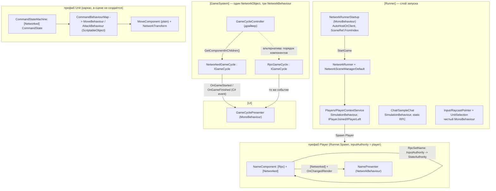

# Глава 07. Remote Procedure Calls

> **TL;DR для агента**
> - RPC в Fusion 2 — это **не** «вызов метода по сети», а **событие** с четырьмя обязательно заданными свойствами: кто имеет право отправить (`RpcSources`), кто исполнит (`RpcTargets`), по какому каналу (`RpcChannel`) и чем считается хост при отправке (`RpcHostMode`). Выписывай все четыре явно.
> - Доставлять изменение состояния можно двумя способами — `[Rpc]`-событием или `[Networked]`-полем. Эта глава даёт готовый стенд: один интерфейс `IGameCycle`, две взаимозаменяемые реализации (`RpcGameCycle` и `NetworkedGameCycle`), и правило выбора между ними.
> - Канонический рабочий паттерн — «сэндвич»: **RPC для команды (InputAuthority → StateAuthority), `[Networked]` для состояния**. Клиент не пишет стейт, он просит; расходится уже стейт.
> - Авторизацию внутри RPC делай по `this.Object.InputAuthority`, **никогда** по аргументам RPC: аргументы приходят от клиента, InputAuthority назначен сервером при `Spawn`.
> - RPC не бросает исключений — он **молча не отправляется** (`RpcSendCullResult.InsufficientSourceAuthority`). Поэтому возвращай `RpcInvokeInfo` и логируй его: без этого ошибка выглядит как «ничего не происходит».

Проект: Unity 2022.3.42f1, Photon Fusion **2.0.5 Stable 920** (`Assets/Photon/Fusion/build_info.txt`), режим `GameMode.AutoHostOrClient` (Host/Client, не Shared). Odin Inspector и ParrelSync установлены (`Assets/Plugins/Sirenix`, `Assets/Plugins/ParrelSync`).

---

## Какую проблему решает

В Host/Client-режиме StateAuthority на всём сетевом состоянии принадлежит хосту. Клиент физически не может записать `[Networked]`-поле так, чтобы запись дожила до следующего снапшота: локальная запись на клиенте произойдёт без ошибки, а затем будет перетёрта снапшотом от хоста. Это худший класс сетевого бага — он не падает, он **мигает**.

Отсюда два вопроса, на которые отвечает глава:

1. **Как клиенту выразить волю**, если писать стейт он не вправе. Ответ: `[Rpc(RpcSources.InputAuthority, RpcTargets.StateAuthority)]` — запрос к владельцу стейта.
2. **Как доставить до всех пиров факт изменения** — реплицировать состояние (`[Networked]`) или разослать событие (`[Rpc(..., RpcTargets.All)]`). Ответ зависит от одного свойства: нужен ли поздним подключениям и переподключениям этот факт. RPC — одноразовое событие, оно не переживает поздний вход; `[Networked]` — истина, которая реплицируется всегда, но занимает место в снапшоте постоянно.

Характерная деталь конфига раздела (`Assets/Photon/Fusion/Resources/NetworkProjectConfig.fusion`): `"InputDataWordCount": 0` при `_runner.ProvideInput = true` в коде. Структура `INetworkInput` **не используется вообще** — вся воля игрока в этом разделе доставляется RPC. Это сознательный учебный выбор: раздел изолирует RPC как единственный канал ввода.

---

## Модель мира: кто чем владеет

| Что | Где исполняется | Кто владеет |
|---|---|---|
| `[Networked]`-поля всех объектов | снапшот от хоста ко всем | **хост** (StateAuthority) |
| `Runner.Spawn` / `Runner.Despawn` / `SetPlayerObject` | только под `if (Runner.IsServer)` | хост |
| `FixedUpdateNetwork()` | у **всех** пиров (с ресимуляцией у клиентов) | — |
| `Spawned()` / `Despawned()` | у всех пиров, когда объект появился/исчез локально | — |
| `PlayerContextService.PlayerCount` | обычный C#-int, считается **локально у каждого пира** | ничей, не реплицируется |
| RPC `StateAuthority → All` | отправляет хост, исполняют все | хост |
| RPC `InputAuthority → StateAuthority` | отправляет владелец ввода, исполняет хост | клиент просит, хост решает |
| `transform` юнита | мутирует `MoveComponent` (plain MonoBehaviour) под симуляцией | реплицирует `NetworkTransform` |

Ключевое следствие: `FixedUpdateNetwork` драйвера игрового цикла исполняется у всех, включая клиентов, и у клиента `PlayerCount` может разойтись с хостовым. Поэтому **защита авторитета вынесена внутрь реализаций**, а не в драйвер (см. ниже «Политика авторитета у владельца стейта»).

По документации SDK (`Assets/Photon/Fusion/Assemblies/Fusion.Runtime.xml`):
- `RpcHostMode.SourceIsServer` — «If host invokes RPC `RpcInfo.Source` will be set to `PlayerRef.None` (default)».
- `RpcHostMode.SourceIsHostPlayer` — «Source will be set to the host's local player».
- `RpcAttribute.TickAligned` — «execution will be postponed until the local simulation catches up with the sender's Tick number… Default value is true».
- `RpcChannel.Reliable` — «order preserved, delivery verified, resend in case of a failed delivery»; `Unreliable` — «delivery not verified, no resend attempts».
- `RpcSendCullResult.InsufficientSourceAuthority` — «Send culled because source NetworkObject current authority does not match flags set in `RpcAttribute.Sources`». Именно поэтому неправомерный RPC не падает, а исчезает.

---

## Архитектура раздела



Четыре слоя:

- **System** — запуск, игровой цикл, игроки, локальный ввод, чат. Всё на сценных объектах `[Runner]` и `[GameSystem]`.
- **GameObject** — сущности (`Unit`) и компоненты-ядра (`HealthComponent`, `AttackComponent`, `TeamComponent`, `NameComponent`, `CommandStateMachine`).
- **UI** — презентеры (`GameCyclePresenter`, `NamePresenter`), подписчики на C#-события.
- **[Archive]** — предыдущие итерации. Важно: **два файла там живые и компилируются** — `IState.cs` и `CommandFSMDebug.cs` (последний даже висит в сцене). Остальное закомментировано целиком.

---

## Реализация по шагам

### Шаг 1. Запуск: Host/Client одним билдом

`Assets/Game/Scripts/System/NetworkRunnerStartup.cs`

```csharp
public sealed class NetworkRunnerStartup : MonoBehaviour
{
    [SerializeField] private NetworkSceneManagerDefault _sceneManager;
    [SerializeField] private NetworkRunner _runner;
    [SerializeField] private string _sessionName = "SampleSession";
    [SerializeField] private int _maxPlayers = 2;

    private void Start()
    {
        StartSimulation(GameMode.AutoHostOrClient);
    }

    private async void StartSimulation(GameMode gameMode)
    {
        _runner.ProvideInput = true;

        await _runner.StartGame(new StartGameArgs
        {
            GameMode = gameMode,
            SceneManager = _sceneManager,
            Scene = GetScene(),
            SessionName = _sessionName,
            PlayerCount = _maxPlayers
        });
    }

    private SceneRef GetScene()
    {
        int buildIndex = SceneManager.GetActiveScene().buildIndex;
        return SceneRef.FromIndex(buildIndex);
    }
}
```

**Почему именно так.** `Start()` не вызывает `StartGame` напрямую — он вызывает отдельный `async void StartSimulation`, потому что `Start()` не может быть `async` без возврата корутины, а `await StartGame` обязателен. Это обычный MonoBehaviour, а не `SimulationBehaviour`: рунера ещё нет, у объекта не может быть сетевого контекста. `_runner` и `_sceneManager` проброшены `[SerializeField]`, а не ищутся `FindObjectOfType` — порядок инициализации сцены становится детерминированным. `SceneRef.FromIndex(активная сцена)` вместо хардкода индекса: один скрипт работает в любой сцене проекта, и Fusion через `NetworkSceneManagerDefault` сам синхронизирует загрузку у клиентов.

⚠️ **Подводный камень, который надо знать.** В сцене (`Assets/Game/Scenes/SampleScene.unity`, блок `--- !u!114 &416808397`) сериализованы только `_sceneManager`, `_runner` и `_sessionName: SampleSession`. Ключа `_maxPlayers` в YAML **нет** — значение 2 берётся из инициализатора поля C#. При этом в `NetworkProjectConfig.fusion` стоит `"Simulation": { "PlayerCount": 10 }`. Если убрать `PlayerCount = _maxPlayers` из `StartGameArgs`, `SessionInfo.MaxPlayers` станет 10, и игровой цикл (который сравнивается именно с `MaxPlayers`) перестанет стартовать на двоих. Всегда задавай `PlayerCount` в `StartGameArgs`, если логика читает `SessionInfo.MaxPlayers`.

### Шаг 2. Player context object — адресат клиентских RPC

`Assets/Game/Scripts/System/Players/PlayerContextService.cs`

```csharp
public sealed class PlayerContextService : SimulationBehaviour, IPlayerJoined, IPlayerLeft
{
    [SerializeField] private NetworkPrefabRef _playerPrefab;

    public int PlayerCount { get; private set; }

    public NetworkObject LocalContext
    {
        get { return this.Runner.GetPlayerObject(this.Runner.LocalPlayer); }
    }

    public NetworkObject GetContext(PlayerRef player)
    {
        return this.Runner.GetPlayerObject(player);
    }

    void IPlayerJoined.PlayerJoined(PlayerRef player)
    {
        this.PlayerCount++;

        if (!this.Runner.IsServer)
            return;

        NetworkObject context = this.Runner.Spawn(_playerPrefab, Vector3.zero, Quaternion.identity, player);
        this.Runner.SetPlayerObject(player, context);
    }

    void IPlayerLeft.PlayerLeft(PlayerRef player)
    {
        this.PlayerCount--;

        if (!this.Runner.IsServer)
            return;

        NetworkObject context = this.Runner.GetPlayerObject(player);
        this.Runner.SetPlayerObject(player, null);
        this.Runner.Despawn(context);
    }
}
```

**Почему именно так.** Клиенту нужен сетевой объект, на котором он **легально обладает InputAuthority** — иначе его RPC с `RpcSources.InputAuthority` будут отбракованы на отправке. Четвёртый позиционный аргумент `Runner.Spawn(..., player)` — это `inputAuthority` (подтверждено сигнатурой `M:Fusion.NetworkRunner.Spawn(NetworkPrefabRef, Vector3?, Quaternion?, PlayerRef?, OnBeforeSpawned, NetworkSpawnFlags)` в `Fusion.Runtime.xml`). Без него клиент не сможет вызвать ни один свой RPC.

Три содержательных решения в порядке строк:

- `PlayerCount++` стоит **до** гейта `IsServer`, то есть счётчик ведётся локально у каждого пира — клиентскому UI он тоже нужен. ⚠️ Но это обычный C#-int, не `[Networked]`: он нигде не сверяется с сервером. Корректность на клиенте зависит от того, приходит ли `IPlayerJoined.PlayerJoined` позднему клиенту для уже подключённых игроков — это поведение Fusion, из кода не выводимое. Именно поэтому проверка авторитета **обязана** жить внутри реализации `IGameCycle`, а не в драйвере: если клиентский счётчик разойдётся, драйвер клиента попытается стартовать игру, и спасёт только внутренний гейт.
- В `PlayerLeft` сначала `SetPlayerObject(player, null)`, только потом `Despawn`. Иначе в реестре рунера остаётся ссылка на уничтожаемый объект.
- Интерфейсы реализованы явно (`void IPlayerJoined.PlayerJoined`), чтобы колбэки не торчали в публичном API сервиса. `IPlayerJoined`/`IPlayerLeft` — это выборочные колбэки: не надо реализовывать весь `INetworkRunnerCallbacks`. ⚠️ Работает только потому, что объект лежит в иерархии `NetworkRunner` — в сцене это дочерний `[Runner]/Players`; иначе `Runner` будет null.

Префаб `Player` (`Assets/Game/Prefabs/Player.prefab`) минимален: `NetworkObject` + `NameComponent` + `NamePresenter`, никакого `NetworkTransform`. Это чистый контейнер авторитета, а не «аватар».

### Шаг 3. Шов абстракции: `IGameCycle`

`Assets/Game/Scripts/System/GameCycle/IGameCycle.cs`

```csharp
public interface IGameCycle
{
    event Action OnGameStarted;
    event Action OnGameFinished;

    GameState State { get; }

    void StartGame();
    void FinishGame();

    bool IsWaiting() => this.State == GameState.Waiting;
    bool IsPlaying() => this.State == GameState.Playing;
    bool IsFinished() => this.State == GameState.Finished;
}
```

**Почему именно так.** Контракт намеренно включает **оба** способа чтения: события (push для UI) и свойство `State` (pull для логики) — именно эти два способа по-разному ведут себя у `[Networked]` и у RPC, и интерфейс обязывает каждую реализацию закрыть оба. Предикаты вынесены в default interface members (C# 8): реализация обязана отдать только `State`, производные вопросы получает бесплатно и одинаково — дублировать `IsWaiting` в двух классах было бы приглашением к расхождению.

`GameState` (`GameState.cs`) объявлен как `enum GameState : byte`. Явный размер — потому что это значение едет в снапшоте. Сравни: `CommandType : byte` (едет), а `CommandResult` — **без** `: byte`, потому что он никогда не покидает тик. Это дисциплина, которой стоит следовать: явный размер только у того, что попадает в сеть.

### Шаг 4. Реализация A — доставка через RPC

`Assets/Game/Scripts/System/GameCycle/RpcGameCycle.cs`

```csharp
public sealed class RpcGameCycle : NetworkBehaviour, IGameCycle
{
    public event Action OnGameStarted;
    public event Action OnGameFinished;
    public GameState State { get; private set; }

    public void StartGame() => this.RpcStartGame();

    public void FinishGame() => this.RpcFinishGame();

    [Rpc(
        RpcSources.StateAuthority,
        RpcTargets.All,
        Channel = RpcChannel.Reliable,
        HostMode = RpcHostMode.SourceIsServer,
        InvokeLocal = true,
        TickAligned = true
    )]
    private void RpcStartGame()
    {
        this.State = GameState.Playing;
        this.OnGameStarted?.Invoke();
    }

    [Rpc(
        RpcSources.StateAuthority,
        RpcTargets.All,
        Channel = RpcChannel.Reliable,
        HostMode = RpcHostMode.SourceIsServer,
        InvokeLocal = true,
        TickAligned = true
    )]
    private void RpcFinishGame()
    {
        this.State = GameState.Finished;
        this.OnGameFinished?.Invoke();
    }
}
```

**Почему именно так — параметр за параметром.**

- `RpcSources.StateAuthority` — отправить может только хост. Это **декларативный** аналог ручного `if (HasStateAuthority)`. Клиент, вызвавший `StartGame()`, получит culled-отправку (`InsufficientSourceAuthority`), а не исключение.
- `RpcTargets.All` — исполнят все пиры. `State` здесь **обычное C#-свойство**: состояние не реплицируется вообще, оно воспроизводится у каждого пира как побочный эффект доставленного события.
- `Channel = RpcChannel.Reliable` — обязательно. Потерянный пакет навсегда оставит часть клиентов в предыдущем состоянии: RPC, в отличие от `[Networked]`, не досылается следующим снапшотом. Для одноразового перехода `Waiting → Playing → Finished` `Unreliable` недопустим.
- `InvokeLocal = true` — без него хост, будучи источником, **не выполнит тело у себя**, и его собственный `State` останется `Waiting`. По доку: «Indicates if the method should be called locally (on the RPC caller). This happens immediately».
- `TickAligned = true` — исполнение откладывается, пока локальная симуляция не догонит тик отправителя. Для перехода состояния игры это правильно: все пиры применят его на одном и том же тике.
- `HostMode = RpcHostMode.SourceIsServer` — при вызове хостом `RpcInfo.Source` будет `PlayerRef.None`, то есть «от сервера». Это системное решение, а не поступок человека.

Публичные `StartGame`/`FinishGame` — обёртки, чтобы `IGameCycle` не знал про RPC. В архивном предке (`Assets/[Archive]/StateMachine/GameCycle.cs`) параметры `[Rpc]` побуквенно те же, но `[Button]` был навешен **прямо на RPC-метод** — переход дёргался руками из инспектора. Появление интерфейса убрало эту возможность: RPC стали приватными.

**Что сломается.** Поздний клиент, подключившийся когда игра уже `Playing`, не получит ни одного RPC и навсегда останется на `WaitingScreen`. У RPC-версии этой защиты нет и быть не может — это её принципиальный недостаток.

### Шаг 5. Реализация B — доставка через реплицируемое состояние

`Assets/Game/Scripts/System/GameCycle/NetworkedGameCycle.cs`

```csharp
public sealed class NetworkedGameCycle : NetworkBehaviour, IGameCycle
{
    public event Action OnGameStarted;
    public event Action OnGameFinished;

    public GameState State => this.StateBufferIsValid ? this.state : GameState.Waiting;

    [Networked, OnChangedRender(nameof(InvokeStateChanged))]
    private GameState state { get; set; }

    public override void Spawned()
    {
        this.InvokeStateChanged();
    }

    public void StartGame()
    {
        if (this.HasStateAuthority)
            this.state = GameState.Playing;
    }

    public void FinishGame()
    {
        if (this.HasStateAuthority)
            this.state = GameState.Finished;
    }

    private void InvokeStateChanged()
    {
        switch (this.state)
        {
            case GameState.Waiting: break;
            case GameState.Playing: this.OnGameStarted?.Invoke(); break;
            case GameState.Finished: this.OnGameFinished?.Invoke(); break;
            default: throw new ArgumentOutOfRangeException();
        }
    }
}
```

**Почему именно так.** Тот же интерфейс, но три вещи, которых у RPC-версии нет:

1. **`StateBufferIsValid`-гейт на чтение.** `[Networked]`-свойство нельзя читать, пока объект не получил валидный буфер состояния; результат — исключения или мусор. Дефолт выбран безопасный (`Waiting`), а не «похожий на правду». У RPC-версии этой проблемы нет вообще, потому что `State` — обычное поле. Это один из редких аргументов «за» RPC.
2. **Явная `HasStateAuthority` на запись.** Ручной аналог декларативного `RpcSources.StateAuthority`. Без него запись у клиента пройдёт тихо и будет перетёрта снапшотом.
3. **`this.InvokeStateChanged()` в `Spawned()`.** `OnChangedRender` срабатывает только на **изменение** значения и не вызывается для начального значения у позднего клиента. Без этой строки игрок, подключившийся в состоянии `Playing`, остался бы на экране ожидания. Это и есть «ручной прогон начального состояния».

Цена: `GameState` занимает место в снапшоте постоянно, даже когда игра не меняется.

⚠️ Про host migration: вывод «Networked-версия корректна при host migration» **ничем в проекте не подтверждён** — в конфиге стоит `"HostMigration": { "EnableAutoUpdate": false }`, и ни одной строки `HostMigrationToken`/`OnHostMigration` в коде нет. Подтверждается кодом только часть про **позднее подключение**.

### Шаг 6. Драйвер, который не знает про транспорт

`Assets/Game/Scripts/System/GameCycle/GameCycleController.cs`

```csharp
public sealed class GameCycleController : NetworkBehaviour
{
    private IGameCycle _gameCycle;

    [SerializeField] private PlayerContextService _playerService;

    private int _maxPlayers;

    public override void Spawned()
    {
        _gameCycle = this.Object.GetComponentInChildren<IGameCycle>();
        _maxPlayers = this.Runner.SessionInfo.MaxPlayers;
    }

    //State Authority
    public override void FixedUpdateNetwork()
    {
        if (_gameCycle.IsWaiting() && _playerService.PlayerCount == _maxPlayers)
            _gameCycle.StartGame();

        if (_gameCycle.IsPlaying() && _playerService.PlayerCount < _maxPlayers)
            _gameCycle.FinishGame();
    }
}
```

**Почему именно так.** Драйвер не содержит **ни одной** проверки авторитета. Это не упущение, а паттерн: политика авторитета принадлежит владельцу стейта, а не вызывающему коду. Если каждый вызывающий сам проверяет `IsServer`, проверку однажды забудут; если проверка живёт рядом с данными (`HasStateAuthority` внутри `NetworkedGameCycle` или `RpcSources.StateAuthority` у `RpcGameCycle`), забыть нельзя. Сравни с архивом (`Assets/[Archive]/StateMachine/GameCycleController.cs`), где контроллер начинался с `if (!this.Runner.IsServer) return;` и сравнивал с магическими константами `PlayerCount == 2` и `PlayerCount == 1` — при смене `PlayerCount` старая версия молча ломается.

`_maxPlayers` кэшируется в `Spawned()`, а не читается каждый тик: `Runner.SessionInfo.MaxPlayers` — единый источник истины вместо константы.

⚠️ Нюанс сцены: `[GameSystem]` (`--- !u!1 &1229943768`) — **корневой** объект с `m_Children: []`. Значит `GetComponentInChildren<IGameCycle>()` физически может найти компонент только на самом `[GameSystem]` — «InChildren» здесь косметика. Порядок компонентов в YAML: `NetworkObject`, `GameCycleController`, `NetworkedGameCycle`, `RpcGameCycle`; `NetworkedBehaviours` перечисляет ровно эти три в том же порядке. То есть **в сцене активна `NetworkedGameCycle`**, а переключение эксперимента — это перестановка/удаление компонента, не правка кода.

### Шаг 7. Презентер: событийная модель вместо polling

`Assets/Game/Scripts/UI/GameCyclePresenter.cs`

```csharp
public sealed class GameCyclePresenter : MonoBehaviour
{
    [SerializeField] private GameObject _gameContext;

    private IGameCycle _gameCycle;

    [SerializeField] private GameObject _waitingScreen;
    [SerializeField] private GameObject _finishScreen;

    private void Awake()
    {
        _waitingScreen.SetActive(true);
        _finishScreen.SetActive(false);
        _gameCycle = _gameContext.GetComponent<IGameCycle>();
    }

    private void OnEnable()
    {
        _gameCycle.OnGameStarted += this.OnGameStarted;
        _gameCycle.OnGameFinished += this.OnGameFinished;
    }
    // ... OnDisable — симметричная отписка
}
```

Сравни с `Assets/Game/Scripts/GameObject/View/NamePresenter.cs`:

```csharp
public sealed class NamePresenter : NetworkBehaviour
{
    [SerializeField] private NameComponent _nameComponent;

    public override void Spawned()
    {
        _nameComponent.OnStateChanged += this.OnNameChanged;
        this.OnNameChanged(_nameComponent.Name.Value);
    }

    public override void Despawned(NetworkRunner runner, bool hasState)
    {
        _nameComponent.OnStateChanged -= this.OnNameChanged;
    }
```

**Почему разные точки подписки.** `NamePresenter` — `NetworkBehaviour`, он подписывается в `Spawned()` и **сразу читает текущее значение** (`OnNameChanged(_nameComponent.Name.Value)`): `Awake`/`OnEnable` для сетевых компонентов наступают раньше, чем приходит стейт, подписка там означает пропущенное первое значение. `GameCyclePresenter` — обычный MonoBehaviour, он не имеет `Spawned()`, поэтому работает через `OnEnable`/`OnDisable` и **полагается на то, что реализация сама прогонит состояние** (`NetworkedGameCycle.Spawned()`).

Разрешение зависимости тоже асимметрично: контроллер делает `GetComponentInChildren` в `Spawned()` (рунер уже есть), презентер — `GetComponent` в `Awake()` (до старта рунера). Работает это только потому, что `GetComponent<IGameCycle>()` ищет **сам объект-компонент**, который существует с момента загрузки сцены, а не его сетевое состояние.

⚠️ Отброшенная альтернатива в хвосте файла (закомментированный `Update()`) начинается с `if (!_gameCycle.StateBufferIsValid) return;`. Но `_gameCycle` имеет тип `IGameCycle`, а `StateBufferIsValid` — свойство `Fusion.NetworkBehaviour`, в интерфейсе его нет. Этот код **не скомпилировался бы** против текущего интерфейса: он писался, когда поле было типизировано конкретным `NetworkedGameCycle`. Урок шире, чем «polling заменили на события»: введение абстракции физически отрезало доступ к сетевым деталям — и это признак, что абстракция выбрана правильно.

### Шаг 8. Сэндвич: RPC для команды, `[Networked]` для состояния

`Assets/Game/Scripts/GameObject/Core/NameComponent.cs`

```csharp
public sealed class NameComponent : NetworkBehaviour
{
    public event Action<string> OnStateChanged;

    [Networked, OnChangedRender(nameof(InvokeOnStateChanged))]
    public NetworkString<_16> Name { get; private set; }

    [Rpc(
        RpcSources.InputAuthority,
        RpcTargets.StateAuthority,
        Channel = RpcChannel.Reliable,
        InvokeLocal = true,
        TickAligned = false
    )]
    public RpcInvokeInfo RpcSetName(NetworkString<_16> name)
    {
        this.Name = name;
        return default;
    }

    private void InvokeOnStateChanged()
    {
        this.OnStateChanged?.Invoke(this.Name.Value);
    }

    [Button]
    private void DebugSetName(string name)
    {
        RpcInvokeInfo invokeInfo = this.RpcSetName(name);
        Debug.Log(invokeInfo);
    }
}
```

**Почему именно так — это главный паттерн главы.** Клиент с InputAuthority **просит**, хост **пишет**, реплика расходится через `[Networked]`, презентер рендерит через событие. Четыре следствия:

- Пара `RpcSources.InputAuthority` / `RpcTargets.StateAuthority` — это **модель безопасности**, а не оптимизация. Клиент не может переименовать чужой `Player`-объект, потому что у него нет на нём InputAuthority, и отправка будет culled.
- Сеттер `Name { get; private set; }` **приватный**. Никто, кроме тела RPC, записать его не может — правило авторитета защищено механически, а не договорённостью.
- `TickAligned = false` здесь (против `true` у игрового цикла): имя не влияет на симуляцию, важна минимальная задержка. Для игровой механики так делать нельзя — несогласованный тик применения даёт рассинхрон.
- `InvokeLocal = true`: хост-игрок, вызвав `RpcSetName` на своём объекте, выполнит тело локально — он же и StateAuthority.

**Контрпример в том же проекте.** `Assets/Game/Scripts/GameObject/Core/Life/HealthComponent.cs`:

```csharp
public sealed class HealthComponent : NetworkBehaviour
{
    [Networked]
    public int Health { get; set; }

    public void TakeDamage(int damage)
    {
        if (this.Health <= 0)
            return;

        this.Health = Mathf.Max(0, this.Health - damage);
    }

    public bool IsEmpty() => this.Health == 0;   // тело сокращено
}
```

Сеттер **публичный**, а `TakeDamage` пишет `Health` без всякой проверки авторитета. Корректность держится исключительно на том, что `TakeDamage` вызывается только из `AttackBehaviour`, который запускается из `CommandStateMachine.FixedUpdateNetwork`. Любой UI-скрипт мог бы вызвать `TakeDamage` на клиенте и получить тихую локальную запись, перетираемую снапшотом. **Делай как `NameComponent`, не как `HealthComponent`:** приватный сеттер — это и есть механическая защита правила авторитета.

### Шаг 9. Объектно-независимый канал: статический RPC

`Assets/Game/Scripts/System/SampleChat.cs`

```csharp
public sealed class SampleChat : SimulationBehaviour //NetworkBehaviour
{
    [Button]
    public void TestSendMessageToServer(string message)
    {
        RpcInvokeInfo invokeInfo = RpcSendMessageTo(this.Runner, PlayerRef.None, message);
        Debug.Log(invokeInfo);
    }

    [Rpc(
        Channel = RpcChannel.Unreliable,
        InvokeLocal = false,
        TickAligned = true,
        HostMode = RpcHostMode.SourceIsHostPlayer
    )]
    public static RpcInvokeInfo RpcSendMessageAll(NetworkRunner runner, NetworkString<_16> message, RpcInfo info = default)
    {
        Debug.Log($"{info}: {message}");
        return default;
    }

    [Rpc(
        Channel = RpcChannel.Unreliable,
        InvokeLocal = true,
        TickAligned = true,
        HostMode = RpcHostMode.SourceIsHostPlayer
    )]
    public static RpcInvokeInfo RpcSendMessageTo(
        NetworkRunner runner,
        [RpcTarget]
        PlayerRef player,
        NetworkString<_16> message,
        RpcInfo info = default
    )
    {
        Debug.Log($"{info}: {message}");
        return default;
    }
}
```

**Почему именно так — четыре урока в одном файле.**

1. **RPC без `NetworkObject`.** По доку SDK: «Static RPCs can be implemented on `SimulationBehaviour`s, and do not require a `NetworkObject` instance. Static RPC require the first argument to be NetworkRunner». Чат, лобби-сообщения, системные уведомления не должны зависеть от жизни какой-то сущности и не должны занимать сетевой стейт. Комментарий `//NetworkBehaviour` рядом с базовым классом фиксирует отвергнутую альтернативу.
2. **`[RpcTarget] PlayerRef` — адресат задаётся аргументом, а не атрибутом.** Поэтому `RpcTargets` в атрибуте не указан вообще: один метод обслуживает и личное сообщение, и запрос к серверу. ⚠️ Что `PlayerRef.None` означает «серверу» — это **вывод** из имени метода `TestSendMessageToServer`; XML-док `T:Fusion.RpcTargetAttribute` говорит только «RPC is sent to the server, and then is forwarded to the specified player», про `None` там ничего.
3. **`Unreliable` для чата.** Потеря одной реплики сообщения приемлема и не стоит того, чтобы занимать надёжный поток, который нужен состоянию. Выбор канала — это всегда решение «что страшнее: потерять или задержать».
4. **`HostMode = SourceIsHostPlayer`** — сообщение хоста должно прийти «от игрока», а не «от сервера»: получатель увидит в `RpcInfo.Source` локального игрока хоста, а не `PlayerRef.None`.

**Диагностика как обязательная практика.** Все отправляющие методы объявлены с возвратом `RpcInvokeInfo` и вызываются как `RpcInvokeInfo info = Rpc...(); Debug.Log(info)`; принимающая сторона логирует `RpcInfo info`. Это не украшение: RPC, нарушивший `RpcSources`, не бросает исключение — он culled (`RpcSendCullResult.InsufficientSourceAuthority`). Без логирования это выглядит как «ничего не происходит». Триггеры вынесены в Odin `[Button]` — ручное тестирование сетевого кода без UI.

Отброшенные итерации полезны:
- `Assets/[Archive]/StateMachine/SampleChat.cs` логировал `Debug.Log($"CURRENT TICK {runner.Tick}");` **внутри тела RPC** — самый прямой способ увидеть, на каком тике исполняется RPC с `TickAligned = true`. Возьми этот приём при отладке.
- `Assets/[Archive]/StateMachine/Chat.cs` закомментирован целиком, потому что содержит **два** метода `Rpc_SendMessageAll`, различающихся только возвращаемым типом и необязательным `RpcInfo info = default` — конфликт перегрузок. Правило подписи RPC: `RpcInvokeInfo` как возврат и `RpcInfo info = default` как последний параметр — это варианты одной сигнатуры, а не отдельная перегрузка.
- Там же `PlayerRef.FromEncoded(playerId)` против живого `PlayerRef.FromIndex(playerId)`. Перепутав Index и Encoded, получишь доставку не тому игроку.

### Шаг 10. Клиент → сервер: команда юнитам (каркас в `[Archive]`)

`Assets/[Archive]/StateMachine/Player/PlayerUnitManager.cs` (закомментирован целиком)

```csharp
// public sealed class PlayerUnitManager : NetworkBehaviour
// {
//     [Rpc(RpcSources.InputAuthority, RpcTargets.StateAuthority)]
//     public void RpcSpawnUnit(Vector3Compressed position)
//     {
//         UnitSpawner unitSpawner = this.Runner.GetBehaviour<UnitSpawner>();
//         unitSpawner.SpawnUnit(position, this.Object.InputAuthority);
//     }
//
//     [Rpc(RpcSources.InputAuthority, RpcTargets.StateAuthority)]
//     public void RpcExecuteCommand(NetworkObject[] units, CommandState command)
//     {
//         foreach (NetworkObject unit in units)
//             if (unit.GetBehaviour<TeamComponent>().Team == this.Object.InputAuthority)
//                 unit.GetComponent<CommandStateMachine>().ChangeCommand(command);
//     }
// }
```

**Почему именно так — самый важный фрагмент архива.** Это отсутствующее в активном коде звено «ввод → сетевое действие», и в нём два урока.

1. RPC принимает `NetworkObject[]` и `INetworkStruct`: Fusion сериализует объекты как сетевые идентификаторы, то есть пакетная команда на выделенную группу уходит **одним** вызовом вместо N.
2. **Авторизация делается по `this.Object.InputAuthority`, а не по аргументам.** Клиент физически может прислать чужих юнитов — сравнение с `TeamComponent.Team` отбрасывает их на сервере. Убери эту проверку, и любой клиент командует армией противника. Спавн тоже идёт через RPC к StateAuthority, а владелец проставляется из `InputAuthority` объекта-контекста, не из параметра.

Почему вообще RPC, а не прямой вызов `ChangeCommand`? Потому что `CommandStateMachine._command` — `[Networked]`, и прямая запись на клиенте была бы записью в стейт, которым он не владеет.

Парный архивный файл `Assets/[Archive]/StateMachine/InputController.cs` показывает границу доверия:

```csharp
//     private void AttackTarget(GameObject target)
//     {
//         if (!target.TryGetComponent(out NetworkObject targetObject))
//             return;
//
//         if (target.GetComponent<TeamComponent>().Team == this.Runner.LocalPlayer)
//             return;
//
//         if (!target.TryGetComponent(out HealthComponent healthComponent) || healthComponent.IsEmpty())
//             return;
//
//         NetworkObject playerContext = _playerService.LocalContext;
//         PlayerUnitManager unitManager = playerContext.GetBehaviour<PlayerUnitManager>();
//
//         CommandState command = CommandState.New(CommandType.Attack, targetObject.Id);
//         unitManager.RpcExecuteCommand(_unitSelection.SelectedUnits, command);
//     }
```

Клиент делает **всю дешёвую валидацию** у себя — чтобы не гонять заведомо бессмысленные RPC и мгновенно давать фидбек. Но это **не замена** серверной проверки: те же факты заново проверяются в `AttackBehaviour` на стороне StateAuthority. Клиентская валидация — для трафика и отзывчивости, серверная — для корректности; путать их нельзя. В сеть уходит `targetObject.Id` (`NetworkId`), а не ссылка, и RPC вызывается на `LocalContext` — объекте, где у клиента есть InputAuthority.

⚠️ Соответствующий `UnitSpawner` (`Assets/[Archive]/StateMachine/Unit/UnitSpawner.cs`) содержит приём, которого больше нигде в разделе нет:

```csharp
//         public void SpawnUnit(Vector3 position, PlayerRef player)
//         {
//             this.Runner.Spawn(_unitPrefab, position, Quaternion.identity, onBeforeSpawned:
//                 (_, o) => o.GetBehaviour<TeamComponent>().Team = player);
//         }
```

`onBeforeSpawned` — канонический способ инициализировать `[Networked]`-поле **до** репликации объекта и до вызова `Spawned()`. Иначе клиенты успеют увидеть объект с дефолтным `Team`, и `ColorComponent.Spawned()` покрасит его неверно, а `TeamComponent.Spawned()` назовёт «Unit0». Обрати внимание: четвёртый позиционный аргумент (inputAuthority) здесь **не передан** — юнит не принадлежит игроку по InputAuthority, владение моделируется только `TeamComponent.Team`. Именно поэтому `RpcExecuteCommand` обязан сверять `Team == this.Object.InputAuthority`: доверенная личность берётся с объекта-контекста игрока, а не с юнита.

### Шаг 11. Одно сетевое поле-«вариант» вместо поля на каждую команду

`Assets/Game/Scripts/GameObject/Core/Command/CommandState.cs`

```csharp
[Serializable]
public unsafe struct CommandState : INetworkStruct
{
    private const int CUSTOM_DATA_SIZE = 32;

    public CommandType type;
    public fixed byte customData[CUSTOM_DATA_SIZE];

    public readonly ref T CustomData<T>() where T : unmanaged
    {
        AssertSize<T>();
        fixed (byte* ptr = this.customData)
            return ref *(T*) ptr;
    }

    private static void AssertSize<T>() where T : unmanaged
    {
        if (sizeof(T) > sizeof(byte) * CUSTOM_DATA_SIZE)
            throw new ArgumentOutOfRangeException(nameof(T), $"Struct {typeof(T).Name} too large for custom data.");
    }

    public static CommandState New<T>(CommandType type, T data) where T : unmanaged
    {
        var state = new CommandState();
        state.type = type;
        state.CustomData<T>() = data;
        return state;
    }

    public bool Equals(CommandState other)
    {
        if (this.type != other.type)
            return false;

        for (int i = 0; i < CUSTOM_DATA_SIZE; i++)
            if (this.customData[i] != other.customData[i])
                return false;

        return true;
    }
    // ... Equals(object), GetHashCode(), операторы ==/!=, перегрузка New(CommandType)
}
```

**Почему именно так.** В сетевом стейте нельзя хранить ссылки, managed-объекты и структуры переменного размера — отсюда тег `type` плюс фиксированные 32 байта нагрузки. Для `Move` туда ложится `Vector3Compressed`, для `Attack` — `NetworkId`. `CustomData<T>()` возвращает `ref` поверх того же буфера, поэтому и запись (`state.CustomData<T>() = data`), и чтение идут без копирования. `AssertSize<T>()` — страховка от молчаливой порчи соседних байт при добавлении новой, более крупной команды.

Альтернатива («по `[Networked]`-полю на каждый тип команды») плохая потому, что каждое `[Networked]`-поле стоит места в снапшоте у каждого объекта **всегда**, даже когда не используется. Юниту нужна ровно одна активная команда.

Ручной `Equals` обходит буфер побайтово, потому что автоматическое сравнение `fixed`-поля сравнило бы указатель, а не содержимое. Без него сброс команды (`_command = new CommandState()`) и сравнение состояний работали бы неверно.

`Vector3Compressed` вместо сырого `Vector3`: сырой влез бы в 32 байта, но стоил бы 12 байт сетевого стейта на каждый юнит на каждый тик. ⚠️ Живая запись `Vector3Compressed` в `customData` есть только в `Assets/[Archive]/StateMachine/CommandFSMDebug.cs` (`Vector3Compressed destination = position; CommandState command = CommandState.New(CommandType.Move, destination);`) и в закомментированном `InputController.cs`. `MoveBehaviour.cs` только **читает**: `Vector3 destination = state.CustomData<Vector3Compressed>();`.

### Шаг 12. Машина состояний, stateless-поведения и таймеры

`Assets/Game/Scripts/GameObject/Core/Command/CommandStateMachine.cs`

```csharp
public sealed class CommandStateMachine : NetworkBehaviour
{
    [Networked]
    private CommandState _command { get; set; }

    [SerializeField]
    private CommandBehaviourMap _behaviourMap;

    public void ChangeCommand(CommandState state) => _command = state;

    public void ResetCommand() => _command = new CommandState();

    public override void FixedUpdateNetwork()
    {
        CommandType commandType = _command.type;
        if (commandType == CommandType.None)
            return;

        CommandBehaviour behaviour = _behaviourMap.GetBehaviour(commandType);
        CommandResult result = behaviour.FixedUpdateNetwork(this.gameObject, _command, this.Runner);
        if (result == CommandResult.Finished)
            _command = new CommandState();
    }
}
```

**Почему именно так.** Сетевая стейт-машина сведена к **одному** `[Networked]`-полю и таблице stateless-поведений. Класс не хранит ни текущего объекта-состояния, ни кэша: всё, что определяет поведение юнита, лежит в реплицируемом `CommandState`, поэтому поведение воспроизводимо при ресимуляции и одинаково у всех пиров. `CommandType.None` — значение 0, то есть `default`-struct это и есть «нет команды», и сброс — просто `new CommandState()`.

Сравни с живым, но несетевым `Assets/[Archive]/StateMachine/IState.cs`:

```csharp
public interface IState
{
    void Enter();
    void Update(float deltaTime);
    void Exit();
}
```

⚠️ Этот файл **компилируется** (он не закомментирован), но ни одна реализация ему не соответствует: закомментированные `FollowState`/`PatrolState` реализуют старую сигнатуру `Enter(GameObject entity)`/`Update(GameObject entity, float)`, а `MoveState` — новую. Для сети объектная FSM не годится принципиально: её состояние — managed-объект, реплицировать его нечем.

`CommandBehaviour` — абстрактный `ScriptableObject`, все параметры по `in`:

```csharp
public abstract class CommandBehaviour : ScriptableObject
{
    public abstract CommandResult FixedUpdateNetwork(
        in GameObject entity,
        in CommandState state,
        in NetworkRunner runner
    );
}
```

Логика команды не должна жить в сетевом компоненте (его стейт реплицируется) и не должна быть `switch`-ем, растущим с каждой командой. ScriptableObject-поведение — общий для всех юнитов неизменяемый объект, настраиваемый из инспектора. `in` — ноль копирований struct-а на тик.

⚠️ `CommandBehaviourMap` содержит **два** метода: безопасный `TryGetBehaviour` и бросающий `GetBehaviour` с `throw new Exception($"Command behaviour of type {type} is not found!")`. `TryGetBehaviour` нигде не используется, а машина вызывает именно бросающий. Следствие: добавил новый `CommandType`, забыл строку в `BehaviourMap.asset` — и исключение летит **каждый тик внутри `FixedUpdateNetwork` у всех пиров**. В `Assets/Game/Configs/StateMachine/BehaviourMap.asset` ровно две записи: `type: 1` (Move) и `type: 2` (Attack). Для `type: 0` записи нет — и не нужна, потому что машина выходит по `if (commandType == CommandType.None) return;` **до** обращения к карте. Это и есть причина, по которой `None` обязан быть нулём.

`Assets/Game/Scripts/GameObject/Core/Attack/AttackBehaviour.cs`

```csharp
public override CommandResult FixedUpdateNetwork(
    in GameObject entity,
    in CommandState state,
    in NetworkRunner runner
)
{
    NetworkId targetId = state.CustomData<NetworkId>();
    if (!targetId.IsValid)
        return CommandResult.Finished;

    if (!runner.TryFindObject(targetId, out NetworkObject target))
        return CommandResult.Finished;

    if (target.GetComponent<HealthComponent>().IsEmpty())
        return CommandResult.Finished;

    Vector3 myPosition = entity.transform.position;
    Vector3 targetPosition = target.transform.position;
    Vector3 distance = targetPosition - myPosition;

    if (distance.sqrMagnitude > _stoppingDistance * _stoppingDistance)
        entity.GetComponent<MoveComponent>().Move(distance.normalized, runner.DeltaTime);
    else
        entity.GetComponent<AttackComponent>().Attack(target);

    return CommandResult.Running;
}
```

**Почему именно так.** Три уровня защиты при работе с сетевой ссылкой, и **ни один не бросает исключение** — все возвращают `Finished`, и машина чисто сбрасывает команду: (1) `NetworkId.IsValid`, (2) `Runner.TryFindObject` (цель могла быть задеспавнена между тиками у этого пира), (3) «цель жива». Передача `NetworkId`, а не ссылки, — единственный способ адресовать объект в реплицируемом стейте. `runner.DeltaTime`, не `Time.deltaTime`: при ресимуляции одного и того же тика `Time.deltaTime` даст разную дистанцию → рассинхрон позиций. `sqrMagnitude` без корня.

Самозавершающаяся команда — обязательна: иначе юнит, дошедший до цели или потерявший её, продолжает «выполнять» команду каждый тик, а сетевой стейт никогда не возвращается в `None`, и это видно всем.

`Assets/Game/Scripts/GameObject/Core/Attack/AttackComponent.cs`

```csharp
    [Networked]
    private TickTimer cooldown { get; set; }

    public void Attack(NetworkObject target)
    {
        Vector3 distance = target.transform.position - this.transform.position;
        this.transform.rotation = Quaternion.LookRotation(distance.normalized);

        if (!this.cooldown.ExpiredOrNotRunning(this.Runner))
            return;

        if (target.TryGetComponent(out HealthComponent healthComponent))
            healthComponent.TakeDamage(this.damage);

        this.cooldown = TickTimer.CreateFromSeconds(this.Runner, _cooldown);
    }
```

**Почему именно так.** Кулдаун — `[Networked] TickTimer`, а не `float`-таймер: `TickTimer` оперирует номерами тиков, поэтому при ресимуляции (rollback и повторный прогон тиков) решение «можно ли бить» воспроизводится ровно так же и урон не удваивается. `ExpiredOrNotRunning` корректно трактует «таймер ещё ни разу не запускали» как «можно». Порядок операций значим: поворот к цели выполняется **до** проверки кулдауна (визуально юнит смотрит на врага всё время), урон и перезапуск таймера — после.

Смерть — отдельная фаза тика, `Assets/Game/Scripts/GameObject/Content/Unit.cs`:

```csharp
    public override void FixedUpdateNetwork()
    {
        if (this.HasStateAuthority)
            if (_healthComponent.IsEmpty())
                this.Runner.Despawn(this.Object);
    }
```

`Despawn` внутри `HealthComponent.TakeDamage` уничтожил бы объект посреди обхода поведений FSM. ⚠️ Фазовость обеспечена **порядком в `NetworkedBehaviours` префаба** `Unit.prefab`: `NetworkTransform`, `CommandStateMachine`, `HealthComponent`, `AttackComponent`, `TeamComponent`, `Unit`, `ColorComponent`. FSM отрабатывает раньше проверки смерти в пределах одного тика. Переставь `Unit` выше `CommandStateMachine` — и юнит будет умирать до того, как успеет ударить.

`MoveComponent` — намеренно **plain MonoBehaviour**, его нет в `NetworkedBehaviours`:

```csharp
public sealed class MoveComponent : MonoBehaviour
{
    [SerializeField] private float _speed = 5.0f;

    public void Move(Vector3 direction, float deltaTime)
    {
        this.transform.position += direction * (_speed * deltaTime);
        this.transform.rotation = Quaternion.LookRotation(direction, Vector3.up);
    }
}
```

Он только **мутирует** `transform`; **реплицирует** его `NetworkTransform` на том же префабе. Если бы компонент движения стал `NetworkBehaviour` с `[Networked]`-позицией, он начал бы конкурировать с `NetworkTransform` и дублировать трафик. Отвергнутые версии с `[Networked] direction`/`required` сохранены в хвосте файла и в `[Archive]/AutoMoveComponent.cs`.

Наконец, `Assets/Game/Scripts/GameObject/Core/Color/ColorComponent.cs` — приём «локальное представление сетевого состояния»:

```csharp
    public override void Spawned()
    {
        _renderer.material.color = _teamComponent.Team == this.Runner.LocalPlayer ? Color.blue : Color.red;
    }
```

Одно и то же реплицированное `Team` рендерится **по-разному на каждом пире**, потому что сравнивается с `Runner.LocalPlayer`. Цвет не реплицируется и не должен — иначе у всех был бы один «свой» цвет. Это `NetworkBehaviour` **без единого `[Networked]`-поля**, и он всё равно внесён в `NetworkedBehaviours` (на дочернем `<View>`): сетевой компонент нужен здесь только ради колбэка `Spawned()`, когда `Team` уже валиден. ⚠️ Используется `.material`, а не `.sharedMaterial` — на каждый юнит создаётся копия материала.

`TeamComponent` там же читает `[Networked] Team` в `Spawned()` **без** гейта `StateBufferIsValid` (`this.name = "Unit" + this.Team;`), хотя его же свойство `PlayerId => this.StateBufferIsValid ? Team.PlayerId : -1` гейт имеет. Вывод автора: в `Spawned()` буфер уже валиден, защита нужна только для инспектора/UI. Переименование GameObject — приём отладки сетевого владения прямо в иерархии.

---

## Fusion API этой главы

| API | Что делает | Где вызывается | Подводный камень |
|---|---|---|---|
| `[Rpc(RpcSources.StateAuthority, RpcTargets.All, Channel=Reliable, HostMode=SourceIsServer, InvokeLocal=true, TickAligned=true)]` | Широковещательное системное событие от хоста | `RpcGameCycle.RpcStartGame/RpcFinishGame` | Без `InvokeLocal=true` хост не выполнит тело у себя; без `Reliable` потерянный пакет навсегда разведёт состояния |
| `[Rpc(RpcSources.InputAuthority, RpcTargets.StateAuthority, Channel=Reliable, InvokeLocal=true, TickAligned=false)]` | Запрос клиента к владельцу стейта | `NameComponent.RpcSetName` | `TickAligned=false` допустим только для вещей, не влияющих на симуляцию |
| `static RpcInvokeInfo Rpc...(NetworkRunner runner, ...)` | RPC без `NetworkObject` на `SimulationBehaviour` | `SampleChat` | Первый параметр обязан быть `NetworkRunner`; `RpcInvokeInfo`-возврат и `RpcInfo info = default` — это одна сигнатура, не перегрузка |
| `[RpcTarget] PlayerRef player` | Адресная доставка аргументом | `SampleChat.RpcSendMessageTo` | `RpcTargets` в атрибуте не указывается; что `PlayerRef.None` = «серверу» — вывод, в XML-доке этого нет |
| `RpcChannel.Reliable` / `Unreliable` | Надёжная / ненадёжная доставка | цикл и имя / чат | «Что страшнее: потерять или задержать». Для одноразового перехода состояния `Unreliable` недопустим |
| `RpcHostMode.SourceIsServer` / `SourceIsHostPlayer` | Чем считается хост-пир: `RpcInfo.Source` = `PlayerRef.None` или локальный игрок хоста | цикл / чат | Поставь циклу `SourceIsHostPlayer`, и фильтр `RpcSources.StateAuthority` может не совпасть (вывод) |
| `RpcInvokeInfo` / `RpcInfo info = default` | Диагностика: отправился ли вызов / от кого пришёл | `SampleChat`, `NameComponent.DebugSetName` | RPC молча culled при нарушении `RpcSources` — без лога не найти |
| `[Networked, OnChangedRender(nameof(M))]` | Fusion зовёт `M` при изменении значения на стороне рендера | `NetworkedGameCycle.state`, `NameComponent.Name` | Не вызывается для начального значения у позднего клиента → нужен ручной прогон в `Spawned()` |
| `StateBufferIsValid` | Валиден ли буфер сетевого состояния | `NetworkedGameCycle.State`, `TeamComponent.PlayerId` | Чтение `[Networked]` без него из инспектора/UI → исключения и мусор |
| `HasStateAuthority` | Ручной гейт записи | `NetworkedGameCycle.StartGame/FinishGame`, `Unit.FixedUpdateNetwork` | Отсутствие гейта даёт «тихую» локальную запись, перетираемую снапшотом — баг, который мигает, а не падает |
| `Runner.Spawn(prefab, pos, rot, player)` | 4-й аргумент = `inputAuthority` | `PlayerContextService.PlayerJoined` | Только под `if (Runner.IsServer)`; без `inputAuthority` клиентские RPC на объекте не пройдут |
| `Runner.Spawn(..., onBeforeSpawned: ...)` | Инициализация `[Networked]` до репликации | `[Archive]/UnitSpawner` | Без него клиенты увидят дефолтное значение и покрасят/назовут объект неверно |
| `Runner.SetPlayerObject` / `GetPlayerObject` | Реестр «игрок → его контекстный объект» | `PlayerContextService` | На выходе: сначала `SetPlayerObject(player, null)`, потом `Despawn` |
| `IPlayerJoined` / `IPlayerLeft` | Выборочные колбэки без всего `INetworkRunnerCallbacks` | `PlayerContextService` | Объект должен быть в иерархии `NetworkRunner`, иначе `Runner` = null |
| `Runner.SessionInfo.MaxPlayers` | Размер матча как источник истины | `GameCycleController.Spawned` | Равен `StartGameArgs.PlayerCount`; если его не задать, подставится `Simulation.PlayerCount` из конфига (здесь 10) |
| `SceneRef.FromIndex(buildIndex)` | Сцена для `StartGameArgs` | `NetworkRunnerStartup.GetScene` | Берётся активная, не хардкод — скрипт переносим |
| `NetworkString<_16>` | Сетевая строка фиксированной длины | `NameComponent` (и `[Networked]`, и параметр RPC), `SampleChat` (только параметр) | 16 символов жёстко; обычный `string` в `[Networked]`/RPC не сериализуется |
| `INetworkStruct` + `fixed byte[32]` + `ref T CustomData<T>()` | Сетевой struct-«вариант» | `CommandState` | Нужны ручные `Equals`/`GetHashCode`/операторы: автосравнение `fixed`-поля сравнит не содержимое |
| `Vector3Compressed` | Сжатая позиция в нагрузке команды | `[Archive]/CommandFSMDebug`, `[Archive]/InputController`; читается в `MoveBehaviour` | Сырой `Vector3` — 12 байт стейта на юнит на тик |
| `NetworkId` + `Runner.TryFindObject` | Адресация объекта в реплицируемом стейте | `AttackBehaviour` | Может вернуть `false` (цель задеспавнена) — возвращай `Finished`, не бросай |
| `TickTimer.CreateFromSeconds` / `ExpiredOrNotRunning` | Детерминированный по тикам кулдаун | `AttackComponent` | `Time.time` при rollback удвоит или потеряет урон |
| `FixedUpdateNetwork()` + `Runner.DeltaTime` | Симуляция | везде | `Time.deltaTime` в FUN даёт разную дистанцию при ресимуляции |
| `Runner.Despawn(this.Object)` | Удаление объекта владельцем стейта | `Unit.FixedUpdateNetwork` под `HasStateAuthority` | Despawn в точке нанесения урона уничтожит объект посреди обхода FSM |
| `Spawned()` / `Despawned(runner, hasState)` | Жизненный цикл сетевой подписки | `NamePresenter`, `ColorComponent`, `TeamComponent` | `Awake`/`OnEnable` наступают до прихода стейта → пропущенное первое значение |

---

## Настройки, без которых не работает

**`Assets/Photon/Fusion/Resources/NetworkProjectConfig.fusion`** (дословно):

- `"PeerMode": 0` — одно-пировый режим. Два инстанса запускаются **только через ParrelSync** (`Assets/Plugins/ParrelSync`), не через multi-peer.
- `"Simulation": { "InputDataWordCount": 0, "PlayerCount": 10, "ReplicationFeatures": 1, "InputTransferMode": 0, "TickRateSelection": { "Client": 64, ... } }` — структура `INetworkInput` не используется; тик 64. ⚠️ `PlayerCount: 10` конфликтует с `_maxPlayers = 2` из кода: в `SessionInfo.MaxPlayers` попадёт 2 только потому, что `StartGameArgs.PlayerCount` задан явно.
- `"LagCompensation": { "Enabled": false }` — хитбоксов и рейкаст-стрельбы в разделе нет.
- `"CheckRpcAttributeUsage": false` — проверка `[Rpc]` weaver-ом отключена. ⚠️ Вывод (не факт из кода): при этом неверный `RpcSources`/`RpcTargets` проявится только в рантайме, culled-отправкой. Держи `true`, пока учишься.
- `"NullChecksForNetworkedProperties": true`, `"CheckNetworkedPropertiesBeingEmpty": false`, `"EnqueueIncompleteSynchronousSpawns": false`, `"InvokeRenderInBatchMode": true`.
- `"HostMigration": { "EnableAutoUpdate": false, "UpdateDelay": 10 }` — host migration не настроен и в коде не используется.
- `"AssembliesToWeave": [ "Fusion.Unity", "Assembly-CSharp", "Assembly-CSharp-firstpass", "Fusion.Addons.Physics", "Fusion.Addons.FSM" ]` — ⚠️ **последние две записи мёртвые**: в `Assets/Photon/` лежат только `Fusion`, `FusionDemos`, `FusionMenu`, `PhotonLibs`; аддоны не установлены. Наличие `Fusion.Addons.FSM` показательно: официальный FSM-аддон рассматривался и был отклонён в пользу собственного `CommandState`.

**Сцена `Assets/Game/Scenes/SampleScene.unity`** — во всей сцене **ни одного prefab instance** (ни `!u!1001`): ни `Unit`, ни `Player` в сцене не лежат, оба создаются только через `Runner.Spawn`.

- `[Runner]` (корневой): `NetworkRunner` + `NetworkSceneManagerDefault` (`IsSceneTakeOverEnabled: 1`) + `NetworkRunnerStartup` (`_sessionName: SampleSession`). Дети: `Input` (`RaycastPointer` с `_layerMask: m_Bits: 55`, `_maxDistance: 200`; `UnitSelection` с `_selectedUnits: []`), `Players` (`PlayerContextService`, `_playerPrefab.RawGuidValue: e4c5d1a8c513c4b64b44d0e533da256d` = `Player.prefab`), `Chat` (`SampleChat`).
- `[GameSystem]` (корневой, `m_Children: []`): `NetworkObject` + `GameCycleController` (`_playerService` → `PlayerContextService`) + `NetworkedGameCycle` + `RpcGameCycle`, в `NetworkedBehaviours` ровно эти три в этом порядке.
- `[UI]`: `GameCyclePresenter`, `_gameContext` → GameObject `[GameSystem]`.
- `[Environment]`: `CommandFSMDebug` с `_target: {fileID: 0}`. `Ground` имеет `m_TagString: Ground`; теги `Ground` и `Entity` зарегистрированы в `ProjectSettings/TagManager.asset`, а в коде используются через `GameObjectTags` (`public const string Ground = nameof(Ground);`) — без строковых литералов.

**Префабы.** `Unit.prefab`: `m_TagString: Entity`; `NetworkedBehaviours` в порядке `NetworkTransform`, `CommandStateMachine` (`_behaviourMap` → `BehaviourMap.asset`), `HealthComponent` (`_Health: 10`), `AttackComponent` (`damage: 1`, `_cooldown: 1`), `TeamComponent`, `Unit`, `ColorComponent` (на дочернем `<View>`); `MoveComponent` (`_speed: 5`) **вне** списка. `Player.prefab`: `NetworkObject`, `NameComponent`, `NamePresenter`.

**Как `[Networked]` получает начальное значение из префаба.** Weaver генерирует Unity-сериализуемое поле с префиксом `_`: в `Unit.prefab` это `_Health: 10` для `[Networked] public int Health`, в `Player.prefab` — `_Name: { _length: 5, _data: { Data: 31000000320000003300000034000000350000... } }`, то есть дефолтное имя равно строке `"12345"` (0x31..0x35 в UTF-32). Значение в инспекторе префаба **засеивает сетевой стейт на момент `Spawn` у StateAuthority** — легальный способ задать стартовое здоровье, не трогая код.

**Конфиг-ассеты.** ⚠️ Значения из ассетов перекрывают инициализаторы кода: `Assets/Game/Configs/StateMachine/MoveBehaviour.asset` → `_stoppingDistance: 0.25` (в коде `= 0.5f`), `AttackBehaviour.asset` → `_stoppingDistance: 5` (в коде тоже `5`). `BehaviourMap.asset` — две записи: `type: 1` → MoveBehaviour, `type: 2` → AttackBehaviour.

---

## Антипаттерны и как их обходит этот код

| Антипаттерн | Что сломается | Как сделано здесь |
|---|---|---|
| Клиент пишет `[Networked]` напрямую | Тихая локальная запись, перетираемая снапшотом — «мигающий» баг без исключения | RPC `InputAuthority → StateAuthority`, внутри него пишет хост (`NameComponent`) |
| Проверка `IsServer` в каждом вызывающем | Однажды забудут | Гейт внутри владельца стейта: `HasStateAuthority` или `RpcSources.StateAuthority`; `GameCycleController` не проверяет ничего |
| Доверие аргументам RPC | Клиент пришлёт чужих юнитов и будет командовать армией противника | Сверка `unit.TeamComponent.Team == this.Object.InputAuthority` |
| `Unreliable` для перехода состояния | Часть клиентов навсегда останется в предыдущем состоянии | `Reliable` у цикла и имени, `Unreliable` только у чата |
| `InvokeLocal = false` у широковещательного события от хоста | Хост не выполнит тело у себя, его `State` останется `Waiting` | `InvokeLocal = true` в обоих RPC `RpcGameCycle` |
| Доставка состояния **только** RPC | Поздний клиент не получит ни одного события и останется на `WaitingScreen` | `NetworkedGameCycle` + `InvokeStateChanged()` в `Spawned()` |
| Подписка на сетевое событие в `Awake`/`OnEnable` | Пропущено первое значение | `NamePresenter` подписывается в `Spawned()` и сразу читает `Name.Value` |
| Чтение `[Networked]` без `StateBufferIsValid` из UI/инспектора | Исключения и мусорные значения | Безопасные дефолты: `Waiting`, `-1` |
| `Time.deltaTime` / `Time.time` в `FixedUpdateNetwork` | При ресимуляции разная дистанция и двойной урон | `Runner.DeltaTime` и `[Networked] TickTimer` |
| `Despawn` в точке нанесения урона | Объект уничтожается посреди обхода поведений FSM | `Unit.FixedUpdateNetwork` под `HasStateAuthority`, фаза задана порядком в `NetworkedBehaviours` |
| `[Networked]`-позиция в компоненте движения | Конкуренция с `NetworkTransform`, дублирование трафика | `MoveComponent` — plain MonoBehaviour вне `NetworkedBehaviours` |
| Ссылка на объект в сетевом стейте | Не сериализуется / указывает не туда | `NetworkId` + `Runner.TryFindObject` локально у каждого пира |
| Поле `[Networked]` на каждый тип команды | Снапшот растёт на каждом объекте всегда | Одно `CommandState` с тегом и `fixed byte[32]` |
| Публичный сеттер `[Networked]`-поля | Любой скрипт может записать стейт на клиенте | `Name { get; private set; }` — записывает только тело RPC. ⚠️ `HealthComponent.Health { get; set; }` этот принцип **нарушает** — не копируй его |
| RPC без диагностики | Нарушение `RpcSources` → culled, выглядит как «ничего не происходит» | `RpcInvokeInfo` на отправке, `RpcInfo` на приёме, Odin `[Button]` как триггер |
| Прямой вызов метода, пишущего `[Networked]`, из отладочного скрипта | Обход всей модели авторитета | ⚠️ **нарушено в проекте**: живой `Assets/[Archive]/StateMachine/CommandFSMDebug.cs` висит в сцене на `[Environment]` и делает `_target.GetComponent<CommandStateMachine>().ChangeCommand(command)` напрямую — без RPC и без проверки авторитета. Это ровно тот антипаттерн, против которого построен раздел, оставленный как отладочный обход. Не воспроизводи его в продакшене |
| Заглушка, выглядящая как рабочий слой | Логика «есть», но массив всегда пуст | ⚠️ `Assets/Game/Scripts/System/Input/UnitSelection.cs` — только `[SerializeField] NetworkObject[] _selectedUnits` и геттер; ничто его не заполняет, в сцене `_selectedUnits: []`. Реализация выделения есть только в полностью закомментированном `[Archive]/UnitSelectionBox.cs` |

---

## Чеклист: как применить в своём проекте

1. **Определись с режимом.** `GameMode.AutoHostOrClient` → StateAuthority на всём у хоста → любое изменение стейта с клиента обязано идти через RPC к StateAuthority. Поднимай рунер из обычного MonoBehaviour, ссылки на `NetworkRunner`/`NetworkSceneManagerDefault` пробрасывай `[SerializeField]`, сцену передавай как `SceneRef.FromIndex(SceneManager.GetActiveScene().buildIndex)`.
2. **Задай `StartGameArgs.PlayerCount` явно** и читай размер матча только из `Runner.SessionInfo.MaxPlayers`, кэшируя его в `Spawned()`. Никаких констант `== 2` в условиях цикла.
3. **Создай player context object.** `SimulationBehaviour` с `IPlayerJoined`/`IPlayerLeft` **внутри иерархии `NetworkRunner`**; на `PlayerJoined` под `if (Runner.IsServer)` вызови `Runner.Spawn(prefab, pos, rot, player)` и `Runner.SetPlayerObject`. На `PlayerLeft`: `SetPlayerObject(player, null)` → потом `Despawn`. Счётчики инкрементируй **до** гейта `IsServer`, но помни: это локальный, не реплицируемый счётчик.
4. **Для каждого изменяемого состояния выбери транспорт по одному вопросу:** «нужен ли этот факт позднему подключению?» Да → `[Networked]` + `OnChangedRender` + ручной прогон в `Spawned()`. Нет (одноразовый эффект, VFX, чат) → `[Rpc(..., RpcTargets.All)]`.
5. **Если сомневаешься — спрячь транспорт за интерфейсом** с событиями (push), свойством состояния (pull) и default-предикатами. Это даёт возможность поменять решение, не переписывая потребителей.
6. **Выписывай все параметры `[Rpc]` явно**: `RpcSources`, `RpcTargets`, `Channel`, `HostMode`, `InvokeLocal`, `TickAligned`. Для широковещательного системного события от хоста: `StateAuthority → All, Reliable, SourceIsServer, InvokeLocal = true, TickAligned = true`.
7. **Для клиентской воли используй сэндвич:** `[Rpc(RpcSources.InputAuthority, RpcTargets.StateAuthority, Channel = Reliable)]`, внутри которого пишется `[Networked]`. **Всегда** делай сеттер `[Networked]`-свойства приватным, чтобы записать его могло только тело RPC.
8. **Никогда не авторизуй по аргументам RPC.** Проверяй `this.Object.InputAuthority` объекта-контекста и сверяй с владением цели (`TeamComponent.Team`). Аргументы приходят от клиента; InputAuthority назначен сервером при `Spawn`.
9. **Политику авторитета размещай у владельца стейта**, не в вызывающем коде: `if (HasStateAuthority)` перед записью или декларативный `RpcSources` на RPC. Драйверы оставляй «глупыми».
10. **Возвращай `RpcInvokeInfo` из каждого RPC и логируй его** на отправке, принимай `RpcInfo info = default` и логируй на приёме. Триггеры для ручных тестов вешай на `[Button]` (Odin) — но никогда не обходи RPC-путь прямым вызовом, как это делает `CommandFSMDebug`.
11. **Для глобальных каналов** (чат, лобби, системные уведомления) делай `static` RPC с первым параметром `NetworkRunner` на `SimulationBehaviour` — без `NetworkObject` и без расхода сетевого стейта. Адресата задавай параметром `[RpcTarget] PlayerRef`, `RpcTargets` в атрибуте не указывай. Канал — `Unreliable`, `HostMode = SourceIsHostPlayer`.
12. **Текст в сети** — только `NetworkString<_16>` (или другой фиксированный размер). Обычный `string` не сериализуется.
13. **Энумы, едущие в снапшоте, объявляй с явным размером** (`: byte`); нулевое значение делай «пустым» (`None = 0`), чтобы `default`-struct означал «нет состояния». Энумы, не покидающие тик, оставляй без размера.
14. **Разнотипную полезную нагрузку** в `[Networked]` упаковывай в `INetworkStruct` с тегом-типом и `fixed byte[N]`, доступ — через `ref T CustomData<T>()` с `AssertSize<T>()`. Пиши **ручные** `Equals`/`GetHashCode`/`==`/`!=` с побайтовым обходом буфера.
15. **Цели передавай как `NetworkId`**, разрешай через `Runner.TryFindObject` локально, обрабатывай `false` как штатное завершение, а не как ошибку. Позиции — `Vector3Compressed`.
16. **Всю симуляцию** держи в `FixedUpdateNetwork` с `Runner.DeltaTime`; все таймеры — `[Networked] TickTimer` + `ExpiredOrNotRunning(Runner)`. Никакого `Time.deltaTime`/`Time.time`.
17. **Логику состояний вынось в stateless `ScriptableObject`-поведения** с параметрами по `in` и таблицей соответствия. Сетевой компонент хранит только реплицируемый тег состояния. Команды делай самозавершающимися (`Finished` → сброс в `default`).
18. **Разделяй мутатор и репликатор `transform`**: plain MonoBehaviour двигает, `NetworkTransform` реплицирует. Не держи `[Networked]`-позицию рядом с `NetworkTransform`.
19. **`Despawn` — отдельная фаза тика** у владельца стейта, в отдельном компоненте, и проверь его позицию в списке `NetworkedBehaviours` префаба: порядок в этом списке задаёт порядок `FixedUpdateNetwork` внутри объекта.
20. **Инициализируй `[Networked]`-поля до репликации** через `Runner.Spawn(..., onBeforeSpawned: (_, o) => ...)`, а статичные стартовые значения задавай прямо в префабе (weaver хранит их как `_<ИмяСвойства>`).
21. **Подписки на сетевые события** — в `Spawned()`, с немедленным прогоном текущего значения; отписки — в `Despawned`. Для не-сетевых презентеров (`OnEnable`/`OnDisable`) позаботься, чтобы начальное состояние прогоняла сама реализация.
22. **Локальное представление сетевого состояния** считай на каждом пире от `Runner.LocalPlayer` (свой/чужой цвет) и **не реплицируй** результат.
23. **Проверь конфиг перед запуском:** `CheckRpcAttributeUsage` держи `true` (иначе ошибки `[Rpc]` уйдут в рантайм); `InputDataWordCount` придётся поднять, как только появится `INetworkInput` и предсказание; при `PeerMode: 0` два инстанса запускай через ParrelSync; не оставляй в `AssembliesToWeave` имена неустановленных аддонов.
