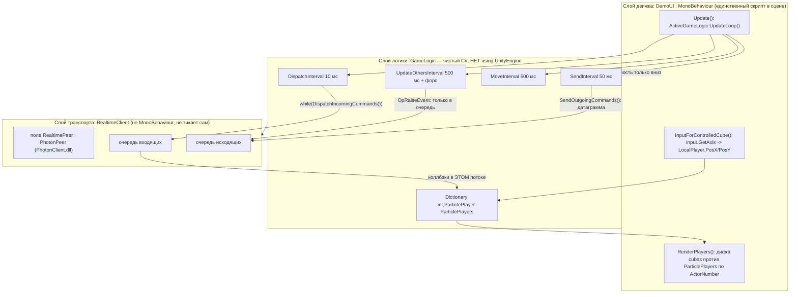

# Глава 15. Photon Realtime & Chat: сетевой цикл, которым владеешь ты

> **TL;DR для агента**
> - Эта глава учит писать сетевое приложение на «сыром» Photon Realtime 5.1.5 — без Fusion, без `NetworkObject`, без `[Networked]`: ты сам владеешь циклом `DispatchIncomingCommands()` / `SendOutgoingCommands()`, сам сериализуешь данные в `OpRaiseEvent`, сам решаешь кто что видит через Interest Groups.
> - Даёт три разных канала синхронизации и правило выбора между ними: **событие** (частое, эфемерное), **Custom Room Property** (общее состояние сессии, отдаётся при join), **кешированное событие** (последовательность, доигрываемая входящим).
> - Даёт переносимую архитектуру: сетевая логика как чистый C#-класс без `using UnityEngine` → её можно запустить в N экземплярах в одном процессе и протестировать трафик без N билдов.
> - Даёт zero-allocation путь для горячего события (`byte[]` на отправку + `ByteArraySlice` из пула на приём) и показывает, где именно демка в этом пути **ошибается** (игнорирует `Offset`/`Count`).
> - **Photon Chat в разделе отсутствует физически.** В проекте нет ни одного упоминания `ChatClient`/`PhotonChat`; единственный след — поле `AppSettings.AppIdChat`. Всё практическое содержание — Realtime.

---

## Какую проблему решает

Раздел содержит только `Demo-Particle.zip` и распакованный `_src` — официальный Photon Realtime Particle Demo (Realtime SDK 5.1.5 по `RealtimeClientVersion.cs:17`, Unity 2022.3.42f1 по `ProjectSettings/ProjectVersion.txt`). Fusion нет: ни `*.fusion`, ни `NetworkProjectConfig`, ни `NetworkObject`, ни `NetworkRunner` — `grep` даёт ноль совпадений. Папок `[Teacher]`/`[Archive]` нет. Учебный код — 7 файлов в `Assets/Photon/DemoParticle`: `Constants.cs`, `GameLogic.cs` (551 строка, ядро), `ParticlePlayer.cs` (239), `DemoUI.cs` (347), `Utils/TimeKeeper.cs`, `Utils/MultiClientRunner.cs`, `Utils/DeleteOnStart.cs`.

Проблема, которую решает этот слой: **Fusion — это абстракция, и она стоит дорого**. Фиксированный тик, ресимуляция, снапшоты состояния, prefab-репликация нужны шутеру и файтингу. Но если тебе нужен чат, лобби, пошаговая игра, редактор в реальном времени, синхронизация курсоров или телеметрия — платить за тик и снапшоты не за что. Realtime даёт голый релей сообщений внутри «комнаты» и три примитива состояния. Взамен требует, чтобы ты:

1. сам крутил насос входящих и исходящих сообщений (нет `FixedUpdateNetwork`, нет `NetworkRunner`);
2. сам определил формат каждого сообщения и его версионирование (нет `[Networked]`, нет автосериализации);
3. сам построил авторитет, если он тебе нужен (в Realtime его нет вообще).

Главный переносимый урок главы: **разделение «сформировать сообщение» и «отправить пакет» на две независимые частоты**. Именно за это Realtime и берут.

---

## Модель мира: кто чем владеет

| Вопрос | Fusion (разделы 01–06) | Realtime (эта глава) |
|---|---|---|
| Кто тикает | `NetworkRunner` + `FixedUpdateNetwork()`, фиксированный шаг, номера тиков, ресимуляция | **Ничто не тикает само.** `GameLogic.UpdateLoop()` вызывается из `DemoUI.Update()`, внутри — 4 независимых таймера |
| Состояние | `[Networked]` поле + `StateAuthority` + дельта-снапшоты | Состояния в сети нет. Есть сообщения (`OpRaiseEvent`) + Custom Room/Player Properties + server-side event cache |
| Авторитет | явный `StateAuthority`/`InputAuthority`, Host/Shared, lag compensation | **Авторитета нет.** Каждый клиент авторитетен над своими данными, сервер релеит |
| Master Client | хост с особыми правами | просто игрок с наименьшим `ActorNumber`. Дословно из `Enums.cs:899-900`: «The "master client" does not have special rights but is the one who is in this room the longest time» |
| Объекты | `Runner.Spawn`, `NetworkObject`, `NetworkTransform` | понятия сетевого объекта нет. Игрок = запись в `Dictionary<int, ParticlePlayer>` по `ActorNumber`, `GameObject` создаётся локально |
| Видимость | Interest Management на уровне `NetworkObject` | Interest Groups: байтовые каналы, два **независимых** действия — `OpChangeGroups` (что я получаю) и `RaiseEventArgs.InterestGroup` (куда я шлю) |
| Привязка к движку | `NetworkBehaviour`, неотделимо от Unity | `GameLogic` — чистый C#, ни одного `using UnityEngine` |

**Единственный примитив согласования** в Realtime — compare-and-set на сервере через `Room.SetCustomProperties(propertiesToSet, expectedValues)`. Без него работает «последняя запись побеждает». Прямое следствие: **Realtime по умолчанию читерабелен**. Всё, что в Fusion даётся бесплатно (валидация ввода на хосте), здесь надо строить самому или уносить в server-side плагин. Если ты пишешь соревновательный шутер — не бери Realtime как транспорт геймплея.

Какой код где исполняется: **весь код клиентский**. Нет кода, который исполняется «на хосте». Все коллбэки (`OnEvent`, `OnJoinedRoom`, `OnPlayerLeftRoom`) выполняются **внутри** вызова `DispatchIncomingCommands()`, то есть в том потоке, который его вызвал. В демке это главный поток Unity — отсюда безопасность работы с Unity-объектами и коллекциями прямо в коллбэках.

---

## Архитектура раздела



**Три слоя, однонаправленная зависимость.**

1. **Транспорт** — `RealtimeClient` из `Assets/Photon/PhotonRealtime/Code` (исходники в виде `.cs`), под ним поле `public readonly PhotonPeer RealtimePeer;` (`RealtimeClient.cs:54`) — закрытый бинарник `PhotonLibs/netstandard2.0/{debug,release}/PhotonClient.dll`. ⚠️ Внимание: `RealtimePeer` — это **имя поля**, тип — `Photon.Client.PhotonPeer`. Класса `RealtimePeer` не существует. Клиент владеет соединением, `ClientState`, `CurrentRoom`/`Players` и реестром callback-таргетов, но **ничего не тикает сам**.

2. **Логика** — `GameLogic`, обычный C#-класс. Владеет `Dictionary<int, ParticlePlayer>` (ключ — `ActorNumber`), ссылкой `LocalPlayer` и четырьмя `TimeKeeper`. Вся «сеть» здесь.

3. **Представление** — `DemoUI : MonoBehaviour`, guid `a67595cf181936f45a4e082fd9919651`, единственный скрипт демки в `ParticleDemoScene.unity`. Своего словаря сетевых игроков нет — только `Dictionary<int, GameObject> cubes` по тому же `ActorNumber`.

Ключевое следствие: один процесс может держать N независимых `GameLogic`, каждый со своим соединением. На это опирается `MultiClientRunner`.

---

## Реализация по шагам

### Шаг 1. Создай клиент и настрой его ДО подключения

`Assets/Photon/DemoParticle/GameLogic.cs:135-147`

```csharp
public GameLogic()
{
    this.RealtimeClient = new RealtimeClient();
    this.RealtimeClient.RealtimePeer.UseByteArraySlicePoolForEvents = this.useByteArraySlice;
    this.RealtimeClient.AddCallbackTarget(this);

    this.RealtimeClient.NickName = "usr" + SupportClass.ThreadSafeRandom.Next() % 99;

    this.DispatchInterval = new TimeKeeper(10);
    this.SendInterval = new TimeKeeper(50);
    this.MoveInterval = new TimeKeeper(500);
    this.UpdateOthersInterval = new TimeKeeper(this.MoveInterval.Interval);
}
```

**Почему именно так.** `new RealtimeClient()` — один экземпляр = одно соединение; это не синглтон, и именно поэтому N клиентов в процессе возможны. `AddCallbackTarget(this)` регистрирует объект сразу на все реализованные им интерфейсы. `NickName` выставляется **в конструкторе, до подключения**: сеттер (`RealtimeClient.cs:373-390`) просто пробрасывает в `LocalPlayer.NickName`, а в комнату значение публикуется позже через `LocalPlayer.UpdateNickNameOnJoined()` (`RealtimeClient.cs:1400,2230`). Это **третий, часто незамеченный канал синхронизации** в демке — Custom Player Property: `DemoUI.cs:286` читает его обратно для чужих игроков (`txt.text = p.NickName`), хотя по сети ник никто явно не отправлял.

`UseByteArraySlicePoolForEvents` выставляется **до** подключения, потому что он меняет способ десериализации всех входящих событий — менять его в середине сессии значит получить события в двух разных форматах.

### Шаг 2. Проверяй возвращаемое значение каждой операции (fail-fast)

`Assets/Photon/DemoParticle/GameLogic.cs:151-159`

```csharp
public void CallConnect(AppSettings appSettings)
{
    bool couldConnect = this.RealtimeClient.ConnectUsingSettings(appSettings);

    if (!couldConnect)
    {
        this.RealtimeClient.DebugReturn(LogLevel.Error, "Failed to connect. See logs for details. Increase logging level for more details.");
    }
}
```

**Почему именно так.** Все `Op*` и `Connect*` в Realtime возвращают `bool` «удалось ли поставить операцию в очередь». Локальные проверки происходят **до** сети: `CheckIfOpCanBeSent` (`RealtimeClient.cs:1506-1531`) проверяет, разрешена ли операция на текущем сервере, готов ли клиент по состоянию и подключён ли peer. Если операция не ушла — **коллбэка не будет НИКОГДА**. Без этой проверки приложение зависнет в «Connecting…» без единой строки диагностики. То же для `ConnectUsingSettings`: `ClientTypeChecks()` → `AppSettings.ClientTypeDetect()` (`AppSettings.cs:202-223`) возвращает ошибку ещё до открытия сокета.

### Шаг 3. Напиши игровой цикл — четыре независимые частоты

`Assets/Photon/DemoParticle/GameLogic.cs:163-207`

```csharp
public void UpdateLoop()
{
    // Dispatch means received messages are executed - one by one when you call dispatch.
    // You could also dispatch each frame!
    if (this.DispatchInterval.ShouldExecute)
    {
        while (this.RealtimeClient.DispatchIncomingCommands())
        {
            // You could count dispatch calls to limit them to X, if they take too much time of a single frame
        }
        this.DispatchInterval.Reset();  // we dispatched, so reset the timer
    }

    // If the client is in a room, we might move our LocalPlayer and update others of our position
    if (this.RealtimeClient.InRoom)
    {
        if (this.MoveInterval.ShouldExecute)
        {
            this.LocalPlayer.MoveRandom();
            this.MoveInterval.Reset();

            this.UpdateOthersInterval.ShouldExecute = true;    // we just moved. this should produce a update (in this demo)
            this.UpdateVisuals = true;                         // update visuals to show new pos
        }

        // This demo sends updates in intervals and when the player was moved
        // In a game you could send ~10 times per second or only when the user did some input, too
        if (this.UpdateOthersInterval.ShouldExecute)
        {
            this.SendPositionUpdate();
            this.UpdateInterestGroups();

            this.UpdateOthersInterval.Reset();
        }
    }

    // With the Photon API you can fine-control sending data, which allows the library to aggregate several messages into one package
    // Keep in mind that reliable messages from the server will need a reply (ack), so send more often than needed.
    // If nothing is waiting to be sent, SendOutgoingCommands won't do anything.
    if (this.SendInterval.ShouldExecute)
    {
        this.RealtimeClient.SendOutgoingCommands();
        this.SendInterval.Reset();
    }
}
```

**Почему именно так.** Это «ручной `FixedUpdateNetwork`», и в нём три отдельных решения.

Первое: **`OpRaiseEvent` только кладёт операцию в очередь, физическая отправка — отдельный таймер**. Если бы каждое событие немедленно уходило в сеть, на 10 обновлений в секунду вышло бы 10 крошечных датаграмм с полным overhead заголовков. Разнесение позволяет библиотеке агрегировать несколько операций в один UDP-пакет. Что сломается иначе: при N клиентах в комнате и per-event отправке ты упрёшься в пакетный rate, а не в полосу.

Второе: **`SendOutgoingCommands()` вызывается всегда, не только когда есть свои данные**. Надёжные (reliable) сообщения сервера требуют ack. Если долго не вызывать Send — соединение отвалится по таймауту даже при полном отсутствии собственного трафика. Комментарий в коде это прямо говорит: «send more often than needed».

Третье: **`Dispatch`/`Send` крутятся всегда, а игровая логика — только внутри `if (InRoom)`**. Соединение нельзя установить, не крутя насос; геймплей без комнаты бессмысленен.

Подводный камень в самом коде: `while (DispatchIncomingCommands())` выгребает очередь **до конца**. При лаг-спайке это съест кадр. Комментарий авторов — готовая рекомендация: «You could count dispatch calls to limit them to X».

⚠️ Альтернатива `RealtimeClient.Service()` (`RealtimeClient.cs:1024-1029`, внутри `this.RealtimePeer.Service()` + `LogStats()`) делает Dispatch и Send вместе. Демка её **сознательно не использует**: Service лишает возможности задать приёму 10 мс, а отправке 50 мс.

### Шаг 4. Отправка события: три ортогональные оси

`Assets/Photon/DemoParticle/GameLogic.cs:275-295`

```csharp
/// <summary>Makes use of the peer (connection to server) to send an Event containing our (local) position.</summary>
/// <remarks>
/// In Photon, by default, events go to everyone in the same Room. Outside of Rooms, you can't send events, usually.
/// There is an option to use Interest Groups to send to just those players interested in a certain group.
/// This can be used to reduce the number of events each player gets or to hide information from users not in the same group.
/// </remarks>
private void SendPositionUpdate()
{
    byte evCode = useByteArraySlice ? Constants.EvPositionBinary : Constants.EvPosition;
    if (this.UseInterestGroups)
    {
        // if groups are enabled for this player, we send to the group specific to our position only. note the group parameter
        byte playerGroup = this.GetGroup(this.LocalPlayer);
        this.RealtimeClient.OpRaiseEvent(evCode, this.LocalPlayer.WriteEvMove(), new RaiseEventArgs() { InterestGroup = playerGroup }, new SendOptions() { Reliability = this.SendReliable });
    }
    else
    {
        // this overload of OpRaiseEvent sends to everyone in the room - even those who did not subscribe to any particular group
        this.RealtimeClient.OpRaiseEvent(evCode, this.LocalPlayer.WriteEvMove(), new RaiseEventArgs(), new SendOptions() { Reliability = this.SendReliable });
    }
}
```

**Почему именно так.** Новички путают три независимые оси, и здесь видны все:

- **`evCode`** — что это за сообщение **и в каком формате полезная нагрузка**. Разные форматы = разные коды (см. шаг 7).
- **`RaiseEventArgs`** — **кому**. Это `struct` (`RaiseEventArgs.cs:13`), `new RaiseEventArgs()` даёт дефолты без аллокации: `CachingOption: DoNotCache, InterestGroup: 0, targetActors: null, receivers: Others`. Адресации **взаимоисключающи**: в `RealtimeClientOps.cs:1619-1631` стоит `if (TargetActors != null) ... else if (InterestGroup != 0) ... else if (Receivers != ReceiverGroup.Others)`. Нельзя одновременно «в группу» и «конкретным актёрам».
- **`SendOptions`** — **как**. По XML-доке `PhotonClient.xml`: «Wraps up DeliveryMode, Encryption and Channel values». `Reliability` — лишь bool-обёртка над полем `DeliveryMode` («Sets the DeliveryMode either to true: Reliable or false: Unreliable»); есть также статические `SendOptions.SendReliable`/`SendUnreliable`, которыми пользуется сам SDK (`RealtimeClientOps.cs:1328` отправляет `OpChangeGroups` именно через `SendOptions.SendReliable`).

Второй урок: `Receivers.Others` по умолчанию значит **«мне самому эхо не придёт»** — поэтому локальное состояние надо применять локально, и демка так и делает (ввод сразу меняет `LocalPlayer.PosX`, без подтверждения сервера).

Третий урок: отправка в группу и подписка на группу — **два независимых действия**. Клиент, который шлёт в группу, но не подписался, будет отправлять и ничего не получать. XML-комментарий `UseInterestGroups` (`GameLogic.cs:106-109`) описывает эту комбинаторику явно: «one game logic might get no updates at all (if others use the groups) or all info despite using the groups».

> ### ⚠️ Ловушка этого проекта: не копируй `SendReliable`
> `public bool SendReliable;` объявлен в `GameLogic.cs:103` и **ни разу не присваивается нигде в проекте** — `grep` по `Assets/Photon/DemoParticle` даёт ровно 4 вхождения: объявление (103) и три чтения (288, 293, 388). `GameLogic` не `MonoBehaviour`, так что и из инспектора его не выставить. Значит он всегда `false`, и **все** события демки уходят unreliable — включая одноразовый кешированный `EvColor`.
>
> Для позиции это правильно: следующий апдейт всё равно перезапишет потерянный. Для цвета это **баг**: `ChangeLocalPlayerColor()` зовётся только из `OnJoinedRoom()` и по кнопке, повтора нет, потерянное событие цвета никто не перешлёт.
>
> **Правило:** надёжность задаётся на каждое событие, а не на соединение. Частое и перезаписываемое (позиция, поворот, курсор) — unreliable. Одноразовое и смыслонесущее (взял предмет, сменил цвет, начислил счёт, нажал «готов») — **всегда** reliable. И проверяй, что флаг реально устанавливается.

### Шаг 5. Interest Groups — пространственный фильтр в три метода

`Assets/Photon/DemoParticle/GameLogic.cs:213-272`

```csharp
public void SetUseInterestGroups(bool? useGroups = null)
{
    if (this.RealtimeClient == null || !this.RealtimeClient.InRoom)
    {
        return;
    }

    // ... (присваивание или инверсия UseInterestGroups)

    if (!this.UseInterestGroups)
    {
        this.RealtimeClient.OpChangeGroups(new byte[0], null);    // remove all group-"subscriptions"
        this.LocalPlayer.VisibleGroup = 0;                  // group 0 is never used for actual grouping, so we can "flag" this as as unused
    }
    else
    {
        this.UpdateInterestGroups();    // this method does what we need to subscribe to certain group(s)
    }
}

private void UpdateInterestGroups()
{
    if (this.UseInterestGroups)
    {
        byte currentGroup = this.GetGroup(this.LocalPlayer);
        if (currentGroup != this.LocalPlayer.VisibleGroup)
        {
            this.RealtimeClient.OpChangeGroups(Array.Empty<byte>(), new[] { currentGroup });     // config the server to only send this group
            this.LocalPlayer.VisibleGroup = currentGroup;                               // store which group we now are interested in (server side)
        }
    }
}

public byte GetGroup(ParticlePlayer player)
{
    int tilesPerGroup = this.GridSize/ Constants.InterestGroupsPerAxis;
    return (byte)(1 + (player.PosX / tilesPerGroup) + ((player.PosY / tilesPerGroup) * Constants.InterestGroupsPerAxis));
}
```

**Почему именно так.** В комнате на 100 игроков каждому не нужны апдейты всех — это O(N²) трафика. Группы режут **и** исходящий поток (шлю только в свою группу), **и** входящий (сервер присылает только подписанные группы). Побочно это **анти-чит**: данные чужого квадранта физически не доходят до клиента, их нельзя «подсмотреть» в памяти.

Четыре отдельные идеи в этих 60 строках.

1. **Семантика `null` vs `byte[0]`.** Дословно из XML-комментария `OpChangeGroups` (`RealtimeClientOps.cs:1294-1302`): «null won't add/remove any groups. byte[0] will add/remove all (existing) groups. First, removing groups is executed». Поэтому `OpChangeGroups(Array.Empty<byte>(), new[]{g})` = «выйти из всех и войти в g» **одной** операцией, а `OpChangeGroups(new byte[0], null)` = «выйти из всех, ни во что не входить».

2. **`VisibleGroup` как кеш серверного состояния.** XML-комментарий поля (`ParticlePlayer.cs:67-70`) говорит прямо: «group interest currently set on server … (not necessarily the current one)». Операция летит **только при смене квадранта**, а не каждые 500 мс. `OpChangeGroups` отправляется reliable (`RealtimeClientOps.cs:1328`), так что без этого кеша ты гонишь мусорный надёжный трафик и провоцируешь «дребезг» подписки на границе.

3. **Группа 0 намеренно не используется как настоящая** — комментарий `GetGroup`: «Group 0 would be received by everyone, so we skip that». Значит `0` свободен как флаг «подписок нет», и отдельное поле не нужно.

4. **Изменение не вступает в силу мгновенно.** Из того же XML: «Changes become active not immediately but when the server executes this operation (approximately RTT/2)». Окно, когда апдейты ещё/уже не приходят, существует **всегда**. Проектируй визуал так, чтобы объект не «телепортировался» при переходе границы.

Что сломается иначе: если забыть `VisibleGroup` или подписаться не на ту группу, клиент **молча** перестанет получать апдейты. Ни ошибки, ни предупреждения.

### Шаг 6. Приём: единая точка и три защитных приёма

`Assets/Photon/DemoParticle/GameLogic.cs:309-344`

```csharp
public void OnEvent(EventData photonEvent)
{
    // events sent from the server (not coming from a specific player) are sent with Sender = 0. this demo ignores those.
    if (photonEvent.Sender <= 0)
    {
        return;
    }

    // each Player in the Room should be represented by a ParticlePlayer, which can be found by associated ActorNumber / Sender
    ParticlePlayer origin = null;
    bool found = this.ParticlePlayers.TryGetValue(photonEvent.Sender, out origin);

    // this demo logic doesn't handle any events from the server (that is done in the base class) so we could return here
    if (!found || origin == null)
    {
        this.RealtimeClient.DebugReturn(LogLevel.Warning, photonEvent.Code + " ev. We didn't find a originating player for actorId: " + photonEvent.Sender);
        return;
    }


    // this demo defines 2 events: Position and Color. additionally, a event is triggered when players join or leave
    switch (photonEvent.Code)
    {
        case Constants.EvPosition:
            origin.ReadEvMove((PhotonHashtable)photonEvent.CustomData);
            break;
        case Constants.EvPositionBinary:
            origin.ReadEvMove((ByteArraySlice)photonEvent.CustomData);
            break;
        case Constants.EvColor:
            origin.ReadEvColor((PhotonHashtable)photonEvent.CustomData);
            break;
    }

    this.UpdateVisuals = true;
}
```

**Почему именно так.** В Realtime нет per-object RPC как в Fusion — есть один поток `EventData`, который ты маршрутизируешь сам.

- **`Sender <= 0` отсекает служебные события сервера.** Без этой проверки поиск игрока по `ActorNumber` 0 всегда провалится и зальёт лог предупреждениями. Коды Photon-событий > 200 зарезервированы, пользовательские начинаются с 0/1 (XML-комментарий `OnEvent`, `GameLogic.cs:303-304`).
- **`TryGetValue` вместо индексатора.** Событие вполне может прийти от игрока, которого локально ещё или уже нет: апдейт позиции обогнал системное событие Join, или пришёл после Leave. Это **нормальная сетевая гонка**, а не ошибка — демка логирует Warning и выходит, а не падает.
- **Каст `CustomData` выполняется только внутри ветки `switch`.** Формат жёстко привязан к коду события; общий каст до `switch` сломался бы на первом же событии другого типа.

Жизненный цикл `ParticlePlayer` ведут коллбэки комнаты: `OnJoinedRoom` создаёт по одному на каждого из `CurrentRoom.Players.Values` (включая себя, локальный опознаётся по `particlePlayer.IsLocal`), `OnPlayerEnteredRoom`/`OnPlayerLeftRoom` добавляют и убирают, `OnLeftRoom` чистит словарь.

### Шаг 7. Код события несёт формат полезной нагрузки + zero-allocation

`Assets/Photon/DemoParticle/Constants.cs:15-22`

```csharp
/// <summary>(1) Messages the color of a player, using OpRaiseEvent.</summary>
public const byte EvColor = 1;

/// <summary>(2) Messages the position of a player, using OpRaiseEvent.</summary>
public const byte EvPosition = 2;

/// <summary>(3) Position of a player as byte-array. Used for OpRaiseEvent / OnEvent.</summary>
public const byte EvPositionBinary = 3;
```

`Assets/Photon/DemoParticle/ParticlePlayer.cs:149-213`

```csharp
PhotonHashtable evContent = new PhotonHashtable();
private bool sendByteArray = true;

// ... <summary>/<remarks> опущены
public object WriteEvMove()
{
    if (this.sendByteArray)
    {
        if (this.posBinary == null)
        {
            posBinary = new byte[] { (byte)this.PosX, (byte)this.PosY };
        }

        this.posBinary[0] = (byte)this.PosX;
        this.posBinary[1] = (byte)this.PosY;
        return this.posBinary;
    }

    evContent[(byte)1] = new byte[] { (byte)this.PosX, (byte)this.PosY };
    return this.evContent;
}

private byte[] posBinary;

/// <summary>Reads the PhotonHashtable received as "move" event.</summary>
public void ReadEvMove(PhotonHashtable evContent)
{
    if (evContent.ContainsKey((byte)1))
    {
        byte[] posArray = (byte[])evContent[(byte)1];
        this.PosX = posArray[0];
        this.PosY = posArray[1];
    }
    else if (evContent.ContainsKey("1"))
    {
        // js client event support (those can't send with byte-keys)
        var posArray = (object[])evContent["1"];   // NOTE: this is subject to change while we update the serialization in JS/Server
        this.PosX = System.Convert.ToByte(posArray[0]);
        this.PosY = System.Convert.ToByte(posArray[1]);
    }
    this.LastUpdateTimestamp = GameLogic.Timestamp;
}

/// <summary>Reads the PhotonHashtable received as "move" event.</summary>
public void ReadEvMove(ByteArraySlice evContent)
{
    this.PosX = evContent.Buffer[0];
    this.PosY = evContent.Buffer[1];
    bool a = evContent.Release();
    this.LastUpdateTimestamp = GameLogic.Timestamp;
}
```

**Почему именно так.** Это самый плотный по урокам файл раздела.

**(1) Отдельный код события на отдельный формат.** Один смысл (позиция) в двух представлениях. Если шлющий и читающий разойдутся в формате, будет `InvalidCastException` на каждом событии. Разные коды делают рассинхрон невозможным. Внимание: переключателей **два и они не связаны** — `useByteArraySlice` в `GameLogic.cs:131` выбирает код события, а `sendByteArray` в `ParticlePlayer.cs:150` выбирает формат содержимого. Оба `true`, но связи между ними нет — риск рассогласования реален. В своём коде держи один источник правды.

**(2) Zero-allocation отправка.** `posBinary` аллоцируется один раз и перезаписывается — на горячем пути ноль аллокаций. Hashtable-ветка создаёт `new byte[]` каждый раз. Позиция улетает ~2 раза в секунду с каждого из N клиентов; мусор на каждую отправку — самая частая причина микрофризов в сетевых играх.

**(3) Zero-allocation приём.** При `UseByteArraySlicePoolForEvents = true` входящий `byte[]` приходит обёрнутым в `ByteArraySlice` из пула. `Release()` **обязателен** — без него буфер не вернётся в пул, и включение флага превращается в утечку пула.

> ### ⚠️ Дефект в этом коде: `ReadEvMove(ByteArraySlice)` игнорирует `Offset`
> Код читает `evContent.Buffer[0]` / `Buffer[1]`. По XML-доке `PhotonClient.xml`:
> - `F:Photon.Client.ByteArraySlice.Offset` — «The position where the content starts in Buffer»
> - `F:Photon.Client.ByteArraySlice.Count` — «The length of the data in the Buffer»
> - `P:Photon.Client.PhotonPeer.UseByteArraySlicePoolForEvents` — «The ByteArraySlice.Buffer will usually be bigger than the send/received byte-array. Check the ByteArraySlice.Count and read only the actually received bytes.»
>
> Корректное чтение — `evContent.Buffer[evContent.Offset + 0]` / `[evContent.Offset + 1]`, с проверкой `evContent.Count >= 2`. Демка работает только потому, что для этой конкретной полезной нагрузки `Offset` фактически 0 (это **вывод**, а не факт из кода — реализация пула в закрытом `PhotonClient.dll`). **Никогда не копируй этот фрагмент без `Offset` и `Count`.** И никогда не храни ссылку на `Buffer`: это буфер пула, он больше полезных данных и будет переиспользован — значения надо скопировать сразу, как демка копирует в `PosX`/`PosY`.
>
> Второй мелкий огрех: `bool a = evContent.Release();` — возврат игнорируется, да ещё и с мёртвой переменной.

**(4) Кросс-SDK толерантный десериализатор.** Один Photon AppId обслуживает C#, JS и Unreal клиентов. JS-клиент не умеет byte-ключи в Hashtable и присылает строковые — поэтому парсер пробует `(byte)1`, затем `"1"`, и во втором случае приводит типы через `System.Convert`. Жёсткий парсер **молча игнорировал** бы таких игроков. То же в `ReadEvColor` (`ParticlePlayer.cs:225-237`).

**(5) `LastUpdateTimestamp` пишется в КАЖДОЙ перегрузке `Read*`** (строки 203, 212, 236) — это основа визуализации возраста данных (шаг 10).

**(6) Ключи Hashtable — `byte`, а не строка.** `evContent[(byte)1]`. Ключи едут в каждом пакете; `byte` занимает 1–2 байта вместо строки. XML-комментарий `WriteEvMove` это советует прямо: «it makes sense to use integer or byte keys, which use few bytes in serialized form».

### Шаг 8. Три канала долгоживущего состояния

`Assets/Photon/DemoParticle/GameLogic.cs:355-392`

```csharp
public void ChangeGridSize()
{
    int newGridSize = this.GridSize * 2;
    if (newGridSize > Constants.GridSizeMax)
    {
        newGridSize = 2;
    }

    PhotonHashtable newGridSizeProp = new PhotonHashtable() { { Constants.GridSizeProp, newGridSize } };
    this.RealtimeClient.CurrentRoom.SetCustomProperties(newGridSizeProp);
}

/// <remarks>
/// We would actually recommend storing values for the player (color, character, loadout) as Custom Player Properties.
/// This demo uses cached events for the sake of showing them at all.
/// ...
/// The downside is that each event adds some data that needs to be sent to joining players (which can amount to issues on join).
/// Cached events can be removed from the cache, so longer running games should avoid the event cache or manage it carefully.
/// This demo does not manage it's event cache.
/// </remarks>
public void ChangeLocalPlayerColor()
{
    if (this.LocalPlayer != null)
    {
        this.LocalPlayer.RandomizeColor();

        RaiseEventArgs raiseEventArgs = new RaiseEventArgs() { CachingOption = EventCaching.AddToRoomCache };
        SendOptions sendOptions = new SendOptions() { Reliability = this.SendReliable };

        this.RealtimeClient.OpRaiseEvent(Constants.EvColor, this.LocalPlayer.WriteEvColor(), raiseEventArgs, sendOptions);
    }
}
```

**Почему именно так.** Это главный архитектурный выбор Realtime — три разных механизма рядом.

**Событие** (`OpRaiseEvent`, `DoNotCache`): частое, эфемерное, не доживает до новых игроков. Позиция, курсор, выстрел.

**Custom Room Property** (`Room.SetCustomProperties`): сервер **хранит** значение, отдаёт его в ответе на join, рассылает `OnRoomPropertiesUpdate`, и (если объявлено в `CustomRoomPropertiesForLobby`) показывает в лобби для матчмейкинга. Для настроек сессии — единственно верный выбор. Сигнатура (`Room.cs:415`): `SetCustomProperties(PhotonHashtable propertiesToSet, PhotonHashtable expectedValues = null)`. Второй параметр — **compare-and-set на сервере**, единственный честный способ в Realtime разыграть «кто первый взял предмет» без выделенного авторитета. Ключи обязаны быть `int` или `string` — иначе `Log.Error` и операция не уйдёт (`Room.cs:417-427`: «must be non-null, not empty and contain only int or string keys»).

**Кешированное событие** (`EventCaching.AddToRoomCache`): сервер сохраняет **само событие** и доигрывает входящим. Важно, когда нужна **последовательность** («создать объект → обновить»), чего свойствами не выразить.

XML-комментарий здесь ценнее кода: авторы честно говорят, что для цвета/персонажа/лоадаута **правильнее Custom Player Properties**, а кеш взят только ради демонстрации. Это **пример механизма, а не образец для копирования**.

Ограничения кеша, подтверждённые кодом:
- Дословно из `Enums.cs:905-910`: «Events are cached per event code and player: Event 100 (example!) can be stored once per player» и — жёсткое ограничение, которое легко пропустить — «Caching works only combination with ReceiverGroup options Others and All». То есть **кеширование нельзя комбинировать с `TargetActors` или `ReceiverGroup.MasterClient`**.
- Из `RoomOptions.cs:48-54` (`CleanupCacheOnLeave`, дефолт `true`): «When you disable this, the event history can become too long to load if the room stays in use indefinitely». Значит риск «тяжёлого join» подтверждён докой — но прежде всего для **выключенного** cleanup. Для цвета в этой демке (один код события на игрока, cleanup включён) кеш растёт по числу игроков, а не бесконечно. Вывод: если отключаешь `CleanupCacheOnLeave` или кешируешь последовательности — управляй кешем сам через `EventCaching.RemoveFromRoomCache*` и `RemoveFromRoomCacheForActorsLeft`.

### Шаг 9. Защитное чтение свойств и матчмейкинг одной операцией

`Assets/Photon/DemoParticle/GameLogic.cs:73-82, 411-442`

```csharp
public int GridSize
{
    get
    {
        var customRoomProps = this.RealtimeClient.CurrentRoom.CustomProperties;
        return customRoomProps.ContainsKey(Constants.GridSizeProp)
                   ? Convert.ToInt32(customRoomProps[Constants.GridSizeProp])   // using Convert for js compatibility (these clients use "number" which is not guaranteed to be int)
                   : Constants.GridSizeDefault;
    }
}

private void JoinRandomOrCreateDemoRoom(Constants.MapType maptype, int gridSize)
{
    // custom room properties to use when this client creates a room.
    PhotonHashtable roomPropsForCreation = new PhotonHashtable() { { Constants.MapProp, maptype.ToString() }, { Constants.GridSizeProp, gridSize } };

    EnterRoomArgs enterRoomArgs = new EnterRoomArgs
    {
        RoomName = Guid.NewGuid().ToString()[..6],
        RoomOptions = new RoomOptions
        {
            CustomRoomProperties = roomPropsForCreation,                // if a new room gets created, these will be the custom props of it
            CustomRoomPropertiesForLobby = Constants.RoomPropsInLobby   // if a new room gets creates, these will be available in the lobby / matchmaking
        }
    };

    this.RealtimeClient.OpJoinRandomOrCreateRoom(null, enterRoomArgs);
}

public void OnConnectedToMaster()
{
    this.JoinRandomOrCreateDemoRoom(Constants.MapType.Forest, 16);
}
```

**Почему именно так.** Четыре урока.

1. **Свойство комнаты читается всегда через `ContainsKey` + default.** Между join-ом и приходом свойства, или если комнату создал клиент другой версии/платформы, ключа может не быть — прямое обращение уронит геймплей. То же для `Map` (`GameLogic.cs:85-94`).
2. **`Convert.ToInt32` вместо `(int)`.** JS-клиент присылает `number`, который не гарантированно `int`. Жёсткий каст дал бы `InvalidCastException` **только на смешанных платформах** — то есть баг, который не ловится в разработке.
3. **Свойства задаются на СОЗДАНИЕ комнаты и отдельно объявляются лоббийными.** Это whitelist, а не «все свойства»: лоббийные едут в листинге всех комнат каждому клиенту в лобби. `Constants.cs:43` → `RoomPropsInLobby = { MapProp, GridSizeProp }`, а сами ключи максимально коротки: `GridSizeProp = "s"`, `MapProp = "m"`. Строка `"gridSize"` против `"s"` — лишние байты, умноженные на число комнат и частоту листинга.
4. **`OpJoinRandomOrCreateRoom` — один round-trip.** Классика `JoinRandom → ждать fail → CreateRoom` стоит лишний round-trip и открывает гонку: два клиента одновременно получают fail и создают **две** комнаты, оставшись каждый в одиночестве. Сервер делает это атомарно. Результат — либо `OnJoinedRoom`, либо `OnCreatedRoom` + `OnJoinedRoom`. Операция разрешена только на Master Server (`RealtimeClientOps.cs:483`, через `CheckIfOpCanBeSent`).

> ### ⚠️ Три недочёта этого фрагмента — не копируй
> **`RoomName = Guid.NewGuid().ToString()[..6]`** — всего 6 hex-символов. `EnterRoomArgs.cs:18` прямо пишет: «If null, the server generates a unique name. If not null, it must be unique and new or will cause an error». При `MultiClientRunner` на 20+ клиентов коллизия реальна → создание комнаты падает → `OnJoinRandomFailed` → ретрай. **Для продакшена: `RoomName = null`**, пусть сервер генерирует.
>
> **Ретрай без ограничителя и с другими параметрами.** `OnJoinRoomFailed` (`GameLogic.cs:533`) и `OnJoinRandomFailed` (540) зовут `JoinRandomOrCreateDemoRoom(Forest, 4)` — `gridSize = 4`, а не 16 как `OnConnectedToMaster` (441). То есть после неудачи комната создаётся с **другой** сеткой. Плюс ретрай безусловный, без backoff и без счётчика: при устойчивой серверной ошибке получается бесконечный цикл повторов.
>
> **Шарить один `EnterRoomArgs` между N клиентами — можно.** Это распространённый миф. `EnterRoomArgs.cs:36-68` описывает `ShallowCopyToNewArgs` как **уже сделанный фикс** («Hence this fix / workaround»): `RealtimeClient.enterRoomArgumentsCache` получает новый экземпляр, «so you can run multiple clients and all share the same EnterRoomArgs initially but get assigned to individual rooms by the Master Server». `RoomOptions` переиспользовать тоже «OK». А в этой демке проблема физически невозможна — `new EnterRoomArgs` создаётся на каждый вызов.

### Шаг 10. Представление: дифф вместо коллбэков + возраст данных как дебаггер

`Assets/Photon/DemoParticle/DemoUI.cs:293-329`

```csharp
                    float alpha = 1.0f;
                    if (!p.IsLocal && p.UpdateAge > 500)
                    {
                        alpha = (p.UpdateAge > 1000) ? 0.3f : 0.8f;
                    }

                    Color cubeColor = IntToColor(p.Color);
                    cube.GetComponent<Renderer>().material.color = new Color(cubeColor.r, cubeColor.g, cubeColor.b, alpha);


                    cube.transform.localScale = scale;
                    cube.transform.position = new Vector3(p.PosX * scale.x + scale.x / 2, scale.z / 2, p.PosY * scale.y + scale.y / 2);
                }


                // check if there are more cubes than players. if so, find the cubes of players who are no longer around (by actorNumber).
                // as this UI deliberately has no access to the callbacks of the GameLogic, this gets solved by looping through the cubes.
                // the benefit is we can run the GameLogic independent from any visuals and Unity itself.
                if (this.cubes.Count != this.ActiveGameLogic.ParticlePlayers.Count)
                {
                    HashSet<int> keysToRemove = new HashSet<int>();
                    // ... сбор лишних ключей и Destroy
                }
```

**Почему именно так.** Два приёма, которые стоит украсть.

**Визуализация возраста данных.** `UpdateAge = GameLogic.Timestamp - LastUpdateTimestamp` (`ParticlePlayer.cs:48`, `Timestamp = Environment.TickCount` в `GameLogic.cs:129`). Чужой куб бледнеет, если от него давно нет апдейтов. Потеря пакетов и лаг в сетевой игре **невидимы** — объект просто «подвисает». Сделав это видимым, разработчик замечает проблему без профайлера и без логов. Локальный игрок исключён (`!p.IsLocal`): у него апдейтов по сети нет вовсе.

**Реконсиляция диффом.** Комментарий в коде сам объясняет мотивацию: UI **сознательно** не имеет доступа к коллбэкам `GameLogic`, чтобы логика оставалась запускаемой без Unity. Если бы UI подписался на `OnPlayerLeftRoom`, он стал бы зависеть от сетевого слоя, а `GameLogic` потерял бы независимость. Дифф по `ActorNumber` даёт то же самое без связи. Удаление идёт только при `cubes.Count != ParticlePlayers.Count` — дешёвая проверка перед дорогим проходом.

⚠️ **Механизм здесь pull, а не push.** `OnRoomPropertiesUpdate` (`GameLogic.cs:480-482`) **пустой**. Изменение grid size никакой коллбэк не обрабатывает — `GameLogic.GridSize` это **свойство**, которое при каждом обращении лезет в `CurrentRoom.CustomProperties`, а `DemoUI` обращается к нему каждый кадр (`RenderPlayers` → `SetPlaygroundTexture` → `GridSize`, и `currentScale` на строке 274). Это прямой контрапункт к Fusion-линии, где `[Networked]` + `ChangeDetector`/`OnChanged` — push. Pull проще и не может «пропустить» изменение, но платит обращением к словарю на каждый кадр.

### Шаг 11. N клиентов в одном процессе

`Assets/Photon/DemoParticle/Utils/MultiClientRunner.cs:32-69`

```csharp
public void AddClient(AppSettings appSettings)
{
    GameLogic ActiveGameLogic = new GameLogic();
    ActiveGameLogic.CallConnect(appSettings);
    this.clients.Add(ActiveGameLogic);
}

public int GetClientCount()
{
    return this.clients.Count;
}

void Update()
{
    foreach (GameLogic game in this.clients)
    {
        game.UpdateLoop();
    }
}

public void ToggleInterestGroupUsage(bool? value = null)
{
    foreach (GameLogic game in this.clients)
    {
        game.SetUseInterestGroups(value);
    }
}

public void RemoveClient()
{
    if (this.clients.Count > 0)
    {
        GameLogic toRemove = this.clients[0];
        this.clients.RemoveAt(0);

        toRemove.RealtimeClient.Disconnect();
    }
}
```

**Почему именно так.** Это прямая награда за то, что `GameLogic` — не `MonoBehaviour` и не синглтон: N полноценных соединений в одном процессе, каждое со своим `RealtimeClient`, своим `LocalPlayer` и своим решением про Interest Groups. Так тестируют нагрузку и interest management **без сборки N билдов и без ParrelSync**. Компонент добавляется в рантайме (`DemoUI.cs:133` → `this.gameObject.AddComponent<MultiClientRunner>()`), в сцене его нет — подтверждено отсутствием guid `4fa8488f5f72a6b4292136c9ee22800f` в `ParticleDemoScene.unity`. Рендерится при этом только `ActiveGameLogic` из `DemoUI`; фоновые клиенты видимы лишь как чужие кубы.

`RemoveClient` **обязательно** зовёт `Disconnect()` перед выбрасыванием из списка — иначе peer останется жив, а комната будет держать «призрачного» актёра до таймаута. Та же причина в `DemoUI.OnApplicationQuit()` с комментарием авторов: «As precaution in the Unity Editor, you should always do a proper disconnect. Else, the Editor might become unresponsive».

`ToggleInterestGroupUsage(bool?)` пробрасывает тот же nullable-тумблер, что и у одиночного клиента — можно сделать асимметричную конфигурацию (одни шлют в группы, другие нет) и увидеть, как это ломает видимость.

### Шаг 12. Дешёвый интервальный таймер с ручным форсированием

`Assets/Photon/DemoParticle/Utils/TimeKeeper.cs:34-56`

```csharp
public bool ShouldExecute
{
    get { return (this.IsEnabled && (this.shouldExecute || (Environment.TickCount - this.lastExecutionTime > this.Interval))); }
    set { this.shouldExecute = value; }
}

// ...

/// <summary>ShouldExecute becomes false and the time interval is refreshed for next execution.</summary>
/// <remarks>Does not affect IsEnabled.</remarks>
public void Reset()
{
    this.shouldExecute = false;
    this.lastExecutionTime = Environment.TickCount;
}
```

**Почему именно так.** Нужен планировщик, **не зависящий от `Time.deltaTime`** — логика должна работать и в потоке вне Unity. XML-комментарий класса честен: «Being based on Environment.TickCount, this is not very precise but cheap».

Два отдельных рычага. Сеттер `ShouldExecute` говорит «выполни сейчас, не ожидая интервала» — демка так делает после `MoveRandom()`: `UpdateOthersInterval.ShouldExecute = true` (`GameLogic.cs:184`). `IsEnabled` — отдельный выключатель, и `Reset()` его **не трогает**: тумблер автодвижения меняет только `MoveInterval.IsEnabled` (`DemoUI.cs:89`), а ручной ввод зовёт `MoveInterval.Reset()` (`DemoUI.cs:232`), подавляя автодвижение на один интервал, не выключая его.

Там же, в `DemoUI.InputForControlledCube`, стоит **троттлинг ввода**: `inputRepeatTimeoutSetting = 0.1f` (строки 49-50, 199-203, 233). Без него зажатая клавиша давала бы 60 шагов по сетке в секунду — 60 событий, из которых 59 бессмысленны.

---

## Realtime API этой главы

(Fusion API в этом разделе нет — проект на Realtime. Таблица сохраняет назначение раздела.)

| API | Что делает | Где вызывается | Подводный камень |
|---|---|---|---|
| `RealtimeClient` (класс) | Соединение, `ClientState`, `CurrentRoom`/`Players`, реестр коллбэков. Аналог `NetworkRunner`, но **не** `MonoBehaviour` и **не** тикает сам | `GameLogic.cs:48,137` | `LoadBalancingClient` — только obsolete-наследник для совместимости (`RealtimeClient.cs:2578`). Один экземпляр = одно соединение |
| `ConnectUsingSettings(AppSettings)` → `bool` | Старт подключения по настройкам | `GameLogic.cs:153` | `false` = операция даже не ушла → **ни одного коллбэка не будет**. Требует ровно один заполненный AppId (`AppSettings.cs:221`) |
| `DispatchIncomingCommands()` → `bool` | Выгребает одно сообщение, исполняет коллбэки **в текущем потоке**. `true` = есть ещё | `GameLogic.cs:169` | `while(...)` без ограничителя съест кадр при лаг-спайке |
| `SendOutgoingCommands()` → `bool` | Собирает операции и ack-и в датаграмму(ы) | `GameLogic.cs:204` | Нужен для ack-ов даже без своих данных. Редко вызывать = таймаут соединения |
| `Service()` | Dispatch + Send + `LogStats()` | не используется демкой (`RealtimeClient.cs:1024-1029`) | Проще, но лишает раздельного контроля частот (10 мс vs 50 мс) |
| `AddCallbackTarget(object)` / `RemoveCallbackTarget` | Регистрирует объект на все реализованные им интерфейсы | `GameLogic.cs:139` | Изменение **ставится в очередь** `callbackTargetChanges` (`RealtimeClient.cs:2460-2481`) и применяется в `UpdateCallbackTargets()` между пачками коллбэков — иначе отписка внутри коллбэка дала бы `InvalidOperationException` |
| `IOnEventCallback.OnEvent(EventData)` | Единая точка приёма **всех** событий | `GameLogic.cs:309` | Коды > 200 зарезервированы Photon. `Sender <= 0` = событие сервера |
| `OpRaiseEvent(byte, object, RaiseEventArgs, SendOptions)` → `bool` | Главный способ передать данные. Ставит операцию в очередь | `GameLogic.cs:288,293,390` | Адресации взаимоисключающи: `TargetActors` → `else if InterestGroup` → `else if Receivers` (`RealtimeClientOps.cs:1619-1631`) |
| `RaiseEventArgs { CachingOption, InterestGroup, TargetActors, Receivers }` | Конверт **адресации и кеширования** | `GameLogic.cs:288,387` | `struct`, `new` даёт дефолты без аллокации. `Receivers.Others` по умолчанию = **эхо себе не придёт** |
| `SendOptions { DeliveryMode, Reliability, Encrypt, Channel }` | Конверт **надёжности** | `GameLogic.cs:288,388` | `Reliability` — bool-обёртка над `DeliveryMode`. Задаётся **на каждое событие**. В демке источник (`SendReliable`) никогда не присваивается → всё unreliable |
| `OpChangeGroups(byte[] remove, byte[] add)` → `bool` | Серверная подписка: что я **получаю** | `GameLogic.cs:233,251` | `null` = не трогать, `byte[0]` = все. Remove до add. Вступает в силу ≈ через RTT/2. Шлётся reliable |
| `OpJoinRandomOrCreateRoom(JoinRandomRoomArgs, EnterRoomArgs)` → `bool` | Матчмейкинг одной операцией | `GameLogic.cs:426` | Только на Master Server. Результат — либо `OnJoinedRoom`, либо `OnCreatedRoom` + `OnJoinedRoom` |
| `EnterRoomArgs` + `RoomOptions.CustomRoomProperties` / `...ForLobby` | Параметры создания комнаты | `GameLogic.cs:416-424` | `RoomName != null` **должно быть уникально**, иначе ошибка. Шарить один экземпляр между клиентами безопасно (`ShallowCopyToNewArgs`) |
| `Room.SetCustomProperties(props, expectedValues = null)` → `bool` | Синхронизированное состояние комнаты | `GameLogic.cs:364` | `expectedValues` = compare-and-set, единственный честный примитив согласования. Ключи только `int`/`string`, иначе `Log.Error` |
| `EventCaching.AddToRoomCache` + `RoomOptions.CleanupCacheOnLeave` | Серверный кеш событий, доигрывается входящим | `GameLogic.cs:387` | Работает **только** с `ReceiverGroup.Others`/`All` (`Enums.cs:910`) — не с `TargetActors`. Кеш «per event code and player» |
| `PhotonPeer.UseByteArraySlicePoolForEvents` (через поле `RealtimeClient.RealtimePeer`) | Пул буферов для входящих байт-массивов | `GameLogic.cs:138` | `Release()` обязателен. Выставлять **до** подключения |
| `ByteArraySlice.Buffer` / `.Offset` / `.Count` / `.Release()` | Приём без аллокации | `ParticlePlayer.cs:207-213` | **`Buffer` больше данных** — читай от `Offset`, не более `Count`. Ссылку на `Buffer` хранить нельзя |
| `PhotonHashtable` как контент события | Универсальный словарь | `ParticlePlayer.cs:181,217-237` | Ключи `byte`/`int` (1–2 байта вместо строки). JS-клиенты не умеют byte-ключи. Новый Hashtable каждый кадр = мусор для GC |
| `Player` (`ActorNumber`, `readonly bool IsLocal`, `NickName`, `CustomProperties`) | Идентичность в комнате | `ParticlePlayer.cs:51-64`; `GameLogic.cs:61,513` | `ActorNumber` валиден только внутри комнаты и меняется при re-join (`Player.cs:46-47`) — не постоянный ID. Для этого `UserId` + `RoomOptions.PublishUserId` |
| `ClientState` / `InRoom` / `InLobby` / `State` | Явный конечный автомат соединения | `GameLogic.cs:177,215`; `DemoUI.cs:165-176`; `Enums.cs:28-89` | Переход Master → Game Server идёт через `DisconnectingFromMasterServer`/`ConnectingToGameServer` — «разрыв» в норме, не ошибка. `OpRaiseEvent` вне комнаты просто вернёт `false` |
| `AppSettings` | `[Serializable]` контейнер настроек, редактируемый в инспекторе | `DemoUI.cs:32`; сцена 2412-2428 | `AppVersion` расщепляет AppId на «виртуальные»: клиенты с разными версиями **никогда** не встретятся в матчмейкинге |
| `Disconnect()` | Явное закрытие соединения | `DemoUI.cs:79`; `MultiClientRunner.cs:67` | Без него редактор Unity может подвиснуть, а комната держит призрачного актёра |
| `ConnectionHandler : MonoBehaviour` | Шлёт `SendAcksOnly()`, пока главный поток занят | **в сцене отсутствует** (`ConnectionHandler.cs:56,245,301,315`) | Без него долгая загрузка уровня = таймаут. Но после `KeepAliveInBackground` (60000 мс) всё равно `Disconnect(DisconnectCause.ClientServiceInactivity)` — это защита от «вечных» фоновых клиентов, а не бесконечный keep-alive |
| `AsyncExtensions` (`ConnectUsingSettingsAsync`, `JoinRandomOrCreateRoomAsync`, `ReconnectAndRejoinAsync`) | Task-based альтернатива коллбэкам | не используется демкой | `AsyncConfig.CreateServiceTask = true` по умолчанию (`AsyncExtensions.cs:990`) — SDK **сам** крутит `Service()` каждые `ServiceIntervalMs` (10 мс), но **только на время ожидаемой операции**. После входа в комнату свой игровой цикл всё равно нужен |

---

## Настройки, без которых не работает

`NetworkProjectConfig` в этом проекте отсутствует — это не Fusion. Конфигурация живёт в `AppSettings`, сериализованном в сцене.

**`ParticleDemoScene.unity:2412-2428` (компонент `DemoUI`, guid `a67595cf181936f45a4e082fd9919651`):**

| Поле | В сцене | Дефолт SDK | Комментарий |
|---|---|---|---|
| `AppIdRealtime` | **пусто** | — | **Без него `Start()` логирует ошибку и выходит** (`DemoUI.cs:61-65`). Заполни своим Realtime AppId |
| `AppIdFusion` / `AppIdQuantum` / `AppIdChat` / `AppIdVoice` | пусто | — | ⚠️ **Не вписывай Fusion/Quantum AppId рядом с Realtime:** `ClientTypeDetect()` требует **ровно один** из `AppIdRealtime`/`AppIdFusion`/`AppIdQuantum` (`AppSettings.cs:202-223`), иначе `Log.Error` и подключение падает ещё до сети |
| `AppVersion` | `1` | — | Расщепляет AppId на «виртуальные». Типичная причина «игрок меня не видит» |
| `UseNameServer` | `1` (true) | `true` | |
| `Protocol` | `0` (Udp) | `Udp` | |
| `EnableProtocolFallback` | `0` | **`true`** (`AppSettings.cs:114`) | Сцена **отключает** фолбэк на TCP/WSS. В сетях с заблокированным UDP клиент не подключится вовсе |
| `AuthMode` | `2` = `AuthOnceWss` | `AuthOnceWss` | |
| `NetworkLogging` | `2` = `Warning` | `Error` (`AppSettings.cs:131`) | Повышено относительно дефолта |
| `ClientLogging` | `3` = `Info` | `Warning` (`AppSettings.cs:134`) | Повышено. Именно поэтому подсказка в `CallConnect` («Increase logging level») в поставке уже частично выполнена |

Уровни: `Photon.Client.LogLevel = { Off=0, Error=1, Warning=2, Info=3, Debug=4 }` (`PhotonClient.xml`).

**Дефолты `RoomOptions`, на которые опирается демка** (она их не меняет): `isVisible = true` (`:28`), `isOpen = true` (`:37`), `MaxPlayers = 0` — без лимита (`:40`), `PlayerTtl = 0`, `EmptyRoomTtl = 0`, `cleanupCacheOnLeave = true` (`:55`), `broadcastPropsChangeToAll = true` (`:128`).

**Сцена.** Единственный скрипт демки — `DemoUI`. При нём: `GroundQuads` — ровно 4 элемента (2×2 квадранта = 4 Interest Group, `Constants.InterestGroupsPerAxis = 2`), три материала (`GroundGridMat`, `GroundGridInterestMat`, `CubeMaterial`), `DemoTitle` (TextMeshPro) и `PlayerPrefab`. **`ConnectionHandler` в сцене отсутствует** (guid `f0b3ce6748186d3468e0dbaecb38b04c` не встречается).

⚠️ **Скрытая связь, которую легко сломать.** `DemoUI.SetPlaygroundTexture()` (`DemoUI.cs:240-254`) дублирует соглашение «группы нумеруются с 1»:

```csharp
renderer.material = this.ActiveGameLogic.UseInterestGroups && i + 1 == this.ActiveGameLogic.LocalPlayer.VisibleGroup ? this.GroundGridInterestMat : this.GroundGridMat;
```

Индекс квадранта в массиве `GroundQuads` жёстко связан с формулой `GetGroup` в `GameLogic.cs:268-272`. Переставь элементы массива в инспекторе — и подсветится не тот квадрант. Второй дефект того же метода: он каждый кадр пишет `mainTextureScale` в **общие Material-ассеты**, а не в инстанс материала — в редакторе это модифицирует сам ассет, и изменения остаются после выхода из Play Mode.

**Префаб.** `Assets/Photon/DemoParticle/Resources/PlayerPrefab.prefab`: `MeshFilter` со встроенным кубом + `MeshRenderer` + `BoxCollider`, дочерний объект с `RectTransform` + `MeshRenderer` + `CanvasRenderer` + `TextMeshPro`. **Ни одного сетевого компонента** — ни `NetworkObject`, ни `NetworkTransform`, ни `HitboxRoot`. Сетевого спавна в Realtime нет вообще: куб создаётся локально через `Instantiate`.

**Пакеты.** Из нестандартных UPM — только `com.unity.textmeshpro 3.0.6`. Photon-пакетов через UPM нет, SDK лежит в `Assets`: `PhotonRealtime/Code` как исходники `.cs`, `PhotonLibs/netstandard2.0/{debug,release}/PhotonClient.dll` как бинарник.

---

## Антипаттерны и как их обходит этот код

**1. «Отправить = послать пакет».** Отправка каждого события немедленно даёт N крошечных датаграмм. Обход: `OpRaiseEvent` только в очередь, `SendOutgoingCommands()` по отдельному таймеру.

**2. «Send нужен только когда есть мои данные».** Reliable-сообщения сервера требуют ack. Обход: `SendInterval` крутится всегда, даже вне комнаты.

**3. Сетевая логика внутри `MonoBehaviour`.** Не тестируется без Play Mode, не запускается в N экземплярах, не переносится на headless-сервер. Обход: `GameLogic` — чистый C#, ни одного `using UnityEngine`; UI зависит от логики, но не наоборот.

**4. UI подписан на сетевые коллбэки.** Создаёт обратную зависимость. Обход: реконсиляция диффом словарей по `ActorNumber`, с мотивацией прямо в комментарии кода.

**5. `OpChangeGroups` каждый кадр.** Reliable-операция в каждом кадре = мусорный надёжный трафик и дребезг на границе квадранта. Обход: `VisibleGroup` как кеш серверного состояния, операция только при смене.

**6. Индексатор словаря в обработчике события.** Событие приходит от игрока, которого локально ещё/уже нет — нормальная гонка. Обход: `TryGetValue` + Warning + `return`.

**7. Общий каст `CustomData` до `switch`.** Сломается на первом событии другого типа. Обход: код события несёт формат, каст внутри ветки.

**8. Жёсткий парсер.** `(int)` вместо `Convert.ToInt32`, только byte-ключи — молча отваливаются JS/Unreal клиенты. Обход: толерантный десериализатор, пробующий оба варианта ключа.

**9. Прямое обращение к room property по ключу.** Обход: `ContainsKey` + default.

**10. `JoinRandom` → ждать fail → `CreateRoom`.** Лишний round-trip + гонка на две пустые комнаты. Обход: `OpJoinRandomOrCreateRoom`.

**11. Игнорирование возвращаемого `bool` операции.** Коллбэка не будет никогда, приложение зависнет без диагностики. Обход: fail-fast с `DebugReturn(LogLevel.Error, ...)`.

**12. Отписка от коллбэка изнутри коллбэка.** `InvalidOperationException`. Обход (библиотечный, но переносимый в любой свой event-bus): очередь `callbackTargetChanges`, применяемая в `UpdateCallbackTargets()` между пачками.

**13. Невидимый лаг.** Обход: `UpdateAge` → альфа куба. Встроенный сетевой дебаггер за три строки.

**14. Незакрытое соединение на выходе.** Обход: `Disconnect()` в `OnApplicationQuit()` и `RemoveClient()`.

**15. Долгие строковые ключи.** Обход: `"s"`, `"m"`, `(byte)1` + whitelist лоббийных свойств.

### Чего этот код НЕ обходит — то, что надо исправить при копировании

| Проблема | Где | Почему это важно |
|---|---|---|
| `SendReliable` никогда не присваивается → всё unreliable, включая одноразовый `EvColor` | `GameLogic.cs:103` | Потерянное событие цвета никто не перешлёт |
| `ByteArraySlice.Buffer[0]` без `Offset`/`Count` | `ParticlePlayer.cs:209-210` | Работает случайно; при другом payload прочитает мусор |
| `UpdateVisuals` — **мёртвое поле** | `GameLogic.cs:99,185,343` | Объявлено и дважды записывается, **ни одного чтения**. `RenderPlayers()` зовётся безусловно каждый кадр — полный ре-рендер. Dirty-flag заявлен в API, но не работает |
| `lock (this.ActiveGameLogic)` | `DemoUI.cs:272-330` | Единственное вхождение `lock` в проекте — защищать нечего. Рудимент многопоточного варианта демки, прямо противоречащий однопоточной модели Dispatch |
| Нет null-защиты в UI-обработчиках | `DemoUI.cs:89,110,120,125,151` | `Start()` при пустом AppId делает `return` **до** создания `ActiveGameLogic`, но эти методы разыменовывают его без проверки → `NullReferenceException` при первом нажатии кнопки в поставляемом проекте. Сравни с `ToggleShowUserInfo` (96) и `InputForControlledCube` (194), где проверка есть |
| `SetUseInterestGroups` молча выходит вне комнаты | `GameLogic.cs:215-218` | Toggle в UI визуально включён, а `UseInterestGroups` остался `false` — рассинхрон UI и логики |
| `IErrorInfoCallback` не реализован | `GameLogic.cs:45` — только 4 интерфейса из 7 (`Callbacks.cs:41,162,262,452,598,643,670`) | Ошибки серверного плагина и вебхуков (`ErrorInfo`) проходят незамеченными |
| Ретрай матчмейкинга без backoff и с `gridSize = 4` вместо 16 | `GameLogic.cs:533,540` vs `441` | Бесконечный цикл при устойчивой ошибке + другая сетка после фолбэка |
| `RoomName` — 6 hex-символов | `GameLogic.cs:418` | Коллизия → ошибка создания комнаты. Для продакшена `RoomName = null` |
| `ClampPosition` асимметричен и не переклампит чужих | `ParticlePlayer.cs:124` (`>=`) vs `134` (`>`) | При уменьшении сетки (128 → 2) чужие `PosX/PosY` останутся большими до их следующего апдейта, и куб уедет далеко за поле (`scale = 128/2 = 64`). Самоисправляется только после их `MoveRandom()` |
| `using ExitGames.Client.Photon;` вне namespace | `GameLogic.cs:7` | Легаси-артефакт Realtime 4.x. Сегодня этот namespace существует только как obsolete-прослойка (`RealtimeClient.cs:2574-2590`: `LoadBalancingClient : RealtimeClient`, `Hashtable : PhotonHashtable`, оба `[Obsolete]`). Строки «ExitGames» в `PhotonClient.dll/xml` нет вообще, а `SupportClass.ThreadSafeRandom` берётся из `Photon.Client` — поэтому `ParticlePlayer.cs` компилируется с одним `using Photon.Client;`. Идеальный пример переименований Realtime 4 → 5 |
| `DeleteOnStart` ни к чему не прикреплён | guid `3e9d1b000f699ba4fb55c4448053e279` не встречается ни в одном `.unity`/`.prefab` | Приём «editor-only объекты, удаляемые в рантайме» в коде есть, но в проекте не используется |
| `SetPlaygroundTexture` пишет в общие Material-ассеты каждый кадр | `DemoUI.cs:244-245` | В редакторе модифицирует ассет, изменения переживают выход из Play Mode |

---

## Чеклист: как применить в своём проекте

1. **Выбери транспорт осознанно.** Realtime — для чата, лобби, пошаговых игр, курсоров, телеметрии, совместных редакторов. Fusion — для шутеров и всего, где нужны предсказание, ресимуляция и серверная валидация. В Realtime авторитета нет, и он читерабелен по умолчанию.
2. **Вынеси сетевую логику в класс без `using UnityEngine`.** Реализуй `IConnectionCallbacks`, `IMatchmakingCallbacks`, `IInRoomCallbacks`, `IOnEventCallback` **и `IErrorInfoCallback`** (демка последний пропустила). Интеграцию с движком сделай отдельным `MonoBehaviour`, вызывающим `UpdateLoop()` из `Update()`.
3. **Создай `RealtimeClient` в конструкторе** и там же выставь `RealtimePeer.UseByteArraySlicePoolForEvents`, `NickName` и `AddCallbackTarget(this)` — до любого `Connect`.
4. **Напиши `UpdateLoop()` с раздельными частотами:** Dispatch ~10 мс, Send ~50 мс, логика по своим таймерам. Dispatch и Send крутятся **всегда**, игровая логика — только под `if (RealtimeClient.InRoom)`. Ограничь число Dispatch-итераций за кадр.
5. **Проверяй `bool` каждой операции** (`ConnectUsingSettings`, `OpRaiseEvent`, `OpChangeGroups`, `SetCustomProperties`) и логируй `LogLevel.Error` на `false`. `false` = коллбэка не будет никогда.
6. **Заведи константы на коды событий и ключи свойств.** Отдельный код на каждый формат полезной нагрузки, один источник правды для выбора формата. Ключи свойств и Hashtable — максимально короткие (`"s"`, `(byte)1`).
7. **Выбери канал под каждый тип данных:** частое и перезаписываемое → unreliable событие; состояние сессии, нужное будущим игрокам → Custom Room Property (+ whitelist в `CustomRoomPropertiesForLobby`); состояние игрока (цвет, персонаж, лоадаут) → **Custom Player Property**, не кешированное событие; последовательность операций над объектом → кешированное событие с планом очистки.
8. **Задавай `Reliability` явно на каждое событие** и проверь, что источник флага реально присваивается. Одноразовые смыслонесущие события — всегда reliable.
9. **Читай room property только через `ContainsKey` + default**, числа — через `Convert.ToInt32`. Парсер событий делай толерантным к byte- и string-ключам, если AppId обслуживает не только C#.
10. **В обработчике события:** отсеки `Sender <= 0`, ищи отправителя через `TryGetValue` (логируй Warning, не падай), кастуй `CustomData` только внутри ветки `switch`.
11. **Interest Groups — два независимых действия.** `OpChangeGroups(Array.Empty<byte>(), new[]{g})` для входящего, `RaiseEventArgs.InterestGroup = g` для исходящего. Кешируй «группу, которую знает сервер», и шли операцию только при смене. Группу 0 держи свободной как флаг. Учти лаг ≈ RTT/2.
12. **Для zero-allocation приёма читай от `Offset`, не более `Count`, и обязательно вызывай `Release()`.** Значения копируй сразу, ссылку на `Buffer` не храни. На отправке переиспользуй один `byte[]`.
13. **Матчмейкинг — `OpJoinRandomOrCreateRoom` из `OnConnectedToMaster`.** `RoomName = null`. Ретрай в `OnJoinRoomFailed`/`OnJoinRandomFailed` делай **с теми же параметрами**, с backoff и счётчиком попыток.
14. **Для «кто первый взял» используй `SetCustomProperties(props, expectedValues)`** — compare-and-set на сервере. Без `expectedValues` побеждает последняя запись.
15. **Кешируй события только с `ReceiverGroup.Others`/`All`** — с `TargetActors` кеш не работает. Если выключаешь `CleanupCacheOnLeave`, предусмотри чистку через `RemoveFromRoomCache*`.
16. **Добавь `ConnectionHandler` в сцену** (в демке его нет) — иначе долгая загрузка уровня или уход приложения в фон дадут таймаут соединения.
17. **Всегда вызывай `Disconnect()`** в `OnApplicationQuit()` и при удалении клиента из пула. Иначе редактор подвисает, а комната держит призрачного актёра.
18. **Сделай возраст данных видимым:** пиши timestamp в каждом `Read*`, и покажи «свежесть» в визуале (альфа, иконка, цвет). Исключи локального игрока.
19. **Реконсилируй представление диффом** по `ActorNumber`, не подписывая UI на сетевые коллбэки.
20. **Троттли ввод** своим таймером, а не частотой кадров: зажатая клавиша не должна давать 60 сетевых событий в секунду.
21. **Для нагрузочного теста заведи раннер с `List<GameLogic>`** и крути `UpdateLoop()` каждого. Шарить один `AppSettings` безопасно (только чтение); шарить `EnterRoomArgs` тоже безопасно благодаря `ShallowCopyToNewArgs`.
22. **Проверь `AppSettings` перед первым запуском:** ровно один AppId заполнен; `EnableProtocolFallback = true`, если целевые сети могут блокировать UDP; `AppVersion` одинаков у всех клиентов, которые должны встречаться; `ClientLogging` на `Info` на время отладки.
23. **Не используй `ActorNumber` как постоянный ID игрока** — он валиден только внутри комнаты и меняется при re-join. Для постоянного ID — `UserId` + `RoomOptions.PublishUserId`.
24. **Если берёшь async-обёртки — помни, что насос SDK (`AsyncConfig.CreateServiceTask`) живёт только на время ожидаемой операции.** После входа в комнату свой игровой цикл всё равно обязателен.
