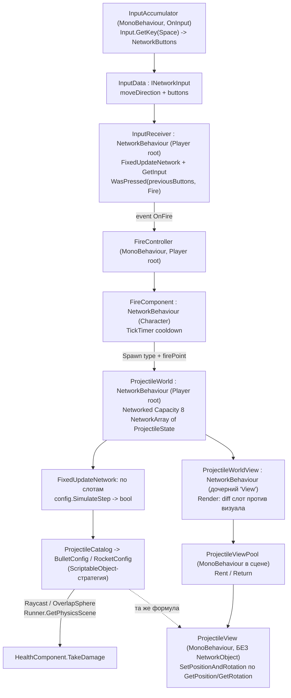
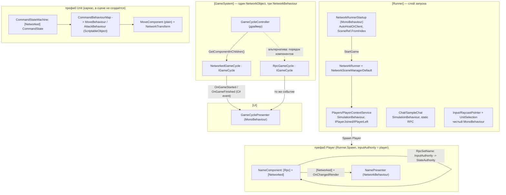
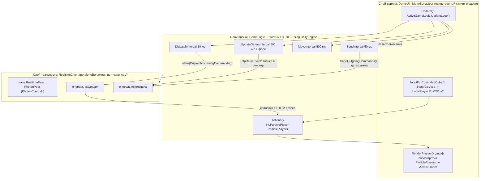

# Сетевые приложения на Unity: руководство

**Photon Fusion 2 · Unity 2022.3 LTS · ноябрь 2026**

Руководство в двух частях. Часть I выведена из построчного разбора десяти учебных
проектов на Photon Fusion 2.0.5 — это код, который работает, разобранный на приёмы.
Часть II закрывает всё, чего в этих проектах нет, по официальной документации Photon
и классическим источникам по сетевым играм. Части III и IV — справочники и чеклисты,
к которым возвращаются во время работы.

Адресат — ИИ-агент, которому предстоит писать сетевой код. Поэтому формулировки
директивные: не «бывает так», а «делай так, потому что иначе сломается вот это».

---

## Оглавление


**[Введение](#part-1)**

- [Как устроено это руководство и как им пользоваться](#ch-00)
    - [0.1. Стек, на котором всё проверено](#ch-00-1)
    - [0.2. Модель мира Fusion 2 — то, что надо держать в голове всегда](#ch-00-2)
    - [0.3. Карта глав](#ch-00-3)
    - [0.4. Как агенту пользоваться этим гайдом](#ch-00-4)
    - [0.5. Протокол чтения для ИИ-агента](#ch-00-5)

**[Часть I. Практика: разбор production-кода](#part-2)**

- [Глава 01. Основы мультиплеера: минимальный каркас Fusion 2](#ch-01)
    - [Какую проблему решает](#ch-01-1)
    - [Модель мира: кто чем владеет](#ch-01-2)
    - [Архитектура раздела](#ch-01-3)
    - [Реализация по шагам](#ch-01-4)
    - [Fusion API этой главы](#ch-01-5)
    - [Настройки, без которых не работает](#ch-01-6)
    - [Антипаттерны и как их обходит этот код](#ch-01-7)
    - [Чеклист: как применить в своём проекте](#ch-01-8)
- [Глава 02. Сетевые компоненты и механики](#ch-02)
    - [Какую проблему решает](#ch-02-1)
    - [Модель мира: кто чем владеет](#ch-02-2)
    - [Архитектура раздела](#ch-02-3)
    - [Реализация по шагам](#ch-02-4)
    - [Fusion API этой главы](#ch-02-5)
    - [Настройки, без которых не работает](#ch-02-6)
    - [Антипаттерны и как их обходит этот код](#ch-02-7)
    - [Чеклист: как применить в своём проекте](#ch-02-8)
- [Глава 03. Кинематика и физика объектов](#ch-03)
    - [Какую проблему решает](#ch-03-1)
    - [Модель мира: кто чем владеет](#ch-03-2)
    - [Архитектура раздела](#ch-03-3)
    - [Реализация по шагам](#ch-03-4)
    - [Fusion API этой главы](#ch-03-5)
    - [Настройки, без которых не работает](#ch-03-6)
    - [Антипаттерны и как их обходит этот код](#ch-03-7)
    - [Чеклист: как применить в своём проекте](#ch-03-8)
    - [Что изменилось относительно главы 02](#ch-03-9)
- [Глава 04. Экстраполяция снарядов: снаряд как строка в `[Networked]`-массиве](#ch-04)
    - [Какую проблему решает](#ch-04-1)
    - [Модель мира: кто чем владеет](#ch-04-2)
    - [Архитектура раздела](#ch-04-3)
    - [Реализация по шагам](#ch-04-4)
    - [Fusion API этой главы](#ch-04-5)
    - [Настройки, без которых не работает](#ch-04-6)
    - [Антипаттерны и как их обходит этот код](#ch-04-7)
    - [Чеклист: как применить в своём проекте](#ch-04-8)
    - [Что изменилось относительно главы 03](#ch-04-9)
- [Глава 05. Интерполяция и снапшоты](#ch-05)
    - [Какую проблему решает](#ch-05-1)
    - [Модель мира: кто чем владеет](#ch-05-2)
    - [Архитектура раздела](#ch-05-3)
    - [Реализация по шагам](#ch-05-4)
    - [Fusion API этой главы](#ch-05-5)
    - [Настройки, без которых не работает](#ch-05-6)
    - [Антипаттерны и как их обходит этот код](#ch-05-7)
    - [Чеклист: как применить в своём проекте](#ch-05-8)
    - [Что изменилось относительно главы 04](#ch-05-9)
- [Глава 06. Компенсация задержек: хитскан-оружие на Runner.LagCompensation](#ch-06)
    - [Какую проблему решает](#ch-06-1)
    - [Модель мира: кто чем владеет](#ch-06-2)
    - [Архитектура раздела](#ch-06-3)
    - [Реализация по шагам](#ch-06-4)
    - [Fusion API этой главы](#ch-06-5)
    - [Настройки, без которых не работает](#ch-06-6)
    - [Антипаттерны и как их обходит этот код](#ch-06-7)
    - [Чеклист: как применить в своём проекте](#ch-06-8)
    - [Что изменилось относительно главы 05](#ch-06-9)
- [Глава 07. Remote Procedure Calls](#ch-07)
    - [Какую проблему решает](#ch-07-1)
    - [Модель мира: кто чем владеет](#ch-07-2)
    - [Архитектура раздела](#ch-07-3)
    - [Реализация по шагам](#ch-07-4)
    - [Fusion API этой главы](#ch-07-5)
    - [Настройки, без которых не работает](#ch-07-6)
    - [Антипаттерны и как их обходит этот код](#ch-07-7)
    - [Чеклист: как применить в своём проекте](#ch-07-8)
- [Глава 08. Interest Management: кому из игроков какие объекты вообще доезжают](#ch-08)
    - [Какую проблему решает](#ch-08-1)
    - [Модель мира: кто чем владеет](#ch-08-2)
    - [Архитектура раздела](#ch-08-3)
    - [Реализация по шагам](#ch-08-4)
    - [Fusion API этой главы](#ch-08-5)
    - [Настройки, без которых не работает](#ch-08-6)
    - [Антипаттерны и как их обходит этот код](#ch-08-7)
    - [Чеклист: как применить в своём проекте](#ch-08-8)
- [Глава 09. Подключение и миграция хоста](#ch-09)
    - [Какую проблему решает](#ch-09-1)
    - [Модель мира: кто чем владеет](#ch-09-2)
    - [Архитектура раздела](#ch-09-3)
    - [Реализация по шагам](#ch-09-4)
    - [Fusion API этой главы](#ch-09-5)
    - [Настройки, без которых не работает](#ch-09-6)
    - [Антипаттерны и как их обходит этот код](#ch-09-7)
    - [Чеклист: как применить в своём проекте](#ch-09-8)
    - [Что изменилось относительно главы 08](#ch-09-9)
- [Глава 15. Photon Realtime & Chat: сетевой цикл, которым владеешь ты](#ch-15)
    - [Какую проблему решает](#ch-15-1)
    - [Модель мира: кто чем владеет](#ch-15-2)
    - [Архитектура раздела](#ch-15-3)
    - [Реализация по шагам](#ch-15-4)
    - [Realtime API этой главы](#ch-15-5)
    - [Настройки, без которых не работает](#ch-15-6)
    - [Антипаттерны и как их обходит этот код](#ch-15-7)
    - [Чеклист: как применить в своём проекте](#ch-15-8)

**[Часть II. Теория и то, чего в курсе нет](#part-3)**

- [Глава 20. Топологии и режимы Fusion 2](#ch-20)
    - [Зачем это знать](#ch-20-1)
    - [1. Топология против режима: три топологии, два режима](#ch-20-2)
    - [2. Модель авторитета по режимам](#ch-20-3)
    - [3. Матчмейкинг, сцены, соединение: что ещё зависит от топологии](#ch-20-4)
    - [4. Что ломается при переходе Host → Shared](#ch-20-5)
    - [5. Цифры и лимиты — все со ссылкой](#ch-20-6)
    - [6. Защита от читов и выбор топологии](#ch-20-7)
    - [Чего по этой теме нет в учебном курсе](#ch-20-8)
    - [Решение: что брать и когда](#ch-20-9)
    - [Чеклист](#ch-20-10)
    - [Источники](#ch-20-11)
- [Глава 21. Предсказание, ресимуляция и тайминг](#ch-21)
    - [Зачем это знать](#ch-21-1)
    - [21.1. Конвейер: один кадр Unity изнутри](#ch-21-2)
    - [21.2. Предсказание: насколько далеко клиент уходит в будущее](#ch-21-3)
    - [21.3. Ресимуляция: что именно ломается](#ch-21-4)
    - [21.4. Удалённое время: снапшотная интерполяция](#ch-21-5)
    - [21.5. Lag compensation — третье время](#ch-21-6)
    - [21.6. Ручки тайминга: что появилось в 2.1](#ch-21-7)
    - [21.7. Физика в этом тайминге](#ch-21-8)
    - [21.8. Диагностика: мерить, а не угадывать](#ch-21-9)
    - [Чего по этой теме нет в учебном курсе](#ch-21-10)
    - [Решение: что брать и когда](#ch-21-11)
    - [Чеклист](#ch-21-12)
    - [Источники](#ch-21-13)
- [Глава 22. Сетевое состояние, сжатие и бюджет трафика](#ch-22)
    - [Зачем это знать](#ch-22-1)
    - [22.1 Модель состояния: плоский буфер слов](#ch-22-2)
    - [22.2 Сжатие: что есть и чего нет](#ch-22-3)
    - [22.3 Коллекции и change detection](#ch-22-4)
    - [22.4 Рычаги бюджета в порядке эффективности](#ch-22-5)
    - [22.5 Измерение: два инструмента, не один](#ch-22-6)
    - [22.6 Бюджет и деньги: как считать](#ch-22-7)
    - [Чего по этой теме нет в учебном курсе](#ch-22-8)
    - [Решение: что брать и когда](#ch-22-9)
    - [Чеклист](#ch-22-10)
    - [Источники](#ch-22-11)
- [Глава 23. Физика и детерминизм](#ch-23)
    - [Зачем это знать](#ch-23-1)
    - [1. Что Fusion гарантирует, а что нет](#ch-23-2)
    - [2. Версионная рамка на 2026-11-01](#ch-23-3)
    - [3. Три стратегии сетевой физики](#ch-23-4)
    - [4. Forecast Physics: требования, настройки, ограничения](#ch-23-5)
    - [5. Physics Addon: ручки, которые решают играбельность](#ch-23-6)
    - [6. Тик-рейт, ресимуляции и CCD](#ch-23-7)
    - [7. Персонажи: Simple KCC и Advanced KCC](#ch-23-8)
    - [8. Цена выбора: не только CPU](#ch-23-9)
    - [Чего по этой теме нет в учебном курсе](#ch-23-10)
    - [Решение: что брать и когда](#ch-23-11)
    - [Чеклист](#ch-23-12)
    - [Источники](#ch-23-13)
- [Глава 24. Лаг-компенсация и попадания на практике](#ch-24)
    - [Зачем это знать](#ch-24-1)
    - [1. Граница применимости: две модели попаданий, а не одна](#ch-24-2)
    - [2. Окно перемотки: откуда 200 мс и когда их мало](#ch-24-3)
    - [3. Хитбоксы в продакшене: активность, анимация, broad-phase](#ch-24-4)
    - [4. Запрос: что в курсе не вызывалось](#ch-24-5)
    - [5. Как попадания сделаны в официальных сэмплах](#ch-24-6)
    - [6. Снаряды: четыре подхода Photon и перенос на свой проект](#ch-24-7)
    - [7. Чего документация не говорит](#ch-24-8)
    - [Чего по этой теме нет в учебном курсе](#ch-24-9)
    - [Решение: что брать и когда](#ch-24-10)
    - [Чеклист](#ch-24-11)
    - [Источники](#ch-24-12)
- [Глава 25. Сцены, Multi-Peer и инструменты тестирования](#ch-25)
    - [Зачем это знать](#ch-25-1)
    - [1. Сцены: Fusion знает только `INetworkSceneManager`](#ch-25-2)
    - [2. Объекты сцены против `Spawn`: откуда берётся `NetworkId`](#ch-25-3)
    - [3. Multi-Peer: N симуляций в одном процессе](#ch-25-4)
    - [4. Четыре способа поднять N клиентов локально](#ch-25-5)
    - [5. Отладка: статистика, брейкпоинты, плохая сеть](#ch-25-6)
    - [6. Версии: состояние на 01.11.2026](#ch-25-7)
    - [Чего по этой теме нет в учебном курсе](#ch-25-8)
    - [Решение: что брать и когда](#ch-25-9)
    - [Чеклист](#ch-25-10)
    - [Источники](#ch-25-11)
- [Глава 26. Экосистема Photon: что выбрать](#ch-26)
    - [Зачем это знать](#ch-26-1)
    - [26.1. Карта стека: один транспорт, четыре топологии](#ch-26-2)
    - [26.2. Photon Quadrant: таблица выбора топологии](#ch-26-3)
    - [26.3. Quantum: другая модель вычислений, а не другой SDK](#ch-26-4)
    - [26.4. Серверный авторитет: Quantum Plugin SDK и Photon Server](#ch-26-5)
    - [26.5. PUN 2, PUN Classic, Bolt: статус и миграция](#ch-26-6)
    - [26.6. CCU-модель: как реально считают деньги](#ch-26-7)
    - [26.7. Регионы, Best Region, AppId / AppVersion](#ch-26-8)
    - [26.8. Chat и Voice](#ch-26-9)
    - [Чего по этой теме нет в учебном курсе](#ch-26-10)
    - [Решение: что брать и когда](#ch-26-11)
    - [Чеклист](#ch-26-12)
    - [Источники](#ch-26-13)
- [Глава 27. Dedicated server и хостинг](#ch-27)
    - [Зачем это знать](#ch-27-1)
    - [27.1. Три архитектуры авторитетного сервера, а не две](#ch-27-2)
    - [27.2. Как технически поднимается Fusion-сервер](#ch-27-3)
    - [27.3. Что меняется в самой симуляции (а не только в bootstrap)](#ch-27-4)
    - [27.4. Билд и контейнер](#ch-27-5)
    - [27.5. Склейка с оркестратором: три рабочих примера](#ch-27-6)
    - [27.6. Рынок хостинга на ноябрь 2026](#ch-27-7)
    - [27.7. Деньги: Photon никуда не уходит](#ch-27-8)
    - [Чего по этой теме нет в учебном курсе](#ch-27-9)
    - [Решение: что брать и когда](#ch-27-10)
    - [Чеклист](#ch-27-11)
    - [Источники](#ch-27-12)
- [Глава 28. Безопасность и борьба с читами](#ch-28)
    - [Зачем это знать](#ch-28-1)
    - [28.1. Что именно может подделать клиент: разбор по каналам](#ch-28-2)
    - [28.2. Валидация на авторитете: эталон из Casual MMO Server Plugin](#ch-28-3)
    - [28.3. Fusion 2.1 Plugin SDK — третий путь между Shared и Dedicated](#ch-28-4)
    - [28.4. Идентичность: AppId, аутентификация, бан-листы](#ch-28-5)
    - [28.5. Rate limiting и утечка данных](#ch-28-6)
    - [28.6. Внешний анти-чит и защита клиента](#ch-28-7)
    - [Чего по этой теме нет в учебном курсе](#ch-28-8)
    - [Решение: что брать и когда](#ch-28-9)
    - [Чеклист](#ch-28-10)
    - [Источники](#ch-28-11)
- [Глава 29. Фундамент: теория сетевых игр](#ch-29)
    - [Зачем это знать](#ch-29-1)
    - [1. Транспорт: почему UDP и что приходится дописывать руками](#ch-29-2)
    - [2. Четыре схемы синхронизации](#ch-29-3)
    - [3. Триада: prediction / interpolation / lag compensation](#ch-29-4)
    - [4. Числа индустрии: чем мерить свои настройки](#ch-29-5)
    - [5. Фиксированный шаг и где взять детерминизм в Unity](#ch-29-6)
    - [6. Честность: три обмена, которых не обойти](#ch-29-7)
    - [Чего по этой теме нет в учебном курсе](#ch-29-8)
    - [Решение: что брать и когда](#ch-29-9)
    - [Чеклист](#ch-29-10)
    - [Источники](#ch-29-11)
- [Глава 30. Альтернативы Fusion и критерии выбора](#ch-30)
    - [Зачем это знать](#ch-30-1)
    - [1. Пять осей, по которым различаются стеки](#ch-30-2)
    - [2. Fusion 2 как базовая линия: что внутри и где потолки](#ch-30-3)
    - [3. Unity-стек: NGO, distributed authority, Netcode for Entities](#ch-30-4)
    - [4. Open-source стек: Mirror, FishNet, Netick](#ch-30-5)
    - [5. Детерминизм: Photon Quantum 3](#ch-30-6)
    - [6. Другие парадигмы: coherence, Normcore, Nakama, Colyseus, свой .NET](#ch-30-7)
    - [7. Экономика: кто за что платит](#ch-30-8)
    - [Чего по этой теме нет в учебном курсе](#ch-30-9)
    - [Решение: что брать и когда](#ch-30-10)
    - [Чеклист](#ch-30-11)
    - [Источники](#ch-30-12)
- [Глава 31. Production: от прототипа до релиза](#ch-31)
    - [Зачем это знать](#ch-31-1)
    - [31.1. Точка отсчёта: версии и стратегия апгрейда](#ch-31-2)
    - [31.2. Бюджет трафика: откуда берутся числа](#ch-31-3)
    - [31.3. Профилирование: Statistics, дашборд, своя телеметрия](#ch-31-4)
    - [31.4. CPU, память, масштабирование сервера](#ch-31-5)
    - [31.5. Регионы, матчмейкинг и лимиты](#ch-31-6)
    - [31.6. Мобильные платформы и WebGL](#ch-31-7)
    - [31.7. Реконнект и матрица причин разрыва](#ch-31-8)
    - [31.8. Версионирование протокола и серверные настройки](#ch-31-9)
    - [31.9. Тестирование: лаги, боты, нагрузка](#ch-31-10)
    - [31.10. Типовые ошибки и как их диагностируют](#ch-31-11)
    - [Чего по этой теме нет в учебном курсе](#ch-31-12)
    - [Решение: что брать и когда](#ch-31-13)
    - [Чеклист](#ch-31-14)
    - [Источники](#ch-31-15)

**[Часть III. Справочники](#part-4)**

- [90. Справочник Fusion 2 API, встреченного в курсе](#ch-90)
    - [90.1. Запуск и жизненный цикл сессии](#ch-90-1)
    - [90.2. Игроки и идентичность](#ch-90-2)
    - [90.3. Ввод (input)](#ch-90-3)
    - [90.4. Сетевое состояние](#ch-90-4)
    - [90.5. Спавн, префабы, пулинг](#ch-90-5)
    - [90.6. Тики и время](#ch-90-6)
    - [90.7. Снапшоты и интерполяция](#ch-90-7)
    - [90.8. Физика и запросы к миру](#ch-90-8)
    - [90.9. Лаг-компенсация](#ch-90-9)
    - [90.10. RPC](#ch-90-10)
    - [90.11. Interest Management (Area of Interest)](#ch-90-11)
    - [90.12. Host Migration](#ch-90-12)
    - [90.13. Служебное](#ch-90-13)
    - [90.14. Photon Realtime (глава 15, без Fusion)](#ch-90-14)
    - [90.15. Чего в курсе НЕТ (и почему это важно знать)](#ch-90-15)
- [91. Таблицы выбора решений](#ch-91)
    - [91.1. Как передать данные между пирами](#ch-91-1)
    - [91.2. Как двигать объект](#ch-91-2)
    - [91.3. Как определить попадание](#ch-91-3)
    - [91.4. Какой базовый класс брать](#ch-91-4)
    - [91.5. Как рендерить то, что приехало по сети](#ch-91-5)
    - [91.6. Как снизить трафик — в порядке эффективности](#ch-91-6)
    - [91.7. Fusion или Realtime](#ch-91-7)
    - [91.8. Жизненный цикл: что на каком хуке делать](#ch-91-8)
    - [91.9. Диагностика: симптом → глава](#ch-91-9)
- [92. Сквозные архитектурные конвенции](#ch-92)
    - [92.1. Раскладка папок](#ch-92-1)
    - [92.2. Единая точка входа (`EntryPoint`)](#ch-92-2)
    - [92.3. `NetworkEvents` вместо реализации `INetworkRunnerCallbacks`](#ch-92-3)
    - [92.4. Один шлюз ввода на объект](#ch-92-4)
    - [92.5. Инъекция зависимостей через `[SerializeField]`](#ch-92-5)
    - [92.6. Stateless-правила в `ScriptableObject`](#ch-92-6)
    - [92.7. Передача зависимости как предиката, а не ссылки](#ch-92-7)
    - [92.8. Коллекции и аллокации](#ch-92-8)
    - [92.9. Отложенное удаление вместо немедленного](#ch-92-9)
    - [92.10. Пулинг прозрачен для игровой логики](#ch-92-10)
    - [92.11. Визуал отделён от сетевого корня](#ch-92-11)
    - [92.12. Отладка сетевого кода — часть кода, а не внешний процесс](#ch-92-12)
    - [92.13. Что считать «готовым» сетевым компонентом](#ch-92-13)

**[Часть IV. Чеклисты](#part-5)**

- [Сводный чеклист правил](#ch-99)
    - [Глава 01. Основы мультиплеера: минимальный каркас Fusion 2](#ch-99-1)
    - [Глава 02. Сетевые компоненты и механики](#ch-99-2)
    - [Глава 03. Кинематика и физика объектов](#ch-99-3)
    - [Глава 04. Экстраполяция снарядов: снаряд как строка в [Networked]-массиве](#ch-99-4)
    - [Глава 05. Интерполяция и снапшоты](#ch-99-5)
    - [Глава 06. Компенсация задержек: хитскан-оружие на Runner.LagCompensation](#ch-99-6)
    - [Глава 07. Remote Procedure Calls](#ch-99-7)
    - [Глава 08. Interest Management: кому из игроков какие объекты вообще доезжают](#ch-99-8)
    - [Глава 09. Подключение и миграция хоста](#ch-99-9)
    - [Глава 15. Photon Realtime & Chat: сетевой цикл, которым владеешь ты](#ch-99-10)
    - [Глава 20. Топологии и режимы Fusion 2](#ch-99-11)
    - [Глава 21. Предсказание, ресимуляция и тайминг](#ch-99-12)
    - [Глава 22. Сетевое состояние, сжатие и бюджет трафика](#ch-99-13)
    - [Глава 23. Физика и детерминизм](#ch-99-14)
    - [Глава 24. Лаг-компенсация и попадания на практике](#ch-99-15)
    - [Глава 25. Сцены, Multi-Peer и инструменты тестирования](#ch-99-16)
    - [Глава 26. Экосистема Photon: что выбрать](#ch-99-17)
    - [Глава 27. Dedicated server и хостинг](#ch-99-18)
    - [Глава 28. Безопасность и борьба с читами](#ch-99-19)
    - [Глава 29. Фундамент: теория сетевых игр](#ch-99-20)
    - [Глава 30. Альтернативы Fusion и критерии выбора](#ch-99-21)
    - [Глава 31. Production: от прототипа до релиза](#ch-99-22)

---


<a id="part-1"></a>

# Введение


<a id="ch-00"></a>

## Как устроено это руководство и как им пользоваться

> **Назначение.** Это рабочая инструкция для ИИ-агента, который пишет мультиплеерный код на Unity.
> Она выведена из разбора учебного курса (10 проектов, Unity 2022.3.42f1, Photon Fusion 2.0.5 build 920),
> где каждый урок — это один инженерный приём, доведённый до рабочего состояния.
> Читай её не как справочник API (он есть у Photon), а как **набор решений: что выбрать и почему**.

---

<a id="ch-00-1"></a>
### 0.1. Стек, на котором всё проверено

| | Версия | Замечание |
|---|---|---|
| Unity | 2022.3.42f1 | все 10 проектов |
| Photon Fusion | **2.0.5 Stable, build 920** (Feb 12, 2025) | `Assets/Photon/Fusion/release_history.txt` |
| Photon Realtime | 5.1.5 | только глава 15, без Fusion |
| Fusion Addons | `Fusion.Addons.Physics` (`NetworkRigidbody3D`) | главы 03+ |
| ParrelSync | — | мультизапуск редактора, главы 01+ |
| Odin Inspector | — | `[Button]` для ручных сетевых тестов, главы 08–09 |

**Fusion 2 ≠ Fusion 1.** Это разные API. Типовые ловушки при переносе знаний:

| Fusion 1 | Fusion 2 | Где в гайде |
|---|---|---|
| `[Rpc]` + `RpcSources`/`RpcTargets` (есть и там) | **плюс** `RpcHostMode`, `RpcInvokeInfo` | гл. 07 |
| `[Networked(OnChanged = ...)]` | **`[OnChangedRender(nameof(...))]`** и `ChangeDetector` | гл. 02, 05 |
| `NetworkRigidbody` в ядре | вынесен в **`Fusion.Addons.Physics`** | гл. 03 |
| `Runner.LagCompensation.Raycast` | то же, но `LagCompensation` — это `HitboxManager` | гл. 06 |
| `NetworkTransform` как база | **`NetworkTRSP`** — база, `NetworkTransform` — реализация | гл. 03, 05 |
| — | **`Runner.GetPhysicsScene()`** вместо `Physics.*` | гл. 02, 03, 08 |

---

<a id="ch-00-2"></a>
### 0.2. Модель мира Fusion 2 — то, что надо держать в голове всегда

#### Три режима и кто считает истину

| Режим | Кто симулирует | Кто пишет `[Networked]` | Курс |
|---|---|---|---|
| **Host** (`GameMode.AutoHostOrClient`) | хост считает всё; клиенты предсказывают и ресимулируют | хост (`Runner.IsServer`) | основной режим курса |
| **Shared** | каждый клиент владеет своими объектами | владелец `StateAuthority` | не используется в курсе |
| **Server** (dedicated) | выделенный сервер | сервер | — |

Курс почти целиком про **Host mode**. Все выводы ниже — для него.

#### Два вида «права» на объект — не путать

```
StateAuthority  — кто имеет право ЗАПИСЫВАТЬ [Networked]-поля.
                  В Host mode это всегда хост. Проверка: HasStateAuthority.

InputAuthority  — чей INetworkInput попадает в GetInput() этого объекта.
                  Это игрок, которому объект «принадлежит». Проверка: HasInputAuthority.
                  Назначается при Runner.Spawn(..., inputAuthority: player).
```

Отсюда главное правило всего гайда:

> **Клиент никогда не пишет сетевое состояние. Клиент отправляет намерение (`INetworkInput`),
> хост превращает намерение в состояние, состояние само приезжает обратно.**

#### Два цикла — и почему их нельзя путать

| | `FixedUpdateNetwork()` (FUN) | `Render()` |
|---|---|---|
| Частота | фиксированный тик симуляции | частота кадров |
| Шаг времени | `Runner.DeltaTime` | `Time.deltaTime` |
| Вызывается | столько раз, сколько нужно (в т.ч. **повторно** при ресимуляции) | один раз на кадр |
| Можно писать `[Networked]` | да (под `HasStateAuthority`) | **нет** |
| Для чего | симуляция, логика, попадания | визуал, интерполяция, косметика |

Из «FUN может вызваться повторно для одного и того же тика» следуют два жёстких требования:

1. **Идемпотентность.** Код в FUN должен давать одинаковый результат при повторном прогоне того же тика.
   Нельзя: `Instantiate` эффекта, `Health--`, инкремент счётчика без проверки.
   Признак «это первый проход» — `Runner.IsForward`.
2. **Детерминизм.** Никаких `Random`, `Time.deltaTime`, `Time.time`, `DateTime.Now` в FUN.
   Нужен разброс — сей генератор от `(Tick, ObjectId)` (гл. 06).

#### Выбор базового класса — по наличию сетевого состояния

```
есть [Networked]-поля или нужен GetInput()?
  ├─ да  → NetworkBehaviour   (живёт на префабе с NetworkObject)
  └─ нет
      ├─ нужен тик симуляции / колбэки ранера → SimulationBehaviour (+ ISpawned/IPlayerJoined/...)
      └─ только визуал/ввод/UI               → обычный MonoBehaviour
```

Это повторяется во **всех** разделах курса и является его главной архитектурной идеей:
`NetworkBehaviour` — дорогой ресурс, его дают только тому, у кого есть что реплицировать.

---

<a id="ch-00-3"></a>
### 0.3. Карта глав

Руководство состоит из двух частей.

**Часть I (главы 01–15)** выведена из разбора учебного кода. Главы 01–06 — один проект,
растущий инкрементально (каждая глава = diff к предыдущей); главы 07, 08→09, 15 — отдельные проекты.

**Часть II (главы 20–31)** закрывает то, чего в учебных проектах нет, по официальной
документации Photon и классическим источникам. Каждый факт там — со ссылкой.

> ### ⚠️ Границы применимости части I
>
> Код курса — **Fusion 2.0.5, режим Host Mode**. Два следствия, которые надо держать в голове:
>
> 1. **Shared Mode — это другая модель.** В нём нет `INetworkInput`, `OnInput`, `GetInput()`,
>    предсказания, ресимуляции, лаг-компенсации, Host Migration и `ConnectionToken`.
>    Клиент пишет `[Networked]` напрямую, владея объектом. Правило «клиент отправляет намерение,
>    хост превращает его в состояние» там **не действует** → [гл. 20](#ch-20).
> 2. **Fusion 2.1 изменил тайминг.** Свободный tick rate 8–256 Гц, Send Priority и Forecast-физика
>    появились только в 2.1; в 2.0.x Shared Mode залочен на 32/16 Гц → [гл. 21](#ch-21).
>
> Прежде чем применять правило из части I, проверь по этим двум главам, что оно верно
> для твоей топологии и версии SDK.

| Глава | Тема | Главная идея | слов | правил |
|---|---|---|---|---|
| [01](#ch-01) | Основы мультиплеера | Каркас: один `NetworkRunner`, `NetworkEvents`, tick-based `INetworkInput` | 2912 | 20 |
| [02](#ch-02) | Сетевые компоненты и механики | Декомпозиция на мелкие сетевые компоненты + Model/View + пулинг | 3656 | 13 |
| [03](#ch-03) | Кинематика и физика объектов | Два способа двигать снаряд и цена детерминизма у каждого | 3242 | 19 |
| [04](#ch-04) | Экстраполяция снарядов | Снаряд — не объект, а строка в `NetworkArray`; позиция = функция времени | 3595 | 15 |
| [05](#ch-05) | Интерполяция и снапшоты | Траектория без формулы: интерполяция двух снапшотов массива | 3588 | 15 |
| [06](#ch-06) | Компенсация задержек | `Runner.LagCompensation` как единственный источник истины о попадании | 3013 | 16 |
| [07](#ch-07) | Remote Procedure Calls | RPC — это событие с источником/целью/каналом, а не «вызов по сети» | 3893 | 18 |
| [08](#ch-08) | Interest Management | Три уровня фильтрации трафика: AoI → always-interested → `ReplicateTo` | 3038 | 18 |
| [09](#ch-09) | Подключение и миграция хоста | Сессия как объект жизненного цикла; `ConnectionToken`; Host Migration | 3596 | 27 |
| [15](#ch-15) | Photon Realtime & Chat | Слой под Fusion: ручной `Dispatch/Send`, `RaiseEvent`, Interest Groups | 4514 | 23 |

#### Часть II — теория и то, чего в курсе нет

| Глава | Тема | Главная идея | слов | правил |
|---|---|---|---|---|
| [20](#ch-20) | Топологии и режимы Fusion 2 | Shared / Host / Server: что ломается при переходе Host → Shared | 3125 | 14 |
| [21](#ch-21) | Предсказание, ресимуляция и тайминг | Три времени Fusion и что изменил 2.1 | 3271 | 16 |
| [22](#ch-22) | Состояние, сжатие и бюджет трафика | Чем платишь за каждое `[Networked]`-поле | 3071 | 13 |
| [23](#ch-23) | Физика и детерминизм | Почему PhysX не детерминирован и что с этим делают | 3477 | 15 |
| [24](#ch-24) | Лаг-компенсация на практике | Как это сделано в официальных сэмплах Photon | 2737 | 13 |
| [25](#ch-25) | Сцены, Multi-Peer и тестирование | Код, совместимый с несколькими ранерами в процессе | 3660 | 14 |
| [26](#ch-26) | Экосистема Photon | Fusion / Quantum / Realtime / Chat / Voice и CCU-модель | 3600 | 14 |
| [27](#ch-27) | Dedicated server и хостинг | Как выкатывают выделенные серверы в 2026 | 3127 | 13 |
| [28](#ch-28) | Безопасность и читы | Что именно может подделать клиент и где Host Mode уязвим | 2928 | 13 |
| [29](#ch-29) | Фундамент: теория сетевых игр | Lockstep / rollback / snapshot — таблица по жанрам | 3354 | 14 |
| [30](#ch-30) | Альтернативы Fusion | NGO, Mirror, FishNet, Quantum: где Fusion слабее | 3390 | 14 |
| [31](#ch-31) | Production: от прототипа до релиза | Бюджет трафика, реконнект, мобилка, WebGL, нагрузка | 3581 | 14 |

#### Справочники и чеклисты

- [90-api-reference.md](#ch-90) — весь Fusion 2 API, встреченный в курсе, по 15 группам.
- [91-decision-tables.md](#ch-91) — 9 таблиц выбора решений + таблица «симптом → глава».
- [92-architecture.md](#ch-92) — конвенции кода, повторяющиеся во всех разделах.
- [99-checklist.md](#ch-99) — **351 правило** из всех 22 глав в одном чеклисте.

#### Как собрано это руководство

**Часть I.** Каждая глава прошла три независимых прохода: разбор всего учебного кода раздела
(с `diff` против предыдущего урока, чтобы точно выделить вклад именно этого занятия) →
адверсариальная проверка каждого утверждения и каждого фрагмента кода по исходникам →
написание главы с учётом найденных ошибок. Выборочная сверка (250 строк кода из 1280) показала
**98 % дословного совпадения с исходниками**; расхождения — только переформатирование
(атрибут собран в одну строку с полем, тело метода свёрнуто), выдуманного кода не найдено.

**Часть II.** Та же схема, но по сети: поиск и чтение первоисточников → фактчек каждого
утверждения и каждого числа по официальным страницам (версии, лимиты, цены, статус продуктов) →
написание главы с обязательной правкой всего, что фактчекер не подтвердил. В главах части II
**844 ссылки на источники**; там, где источники расходятся или вопрос не документирован,
это сказано прямо.

Итого: 22 главы, около 80 000 слов, 351 правило.

---

<a id="ch-00-4"></a>
### 0.4. Как агенту пользоваться этим гайдом

1. **Начинаешь сетевой проект с нуля** → гл. 01 (каркас) → [92-architecture.md](#ch-92) (как раскладывать код) → гл. 02 (компоненты).
2. **Нужно решить «как передавать X»** → [91-decision-tables.md](#ch-91), затем глава по ссылке.
3. **Проблема с «у клиентов разное»** → гл. 03 (детерминизм) и правила идемпотентности выше.
4. **Проблема с «визуал дёргается»** → гл. 05 (интерполяция, `InterpolationTarget`, выбор таймфрейма).
5. **Проблема «не попадаю в движущуюся цель»** → гл. 06 (лаг-компенсация).
6. **Проблема «слишком много трафика»** → гл. 04 (убрать объекты) и гл. 08 (AoI).
7. **Проблема «хост ушёл / игрок переподключился»** → гл. 09.
8. **Перед тем как написать первый `[Rpc]`** → гл. 07 целиком. RPC — последнее средство, не первое.

Вопросы, на которые отвечает часть II:

9. **Какую топологию взять** (и можно ли вообще Shared) → [гл. 20](#ch-20).
10. **Какой продукт Photon брать** — Fusion, Quantum, Realtime → [гл. 26](#ch-26).
11. **А может, вообще не Photon** → [гл. 30](#ch-30).
12. **Нужен ли выделенный сервер и сколько это стоит** → [гл. 27](#ch-27).
13. **Насколько это защищено от читов** → [гл. 28](#ch-28).
14. **Сколько трафика я могу себе позволить** → [гл. 22](#ch-22), [гл. 31](#ch-31).
15. **Хочу понять, как это работает вообще, а не в Fusion** → [гл. 29](#ch-29).
16. **Готовлю релиз** → [гл. 31](#ch-31) и чеклист [99](#ch-99).

**Правило цитирования кода.** Весь код в главах — дословный из учебных проектов
(`<раздел>/_src/Assets/Game/Scripts/**` или `.../Assets/Scripts/**`), с указанием файла.
Места, где приём рекомендуется, но в проекте его нет, помечены `⚠️ в проекте не реализовано`.

<a id="ch-00-5"></a>
### 0.5. Протокол чтения для ИИ-агента

Этот документ в собранном виде — около 900 000 символов, порядка полумиллиона
токенов. Читать его целиком нельзя: единица чтения — **раздел главы** (1–20 К
символов), а не глава (41–68 К) и не часть.

Рабочий протокол, карта диапазонов строк и готовые команды лежат в корне папки:

- **`CLAUDE.md`** — протокол: ядро, которое загружается всегда; роутеры «задача →
  глава» и «симптом → глава»; анатомия главы (какой из восьми разделов нужен под
  какую задачу); проверенные `grep`/`sed`-рецепты; приоритет источников при
  конфликте; границы применимости.
- **`guide/MAP.txt`** — карта всех 330 заголовков: якорь главы, уровень, диапазон
  строк, размер. Один `grep 'ch-06' guide/MAP.txt` отдаёт главу и все её разделы
  с точными диапазонами.
- **`guide/map.pl`** — генератор карты. Перезапускать после каждой пересборки
  документа, иначе диапазоны соврут.

Минимум, с которого начинается любая работа с сетевым кодом: раздел 0.2 выше
(модель мира) плюс врезка «Границы применимости части I» в разделе 0.3 — вместе
около 3 К символов. Без них правило из части I легко применить к топологии, для
которой оно не писано.


---


<a id="part-2"></a>

# Часть I. Практика: разбор production-кода


Десять глав, выведенных из разбора учебного курса на Photon Fusion 2 — кода, который
работает. Каждая глава отвечает на вопрос «как это делается и почему именно так».


<a id="ch-01"></a>

## Глава 01. Основы мультиплеера: минимальный каркас Fusion 2

> **TL;DR для агента**
> - Поднять сетевую сессию Fusion 2 в режиме Host/Client одним вызовом `NetworkRunner.StartGame` из одной точки входа, без UI выбора роли и без создания раннера кодом.
> - Раздать `INetworkRunnerCallbacks` по мелким независимым MonoBehaviour через штатный компонент `NetworkEvents`, вместо god-класса на 19 методов.
> - Построить server-authoritative жизненный цикл игрока: `Spawn`/`Despawn` только под `runner.IsServer`, связка «игрок ↔ объект» — в реплицируемом реестре Fusion (`SetPlayerObject`/`GetPlayerObject`), а не в своём `Dictionary`.
> - Сделать движение детерминированным: ввод собирается ровно один раз на тик в `OnInput`, применяется в `FixedUpdateNetwork`, шаг масштабируется на `Runner.DeltaTime` (никогда на `Time.deltaTime`).
> - Понять, почему `NetworkTransform` на префабе обязателен: симуляция идёт 64 Гц, пакеты уходят 32 Гц — разрыв прячет интерполяция, и именно сетевое состояние `NetworkTransform` делает безопасной относительную мутацию `transform.position += ...`.

Версии, на которых всё проверено: **Unity 2022.3.42f1** (`ProjectSettings/ProjectVersion.txt`), **Photon Fusion 2.0.5 Stable build 920**, 2025-02-12, ветка `2.0/release` (`Assets/Photon/Fusion/build_info.txt`). Корень проекта главы: `C:/Users/MY PC/Downloads/Модуль V. Мультиплеер/01 - Основы мультиплеера/_src`.

Учебного кода ровно 8 файлов, все в `Assets/Scripts`. Папок `[Teacher]`/`[Archive]` в разделе нет. Зато в раздаче лежит `Assets/Photon/FusionDemos/Photon-Fusion-Intro-Sample-2.0.5-Stable-920.unitypackage` — неимпортированный официальный Intro Sample; это ближайший аналог отсутствующей эталонной реализации, если понадобится сверка.

---

<a id="ch-01-1"></a>
### Какую проблему решает

Любое сетевое приложение на Fusion упирается в четыре вопроса, на которые надо ответить **до** написания игровой логики. Эта глава даёт на них ответы в виде рабочего каркаса.

**1. Как вообще начать сессию и не получить гонку инициализации.** `StartGame` — асинхронная операция, которая поднимает симуляцию, подключается к Photon Cloud, выбирает роль пира и перехватывает сцену. Если её вызывать из нескольких мест, из UI-кнопок или из `Awake`, получаются двойные старты раннера и подписчики, которые пропустили первые колбэки.

**2. Как не утонуть в `INetworkRunnerCallbacks`.** Интерфейс рантайма — это 19 методов (точное число подтверждается по сцене: у `NetworkEvents` ровно 19 UnityEvent-полей). Реализация их одним классом неизбежно смешивает спавн, ввод, матчмейкинг, загрузку сцен и AOI в нерефакторимый god-object.

**3. Кто имеет право создавать и двигать объекты.** Колбэки `PlayerJoined`/`PlayerLeft` приходят на **все** пиры. Без гейта авторитета каждый клиент попытается заспавнить персонажа — в Host-режиме это ошибка отсутствия state authority, а логически дубли.

**4. Почему движение «разъезжается» между хостом и клиентом.** Ответ — детерминизм по тикам: одинаковый ввод, привязанный к номеру тика, плюс одинаковый шаг времени. Любое отступление (`Time.deltaTime`, чтение ввода в `Update`, мутация состояния вне `FixedUpdateNetwork`) даёт разные результаты на разных пирах и постоянные рывки коррекции.

Чего в этой главе **намеренно нет** и чего не надо искать: ни одного `[Networked]`-свойства, ни `Spawned()`/`Despawned()`/`Render()`, ни RPC, ни `ChangeDetector`, ни lag compensation (`LagCompensation.Enabled: false`), ни host migration (`HostMigration.EnableAutoUpdate: false`), ни Rigidbody/физики, ни UI и матчмейкинга. Это нулевой каркас.

---

<a id="ch-01-2"></a>
### Модель мира: кто чем владеет

Режим один — **Host/Client**, задаётся `GameMode.AutoHostOrClient`. Shared-режим в главе не используется (хотя на префабе уже видны его «крючки» — см. раздел настроек).

**Два вида авторитета, которые нельзя путать:**

- **State authority** — право менять сетевое состояние объекта. В Host-режиме она у **хоста**, для всех объектов. Клиенты держат *предсказанные* копии и *прокси*.
- **Input authority** — право поставлять ввод для объекта. Выдаётся конкретному `PlayerRef` четвёртым аргументом `Spawn`.

**Что где исполняется.** Это критично, и в главе это видно буквально через `Debug.Log`:

| Код | Хост | Клиент-владелец | Клиент-прокси (чужой объект) |
|---|---|---|---|
| `OnInput` (колбэк) | да (для своего ввода) | да | — (вызывается на пире с `ProvideInput`, для его собственного ввода) |
| `FixedUpdateNetwork()` | да, для всех объектов | да, для всех объектов | да, для всех объектов |
| `GetInput(out …)` → `true` | да (есть state authority) | да (есть input authority) | **нет** — вернёт `false` |
| `Spawn`/`Despawn` | да | нет (гейт `IsServer`) | нет |

Отсюда правило: **`FixedUpdateNetwork` исполняется везде, а право на действие внутри него определяется `GetInput`/authority-проверками.** В коде главы это зафиксировано комментарием автора `//Only Input Authority & State Authority` над `FixedUpdateNetwork`.

**Тик и время.** Симуляция идёт с частотой 64 Гц (`TickRateSelection.Client: 64`). Но отправка пакетов — **32 Гц**: поля `ClientSendIndex: 1` и `ServerSendIndex: 1` — это *индексы делителя*, а не частоты. Подтверждение в раздаче, `Assets/Photon/Fusion/Editor/Fusion.Unity.Editor.cs`, `TickRateDrawer` (~стр. 1552–1676): кнопки делителя подписаны `"1:1"` при `currentValue == 0`, подписи вариантов строятся как `ratioOptions[i] = tickRate.GetTickRate(i)`, а поля рисуются как «Client Tick Rate» / «Client Send Rate» / «Server Tick Rate» / «Server Send Rate». Там же комментарий про `ServerIndex`: *«Force it to be 1:1 with the client tick rate - since different tick rates are not supported»* — отсюда `ServerIndex: 0`.

**Практический вывод, который и объясняет весь префаб игрока:** 64 тика симуляции против 32 отправок в секунду = интервал снапшота ≈ 31.25 мс. Прокси-копии получают позицию в два раза реже, чем она считается. Без интерполяции они двигались бы рывками по 31 мс. Именно это, а не абстрактная «гладкость», делает `NetworkTransform` на префабе обязательным.

---

<a id="ch-01-3"></a>
### Архитектура раздела

```
                 ┌───────────────────────── Сцена SampleScene ──────────────────────────┐
                 │                                                                      │
  [System] ──────┤  1. NetworkRunner           ← лежит в сцене, НЕ создаётся кодом      │
  (один GameObject, 2. NetworkSceneManagerDefault                                       │
   все компоненты   3. EntryPoint ─── Start() ──► StartGame(StartGameArgs)              │
   в одном стеке)   4. NetworkEvents  ← ДОЛЖЕН быть на GameObject раннера               │
                 │  5. PlayerJoinController ─┐                                          │
                 │  6. SpawnPointService     │ подписка только из кода,                  │
                 │  7. PlayerLeftController ─┤ OnEnable / OnDisable                      │
                 │  8. InputAccumulator ─────┘                                          │
                 │  дети: SpawnPoint1, SpawnPoint2                                       │
                 │                                                                      │
  [Camera] ──────┤  Camera + EnableOnSingleRunner                                       │
  Directional Light  Light + EnableOnSingleRunner                                       │
  [Environment] ─┤  Plane (материал Green.mat)                                          │
                 └──────────────────────────────────────────────────────────────────────┘

ПОТОК ВВОДА (один тик, 64 Гц):

  Устройство            Пир с ProvideInput                 Все пиры
  ─────────             ──────────────────                 ────────
  Input.GetAxis  ──►  NetworkEvents.OnInput
                        └► InputAccumulator.OnInput
                             └► input.Set(InputData)   ──┐
                                                         │ сериализация,
                                                         │ привязка к номеру тика,
                                                         │ отправка 32 Гц
                                                         ▼
                                           MoveController.FixedUpdateNetwork()
                                             └► GetInput(out InputData)      → true только
                                                  └► direction * Runner.DeltaTime  у владельца
                                                       └► MoveComponent.MoveStep(step)
                                                            └► transform.position += step * _speed
                                                                 ▼
                                                       NetworkTransform (сетевое состояние)
                                                                 ▼
                                           на прокси: интерполяция между снапшотами (≈31.25 мс)
```

**Три слоя, сознательно плоские, без DI-контейнера и без синглтонов.**

**Слой запуска.** `EntryPoint` — обычный `MonoBehaviour`, не `NetworkBehaviour`. Раннер и scene-manager прокинуты через `[SerializeField]` и живут в сцене **до** старта игры. Это ключевое архитектурное решение: все остальные системы могут безопасно ссылаться на раннер и на `NetworkEvents` в инспекторе, не решая задачу «найти раннер в рантайме».

**Слой системных контроллеров.** Один объект `[System]`, на нём весь стек. Каждый «интерес» — отдельный крошечный класс на одно событие. Фактический порядок компонентов в YAML, кстати, не совпадает с логическим: `PlayerJoinController` (fileID 933717206) стоит **раньше** `SpawnPointService` (933717205). Это не ошибка и не баг — и то, что это безразлично, само по себе важный факт (см. шаг 6).

**Слой игрового объекта.** Префаб `Player`: корень несёт только `NetworkObject`, `NetworkTransform`, `MoveComponent`, `MoveController`. Визуал (MeshFilter, MeshRenderer, CapsuleCollider) вынесен в дочерний `Visual` с `m_LocalPosition.y = 1`.

---

<a id="ch-01-4"></a>
### Реализация по шагам

#### Шаг 1. Точка входа: один раннер, одна сцена, одна строка конфигурации

Файл: `Assets/Scripts/EntryPoint.cs`

```csharp
using Fusion;
using UnityEngine;
using UnityEngine.SceneManagement;

namespace SampleGame
{
    public sealed class EntryPoint : MonoBehaviour
    {
        [SerializeField]
        private NetworkRunner _networkRunner;

        [SerializeField]
        private NetworkSceneManagerDefault _sceneManager;
        
        private void Start()
        {
            _networkRunner.StartGame(new StartGameArgs
            {
                GameMode = GameMode.AutoHostOrClient,
                SessionName = "SampleSession",
                Scene = SceneRef.FromIndex(SceneManager.GetActiveScene().buildIndex),
                SceneManager = _sceneManager
            });
        }
    }
}
```

**Почему именно так.**

`GameMode.AutoHostOrClient` снимает необходимость в UI выбора роли: первый процесс с данным `SessionName` становится хостом, остальные — клиентами. Для учебного запуска через ParrelSync это два клика вместо кнопок Host/Client. **Следствие, которое надо впитать:** роль **не детерминирована**. Никогда не пиши логику, завязанную на «я всегда клиент» или на константу сборки — всё ветвление делается через `runner.IsServer` в рантайме.

`SessionName = "SampleSession"` — жёстко зашитая константа. В учебном проекте это рандеву-точка для ParrelSync-клонов. **В реальном проекте так нельзя**, и здесь это особенно остро: `Assets/Photon/Fusion/Resources/PhotonAppSettings.asset` приезжает в раздаче с **уже заполненным чужим** `AppIdFusion: b8976a98-4b4b-405e-8a66-0e4404b7e0bb`. Проект запускается «из коробки», но это значит, что все, кто скачал раздачу, сидят на одном AppId с одинаковым константным именем сессии: общий лимит CCU и общее пространство сессий. Свой AppId надо подставлять осознанно.

`Scene = SceneRef.FromIndex(SceneManager.GetActiveScene().buildIndex)` — раннер берёт на себя **уже загруженную** сцену, а не грузит её повторно. Без этого сцена перезагрузилась бы и уничтожила объекты, на которые ссылается инспектор. Работает это потому, что сцена есть в `EditorBuildSettings` (там она единственная, индекс 0).

**Важная поправка к распространённому заблуждению.** `IsSceneTakeOverEnabled: 1` в сцене — это **дефолт Fusion, а не настройка автора**: в `Assets/Photon/Fusion/Runtime/NetworkSceneManagerDefault.cs` поле объявлено как `public bool IsSceneTakeOverEnabled = true;` (стр. 22), `LogSceneLoadErrors = true` (стр. 30). И смысл опции уже, чем «перехват открытой сцены» — её собственный XML-doc: *«If enabled and there is an already loaded scene that matches what the scene manager has intended to load, that scene will be used instead and load will be avoided»*. То есть: совпала уже загруженная сцена → повторная загрузка пропускается. **Ценность приёма держится на `Scene = SceneRef.FromIndex(активная сцена)`, а не на галочке.** Передача своего scene-manager здесь нужна, чтобы настройки были видны в инспекторе одного объекта, а не потому, что без неё take-over не заработает.

⚠️ **В проекте не реализовано, рекомендация:** `StartGame` возвращает `Task<StartGameResult>`, и результат здесь не ожидается и не проверяется — ошибка подключения молча утонет. В своём коде делай метод `async void`/`async Task`, `await`-ь результат и смотри `StartGameResult.Ok`, иначе при неверном AppId или отсутствии сети ты получишь пустую сцену без единой записи в консоли.

#### Шаг 2. Контракт ввода

Файл: `Assets/Scripts/System/Input/InputData.cs`

```csharp
using Fusion;
using UnityEngine;

namespace SampleGame
{
    public struct InputData : INetworkInput
    {
        public Vector3 direction;
    }
}
```

**Почему именно так.** `INetworkInput` — маркерный интерфейс, по которому Fusion ILWeaver генерирует сериализацию. Обязательно `struct` и только блиттируемые поля: никаких ссылок, строк, массивов, `List`. Именно поэтому в конфиге можно оставить `InputDataWordCount: 0` — weaver вычисляет размер сам, но **только** если сборка с кодом перечислена в `AssembliesToWeave` (там есть `Assembly-CSharp`).

Цена контракта: `Vector3` = 12 байт на тик. При 64 тиках это заметный трафик для одного вектора направления. В реальном проекте направление упаковывают в `byte`/короткий угол, а кнопки — в битовую маску `NetworkButtons`.

#### Шаг 3. Сбор ввода: один раз на тик, а не на кадр

Файл: `Assets/Scripts/System/Input/InputAccumulator.cs`

```csharp
public sealed class InputAccumulator : MonoBehaviour
{
    [SerializeField]
    private NetworkEvents _networkEvents;

    private void OnEnable()
    {
        _networkEvents.OnInput.AddListener(this.OnInput);
    }

    private void OnDisable()
    {
        _networkEvents.OnInput.RemoveListener(this.OnInput);
    }

    private void OnInput(NetworkRunner runner, NetworkInput input)
    {
        float dx = Input.GetAxis("Horizontal");
        float dz = Input.GetAxis("Vertical");

        var moveDirection = new Vector3(dx, 0, dz);
        var inputData = new InputData
        {
            direction = moveDirection
        };

        input.Set(inputData);
    }
}
```

**Почему именно так.** Чтение устройства происходит **внутри колбэка `OnInput`**, который Fusion вызывает один раз на тик симуляции, и результат немедленно упаковывается через `input.Set`. Ввод становится привязан к номеру тика и может быть переигран при ресимуляции. Читай ввод в `Update` — и он потеряет привязку к тику: сервер и клиент прогонят один тик с разными данными, предсказание разъедется.

`Input.GetAxis`, а не `Input.GetKeyDown` — это **правильно, но по более узкой причине, чем кажется**. Дискретные `GetKeyDown`/`GetKeyUp` живут один кадр Unity, а `OnInput` привязан к тикам. Unity Fixed Timestep здесь 0.02 (50 Гц), Fusion tick rate — 64 Гц; кадр и тик не совпадают, поэтому однокадровое нажатие можно пропустить или продублировать. Для кнопок правильный паттерн — накапливать их в поле между вызовами `OnInput` и сбрасывать после `input.Set`, либо хранить состояние как `NetworkButtons`.

Legacy Input здесь не случайность: `ProjectSettings/ProjectSettings.asset`, стр. 848 — `activeInputHandler: 0`, то есть Input Manager (Old). Это и есть прямое доказательство (пакет Input System можно иметь установленным и при `activeInputHandler: 0`, так что по `manifest.json` судить нельзя).

⚠️ **Две реальные дырки в этом фрагменте — не повторяй их.**

1. `Input.GetAxis` применяет **сглаживание** Unity (gravity/sensitivity из InputManager) по **кадрам**. Одно и то же физическое удержание клавиши даст разные значения оси на пирах с разным FPS, а `OnInput` привязан к тикам. Tick-корректный вариант — `Input.GetAxisRaw` (или Input System) плюс своя нормализация.
2. `new Vector3(dx, 0, dz)` **никогда не нормализуется**. По диагонали персонаж едет до √2 ≈ 1.41 раза быстрее — классический баг учебных проектов. Делай `Vector3.ClampMagnitude(moveDirection, 1f)` или `.normalized` при ненулевой длине.

#### Шаг 4. Применение ввода: единственное место, где меняется состояние

Файл: `Assets/Scripts/GameObject/MoveController.cs`

```csharp
using Fusion;
using UnityEngine;

namespace SampleGame
{
    public sealed class MoveController : NetworkBehaviour
    {
        [SerializeField]
        private MoveComponent _moveComponent;

        //Only Input Authority & State Authority
        public override void FixedUpdateNetwork()
        {
            Debug.Log($"FIXED UPDATE {this.Object.Id}");
            
            if (this.GetInput(out InputData inputData))
            {
                Vector3 moveStep = inputData.direction * this.Runner.DeltaTime;
                _moveComponent.MoveStep(moveStep);
                Debug.Log($"GET INPUT {this.Object.Id}");
            }
        }
    }
}
```

**Почему именно так.** Три вещи, каждая обязательна.

*Состояние меняется только в `FixedUpdateNetwork`.* Fusion зовёт его по тикам и повторно при ресимуляции предсказанных тиков. Трогай `transform` в `Update`/`LateUpdate` — и `NetworkTransform` с ресимуляцией начнут бороться с твоим кодом: получишь дрожание.

*`GetInput` — это и есть authority-гейт.* Он возвращает `true` только там, где есть право читать ввод, и `false` на прокси. Два `Debug.Log` по `Object.Id` в учебном коде позволяют увидеть это вживую: `FIXED UPDATE` печатается для **всех** объектов на **всех** пирах, а `GET INPUT` — только для своего.

*Шаг масштабируется на `Runner.DeltaTime`.* Это единственный источник времени в игровой логике главы. Подстановка `Time.deltaTime`/`Time.fixedDeltaTime` сломала бы детерминизм: Unity Fixed Timestep 0.02 (50 Гц) ≠ Fusion tick rate 64 Гц, числа разные, дистанция за тик разъехалась бы между пирами и при ресимуляции.

**А вот про сами `Debug.Log` надо сказать честно.** Они дидактически полезны, но они же — живая демонстрация **неидемпотентности**: при ресимуляции предсказанного тика лог сработает повторно для одного и того же тика, и консоль покажет один тик несколько раз. Это ровно тот побочный эффект, от которого надо избавляться в бою. Правило: **любой побочный эффект в `FixedUpdateNetwork` (звук, VFX, лог, аналитика) оборачивай в проверку `Runner.IsForward`**, иначе он отработает N раз на один тик. Члены `IsForward` и `IsResimulation` присутствуют в метаданных `Assets/Photon/Fusion/Assemblies/Fusion.Runtime.dll`.

⚠️ **Ветка `else` отсутствует.** При потере пакета ввода объект просто не двигается этот тик. Штатное решение Fusion 2 — колбэк `OnInputMissing`, см. шаг 9.

#### Шаг 5. Чистая механика без сетевой осведомлённости

Файл: `Assets/Scripts/GameObject/MoveComponent.cs`

```csharp
using UnityEngine;

namespace SampleGame
{
    public sealed class MoveComponent : MonoBehaviour
    {
        [SerializeField]
        private float _speed = 5;
        
        public void MoveStep(Vector3 step) => 
            this.transform.position += step * _speed;
    }
}
```

**Почему именно так.** Нулевая сетевая осведомлённость: обычный `MonoBehaviour`, никаких `[Networked]`, `Runner` или authority. Это делает механику переиспользуемой (AI, катсцена, локальный прототип) и тестируемой обычными unit-тестами, а сетевой слой — тонким настолько, что его можно глазами прочитать на предмет authority-ошибок. Ссылка прокинута `[SerializeField]`, без `GetComponent` в рантайме.

**А теперь самое важное и самое неочевидное место всей главы.** `this.transform.position += step * _speed` — это **относительная мутация**, и она по определению **не идемпотентна**: два прогона одного тика дадут двойной сдвиг. Почему же это работает корректно и в предсказанном, и в авторитетном тике?

Не потому, что код идемпотентен. А потому, что **позиция живёт не в обычном поле `MonoBehaviour`, а в сетевом состоянии `NetworkTransform`**, и Fusion перед ресимуляцией тика восстанавливает это состояние — после чего `transform.position` читается уже откатанным. *(Это вывод о поведении Fusion, а не факт из учебного кода. Подкрепляется тем, что `NetworkTransform` наследует `NetworkTRSP`, то есть transform — часть сетевого снапшота; `NetworkTRSP` есть в метаданных `Fusion.Runtime.dll`, и в `Assets/Photon/Fusion/release_history.txt` для 2.0.5 Build 920 есть запись «`NetworkTRSP` state authority change error correction delta default value set to 0».)*

**Переносимое правило, которое из этого следует:**

> `+=` по `transform` безопасно **только** пока эта позиция является сетевым состоянием (`NetworkTransform` / `NetworkRigidbody` / `NetworkCharacterController`). Сними `NetworkTransform` с префаба — и тот же `MoveComponent` поедет: ресимуляция начнёт накапливать шаги, а прокси-копии вообще перестанут двигаться.
>
> Любое **своё** накопительное значение (счётчик патронов, таймер перезарядки, здоровье) в обычном поле `MonoBehaviour` ломается по той же причине и обязано быть `[Networked]`.

#### Шаг 6. Server-authoritative спавн

Файл: `Assets/Scripts/System/Player/PlayerJoinController.cs`

```csharp
private void OnEnable()
{
    _networkEvents.PlayerJoined.AddListener(this.OnPlayerJoined);
}

private void OnDisable()
{
    _networkEvents.PlayerJoined.RemoveListener(this.OnPlayerJoined);
}

private void OnPlayerJoined(NetworkRunner runner, PlayerRef player)
{
    if (!runner.IsServer)
        return;

    Transform spawnPoint = _pointService.GetSpawnPoint(player);
    NetworkObject character = runner.Spawn(_characterPrefab, spawnPoint.position, spawnPoint.rotation, player);
    runner.SetPlayerObject(player, character);
}
```

**Почему именно так — четыре приёма в семи строках.**

`if (!runner.IsServer) return;` — гейт авторитета. Колбэк прилетает на **все** пиры; без гейта каждый клиент плодил бы дубль или падал на отсутствии state authority. Обрати внимание: проверяется **роль в рантайме**, а не константа сборки — потому что `AutoHostOrClient` не даёт знать роль заранее. Во всём учебном коде главы `runner.IsServer` — **единственный** authority-гейт, и стоит он ровно в двух контроллерах жизненного цикла. Ни одного `HasStateAuthority`, `Object.HasInputAuthority`, `Runner.IsClient` или `Runner.IsSharedModeMasterClient` в разделе нет.

Правило размещения делегировано в `SpawnPointService` — сетевой код не знает, как выбирается точка.

**Четвёртый аргумент `Spawn` — это input authority.** Полная сигнатура в Fusion 2: `Spawn(GameObject prefab, Vector3? position = null, Quaternion? rotation = null, PlayerRef? inputAuthority = null, OnBeforeSpawned onBeforeSpawned = null, NetworkObjectPredictionKey? predictionKey = null)` — все позиционные параметры опциональные и nullable. Забыть `player` — и объект создастся, но `GetInput` на машине владельца всегда вернёт `false`: игрок неподвижен без единой ошибки в консоли. Классическая «тихая» поломка.

**Про пятый параметр, которого здесь нет, но который понадобится сразу же.** `onBeforeSpawned` — канонический способ проинициализировать `[Networked]`-состояние **до** того, как объект отреплицируется. Здесь без него обходятся именно потому, что `[Networked]`-полей нет вовсе. Как только они появятся, инициализация в `Spawned()` будет уже поздно: клиенты сначала увидят объект с нулевым состоянием.

`SetPlayerObject` вместо собственного словаря: связка игрок↔объект уходит в **реплицируемый** реестр Fusion, доступный и клиентам, и переживающий смену хоста. Свой `Dictionary<PlayerRef, NetworkObject>` живёт только на хосте, клиентам не видим и теряется при host migration.

⚠️ `private GameObject _characterPrefab` типизирован как `GameObject`, а не `NetworkObject`/`NetworkPrefabRef`. Компилятор не гарантирует, что в инспектор положили префаб с `NetworkObject`. Типизируй поле `NetworkObject` — тогда ошибка возникнет на этапе назначения в инспекторе, а не в рантайме.

**И ключевая деталь про порядок инициализации, которая здесь load-bearing.** Подписка стоит в `OnEnable`, а `StartGame` вызывается в `Start()` (`EntryPoint`). Unity гарантирует, что `Awake`/`OnEnable` **всех** компонентов активного объекта выполнятся до `Start` **любого** из них. Поэтому `PlayerJoinController`, `PlayerLeftController` и `InputAccumulator` заведомо подписаны к моменту `StartGame`. `PlayerJoined` для локального игрока хоста прилетает практически сразу после `StartGame` — **перенеси подписку в `Start()`, и всё начнёт зависеть от порядка компонентов на GameObject, а персонаж хоста иногда не будет спавниться вообще.** Перенести `StartGame` в `Awake` поломало бы это с другой стороны. Именно поэтому фактический порядок компонентов в YAML (`PlayerJoinController` раньше `SpawnPointService`) безразличен: зависимости прокинуты ссылками, а подписки — в `OnEnable`.

#### Шаг 7. Зеркальный деспавн

Файл: `Assets/Scripts/System/Player/PlayerLeftController.cs`

```csharp
private void OnPlayerLeft(NetworkRunner runner, PlayerRef player)
{
    if (runner.IsServer)
    {
        NetworkObject character = runner.GetPlayerObject(player);
        runner.Despawn(character);
    }
}
```

**Почему именно так.** Тот же гейт `IsServer`, и объект находится через `GetPlayerObject` — реестр Fusion используется и на запись, и на чтение. Контроллер полностью stateless, поэтому его и можно держать отдельным классом от `PlayerJoinController`.

⚠️ **Две дыры, которые надо закрыть в своём коде.**

1. `GetPlayerObject` может вернуть `null` (игрок отвалился до завершения спавна, объект уже снят), а null-проверки перед `Despawn` нет. Готовое решение есть в API — `TryGetPlayerObject` (член присутствует в метаданных `Fusion.Runtime.dll`). Правильный вид обработчика:
   ```csharp
   if (runner.IsServer && runner.TryGetPlayerObject(player, out NetworkObject character))
       runner.Despawn(character);
   ```
2. После `Despawn` **не вызывается** `runner.SetPlayerObject(player, null)`. Запись в реестре остаётся висеть на уничтоженный объект, и следующий `GetPlayerObject` по тому же (переиспользованному) `PlayerId` может вернуть мусор.

#### Шаг 8. Правило размещения в stateless-сервисе

Файл: `Assets/Scripts/System/SpawnPointService.cs`

```csharp
using Fusion;
using UnityEngine;

namespace SampleGame
{
    public sealed class SpawnPointService : MonoBehaviour
    {
        [SerializeField]
        private Transform _spawnPoint1;
        
        [SerializeField]
        private Transform _spawnPoint2;

        public Transform GetSpawnPoint(PlayerRef player)
        {
            return player.PlayerId == 1 
                ? _spawnPoint1 
                : _spawnPoint2;
        }
    }
}
```

**Почему именно так.** Логика «куда ставить игрока» меняется часто (команды, рандом, круг, сохранённая позиция). Вшей её в обработчик `PlayerJoined` — и каждое изменение правил будет править сетевой код. Сервис принимает `PlayerRef` и ничего не знает ни о `Spawn`, ни о раннере; точки спавна — обычные `Transform` в сцене, дети `[System]`.

⚠️ **Это одновременно и анти-пример, который полезно разобрать.** `PlayerId` переиспользуется после выхода игрока и не гарантирует «первый зашедший = 1». А при `PlayerCount: 10` из конфига **все игроки с третьего встанут в одну точку**. Реальному проекту нужен пул точек и выдача по кругу/занятости.

#### Шаг 9 (⚠️ в проекте не реализовано). `OnInputMissing` — штатный ответ на потерю ввода

В сцене у `NetworkEvents` есть UnityEvent `OnInputMissing`, но ни один учебный класс на него не подписан. Это прямое штатное решение проблемы из шага 4. Сигнатура подтверждается по раздаче — `Assets/Photon/Fusion/Runtime/Utilities/RunnerVisibility/RunnerEnableVisibility.cs`:

```csharp
void INetworkRunnerCallbacks.OnInputMissing(NetworkRunner runner, PlayerRef player, NetworkInput input) { }
```

**Зачем:** колбэк вызывается на сервере, когда ввод игрока за тик не пришёл, и позволяет подставить предыдущий ввод (`input.Set(lastInput)`) **один раз централизованно**, вместо того чтобы каждый `NetworkBehaviour` кэшировал последний ввод у себя.

**Что сломается иначе:** при обычном джиттере объект стоит один тик, едет следующий — получается дрожание, а на клиенте-владельце ещё и постоянная коррекция предсказания.

---

<a id="ch-01-5"></a>
### Fusion API этой главы

| API | Что делает | Где вызывается | Подводный камень |
|---|---|---|---|
| `NetworkRunner.StartGame(StartGameArgs)` | Поднимает симуляцию, подключается к Photon Cloud, решает роль пира | `EntryPoint.Start()` | Возвращает `Task` — в коде не ожидается, ошибка подключения молча теряется. `await`-ь и проверяй `StartGameResult.Ok` |
| `GameMode.AutoHostOrClient` | Первый процесс с данным `SessionName` → хост, остальные → клиенты | `EntryPoint` | Роль не детерминирована. Всё ветвление только через `runner.IsServer` в рантайме |
| `StartGameArgs.SessionName` | Строковый ключ матчмейкинга | `EntryPoint` | Константа `"SampleSession"` + чужой `AppIdFusion` в раздаче = общее пространство сессий со всеми, у кого та же раздача |
| `SceneRef.FromIndex(...)` + `StartGameArgs.Scene` | Объявляет сетевой сценой уже открытую сцену | `EntryPoint` | Работает только если сцена есть в `EditorBuildSettings`. Это и есть механизм take-over, а не галочка на scene-manager |
| `StartGameArgs.SceneManager` | Передаёт реализацию `INetworkSceneManager` | `EntryPoint` | Не передашь — Fusion создаст `NetworkSceneManagerDefault` сам, с теми же дефолтами (`IsSceneTakeOverEnabled = true`). Передача нужна для видимости настроек, не для работоспособности |
| `NetworkEvents` | Штатный компонент, реализующий `INetworkRunnerCallbacks` и переизлучающий **19** колбэков как UnityEvent | Компонент в сцене на GameObject раннера | Должен лежать **на GameObject раннера**. Имена UnityEvent ≠ имена методов интерфейса (см. ниже) |
| `INetworkRunnerCallbacks.OnInput` → `NetworkInput.Set<T>()` | Сбор локального ввода один раз на тик и упаковка в сетевую структуру | `InputAccumulator.OnInput` | Вызывается по тикам, а не по кадрам, и только на пире с `ProvideInput`. `GetKeyDown` здесь ловить нельзя |
| `INetworkRunnerCallbacks.OnInputMissing` | Сервер сообщает, что ввод игрока за тик не пришёл | ⚠️ не используется | Единственное централизованное место, где можно переиспользовать последний ввод |
| `INetworkInput` | Контракт сериализуемого ввода; маркер для weaver | `InputData` | Обязательно `struct`, только блиттируемые поля. `Vector3` = 12 байт × 64 тика |
| `NetworkBehaviour.FixedUpdateNetwork()` | Тик симуляции; единственное место, где меняется состояние | `MoveController` | Зовётся на **всех** пирах для **всех** объектов и повторно при ресимуляции. Побочные эффекты оборачивай в `Runner.IsForward` |
| `NetworkBehaviour.GetInput(out T)` | Достаёт `InputData` текущего тика; `false` без права на ввод | `MoveController.FixedUpdateNetwork` | Ветка `false` не обработана: потеря пакета = тик без движения |
| `NetworkRunner.DeltaTime` | Длительность одного тика симуляции | `MoveController` | Никогда не заменяй на `Time.deltaTime`/`Time.fixedDeltaTime`: 0.02 (50 Гц) ≠ 1/64 |
| `NetworkRunner.Spawn(prefab, position?, rotation?, inputAuthority?, onBeforeSpawned?, predictionKey?)` | Создаёт сетевой объект и выдаёт input authority | `PlayerJoinController` | 4-й аргумент — **input**, не state authority. Забудешь — `GetInput` всегда `false`, без ошибок. 5-й (`onBeforeSpawned`) — единственный способ задать `[Networked]`-состояние до репликации |
| `NetworkRunner.IsServer` | Гейт на спавн/деспавн | Оба контроллера жизненного цикла | `PlayerJoined`/`PlayerLeft` приходят на все пиры. Без гейта — дубли или ошибка state authority |
| `NetworkRunner.SetPlayerObject` / `GetPlayerObject` | Реплицируемый реестр «игрок → главный NetworkObject» | `PlayerJoinController` / `PlayerLeftController` | `GetPlayerObject` может вернуть `null`. Используй `TryGetPlayerObject`. И обнуляй запись после `Despawn` |
| `NetworkRunner.Despawn(NetworkObject)` | Снимает персонажа | `PlayerLeftController` | Null-проверки в коде нет — реальная дыра |
| `PlayerRef` / `PlayerRef.PlayerId` | Сетевой идентификатор игрока | `SpawnPointService` | `PlayerId` переиспользуется после выхода и не даёт стабильной нумерации |
| `NetworkTransform` | Репликация + интерполяция позиции/поворота | Компонент на префабе | Единственное сетевое состояние главы. Прячет разрыв 64 Гц симуляции / 32 Гц отправки. Снимешь — `+=` по transform начнёт накапливать при ресимуляции |

**Ловушка, которая стоит отдельного абзаца: имена UnityEvent у `NetworkEvents` НЕ совпадают с именами методов интерфейса.** `PlayerJoined` против `INetworkRunnerCallbacks.OnPlayerJoined`, `PlayerLeft` против `OnPlayerLeft`, `OnSimulationMessage` против `OnUserSimulationMessage`, `OnSessionListUpdate` против `OnSessionListUpdated`, `OnReliableData` против `OnReliableDataReceived`. Имена методов видны в `Assets/Photon/Fusion/Runtime/Utilities/RunnerVisibility/RunnerEnableVisibility.cs` (стр. 65–81). При переходе с ручной реализации `INetworkRunnerCallbacks` на `NetworkEvents` поиск по именам ничего не найдёт.

Полный список 19 UnityEvent из YAML сцены: `OnInput`, `OnInputMissing`, `OnConnectedToServer`, `OnDisconnectedFromServer`, `OnConnectRequest`, `OnConnectFailed`, `PlayerJoined`, `PlayerLeft`, `OnSimulationMessage`, `OnShutdown`, `OnSessionListUpdate`, `OnCustomAuthenticationResponse`, `OnHostMigration`, `OnSceneLoadDone`, `OnSceneLoadStart`, `OnReliableData`, `OnReliableProgress`, `OnObjectEnterAOI`, `OnObjectExitAOI`.

---

<a id="ch-01-6"></a>
### Настройки, без которых не работает

#### `Assets/Photon/Fusion/Resources/NetworkProjectConfig.fusion`

```
"PeerMode": 0,
"LagCompensation": { "Enabled": false, "HitboxBufferLengthInMs": 200 },
"Simulation": {
    "InputDataWordCount": 0,
    "ReplicationFeatures": 1,
    "InputTransferMode": 0,
    "SimulationUpdateTimeMode": 0,
    "PlayerCount": 10,
    "TickRateSelection": { "Client": 64, "ServerIndex": 0, "ClientSendIndex": 1, "ServerSendIndex": 1 }
},
"HostMigration": { "EnableAutoUpdate": false, "UpdateDelay": 10 },
"NetworkConditions": { "Enabled": false, "DelayMin": 0.15, "DelayMax": 0.15, "AdditionalJitter": 0.05 },
"AssembliesToWeave": [ "Fusion.Unity", "Assembly-CSharp", "Assembly-CSharp-firstpass", "Fusion.Addons.Physics", "Fusion.Addons.FSM" ]
```

- **`TickRateSelection`: симуляция 64 Гц, отправка 32 Гц.** `Client: 64` — тик. `ServerIndex: 0` — тик сервера 1:1 с клиентом (разные тик-рейты не поддерживаются). `ClientSendIndex: 1` и `ServerSendIndex: 1` — делитель 1/2, то есть **send rate = 32 Гц**, интервал снапшота ≈31.25 мс. Это то число, которое стоит за `Runner.DeltaTime`, и то, из-за чего нужна интерполяция прокси.
- **`PeerMode: 0` (Single)** — один раннер на процесс. Поэтому второго игрока в том же редакторе не получить, и поэтому в раздаче лежит ParrelSync (`Assets/ParrelSync`, `Assets/Plugins/ParrelSync/ScriptableObjects/ParrelSyncProjectSettings.asset`): клон на симлинках `Assets`/`ProjectSettings`/`Packages` гарантирует одинаковый код и конфиг у хоста и клиента.
- **`InputDataWordCount: 0`** работает только потому, что `Assembly-CSharp` входит в `AssembliesToWeave`. Вынесешь учебный код в свой asmdef и забудешь добавить его сюда — `[Networked]`-поля и `INetworkInput` **тихо** перестанут работать.
- **`PlayerCount: 10`** против двух точек спавна в `SpawnPointService` — рассогласование, о котором надо знать.
- `LagCompensation.Enabled: false` (`HitboxBufferLengthInMs 200`, `HitboxDefaultCapacity 512`), `HostMigration.EnableAutoUpdate: false` — явные границы главы.
- `NetworkConditions.Enabled: false`, но заготовлены `DelayMin/Max: 0.15`, `AdditionalJitter: 0.05`, `LossChance: 0.05` — готовый тумблер для демонстрации десинхрона.
- Прочее: `Network.ConnectionTimeout 10.0`, `ConnectionShutdownTime 1.0`, `ReliableDataTransferModes 3`; `EncryptionConfig.EnableEncryption: false`; `Heap { PageShift: 15, PageCount: 256 }`; `NullChecksForNetworkedProperties: true`, `UseSerializableDictionary: true`, `CheckRpcAttributeUsage: false`.
- `ReplicationFeatures: 1` и `InputTransferMode: 0` — дефолты, но `InputTransferMode` стоит держать в голове: enum `InputTransferModes` есть в `Fusion.Runtime.dll`, и он определяет, как ввод передаётся между пирами, в том числе могут ли клиенты видеть ввод друг друга. Это прямо влияет на то, что вообще можно читать в `GetInput` на не-владельце.

#### `Assets/Photon/Fusion/Resources/PhotonAppSettings.asset`

`AppIdFusion: b8976a98-4b4b-405e-8a66-0e4404b7e0bb` — **заполнен**, `AppIdChat`/`AppIdVoice` пусты, `UseNameServer: 1`, `Protocol: 0`, `AuthMode: 0`, `EnableLobbyStatistics: 0`. Проект стартует «из коробки» на чужом AppId. Для своего проекта это первое, что надо менять.

#### `ProjectSettings/`

- `TimeManager.asset`: Fixed Timestep **0.02** (50 Гц), Maximum Allowed Timestep 0.33333334. **Не совпадает** с Fusion tick rate 64 — отсюда правило никогда не использовать `Time.fixedDeltaTime` в `FixedUpdateNetwork`.
- `EditorBuildSettings.asset`: ровно одна сцена `Assets/Scenes/SampleScene.unity`, `enabled: 1`, индекс 0. Без неё `SceneRef.FromIndex(buildIndex)` не сработал бы.
- `ProjectSettings.asset`: `productName PhotonSample`, `companyName DefaultCompany`, `activeInputHandler: 0` (Input Manager Old).
- `DynamicsManager.asset`: `m_Gravity (0, -9.81, 0)`, `m_AutoSimulation: 1`, `m_DefaultSolverIterations: 6`. Автосимуляция Unity-физики здесь безвредна, потому что игрок кинематический и Rigidbody нет; в главе про физику её обычно приходится отключать и гонять из Fusion.

#### Сцена `Assets/Scenes/SampleScene.unity`

Корневые объекты: `[System]`, `[Camera]`, `[Environment]` (с Plane), `Directional Light`.

На `[System]` (фактический порядок компонентов из YAML): Transform, `NetworkRunner` (guid `e725a070cec140c4caffb81624c8c787`, fileID `-1199893898`, **без единого сериализованного поля**), `NetworkSceneManagerDefault` (`IsSceneTakeOverEnabled: 1`, `LogSceneLoadErrors: 1` — дефолты), `EntryPoint`, `NetworkEvents` (fileID `-232609262`, все 19 UnityEvent с **пустыми** `m_PersistentCalls.m_Calls`), `PlayerJoinController`, `SpawnPointService`, `PlayerLeftController`, `InputAccumulator`. Дети: `SpawnPoint1`, `SpawnPoint2` — пустые Transform.

**Критично:** `NetworkEvents` лежит на том же GameObject, что `NetworkRunner`, и в коде нигде нет `runner.AddCallbacks` (проверено по всему проекту, включая вендор — ни одного вызова). Это **документированный контракт Fusion**, а не догадка. Подтверждение в раздаче:

1. `Assets/Photon/Fusion/Runtime/FusionBootstrap.cs`, стр. ~61–63: *«Supply a Prefab or a scene object which has the `NetworkRunner` component on it, as well as any runner dependent components which implement `INetworkRunnerCallbacks`, such as `NetworkEvents` or your own custom INetworkInput implementations»*.
2. `Assets/Photon/Fusion/Editor/Fusion.Unity.Editor.cs`, стр. 12066: пункт меню «Tools/Fusion/Scene/Setup Networking in the Scene» делает `n.nr.gameObject.EnsureComponentExists<NetworkEvents>();`.

Перенесёшь `NetworkEvents` на другой объект — ввод, спавн и деспавн **молча** перестанут работать.

Вывод, который остаётся выводом: `ProvideInput` у `NetworkRunner` в сцене не задан явно (у компонента нет сериализованных полей). Что `OnInput` вообще вызывается, объясняется значением по умолчанию `true`.

**Вендорный компонент, который легко пропустить.** `Fusion.EnableOnSingleRunner` (guid `d73b0a95be81246699cf0d9ecdc01863`) висит в сцене на **двух** объектах: на `[Camera]` (`PreferredRunner: 0`, `Components: [{fileID: 963194226}]` — сама Camera) и на `Directional Light` (`Components: [{fileID: 705507994}]` — сам Light); у каждого свой сериализованный `_guid`. Его собственный XML-doc (`Assets/Photon/Fusion/Runtime/Utilities/RunnerVisibility/EnableOnSingleRunner.cs`): *«Automatically adds a `RunnerVisibilityLink` for each indicated component. These indicated components will be limited to no more than one enabled instance when running in Multi-Peer mode»*. **Зачем:** в Multi-Peer режиме в одном процессе живёт несколько `NetworkRunner`, сцена дублируется, и ты получаешь N камер, N источников света и N AudioListener (лог-спам и «белая» картинка). При `PeerMode: 0` компонент практически no-op — его добавил ассистент Fusion (там же `HandleAudioListeners()`/`HandleLights()`, `Fusion.Unity.Editor.cs` ~стр. 12060–12090). **Переносимое знание:** как только переключишься на Multi-Peer для тестов в одном редакторе, единственность камеры/света/листенера становится обязательной темой.

#### Префаб `Assets/Prefabs/Player.prefab`

```yaml
--- !u!114 &2651116395783247469   # NetworkObject
  m_Script: {fileID: -1552182283, guid: e725a070cec140c4caffb81624c8c787, type: 3}
  SortKey: 2591673740
  ObjectInterest: 1
  Flags: 262145
  NestedObjects: []
  NetworkedBehaviours:
  - {fileID: 2109334254631807660}   # NetworkTransform
  - {fileID: 449620599510217154}    # MoveController
  ForceRemoteRenderTimeframe: 0
--- !u!114 &2109334254631807660   # NetworkTransform
  _stateAuthorityChangeErrorCorrectionDelta: 0
  SyncScale: 0
  SyncParent: 0
  _autoAOIOverride: 1
  DisableSharedModeInterpolation: 0
--- !u!114 &6027591379984614441   # MoveComponent
  _speed: 5
--- !u!114 &449620599510217154    # MoveController
  _moveComponent: {fileID: 6027591379984614441}
```

Сетевых поведений ровно два. **Список `NetworkedBehaviours` и их порядок — часть сетевого контракта префаба**: добавление/удаление `NetworkBehaviour` меняет раскладку состояния, поэтому сборки с разными версиями префаба несовместимы.

`SyncScale: 0` и `SyncParent: 0` — то, что не меняется, не реплицируется: экономия байт на тик. Обратная сторона: начнёшь менять scale/parent в рантайме — на прокси этого не будет видно.

**Что такое `Flags: 262145`** — важно не ошибиться. Это `NetworkObjectFlags`, и инспектор рисует из них ровно три бита в секции «Shared Mode Settings» (`Fusion.Unity.Editor.cs`, стр. ~12673–12720): `MasterClientObject`, `AllowStateAuthorityOverride`, `DestroyWhenStateAuthorityLeaves`. То есть `Flags` относится к правилам authority в **Shared-режиме**, а не к репликации transform, и к сетевому контракту раскладки состояния отношения **не имеет**. Числовые значения конкретных битов остались в DLL.

`ObjectInterest` — **не битовая маска**, а enum-поле типа `NetworkObject.ObjectInterestModes` (`Fusion.Unity.Editor.cs`, стр. ~12731–12734, секция «Interest Management Settings», сравнивается с `ObjectInterestModes.AreaOfInterest`). `_autoAOIOverride` соответствует `AutoUpdateAreaOfInterestOverride`/`SetAreaOfInterestOverride` (есть в метаданных `Fusion.Runtime.dll`).

`_stateAuthorityChangeErrorCorrectionDelta: 0` — это **новый дефолт 2.0.5**, а не настройка автора (`release_history.txt`). Вместе с `DisableSharedModeInterpolation` это Shared-специфичные поля, не задействованные в этой главе.

Дочерний `Visual` (`m_LocalPosition.y = 1`): MeshFilter (встроенная капсула, mesh 10208), MeshRenderer (встроенный дефолтный материал 10303), CapsuleCollider (radius 0.5, height 2, direction 1, `isTrigger 0`). Коллайдер есть, но **в логике движения не участвует**: нет ни `Rigidbody`, ни `NetworkRigidbody`, ни `NetworkCharacterController`, ни `Hitbox`/`HitboxRoot`, ни `NetworkMecanimAnimator`.

Материалы: `Assets/Materials/Green.mat` (guid `95e895472c1f44ca8997905091d94530`) — это материал **земли**, он лежит на MeshRenderer объекта Plane внутри `[Environment]` (строка 250 сцены: `m_Materials: - {fileID: 2100000, guid: 95e895472c1f44ca8997905091d94530, type: 2}`). Дефолтный встроенный материал используется только на `Visual` в префабе игрока.

---

<a id="ch-01-7"></a>
### Антипаттерны и как их обходит этот код

| Антипаттерн | Как обойдён | Что сломается иначе |
|---|---|---|
| God-класс на `INetworkRunnerCallbacks` | Компонент `NetworkEvents` + три подписчика по одному событию | Спавн, ввод, матчмейкинг и загрузка сцен склеиваются в нерефакторимый класс на 19 методов |
| Спавн на каждом пире | `if (!runner.IsServer) return;` в обоих контроллерах жизненного цикла | Ошибка отсутствия state authority на клиенте; логически — дубли персонажей |
| Забытая input authority | `PlayerRef` четвёртым аргументом `Spawn` | Объект создан, но `GetInput` у владельца всегда `false`: игрок неподвижен **без ошибок в консоли** |
| Свой `Dictionary<PlayerRef, NetworkObject>` | `SetPlayerObject`/`GetPlayerObject` | Словарь не реплицируется клиентам и не выживает при host migration |
| Чтение ввода в `Update` | Только внутри `OnInput`, сразу `input.Set` | Ввод теряет привязку к номеру тика, предсказание разъезжается |
| `GetKeyDown` в `OnInput` | Только непрерывные оси | Кадр (50 Гц) ≠ тик (64 Гц): нажатие пропускается или дублируется |
| `Time.deltaTime` в сетевой логике | Только `Runner.DeltaTime` | Fixed Timestep 0.02 ≠ 1/64: разная дистанция за тик у разных пиров и при ресимуляции |
| Изменение состояния вне `FixedUpdateNetwork` | Движение только в `FixedUpdateNetwork` | `NetworkTransform` и ресимуляция начнут бороться с кодом → дрожание |
| Побочные эффекты в тике | ⚠️ **не обойдён**: два `Debug.Log` в `FixedUpdateNetwork` | При ресимуляции сработают повторно для одного тика. Оборачивай в `Runner.IsForward` |
| Накопительная мутация без сетевого состояния | ⚠️ `transform.position +=` работает **только** потому, что позиция — состояние `NetworkTransform` | Сними `NetworkTransform` — ресимуляция начнёт накапливать шаги, прокси перестанут двигаться |
| `GetComponent`/`FindObjectOfType`/статические синглтоны | Всё через `[SerializeField]`, все 7 классов `sealed`, раннер берётся из `NetworkBehaviour.Runner` или из аргумента колбэка | В процессе может быть несколько раннеров/сцен, порядок инициализации статиков непредсказуем |
| Утечка подписок | Строго симметричные `OnEnable`/`OnDisable` | Вызовы в уничтоженные объекты и работающая логика у выключенного контроллера |
| Подписка через инспектор | Все `m_PersistentCalls` у `NetworkEvents` пусты | Инспекторные привязки не находятся поиском по коду, молча рвутся при переименовании, не видны в code review |
| Повторная загрузка сцены при старте | `Scene = SceneRef.FromIndex(активная сцена)` | Сцена перезагрузится и уничтожит объекты, на которые ссылается инспектор |
| Ручной выбор роли Host/Client | `AutoHostOrClient` + константный `SessionName` | Нужен UI и ветвление; и всё равно роль нельзя знать заранее |
| Сетевая позиция, завязанная на визуал | Меш и коллайдер в дочернем `Visual` (y=1) | Правка пивота/модели поедет в сеть и сломает интерполяцию |
| Лишний трафик в `NetworkTransform` | `SyncScale: 0`, `SyncParent: 0` | Байты на тик × 32 отправки/с |
| Жирный `INetworkInput` | Ровно одно поле | Неблиттируемые типы weaver не соберёт, лишние байты умножаются на send rate |

**Явные границы главы, которые полезно зафиксировать как границы, а не как недоработки.** В сцене нет камеры за игроком: `[Camera]` статичен, на нём только `Camera` + `EnableOnSingleRunner`, никакого follow-скрипта. И реестр `SetPlayerObject` **ни один учебный файл не читает локально** — он пишется и читается только на сервере. Канонический потребитель, который появится дальше, — `Runner.GetPlayerObject(Runner.LocalPlayer)`, чтобы клиент нашёл своего персонажа для камеры и UI. То есть «клиент сможет узнать, где мой персонаж» — это потенциал API, а не приём этой главы.

---

<a id="ch-01-8"></a>
### Чеклист: как применить в своём проекте

1. **Создай один GameObject `[System]`** и положи на него `NetworkRunner`. Рядом, **на тот же GameObject**, положи `NetworkEvents` — иначе Fusion его не подхватит и все подписки молча умрут. Можно сделать это пунктом «Tools/Fusion/Scene/Setup Networking in the Scene».
2. **Напиши `sealed MonoBehaviour EntryPoint`** с `[SerializeField] NetworkRunner` и `[SerializeField] NetworkSceneManagerDefault`. Вызывай `StartGame` **в `Start()`**, не в `Awake()`.
3. **`await`-ь результат `StartGame`** и проверяй `StartGameResult.Ok` с логом ошибки. Это строчка, которой нет в учебном коде и которая экономит часы отладки «почему пусто».
4. **Добавь сцену в `EditorBuildSettings`** и передавай `Scene = SceneRef.FromIndex(SceneManager.GetActiveScene().buildIndex)`, чтобы раннер взял уже открытую сцену, а не перезагрузил её.
5. **Подставь свой `AppIdFusion`** в `Assets/Photon/Fusion/Resources/PhotonAppSettings.asset` и не оставляй `SessionName` константой в проде — иначе ты делишь CCU и пространство сессий со всеми владельцами той же раздачи.
6. **Заведи по одному маленькому `sealed MonoBehaviour` на каждый колбэк**: join, leave, input. Подписывайся в `OnEnable`, отписывайся в `OnDisable`, строго симметрично. **Никогда не подписывайся в `Start()`** — `PlayerJoined` хоста прилетает сразу после `StartGame`, и ты начнёшь зависеть от порядка компонентов.
7. **Не используй persistent calls в инспекторе** для `NetworkEvents`. Только `AddListener`/`RemoveListener` из кода.
8. **Помни, что имена UnityEvent ≠ имена методов интерфейса** (`PlayerJoined` vs `OnPlayerJoined`, `OnSessionListUpdate` vs `OnSessionListUpdated`, `OnReliableData` vs `OnReliableDataReceived`). Ищи по списку из 19 полей, не по именам интерфейса.
9. **Закрой любой `Spawn`/`Despawn` гейтом `if (!runner.IsServer) return;`.** Колбэки приходят на все пиры. Проверяй роль в рантайме, никогда — константой сборки.
10. **Передавай `PlayerRef` четвёртым аргументом `Spawn`** для объектов, которыми игрок управляет. Без этого `GetInput` у владельца всегда `false` и ошибок не будет.
11. **Типизируй поле префаба как `NetworkObject` или `NetworkPrefabRef`**, не `GameObject` — чтобы ошибку поймал инспектор, а не рантайм.
12. **Как только появятся `[Networked]`-поля — инициализируй их через `onBeforeSpawned`** (пятый параметр `Spawn`), а не в `Spawned()`: иначе клиенты сначала увидят объект с нулевым состоянием.
13. **Храни связку «игрок ↔ объект» в `SetPlayerObject`**, не в своём словаре. Читай через **`TryGetPlayerObject`**, а не `GetPlayerObject`. После `Despawn` вызывай `SetPlayerObject(player, null)`, иначе запись повиснет на уничтоженный объект и переиспользованный `PlayerId` вернёт мусор.
14. **Объяви `struct X : INetworkInput`** только с блиттируемыми полями. Упаковывай направление в `byte`/короткий угол и кнопки в битовую маску — всё это умножается на send rate.
15. **Читай устройства ввода только в `OnInput`** и сразу делай `input.Set`. Используй **`GetAxisRaw`**, не `GetAxis` (сглаживание Unity зависит от FPS, а тик — нет), и **нормализуй вектор** (`Vector3.ClampMagnitude(dir, 1f)`), иначе диагональ будет быстрее в √2 раза.
16. **Для дискретных кнопок** накапливай состояние между вызовами `OnInput` и сбрасывай после `input.Set`; одиночный `GetKeyDown` внутри `OnInput` — баг.
17. **Подпишись на `OnInputMissing`** и подставляй там последний известный ввод (`input.Set(lastInput)`) — централизованно, в одном месте, вместо кэша в каждом `NetworkBehaviour`. Иначе джиттер даёт дрожание и постоянную коррекцию предсказания.
18. **Меняй состояние только в `FixedUpdateNetwork`.** Никогда не трогай сетевой `transform` в `Update`/`LateUpdate`.
19. **Масштабируй всё на `Runner.DeltaTime`.** `Time.deltaTime` и `Time.fixedDeltaTime` в сетевой логике запрещены: Fixed Timestep 0.02 ≠ 1/64.
20. **Оборачивай любой побочный эффект в `FixedUpdateNetwork` в `Runner.IsForward`** — логи, звуки, VFX, аналитику. Иначе при ресимуляции они отработают несколько раз на один тик.
21. **Делай накопительное состояние `[Networked]`.** `transform.position += ...` допустимо **только** потому, что позиция принадлежит `NetworkTransform`; своё поле в `MonoBehaviour` при ресимуляции накопит лишнее.
22. **Расщепляй сетевой контроллер и чистую механику**: `NetworkBehaviour` знает про тики и authority и делегирует в обычный `MonoBehaviour`, который умеет только «сдвинуться на шаг». Так механика переиспользуется в AI и тестах, а сетевой слой остаётся читаемым.
23. **Вынеси правила размещения в stateless-сервис** `GetSpawnPoint(PlayerRef)`. Не выбирай точку по `PlayerId == 1 ? a : b` — `PlayerId` переиспользуется, и при `PlayerCount > 2` все встанут в одну точку. Делай пул точек с выдачей по занятости.
24. **Повесь `NetworkTransform` на корень префаба** и выставь `SyncScale: 0`/`SyncParent: 0`, если scale и parent не меняются. Помни: он не просто реплицирует, а прячет разрыв между 64 Гц симуляции и 32 Гц отправки.
25. **Вынеси меш, материалы и коллайдеры в дочерний объект.** Сетевой корень — чистая точка на земле, чтобы художественные правки не ехали в сеть и не ломали интерполяцию.
26. **Прокидывай все зависимости `[SerializeField]`**, делай классы `sealed`, не заводи статиков и синглтонов для раннера. В игровом коде бери раннер из `NetworkBehaviour.Runner` или из аргумента колбэка.
27. **Если выносишь код в свой asmdef — добавь его в `AssembliesToWeave`.** Иначе `[Networked]` и `INetworkInput` тихо перестанут работать, и `InputDataWordCount: 0` перестанет выводиться автоматически.
28. **Для тестов нескольких игроков при `PeerMode: 0`** используй ParrelSync (второй процесс редактора) вместе с `AutoHostOrClient` и фиксированным `SessionName`. Переключишься на Multi-Peer — обязательно навесь `EnableOnSingleRunner` на камеру, свет и AudioListener, иначе получишь N копий каждого.
29. **Для демонстрации десинхрона включай `NetworkConditions`** в `NetworkProjectConfig` — заготовки задержки 150 мс и потерь 5 % уже лежат там выключенными.


---


<a id="ch-02"></a>

## Глава 02. Сетевые компоненты и механики

> **TL;DR для агента**
> - Разбивай игровую логику на мелкие компоненты и выбирай базовый класс по одному критерию: **есть `[Networked]`-поле или нужен `FixedUpdateNetwork`/`Render` → `NetworkBehaviour`, иначе `MonoBehaviour`**. Компоненты связывай C#-событиями и `Func<bool>`, а не взаимными ссылками.
> - Читай ввод **ровно в одном месте** через `GetInput`, храни `previousButtons` как `[Networked]` и транслируй наружу намерения (`OnMove`, `OnFire`), а не кнопки.
> - Детектируй попадания `Runner.GetPhysicsScene().OverlapSphere(...)` внутри `FixedUpdateNetwork`, а не через `OnTriggerEnter`. Результат записывай в `[Networked] bool`, а `Despawn` делай отдельно, в следующем проходе FUN.
> - Чтобы у клиента не было задержки выстрела на RTT, держи `[Networked] NetworkArray<NetworkObject>` предспавненных объектов, снятых с симуляции, и выдавай их через `AssignInputAuthority`. Не-сетевые следствия (`SetActive`) восстанавливай на прокси диффом в `Render()`.
> - Пулинг включай не в игровом коде, а в `NetworkObjectProviderDefault.InstantiatePrefab/DestroyPrefabInstance` — тогда `Runner.Spawn`/`Runner.Despawn` остаются единственным API игровой логики.

Проект главы: `C:/Users/MY PC/Downloads/Модуль V. Мультиплеер/02 - Сетевые компоненты и механики/_src/Lessons-kinematic-physics-bullet-31.03.25`.
Unity 2022.3.42f1, Fusion 2.0.5 Stable 920 (2025-02-12). Учебный код — 28 файлов в `Assets/Game/Scripts/**`. Папок `[Teacher]`/`[Archive]` в этом разделе нет.

---

<a id="ch-02-1"></a>
### Какую проблему решает

Раздел закрывает четыре разные инженерные задачи, и важно не смешивать их:

1. **Декомпозиция.** Типовой «скрипт игрока» на 500 строк в мультиплеере хуже, чем в сингле: каждое поле такого класса — кандидат в сетевое состояние, и веавер Fusion платит за весь класс целиком. Раздел показывает, как резать логику на атомарные механики и как при этом **не** превращать их все в `NetworkBehaviour`.
2. **Детерминированный детект попаданий.** Unity-колбэки физики (`OnTriggerEnter`, `OnCollisionEnter`) привязаны к `FixedUpdate` Unity, а не к тикам Fusion, и при ресимуляции не воспроизводятся в нужный тик. Урон, построенный на них, в сети становится то двойным, то потерянным. Решение — явный запрос к физической сцене раннера внутри `FixedUpdateNetwork`.
3. **Задержка спавна у клиента.** В Host-режиме клиент не имеет State Authority и не может создать сетевой объект сам: `Runner.Spawn` на нём — это просьба к хосту, и снаряд появится через RTT (на 150 мс канале это заметно физически). Решение — буфер уже существующих во всех копиях мира `NetworkObject`.
4. **Цена `Instantiate`/`Destroy`.** Снаряды живут 1–5 секунд, значит создаются и уничтожаются постоянно. Решение — пулинг в штатной точке расширения Fusion, прозрачный для игрового кода.

---

<a id="ch-02-2"></a>
### Модель мира: кто чем владеет

Конфигурация (`Assets/Photon/Fusion/Resources/NetworkProjectConfig.fusion` + `EntryPoint.cs`): `PeerMode: 0` (Single-Peer), `GameMode.AutoHostOrClient`. То есть первый пир становится хостом (State Authority на всё), остальные — клиентами. Shared-режим в этом разделе не используется.

**Кто чем владеет:**

| Объект | State Authority | Input Authority |
|---|---|---|
| `Character` (спавнится в `PlayerJoinController`) | хост | игрок, которому он принадлежит (`runner.Spawn(..., player)`) |
| `Bullets` (**сценный** NetworkObject, `SortKey: 2750755712`, `Flags: 262145`) | хост всегда | нет |
| Снаряд из буфера | хост | присваивается клиенту через `AssignInputAuthority` в момент выстрела |

То, что `Bullets` — сценный объект, а не спавненный префаб, важно архитектурно: State Authority над буфером принадлежит хосту **по построению сцены**, а не по договорённости в коде. Поэтому ветки «наполнить буфер» и «фолбэк на `Runner.Spawn`» гарантированно хостовые. Переносимое правило: инфраструктурные `[Networked]`-данные уровня матча кладите на сценный NetworkObject.

**Где исполняется код:**

- `FixedUpdateNetwork` идёт на пире, который *симулирует* объект. По умолчанию это State Authority и Input Authority. Чтобы FUN шёл и на прокси, нужен `Runner.SetIsSimulated(Object, true)` — именно это делают `Character.Spawned()` и `PhysicsBullet.Spawned()`.
- `GetInput` возвращает `true` только там, где ввод доступен (State Authority + Input Authority). На прокси — `false`, поэтому ранний `return` в `InputReceiver` обязателен.
- `Render()` идёт на всех пирах каждый кадр. В конфиге `InvokeRenderInBatchMode: true`.
- **`Runner.Despawn` на не-StateAuthority пире — тихий no-op.** Прямая цитата из `Assets/Photon/Fusion/Assemblies/Fusion.Runtime.xml` (`M:Fusion.NetworkRunner.Despawn`): «This method checks if the local simulation has state authority over the NetworkObject.» Отсюда следует центральный вывод главы: клиент не может «предсказанно удалить» снаряд, он может только записать в сетевое состояние факт попадания и дождаться, пока хост удалит объект и реплицирует это.

**Авторитет в пути нанесения урона: его нет.** Проверено `grep` по `GameObject/Core/*.cs`, `GameObject/Content/*.cs`: ни `HasStateAuthority`, ни `IsServer` в `CollisionComponent`, `KinematicBullet`, `PhysicsBullet`, `HealthComponent` не встречаются ни разу (единственное упоминание авторитета в этих папках — `HasInputAuthority` в `ColorComponent`). Значит цепочка `CollisionComponent.FixedUpdateNetwork → ProcessCollision → HealthComponent.TakeDamage` пишет `[Networked] Health` на **каждом** пире, который симулирует снаряд: на хосте — авторитетно, на клиенте-стрелке — как предсказание, которое следующий снапшот хоста либо подтвердит, либо перезапишет. То же про `[Networked] bool _collided` и `[Networked] TickTimer timer` в `FireComponent`. Именно поэтому в `TakeDamage` стоит диагностический лог с `Runner.Tick` и `Runner.IsForward`: он даёт увидеть, как один и тот же урон проигрывается в форварде и затем ещё раз в ресимуляции.

**Время.** `TickRateSelection.Client: 30` в конфиге, `Fixed Timestep: 0.02` в `ProjectSettings/TimeManager.asset`. Это **разные** частоты, и они не обязаны совпадать. Отсюда железное правило раздела: шаг механики получает `Runner.DeltaTime` параметром, `Time.deltaTime` в сетевой логике не читается нигде.

---

<a id="ch-02-3"></a>
### Архитектура раздела

```
         клавиатура (Update)
                │
                ▼
   ┌─ InputAccumulator : MonoBehaviour ────────────┐   подписан на NetworkEvents.OnInput
   │  buttons.Set(InputKeys.Fire, GetKey(Space))   │   (компонент Fusion на [System])
   │  input.Set(new InputData{ dir, buttons })     │
   └───────────────────────┬───────────────────────┘
                           │  Fusion доставляет кадр ввода на симуляцию
                           ▼
   ┌─ InputReceiver : NetworkBehaviour ────────────┐   ЕДИНСТВЕННЫЙ GetInput в разделе
   │  if (!GetInput(out InputData)) return;        │   [Networked] previousButtons
   │  OnMove(dir, Runner.DeltaTime) / OnFire()     │   → наружу уходят НАМЕРЕНИЯ
   └─────────┬───────────────────────────┬─────────┘
             │ C#-event                  │ C#-event
             ▼                           ▼
   MoveController (Mono)          FireController (Mono)        ← адаптеры «ввод → механика»
             │                           │
             ▼                           ▼
   MovementComponent (Mono)       FireComponent (Network)
   RotationComponent (Mono)         [Networked] TickTimer
     Func<bool> _condition                │ TrySpawn
             ▲                            ▼
             │ SetCondition      ┌─ NetworkObjectSpawner (сценный объект Bullets) ─┐
   Character (сборщик) ──────────┤ [Networked, Capacity(8)] NetworkArray<NetworkObject>
     HealthComponent (Network)   │ [Networked] int _bufferIndex                    │
       [Networked] Health        │ Render(): diff против _localBuffer на прокси    │
       [OnChangedRender]         └──────────────────┬──────────────────────────────┘
             │                                     ▼ выданный снаряд
             ▼                      PhysicsBullet / KinematicBullet
   CharacterView (View)              [Networked] bool _collided
     _visual.SetActive(hp>0)                 ▲
                                             │ ProcessCollision(buffer,count)
                                  CollisionComponent : NetworkBehaviour
                                    FUN: Runner.GetPhysicsScene().OverlapSphere(...)

   уровень ниже и ортогонально:  PoolableNetworkObjectProvider : NetworkObjectProviderDefault
                                 (Instantiate/Destroy ↔ Queue, каталог-ScriptableObject)
```

**Слои и их границы:**

- `Scripts/System/**` — инфраструктура сцены. Почти всё — обычные `MonoBehaviour`, подписанные на `NetworkEvents` (`OnInput`, `PlayerJoined`, `PlayerLeft`). Сюда же `NetworkObjectSpawner`/`NetworkObjectBuffer` и провайдер пула.
- `Scripts/GameObject/Core/**` — атомарные механики: `MovementComponent`, `RotationComponent` (Mono), `HealthComponent`, `FireComponent`, `LifetimeComponent`, `CollisionComponent` (Network). Ни одна механика не знает про другую.
- `Scripts/GameObject/Content/**` — «сборщики»: `Character`, `CharacterView`, `KinematicBullet`, `PhysicsBullet`. Только здесь механики узнают друг о друге, и только через `[SerializeField]`.
- `Scripts/Player/**` — адаптеры ввода: `InputReceiver`, `MoveController`, `FireController`.
- `Scripts/GameObject/View/**` — `ColorComponent`, чистый вид.

**Два буфера на одном объекте.** В сцене на `Bullets` висят **оба** компонента, и оба включены (`m_Enabled: 1`, оба зарегистрированы в `NetworkObject.NetworkedBehaviours`: `2072367389` → `NetworkObjectBuffer`, guid `dd841b92…`; `2072367390` → `NetworkObjectSpawner`, guid `a53b464d…`). У обоих `_prefab` = `Bullet (Physics)`, `_bufferSize: 8`. То есть `NetworkObjectBuffer` — не «спящий эталон»: его `Spawned() → FillBuffer()` реально выполняется, в рантайме предспавнивается **16** снарядов, и его `Render()`-реконсиляция крутится каждый кадр на прокси. Игровой код (`FireComponent`) зовёт только `NetworkObjectSpawner`. Учебно это полезно: два независимых `[Networked]`-массива на одном NetworkObject наглядно показывают, что сетевое состояние принадлежит **компоненту**, а не объекту. `NetworkObjectSpawner` — единственный учебный класс без `sealed`, и его XML-`<summary>` слово в слово совпадает с `NetworkObjectBuffer`: это авторская производная от референсной версии Photon.

---

<a id="ch-02-4"></a>
### Реализация по шагам

#### Шаг 1. Точка входа

`Assets/Game/Scripts/EntryPoint.cs`

```csharp
private void Start()
{
    _networkRunner.ProvideInput = true;

    _networkRunner.StartGame(new StartGameArgs
    {
        GameMode = GameMode.AutoHostOrClient,
        SessionName = "SampleSession",
        Scene = SceneRef.FromIndex(SceneManager.GetActiveScene().buildIndex),
        SceneManager = _sceneManager,
        ObjectProvider = _objectProvider
    });
}
```

**Почему именно так.** `ProvideInput = true` ставится **до** `StartGame`: без него `NetworkEvents.OnInput` не вызовется и `GetInput` всегда вернёт `false` — игра запустится, но персонаж не сдвинется. `SceneRef.FromIndex(активная сцена)` вместе с `NetworkSceneManagerDefault.IsSceneTakeOverEnabled: 1` позволяет Fusion «присвоить» уже загруженную сцену, не перезагружая её: нет отдельной лобби-сцены, нажал Play — играешь. `ObjectProvider` — штатная подмена фабрики инстансов.

⚠️ **Дефект сцены, который важно не скопировать.** В `Game.unity` у `EntryPoint` стоит `_objectProvider: {fileID: 0}`, хотя `PoolableNetworkObjectProvider` (`fileID: 1271489003`) физически висит на `[System]` с настроенными `_catalog` и `_container: {fileID: 2122250561}` (объект `Pool`). То есть в текущем состоянии сцены **провайдерный пулинг в `StartGame` не передаётся** (вывод по YAML, не по коду). Проверяйте такие ссылки: `null` в `[SerializeField]` не даёт ошибки компиляции и ломается молча. Автор, кстати, держит для этого отдельный инструмент — `Assets/Tools/ReferenceCheck/` (вендорная папка, но упомянуть стоит: весь раздел построен на ссылках из инспектора).

#### Шаг 2. Кадр ввода

`Assets/Game/Scripts/System/Input/InputData.cs` и `InputKeys.cs`

```csharp
public struct InputData : INetworkInput
{
    public Vector3 moveDirection;
    public NetworkButtons buttons;
}

public enum InputKeys
{
    None = 0,
    Fire = 1,
    Reload = 2,
    Jump = 3,
    Interact = 4
}
```

**Почему именно так.** `InputDataWordCount: 0` в конфиге — размер структуры выводится веавером, вручную его задавать не нужно. А вот `InputKeys` требует осторожности: по XML-докам Fusion 2.0.5 `NetworkButtons.Set(System.Int32 button, ...)` и `WasPressed(NetworkButtons previous, System.Int32 button)` трактуют аргумент как **индекс бита** («The index of the button»), а дженерик-перегрузки просто кастуют enum к int. Это **не** `[Flags]`-маска: значения enum — номера битов, и `None = 0` занимает нулевой бит, а не означает «ничего нажато». Пока используется только `Fire`, бага нет. Переносимое правило: такой enum нумеруйте с 1, никогда не вводите в него комбинированные значения и не заводите элемент `None`.

#### Шаг 3. Сбор ввода на обычном MonoBehaviour

`Assets/Game/Scripts/System/Input/InputAccumulator.cs`

```csharp
private void Awake()
{
    _networkEvents = FindObjectOfType<NetworkEvents>();
}

private void OnEnable()  { _networkEvents.OnInput.AddListener(this.OnInput); }
private void OnDisable() { _networkEvents.OnInput.RemoveListener(this.OnInput); }

private void OnInput(NetworkRunner runner, NetworkInput input)
{
    var buttons = new NetworkButtons();
    this.AccumulateFire(ref buttons);

    var inputData = new InputData
    {
        moveDirection = this.AccumulateMove(),
        buttons = buttons
    };

    input.Set(inputData);
}

private void AccumulateFire(ref NetworkButtons buttons)
{
    buttons.Set(InputKeys.Fire, Input.GetKey(KeyCode.Space));
}
```

**Почему именно так.** Альтернатива — реализовать `INetworkRunnerCallbacks` и получить один класс с десятком несвязанных методов. `NetworkEvents` превращает колбэки раннера в `UnityEvent`, и каждая ответственность уезжает в отдельный маленький компонент с нормальным жизненным циклом Unity. Подписка строго в `OnEnable`, отписка в `OnDisable` — иначе выключенный объект продолжит получать ввод. В сцене у `NetworkEvents` все `m_PersistentCalls` пустые: вся подписка идёт из кода, в инспекторе ничего не проставлено.

Обратите внимание: здесь `Input.GetKey` (удержание), а не `GetKeyDown`. Фронт нажатия детектируется **на стороне симуляции**, а не на стороне сбора — потому что только симуляция знает, какой тик она сейчас проигрывает.

#### Шаг 4. Единственная точка чтения ввода

`Assets/Game/Scripts/Player/InputReceiver.cs`

```csharp
public sealed class InputReceiver : NetworkBehaviour
{
    public event Action<Vector3, float> OnMove;
    public event Action OnFire;

    [Networked]
    private NetworkButtons previousButtons { get; set; }

    public override void FixedUpdateNetwork()
    {
        if (!this.GetInput(out InputData input)) 
            return;
        
        float deltaTime = this.Runner.DeltaTime;
        
        this.ProcessMove(input, deltaTime);
        this.ProcessFire(input);
        
        this.previousButtons = input.buttons;
    }

    private void ProcessMove(InputData input, float deltaTime)
    {
        Vector3 moveDirection = input.moveDirection.normalized;
        if (moveDirection != Vector3.zero)
            this.OnMove?.Invoke(moveDirection, deltaTime);
    }

    private void ProcessFire(InputData input)
    {
        if (input.buttons.WasPressed(this.previousButtons, InputKeys.Fire))
            this.OnFire?.Invoke();
    }
}
```

**Почему именно так.** Три решения, каждое закрывает свой класс багов.

1. **Ранний `return` при `!GetInput`.** Без него прокси начнут двигать объект локально по мусорным данным и разъедутся с сервером. С ним на прокси не стреляет ни одно событие — вообще ни одна механика не выполняется.
2. **`previousButtons` обязано быть `[Networked]`.** Fusion переигрывает тики при ресимуляции. Если держать предыдущее состояние кнопок в обычном поле, при повторном проигрывании тика N сравнение пойдёт с состоянием из тика N+3 — и выстрел либо продублируется, либо исчезнет. `[Networked]` откатывается вместе с остальным состоянием. Заметьте: свойство **приватное** — `[Networked]` работает и с приватными авто-свойствами.
3. **Наружу уходят намерения, не кнопки.** `OnMove(Vector3, float)` и `OnFire()` — механики не знают ни про `InputData`, ни про `NetworkButtons`, ни про сеть вообще. И `deltaTime` берётся из `Runner.DeltaTime` **здесь** и передаётся параметром, чтобы механика физически не могла прочитать `Time.deltaTime`.

Проверено `grep`: `GetInput` в разделе встречается ровно один раз — в этом файле.

#### Шаг 5. Адаптеры «ввод → механика»

`Assets/Game/Scripts/Player/MoveController.cs`

```csharp
private void Awake()
{
    _inputReceiver = this.GetComponent<InputReceiver>();
    _movementComponent = this.GetComponent<MovementComponent>();
    _rotationComponent = this.GetComponent<RotationComponent>();
}

private void OnEnable()  { _inputReceiver.OnMove += this.OnMove; }
private void OnDisable() { _inputReceiver.OnMove -= this.OnMove; }

private void OnMove(Vector3 direction, float deltaTime)
{
    _movementComponent.MoveStep(direction, deltaTime);
    _rotationComponent.RotateStep(direction, deltaTime);
}
```

`Assets/Game/Scripts/Player/FireController.cs`

```csharp
private void OnEnable()  { _inputReceiver.OnFire += _fireComponent.Fire; }
private void OnDisable() { _inputReceiver.OnFire -= _fireComponent.Fire; }
```

**Почему именно так.** Это чистые `MonoBehaviour` — у них нет сетевого состояния, они лишь склеивают событие с вызовом. Два разных стиля: `MoveController` подписывает **свой** приватный метод, потому что одно событие надо развести на два вызова; `FireController` подписывает метод механики напрямую, потому что вызов один. Оба в списке `NetworkedBehaviours` префаба отсутствуют — проверено по `Character.prefab` (`MoveController` = `3067079622937131539`, `FireController` = `540261866940632050`, в списке их нет).

#### Шаг 6. Механика без сети: критерий выбора базового класса

`Assets/Game/Scripts/GameObject/Core/MovementComponent.cs`

```csharp
public sealed class MovementComponent : MonoBehaviour
{
    [SerializeField]
    private float _speed = 5;

    private Func<bool> _condition;

    public void SetCondition(Func<bool> condition) { _condition = condition; }

    public bool CanMove() { return _condition == null || _condition.Invoke(); }

    public void MoveStep(Vector3 direction, float deltaTime)
    {
        if (this.CanMove()) 
            this.transform.position += direction * (_speed * deltaTime);
    }
}
```

**Почему именно так.** `NetworkBehaviour` стоит денег: веавер, слот в сетевом состоянии, участие в ресимуляции, запись в `NetworkObject.NetworkedBehaviours`. У `MovementComponent` нет `[Networked]`-полей и он не нуждается в собственном FUN — позицию реплицирует `NetworkTransform`. Значит он `MonoBehaviour`. В `Character.prefab` это видно напрямую: `NetworkedBehaviours` содержит 7 элементов (`NetworkTransform`, `InputReceiver`, `HealthComponent`, `FireComponent`, `Character`, `ColorComponent`, `CharacterView`), а `MovementComponent` (`4809922655746850113`) и `RotationComponent` (`7786442775252456377`) в него не попали.

Второе решение — **внешнее условие как `Func<bool>`, а не ссылка на `HealthComponent`**. Если бы `MovementComponent` знал про здоровье, то каждая новая причина «нельзя двигаться» (стан, перезарядка, катсцена) правила бы сам `MovementComponent`. С `Func<bool>` тот же компонент работает на персонаже (условие = жив) и на кинематическом снаряде (условия нет вообще — `CanMove()` вернёт `true`). `RotationComponent` устроен так же (`CanRotate()`, `RotateStep` через `Quaternion.RotateTowards`, `_speedRate: 2000` в префабе).

#### Шаг 7. Состояние и мост к виду

`Assets/Game/Scripts/GameObject/Core/HealthComponent.cs`

```csharp
public sealed class HealthComponent : NetworkBehaviour
{
    //View
    public event Action<int> OnHealthChanged;

    [Networked]
    [OnChangedRender(nameof(InvokeHealthChanged))]
    public int Health { get; private set; }

    public int MaxHealth;

    public override void Spawned()
    {
        Health = MaxHealth;
    }

    public bool TakeDamage(int damage)
    {
        if (this.Health == 0)
            return false;

        Debug.Log($"TAKE DAMAGE {Object.Name} {Health} {Runner.Tick} {this.Runner.IsForward}");
        this.Health = Mathf.Max(0, this.Health - damage);
        return true;
    }

    public bool Exists() { return this.Health > 0; }

    private void InvokeHealthChanged() { this.OnHealthChanged?.Invoke(this.Health); }
}
```

**Почему именно так.** Четыре приёма в одном файле.

1. **`[OnChangedRender]` как мост модель→вид.** Визуал нельзя обновлять в FUN: в ресимуляции тик проигрывается несколько раз, и UI/партиклы будут мигать и срабатывать повторно. Атрибут переносит колбэк на фазу рендера. ⚠️ Точная семантика (сравнение отрендеренных значений, а не каждой записи в FUN) **кодом и доками раздела не подтверждается** — в `Fusion.Runtime.xml` про `OnChangedRenderAttribute` сказано только «This attribute is used to specify a method that should be called when the property changes». Считайте это выводом о поведении Fusion, а не фактом из кода; практический вывод — обновляйте вид отсюда, а не из FUN.
2. **`TakeDamage` возвращает `bool` «урон реально нанесён».** Снаряд использует это как критерий «я попал», так что состояние цели и решение о despawn снаряда согласованы одной проверкой, без второго источника истины.
3. **`if (Health == 0) return false`** не даёт двум снарядам в одном тике «добить» уже мёртвого и некорректно схлопнуть логику.
4. **`Health = MaxHealth` именно в `Spawned()`, без проверки авторитета.** Это сознательно: объект приходит из пула/буфера, `Awake` на нём уже отработал когда-то давно, и единственный момент «новая жизнь началась» — это `Spawned`. В `Character.prefab` рядом с `MaxHealth: 5` сериализовано `_Health: 0` — это бэкинг-поле, которое веавер создал для `[Networked] Health`. Прямое доказательство в YAML, что `[Networked]`-свойство превращается в обычное сериализуемое поле, и заодно объяснение, почему без строки в `Spawned()` объект стартовал бы с нулём здоровья. `MaxHealth` при этом — обычное публичное поле, не `[Networked]`: это конфиг из префаба, он не меняется в рантайме.

Сравните с соседним файлом `LifetimeComponent.cs`, где вариант со `Spawned()` **специально закомментирован**:

```csharp
// public override void Spawned()
// {
//     this.timer = TickTimer.CreateFromSeconds(this.Runner, _lifetime);
// }

//Server side...
public void Init()
{
    this.timer = TickTimer.CreateFromSeconds(this.Runner, _lifetime);
}

public override void FixedUpdateNetwork()
{
    if (this.timer.Expired(this.Runner)) 
        this.Runner.Despawn(this.Object);
}
```

Два противоположных решения в двух соседних файлах — и это и есть учебный смысл. Здоровье сбрасывается в `Spawned`, потому что «жизнь объекта» = «его существование». Время жизни снаряда стартует в `Init()`, потому что `Spawned` у буферизованного снаряда прошёл задолго до выстрела, и таймер, запущенный там, убил бы снаряд прямо в буфере. **Правило: если момент «реального начала» не совпадает со `Spawned`, заводите явный `Init()`.**

#### Шаг 8. Вид, подписанный на модель

`Assets/Game/Scripts/GameObject/Content/CharacterView.cs`

```csharp
public override void Spawned()
{
    _healthComponent.OnHealthChanged += this.OnHealthChanged;
    this.OnHealthChanged(_healthComponent.Health);
}

public override void Despawned(NetworkRunner runner, bool hasState)
{
    _healthComponent.OnHealthChanged -= this.OnHealthChanged;
}

private void OnHealthChanged(int health)
{
    _visual.SetActive(health > 0);
}
```

**Почему именно так.** Модель о виде не знает ничего (в `HealthComponent` над событием стоит только комментарий `//View`). Критическая деталь — **явный вызов `this.OnHealthChanged(_healthComponent.Health)` сразу после подписки**: change-событие срабатывает только на *изменение*, поэтому присоединившийся позже клиент (или объект, пришедший из пула) без этой строки отрисовал бы вид по состоянию префаба, а не по актуальному сетевому `Health`. Переносимое правило: **подписка на change-событие всегда идёт в паре с синхронизацией по текущему значению.**

Отписка в `Despawned` — не вежливость, а необходимость: при пулинге GameObject не уничтожается, тот же инстанс вернётся из `Queue` и снова получит `Spawned()`. Без `-=` подписка удвоится, и обработчик сработает дважды.

#### Шаг 9. Сборщик

`Assets/Game/Scripts/GameObject/Content/Character.cs`

```csharp
public override void Spawned()
{
    _movementComponent.SetCondition(_healthComponent.Exists);
    _rotationComponent.SetCondition(_healthComponent.Exists);
    this.Runner.SetIsSimulated(this.Object, true);
}

public override void FixedUpdateNetwork()
{
    _collider.enabled = _healthComponent.Exists();
}
```

**Почему именно так.** `Character` — не «класс персонажа», а единственное место, где механики узнают друг о друге. `SetCondition(_healthComponent.Exists)` — передача метода как делегата: без аллокации лямбды и без компиляционной связи `MovementComponent → HealthComponent`.

`SetIsSimulated(Object, true)` расширяет исполнение FUN на прокси. Без него коллайдер мёртвого персонажа не выключился бы на пирах, которые им не владеют, и попадания считались бы «по трупу». Выключение коллайдера сделано именно в FUN, а не в `Render`/`Update`, чтобы физическое состояние было детерминированным по тикам — иначе `OverlapSphere` в чужом FUN увидит разную картину на разных пирах.

#### Шаг 10. Детект коллизий без Unity-колбэков

`Assets/Game/Scripts/GameObject/Core/CollisionComponent.cs`

```csharp
public sealed class CollisionComponent : NetworkBehaviour
{
    public delegate void Processor(Collider[] buffer, int count);

    public event Processor ProcessCollision;

    [SerializeField] private Transform _center;
    [SerializeField] private float _radius = 1;
    [SerializeField] private LayerMask _layerMask;
    [SerializeField] private QueryTriggerInteraction _triggerInteraction;
    [SerializeField] private Collider[] _buffer = new Collider[8];

    public override void FixedUpdateNetwork()
    {
        PhysicsScene physicsScene = this.Runner.GetPhysicsScene();
        int count = physicsScene.OverlapSphere(_center.position, _radius, _buffer, _layerMask, _triggerInteraction);
        this.ProcessCollision?.Invoke(_buffer, count);
    }

    private void OnDrawGizmos()
    {
        if (_center)
            Gizmos.DrawWireSphere(_center.position, _radius);
    }
}
```

**Почему именно так.** Это замена `OnTriggerEnter` на детерминированный запрос внутри сетевого тика. `Runner.GetPhysicsScene()` отдаёт физическую сцену **именно этого раннера** (критично для мультипирного режима и для ParrelSync-тестов), а вызов из FUN гарантирует, что детект произойдёт в том же тике и при ресимуляции. Собственный `delegate` с `(buffer, count)` вместо `List`/`IEnumerable` плюс предвыделенный `Collider[8]` убирают аллокации в самом горячем месте проекта: запрос идёт каждый тик на каждом снаряде. Потребитель итерирует `for (int i = 0; i < count; i++)` — буфер отдаётся как есть, валидная длина передаётся отдельно.

Все параметры — сериализуемые поля, поэтому один компонент настраивается и под кинематический, и под физический снаряд (в обоих префабах `_radius: 0.125`, `_layerMask.m_Bits: 1` — только `Default`, `_triggerInteraction: 0`).

Деталь из префабов: у обоих снарядов `_center` указывает на **корневой** `Transform` (`5428821966894332721`), а не на дочерний `<Visual>` (`7002937625849939667`). Корень живёт в тиковом пространстве, визуал интерполируется отдельно — логика обязана опираться на корень.

#### Шаг 11. Снаряд: флаг вместо немедленного despawn

`Assets/Game/Scripts/GameObject/Content/KinematicBullet.cs`

```csharp
[Networked]
private bool _collided { get; set; }

public override void Spawned()
{
    _collisionComponent.ProcessCollision += this.ProcessCollision;
}

public override void Despawned(NetworkRunner runner, bool hasState)
{
    _collisionComponent.ProcessCollision -= ProcessCollision;
}

//State Authority & Input Authority
public override void FixedUpdateNetwork()
{
    _movementComponent.MoveStep(this.transform.forward, this.Runner.DeltaTime);
    if (_collided)
        this.Runner.Despawn(this.Object);
}

//Fixed Update Network
private void ProcessCollision(Collider[] buffer, int count)
{
    if (_collided)
        return;

    for (int i = 0; i < count; i++)
    {
        Collider collider = buffer[i];
        if (this.DealDamage(collider))
        {
            _collided = true;
            return;
        }
    }
}

private bool DealDamage(Collider collider)
{
    if (!collider.CompareTag(GameObjectTags.Character))
        return false;

    NetworkObject other = collider.GetComponent<NetworkObject>();
    if (other.InputAuthority == this.Object.InputAuthority)
        return false;

    HealthComponent healthComponent = other.GetComponent<HealthComponent>();
    return healthComponent.TakeDamage(_damage);
}
```

**Почему именно так.**

- **`[Networked] bool _collided` вместо `Despawn` прямо из обработчика.** Решение «я попал» становится частью сетевого состояния: оно переигрывается при ресимуляции и, главное, **доживает до хоста**. Напомню цитату из доков: клиентский `Runner.Despawn` — no-op, он ничего не удалит. Так что флаг тут не «предсказанное удаление», а единственный способ сообщить решение. Плюс `if (_collided) return` на входе защищает от повторного урона и в этом тике, и в последующих, пока объект ещё жив.
- **Фильтр по возрастанию стоимости:** тег → `InputAuthority` → `TakeDamage`. Friendly fire решается сравнением `other.InputAuthority == this.Object.InputAuthority` — **без собственного `[Networked] PlayerRef _owner`**. `InputAuthority` уже реплицируется Fusion и уже присваивается снаряду при выдаче, так что это и дешевле по байтам, и на один источник расхождения меньше. Теги вынесены в константы: `GameObjectTags.Character = nameof(Character)` — никаких магических строк.
- **Подписка/отписка строго симметричны** — обязательно из-за буфера и пула.

⚠️ **Слабое место раздела, не копируйте его.** Вопреки заявленному «композиция через `[SerializeField]`», **межобъектные** связи решаются рантайм-поиском: `collider.GetComponent<NetworkObject>()` и `other.GetComponent<HealthComponent>()` вызываются на **каждый** коллайдер из `OverlapSphere` на **каждом** тике. Внутри одного объекта ссылки действительно проставлены в YAML (проверено для `Character`, `KinematicBullet`, `PhysicsBullet`, `CollisionComponent`), но путь «снаряд → цель» — это два `GetComponent` в самом горячем коде. Рекомендация: кешировать карту `Collider → HealthComponent` или положить на цель один компонент-фасад, который достаётся одним `TryGetComponent`.

`PhysicsBullet` отличается от кинематического тремя вещами: он не двигает себя сам (`Rigidbody` + `NetworkRigidbody3D`), гасит визуал в `Render()` (`_visual.SetActive(!_collided)` — не-сетевое следствие сетевого флага, на фазе рендера) и имеет `Init()`:

```csharp
public void Init()
{
    _rigidbody.isKinematic = false;
    _rigidbody.velocity = this.transform.forward * _speed;
}
```

**Порядок строк обязателен:** `velocity` на kinematic-Rigidbody Unity молча проигнорирует. В префабе `m_IsKinematic: 0`, и никто в учебном коде не ставит его в `true`, значит первая строка защитная — объект приходит из буфера снятым с симуляции, и `NetworkRigidbody3D` аддона сам управляет kinematic-состоянием несимулируемого тела (вывод о поведении аддона, не факт из учебного кода).

**Разница префабов снарядов (по YAML), из которой вырастает следующий раздел:**

| | `Bullet (Kinematic)` | `Bullet (Physics)` |
|---|---|---|
| Коллайдер | **нет вообще** | `SphereCollider`, `m_Radius: 0.125`, `m_IsTrigger: 0` |
| Rigidbody | нет | есть, `m_UseGravity: 1`, `m_Drag: 0`, `m_Interpolate: 0`, `m_CollisionDetection: 0` |
| Траектория | прямая (`MoveStep(transform.forward)`) | **баллистическая дуга** |
| `_lifetime` | `1` | `5` |
| Репликация | `NetworkTransform` (`SyncParent: 0`, `_autoAOIOverride: 1`) | `NetworkRigidbody3D`, `NetworkTransform` отсутствует |
| `ParentTransformConstraint` | нет | есть, `_parentName: '[World]'` |
| `NetworkedBehaviours` (5) | NetworkTransform, LifetimeComponent, KinematicBullet, CollisionComponent, ColorComponent | LifetimeComponent, NetworkRigidbody3D, PhysicsBullet, CollisionComponent, ColorComponent |

Кинематический снаряд **нечем ударить** (коллайдера нет) — он только испускает запросы. `_lifetime: 5` у физического компенсирует дугу: он летит дольше и дальше по времени. `MovementComponent` кинематического снаряда в `NetworkedBehaviours` не попал — тот же критерий, что у `Character`.

Ещё деталь про компоновку: `ColorComponent` на всех трёх префабах висит на **дочернем** GameObject `<Visual>`, но зарегистрирован в `NetworkedBehaviours` **корневого** NetworkObject (`Character`: `767492506650752275`; оба снаряда: `7266777733760057856`). `NetworkBehaviour`-ы одного NetworkObject могут жить на детях — это и объясняет, почему `_renderer` указывает на рендерер визуала, а `_center` коллизии — на корень.

#### Шаг 12. Выстрел

`Assets/Game/Scripts/GameObject/Core/FireComponent.cs`

```csharp
[Networked]
private TickTimer timer { get; set; }

private NetworkObjectSpawner _bulletSpawner;

public override void Spawned()
{
    _bulletSpawner = FindObjectOfType<NetworkObjectSpawner>();
}

public void Fire()
{
    if (!this.timer.ExpiredOrNotRunning(this.Runner))
        return;

    if (_bulletSpawner.TrySpawn(
            _firePoint.position,
            _firePoint.rotation,
            this.Object.InputAuthority,
            out NetworkObject bullet))
    {
        bullet.GetComponent<LifetimeComponent>().Init();
        bullet.GetComponent<PhysicsBullet>().Init();
    }

    this.timer = TickTimer.CreateFromSeconds(this.Runner, _cooldown);
}
```

**Почему именно так.** Кулдаун — `[Networked] TickTimer`, а не `float` + `Time.time`: таймер живёт в тиках, ресимуляция даёт тот же результат, и клиент может предсказать свой выстрел без расхождения с хостом. `ExpiredOrNotRunning` выбран вместо `Expired` именно ради начального состояния: default-таймер «не запущен» тоже означает «можно стрелять». Для `LifetimeComponent`, наоборот, нужен `Expired` — там таймер гарантированно запущен в `Init()`, и `ExpiredOrNotRunning` despawn-ил бы снаряд в первом же тике.

⚠️ **Два реальных дефекта в этих 20 строках. Исправляйте при переносе.**

1. **Перезарядка стоит ВНЕ блока `if (TrySpawn(...))`.** Клиент с пустым буфером (`TrySpawn` вернул `false`, фолбэк на `Runner.Spawn` доступен только State Authority) теряет и выстрел, **и** кулдаун: нажатие съедено, снаряда нет, следующая попытка — только через секунду. Правильно — перезаряжать внутри успешной ветки.
2. **`FindObjectOfType<NetworkObjectSpawner>()` в `Spawned()`** — поиск по всей сцене на каждого персонажа при каждом `Spawned`, включая каждое извлечение `Character` из пула. И тип в поиске жёстко зашит — именно поэтому `NetworkObjectBuffer.Get<T>()` в разделе не вызывается никем. Переносимый вывод здесь **обратный** тому, что подаёт код: механика сама ищет инфраструктуру вместо того, чтобы получить её инъекцией от сборщика `Character`, как получает условие `Func<bool>`. Это нарушение собственной декомпозиции раздела.
3. **`GetComponent<PhysicsBullet>()` вызывается безусловно.** На `Bullet (Kinematic)` этого компонента нет, так что переключение `_prefab` на кинематический уронит выстрел `NullReferenceException`.

#### Шаг 13. Предспавненный буфер — ядро главы

`Assets/Game/Scripts/System/NetworkObject/NetworkObjectSpawner.cs`

```csharp
[Networked, Capacity(CAPACITY)]
private NetworkArray<NetworkObject> _buffer { get; }

[Networked]
private int _bufferIndex { get; set; }

private NetworkObject[] _localBuffer;

public override void Spawned()
{
    _localBuffer = new NetworkObject[_bufferSize];

    if (this.HasStateAuthority)
        for (int i = 0; i < _bufferSize; i++)
            _buffer.Set(i, this.CreateInstance());
}

public bool TrySpawn(Vector3 position, Quaternion rotation, PlayerRef player, out NetworkObject instance)
{
    instance = _buffer[_bufferIndex];
    if (instance != null)
    {
        instance.AssignInputAuthority(player);
        instance.transform.SetPositionAndRotation(position, rotation);
        instance.gameObject.SetActive(true);

        this.Runner.SetIsSimulated(instance, true);

        _buffer.Set(_bufferIndex, this.HasStateAuthority ? this.CreateInstance() : null);
        _bufferIndex = (_bufferIndex + 1) % _bufferSize;
        
        return true;
    }
    
    if (!this.HasStateAuthority)
        return false;

    instance = this.Runner.Spawn(_prefab, position, rotation, player);
    return true;
}

private NetworkObject CreateInstance()
{
    NetworkObject instance = this.Runner.Spawn(_prefab, _outsidePosition);
    instance.gameObject.SetActive(false);
    this.Runner.SetIsSimulated(instance, false);
    return instance;
}
```

**Почему именно так.** Объект уже существует во всех копиях мира, поэтому Input Authority получает снаряд **мгновенно**, без RTT: `AssignInputAuthority` + `SetPositionAndRotation` + `SetActive(true)` + `SetIsSimulated(true)`.

- `NetworkArray` — read-only свойство без сеттера, запись только через `.Set(index, value)`. `NetworkObject` в нём сериализуется как `NetworkId`.
- **Тернарник в `_buffer.Set` — суть предсказания.** State Authority подставляет в освободившуюся ячейку свежий инстанс; клиент пишет туда `null` как локальное предсказание, которое следующий снапшот либо подтвердит, либо откатит.
- `_bufferIndex` тоже `[Networked]` — иначе клиент и хост разошлись бы в том, какую ячейку считать текущей. (В референсном `NetworkObjectBuffer` то же поле называется `_bufferHead` — это два разных класса с разными именами полей.)
- `CreateInstance` спавнит объект в `_outsidePosition` (в сцене `{x: 0, y: -1000, z: 0}`), гасит GameObject и **обязательно** снимает с симуляции. Без `SetIsSimulated(false)` `LifetimeComponent` отсчитал бы время жизни и despawn-ил снаряд прямо в буфере, а `CollisionComponent` жёг бы `OverlapSphere` каждый тик на восьми невидимых объектах.
- **Фолбэк доступен только State Authority.** Клиент при пустом буфере честно возвращает `false` и не стреляет, вместо того чтобы предсказать выстрел, которого хост не подтвердит. Расхождение хуже пропущенного выстрела.
- `_localBuffer` аллоцируется в `Spawned()` **на всех пирах** (прокси теневая копия нужна не меньше), а наполнение `_buffer` — только под `HasStateAuthority`.

Обязательная вторая половина приёма — разбор:

```csharp
public override void Despawned(NetworkRunner runner, bool hasState)
{
    if (this.HasStateAuthority)
    {
        for (int i = 0; i < _bufferSize; i++)
        {
            NetworkObject instance = _buffer[i];
            if (instance != null)
                this.Runner.Despawn(instance);
        }

        _buffer.Clear();
    }
    else
    {
        Array.Clear(_localBuffer, 0, _localBuffer.Length);
    }
}
```

Без этого 8 (а в этой сцене 16) невидимых снарядов переживут despawn спавнера и останутся висеть на `(0, -1000, 0)` — утечка сетевых объектов, которая на ресетах матча накапливается.

#### Шаг 14. Реконсиляция не-сетевых следствий в Render()

`Assets/Game/Scripts/System/NetworkObject/NetworkObjectSpawner.cs`

```csharp
public override void Render()
{
    if (this.HasStateAuthority)
        return;

    for (int i = 0; i < _bufferSize; i++)
    {
        NetworkObject networkInstance = _buffer[i];
        NetworkObject localInstance = _localBuffer[i];

        if (localInstance == networkInstance)
            continue;

        if (localInstance != null && localInstance.IsValid)
        {
            // Network instance was released so we need to activate
            // object on all clients (including proxies) not only
            // on those where Get method was called
            localInstance.gameObject.SetActive(true);
#if UNITY_EDITOR
            localInstance.name = _prefab.name;
#endif
        }

        _localBuffer[i] = networkInstance;

        if (networkInstance != null)
        {
            // New instance was added to the buffer, we need to make sure
            // that the object is inactive on all clients (including proxies)
            networkInstance.gameObject.SetActive(false);
#if UNITY_EDITOR
            networkInstance.name = $"(Buffered) {networkInstance.name}";
#endif
        }
    }
}
```

**Почему именно так.** Это решает проблему, которую легко не заметить: **`GameObject.activeSelf` — не сетевое состояние.** Прокси (третий игрок, который не стрелял) никогда не вызывает `TrySpawn`, значит у него выданный снаряд так и остался выключенным и невидимым. И наоборот: когда хост положил в ячейку новый инстанс, его надо спрятать на всех пирах.

Приём универсален: **держите теневую локальную копию `[Networked]`-данных и в `Render()` диффьте её против сетевого состояния, применяя не-сетевые следствия.** Схема переносится на любое не-сетевое следствие сетевого состояния — активация, звук, партиклы, слой.

Детали, без которых не работает: `localInstance.IsValid` — объект мог быть уже despawned; `if (HasStateAuthority) return` — на хосте состояние и так истинное, диффить нечего; переименование в `(Buffered) ...` только под `UNITY_EDITOR` — это не просто отладка, см. следующий шаг.

#### Шаг 15. Пулинг в точке расширения Fusion

`Assets/Game/Scripts/System/NetworkObject/PoolableNetworkObjectProvider.cs`

```csharp
public sealed class PoolableNetworkObjectProvider : NetworkObjectProviderDefault
{
    [SerializeField] private PoolableNetworkObjectCatalog _catalog;
    [SerializeField] private Transform _container;

    private Dictionary<NetworkObject, Queue<NetworkObject>> _pool;

    private void Awake()
    {
        IReadOnlyList<NetworkObject> prefabs = _catalog.Prefabs;
        int count = prefabs.Count;

        _pool = new Dictionary<NetworkObject, Queue<NetworkObject>>(count);
        for (int i = 0; i < count; i++)
        {
            NetworkObject prefab = prefabs[i];
            _pool.Add(prefab, new Queue<NetworkObject>());
        }
    }

    protected override NetworkObject InstantiatePrefab(NetworkRunner runner, NetworkObject prefab)
    {
        if (!_catalog.ContainsPrefab(prefab))
            return base.InstantiatePrefab(runner, prefab);

        Queue<NetworkObject> queue = _pool[prefab];
        if (queue.TryDequeue(out NetworkObject instance))
            instance.gameObject.SetActive(true);
        else
            instance = Instantiate(prefab);

        instance.name = prefab.name;
        return instance;
    }

    protected override void DestroyPrefabInstance(
        NetworkRunner runner,
        NetworkPrefabId prefabId,
        NetworkObject instance
    )
    {
        if (!_catalog.FindPrefab(instance.name, out NetworkObject prefab))
        {
            base.DestroyPrefabInstance(runner, prefabId, instance);
            return;
        }

        Queue<NetworkObject> queue = _pool[prefab];
        queue.Enqueue(instance);

        instance.gameObject.SetActive(false);
        instance.transform.parent = _container;
    }
}
```

**Почему именно так.** Пулинг вставлен в штатную точку расширения (`NetworkObjectProviderDefault.InstantiatePrefab` / `DestroyPrefabInstance` — `protected virtual`, `Assets/Photon/Fusion/Runtime/NetworkObjectProviderDefault.cs`), поэтому игровой код продолжает звать `Runner.Spawn`/`Runner.Despawn` и о пуле не знает вообще. Это **два ортогональных уровня**: провайдер экономит `Instantiate`/`Destroy`, буфер экономит сетевой round-trip. Они независимы.

- **`Awake` несущий.** Без него словаря не существует, и индексатор `_pool[prefab]` бросил бы исключение. `Awake` заранее создаёт по одной `Queue` на каждый префаб каталога с точной ёмкостью словаря. Приём: пул **не растёт по требованию**, набор ключей фиксируется каталогом на старте, поэтому `_pool[prefab]` можно писать индексатором без `TryGetValue` — отказоустойчивость заменена белым списком.
- **Белый список — опт-ин, не «пулим всё».** Каталог (`PoolableNetworkObjectCatalog.asset`) содержит ровно два префаба: `Bullet (Physics)` и `Character`. `Bullet (Kinematic)` в каталог не входит и честно уходит в `base`.
- ⚠️ **Ключом обратного поиска служит ИМЯ инстанса**, не `NetworkPrefabId`: `FindPrefab(instance.name, ...)`. Отсюда жёсткая связка с `#if UNITY_EDITOR`-переименованием в буфере: `(Buffered) Bullet (Physics)` не найдётся в каталоге, и объект уйдёт в `Destroy` вместо пула. Поэтому `Render()` обязан вернуть имя назад при выдаче. Хрупко; при переносе лучше ключевать по `NetworkPrefabId` или по компоненту-метке на инстансе.

#### Шаг 16. Системная логика на UnityEvent

`Assets/Game/Scripts/System/Players/PlayerJoinController.cs`

```csharp
private void OnPlayerJoined(NetworkRunner runner, PlayerRef player)
{
    if (!runner.IsServer)
        return;

    Transform spawnPoint = _spawnPointService.NextPoint();
    NetworkObject character = runner.Spawn(_characterPrefab, spawnPoint.position, spawnPoint.rotation, player);
    runner.SetPlayerObject(player, character);
}
```

`Assets/Game/Scripts/System/Players/PlayerLeftController.cs`

```csharp
private void OnPlayerLeft(NetworkRunner runner, PlayerRef player)
{
    if (runner.IsServer)
    {
        NetworkObject character = runner.GetPlayerObject(player);
        runner.Despawn(character);
    }
}
```

**Почему именно так.** `SetPlayerObject`/`GetPlayerObject` — штатный реестр «игрок → его персонаж», который ведёт и реплицирует сам Fusion. Свой `Dictionary<PlayerRef, NetworkObject>` не нужен и, в отличие от штатного, умеет рассинхронизироваться. Обе ветки ограничены сервером, но стиль разный: guard-clause против положительной обёртки — приём один, оформление два.

`SpawnPointService.NextPoint()` — bag-random: точка удаляется из `_freePoints` и список перезаполняется только при опустошении. Чистый `Random.Range` по массиву дал бы повторы и спавн двух игроков в одной точке. Несетевой `Random` здесь безопасен **потому что вызывается только на сервере**: решение принимает один пир и реплицирует результат как позицию спавна.

`ParentTransformConstraint` в `OnEnable` делает `GameObject.Find(_parentName)` и уезжает под `[World]`. Чтобы перепарентивание не разъехалось, у `Character` `NetworkTransform.SyncParent: 1`, у `Bullet (Physics)` `NetworkRigidbody3D.SyncParent: 1`. `SyncScale: 0` выключен везде — лишние байты на то, что не меняется.

---

<a id="ch-02-5"></a>
### Fusion API этой главы

| API | Что делает | Где вызывается | Подводный камень |
|---|---|---|---|
| `NetworkRunner.ProvideInput` | разрешает пиру поставлять ввод | `EntryPoint.Start` | ставить **до** `StartGame`; без него `OnInput` не зовётся и `GetInput` всегда `false` |
| `StartGame(new StartGameArgs{ GameMode, SessionName, Scene, SceneManager, ObjectProvider })` | единая точка старта | `EntryPoint` | `ObjectProvider` можно забыть проставить в инспекторе — именно это и произошло в `Game.unity` |
| `NetworkEvents.OnInput / PlayerJoined / PlayerLeft` | колбэки раннера как `UnityEvent` | `InputAccumulator`, `PlayerJoinController`, `PlayerLeftController` | находится через `FindObjectOfType` в `Awake`; подписка строго `OnEnable`/`OnDisable` |
| `NetworkInput.Set(inputData)` / `INetworkInput` | упаковка кадра ввода | `InputAccumulator.OnInput` | `InputDataWordCount: 0` — размер выводит веавер |
| `NetworkBehaviour.GetInput(out InputData)` | единственное чтение ввода | `InputReceiver.FixedUpdateNetwork` | на прокси `false`; без раннего `return` прокси начнут симулировать локально |
| `NetworkButtons.Set(key, bool)` / `WasPressed(prev, key)` | фронт нажатия поверх удержания | `InputAccumulator`, `InputReceiver` | аргумент — **индекс бита**, не флаг; `prev` обязано быть `[Networked]` |
| `[Networked]` на приватном авто-свойстве | сетевое состояние | `previousButtons`, `timer`, `_collided`, `_bufferIndex` | работает и с `private`; в YAML появляется бэкинг-поле (`_Health: 0`) |
| `[OnChangedRender(nameof(M))]` | колбэк на изменение, на фазе рендера | `HealthComponent.Health` | срабатывает только на **изменение** — после подписки синхронизируйте вид вручную; точная семантика в доках не описана (вывод) |
| `TickTimer.CreateFromSeconds` / `ExpiredOrNotRunning` / `Expired` | время в тиках | `FireComponent`, `LifetimeComponent` | `ExpiredOrNotRunning` для «ещё не запускался», `Expired` для «запущен и истёк»; на `Time.time` ресимуляция ломается |
| `[Networked, Capacity(N)] NetworkArray<T>` | сетевой массив | `NetworkObjectSpawner`, `NetworkObjectBuffer` | read-only свойство, запись только `.Set(i, v)`; `NetworkObject` сериализуется как `NetworkId` |
| `NetworkRunner.SetIsSimulated(obj, bool)` | прогон FUN на этом пире | `Character`, `PhysicsBullet`, оба буфера | `false` для лежащих в буфере — иначе `LifetimeComponent` despawn-ит снаряд в пуле |
| `NetworkObject.AssignInputAuthority(player)` | передача владения уже существующему объекту | `TrySpawn`, `Get` | авторитет меняется **после** `Spawned` — поэтому `ColorComponent` красит и в `Render()` |
| `NetworkRunner.Spawn(prefab, pos, rot, player)` | создание объекта | `PlayerJoinController`, `CreateInstance`, фолбэк | только State Authority; на клиенте — это RTT-запрос к хосту |
| `NetworkRunner.Despawn(obj)` | удаление | `LifetimeComponent`, оба снаряда, `PlayerLeftController`, `Despawned` буфера | **no-op на не-StateAuthority** (XML-док); зовите из FUN, не из `Render`/колбэка физики |
| `SetPlayerObject` / `GetPlayerObject` | реестр «игрок → объект» | `PlayerJoin/LeftController` | ведёт и реплицирует сам Fusion — свой словарь не нужен |
| `NetworkRunner.GetPhysicsScene().OverlapSphere(...)` | детерминированный запрос коллизий | `CollisionComponent.FixedUpdateNetwork` | физическая сцена **этого** раннера; нужен `RunnerSimulatePhysics3D`, иначе позиции неактуальны |
| `HasStateAuthority` / `HasInputAuthority` / `Object.InputAuthority` | развилки прав и friendly-fire | буферы, снаряды, `ColorComponent` | сравнение `InputAuthority` — самый дешёвый фильтр «не бить своего» |
| `Runner.DeltaTime` / `Runner.Tick` / `Runner.IsForward` | тиковое время и фаза | `InputReceiver`, `KinematicBullet`, `HealthComponent` | `Time.deltaTime` даёт разную дистанцию на пирах; `IsForward` — диагностика ресимуляции |
| `Spawned()` / `Despawned(runner, hasState)` | парная инициализация и отписка | все Content-классы, буферы | при пулинге GameObject не умирает — без `-=` подписка удвоится |
| `Render()` | фаза визуала и реконсиляции | `ColorComponent`, `PhysicsBullet`, буферы | в буферах активен только при `!HasStateAuthority` |
| `NetworkObjectProviderDefault.InstantiatePrefab/DestroyPrefabInstance` | точка расширения под пул | `PoolableNetworkObjectProvider` | обратный поиск идёт по **имени** инстанса |
| `NetworkTransform` (`SyncParent`, `SyncScale`, `_autoAOIOverride`) | репликация трансформа | `Character`, `Bullet (Kinematic)` | `SyncParent: 1` обязателен, если объект перепарентивается |
| `NetworkRigidbody3D` + `_interpolationTarget` | сетевое физическое тело | `Bullet (Physics)` | `_interpolationTarget` — дочерний `<Visual>`, не корень |
| `RunnerSimulatePhysics3D` | отдаёт `Physics.Simulate()` под Fusion | объект `[System]` в сцене | без него `OverlapSphere` в FUN видит устаревшие позиции |

---

<a id="ch-02-6"></a>
### Настройки, без которых не работает

**`NetworkProjectConfig.fusion`:**
- `PeerMode: 0` (Single-Peer), `Simulation.PlayerCount: 10`.
- `AssembliesToWeave` содержит `Fusion.Addons.Physics` и `Fusion.Addons.FSM` — без первого не соткётся `NetworkRigidbody3D`.
- `Simulation.TickRateSelection: { Client: 30, ServerIndex: 0, ClientSendIndex: 1, ServerSendIndex: 1 }`. Тикрейт Fusion живёт **отдельно** от `Fixed Timestep: 0.02` — ровно поэтому механики обязаны получать `Runner.DeltaTime` параметром.
- `Simulation.ReplicationFeatures: 1`. По `Fusion.Runtime.xml` это `Scheduling`, а `SchedulingAndInterestManagement` = 2. Значит **Interest Management (AOI / Explicit Interest) на уровне проекта выключен**, и `ObjectInterest: 1` на префабах вместе с `_autoAOIOverride: 1` у `Bullet (Kinematic)` в этом разделе ни на что не влияют — это задел на будущее, а не действующая настройка.
- `LagCompensation.Enabled: false`. Хитбоксов и `HitboxRoot` в разделе нет вообще (`grep` по префабам — ноль), попадания считаются обычными физическими оверлапами.
- `Simulation.InputDataWordCount: 0`, `InvokeRenderInBatchMode: true`, `NullChecksForNetworkedProperties: true`, `EnqueueIncompleteSynchronousSpawns: false`, `HostMigration.EnableAutoUpdate: false`, `Heap: { PageShift: 15, PageCount: 256 }`.
- **`NetworkConditions` настроен, но `Enabled: false`**: `DelayMin/DelayMax: 0.15`, `AdditionalJitter: 0.05`, `LossChanceMin/Max: 0.05`. Это штатный способ включить 150 мс задержки и 5% потерь и **своими глазами увидеть**, зачем нужен предспавненный буфер. Без него весь раздел на localhost выглядит бессмысленным: разницы между `Runner.Spawn` и буфером не видно. **Включайте это при разработке предсказания.**

**Сцена `Game.unity`, объект `[System]`:** `NetworkRunner`, `NetworkEvents`, `NetworkSceneManagerDefault` (`IsSceneTakeOverEnabled: 1`), `EntryPoint`, `PoolableNetworkObjectProvider`, и `RunnerSimulatePhysics3D` с `_physicsAuthority: 2` (`PhysicsAuthorities.Fusion`), `_physicsTiming: 3` (`PhysicsTimings.FixedUpdateNetwork`), `ClientPhysicsSimulation: 3` (`SimulateAlways` — «Physics.Simulate() is called every tick»), `SetUnityFixedTimestep: 0`, `DeltaTimeMultiplier: 1`. Декодировка — по `RunnerSimulatePhysicsEnums.cs`.

Важное уточнение про `ProjectSettings/DynamicsManager.asset`: `m_SimulationMode: 0` — это **дефолт Unity** (`FixedUpdate`), он ничего не говорит о Fusion. Переключение делает аддон в рантайме: `RunnerSimulatePhysics3D.OverrideAutoSimulate` ставит `UnityEngine.Physics.simulationMode = SimulationMode.Script`, когда авторитет — Fusion. А вот `m_AutoSyncTransforms: 0` значим — `RunnerSimulatePhysicsBase.WarnAutoSyncTransforms` его проверяет и ругается, если он включён. Также значимо `m_QueriesHitTriggers: 1`.

**`TagManager`:** ровно два тега — `Character` и `Bullet` (на них опираются `GameObjectTags` и `CompareTag`), слои `Player1`/`Player2` на индексах 6 и 7, матрица коллизий целиком открыта.

**Сцена, объект `Bullets`:** сценный NetworkObject (`Flags: 262145`) с **двумя** включёнными буферами, у обоих `_prefab` = `Bullet (Physics)`, `_bufferSize: 8`.

**Порядок компонентов и ссылки.** Весь раздел держится на `[SerializeField]`-ссылках, проставленных в инспекторе. `null` здесь не даёт ошибки компиляции — он падает в рантайме, иногда через минуту игры. Заводите проверку ссылок (в проекте это `Assets/Tools/ReferenceCheck/`) или валидацию в `OnValidate`.

---

<a id="ch-02-7"></a>
### Антипаттерны и как их обходит этот код

| Антипаттерн | Чем плох в сети | Как сделано здесь |
|---|---|---|
| Всё игровое — `NetworkBehaviour` | веавер, слот состояния, участие в ресимуляции на компонентах, которым это не нужно | базовый класс выбирается по наличию `[Networked]`/нужде в FUN; `MovementComponent`/`RotationComponent`/контроллеры — `MonoBehaviour` и в `NetworkedBehaviours` не попадают |
| `Time.deltaTime` / `Time.time` в сетевой логике | разная дистанция на пирах, кулдауны ломаются при ресимуляции | `Runner.DeltaTime` берётся в `InputReceiver` и передаётся параметром; кулдауны — `[Networked] TickTimer` |
| `OnTriggerEnter` / `OnCollisionEnter` для урона | привязаны к `FixedUpdate` Unity, при ресимуляции срабатывают не в том тике; урон то двойной, то потерянный | `Runner.GetPhysicsScene().OverlapSphere(...)` прямо в FUN, буфер предвыделен |
| `previousButtons` в обычном поле | при ресимуляции сравнение идёт с «будущим» состоянием — выстрел дублируется или теряется | `[Networked] NetworkButtons previousButtons` |
| `Despawn` прямо из обработчика коллизии | на клиенте это no-op; на хосте — изменение набора объектов посреди обхода, плюс второй удар до удаления | `[Networked] bool _collided` + `Despawn` отдельным проходом в FUN, `if (_collided) return` на входе |
| Обновление вида из `FixedUpdateNetwork` | ресимуляция проигрывает тик несколько раз — мигание UI, повторные партиклы | `[OnChangedRender]` + отдельный View-компонент; `PhysicsBullet._visual` гасится в `Render()` |
| Подписка в `Spawned` без отписки | при пулинге тот же инстанс получит `Spawned` снова → двойной урон, двойная реакция вида | строго зеркальные `Spawned`/`Despawned`, для Mono-адаптеров `OnEnable`/`OnDisable` |
| Подписка на change-событие без начальной синхронизации | поздний клиент и объект из пула рисуют состояние префаба | `CharacterView.Spawned` явно зовёт `OnHealthChanged(_healthComponent.Health)` |
| Собственное `[Networked] PlayerRef _owner` на снаряде | лишние байты и второй источник истины | фильтр `other.InputAuthority == Object.InputAuthority` |
| Свой `Dictionary<PlayerRef, NetworkObject>` | может рассинхронизироваться | `SetPlayerObject`/`GetPlayerObject` |
| `List`/`IEnumerable` в детекте коллизий | аллокация каждый тик на каждом снаряде | `delegate void Processor(Collider[] buffer, int count)` + `Collider[8]` в `[SerializeField]` |
| Клиент ждёт хоста, чтобы увидеть свой выстрел | 50–150 мс визуального лага на каждое нажатие | предспавненный `[Networked] NetworkArray<NetworkObject>`, снятый с симуляции |
| Полагаться, что изменение `[Networked]` само включит объект | `activeSelf` — не сетевое состояние, прокси останется с выключенным снарядом | теневой `_localBuffer` + диффинг в `Render()` при `!HasStateAuthority` |
| Пулить вручную в игровом коде | каждый `Spawn`/`Despawn` обрастает обвязкой | override `InstantiatePrefab`/`DestroyPrefabInstance` + каталог-белый список |
| Реализовать `INetworkRunnerCallbacks` одним классом | один класс на десяток несвязанных колбэков | `NetworkEvents` + по одному `MonoBehaviour` на ответственность |
| `Random.Range` по массиву спавн-точек | повторы, два игрока в одной точке | bag-random в `SpawnPointService`, вызывается только на сервере |
| **Антипаттерны, которые этот код НЕ обходит** | | |
| `GetComponent` в горячем коде | два `GetComponent` на каждый коллайдер каждый тик | ⚠️ так и сделано в `DealDamage` обоих снарядов; при переносе кешируйте |
| `FindObjectOfType` в `Spawned` | поиск по сцене на каждый спавн, жёстко зашитый тип | ⚠️ так и сделано в `FireComponent`; инжектируйте спавнер из `Character` |
| Побочный эффект вне успешной ветки | кулдаун тратится на неудавшийся выстрел | ⚠️ `TickTimer` в `FireComponent.Fire` стоит вне `if (TrySpawn(...))` |
| Ключ пула по строке-имени | переименование объекта уводит его в `Destroy` | ⚠️ `FindPrefab(instance.name, ...)` + `#if UNITY_EDITOR`-переименование |

---

<a id="ch-02-8"></a>
### Чеклист: как применить в своём проекте

1. **Включи `ProvideInput = true` до `StartGame`.** Проверь, что все `[SerializeField]` в точке входа действительно проставлены в сцене (особенно `ObjectProvider` — в учебном проекте он забыт).
2. **Положи инфраструктурное сетевое состояние на сценный NetworkObject**, а не на спавненный префаб: тогда State Authority над ним принадлежит хосту по построению.
3. **Раздели ввод на три уровня:** сборщик (`MonoBehaviour` на `NetworkEvents.OnInput`) → приёмник (единственный `GetInput`, `[Networked] previousButtons`, ранний `return`) → адаптеры (`MonoBehaviour`, `OnEnable`/`OnDisable`). Наружу из приёмника выпускай намерения и `Runner.DeltaTime`, не кнопки.
4. **Нумеруй enum кнопок с 1**, без `None` и без комбинированных значений: `NetworkButtons` трактует значение как индекс бита.
5. **Для каждого компонента задай вопрос «есть ли `[Networked]`-поле или нужен ли FUN/Render».** Нет — делай `MonoBehaviour`. После написания сверься со списком `NetworkedBehaviours` в YAML префаба: там должны быть только настоящие сетевые компоненты.
6. **Внешние условия механик передавай как `Func<bool>`** (метод как делегат, без лямбды), а склейку механик держи в одном сборщике на объект.
7. **Кулдауны, время жизни, любые задержки — `[Networked] TickTimer`.** `ExpiredOrNotRunning` для «ещё не запускался», `Expired` для «запущен и истёк». Никогда `Time.time`.
8. **Если «начало жизни» объекта не совпадает со `Spawned` (пул, буфер), заведи явный `Init()`** и зови его из того, кто выдал объект. Сброс состояния, одинаковый для любого рождения (здоровье), оставляй в `Spawned`.
9. **Коллизии считай `Runner.GetPhysicsScene().OverlapSphere(...)` в `FixedUpdateNetwork`** с предвыделенным `Collider[N]` и отдавай результат как `(buffer, count)`. Никаких Unity-колбэков физики в сетевой логике.
10. **Результат попадания пиши в `[Networked] bool`, а `Despawn` делай отдельно по этому флагу в FUN.** Помни: `Runner.Despawn` на не-StateAuthority — тихий no-op, флаг нужен именно чтобы решение дожило до хоста.
11. **Friendly fire решай сравнением `InputAuthority`**, не собственным сетевым полем «владелец». Фильтры выстраивай по возрастанию стоимости: тег → авторитет → обращение к компоненту.
12. **Вид обновляй только на фазе рендера** — через `[OnChangedRender]` или в `Render()`. Никогда из FUN. И сразу после подписки на change-событие синхронизируй вид текущим значением.
13. **Все подписки симметричны:** `Spawned`/`Despawned` для `NetworkBehaviour`, `OnEnable`/`OnDisable` для `MonoBehaviour`. При пулинге это не стиль, а защита от двойного срабатывания.
14. **Чтобы убрать задержку выстрела у клиента:** `[Networked, Capacity(N)] NetworkArray<NetworkObject>` + `[Networked] int` индекс; State Authority наполняет в `Spawned`, прячет объекты далеко (`0, -1000, 0`), гасит `SetActive(false)` и **обязательно** снимает с симуляции `SetIsSimulated(false)`; выдача — `AssignInputAuthority` + позиция + `SetActive(true)` + `SetIsSimulated(true)`; клиент пишет в ячейку `null` как предсказание, хост — свежий инстанс.
15. **В `Despawned` буфера обязательно разбери его:** State Authority despawn-ит каждый непустой элемент и зовёт `.Clear()`, остальные пиры чистят теневую копию. Иначе невидимые объекты утекут.
16. **Любое не-сетевое следствие сетевого состояния восстанавливай диффом в `Render()`** против теневой локальной копии, под `if (HasStateAuthority) return`. `activeSelf`, имена, материалы, звук — всё это не реплицируется.
17. **Фолбэк на `Runner.Spawn` разрешай только State Authority.** Клиент при пустом буфере должен вернуть `false` и не стрелять — расхождение хуже пропущенного выстрела. И перезаряжай кулдаун **внутри** успешной ветки.
18. **Пулинг включай через `NetworkObjectProviderDefault`**, с белым списком в `ScriptableObject` и предсозданными очередями в `Awake`. Всё, что не в списке, делегируй в `base`. Ключуй по `NetworkPrefabId` или компоненту-метке, а не по имени объекта.
19. **Для физических объектов поставь `RunnerSimulatePhysics3D`** с `_physicsAuthority: Fusion`, `_physicsTiming: FixedUpdateNetwork`, `ClientPhysicsSimulation: SimulateAlways`, выключи `m_AutoSyncTransforms`, а `_interpolationTarget` у `NetworkRigidbody3D` направь на дочерний визуал, не на корень. Логику привязывай к корню.
20. **Если объект перепарентивается в рантайме — включи `SyncParent: 1`.** `SyncScale` выключай, если масштаб не меняется.
21. **Включи `NetworkConditions` (150 мс + 5% потерь) на время разработки предсказания.** Без этого на localhost ты не увидишь ни проблему, ни эффект буфера.
22. **Не оставляй `GetComponent`/`FindObjectOfType` в горячем пути.** Кешируй цели попадания и инжектируй инфраструктуру в механики от сборщика — ровно так же, как инжектируется `Func<bool>`.


---


<a id="ch-03"></a>

## Глава 03. Кинематика и физика объектов

> **TL;DR для агента**
> - Делай движение сетевого объекта **одним из двух способов** и никогда не смешивай: либо кинематический шаг `transform.position += dir * speed * Runner.DeltaTime` внутри `FixedUpdateNetwork()`, либо настоящий `Rigidbody`, которому **Fusion** (а не Unity) вызывает `Physics.Simulate()` внутри тика.
> - Физику отдают Fusion одним сценным компонентом `RunnerSimulatePhysics3D` на объекте раннера: `_physicsAuthority = Fusion`, `_physicsTiming = FixedUpdateNetwork`, `ClientPhysicsSimulation = SimulateAlways`. Без этого Rigidbody нельзя откатить и переиграть.
> - Каждый `Rigidbody`-объект, который должен предсказываться на клиенте, обязан в `Spawned()` позвать `Runner.SetIsSimulated(Object, true)` — иначе аддон принудительно сделает прокси-Rigidbody кинематическим.
> - Попадания считай **активным запросом** `Runner.GetPhysicsScene().OverlapSphere(...)` из `FixedUpdateNetwork()`, а не `OnCollisionEnter`/`OnTriggerEnter`: только запрос воспроизводится при ресимуляции и работает в физической сцене конкретного раннера.
> - Любой факт, накопленный в FUN (попал/не попал, предыдущие кнопки, таймер), держи в `[Networked]`. Обычное поле не откатывается — и ресимуляция либо потеряет событие, либо задублирует его.

---

<a id="ch-03-1"></a>
### Какую проблему решает

Host/Client-топология Fusion устроена так: клиент не ждёт сервера, а **предсказывает** результат своего ввода локально, а когда приходит авторитетный снапшот сервера — откатывает состояние назад и **переигрывает** (resimulate) все тики от снапшота до текущего. Это значит, что `FixedUpdateNetwork()` одного и того же тика исполняется несколько раз, и каждый повтор обязан дать **ровно тот же результат**.

Отсюда два требования к любому движению:

1. **Детерминизм.** Шаг движения должен быть чистой функцией от сетевого состояния и `Runner.DeltaTime`. `Time.deltaTime`, `Time.fixedDeltaTime`, `UnityEngine.Random` и локальные поля внутри FUN ломают это требование.
2. **Откатываемость.** Всё, что движение «помнит», должно лежать в снапшоте, который Fusion умеет откатить.

Кинематическое движение удовлетворяет оба требования почти бесплатно: это арифметика, а позицию синхронизирует `NetworkTransform`. Unity-физика — не удовлетворяет **ни одному**, пока она крутится в своём `FixedUpdate`: PhysX ничего не знает про тики Fusion, не умеет откатывать внутреннее состояние солвера и шагает в своём темпе (`Fixed Timestep: 0.02` против тикрейта Fusion `30`). Результат без вмешательства — физический снаряд на клиенте разъезжается с сервером и дёргается.

Раздел решает эту проблему ровно одним структурным приёмом: **шаг физики становится частью тика**. Для доказательства в проекте сделаны два снаряда с одинаковым контрактом урона и разным механизмом движения: `Bullet (Kinematic)` и `Bullet (Physics)`.

Проект: Unity 2022.3 + Photon Fusion **2.0.5 Stable, build 920** (`Assets/Photon/Fusion/release_history.txt`), `"PeerMode": 0` (Single Peer), запуск `GameMode.AutoHostOrClient`. Все решения главы справедливы для **Host/Client**, а не для Shared.

---

<a id="ch-03-2"></a>
### Модель мира: кто чем владеет

| Что | Где исполняется | Чем подтверждается |
|---|---|---|
| Сбор ввода (`NetworkEvents.OnInput`) | только на пире, где `Runner.ProvideInput = true` | `EntryPoint.cs`, `InputAccumulator.cs` |
| `FixedUpdateNetwork()` объекта | на StateAuthority **и** на пире с InputAuthority (на прокси — нет, если объект не включён в симуляцию) | комментарии `//State Authority & Input Authority` в коде пуль |
| Спавн снаряда | **только сервер**: `if (!this.Runner.IsServer) return;` | `FireComponent.Fire()` |
| Спавн/despawn персонажа | **только сервер**: `if (!runner.IsServer) return;` | `PlayerJoinController`, `PlayerLeftController` |
| `Physics.Simulate()` | сервер — всегда; клиент — если `ClientPhysicsSimulation == SimulateAlways` (и в forward-, и в resim-тиках) | `RunnerSimulatePhysicsBase.CanSimulatePhysics()` |
| Предсказание Rigidbody на клиенте | только если `Object.IsInSimulation == true` **и** `ClientPhysicsSimulation` ∈ {SimulateAlways, SimulateForward} | `NetworkRigidbody.Spawned()` |
| Урон (`HealthComponent.TakeDamage`) | там, где исполняется FUN пули, т.е. и на предсказывающем клиенте | `KinematicBullet/PhysicsBullet.ProcessCollision` |

Главный вывод модели: **InputAuthority-клиент тоже считает попадания и урон**. Его результат — предсказание, которое затрётся снапшотом сервера. Поэтому весь код попаданий обязан быть идемпотентным по тику, а не «однократным».

Вот как это видно глазами (`Assets/Game/Scripts/GameObject/Core/HealthComponent.cs`):

```csharp
Debug.Log($"TAKE DAMAGE {Object.Name} {Health} {Runner.Tick} {this.Runner.IsForward}");
```

Один и тот же `Runner.Tick` печатается несколько раз, и в повторах `IsForward == false`. Это рабочий диагностический приём: **любой побочный эффект (звук, VFX, инкремент счётчика), не защищённый проверкой `Runner.IsForward`, задублируется столько раз, сколько раз переиграли тик.**

---

<a id="ch-03-3"></a>
### Архитектура раздела

```
 [Unity Input]                                  ┌──────────── только на пире с ProvideInput
      │                                         │
      ▼                                         │
 InputAccumulator (MonoBehaviour) ──NetworkEvents.OnInput──▶ NetworkInput.Set(InputData)
                                                             │
                                               ═══ граница сети / тик Fusion ═══
                                                             ▼
 ┌─────────────────────────── FixedUpdateNetwork тика N ──────────────────────────┐
 │                                                                                │
 │  RunnerSimulatePhysics3D.FUN  ──▶ Physics.Simulate(Runner.DeltaTime)           │
 │        (сценный SimulationBehaviour на объекте раннера, НЕ на пуле)            │
 │                                                                                │
 │  Character:                                                                    │
 │    InputReceiver.FUN ──GetInput(out InputData)──▶ OnMove / OnFire              │
 │        │                       │                                               │
 │        ▼                       ▼                                               │
 │    MoveController        FireController                                        │
 │        │                       │                                               │
 │        ▼                       ▼                                               │
 │    MovementComponent     FireComponent.Fire() ──IsServer──▶ Runner.Spawn(...)  │
 │    RotationComponent                             onBeforeSpawned: Init()       │
 │        │                                                                       │
 │        ▼                                                                       │
 │    transform ──▶ NetworkTransform (захват в снапшот)                           │
 │                                                                                │
 │    Character.FUN ──▶ _collider.enabled = _healthComponent.Exists()             │
 │                                                                                │
 │  Bullet (Kinematic):            │  Bullet (Physics):                           │
 │    LifetimeComponent.FUN        │    LifetimeComponent.FUN                     │
 │    CollisionComponent.FUN ──┐   │    CollisionComponent.FUN ──┐                │
 │    KinematicBullet.FUN      │   │    NetworkRigidbody3D       │                │
 │      MoveStep(forward)      │   │    PhysicsBullet.FUN        │                │
 │      if(_collided) Despawn ◀┘   │      if(_collided) Despawn ◀┘                │
 └────────────────────────────────────────────────────────────────────────────────┘
                                 │
                                 ▼  Render / OnChangedRender
                     CharacterView, ColorComponent, InterpolationTarget <Visual>
```

Четыре слоя, и само разбиение — приём:

1. **Core** (`Assets/Game/Scripts/GameObject/Core`) — мелкие кирпичики без знания про игру: `MovementComponent`, `RotationComponent`, `CollisionComponent`, `LifetimeComponent`, `HealthComponent`, `FireComponent`.
2. **Content** (`.../Content`) — сборщики: `Character`, `CharacterView`, `KinematicBullet`, `PhysicsBullet`. Здесь живёт развилка кинематика/физика.
3. **Player** (`Assets/Game/Scripts/Player`) — мост «ввод → компоненты»: `InputReceiver` плюс обычные `MonoBehaviour`-подписчики `MoveController` и `FireController`.
4. **System** (`Assets/Game/Scripts/System`) — сцена и инфраструктура: `EntryPoint`, `InputAccumulator`, `PlayerJoinController`/`PlayerLeftController`, `SpawnPointService`, `WorldTransform`, пул объектов.

**Выбор базового класса — осознанный, а не случайный.** `MovementComponent` и `RotationComponent` — обычные `MonoBehaviour`, потому что у них **нет собственного сетевого состояния**: их результат (позиция/поворот) уже синхронизируется внешним `NetworkTransform`. `NetworkBehaviour` только там, где есть `[Networked]` или нужны `FixedUpdateNetwork`/`Spawned`: `HealthComponent`, `LifetimeComponent`, `FireComponent`, `InputReceiver`, `CollisionComponent`, пули, `ColorComponent`, `CharacterView`. Каждый лишний `NetworkBehaviour` — это вес в weaving'е, в снапшоте и в обходе симуляции.

Отдельная деталь, которая подтверждает выбор: `RotationComponent._speedRate: 2000` на `Character.prefab` (строка 139). 2000 град/с в `Quaternion.RotateTowards` при шаге 1/30 с — это 66 град за тик, то есть поворот в большинстве тиков «добивает» до цели и практически не зависит от истории. Поэтому его безопасно держать в несетевом `MonoBehaviour` без собственного `[Networked]`-состояния.

---

<a id="ch-03-4"></a>
### Реализация по шагам

#### Шаг 1. Отдать `Physics.Simulate()` Fusion'у

`Assets/Game/Scenes/Game.unity`, GameObject `[System]` (компонент `RunnerSimulatePhysics3D`, guid `7b5a1ff9dee264bfd829a39e6542dcbd`):

```yaml
  m_Script: {fileID: 11500000, guid: 7b5a1ff9dee264bfd829a39e6542dcbd, type: 3}
  _physicsAuthority: 2        # PhysicsAuthorities.Fusion
  _physicsTiming: 3           # PhysicsTimings.FixedUpdateNetwork
  ClientPhysicsSimulation: 3  # SimulateAlways
  DeltaTimeMultiplier: 1
  SetUnityFixedTimestep: 0
```

**Почему именно так.** Это «physics simulation mode» урока, и он задаётся **не** в `NetworkProjectConfig`, а компонентом аддона на объекте раннера. Расшифровка по `RunnerSimulatePhysicsEnums.cs`: `PhysicsAuthorities` = Auto(0)/Unity(1)/Fusion(2); `PhysicsTimings` = FixedUpdate(0)/Update(1)/Script(2)/FixedUpdateNetwork(3); `ClientPhysicsSimulation` = Disabled(0)/SyncTransforms(1)/SimulateForward(2)/SimulateAlways(3).

Механика подтверждается кодом аддона. `Startup()` зовёт `OverrideAutoSimulate(_physicsAuthority == PhysicsAuthorities.Unity)`, т.е. с `false`, а `RunnerSimulatePhysics3D.OverrideAutoSimulate(false)` ставит `UnityEngine.Physics.simulationMode = SimulationMode.Script` — Unity перестаёт симулировать сама. Дальше:

```csharp
// Assets/Photon/FusionAddons/Physics/RunnerSimulatePhysics/RunnerSimulatePhysicsBase.cs
    public override void FixedUpdateNetwork() {
      // ...
      // If selected timing is not FixedUpdateNetwork, this FixedUpdateNetwork callback should be ignored
      if (_physicsTiming != PhysicsTimings.FixedUpdateNetwork) { return; }

      // if Unity is currently auto-simulating - Fusion should not.
      if (UnityPhysicsMode != PhysicsTimings.Script) { return; }

      var  deltaTime = PhysicsSimulationDeltaTime * DeltaTimeMultiplier;

      SimulationExecute(deltaTime, true);
    }

    protected bool CanSimulatePhysics(ClientPhysicsSimulation clientPhysicsSimulation) {
      if (Runner.IsServer) {
        return true;
      }

      return clientPhysicsSimulation == ClientPhysicsSimulation.SimulateAlways || (clientPhysicsSimulation == ClientPhysicsSimulation.SimulateForward && Runner.IsForward);
    }
```

`PhysicsSimulationDeltaTime => Runner.DeltaTime`. То есть шаг физики равен шагу тика, и при `SimulateAlways` клиент гоняет `Simulate` **и в forward-, и в resim-тиках** — физика предсказывается и переигрывается вместе с остальным состоянием. Если бы стояло `SimulateForward`, в resim-тиках вместо `Simulate` вызывался бы `Physics.SyncTransforms()`, и переигранная траектория не совпала бы с исходной.

Важно, чего аддон **не** сделает за вас. Фикс конфигурации в `Startup()` (переключение на `SimulateAlways`) срабатывает **только** при `Runner.GameMode == GameMode.Shared` — здесь режим `AutoHostOrClient`, значит ветка не исполняется никогда. А предупреждение «Unity cannot auto-simulate FixedUpdateNetwork()» живёт в `OnValidate()` под `#if UNITY_EDITOR` — это валидация инспектора, а не рантайм-защита. **Ставьте значения руками и проверяйте их глазами.**

Зачем вообще явный компонент в сцене: если его не положить, `NetworkRigidbody.EnsureHasRunnerSimulatePhysics()` добавит его сам «с дефолтными настройками» (и залогирует предупреждение) — а дефолт `ClientPhysicsSimulation = Disabled` убьёт клиентское предсказание физики.

`SetUnityFixedTimestep: 0` оставляет `Time.fixedDeltaTime = 0.02` (`ProjectSettings/TimeManager.asset`) при тикрейте Fusion 30 Hz. Расхождение допустимо **именно потому, что физика больше не живёт в `FixedUpdate`**.

#### Шаг 2. Кинематический снаряд

`Assets/Game/Scripts/GameObject/Content/KinematicBullet.cs`:

```csharp
    public sealed class KinematicBullet : NetworkBehaviour
    {
        [SerializeField]
        private MovementComponent _movementComponent;

        [SerializeField]
        private CollisionComponent _collisionComponent;

        [SerializeField]
        private int _damage;

        [Networked]
        private bool _collided { get; set; }

        public override void Spawned()
        {
            _collisionComponent.ProcessCollision += this.ProcessCollision;
        }

        public override void Despawned(NetworkRunner runner, bool hasState)
        {
            _collisionComponent.ProcessCollision -= ProcessCollision;
        }

        //State Authority & Input Authority
        public override void FixedUpdateNetwork()
        {
            _movementComponent.MoveStep(this.transform.forward, this.Runner.DeltaTime);
            if (_collided)
                this.Runner.Despawn(this.Object);
        }

        //Fixed Update Network
        private void ProcessCollision(Collider[] buffer, int count)
        {
            if (_collided)
                return;

            for (int i = 0; i < count; i++)
            {
                Collider collider = buffer[i];
                if (this.DealDamage(collider))
                {
                    _collided = true;
                    return;
                }
            }
        }

        private bool DealDamage(Collider collider)
        {
            if (!collider.CompareTag(GameObjectTags.Character))
                return false;

            NetworkObject other = collider.GetComponent<NetworkObject>();
            if (other.InputAuthority == this.Object.InputAuthority)
                return false;

            HealthComponent healthComponent = other.GetComponent<HealthComponent>();
            return healthComponent.TakeDamage(_damage);
        }
    }
```

**Почему именно так.** Движение — `_movementComponent.MoveStep(transform.forward, Runner.DeltaTime)`, где `MoveStep` это `transform.position += direction * (_speed * deltaTime)`. Чистая арифметика от шага тика: при ресимуляции Fusion откатывает `NetworkTransform` и `[Networked]`-поля, и те же N тиков дают ту же траекторию бит-в-бит. Подставьте сюда `Time.deltaTime` — и на повторном тике шаг будет другим, потому что `Time.deltaTime` это длительность кадра, а не тика.

Факт попадания лежит в `[Networked] bool _collided`, а не в обычном `bool`. Обычное поле не откатывается: после откатa состояния снаряд «уже попал», и либо урон не нанесётся повторно (сервер его не подтвердит), либо нанесётся дважды. `[Networked]` делает флаг частью снапшота.

`if (_collided) return;` первой строкой `ProcessCollision` делает обработку **идемпотентной**: повторный проход того же тика не наносит урон снова.

Подписка в `Spawned()` и отписка в `Despawned()` обязательны: объект пулится (см. шаг 8) и переживает несколько жизней. Без отписки второй экземпляр жизни получит два обработчика.

**Внимание на порядок внутри тика.** В `NetworkObject.NetworkedBehaviours` префаба (`Bullet (Kinematic).prefab:156-161`) `CollisionComponent` стоит **раньше** `KinematicBullet`. Вывод (о порядке исполнения Fusion, не факт из кода): `ProcessCollision` выставляет `_collided`, и FUN пули видит его **в том же тике**. При этом `MoveStep` стоит **до** проверки, значит пуля делает ещё один шаг после зафиксированного попадания. Это не баг — но если вам нужен despawn строго в тик попадания и без лишнего шага, проверку надо поднять выше `MoveStep`.

Префаб `Bullet (Kinematic).prefab`: `NetworkObject` + `NetworkTransform` (`SyncScale: 0`, `SyncParent: 0`, `_autoAOIOverride: 1`) + `MovementComponent (_speed: 5)` + `LifetimeComponent (_lifetime: 1)` + `CollisionComponent` + `KinematicBullet (_damage: 1)` + дочерний `<Visual>` с `ColorComponent`. **Ни `Rigidbody`, ни коллайдера на нём нет вообще.** Отсюда прямое следствие: `OnCollisionEnter`/`OnTriggerEnter` ему физически не придут, и единственный путь к попаданиям — активный запрос.

#### Шаг 3. Активный запрос коллизий вместо колбэков Unity

`Assets/Game/Scripts/GameObject/Core/CollisionComponent.cs`:

```csharp
    public sealed class CollisionComponent : NetworkBehaviour
    {
        public delegate void Processor(Collider[] buffer, int count);

        public event Processor ProcessCollision;

        [SerializeField]
        private Transform _center;

        [SerializeField]
        private float _radius = 1;

        [SerializeField]
        private LayerMask _layerMask;

        [SerializeField]
        private QueryTriggerInteraction _triggerInteraction;

        [SerializeField]
        private Collider[] _buffer = new Collider[8];

        public override void FixedUpdateNetwork()
        {
            PhysicsScene physicsScene = this.Runner.GetPhysicsScene();
            int count = physicsScene.OverlapSphere(_center.position, _radius, _buffer, _layerMask, _triggerInteraction);
            this.ProcessCollision?.Invoke(_buffer, count);
        }

        private void OnDrawGizmos()
        {
            if (_center)
                Gizmos.DrawWireSphere(_center.position, _radius);
        }
    }
```

**Почему именно так.** Четыре причины отказаться от `OnCollisionEnter`:

1. Колбэк приходит из цикла Unity-физики и **не воспроизводится при ресимуляции** — переигранный тик его не получит.
2. Он вообще не придёт объекту без `Rigidbody`/`Collider` — то есть кинематической пуле.
3. Статический `Physics.OverlapSphere` читает `Physics.defaultPhysicsScene`. `Runner.GetPhysicsScene()` отдаёт физическую сцену **этого** раннера — при multi-peer у каждого раннера своя, и статический вызов брал бы чужую.
4. Запрос из FUN — чистая функция от текущего состояния: одинаковая на всех пирах и в любом повторе тика.

`OverlapSphere` взят в **non-alloc** перегрузке с заранее выделенным `Collider[8]`: в каждом тике, включая десятки resim-тиков, не должно быть аллокаций. Делегат отдаёт `(buffer, count)`, а не копию массива — по той же причине.

`OnDrawGizmos` здесь не украшение: у кинематической пули нет ни коллайдера, ни хитбокса, и `DrawWireSphere` — **единственный** способ увидеть её зону попадания в редакторе.

⚠️ **Ловушка сериализованного буфера.** `= new Collider[8]` — это лишь дефолт для инспектора. Реальный размер берётся из префаба; в `Bullet (Kinematic).prefab:224-232` и `Bullet (Physics).prefab:196-204` видно ровно 8 записей `- {fileID: 0}`. Если в префабе окажется **0** элементов, non-alloc `OverlapSphere` вернёт 0, и попаданий не будет никогда при полностью «правильном» коде. Проверяйте размер буфера в префабе, а не в исходнике.

Для сравнения — учительская версия `Assets/[Teacher]/CollisionComponent.cs` (закомментирована) содержала дополнительный гейт `if (!this.Runner.IsServer) return;` в FUN. В финальной версии его нет: клиент тоже должен считать попадания, иначе предсказания урона не будет вовсе.

#### Шаг 4. Физический снаряд

`Assets/Game/Scripts/GameObject/Content/PhysicsBullet.cs`:

```csharp
    public sealed class PhysicsBullet : NetworkBehaviour
    {
        [SerializeField]
        private Rigidbody _rigidbody;

        [SerializeField]
        private float _speed = 8;
        
        [SerializeField]
        private CollisionComponent _collisionComponent;

        [SerializeField]
        private int _damage;

        [Networked]
        private bool _collided { get; set; }

        public void Init()
        {
            _rigidbody.velocity = this.transform.forward * _speed;
        }
        
        public override void Spawned()
        {
            _collisionComponent.ProcessCollision += this.ProcessCollision;
            this.Runner.SetIsSimulated(this.Object, true);
        }

        public override void Despawned(NetworkRunner runner, bool hasState)
        {
            _collisionComponent.ProcessCollision -= ProcessCollision;
        }

        //State Authority & Input Authority
        public override void FixedUpdateNetwork()
        {
            if (_collided)
                this.Runner.Despawn(this.Object);
        }

        // ... ProcessCollision и DealDamage дословно совпадают с KinematicBullet
    }
```

**Почему именно так.** FUN пустой, кроме despawn'а: движение целиком на `Rigidbody`. Смысл главы несут две строки.

`Init()` выставляет `velocity` **один раз** и вызывается из `onBeforeSpawned` (шаг 5) — до первого синхронизируемого снапшота.

`Runner.SetIsSimulated(this.Object, true)` включает объект в локальную симуляцию клиентов. Вот почему без неё не работает — вендорный код `Assets/Photon/FusionAddons/Physics/NetworkRigidbody/NetworkRigidbodyBase/NetworkRigidbody.cs` (`Spawned()` начинается на строке 50, `AfterSpawned()` — на 75):

```csharp
    public override void Spawned() {
      base.Spawned();

      // Force Proxies to be kinematic.
      // This can be removed if you specifically instruct proxies to simulate with Runner.SetIsSimulated()
      // and want proxies to predict (not applicable to Shared Mode).
      if (IsProxy) {
        SetRBIsKinematic(_rigidbody, true);
      }

      EnsureHasRunnerSimulatePhysics();
      _clientPrediction = Runner.Topology != Topologies.Shared && (Runner.IsServer || _physicsSimulator.ClientPhysicsSimulation == ClientPhysicsSimulation.SimulateAlways || _physicsSimulator.ClientPhysicsSimulation == ClientPhysicsSimulation.SimulateForward);

      if (HasStateAuthority) {
        CopyToBuffer(false);
      } else {
        // Mark the root as dirty to force CopyToEngine to update the transform.
        _rootIsDirtyFromInterpolation = true;
        CopyToEngine(true);
        // This has to be here after CopyToEngine, or it will set Kinematic right back.
        if (Object.IsInSimulation == false) {
          SetRBIsKinematic(_rigidbody, true);
        }
      }
    }
```

Прокси по умолчанию принудительно кинематические; динамическим Rigidbody остаётся только если `Object.IsInSimulation == true`. То есть `ClientPhysicsSimulation = SimulateAlways` и `SetIsSimulated(true)` — **согласованная пара**, два конца одной настройки. Рассогласование ловит `AfterSpawned()` и пишет варнинг с готовым рецептом в обе стороны («Add the NetworkObject on the simulation calling `Runner.SetIsSimulated(Object, true);` in Spawned()»). Без `SetIsSimulated` пуля на клиенте замрёт или задёргается.

Префаб `Bullet (Physics).prefab`: `SphereCollider` (`m_IsTrigger: 0`, `m_Radius: 0.125`), `Rigidbody` (`m_Mass: 1`, `m_Drag: 0`, `m_UseGravity: 1`, `m_IsKinematic: 0`, `m_Interpolate: 0`, `m_CollisionDetection: 0`), `NetworkRigidbody3D`, `LifetimeComponent (_lifetime: 5)`, `CollisionComponent`, `PhysicsBullet (_speed: 8)`, `ParentTransformConstraint (_parentName: '[World]')`. `NetworkTransform` на нём **отсутствует** — и не нужен: `NetworkRigidbodyBase : NetworkTRSP, INetworkTRSPTeleport`, то есть сам является носителем TRSP-состояния.

```yaml
# Assets/Game/Prefabs/Bullet (Physics).prefab — NetworkRigidbody3D
  SyncScale: 0
  SyncParent: 1
  _interpolationTarget: {fileID: 7002937625849939667}   # дочерний <Visual>
  UsePreciseRotation: 0
  UseRenderSleepThresholds: 1
```

`m_Interpolate: 0` на `Rigidbody` — сглаживание делает **не** Unity, а `NetworkRigidbody3D` через `_interpolationTarget`, и цель — дочерний `<Visual>`, а не корень. Это принципиально: корень носит `SphereCollider`, `Rigidbody` и служит `_center` для `OverlapSphere`, и обязан оставаться в «тиковой» позиции. Интерполируй корень — и физические запросы начнут читать сглаженную, то есть неверную позицию.

**Разница между снарядами шире, чем «способ движения».** У физической пули нетриггерный коллайдер, масса и гравитация: она реально летит по параболе и **отбивается** от пола и кубов. У кинематической нет коллайдера вообще — она не существует для физики и для чужих запросов. Побочно: собственный коллайдер физической пули попадает в её же `_buffer`, и отфильтровывается он только по тегу внутри `DealDamage`; окружение (Plane, Cube'ы) тоже лежит на слое Default при маске `_layerMask.m_Bits: 1`, то есть делит с целями те же 8 слотов буфера.

#### Шаг 5. Инициализация сетевого состояния строго в `onBeforeSpawned`

`Assets/Game/Scripts/GameObject/Core/FireComponent.cs`:

```csharp
        [SerializeField]
        private NetworkPrefabRef _bulletPrefab;

        [SerializeField]
        private float _cooldown = 1;
        
        [Networked]
        private TickTimer timer { get; set; }

        public void Fire()
        {
            if (!this.Runner.IsServer)
                return;

            if (!this.timer.ExpiredOrNotRunning(this.Runner)) 
                return;
            
            PlayerRef player = this.Object.InputAuthority;
            Vector3 position = _firePoint.position;
            Quaternion rotation = _firePoint.rotation;
            this.Runner.Spawn(_bulletPrefab, position, rotation, player, onBeforeSpawned: (_, o) =>
            {
                o.GetComponent<LifetimeComponent>().Init();
                o.GetComponent<PhysicsBullet>().Init();
            });

            this.timer = TickTimer.CreateFromSeconds(this.Runner, _cooldown);
        }
```

**Почему именно так.** Порядок гейтов не случаен. Сначала `IsServer`: спавн — прерогатива сервера, клиент не должен тратить на него тик. Затем `ExpiredOrNotRunning`, а **не** `Expired`: `default`-таймер не считается «истёкшим», и с `Expired()` первый выстрел был бы запрещён навсегда. Контраст — `LifetimeComponent`, где намеренно `Expired()`, чтобы неинициализированный таймер не удалил объект в первый же тик. Оба поля `[Networked]`, иначе таймер «скакал» бы при ресимуляции.

`onBeforeSpawned` — **единственное корректное место** для записи `[Networked]`-полей и физического `velocity`: только там они попадут в первый же синхронизируемый снапшот. Сделай это после `Runner.Spawn` — и клиенты минимум один тик увидят объект с нулевым таймером и нулевой скоростью.

`InputAuthority` стрелка передаётся снаряду при спавне — на этом строится фильтр «не бей своего» в `DealDamage`.

⚠️ **Цена этой простоты.** Колбэк жёстко зовёт `GetComponent<PhysicsBullet>()`. Переключение кинематика/физика в уроке делается подменой `_bulletPrefab` в инспекторе (`Character.prefab`: `RawGuidValue: 7e564fc72506c4313a09a62c3ef49ede` = `Bullet (Physics)`), код не меняется — но на кинематическом префабе этого компонента нет, и будет `NullReferenceException`. В своём проекте пишите `if (o.TryGetComponent(out PhysicsBullet pb)) pb.Init();` или заведите общий интерфейс инициализации.

#### Шаг 6. Ввод: один шлюз и `[Networked] previousButtons`

`Assets/Game/Scripts/Player/InputReceiver.cs`:

```csharp
        public event Action<Vector3, float> OnMove;
        public event Action OnFire;

        [Networked]
        private NetworkButtons previousButtons { get; set; }

        public override void FixedUpdateNetwork()
        {
            if (!this.GetInput(out InputData input)) 
                return;
            
            float deltaTime = this.Runner.DeltaTime;
            
            this.ProcessMove(input, deltaTime);
            this.ProcessFire(input);
            
            this.previousButtons = input.buttons;
        }

        private void ProcessFire(InputData input)
        {
            if (input.buttons.WasPressed(this.previousButtons, InputKeys.Fire))
                this.OnFire?.Invoke();
        }
```

**Почему именно так.** `GetInput` имеет смысл только в FUN и только там, где есть InputAuthority. Один шлюз на объект — и остальные компоненты (`MoveController`, `FireController`) получают готовые события и остаются обычными `MonoBehaviour`. Разбросанный по компонентам `GetInput` дал бы разное поведение на разных пирах.

`previousButtons` помечен `[Networked]` — это ключевая деталь. Локальная переменная при ресимуляции уже содержала бы «будущее» значение, и фронт кнопки (`WasPressed`) либо потерялся бы, либо сработал дважды: выстрел пропал бы или задублировался.

Сбор ввода, `Assets/Game/Scripts/System/Input/InputAccumulator.cs`:

```csharp
        private void AccumulateFire(ref NetworkButtons buttons)
        {
            buttons.Set(InputKeys.Fire, Input.GetKey(KeyCode.Space));
        }
```

`Input.GetKey`, а **не** `GetKeyDown` — и это осознанно: фронт детектится позже, уже в тике, через `WasPressed(previousButtons, ...)`. С `GetKeyDown` нажатие, пришедшееся на кадр без колбэка `OnInput`, потерялось бы целиком. (Побочно: класс назван `Accumulator`, но ничего не аккумулирует между кадрами — `new NetworkButtons()` на каждый вызов; честнее было бы `InputProvider`.)

Теперь главная ловушка Fusion в этом разделе — `Assets/Game/Scripts/System/Input/InputKeys.cs`:

```csharp
    public enum InputKeys
    {
        None = 0,
        Fire = 1,
        Reload = 2,
        Jump = 3,
        Interact = 4
    }
```

Без `[Flags]`, со **последовательными** значениями. Учительская версия (`Assets/[Teacher]/InputKeys.cs`, закомментирована) — наоборот, с `[Flags]` и степенями двойки (`Fire = 1, Jump = 2, Reload = 4`). Вывод (о поведении Fusion, не факт из кода): `NetworkButtons.Set/WasPressed` трактует значение enum как **индекс бита**, а не как битовую маску. Поэтому последовательная нумерация правильна, а `[Flags]`-вариант тратит биты впустую и на 5-й кнопке начнёт вести себя неожиданно. **Нумеруйте кнопки подряд и не ставьте `[Flags]`.**

#### Шаг 7. Состояние против представления

`Assets/Game/Scripts/GameObject/Core/HealthComponent.cs`:

```csharp
        //View
        public event Action<int> OnHealthChanged;

        [Networked]
        [OnChangedRender(nameof(InvokeHealthChanged))]
        [UnityNonSerialized]
        public int Health { get; private set; }

        public int MaxHealth;

        public override void Spawned()
        {
            Health = MaxHealth;
        }

        public bool TakeDamage(int damage)
        {
            if (this.Health == 0)
                return false;

            Debug.Log($"TAKE DAMAGE {Object.Name} {Health} {Runner.Tick} {this.Runner.IsForward}");
            this.Health = Mathf.Max(0, this.Health - damage);
            // Debug.Log($"DAMAGE TAKEN {Object.Name} {Health} {Runner.Tick} {this.Runner.IsForward}");
            return true;
        }
```

**Почему именно так.** `[OnChangedRender]` даёт реакцию вьюшки на изменение сетевого поля без polling'а в `Render()`. `[UnityNonSerialized]` запрещает Unity сохранять backing-поле networked-свойства в префаб — это проверяемо: в снапшоте раздела 02 в `Character.prefab` лежала строка `_Health: 0`, здесь её нет. Сериализованное в префаб networked-поле — мусор, который путает инспектор, дифф и читателя.

`TakeDamage` возвращает `bool`, а не `void`, и именно по этому `bool` снаряд решает, считать ли попадание состоявшимся. Так урон и уничтожение снаряда не расходятся.

⚠️ `Spawned()` пишет `Health = MaxHealth;` **без проверки авторитета**. На прокси это локальная запись в `[Networked]`-свойство, которую затрёт первый же снапшот. Корректнее — гейт `if (HasStateAuthority)` либо инициализация в `onBeforeSpawned`, как уже сделано для `LifetimeComponent.Init()`.

`Assets/Game/Scripts/GameObject/Content/CharacterView.cs`:

```csharp
        public override void Spawned()
        {
            _healthComponent.OnHealthChanged += this.OnHealthChanged;
            this.OnHealthChanged(_healthComponent.Health);
        }

        public override void Despawned(NetworkRunner runner, bool hasState)
        {
            _healthComponent.OnHealthChanged -= this.OnHealthChanged;
        }

        private void OnHealthChanged(int health)
        {
            _visual.SetActive(health > 0);
        }
```

Явный вызов `this.OnHealthChanged(_healthComponent.Health)` сразу после подписки **обязателен**: `[OnChangedRender]` стреляет только на **изменении**, а не на начальном значении. Прокси, вошедший в AOI уже мёртвого персонажа, иначе увидел бы `_visual` включённым до первого изменения `Health`.

`Assets/Game/Scripts/GameObject/Content/Character.cs` (отступы в файле действительно сломаны — артефакт правки прямо на уроке):

```csharp
        public override void Spawned()
        {
            _movementComponent.SetCondition(_healthComponent.Exists);
            _rotationComponent.SetCondition(_healthComponent.Exists);
        }
        
                public override void FixedUpdateNetwork()
                {
               _collider.enabled = _healthComponent.Exists();
                }
```

**Почему именно так.** `SetCondition(Func<bool>)` — точка, где «правило игры» подключается к «кирпичику»: `MovementComponent` не знает про здоровье, а `Character` не переписывает движение. Если условие не задано (как у пули), `CanMove()` возвращает `true`. Альтернатива из `Assets/[Teacher]/Content/Character.cs` — интерфейс `ICondition`, который `Character` реализует сам; делегат убирает лишний интерфейс.

Гашение коллайдера стоит **в FUN**, а не в `Render()` и не в колбэке смерти — потому что это **часть игрового состояния**: оно детерминированно, переигрывается вместе с тиком и одинаково на всех пирах. Погаси коллайдер в `Render()` — и `OverlapSphere` пули продолжит попадать в труп, а на ресимуляции состояние коллайдера разойдётся между пирами. Это же объясняет, зачем `Character` держит `[SerializeField] Collider _collider`.

#### Шаг 8. Пул сетевых объектов и локальный парентинг

`Assets/Game/Scripts/System/ObjectProvider/PoolableNetworkObjectProvider.cs`:

```csharp
        protected override NetworkObject InstantiatePrefab(NetworkRunner runner, NetworkObject prefab)
        {
            if (!_catalog.ContainsPrefab(prefab))
                return base.InstantiatePrefab(runner, prefab);

            Queue<NetworkObject> queue = _pool[prefab];
            if (queue.TryDequeue(out NetworkObject instance))
                instance.gameObject.SetActive(true);
            else
                instance = Instantiate(prefab);

            instance.name = prefab.name;
            return instance;
        }

        protected override void DestroyPrefabInstance(
            NetworkRunner runner,
            NetworkPrefabId prefabId,
            NetworkObject instance
        )
        {
            if (!_catalog.FindPrefab(instance.name, out NetworkObject prefab))
            {
                base.DestroyPrefabInstance(runner, prefabId, instance);
                return;
            }

            Queue<NetworkObject> queue = _pool[prefab];
            queue.Enqueue(instance);

            instance.gameObject.SetActive(false);
            instance.transform.parent = _container;
        }
```

**Почему именно так.** Это правильная точка расширения: подменяется только физическое создание/уничтожение `GameObject`, а владение жизненным циклом `NetworkObject` (Id, снапшоты, `Spawned`/`Despawned`) остаётся у Fusion. `instance.name = prefab.name` неочевидна и обязательна: без неё Unity допишет `" (Clone)"`, `FindPrefab(instance.name, ...)` при возврате не найдёт очередь, объект уйдёт в `base.DestroyPrefabInstance`, и пул начнёт течь. Белый список — ScriptableObject-каталог (`PoolableNetworkObjectCatalog.asset`: `Bullet (Physics)` и `Character`) с fallback на `base`, чтобы непулящиеся префабы работали как раньше. Именно из-за пулинга все подписки в снарядах обязаны сниматься в `Despawned`.

Парентинг — `ParentTransformConstraint`: `GameObject.Find(_parentName)` в `OnEnable` и локальная перепривязка под `[World]`. Он стоит на `Character.prefab` (строка 232) и `Bullet (Physics).prefab` (строка 304) — на обоих `SyncParent: 1`. На `Bullet (Kinematic).prefab` его **нет** вообще (полный список компонентов корня: Transform, NetworkObject, NetworkTransform, MovementComponent, LifetimeComponent, CollisionComponent, KinematicBullet), и там `SyncParent: 0`. Учительский вариант `Assets/[Teacher]/Utils/WorldTransformChild.cs` — единственный незакомментированный файл в `[Teacher]` — делает то же через `FindObjectOfType<WorldTransform>()`, т.е. через маркер-компонент, а не строковое имя: устойчивее к переименованию. **Предпочитайте маркер строке.**

---

<a id="ch-03-5"></a>
### Fusion API этой главы

| API | Что делает | Где вызывается | Подводный камень |
|---|---|---|---|
| `RunnerSimulatePhysics3D` (сценный компонент) | Отбирает `Physics.Simulate` у Unity и зовёт его внутри тика | `Game.unity`, GO `[System]` рядом с `NetworkRunner` | Рантайм-защит нет: `OnValidate` — только редактор, а фикс в `Startup()` работает лишь при `GameMode.Shared`. Не положите компонент — `NetworkRigidbody` добавит свой с `ClientPhysicsSimulation = Disabled` |
| `Runner.SetIsSimulated(Object, bool)` | Включает объект в локальную симуляцию прокси | `PhysicsBullet.Spawned()` | Без неё прокси-Rigidbody форсится в `isKinematic = true`. Должна быть согласована с `ClientPhysicsSimulation`; рассогласование — варнинг в `AfterSpawned()`. В снапшоте 02 этот вызов стоял и на `Character` — в 03 убран как ненужный |
| `Runner.GetPhysicsScene()` → `PhysicsScene.OverlapSphere(center, radius, buffer, mask, triggerInteraction)` | Запрос пересечений в физической сцене **этого** раннера | `CollisionComponent.FixedUpdateNetwork()` | Член `NetworkRunner` (в `Fusion.Runtime.dll`), не extension-метод. Статический `Physics.OverlapSphere` при multi-peer взял бы дефолтную сцену. Берите non-alloc перегрузку |
| `FixedUpdateNetwork()` | Единственное место, где меняется игровое состояние | пули, `CollisionComponent`, `LifetimeComponent`, `InputReceiver`, `Character`, аддон физики | Вызывается многократно для одного тика. Всё накапливаемое — либо `[Networked]`, либо чистая функция от состояния |
| `Runner.DeltaTime` | Шаг интегрирования движения и физики | `MovementComponent.MoveStep`, `InputReceiver`, `PhysicsSimulationDeltaTime` | `Time.deltaTime`/`Time.fixedDeltaTime` в FUN ломают детерминизм: на ресимуляции они не равны шагу тика |
| `Runner.IsForward` | «Этот тик считается впервые» | диагностический `Debug.Log` в `HealthComponent` | Побочный эффект (звук, VFX, счётчик) без этой проверки задублируется столько раз, сколько было повторов тика |
| `[Networked] bool` / `TickTimer` / `NetworkButtons` | Состояние в снапшоте, которое Fusion откатывает | `_collided`, `timer`, `previousButtons` | Обычное поле не откатывается → потерянное или задвоенное событие |
| `TickTimer.CreateFromSeconds` / `.Expired` / `.ExpiredOrNotRunning` | Время в тиках, не в секундах реального времени | `FireComponent`, `LifetimeComponent` | `Expired()` у `default`-таймера = false (нужно `LifetimeComponent`), `ExpiredOrNotRunning()` = true (нужно `FireComponent`). Перепутаете — либо вечный снаряд, либо запрещённый первый выстрел |
| `Runner.Spawn(prefabRef, pos, rot, inputAuthority, onBeforeSpawned:)` | Серверный спавн с передачей InputAuthority и инициализацией до `Spawned()` | `FireComponent.Fire()` | `onBeforeSpawned` — единственное место для `[Networked]` и `velocity`. `GetComponent<T>()` там падает, если префаб подменили |
| `NetworkPrefabRef` | Сериализуемая ссылка на сетевой префаб | `FireComponent._bulletPrefab`, `PlayerJoinController._characterPrefab` | Переключение кинематика/физика делается подменой этого поля в инспекторе, но `onBeforeSpawned` зашит под `PhysicsBullet` |
| `GetInput(out InputData)` + `NetworkButtons.WasPressed(previous, key)` | Чтение ввода тика и детекция фронта кнопки | `InputReceiver.FixedUpdateNetwork()` | `previous` обязан быть `[Networked]`. Значения enum кнопок — индексы битов, подряд, без `[Flags]` |
| `[OnChangedRender(nameof(...))]`, `[UnityNonSerialized]` | Реакция вьюшки на изменение; запрет сериализации backing-поля в префаб | `HealthComponent.Health` | Стреляет только на **изменении** — начальное значение надо применить руками (`CharacterView.Spawned`) |
| `NetworkRigidbody3D` (`NetworkRigidbodyBase : NetworkTRSP`) | Синхронизирует Rigidbody как часть снапшота + сглаживает рендер | `Bullet (Physics).prefab` | `NetworkTransform` рядом не нужен и не ставится. `InterpolationTarget` — на дочерний визуал, иначе физические запросы читают сглаженную позицию |
| `NetworkTransform` | Синхронизирует кинематическое движение | `Character.prefab`, `Bullet (Kinematic).prefab` | Объект без `Rigidbody`/`Collider` не получает физических колбэков вообще |
| `NetworkObjectProviderDefault.InstantiatePrefab` / `DestroyPrefabInstance` | Пул: Fusion владеет `NetworkObject`, вы — созданием `GameObject` | `PoolableNetworkObjectProvider` | Опознание по `instance.name` — обязательно перезаписывать его, иначе `" (Clone)"` и утечка пула |
| `NetworkEvents` (`OnInput`, `PlayerJoined`, `PlayerLeft`) + `SetPlayerObject`/`GetPlayerObject` | Подписка обычных `MonoBehaviour` на события раннера | `InputAccumulator`, `PlayerJoinController`, `PlayerLeftController` | `FindObjectOfType<NetworkEvents>()` в `Awake` **зависит** от того, что `NetworkEvents` уже лежит в сцене (здесь — на `[System]`). Создадите раннер в рантайме — NRE в `OnEnable` |

---

<a id="ch-03-6"></a>
### Настройки, без которых не работает

**`Assets/Photon/Fusion/Resources/NetworkProjectConfig.fusion`**
- `"PeerMode": 0` — Single Peer.
- `Simulation.TickRateSelection`: `Client: 30`, `ServerIndex: 0`, `ClientSendIndex: 1`, `ServerSendIndex: 1`. Тикрейт 30 Hz задаёт `Runner.DeltaTime`, а значит и шаг `Physics.Simulate`.
- `Simulation.PlayerCount: 10`, `InputDataWordCount: 0` (размер `InputData` считает ткач), `ReplicationFeatures: 1`, `InputTransferMode: 0`, `SimulationUpdateTimeMode: 0`.
- `LagCompensation.Enabled: false` (+ `HitboxBufferLengthInMs: 200`, `HitboxDefaultCapacity: 512`). `Hitbox`/`HitboxRoot` в учебном коде не используются вовсе — попадания идут через обычную физику и `OverlapSphere`. Лаг-компенсация — тема главы 06.
- `AssembliesToWeave`: `Fusion.Unity`, `Assembly-CSharp`, `Assembly-CSharp-firstpass`, **`Fusion.Addons.Physics`**, `Fusion.Addons.FSM`. Выпадет `Fusion.Addons.Physics` — `[Networked]` внутри `NetworkRigidbody` не соткётся, и синхронизация Rigidbody отвалится.
- `NetworkConditions.Enabled: false`, но заготовлено: `DelayMin/Max 0.15`, `AdditionalJitter 0.05`, `LossChanceMin/Max 0.05`. Включайте, чтобы **увидеть** ресимуляцию.
- `NullChecksForNetworkedProperties: true`, `InvokeRenderInBatchMode: true`, `HostMigration.EnableAutoUpdate: false`, `EncryptionConfig.EnableEncryption: false`.

**`ProjectSettings/`**
- `DynamicsManager.asset`: `m_Gravity: (0, -9.81, 0)` — физическая пуля летит по параболе, это и отличает её от кинематической визуально. `m_SimulationMode: 0` (состояние редактора; в рантайме аддон переводит его в `Script`). `m_AutoSyncTransforms: 0`, `m_DefaultSolverIterations: 6`, матрица слоёв — все со всеми.
- `TimeManager.asset`: `Fixed Timestep: 0.02` при тикрейте Fusion 30 Hz — расхождение осознанно, потому что физика больше не в `FixedUpdate`.

**Порядок компонентов в `NetworkObject.NetworkedBehaviours`** — это не косметика, это порядок исполнения FUN:
- `Bullet (Kinematic).prefab:156-161`: NetworkTransform → LifetimeComponent → CollisionComponent → KinematicBullet → ColorComponent.
- `Bullet (Physics).prefab:158-163`: LifetimeComponent → CollisionComponent → NetworkRigidbody3D → PhysicsBullet → ColorComponent.
- `Character.prefab:64-71`: NetworkTransform → InputReceiver → HealthComponent → Character → FireComponent → ColorComponent → CharacterView.

**Сцена `Game.unity`**: на `[System]` — `EntryPoint`, `NetworkRunner`, `NetworkEvents` (все 19 UnityEvent'ов с пустыми `m_Calls`, подписка идёт из кода), `NetworkSceneManagerDefault` (`IsSceneTakeOverEnabled: 1`), `RunnerSimulatePhysics3D`, `PoolableNetworkObjectProvider`; `InputAccumulator` на `Input`; `PlayerJoinController`/`PlayerLeftController` на `Players`; `WorldTransform` на `[World]`; `SpawnPointService` с 4 точками на `[SpawnPoints]`; контейнер `Pool`.

⚠️ **В этом снапшоте сцена и префабы сломаны, и это надо знать.**
- `EntryPoint._objectProvider: {fileID: 0}` (`Game.unity:928`) — не назначен, значит `StartGameArgs.ObjectProvider` уходит `null` и пул не используется. При этом сам `PoolableNetworkObjectProvider` висит на `[System]` с назначенными `_catalog` и `_container`: его `Awake()` построит словарь пула, который никто не спросит. Классический «работающий, но неподключённый» компонент.
- Слот `CollisionComponent` на обеих пулях указывает на guid `b1e46e3111fd42ca8a844b88a454b40b` = `Assets/[Teacher]/CollisionComponent.cs`, который **закомментирован целиком**. Это missing script: в рантайме `_collisionComponent == null`, и `Spawned()` обеих пуль упадёт на `_collisionComponent.ProcessCollision += ...`.
- Слот `Character` на `Character.prefab` указывает на guid `3d5ed43715a74977977a864e39acdd9a` = `Assets/[Archive1]/GameObjects/Character/Character.cs`, тоже закомментирован. Следствие: `SetCondition` не вызывается вовсе, `MovementComponent.CanMove()` всегда `true` (мёртвый персонаж продолжит ездить), коллайдер не гасится.
- Все три missing-компонента **остались** в списках `NetworkedBehaviours` (`Character.prefab:64-71`, `Bullet (Kinematic).prefab:156-161`, `Bullet (Physics).prefab:158-163`) — то есть пострадала и запечённая раскладка сетевых поведений, а не только одна ссылка.

**Перед запуском: перепривяжите эти три слота на классы из `Assets/Game/Scripts`.**

---

<a id="ch-03-7"></a>
### Антипаттерны и как их обходит этот код

**`Time.deltaTime` внутри FUN.** На ресимуляции он не равен шагу тика, и переигранная траектория разойдётся с исходной. Обход: `Runner.DeltaTime` везде — и в `MoveStep`, и в `Physics.Simulate`.

**`OnCollisionEnter`/`OnTriggerEnter` как источник игровых событий.** Не воспроизводится при ресимуляции, не приходит объекту без коллайдера, читает дефолтную физическую сцену. Обход: активный `OverlapSphere` в FUN. Учительская версия `PhysicsBullet` (`Assets/[Teacher]/Content/PhysicsBullet.cs`) делала именно через `OnCollisionEnter` — от этого ушли.

**Обычное поле как «я уже попал».** Не откатывается → потерянный или двойной урон. Обход: `[Networked] bool _collided` плюс `if (_collided) return;` в начале обработки.

**Удаление объекта из обхода буфера.** Ломает итерацию и может случиться в не-forward тике. Обход: флаг намерения + `Runner.Despawn` отдельной строкой в FUN. (Из порядка компонентов следует, что despawn произойдёт в том же тике — но уже за пределами цикла по буферу, а это и есть цель.)

**Запись `[Networked]`-полей после `Runner.Spawn`.** Клиенты увидят нулевое состояние минимум один тик. Обход: всё в `onBeforeSpawned`.

**`Render()`-polling вместо реакции на изменение.** `CharacterView` в `[Teacher]` каждый кадр делал `_visual.SetActive(_healthComponent.Exists())`; `ColorComponent` в снапшоте 02 дублировал логику `Spawned()` в `Render()`. Обход: `[OnChangedRender]` + событие, и материал один раз в `Spawned()`.

**Логика в `Render()`, которая на самом деле состояние.** Гашение коллайдера живёт в FUN `Character`, потому что от него зависят попадания.

**Интерполяция корня физического объекта.** Обход: `_interpolationTarget` на дочерний `<Visual>`, корень — в тиковой позиции.

**`Random` в детерминированном коде.** Поучительный контраст: `SpawnPointService.NextPoint()` использует `UnityEngine.Random.Range` и мутирует `List` — но зовётся **только** из `PlayerJoinController.OnPlayerJoined` под гейтом `if (!runner.IsServer) return;`, то есть не из FUN. Поэтому здесь безопасно. Тот же `Random` внутри `FixedUpdateNetwork` сломал бы ресимуляцию: на переигранном тике выпало бы другое число. **Правило: `Random` — только вне FUN и только на сервере.**

**⚠️ Чего этот код не обходит (учитывайте в своём проекте):**

1. **`Despawn` без проверки авторитета.** `LifetimeComponent.FixedUpdateNetwork`, `KinematicBullet.FixedUpdateNetwork` и `PhysicsBullet.FixedUpdateNetwork` зовут `Runner.Despawn(this.Object)` без `HasStateAuthority`/`IsServer`, хотя комментарий `//State Authority & Input Authority` прямо фиксирует, что FUN идёт и на InputAuthority-клиенте (а у пули InputAuthority — стрелок). Контраст тем резче, что `FireComponent.Fire()` начинается с `if (!this.Runner.IsServer) return;`. Плюс `LifetimeComponent` стоит в `NetworkedBehaviours` **раньше** скрипта пули, значит в одном тике `Despawn` может быть вызван дважды — по таймеру и по `_collided`. Вывод, требующий проверки в редакторе: Fusion 2 на `Despawn` без StateAuthority логирует ошибку или игнорирует вызов. **Рекомендация: гейт `if (!HasStateAuthority) return;` перед любым `Despawn`.**
2. **`HealthComponent.Spawned()` пишет `Health = MaxHealth;` без гейта по авторитету** (см. шаг 7).
3. **`m_AutoSyncTransforms: 0` без единого `Physics.SyncTransforms()`.** При выключенном авто-синке позиции коллайдеров в PhysX обновляются только внутри `Physics.Simulate`/`Physics.SyncTransforms`. Сам аддон в тексте атрибута `[WarnIf]` (`RunnerSimulatePhysicsBase.cs:61-65`) советует «manually call `SyncTransforms()` before Raycast/Overlap queries». В учебном коде этого вызова нет **нигде**, при том что `Character` двигает `transform.position` напрямую в FUN и носит `CapsuleCollider`, а `CollisionComponent.OverlapSphere` — это ровно overlap query. Это настоящая мина раздела. (Уточнение: `WarnAutoSyncTransforms` — это свойство для inspector-атрибута `[WarnIf]`, а не рантайм-лог.)
4. **Порядок `Physics.Simulate` vs `OverlapSphere` внутри тика не зафиксирован.** `Simulate` зовётся из `FixedUpdateNetwork()` сценного `RunnerSimulatePhysics3D` (он `SimulationBehaviour, IBeforeTick` — отдельная точка в порядке симуляции, а не `NetworkBehaviour` на пуле), `OverlapSphere` — из FUN `CollisionComponent` на пуле. Ни `[OrderBefore]`, ни `[OrderAfter]` в аддоне нет (grep по `Assets/Photon/FusionAddons/Physics` даёт ноль совпадений). Значит вопрос «видит ли запрос позиции до или после `Simulate` этого тика» в коде раздела никак не решён. **Для главы про детерминизм это главный незаданный вопрос — в своём проекте расставьте порядок явно.**
5. **Туннелирование. Сведите числа сами:** тик 30 Hz → шаг 1/30 с. Кинематическая пуля `_speed: 5` → **0.167 м/тик** при радиусе запроса `_radius: 0.125`. Физическая `_speed: 8` → **0.267 м/тик** при `m_CollisionDetection: 0` (Discrete) и `SphereCollider m_Radius: 0.125`. Шаг за тик **вдвое больше радиуса** — и собственный `OverlapSphere`, и Unity-физика способны проскочить тонкую цель. Это и есть мотивация глав 04 (экстраполяция) и 06 (лаг-компенсация). **Рекомендация: либо radius ≥ шаг за тик, либо `Continuous` collision detection, либо sweep/raycast по отрезку между тиками.**
6. **`DealDamage`/`ProcessCollision` продублированы копипастой** по ~30 строк в `KinematicBullet.cs` и `PhysicsBullet.cs`; общего базового класса или хелпера нет — ничего никуда не «вынесено». Для урока это удобно (переменная эксперимента ровно одна — способ движения), для продакшена выносите в `abstract class BulletBase` или статический хелпер.
7. **`[SerializeField]` вместо `GetComponent` применён не везде.** `Character`, `KinematicBullet`, `PhysicsBullet`, `CharacterView` держат явные ссылки (и это правильно: разрешаются один раз на импорте, а не на каждый спавн пулящегося объекта). Но `MoveController` и `FireController` по-прежнему делают `GetComponent` в `Awake()`, а `InputAccumulator`, `PlayerJoinController`, `PlayerLeftController` — `FindObjectOfType` в `Awake()`. Утверждение «ушли от GetComponent/FindObjectOfType» верно только для четырёх классов.
8. **`EntryPoint`: результат `StartGame` (Task) не ожидается и не проверяется** — нет `await`, нет разбора `ShutdownReason`. Fire-and-forget `StartGame` в проде прячет ошибки подключения.

---

<a id="ch-03-8"></a>
### Чеклист: как применить в своём проекте

1. Поставьте `NetworkProjectConfig`: `PeerMode`, тикрейт (здесь 30), и убедитесь, что `Fusion.Addons.Physics` есть в `AssembliesToWeave`.
2. На GameObject с `NetworkRunner` положите `RunnerSimulatePhysics3D` **руками** и выставьте `PhysicsAuthority = Fusion`, `PhysicsTiming = FixedUpdateNetwork`, `ClientPhysicsSimulation = SimulateAlways`, `DeltaTimeMultiplier = 1`. Не надейтесь ни на `OnValidate`, ни на фикс в `Startup()`: первый только редакторный, второй только для Shared.
3. Решите по каждому движущемуся объекту: кинематика или Rigidbody. **Смешивать нельзя.** Кинематика → `NetworkTransform` + шаг в FUN. Rigidbody → `NetworkRigidbody3D` (без `NetworkTransform`), `m_IsKinematic: 0`, `m_Interpolate: 0`.
4. У каждого `NetworkRigidbody`-объекта, который должен предсказываться на клиенте, в `Spawned()` вызовите `Runner.SetIsSimulated(Object, true)`. Проверьте согласованность с `ClientPhysicsSimulation` и прочитайте варнинги из `AfterSpawned()`.
5. `InterpolationTarget` у `NetworkRigidbody` назначьте на **дочерний** визуальный объект. Корень оставьте носителем коллайдера, Rigidbody и центра запросов.
6. Весь шаг кинематического движения пишите как `position += dir * (speed * Runner.DeltaTime)` в `FixedUpdateNetwork()`. `Time.deltaTime` в FUN запрещён.
7. Попадания делайте через `Runner.GetPhysicsScene().OverlapSphere(...)` в FUN, в non-alloc перегрузке с заранее выделенным буфером. **Проверьте размер буфера в префабе, а не в исходнике.** Добавьте `OnDrawGizmos`, чтобы видеть зону.
8. Любой факт, накопленный в FUN, объявите `[Networked]`: флаг попадания, предыдущие кнопки, таймеры. Первой строкой обработчика ставьте guard по этому флагу — обработка должна быть идемпотентной.
9. Удаление объекта делайте флагом + отдельным `Runner.Despawn` в FUN, никогда внутри обхода буфера или колбэка физики. Добавьте гейт `if (!HasStateAuthority) return;` (в этом проекте его нет — не копируйте пробел).
10. Всю инициализацию `[Networked]`-полей и `velocity` делайте в `onBeforeSpawned` у `Runner.Spawn`. Используйте `TryGetComponent`, чтобы подмена префаба не роняла колбэк.
11. Таймеры — `TickTimer`. `ExpiredOrNotRunning()` там, где `default` должен считаться «готов» (кулдаун); `Expired()` там, где `default` не должен срабатывать (время жизни).
12. Ввод: один `NetworkBehaviour`-шлюз с `GetInput(out T)` на объект, раскладывающий ввод в C#-события. `previousButtons` — `[Networked]`. Enum кнопок — **подряд от нуля, без `[Flags]`** (значение = индекс бита). В сборе ввода — `Input.GetKey`, фронт детектируйте в тике через `WasPressed`.
13. Базовый класс выбирайте по наличию состояния: нет `[Networked]`, нет FUN/Spawned → обычный `MonoBehaviour`.
14. Инициализируйте `[Networked]`-поля только на StateAuthority либо в `onBeforeSpawned`; на прокси такая запись будет затёрта снапшотом.
15. Визуал — только `Render()`/`[OnChangedRender]`, и **применяйте начальное значение руками** сразу после подписки. Никакой визуальной работы в FUN. Побочные эффекты (звук, VFX) гейтьте по `Runner.IsForward`.
16. Состояние, от которого зависят попадания (включённость коллайдера, живость), меняйте **в FUN**, а не в Render.
17. Условия («можно двигаться?») подключайте к core-компонентам снаружи через `Func<bool>`/`SetCondition`, а не зашивайте в компонент.
18. Пул делайте через `NetworkObjectProviderDefault`, не через свой спавнер. Обязательно `instance.name = prefab.name`. Снимайте все подписки в `Despawned()`. Передайте провайдер в `StartGameArgs.ObjectProvider` — иначе он просто не используется (как здесь).
19. Иерархию сцены держите локальной: перепривязка под контейнер через маркер-компонент (`FindObjectOfType<WorldTransform>()`), а не через строковое имя; `SyncParent` включайте только если родитель реально меняется в сети.
20. `Random` — только вне FUN и только на сервере.
21. Сведите числа на туннелирование: `speed / tickRate` против радиуса запроса и размера коллайдера. Если шаг больше радиуса — меняйте радиус, включайте `Continuous` или переходите на sweep.
22. При `m_AutoSyncTransforms: 0` добавьте `Physics.SyncTransforms()` перед overlap/raycast-запросами, если двигаете трансформы напрямую.
23. Расставьте `[OrderBefore]`/`[OrderAfter]` между симуляцией физики и вашими физическими запросами. Порядок, который «просто работает», — это не контракт.
24. Включите `NetworkConditions` (`DelayMin/Max 0.15`, `LossChance 0.05`) и залогируйте `Runner.Tick` вместе с `Runner.IsForward`, чтобы **увидеть** ресимуляцию и поймать задвоенные эффекты.

---

<a id="ch-03-9"></a>
### Что изменилось относительно главы 02

**Оговорка о направлении диффа.** Папка «предыдущего» раздела 02 внутри называется `Lessons-kinematic-physics-bullet-31.03.25`, то есть архив 02 — это снапшот **того же проекта и той же темы**, снятый **позже** (mtime файлов 02 — 2025-04-02, файлов 03 — 2025-04-01). Вывод (из имён и времён, не из кода): по курсовому порядку 02 → 03 диффы читаются «назад по времени». 03 — рабочее состояние урока про кинематику/физику; 02 — его более поздняя редакция с уже сделанным рефакторингом спавна и пулинга.

**Что появилось в 03:**
- Референсные папки `Assets/[Teacher]` (15 файлов .cs, незакомментирован только `Utils/WorldTransformChild.cs`; в `Configs` лежит `PoolObjectCatalog.asset`, чей скрипт тоже закомментирован — ещё один missing-script asset; папки `Bullet` и `Camera` пустые) и `Assets/[Archive1]` (20 файлов .cs, почти все закомментированы). Папки `[Archive]` в разделе нет. `[Teacher]` — предыдущие редакции тех же классов (`GetComponent` вместо `[SerializeField]`, `ICondition`/`ConditionableComponent` вместо `Func<bool>`, `OnCollisionEnter` вместо `OverlapSphere`, `LifetimeComponent.SetCallback(Action)`, отдельный `BulletSpawner : SimulationBehaviour`, `CameraFollower` на `Render()`, свой `PoolObjectProvider`, `[Flags] InputKeys`). `[Archive1]` — досетевой Zenject-прототип (`TeamConfig`, `TeamType`, `Leaderboard`, `GameCycle`, `CharacterRespawnController`, `PlayerInstaller`), к Fusion отношения не имеющий; полезен только как «вот от чего ушли».
- `FireComponent` спавнит пулю **напрямую**: `[SerializeField] NetworkPrefabRef _bulletPrefab` + `Runner.Spawn(..., onBeforeSpawned:)` и серверный гейт `if (!this.Runner.IsServer) return;` первой строкой. В 02 была косвенность через `NetworkObjectSpawner` (`FindObjectOfType` в `Spawned()`, затем `TrySpawn(position, rotation, InputAuthority, out NetworkObject bullet)`), а гейта `IsServer` в `Fire()` не было. Папка `Assets/Game/Scripts/System/NetworkObject` в 02 содержит **четыре** файла (`NetworkObjectBuffer`, `NetworkObjectSpawner`, `PoolableNetworkObjectCatalog`, `PoolableNetworkObjectProvider`); в 03 каталог и провайдер переехали в `System/ObjectProvider` (переименование папки), а буфер и спавнер отсутствуют. В сцене 02 был отдельный NetworkObject «Bullets» с `NetworkObjectBuffer` + `NetworkObjectSpawner` (`_prefab` = Bullet (Physics), `_bufferSize: 8`, `_outsidePosition: (0,-1000,0)`) — в 03 его нет вовсе.
- `Character` в 03 **не** зовёт `Runner.SetIsSimulated(Object, true)` в `Spawned()` — в 02 эта строка там была. Содержательная правка: кинематического `NetworkTransform`-персонажа в локальную симуляцию прокси включать не нужно, а Rigidbody-снаряд без этого не предсказывается.
- `PhysicsBullet` в 03 проще: нет `[SerializeField] GameObject _visual` и нет `Render() { _visual.SetActive(!_collided); }`, в `Init()` нет `_rigidbody.isKinematic = false;`. Вывод: оба добавления в 02 нужны именно при пулинге/предсозданном буфере — переиспользованный Rigidbody может вернуться из пула кинематическим (`NetworkRigidbody.SimulationExit()` ставит `isKinematic = true`).
- `ColorComponent` в 03 красит материал только в `Spawned()`; в 02 та же логика дублировалась ещё и в `Render()` каждый кадр.
- `HealthComponent` в 03 получил `[UnityNonSerialized]` — и в `Character.prefab` исчезла строка `_Health: 0`, которая есть в версии 02.
- `LifetimeComponent` в 03 без закомментированного `Spawned()`-артефакта из 02 (там `timer` создавался в `Spawned`, а не в `Init()` из `onBeforeSpawned`).
- `_triggerInteraction` у `CollisionComponent` на пулях в 03 = `1` (`QueryTriggerInteraction.Ignore`), в 02 = `0` (`UseGlobal`).
- Префабы в 03 ссылаются на закомментированные классы в `[Teacher]`/`[Archive1]` (missing scripts, см. раздел настроек); в 02, на день позже, привязка уже исправлена на финальные классы в `Game/Scripts`.

**Что не изменилось вообще:** `ProjectSettings/**` побайтово идентичны между 02 и 03 (`diff -rq` не дал ни одной строки), `NetworkProjectConfig.fusion` тоже идентичен, аддон `Assets/Photon/FusionAddons/Physics` присутствует в обоих. То есть ключевые настройки этой главы (`RunnerSimulatePhysics3D` с Fusion/FixedUpdateNetwork/SimulateAlways в сцене, тикрейт 30, `m_SimulationMode: 0` + `m_AutoSyncTransforms: 0`, `Fusion.Addons.Physics` в `AssembliesToWeave`) к моменту этого урока уже стояли. Их «новизна» в главе 03 не в том, что их добавили, а в том, что урок их **объясняет и демонстрирует** на паре `KinematicBullet`/`PhysicsBullet`.


---


<a id="ch-04"></a>

## Глава 04. Экстраполяция снарядов: снаряд как строка в `[Networked]`-массиве

> **TL;DR для агента**
> - Перестань делать снаряд `NetworkObject`. Реплицируй только «паспорт» выстрела — `(type, tick, origin, rotation)` — одной записью в `[Networked] NetworkArray<T>`, а позицию в любой момент считай детерминированной аналитической функцией времени. Трафик в полёте — ноль байт.
> - Держи один `NetworkBehaviour`-контейнер (`ProjectileWorld`) на **игрока**, а не на сцену: тогда стрелок выводится из `Object.InputAuthority` контейнера, а выстрел клиента предсказывается локально и ощущается мгновенно.
> - Поведение снаряда (скорость, гравитация, урон, форма траектории) выноси в `ScriptableObject`-стратегию: один и тот же ассет на всех пирах — это и есть гарантия детерминизма без репликации параметров.
> - Весь визуал — несетевой, выводится из состояния и реконсилируется по индексу слота **в `Render()`**, не в `FixedUpdateNetwork()`. Тогда откат предсказания не требует никакой компенсации.
> - Две шкалы времени: симуляция считает по тикам (`(tick - projectile.tick) * Runner.DeltaTime`), рендер — по непрерывному `LocalRenderTime + DeltaTime` для своих и `RemoteRenderTime` для чужих снарядов.

Проект главы: Unity **2022.3.42f1**, Photon Fusion **2.0.5** (build 920), режим **Host/Client** (`GameMode.AutoHostOrClient`), тикрейт клиента **30**, Lag Compensation **выключена**.

---

<a id="ch-04-1"></a>
### Какую проблему решает

В главе 03 каждая пуля была полноценным сетевым объектом: префабы `Bullet (Kinematic)` и `Bullet (Physics)` несли `NetworkObject` + `NetworkTransform` (или `Rigidbody` + `NetworkRigidbody`) + `LifetimeComponent` + `CollisionComponent` + `KinematicBullet`/`PhysicsBullet`. Один выстрел = 1 `NetworkObject` и 3–4 `NetworkBehaviour`. Отсюда четыре системных проблемы.

1. **Трафик пропорционален времени полёта.** `NetworkTransform` реплицирует позицию каждый тик. Пуля с `_lifetime = 3` при 30 Hz — это порядка 90 обновлений трансформа на один выстрел, и это при том, что траектория была известна целиком уже в момент нажатия.
2. **Стоимость жизненного цикла.** `Runner.Spawn`/`Runner.Despawn` — это сообщение, выделение `NetworkId`, инстанцирование префаба (в 03 для этого даже пришлось написать `PoolableNetworkObjectProvider`). Для короткоживущих массовых объектов это худший возможный профиль.
3. **Задержка отклика = RTT.** В 03 в `FireComponent.Fire()` первой строкой стояло `if (!this.Runner.IsServer) return;`. Клиент узнавал о собственной пуле только из пакета хоста.
4. **Позицию нельзя восстановить из состояния.** `MovementComponent.MoveStep` интегрировал `position += direction * (_speed * deltaTime)`. При ресимуляции Fusion это надо прокручивать заново шаг за шагом, накапливая ошибку округления.

Глава 04 убирает все четыре проблемы одним решением: **снаряд перестаёт быть объектом и становится данными**. Оба префаба пули уехали в `Assets/Archive/`, а на их место пришли четыре слоя, описанные ниже.

---

<a id="ch-04-2"></a>
### Модель мира: кто чем владеет

Это **Host/Client** (`PeerMode: 0`, `GameMode.AutoHostOrClient`). Разбор того, кто что исполняет, здесь важнее обычного, потому что в коде раздела **нет ни одной проверки авторитета** — ни `HasStateAuthority`, ни `HasInputAuthority`, ни `Runner.IsServer` — ни в `ProjectileWorld.Spawn`, ни в `ProjectileWorld.FixedUpdateNetwork`, ни в `FireComponent.Fire`, ни в `HealthComponent.TakeDamage`. Это сознательное решение, и его надо понять буквально.

- **`NetworkObject` в системе один на игрока** — это новый `Player.prefab`. `Character` — вложенный (`NestedObjects`) сетевой объект внутри него. `ProjectileWorld` и `ProjectileWorldView` — это `NetworkBehaviour`'ы, а не сетевые объекты; `ProjectileWorldView` физически висит на **дочернем** GameObject `View`, и это работает потому, что корневой `NetworkObject` собирает `NetworkedBehaviours` со всей своей иерархии: в YAML `Player.prefab` список корня — `[InputReceiver, ProjectileWorld, ProjectileWorldView]`.
- **`InputAuthority` принадлежит `NetworkObject`** (`Player`), а не массиву снарядов. Важно: `InputAuthority` **не даёт права записи** в сетевое состояние. То, что клиент пишет в `_projectiles`, — это **предсказание**: Fusion даёт локальной записи жить до прихода снапшота хоста, после чего снапшот её перетирает (вывод о поведении Fusion, не факт из кода).
- **`ProjectileWorld.FixedUpdateNetwork` исполняется на всех пирах для всех `Player`-объектов**, включая чужие, где локальный пир — прокси. То есть клиент симулирует и чужие снаряды, и безусловно вызывает `HealthComponent.TakeDamage` на чужом `Health`. На клиенте это тоже предсказание, которое сойдётся со снапшотом хоста.

**Отсюда главный инженерный вывод главы: детерминированная аналитическая траектория здесь не оптимизация, а условие корректности.** Поскольку гейта по авторитету нет, рассинхрон между пиром и хостом гасится только тем, что из одного и того же `(tick, position, rotation)` плюс одного и того же ассета конфига все пиры получают **тот же результат**. Замените формулу на интегрирование по кадрам или на `Time.deltaTime` — и предсказание перестанет сходиться с хостом, появятся «фантомные» попадания и дёргающиеся снаряды.

Два потока времени:

| Поток | Формула | Кто пользуется |
|---|---|---|
| Симуляционное (дискретное) | `(tick - projectile.tick) * runner.DeltaTime` | `SimulateStep`, `DrawGizmos` |
| Рендерное (непрерывное) | `renderTime - projectile.tick * runner.DeltaTime`, где `renderTime = IsProxy ? RemoteRenderTime : LocalRenderTime + DeltaTime` | `ProjectileView.UpdateTransform` |

---

<a id="ch-04-3"></a>
### Архитектура раздела



**Слой 1 — сетевое состояние.** `ProjectileState : INetworkStruct`: четыре поля и ни одного лишнего.
**Слой 2 — контейнер.** `ProjectileWorld : NetworkBehaviour` с `NetworkArray` фиксированной ёмкости; единственная точка мутации.
**Слой 3 — поведение как данные.** `ProjectileConfig : ScriptableObject` — абстрактная стратегия; `BulletConfig` (прямая) и `RocketConfig` (парабола с AoE); `ProjectileCatalog` — реестр `ProjectileType -> config`.
**Слой 4 — визуал вне сети.** `ProjectileWorldView` (реконсиляция в `Render`), `ProjectileViewPool`, `ProjectileView` — обычные `MonoBehaviour`/`GameObject`, Fusion о них не знает вовсе (в `.meta` префабов `Bullet (View)` и `Rocket (View)` нет метки `FusionPrefab`).

---

<a id="ch-04-4"></a>
### Реализация по шагам

#### Шаг 1. Состояние: минимальная `INetworkStruct`

`Assets/Game/Scripts/Projectiles/Core/ProjectileState.cs`

```csharp
[Serializable]
public struct ProjectileState : INetworkStruct
{
    public ProjectileType type;
    public int tick;
    public Vector3 position; 
    public Quaternion rotation;

    public bool IsActive => this.tick > 0;
    public void SetInactive() => this.tick = 0;
}
```

**Почему именно так.** Каждое поле структуры умножается на `Capacity` **и** на число игроков, поэтому состав полей — это бюджетное решение, а не вопрос вкуса. Здесь нет текущей позиции (она выводится), нет скорости и гравитации (они в конфиге, одинаковом на всех пирах), нет урона (там же), нет таймера жизни (вычисляется из `tick`), нет владельца (выводится из того, в чьём `ProjectileWorld` лежит слот), и нет флага «жив».

Флага «жив» нет намеренно: `tick` **перегружен** — это и точка отсчёта экстраполяции, и признак занятости слота. В учительской версии (`Assets/[Teacher]/ProjectileWorld.txt`) было отдельное поле `IsAlive` рядом с `startTick`. Финальный код его убрал: минус одно сетевое поле × Capacity × игроков и, что важнее, минус второй источник истины, который можно рассинхронизировать с первым. Допущение, которое вы принимаете вместе с этим приёмом: снаряд, выпущенный ровно на тике 0, будет потерян.

#### Шаг 2. Контейнер и публикация выстрела

`Assets/Game/Scripts/Projectiles/Core/ProjectileWorld.cs`

```csharp
using System.Collections.Generic;
using Fusion;
using Sirenix.OdinInspector;
using UnityEngine;

public sealed class ProjectileWorld : NetworkBehaviour
{
    private const int MAX_PROJECTILES = 8;

    [SerializeField]
    private ProjectileCatalog _catalog;

    [Networked, Capacity(MAX_PROJECTILES)]
    private NetworkArray<ProjectileState> _projectiles { get; }

    public int Length => MAX_PROJECTILES;

    [ShowInInspector, Sirenix.OdinInspector.ReadOnly]
    public IEnumerable<ProjectileState> Projectiles => _projectiles;

    public bool Spawn(ProjectileType type, Vector3 position, Quaternion rotation)
    {
        if (!this.FindFreeSlot(out int index))
            return false;

        ProjectileState projectile = new ProjectileState
        {
            type = type,
            tick = this.Runner.Tick,
            position = position,
            rotation = rotation
        };

        _projectiles.Set(index, projectile);
        return true;
    }

    public ProjectileState GetProjectile(int index)
    {
        return _projectiles[index];
    }
```

**Почему именно так.** `Capacity` обязателен и обязан быть константой: сетевое состояние Fusion имеет фиксированный размер, который кодогенерация (weaving) вычисляет на этапе сборки. Менять длину в рантайме нельзя, поэтому переполнение — штатная ситуация, которую обрабатывают руками: `Spawn` возвращает `bool`, а не пишет предупреждение в лог (в учительской версии `Spawn` был `void` плюс `Debug.LogWarning`). Этот `bool` потом работает в `FireComponent` — см. шаг 7.

Свойство объявлено **без сеттера и без инициализации**: weaver подставляет туда доступ к сетевой памяти. Следствие: читать `_projectiles` до того, как объект получил состояние, нельзя — отсюда проверка `StateBufferIsValid` в `OnDrawGizmos` (шаг 10).

`Capacity(8)` — это 8 снарядов **на игрока**, потому что контейнер лежит на `Player.prefab`. У учителя было 32 глобально. Версия «на игрока» масштабируется линейно с числом игроков и заодно бесплатно даёт владельца снаряда.

Строка `[ShowInInspector, Sirenix.OdinInspector.ReadOnly] public IEnumerable<ProjectileState> Projectiles` — третий отладочный инструмент раздела (рядом с гизмо и цветовой раскраской): сетевой массив видно в инспекторе в рантайме только для чтения. Учтите проектную зависимость: `Assets/Plugins/Sirenix` обязателен, без Odin раздел не компилируется.

#### Шаг 3. Единственная точка мутации — `FixedUpdateNetwork`

`Assets/Game/Scripts/Projectiles/Core/ProjectileWorld.cs`

```csharp
    public override void FixedUpdateNetwork()
    {
        NetworkRunner runner = this.Runner;
        PlayerRef player = this.Object.InputAuthority;

        for (int i = 0; i < _projectiles.Length; i++)
        {
            ref ProjectileState projectile = ref _projectiles.GetRef(i);
            if (!projectile.IsActive)
                continue;

            ProjectileType type = projectile.type;
            ProjectileConfig config = _catalog.GetConfig(type);

            if (!config.SimulateStep(in projectile, in runner, in player))
                projectile.SetInactive();
        }
    }

    private bool FindFreeSlot(out int index)
    {
        for (int i = 0; i < _projectiles.Length; i++)
        {
            ProjectileState projectile = _projectiles[i];
            if (!projectile.IsActive)
            {
                index = i;
                return true;
            }
        }

        index = -1;
        return false;
    }
```

**Почему именно так.** Разделение «решение / мутация»: `SimulateStep` возвращает `bool` «жив ли», а гасит слот только контейнер. Если бы каждый конфиг сам писал в состояние, точек записи стало бы столько, сколько типов снарядов, и каждую пришлось бы аудировать отдельно. Конфиг остаётся чистым решателем и не знает о сети ничего, кроме чтения `Runner`.

`PlayerRef player = this.Object.InputAuthority` берётся **один раз из контейнера** — так владелец снаряда не занимает места в `ProjectileState`.

`_projectiles.GetRef(i)` даёт `ref` прямо в сетевую память слота, чтобы `projectile.SetInactive()` мутировал структуру на месте, без цикла «прочитать копию — изменить — `Set` обратно». Нюанс: в `FindFreeSlot` используется индексатор `_projectiles[i]` (чтение копии) — и это правильно, потому что поиск ничего не пишет.

Фиксированные слоты с «дырками» — это не небрежность, а приём: индекс слота не меняется за всю жизнь снаряда и работает **бесплатным сетевым идентификатором**. Компактный список со сдвигом элементов при удалении заставил бы визуалы перескакивать между снарядами каждый раз, когда умирает любой из них.

#### Шаг 4. Поведение как `ScriptableObject`-стратегия

`Assets/Game/Scripts/Projectiles/Core/ProjectileConfig.cs`

```csharp
public abstract class ProjectileConfig : ScriptableObject
{
    [field: SerializeField]
    public ProjectileType Type { get; private set; }
    
    [field: SerializeField]
    public ProjectileView Prefab { get; private set; }
    
    public abstract bool SimulateStep(in ProjectileState projectile, in NetworkRunner runner, in PlayerRef player);

    public abstract void DrawGizmos(in ProjectileState projectile, in NetworkRunner runner, in PlayerRef player);
    
    public abstract Vector3 GetPosition(in ProjectileState projectile, in float time);
    
    public abstract Quaternion GetRotation(in ProjectileState projectile, in float time);
}
```

**Почему именно так.** У снаряда больше нет `GameObject`, значит некуда положить `MonoBehaviour` с его правилами. Стратегия в `ScriptableObject` решает сразу три задачи: два принципиально разных снаряда без `switch` в контейнере; параметры (`_speed`, `_gravity`, `_damage`) живут в ассете и поэтому одинаковы на всех пирах **без репликации**; конфиг доступен и симуляции, и визуалу.

Контракт базы сведён к **одной шкале времени** — чистому `float time` (возраст снаряда в секундах). У учителя в базе было четыре дополнительных невиртуальных перегрузки `GetPosition`/`GetRotation` (по `Tick` и по абсолютному времени, каждая с параметром `deltaTime`). Финальная версия их выбросила, а пересчёт перенесла туда, где известен контекст: тиковый — приватно в каждый конфиг, рендерный — в `ProjectileView`. Цена: приватный `GetPosition(projectile, runner, tick)` продублирован в `BulletConfig` и `RocketConfig` (регресс по DRY). Выгода: у базы ровно один контракт времени, и невозможно случайно передать несогласованные `tick` и `deltaTime`.

`DrawGizmos` объявлен **`abstract`**, а не `virtual` с пустым телом (как у учителя): отладочная визуализация стала обязательной частью контракта каждого типа снаряда.

`ProjectileCatalog` (`Core/ProjectileCatalog.cs`) — массив конфигов с линейным поиском по `Type` и `throw new Exception($"Projectile config of type {type} is not found!")` при промахе. Исключение, а не `null`: несконфигурированный каталог обязан падать на первом же выстреле, а не выдавать `NullReferenceException` внутри цикла симуляции.

#### Шаг 5. Пуля: аналитическая прямая плюс сегментный raycast

`Assets/Game/Scripts/Projectiles/Content/BulletConfig.cs`

```csharp
    public override bool SimulateStep(in ProjectileState projectile, in NetworkRunner runner, in PlayerRef player)
    {
        if (this.IsExpired(in projectile, in runner))
            return false;

        Vector3 previousPosition = this.GetPosition(in projectile, runner, runner.Tick - 1);
        Vector3 currentPositon = this.GetPosition(in projectile, runner, runner.Tick);
        Vector3 distance = currentPositon - previousPosition;

        PhysicsScene physicsScene = runner.GetPhysicsScene();
        if (!physicsScene.Raycast(previousPosition, distance.normalized, out RaycastHit hit, distance.magnitude,
                _layerMask, _triggerInteraction))
            return true;

        if (!this.DealDamage(in hit, in player))
            return true;

        return false;
    }

    private bool IsExpired(in ProjectileState projectile, in NetworkRunner runner)
    {
        int lifetime = Mathf.Max(1, (int) (_lifetime / runner.DeltaTime));
        return projectile.tick + lifetime < runner.Tick;
    }

    private Vector3 GetPosition(in ProjectileState projectile, in NetworkRunner runner, in Tick tick)
    {
        float time = (tick - projectile.tick) * runner.DeltaTime;
        return this.GetPosition(projectile, time);
    }
    
    public override Vector3 GetPosition(in ProjectileState projectile, in float time)
    {
        if (time <= 0)
            return projectile.position;

        Vector3 direction = projectile.rotation * Vector3.forward;
        return projectile.position + direction * (_speed * time);
    }

    public override Quaternion GetRotation(in ProjectileState projectile, in float time)
    {
        return projectile.rotation;
    }
    
    private bool DealDamage(in RaycastHit hit, in PlayerRef player)
    {
        Collider collider = hit.collider;
        if (!collider.CompareTag(GameObjectTags.Character))
            return false;

        NetworkObject other = collider.GetComponent<NetworkObject>();
        if (other.InputAuthority == player)
            return false;

        HealthComponent healthComponent = other.GetComponent<HealthComponent>();
        return healthComponent.TakeDamage(_damage);
    }
```

**Почему именно так.** `GetPosition(state, time)` — **чистая функция времени**, а не шаг интегрирования. Следствия: ни один пир не накапливает ошибку; любое время (тиковое или дробное render-время) даёт корректную точку; ресимуляция Fusion бесплатна, потому что пересчёт не зависит от предыдущего кадра; интерполировать позицию снаряда не нужно вообще.

Попадание проверяется **по отрезку** между позициями `tick - 1` и `tick`, вычисленными той же формулой. Это анти-туннелирование: дискретная проверка «есть ли кто-то в текущей точке» на 30 Hz систематически промахивается сквозь игрока, если за тик снаряд пролетел дальше его толщины. При `_speed = 5` и `DeltaTime` около 0.033 шаг — 16 см; с ростом скорости сегментная проверка становится обязательной.

**Clamp `if (time <= 0)` — не косметика.** Отрицательный `time` возникает в двух местах. Первое — факт из кода: на тике рождения `SimulateStep` берёт выборку `runner.Tick - 1`, то есть `time = -DeltaTime`. Без clamp'а `previousPosition` уехала бы **за стрелка**, и самый первый raycast проверил бы отрезок позади дула. Второе (вывод о поведении Fusion, не факт из кода) — у прокси `RemoteRenderTime` отстаёт от тика рождения снаряда, поэтому на первых кадрах `renderTime - tick * DeltaTime` тоже отрицателен.

Время жизни — **арифметика от стартового тика**, а не сетевой таймер: `tick` уже есть в состоянии, поэтому хранить `TickTimer` на снаряд (как делал `LifetimeComponent` в 03) не нужно. `Mathf.Max(1, ...)` защищает от `_lifetime` меньше одного шага симуляции: без него снаряд умирал бы в тик рождения.

**⚠️ Честная оговорка, которую надо знать: пуля пролетает сквозь геометрию.** `SimulateStep` гасит пулю только если raycast попал **и** `DealDamage` вернул `true`. `DealDamage` возвращает `false`, если коллайдер не с тегом `Character`, если это свой стрелок, и если `HealthComponent.TakeDamage` вернул `false` (цель уже мертва, `Health == 0`). Во всех этих случаях `SimulateStep` возвращает `true` и пуля летит дальше. При этом `_layerMask.m_Bits = 1` (Default) включает землю и препятствия — то есть пуля физически просвистывает сквозь стены и пол и живёт до истечения `_lifetime`. «Попадание как терминатор» здесь реализовано только для живых персонажей. **Рекомендация:** разделите «есть ли препятствие» и «нанесён ли урон» — гасите снаряд при любом попадании по маске, а урон применяйте только к `Character`.

#### Шаг 6. Ракета: парабола, ориентация как производная, AoE

`Assets/Game/Scripts/Projectiles/Content/RocketConfig.cs`

```csharp
    public override bool SimulateStep(in ProjectileState projectile, in NetworkRunner runner, in PlayerRef player)
    {
        Vector3 position = this.GetPosition(in projectile, in runner, runner.Tick);
        if (position.y <= _radius)
        {
            this.ApplyDamage(in runner, in position);
            return false;
        }

        if (this.HasCollision(in runner, in position, in player))
        {
            this.ApplyDamage(in runner, in position);
            return false;
        }

        return true;
    }

    public override Vector3 GetPosition(in ProjectileState projectile, in float time)
    {
        return time <= 0
            ? projectile.position
            : projectile.position +
              projectile.rotation * Vector3.forward * (_speed * time) +
              Vector3.down * (0.5f * _gravity * time * time);
    }

    public override Quaternion GetRotation(in ProjectileState projectile, in float time)
    {
        Vector3 direction = projectile.rotation * Vector3.forward;
        Vector3 velocity = direction * _speed;
        Vector3 acceleration = Vector3.down * _gravity;

        Vector3 currentVelocity = velocity + acceleration * time;
        return Quaternion.LookRotation(currentVelocity.normalized);
    }
```

**Почему именно так.** Экстраполяция не ограничена прямой линией — достаточно, чтобы траектория была **замкнутой формулой**. Парабола `p0 + v*t + 0.5*g*t^2` полностью заменяет `Rigidbody` плюс `NetworkRigidbody` из главы 03: физика выброшена, поведение сохранено и при этом стало детерминированным.

`GetRotation` — тоже производная состояния: вектор скорости в момент `t` получен аналитическим дифференцированием (`v + a*t`), поэтому ракета сама разворачивается носом по траектории **без репликации rotation**. `.normalized` перед `LookRotation` добавлен специально (у учителя его не было) — `LookRotation` от ненормализованного вектора менее устойчив численно.

Три точечных исправления краевых случаев относительно учительской версии: `position.y <= _radius` вместо `y <= 0` (подрыв по касанию оболочки, а не по провалу центра под пол), `.normalized`, и clamp `time <= 0` в `GetPosition`. Деталь, которая делает первое исправление наглядным: в `RocketConfig.asset` `_radius: 0.125`, а дочерний `<Visual>` на `Rocket (View).prefab` — единичная сфера со `scale 0.25`, то есть радиус ровно 0.125. **Оболочка коллизии совпадает с видимым мешем.** Заодно оговорка по арту: `Rocket (View)` использует тот же сферический меш, что и `Bullet (View)`, поэтому аккуратно выведенный `GetRotation` на текущем арте визуально не виден.

Проверка попадания у ракеты объёмная (`OverlapSphere`), а не сегментная: ракета медленная и «толстая», туннелирование ей не грозит, а объёмный тест даёт честное касание.

```csharp
    [SerializeField]
    private Collider[] _colliderBuffer = new Collider[8];
```

Переиспользуемый буфер в самом ассете: `OverlapSphere` без буфера аллоцирует массив на каждый вызов, а вызовов столько же, сколько живых ракет × тиков, **включая ресимуляцию** — прямой путь к GC-спайкам на тикрейте. Буфер общий для всех ракет всех игроков, и это безопасно **только** потому, что `HasCollision` (радиус `_radius`) и `ApplyDamage` (радиус `_damageRadius`) вызываются строго последовательно внутри одного `SimulateStep`, и результат первого не переживает второй вызов. Отсюда же поправка к формулировке: конфиг **не stateless вообще** — он не хранит состояния *снаряда*, а разделяемый буфер является временным скрэтчем внутри одного синхронного вызова.

**⚠️ В `ApplyDamage` фильтра по стрелку нет:**

```csharp
    private void ApplyDamage(in NetworkRunner runner, in Vector3 position)
    {
        PhysicsScene scene = runner.GetPhysicsScene();
        int count = scene.OverlapSphere(position, _damageRadius, _colliderBuffer, _layerMask, _triggerInteraction);
        for (int i = 0; i < count; i++)
        {
            Collider collider = _colliderBuffer[i];
            if (collider.CompareTag(GameObjectTags.Character))
            {
                HealthComponent healthComponent = collider.GetComponent<HealthComponent>();
                healthComponent.TakeDamage(_damage);
            }
        }
    }
```

Фильтр `otherObject.InputAuthority != player` стоит только в `HasCollision` (срабатывание), а AoE-урон бьёт **всех** с тегом `Character` в `_damageRadius` (2 метра при `_radius` 0.125), включая самого стрелка. Это поведение кода: стрелок получает урон от собственной ракеты, если оказался в радиусе взрыва. Решайте осознанно — для гранат это обычно желаемое поведение, для ракеты в упор чаще нет.

**Значения ассета перекрывают дефолты кода.** В коде `_radius = 0.25f`, `_speed = 5f`, `_damageRadius = 1`; в `RocketConfig.asset` — `_radius: 0.125`, `_speed: 6`, `_damageRadius: 2`. Игру определяет ассет. Никогда не читайте баланс из полей класса.

#### Шаг 7. Вход, edge-детект и кулдаун

`Assets/Game/Scripts/System/Input/InputAccumulator.cs`

```csharp
    private void AccumulateFire(ref NetworkButtons buttons)
    {
        buttons.Set(InputKeys.Fire, Input.GetKey(KeyCode.Space));
    }
```

`Assets/Game/Scripts/Player/InputReceiver.cs`

```csharp
    [Networked]
    private NetworkButtons previousButtons { get; set; }

    public override void FixedUpdateNetwork()
    {
        if (!this.GetInput(out InputData input)) 
            return;
        
        float deltaTime = this.Runner.DeltaTime;
        
        this.ProcessMove(input, deltaTime);
        this.ProcessFire(input);
        
        this.previousButtons = input.buttons;
    }

    private void ProcessFire(InputData input)
    {
        if (input.buttons.WasPressed(this.previousButtons, InputKeys.Fire))
            this.OnFire?.Invoke();
    }
```

**Почему именно так.** Аккумулятор сознательно отдаёт в сеть **состояние** кнопки (`Input.GetKey`), а не событие (`GetKeyDown`). Сырой ввод фронта не содержит, поэтому фронт детектируется уже в симуляции — и именно поэтому `previousButtons` обязано быть `[Networked]`, а не локальным полем. Fusion может ресимулировать один и тот же тик многократно; при откате локальное поле уже затёрто, и выстрел либо продублируется, либо пропадёт. В сетевом состоянии `previousButtons` откатывается вместе со всем остальным.

`Assets/Game/Scripts/GameObject/Core/FireComponent.cs`

```csharp
public sealed class FireComponent : NetworkBehaviour
{
    [SerializeField]
    private Transform _firePoint;

    [SerializeField]
    private float _cooldown = 1;

    [Networked]
    private TickTimer timer { get; set; }

    [SerializeField]
    private ProjectileType _type;

    [SerializeField]
    private ProjectileWorld _projectileWorld;

    public void Fire()
    {
        if (!this.timer.ExpiredOrNotRunning(this.Runner))
            return;

        if (!_projectileWorld.Spawn(_type, _firePoint.position, _firePoint.rotation))
            return;

        this.timer = TickTimer.CreateFromSeconds(this.Runner, _cooldown);
    }
}
```

**Почему именно так.** Это самое концентрированное место диффа с главой 03. Исчезли `NetworkPrefabRef _bulletPrefab` и весь блок `Runner.Spawn(..., onBeforeSpawned: ...)` с ручной инициализацией `LifetimeComponent`/`PhysicsBullet`. И — критично — **исчезла строка `if (!this.Runner.IsServer) return;`**. Теперь `Fire()` исполняется и у клиента: запись в `[Networked]`-массив предсказывается локально, снаряд появляется мгновенно, без ожидания RTT.

Порядок трёх шагов содержателен: **таймер → `Spawn` → перезапуск таймера**. Неудачный выстрел (слоты кончились) не тратит кулдаун — иначе игрок терял бы такт стрельбы из-за внутреннего лимита, которого он не видит. Ровно для этого `Spawn` и возвращает `bool`.

**Назовём прямо ещё одну особенность:** `FireComponent` висит на вложенном `Character` (своём `NetworkObject`), а `_projectileWorld` указывает на `ProjectileWorld` **родителя**. То есть сетевое состояние одного `NetworkObject` мутируется из `FixedUpdateNetwork`-пути другого. Технически это обычный вызов метода и работает, но это нарушает интуицию «каждый пишет только своё состояние». В `Character.prefab` поле `_projectileWorld` равно `{fileID: 0}`, а закрывается **оверрайдом** на уровне `Player.prefab` (в YAML видна модификация `propertyPath: _projectileWorld` с `objectReference` на `ProjectileWorld` родителя). Это штатный приём композиции: вложенный префаб оставляет «дырку», которую заполняет родитель.

#### Шаг 8. Иерархия: `Player` как долгоживущий корень

`Assets/Game/Scripts/System/Players/PlayerJoinController.cs`

```csharp
    private void OnPlayerJoined(NetworkRunner runner, PlayerRef player)
    {
        if (!runner.IsServer)
            return;

        Transform spawnPoint = _spawnPointService.NextPoint();
        NetworkObject playerObject = runner.Spawn(_playerPrefab, Vector3.zero, Quaternion.identity, player);
        runner.SetPlayerObject(player, playerObject);

        Character character = playerObject.GetComponentInChildren<Character>();
        character.transform.SetPositionAndRotation(spawnPoint.position, spawnPoint.rotation);
    }
```

**Почему именно так.** Спавнится не `Character`, а новый `Player.prefab`, и обязательно в `Vector3.zero`: на корне `Player` **нет `NetworkTransform`** (проверено по YAML — в `NetworkedBehaviours` только `InputReceiver`, `ProjectileWorld`, `ProjectileWorldView`), его трансформ не реплицируется вовсе. Позиция спавна поэтому задаётся уже после `Spawn` напрямую дочернему `Character`, у которого `NetworkTransform` остался (`SyncScale: 0`, `SyncParent: 1`).

Зачем вообще такая реструктуризация. Если `ProjectileWorld` повесить на `Character`, то его смерть/респавн уничтожат снаряды в полёте, а Interest Management начнёт выгружать снаряды вместе с персонажем. Если сделать один глобальный `ProjectileWorld` в сцене со `StateAuthority` у хоста, клиент не сможет предсказать свой выстрел — отклик снова станет равен RTT. Контейнер на долгоживущем `Player` с `InputAuthority` игрока решает оба случая.

**Оговорка:** в самом разделе 04 этот аргумент кодом **не демонстрируется**. Респавна и `Despawn` персонажа здесь нет: по `Assets/Game/Scripts` ровно один `runner.Spawn` (`Player` в `PlayerJoinController`) и один `runner.Despawn` (`Player` в `PlayerLeftController`), а смерть выражается только в `Health == 0` и `_collider.enabled = _healthComponent.Exists()` в `Character.FixedUpdateNetwork`. Это задел на будущее и дидактический аргумент, а не наблюдаемое поведение главы.

`MoveController` и `FireController` остались на `Player` root (рядом с `InputReceiver`, от которого подписываются), а компоненты персонажа получают через сериализованное поле:

`Assets/Game/Scripts/Player/FireController.cs`

```csharp
    private InputReceiver _inputReceiver;
    
    [SerializeField]
    private GameObject _character;
    
    private FireComponent _fireComponent;

    private void Awake()
    {
        _inputReceiver = this.GetComponent<InputReceiver>();
        _fireComponent = _character.GetComponent<FireComponent>();
    }
```

#### Шаг 9. Визуал: два таймфрейма и реконсиляция в `Render`

`Assets/Game/Scripts/Projectiles/View/ProjectileWoldView.cs` (имя файла действительно с опечаткой `Wold`)

```csharp
    public override void Render()
    {
        NetworkRunner runner = this.Runner;
        float renderTime = this.Object.IsProxy 
            ? this.Runner.RemoteRenderTime 
            : this.Runner.LocalRenderTime + this.Runner.DeltaTime;
        
        PlayerRef player = this.Object.InputAuthority;

        for (int i = 0; i < _world.Length; i++)
        {
            ProjectileState projectile = _world.GetProjectile(i);
            bool hasProjectile = projectile.IsActive;

            ProjectileView projectileView = _projectileViews[i];
            bool hasView = projectileView != null;

            if (hasProjectile && !hasView)
            {
                //Spawn view
                projectileView = _viewPool.Rent(projectile.type, _container);
                projectileView.OnSpawn(in projectile, in runner, in player, in renderTime);
                _projectileViews[i] = projectileView;
            }
            else if (hasView && !hasProjectile)
            {
                //Unspawn view:
                projectileView.OnUnspawn(in runner, in player);
                _viewPool.Return(projectileView);
                _projectileViews[i] = null;
            }
            else if (hasProjectile)
            {
                //Update view:
                projectileView.OnUpdate(in projectile, in runner, in player, in renderTime);
            }
        }
    }
```

**Почему именно так — две техники в одном методе.**

*Выбор таймфрейма.* Собственный снаряд рисуется в `LocalRenderTime + DeltaTime` — в предсказанном времени с опережением на тик, чтобы выстрел ощущался мгновенно и визуально шёл впереди подтверждённого состояния. Чужой — в `RemoteRenderTime`, отстающем подтверждённом времени. Поменяйте местами, и вы получите либо «залипание» выстрела на RTT (свои в remote), либо телепорты чужих снарядов при каждой коррекции (чужие в local). У учителя стояло `float renderTime = Object.RenderTime` — Fusion выбирает таймфрейм сам; финальная версия выписывает выбор явно и добавляет осознанный сдвиг `+ DeltaTime`. `IsProxy` проверяется у `Object`, которому принадлежит `ProjectileWorld` (то есть у `Player`), а не у снаряда — снаряда как объекта больше не существует.

*Реконсиляция по diff состояния именно в `Render`.* `Render()` вызывается ровно раз на кадр и всегда по итоговому состоянию, а `FixedUpdateNetwork` — ноль или много раз для одного и того же тика. `Instantiate`/`Return`/VFX/звук внутри FUN размножились бы и оставили мусор при откате. Массив `_projectileViews[i]` строго параллелен `_projectiles[i]`, и на каждый индекс решается один из трёх переходов. Поскольку визуал не хранит ничего своего, **откат предсказанного выстрела обрабатывается сам собой**: слот опустел — визуал ушёл в пул, никакой компенсации не требуется.

`Assets/Game/Scripts/Projectiles/View/ProjectileView.cs`

```csharp
    private void UpdateTransform(in ProjectileState projectile, in NetworkRunner runner, in float renderTime)
    {
        float time = renderTime - projectile.tick * runner.DeltaTime;
        Vector3 position = _config.GetPosition(in projectile, in time);
        Quaternion rotation = _config.GetRotation(in projectile, in time);
        this.transform.SetPositionAndRotation(position, rotation);
    }
```

Мост между дискретным сетевым временем и непрерывным рендером: абсолютное render-время переводится в **возраст снаряда**, после чего ту же позицию выдаёт та же функция, что считает попадания. `ProjectileView` — обычный `MonoBehaviour`; `Bullet (View).prefab` и `Rocket (View).prefab` не содержат `NetworkObject`, коллайдера и `Rigidbody`, и в их `.meta` нет метки `FusionPrefab`. Один снаряд в полёте имеет **нулевую сетевую стоимость** и локальный визуал из пула.

**⚠️ Ловушка, которую надо знать:** функция траектории берётся из **двух независимых ссылок**. `ProjectileWorld` получает конфиг из `_catalog` по `type`, а `ProjectileView` — из собственного сериализованного поля `_config` на префабе визуала (`Rocket (View)._config` → `RocketConfig.asset`, guid `9d666056...`; `Bullet (View)._config` → `BulletConfig.asset`, guid `967836e3...`). Согласованность симуляции и картинки держится только на ручной двусторонней связи `config.Prefab` ↔ `view._config`. Перепутанный `_config` на префабе даст визуал, едущий по чужой формуле, **без единой ошибки в рантайме**. **Рекомендация:** инжектируйте конфиг в `ProjectileView` при `Rent`/`OnSpawn` из каталога, а не храните его второй ссылкой на префабе.

`Assets/Game/Scripts/Projectiles/View/ProjectileViewPool.cs`

```csharp
            public void Return(in ProjectileView view)
            {
                view.gameObject.SetActive(false);
                
                if (!_stack.Contains(view))
                    _stack.Push(view);
                else
                    Debug.LogWarning($"View {view.Type} already contains in pool!", view);
            }
```

Защита от двойного возврата закрывает самый коварный баг пулов: один `ProjectileView` достался бы двум слотам, один снаряд стал бы невидимым, другой задублированным — поймать это в рантайме почти невозможно. `O(n)` на возврат допустим при `n` порядка единиц. `Debug.LogWarning` получает `view` вторым аргументом, чтобы клик в консоли подсветил виновника в иерархии. Пул чисто локальный — он не проходит через `NetworkObjectProvider`, потому что визуал не является сетевым объектом.

**⚠️ Жизненный цикл визуалов при despawn не закрыт.** В `Assets/Game/Scripts/Projectiles` нет ни одного `Despawned`/`OnDisable`/`OnDestroy`, а `_projectileViews` — обычный несетевой массив, заполняемый в `Render`. Если `Player` деспавнится с занятыми слотами, арендованные визуалы останутся детьми `Character/<Visual>` и будут уничтожены вместе с ним, не вернувшись в стек пула: инстансы пула молча теряются. «Визуал не хранит ничего своего» верно для отката предсказания, но не для despawn владельца. **Рекомендация:** переопределите `Despawned(NetworkRunner, bool)` в `ProjectileWorldView` и верните все непустые `_projectileViews` в пул.

#### Шаг 10. Отладка: гизмо, Odin, `IsForward`

`Assets/Game/Scripts/Projectiles/Core/ProjectileWorld.cs`

```csharp
    private void OnDrawGizmos()
    {
        if (!this.StateBufferIsValid)
            return;

        NetworkRunner runner = this.Runner;
        PlayerRef player = this.Object.InputAuthority;

        for (int i = 0; i < _projectiles.Length; i++)
        {
            ref ProjectileState projectile = ref _projectiles.GetRef(i);
            if (projectile.IsActive)
            {
                ProjectileType type = projectile.type;
                ProjectileConfig config = _catalog.GetConfig(type);
                config.DrawGizmos(in projectile, in runner, in player);
            }
        }
    }
```

**Почему именно так.** Главный класс ошибок в экстраполяции — рассогласование симуляционной и рендерной позиции: игрок видит попадание, а урона нет (или наоборот). На глаз это неотличимо от лага. Гизмо рисует **тиковую (симуляционную)** позицию, а меш стоит в **рендерной** — любое расхождение становится видимым. Цвет синий/красный по `player == runner.LocalPlayer` сразу отличает свои снаряды от чужих, то есть локальное предсказание от remote-таймфрейма. `StateBufferIsValid` обязателен: `OnDrawGizmos` вызывается и на префабе в редакторе, и на кадре до `Spawned()`, где обращение к `[Networked]`-памяти упало бы. (Мелкое замечание по стилю: `GetRef` здесь используется для чтения — технически он открывает `ref` на запись в сетевое состояние вне FUN; безопаснее был бы индексатор, как в учительской версии.)

`Assets/Game/Scripts/GameObject/Core/HealthComponent.cs`

```csharp
    [Networked]
    [OnChangedRender(nameof(InvokeHealthChanged))]
    [UnityNonSerialized]
    public int Health { get; private set; }

    public bool TakeDamage(int damage)
    {
        if (this.Health == 0)
            return false;

        Debug.Log($"TAKE DAMAGE {Object.Name} {Health} {Runner.Tick} {this.Runner.IsForward}");
        this.Health = Mathf.Max(0, this.Health - damage);
        // Debug.Log($"DAMAGE TAKEN {Object.Name} {Health} {Runner.Tick} {this.Runner.IsForward}");
        return true;
    }
```

Две вещи, которые нужно унести из этого фрагмента. Первая: `[OnChangedRender]` — Fusion 2-способ реагировать на изменение сетевого поля **в `Render`** (замена Fusion 1 `[Networked(OnChanged = ...)]` и альтернатива `ChangeDetector`); `[UnityNonSerialized]` убирает поле из сериализации Unity. Это единственное место в разделе, где визуал обновляется по событию, а не по diff'у, как у снарядов. Вторая: `Runner.IsForward` в логе — это **встроенный в раздел зонд ресимуляции**. Лог намеренно оставлен в FUN-пути, чтобы вы увидели, как один и тот же тик печатается несколько раз, и `IsForward` — ровно тот флаг, которым отличают первый (forward) прогон тика от повторного.

---

<a id="ch-04-5"></a>
### Fusion API этой главы

| API | Что делает | Где вызывается | Подводный камень |
|---|---|---|---|
| `[Networked, Capacity(N)] NetworkArray<T> { get; }` | Массив фиксированной длины в сетевом состоянии `NetworkBehaviour` вместо N отдельных `NetworkObject` | `ProjectileWorld` | `Capacity` обязателен и фиксируется кодогенерацией (weaving); в рантайме не меняется. Свойство без сеттера — weaver подставляет доступ к сетевой памяти, читать до `Spawned()` нельзя. Переполнение обрабатывай сам |
| `NetworkArray<T>.Set(index, value)` | Публикация нового снаряда в слот | `ProjectileWorld.Spawn` | Копирует всю структуру; по сети уйдут только изменившиеся words, то есть запись при спавне стоит один раз, а не каждый тик |
| `NetworkArray<T>.GetRef(index)` → `ref T` | `ref` прямо в сетевую память слота для мутации на месте | `ProjectileWorld.FixedUpdateNetwork`, `OnDrawGizmos` | Это ссылка **на запись**; для чистого чтения (поиск слота, гизмо) правильнее индексатор `_projectiles[i]` |
| `INetworkStruct` | Разрешает использовать `struct` как элемент сетевого состояния | `ProjectileState` | Все поля должны быть поддерживаемыми Fusion типами (enum, int, Vector3, Quaternion). Каждое лишнее поле умножается на `Capacity` × число игроков |
| `NetworkRunner.Tick` | Момент рождения снаряда и текущий момент симуляции | `Spawn`, оба конфига | Тик одинаков у всех пиров для одного шага симуляции — это и делает траекторию общей истиной. Абсолютное время хранить нельзя: у клиентов разные часы |
| `NetworkRunner.DeltaTime` | Единственный конвертер тиков в секунды в обе стороны | `BulletConfig.IsExpired`, оба `GetPosition`, `ProjectileView` | Это фиксированный шаг симуляции (тикрейт 30), а не `Time.deltaTime`. Подставьте `Time.deltaTime` — и траектория станет разной на машинах с разным FPS |
| `NetworkRunner.LocalRenderTime` / `RemoteRenderTime` | Два таймфрейма рендера: предсказанный локальный и отстающий подтверждённый | `ProjectileWorldView.Render` | Перепутаете — свои снаряды отстанут на RTT, чужие начнут дёргаться при коррекциях |
| `NetworkBehaviour.Render()` | Точка, где состояние превращается в визуал | `ProjectileWorldView` | Вызывается ровно раз на кадр; `FixedUpdateNetwork` — ноль или много раз. Любой невосстановимый побочный эффект (`Instantiate`, VFX, звук) обязан быть здесь |
| `NetworkObject.IsProxy` | Различает «мой» и «чужой» объект для выбора таймфрейма | `ProjectileWorldView.Render` | Проверяется у владельца `ProjectileWorld` (`Player`), не у снаряда |
| `NetworkObject.InputAuthority` (`PlayerRef`) | Идентификатор стрелка | `ProjectileWorld.FixedUpdateNetwork`, оба конфига, `ProjectileView` | Принадлежит `NetworkObject`, а не массиву, и **права записи в сетевое состояние не даёт**. Локальная запись клиента — предсказание |
| `NetworkRunner.GetPhysicsScene()` → `PhysicsScene` | Физическая сцена конкретного раннера для `Raycast`/`OverlapSphere` | `BulletConfig`, `RocketConfig` | Вывод (не факт из кода): при нескольких раннерах в одном процессе глобальный `Physics.Raycast` спутал бы коллайдеры разных пиров |
| `NetworkBehaviour.StateBufferIsValid` | Страховка перед чтением `[Networked]` вне обычного жизненного цикла | `ProjectileWorld.OnDrawGizmos` | Без неё гизмо на префабе в редакторе или на кадре до `Spawned()` обратится к несуществующей сетевой памяти |
| `TickTimer.CreateFromSeconds` / `ExpiredOrNotRunning` | Кулдаун выстрела — единственный `TickTimer` в системе | `FireComponent.Fire` | Порядок: проверка → `Spawn` → перезапуск. Иначе неудачный выстрел съест кулдаун |
| `NetworkButtons.WasPressed(previous, key)` плюс `[Networked] previousButtons` | Edge-детект, устойчивый к ресимуляции | `InputReceiver.ProcessFire` | Предыдущее состояние кнопок **обязано** лежать в сетевом состоянии; в локальном поле при откате выстрел продублируется или пропадёт |
| `[OnChangedRender(nameof(...))]`, `[UnityNonSerialized]` | Fusion 2-реакция на изменение `[Networked]`-поля в `Render` | `HealthComponent.Health` | Fusion 2-замена `[Networked(OnChanged = ...)]` из Fusion 1; вызывается в рендер-фазе, не в FUN |
| `NetworkRunner.IsForward` | Отличает первый прогон тика от ресимуляции | `HealthComponent.TakeDamage` (лог) | Используй как гейт для одноразовых эффектов, если их всё же приходится делать в FUN |
| `NetworkObject.NestedObjects` (структура префаба) | Вложенные сетевые объекты, собранные редактором | `Player.prefab` (YAML) | Это **сериализованное поле**, заполняемое редактором, а не рантайм-API — не искать такой метод. Fusion инстанцирует вложенные объекты вместе с корневым префабом |
| `NetworkObjectProviderDefault.InstantiatePrefab` / `DestroyPrefabInstance` | Пул сетевых объектов, унаследованный из главы 03 | `PoolableNetworkObjectProvider` | В 04 фактически не задействован: `Player.prefab` в каталоге пула отсутствует, а `Character` — `NestedObject` и отдельно не спавнится |

---

<a id="ch-04-6"></a>
### Настройки, без которых не работает

**`NetworkProjectConfig.fusion` — байт-в-байт тот же, что в главе 03.** Это самостоятельная часть урока: новая модель снарядов **не потребовала ни одной настройки Fusion**. Ни увеличения heap, ни включения Lag Compensation, ни регистрации новых сетевых префабов. Снаряды просто перестали быть сетевыми объектами.

- `PeerMode: 0`, `GameMode.AutoHostOrClient` (`EntryPoint.cs`), `SessionName: "SampleSession"`, `ObjectProvider = PoolableNetworkObjectProvider`, `ProvideInput = true`.
- `Simulation`: `InputDataWordCount: 0`, `ReplicationFeatures: 1`, `PlayerCount: 10`, `TickRateSelection.Client: 30`, `ClientSendIndex`/`ServerSendIndex: 1`.
- `LagCompensation.Enabled: false` (`HitboxBufferLengthInMs: 200`, `HitboxDefaultCapacity: 512`). **Hitbox/HitboxRoot в проекте не используются вовсе.** Попадания считаются обычными `PhysicsScene.Raycast`/`OverlapSphere` по коллайдерам в текущем состоянии симуляции, без отката хитбоксов во времени. Это ограничение главы; компенсация задержек — тема главы 06.
- `Heap`: `PageShift: 15`, `PageCount: 256`. `InvokeRenderInBatchMode: true`, `NullChecksForNetworkedProperties: true`, `CheckNetworkedPropertiesBeingEmpty: false`, `HostMigration.EnableAutoUpdate: false`, `EncryptionConfig` выключен, `NetworkConditions.Enabled: false` (но `DelayMin`/`DelayMax` 0.15 и `LossChanceMin` 0.05 уже настроены — включаются одним флажком для проверки главы на лаге). `AssembliesToWeave` включает `Assembly-CSharp`.

**Префабы и порядок компонентов.**

- `Player.prefab` (label `FusionPrefab`): корень — `Transform`, `NetworkObject` (`SortKey: 477462300`, `ObjectInterest: 1`, `Flags: 262145`), `InputReceiver`, `MoveController`, `FireController`, `ProjectileWorld`. **`NetworkTransform` на корне нет.** `NestedObjects: [NetworkObject Character]`. `NetworkedBehaviours: [InputReceiver, ProjectileWorld, ProjectileWorldView]`.
- `ProjectileWorldView` висит на **дочернем** GameObject `View` и лишь зарегистрирован в `NetworkedBehaviours` корня. Это нормально: корневой `NetworkObject` собирает `NetworkBehaviour`'ы со всей иерархии, поэтому дочерний компонент всё равно получает `Render()`.
- **Порядок в `NetworkedBehaviours` значим.** Он равен `[InputReceiver, ProjectileWorld, ProjectileWorldView]`, и (вывод о поведении Fusion, не факт из кода) FUN исполняется в этом порядке. Значит снаряд, записанный в слот на тике T через `InputReceiver → FireController → FireComponent.Fire`, симулируется `ProjectileWorld`'ом **уже на тике T** с `time = 0`. Именно это делает корректным clamp `time <= 0`: у пули `previousPosition(tick-1)` и `currentPosition(tick)` после clamp'а совпадают, отрезок нулевой, raycast ничего не находит; у ракеты на `t = 0` `OverlapSphere` проверяется прямо в дуле, и спасает только фильтр `otherObject.InputAuthority != player` в `HasCollision`.
- `Character.prefab` (label `FusionPrefab`, тег `Character`): `NetworkObject` + `NetworkTransform` (`SyncScale: 0`, `SyncParent: 1`, `DisableSharedModeInterpolation: 0`) + `MovementComponent` (`_speed: 5`) + `RotationComponent` (`_speedRate: 2000`) + `HealthComponent` (`MaxHealth: 5`) + `FireComponent` (`_cooldown: 1`, `_type: 1` = Rocket, `_projectileWorld: {fileID: 0}`) + `CapsuleCollider`; дочерние `Root`, `<Visual>` (с `ColorComponent`, `CharacterView`), `<FirePoint>`.
- `ProjectileWorldView._container` указывает на `Transform` `<Visual>` **внутри** `Character`. Это чисто иерархический бакет: позиция визуала всё равно ставится в мировых координатах через `SetPositionAndRotation`.
- `Bullet (View).prefab`, `Rocket (View).prefab`: **без `NetworkObject`, без коллайдера, без `Rigidbody`, без метки `FusionPrefab`** в `.meta`. Тег корня — `Bullet`, дочерний `<Visual>` со `scale 0.25`.
- Сцена `Game.unity`: объект `Projectiles` с компонентом `ProjectileViewPool` (`_container` = его же `Transform`, `_catalog` = `ProjectileCatalog.asset`); `PlayerJoinController._playerPrefab` → `Player.prefab`.
- Ассеты: `ProjectileCatalog = [BulletConfig, RocketConfig]`; `BulletConfig` (`Type 0`, `Prefab` → `Bullet (View)`, `_damage 1`, `_speed 5`, `_lifetime 3`, `m_Bits 1`, `_triggerInteraction 1`); `RocketConfig` (`Type 1`, `Prefab` → `Rocket (View)`, `_radius 0.125`, `_damage 1`, `_damageRadius 2`, `_speed 6`, `_gravity 9.81`, буфер на 8).
- **Зависимость:** `Sirenix.OdinInspector` (`Assets/Plugins/Sirenix`) — `ProjectileWorld` его импортирует, без Odin раздел не собирается.

---

<a id="ch-04-7"></a>
### Антипаттерны и как их обходит этот код

1. **`NetworkObject` на короткоживущий массовый объект.** Spawn/Despawn-сообщение, `NetworkId`, репликация трансформа каждый тик плюс задержка появления = RTT. → Запись в `NetworkArray` фиксированной ёмкости; один раз на спавн, один `int` на смерть, ноль в полёте.
2. **Интегрирование позиции по шагам.** `position += velocity * dt` нельзя восстановить из состояния: его надо либо реплицировать, либо прокручивать историю заново при каждой ресимуляции, накапливая ошибку. → Чистая аналитическая функция времени.
3. **`Time.deltaTime` в сетевой логике.** Разный FPS — разная траектория — расхождение пиров. → Только `Runner.DeltaTime`.
4. **Абсолютное время вместо тика в состоянии.** У клиентов разные часы. → `tick` как точка отсчёта.
5. **Компактный список с удалением элементов.** Индексы сдвигаются, визуалы перескакивают между снарядами. → Слоты с «дырками»; индекс = бесплатный идентификатор.
6. **Лишний сетевой флаг.** `bool IsAlive` рядом с `startTick` (учительская версия) — это слова состояния × Capacity × игроков и второй источник истины, который можно рассинхронизировать. → `tick == 0` как sentinel.
7. **`Instantiate`/`Destroy`/VFX/звук в `FixedUpdateNetwork`.** FUN ресимулируется — эффекты размножатся и оставят мусор при откате. → Весь побочный эффект в `Render()`, по diff'у итогового состояния. Если побочный эффект всё-таки обязан быть в FUN — гейтите его `Runner.IsForward`.
8. **Мутация состояния из нескольких мест.** Каждый тип снаряда гасил бы свой слот сам, и точек записи стало бы столько, сколько типов. → `SimulateStep` возвращает `bool`, пишет только контейнер.
9. **`OverlapSphere` без буфера.** Аллокация на каждый вызов × ракеты × тики × ресимуляции = GC-спайки на тикрейте. → `[SerializeField] Collider[] _colliderBuffer` в конфиге, используемый строго внутри одного синхронного вызова.
10. **Двойной возврат в пул.** Один визуал двум слотам: один снаряд невидим, другой задублирован, в рантайме не ловится. → `if (!_stack.Contains(view))` плюс `LogWarning(msg, view)`.
11. **Локальное поле для edge-детекта ввода.** При откате выстрел дублируется или пропадает. → `[Networked] previousButtons` плюс `WasPressed`.
12. **Кулдаун до проверки успеха действия.** Исчерпание слотов съедало бы такт стрельбы. → Таймер ставится только после успешного `Spawn`.
13. **Глобальный `Physics.Raycast` при нескольких раннерах.** Коллайдеры разных пиров перемешаются. → `Runner.GetPhysicsScene()`.
14. **Отладка «на глаз».** Расхождение симуляции и рендера неотличимо от лага. → Гизмо в тиковой позиции плюс меш в рендерной плюс цвет по владельцу плюс Odin-просмотр массива.
15. **Опора на гейт по авторитету вместо детерминизма.** Здесь гейта нет вообще, и подсистема корректна только потому, что формула детерминирована и предсказание сходится со снапшотом. Если вы добавляете недетерминированный элемент (случайность, `Time`, физику), гейт по авторитету становится обязательным — иначе рассинхрон не сойдётся.

---

<a id="ch-04-8"></a>
### Чеклист: как применить в своём проекте

1. Объяви `struct XState : INetworkStruct` с **минимумом** полей: тип, тик рождения, стартовая позиция, стартовая ориентация. Ничего, что выводится из них.
2. Перегрузи тик рождения как признак занятости слота: `IsActive => tick > 0`, `SetInactive() => tick = 0`. Не добавляй отдельный `bool`.
3. Сделай `XWorld : NetworkBehaviour` с `[Networked, Capacity(N)] NetworkArray<XState> { get; }`, где `N` — константа. Никаких сеттеров и инициализации.
4. Повесь контейнер на **долгоживущий `Player`-объект** с `InputAuthority` игрока, не на персонажа и не на глобальный объект сцены. Персонажа сделай `NestedObject` внутри `Player`.
5. Если на корне `Player` нет `NetworkTransform` — спавни его в `Vector3.zero` и ставь позицию вручную дочернему объекту **после** `Runner.Spawn`.
6. `Spawn` в контейнере: линейный `FindFreeSlot`, запись структуры с `tick = Runner.Tick` через `Set`, **возврат `bool`**. Вызывающий обязан уметь обработать отказ.
7. В `FixedUpdateNetwork` контейнера пройди слоты, возьми `ref` через `GetRef(i)`, спроси стратегию `SimulateStep(...) → bool` и гаси слот **только здесь**. Для чистого чтения используй индексатор.
8. Вынеси поведение в `abstract XConfig : ScriptableObject` с методами `SimulateStep`, `GetPosition(in state, in float time)`, `GetRotation(in state, in float time)`, `DrawGizmos`. `DrawGizmos` делай `abstract`, а не `virtual`.
9. Контракт времени в базе — **только** чистый `float time` (возраст в секундах). Пересчёт из тиков делай у вызывающего, чтобы нельзя было передать несогласованные `tick` и `deltaTime`.
10. `GetPosition` пиши замкнутой формулой от `time`. Первой строкой — clamp `if (time <= 0) return state.position;`.
11. Переводи секунды в тики **только** через `Runner.DeltaTime` и защищайся `Mathf.Max(1, (int)(_lifetime / runner.DeltaTime))`. Никогда не `Time.deltaTime`.
12. Проверяй попадание быстрых снарядов **по отрезку** между `GetPosition(tick-1)` и `GetPosition(tick)`; медленные и «толстые» проверяй объёмом (`OverlapSphere`).
13. Разделяй «что гасит снаряд» и «кому наносится урон»: гаси по любому попаданию в маску, урон применяй по тегу/компоненту. Иначе снаряд пролетит сквозь стену.
14. Решай явно, бьёт ли AoE самого стрелка, и если нет — фильтруй по `InputAuthority` и в `ApplyDamage`, а не только в проверке срабатывания.
15. Физические запросы делай через `runner.GetPhysicsScene()`, а не через глобальный `Physics`. Буфер коллайдеров держи переиспользуемым и используй строго внутри одного синхронного вызова.
16. Визуал делай **несетевым**: обычный `MonoBehaviour` на префабе без `NetworkObject` и без метки `FusionPrefab`.
17. Реконсилируй визуалы в `Render()` по diff'у «есть состояние / есть визуал» строго по индексу слота. Три перехода: `Rent + OnSpawn`, `OnUnspawn + Return`, `OnUpdate`.
18. Выбирай таймфрейм явно: `Object.IsProxy ? Runner.RemoteRenderTime : Runner.LocalRenderTime + Runner.DeltaTime`.
19. В пуле визуалов защищайся от двойного возврата (`!_stack.Contains(view)`) и логируй предупреждение с самим объектом вторым аргументом.
20. Верни визуалы в пул в `Despawned(NetworkRunner, bool)` контейнера — иначе инстансы потеряются вместе с деспавненным владельцем.
21. Edge-детект кнопок делай в симуляции по `[Networked] previousButtons` плюс `WasPressed`; в `OnInput` отдавай **состояние** (`Input.GetKey`), а не событие.
22. Кулдаун ставь **после** успешного действия, не до.
23. Для `[Networked]`-реакций визуала используй `[OnChangedRender(nameof(...))]`; для одноразовых эффектов в FUN — гейт `Runner.IsForward`.
24. Защищай `OnDrawGizmos` проверкой `StateBufferIsValid` и рисуй **симуляционную** позицию, пока меш стоит в рендерной.
25. Проверь, что ассет и дефолты кода не расходятся незаметно: баланс определяет ассет, а не поля класса.
26. Если конфиг стратегии нужен и симуляции, и визуалу — инжектируй его из каталога при `Rent`, а не храни второй ссылкой на префабе визуала.
27. Проверь порядок `NetworkedBehaviours` на корневом префабе: от него зависит, симулируется ли снаряд в тот же тик, в который был записан.

---

<a id="ch-04-9"></a>
### Что изменилось относительно главы 03

**Добавлено.** Целиком новая папка `Assets/Game/Scripts/Projectiles/` из 9 файлов: `Core/ProjectileState.cs`, `Core/ProjectileType.cs` (`Bullet = 0`, `Rocket = 1`), `Core/ProjectileConfig.cs`, `Core/ProjectileCatalog.cs`, `Core/ProjectileWorld.cs`, `Content/BulletConfig.cs`, `Content/RocketConfig.cs`, `View/ProjectileView.cs`, `View/ProjectileViewPool.cs`, `View/ProjectileWoldView.cs`. Новые ассеты `Assets/Game/Configs/Projectiles/{BulletConfig, RocketConfig, ProjectileCatalog}.asset`. Новые префабы `Bullet (View).prefab`, `Rocket (View).prefab` (без `NetworkObject`, без `FusionPrefab`) и `Player.prefab` (новый корневой сетевой объект). Новая справочная папка `Assets/[Teacher]/` — **8 файлов** `.txt`: `BulletConfig.txt`, `ProjectileCatalog.txt`, `ProjectileConfig.txt`, `ProjectileViewPool.txt`, `ProjectileWorld.txt`, `ProjectileWorldView.txt`, `ProjetileView.txt` (именно с опечаткой в имени), `RocketConfig.txt`.

**Удалено / перемещено.** `Bullet (Kinematic).prefab` и `Bullet (Physics).prefab` переехали в `Assets/Archive/`. Папка `Assets/[Archive1]` из 03 отсутствует, прежняя начинка `[Teacher]` заменена целиком. Из сцены удалена группа декоративных Cube-препятствий, добавлен объект `Projectiles` с `ProjectileViewPool`.

**Изменено — 4 учебных `.cs`.**
1. `GameObject/Core/FireComponent.cs` — убраны `NetworkPrefabRef _bulletPrefab` и `Runner.Spawn(..., onBeforeSpawned: ...)` с `Init()` у `LifetimeComponent`/`PhysicsBullet`; добавлены `_type` и `_projectileWorld`; **удалена строка `if (!this.Runner.IsServer) return;`** — главный качественный выигрыш главы помимо трафика; порядок изменён на «таймер → Spawn → таймер».
2. `System/Players/PlayerJoinController.cs` — `_characterPrefab` → `_playerPrefab` (с `[FormerlySerializedAs]`, чтобы не потерять ссылку в сцене); `Spawn(prefab, spawnPoint.position, spawnPoint.rotation, player)` → `Spawn(prefab, Vector3.zero, Quaternion.identity, player)` плюс ручная установка позиции найденному `GetComponentInChildren<Character>()`.
3. и 4. `Player/MoveController.cs`, `Player/FireController.cs` — `this.GetComponent<...>()` заменён на сериализованное поле `GameObject _character` и `_character.GetComponent<...>()`, потому что контроллеры ввода остались на `Player` root, а `MovementComponent`/`RotationComponent`/`FireComponent` — на вложенном `Character`.

**Изменено — префабы.** `Character.prefab` потерял `InputReceiver`, `MoveController`, `FireController` (переехали на `Player` root); `FireComponent` получил `_type: 1` и поле `_projectileWorld = {fileID: 0}`, закрываемое оверрайдом на уровне `Player.prefab`. (Уточнение к расхожему пункту диффа: `LifetimeComponent` на `Character` **никогда не висел** — он был на префабах пуль; grep его guid даёт 0 вхождений в `Character.prefab` и в 03, и в 04.)

**Не изменилось.** `ProjectSettings/` идентичны; `NetworkProjectConfig.fusion` байт-в-байт тот же; `PoolableNetworkObjectCatalog.asset` не тронут.

**Мёртвый и «архивный» код, который надо знать.** `KinematicBullet.cs`, `PhysicsBullet.cs`, `LifetimeComponent.cs`, `CollisionComponent.cs`, `ParentTransformConstraint.cs`, `WorldTransform.cs` компилируются, но игроком не используются. При этом `PoolableNetworkObjectCatalog.asset` содержит два элемента: guid `7e564fc7...` и `eb3686ca...`. Это **не битые ссылки**: `7e564fc7...` — это `Assets/Archive/Bullet (Physics).prefab`, который существует и чей `.meta` **всё ещё несёт label `FusionPrefab`**; он же продолжает ссылаться на `ParentTransformConstraint`. То есть архивные префабы остались зарегистрированными Fusion-префабами и продолжают ссылаться на «мёртвые» компоненты — это незачищенный архив внутри сетевой таблицы префабов, а не висячая ссылка. Второй элемент — `Character.prefab`, но `Character` в 04 больше не спавнится через `Runner.Spawn` (он `NestedObject`, и вывод: Fusion инстанцирует вложенные объекты вместе с корневым префабом, без отдельного `InstantiatePrefab`), а `Player.prefab` в каталоге **отсутствует**. Итог: единственный `Runner.Spawn` раздела идёт по ветке `base.InstantiatePrefab`, и **пулинг сетевых объектов из главы 03 в 04 фактически не задействован вообще**.

**Чем финальный код лучше учительской версии (`Assets/[Teacher]/*.txt`).** `Capacity` 8 на игрока вместо 32 глобально. Состояние: `tick` с перегруженным смыслом вместо `startTick` плюс `IsAlive`. Подпись `SimulateStep(in state, in NetworkRunner, in PlayerRef)` вместо шестипараметрического `Simulate(in state, PhysicsScene, in Tick, in float deltaTime, in PlayerRef, in NetworkRunner)`, где четыре параметра производны от `runner` и легко передать несогласованные `tick`/`deltaTime`. База сведена к двум абстрактным методам от чистого `float time` вместо четырёх невиртуальных перегрузок. Таймфрейм рендера выписан явно вместо `Object.RenderTime`, со сдвигом `+ DeltaTime` для своих. `Spawn` возвращает `bool` вместо `void` плюс `LogWarning`, и этот `bool` гасит постановку кулдауна. У ракеты: `y <= _radius` вместо `y <= 0`, `.normalized` в `LookRotation`, clamp `t <= 0` в `GetPosition`. У пули: `Simulate` разбит на именованные early-return'ы (включая отдельный `IsExpired`) вместо составного выражения с `||`/`!`; gizmo фиксированного радиуса 0.125 вместо «полшага». `DrawGizmos` стал `abstract` вместо `virtual` с пустым телом. Убран отладочный тумблер `[SerializeField] private bool _drawGizmos = true` (гизмо рисуется всегда), а доступ к слотам сменился с индексатора `public ProjectileState this[in int index]` на метод `GetProjectile(int index)`. Дефолты: у учителя `_damage` без значения и `_lifetime = 5`; в финале `_damage = 1`, `_lifetime = 3`. `ProjectileViewPool` переписывать не пришлось — он побайтово совпадает с учительским.


---


<a id="ch-05"></a>

## Глава 05. Интерполяция и снапшоты

> **TL;DR для агента**
> - Рисовать сетевое состояние можно двумя принципиально разными способами, и выбор делается **по природе траектории**, а не по вкусу: детерминированную траекторию (пуля, ракета) **экстраполируй формулой** от стартового тика; траекторию, зависящую от внешнего движущегося состояния (самонаведение), **интерполируй между двумя снапшотами**.
> - `NetworkBehaviour.TryGetSnapshotsBuffers(out from, out to, out alpha)` + `GetArrayReader<T>(nameof(поле))` + `ArrayReader<T>.Read(buffer)` дают доступ к *любому* `[Networked]`-полю на начало и конец render-кадра. Это ручная замена `NetworkTransform`-интерполяции для данных, которые Fusion интерполировать не умеет.
> - Расширяй `INetworkStruct` не новыми полями под каждый тип сущности, а блоком `fixed byte customData[N]` + типизированным `ref T CustomData<T>()`: цена трафика остаётся постоянной при росте числа типов.
> - Одноразовую инициализацию сетевой сущности (захват цели) делай **до** записи структуры в `NetworkArray`, и храни ссылку как `NetworkId`, а не как `NetworkObject`.
> - `SimulateStep(ref ProjectileState …)` + `NetworkArray<T>.GetRef(i)` = мутация прямо в сетевой памяти, без копии и без обратного `Set`.

---

<a id="ch-05-1"></a>
### Какую проблему решает

Симуляция в этом проекте идёт на **30 Гц** (`NetworkProjectConfig.fusion`: `TickRateSelection.Client: 30`), а рендер — на частоте кадров монитора. Между двумя тиками сетевое состояние не меняется вообще, поэтому «рисовать то, что лежит в `[Networked]`-поле прямо сейчас» = показывать картинку с шагом 33 мс. Это заметно всегда, а на быстром снаряде — особенно.

В главе 04 проблема решалась **экстраполяцией**: в сетевое состояние писались только `tick`/`position`/`rotation` момента выстрела, а позиция на произвольное render-время считалась чистой функцией `GetPosition(state, time)`. Это идеальное решение, но у него есть жёсткое предусловие: **траектория должна полностью выводиться из стартового состояния**. Пуля (прямая) и ракета (парабола с гравитацией) это условие выполняют. Побочный выигрыш огромен: состояние снаряда после спавна **вообще не меняется**, то есть трафика на полёт нет, и экстраполировать можно сколько угодно вперёд.

Глава 05 вводит снаряд, который это предусловие ломает, — самонаводящийся. Его путь зависит от позиции *движущейся цели*, которая на момент выстрела неизвестна. Формулы нет. Состояние приходится мутировать каждый тик. И дальше встаёт вопрос: как такое рисовать плавно?

- Если экстраполировать (как Bullet/Rocket) — снаряд будет улетать по направлению, актуальному на последний известный тик, а при приходе нового снапшота рывком возвращаться. Чем сильнее доворот, тем сильнее рывок.
- Если рисовать «последнее известное состояние» — получим ступеньки 30 Гц.
- Единственный корректный вариант — **интерполяция назад**: взять два уже известных состояния (прошлый и следующий тик render-таймфрейма), смешать их по `alpha`. Картинка отстаёт от симуляции меньше чем на тик, зато гладкая и никогда не «врёт» о будущем.

Проблема главы, таким образом, формулируется так: **расширить рендер-контракт так, чтобы экстраполяторы и интерполяторы жили за одной абстракцией**, и получить низкоуровневый доступ к снапшотам произвольного `[Networked]`-поля.

---

<a id="ch-05-2"></a>
### Модель мира: кто чем владеет

Здесь важно не повторить ошибку, которую легко сделать по аналогии с «серверным» кодом.

**Где живёт состояние.** `ProjectileWorld : NetworkBehaviour` висит на корне префаба `Player`. `Player` — это `NetworkObject`, заспавненный хостом с `inputAuthority = player` (`PlayerJoinController`), с вложенным `NetworkObject` персонажа. Значит:

- `this.Object.InputAuthority` внутри `ProjectileWorld` — это **стреляющий игрок**. Отсюда и фильтр «не стреляй в себя», и выбор цвета вью.
- `this.Object.IsProxy` внутри `ProjectileWorldView` — это «чужой игрок», что и даёт развилку таймфреймов.
- `StateAuthority` всех `Player`/`Character` в host-режиме — один и тот же хост. **Поэтому проверка «свой/чужой» делается по `InputAuthority`, а не по `StateAuthority`** — по `StateAuthority` все персонажи выглядели бы одинаково.

**Кто исполняет код.** `EntryPoint` стартует `GameMode.AutoHostOrClient` и ставит `ProvideInput = true`. Это значит, что `InputReceiver.FixedUpdateNetwork` → `GetInput(out InputData)` отдаёт ввод и хосту (у него и StateAuthority, и InputAuthority своего Player), и клиенту с InputAuthority. Дальше:

```
Assets/Game/Scripts/System/Players/PlayerJoinController.cs
```
```csharp
private void OnPlayerJoined(NetworkRunner runner, PlayerRef player)
{
    if (!runner.IsServer)
        return;
    // ...
}
```

Это **единственная** проверка authority во всём учебном коде раздела. В цепочке выстрела — `InputReceiver.FixedUpdateNetwork` → `FireController` → `FireComponent.Fire` → `ProjectileWorld.Spawn` → `HomingProjectileConfig.IniitalizeStep`, и далее `ProjectileWorld.FixedUpdateNetwork` → `SimulateStep` — **нет ни одной** проверки `HasStateAuthority` / `Runner.IsServer` / `HasInputAuthority`.

Практический вывод, который надо держать в голове: `Spawn` и `IniitalizeStep` выполняются на **каждом пире, который симулирует этот тик** — то есть и предсказательно на клиенте-владельце ввода, и повторно при ресимуляции того же тика. Говорить «цель выбирается один раз и одинаково у всех» как о факте из кода **нельзя**. Корректная формулировка (это вывод, а не факт из кода): *детерминизм выбора цели обеспечивается не кодом конфига, а тем, что реплицированное значение хоста перетирает клиентское предсказание*. Фиксация цели в сетевом состоянии при этом остаётся правильным приёмом — она убирает перецеливание между тиками, но не заменяет authority-гейт.

> ⚠️ **в проекте не реализовано, рекомендация:** в продакшене закрой спавн снаряда authority-гейтом — `if (!Object.HasStateAuthority) return;` в `Spawn` (host-авторитет) либо `if (!Runner.IsForward) return;` там, где одноразовый побочный эффект не должен повторяться при ресимуляции. Здесь это сознательное упрощение урока.

**Где исполняется рендер.** `Spawned()` вызывается на **всех** пирах, включая прокси, — и это обязательное условие работы главы: `ArrayReader` нужен именно на render-пути прокси. Если бы его инициализация стояла под проверкой authority, интерполяция снапшотов у чужих игроков не работала бы вообще.

**Порядок внутри объекта.** В `Player.prefab` у `NetworkObject` корня:

```
Assets/Game/Prefabs/Player.prefab
```
```yaml
  NetworkedBehaviours:
  - {fileID: 8032379552497074581}   # InputReceiver
  - {fileID: 1219346628194265535}   # ProjectileWorld
  - {fileID: 7963562908096527971}   # ProjectileWorldView
  ForceRemoteRenderTimeframe: 0
```

`ProjectileWorld` стоит **раньше** `ProjectileWorldView`, поэтому `ProjectileWorld.Spawned()` (создание ридера) гарантированно проходит до первого `ProjectileWorldView.Render()` на том же объекте. Это не косметика — это то, почему достаточно создать ридер в `Spawned()` и не проверять его на `null` в `Render()`.

---

<a id="ch-05-3"></a>
### Архитектура раздела

```
                 ВВОД (локальный, каждый кадр)
  InputAccumulator (MonoBehaviour, NetworkEvents.OnInput)
        │ buttons.Set(InputKeys.Fire, …) ; input.Set(inputData)
        ▼
  ═══════════════ СИМУЛЯЦИЯ — FixedUpdateNetwork, 30 Гц ═══════════════
  InputReceiver (NetworkBehaviour, корень Player)
        │ GetInput(out InputData) ; buttons.WasPressed([Networked] previousButtons, Fire)
        ▼ OnFire
  FireController ──► FireComponent (Character)
        │ [Networked] TickTimer timer — кулдаун в ТИКАХ
        ▼ _projectileWorld.Spawn(type, firePoint.position, firePoint.rotation)
  ProjectileWorld (корень Player)
        │ FindFreeSlot → собрать ProjectileState{ tick = Runner.Tick }
        │ config.IniitalizeStep(ref state, Runner, Object.InputAuthority)
        │        └─► HomingProjectileConfig
        │                └─► runner.GetSingleton<NetworkObjectService>()
        │                        └─► Runner.GetAllNetworkObjects(ListPool-буфер)
        │                            фильтр: тег + InputAuthority != player + Health > 0
        │                └─► state.CustomData<NetworkId>() = target.Id
        │ _projectiles.Set(index, state)          ← атомарно, цель уже внутри
        │
        │ каждый тик: ref state = ref _projectiles.GetRef(i)
        │             config.SimulateStep(ref state, …)
        │               homing: TryFindObject(id) → LookRotation → position += …
        │               false → state.SetInactive()  (tick = 0, слот свободен)
        ▼
  [Networked, Capacity(8)] NetworkArray<ProjectileState>   ← РЕПЛИКАЦИЯ
        │
  ═══════════════ РЕНДЕР — Render(), частота кадров ═══════════════
  ProjectileWorldView (дочерний GO "View", зарегистрирован в NetworkedBehaviours)
        │ renderTime = Object.IsProxy ? RemoteRenderTime : LocalRenderTime + DeltaTime
        │ _world.TryGetProjectileSnapshots(out prev, out cur, out alpha)
        │        └─► TryGetSnapshotsBuffers(out NetworkBehaviourBuffer from,
        │                                   out NetworkBehaviourBuffer to, out alpha)
        │        └─► _projectileReader.Read(buffer) ×2 → NetworkArrayReadOnly<T> ×2
        │ if (!prev[i].IsActive) prev[i] = cur[i];        ← защита кадра появления
        │ диффер: слот активен ↔ вью есть  → Rent / Return в ProjectileViewPool
        ▼
  ProjectileView (обычный MonoBehaviour, БЕЗ NetworkObject, пулится)
        │ _config.GetRenderPosition(in from, in to, in alpha, runner, player, renderTime)
        ├── Bullet/Rocket:  time = renderTime - to.tick * DeltaTime → ЭКСТРАПОЛЯЦИЯ
        └── Homing:         Vector3.Lerp(from.position, to.position, alpha) → ИНТЕРПОЛЯЦИЯ
        ▼ transform.SetPositionAndRotation(...)
```

Слои снизу вверх: **(1)** сетевое состояние — `ProjectileState` с union-блоком; **(2)** поведение как данные — `ProjectileConfig : ScriptableObject` с тремя контрактами (инициализация / симуляция / рендер); **(3)** мир — `ProjectileWorld` как единственный владелец `NetworkArray` и фасад над снапшот-API; **(4)** рендер — `ProjectileWorldView` (диффер слотов) + `ProjectileView` (транспорт); **(5)** сервис запросов к миру — `NetworkObjectService : SimulationBehaviour`.

---

<a id="ch-05-4"></a>
### Реализация по шагам

#### Шаг 1. Расширяемое сетевое состояние: union вместо полей под каждый тип

```
Assets/Game/Scripts/Projectiles/Core/ProjectileState.cs
```
```csharp
[Serializable]
public unsafe struct ProjectileState : INetworkStruct
{
    private const int CUSTOM_DATA_SIZE = 16;

    public ProjectileType type;
    public int tick;
    public Vector3 position;
    public Quaternion rotation;
    public fixed byte customData[CUSTOM_DATA_SIZE];

    public bool IsActive => this.tick > 0;

    public void SetInactive() => this.tick = 0;

    public readonly ref T CustomData<T>() where T : unmanaged
    {
        if (sizeof(T) > sizeof(byte) * CUSTOM_DATA_SIZE)
            throw new ArgumentOutOfRangeException(nameof(T), $"Struct {typeof(T).Name} too large for custom data.");

        fixed (byte* ptr = this.customData)
            return ref *(T*) ptr;
    }
}
```

**Почему именно так.** Элемент `NetworkArray` реплицируется для всех слотов одного размера. Если под каждый новый тип снаряда добавлять своё поле (`targetId` для homing, что-то ещё для следующего), структура и трафик растут линейно по числу типов, хотя в каждом конкретном слоте используется только одно из этих полей. Общий блок фиксированного размера держит цену постоянной: 16 байт, которые каждый тип трактует по-своему (homing пишет туда `NetworkId` — 4 байта).

Три тонкости, которые надо понимать правильно:

- `readonly` на методе, возвращающем **mutable** `ref` в собственную память, — не защита от потери записи в текущем коде. Оба места, где `CustomData` используется (`IniitalizeStep`, `SimulateStep`), принимают `ref ProjectileState`, значит defensive copy там не возникает ни при каком модификаторе. `readonly` нужен для другого: чтобы `CustomData<T>()` *вообще можно было вызвать* в `in`/readonly-контексте (`DrawGizmos(in ProjectileState …)`, `GetRenderPosition(in ProjectileState from, …)`) без того, чтобы компилятор отдал ref внутрь временной копии. В главе 05 ни один render/gizmo-метод `CustomData` не вызывает — это задел на будущее.
- Проверка размера **рантаймовая**. Компилятор её не обеспечивает. Это лучше, чем молча затереть соседние поля, но хуже, чем ошибка компиляции.
- `IsActive => tick > 0` + `SetInactive() => tick = 0` означают, что **тик 0 зарезервирован как «слот пуст»**. Выигрыш: обнулённая память `NetworkArray` = пустые слоты, отдельный флаг не нужен и не ест байт. Цена: снаряд, выстреленный ровно на тике 0, будет невидим. На практике тик 0 недостижим, но приём надо применять осознанно.

#### Шаг 2. Сузить enum до byte

```
Assets/Game/Scripts/Projectiles/Core/ProjectileType.cs
```
```csharp
public enum ProjectileType : byte
{
    Bullet = 0,
    Rocket = 1,
    Homing = 2
}
```

**Почему именно так.** Этот enum лежит в каждом из 8 элементов реплицируемого массива. `int` по умолчанию — 4 байта там, где достаточно одного. Насколько реально сэкономится трафик — **вывод, а не факт из кода**: Fusion упаковывает `INetworkStruct` по словам, так что выигрыш зависит от общего размера структуры и может оказаться нулевым. Но как привычка для полей внутри `INetworkStruct` это правильно и бесплатно.

#### Шаг 3. Три контракта в одном конфиге

```
Assets/Game/Scripts/Projectiles/Core/ProjectileConfig.cs
```
```csharp
public abstract class ProjectileConfig : ScriptableObject
{
    [field: SerializeField]
    public ProjectileType Type { get; private set; }

    [field: SerializeField]
    public ProjectileView Prefab { get; private set; }

    public virtual void IniitalizeStep(ref ProjectileState projectile, in NetworkRunner runner, PlayerRef player)
    {
    }

    public abstract bool SimulateStep(ref ProjectileState projectile, in NetworkRunner runner, in PlayerRef player);

    public abstract void DrawGizmos(in ProjectileState projectile, in NetworkRunner runner, in PlayerRef player);

    public abstract Vector3 GetPosition(in ProjectileState projectile, in float time);

    public abstract Quaternion GetRotation(in ProjectileState projectile, in float time);

    public abstract Vector3 GetRenderPosition(
        in ProjectileState @from,
        in ProjectileState to,
        in float alpha,
        in NetworkRunner runner,
        in PlayerRef player,
        in float renderTime
    );

    public abstract Quaternion GetRenderRotation(
        in ProjectileState @from,
        in ProjectileState to,
        in float alpha,
        in NetworkRunner runner,
        in PlayerRef player,
        in float renderTime
    );
}
```

**Почему именно так.** Это ключевое проектное решение главы — **разделение контракта симуляции и контракта рендера**.

- Симуляция обязана быть детерминированной и работать по тикам (её переигрывают при ресимуляции). Её вход — `ref ProjectileState` + `Runner` + `PlayerRef`. Никакого render-времени здесь быть не должно: занеси его в сетевую логику — получишь рассинхрон, потому что render-время у каждого пира своё.
- Рендер обязан быть гладким и вызываться с любой частотой. Его вход — `from`, `to`, `alpha`, `renderTime`. Он вправе делать что угодно, **кроме записи в состояние**.
- Единая сигнатура рендер-методов покрывает оба случая. `BulletConfig`/`RocketConfig` используют из неё только `to.tick` и `renderTime`; `HomingProjectileConfig` — только `from`/`to`/`alpha`. Вызывающий код (`ProjectileView`) о разнице не знает вообще.

Старые `GetPosition(state, time)` / `GetRotation(state, time)` остались как чистые функции траектории — ими пользуются симуляция и гизмо. Homing реализует их тривиально (возвращает текущие `position`/`rotation`), потому что «формулы траектории» для него не существует, — и это честно описывает его природу.

#### Шаг 4. Фасад над снапшот-API внутри владельца состояния

```
Assets/Game/Scripts/Projectiles/Core/ProjectileWorld.cs
```
```csharp
[Networked, Capacity(MAX_PROJECTILES)]
private NetworkArray<ProjectileState> _projectiles { get; }

private ArrayReader<ProjectileState> _projectileReader;

public int Length => MAX_PROJECTILES;

[ShowInInspector, Sirenix.OdinInspector.ReadOnly]
public IEnumerable<ProjectileState> Projectiles => _projectiles;

public override void Spawned()
{
    _projectileReader = this.GetArrayReader<ProjectileState>(nameof(_projectiles));
}

// ...

public bool TryGetProjectileSnapshots(
    out NetworkArrayReadOnly<ProjectileState> previous,
    out NetworkArrayReadOnly<ProjectileState> current,
    out float alpha //0..1
)
{
    if (this.TryGetSnapshotsBuffers(
            out NetworkBehaviourBuffer previousSnapshot,
            out NetworkBehaviourBuffer currentSnapshot,
            out alpha))
    {
        previous = _projectileReader.Read(previousSnapshot);
        current = _projectileReader.Read(currentSnapshot);
        return true;
    }

    previous = default;
    current = default;
    return false;
}
```

**Почему именно так.** Это ядро урока, и здесь работают три сущности Fusion одновременно:

- `NetworkBehaviourBuffer` — **сырая память** состояния этого behaviour'а на один тик. Сам по себе бесполезен.
- `ArrayReader<T>` — типизированный разбор буфера в `NetworkArrayReadOnly<T>`. Получается из `GetArrayReader<T>(имя свойства)`. Имя передаётся **строкой**, поэтому единственно верный способ — `nameof(_projectiles)`: переименование поля ломает компиляцию, а не рантайм.
- `alpha` — где внутри интервала `[from; to]` находится текущий кадр.

Важно про имена: `from` — состояние **на начало** render-кадра, `to` — **на конец** (дословно из `Fusion.Runtime.xml`: `The buffer representing the state of the network behaviour at the start of the render frame` / `at the end of the render frame`). Поэтому `to` в коде считается «актуальным» снапшотом (`projectiles = current`), и именно от `to.tick` экстраполяторы отсчитывают время.

Ридер создаётся **в `Spawned()`, а не в `Awake`**. Привязка behaviour'а к сетевому состоянию до спавна ещё не готова — это **вывод из места вызова, а не факт из кода**, но правило безопасное: любые метаданные `[Networked]`-полей трогай начиная со `Spawned()`.

Фасад нужен, чтобы детали памяти не утекали во view-слой: иначе `ProjectileWorldView` зависел бы от имени приватного поля `_projectiles`. Инкапсуляция здесь не стилистика — только владелец состояния знает, как оно лежит.

Два попутных замечания по этому фрагменту. `ArrayReader<T>` — это **вложенный** тип `Fusion.NetworkBehaviour.ArrayReader<T>`; неквалифицированное имя компилируется только потому, что класс наследует `NetworkBehaviour`. И `[ShowInInspector] IEnumerable<ProjectileState> Projectiles` — жёсткая компиляционная зависимость учебного кода на Odin Inspector (`using Sirenix.OdinInspector;`); как **приём отладки** смотреть содержимое `NetworkArray` в инспекторе в рантайме — отлично, но `IEnumerable` по `NetworkArray` аллоцирует энумератор, поэтому такое свойство годится только для инспектора и никогда для игрового кода.

#### Шаг 5. Одноразовая инициализация попадает в состояние тем же присваиванием

```
Assets/Game/Scripts/Projectiles/Core/ProjectileWorld.cs
```
```csharp
public bool Spawn(ProjectileType type, Vector3 position, Quaternion rotation)
{
    if (!this.FindFreeSlot(out int index))
        return false;

    ProjectileState projectile = new ProjectileState
    {
        type = type,
        tick = this.Runner.Tick,
        position = position,
        rotation = rotation
    };

    ProjectileConfig config = _catalog.GetConfig(type);
    config.IniitalizeStep(ref projectile, this.Runner, this.Object.InputAuthority);

    _projectiles.Set(index, projectile);
    return true;
}

public override void FixedUpdateNetwork()
{
    NetworkRunner runner = this.Runner;
    PlayerRef player = this.Object.InputAuthority;

    for (int i = 0; i < _projectiles.Length; i++)
    {
        ref ProjectileState projectile = ref _projectiles.GetRef(i);
        if (!projectile.IsActive)
            continue;

        ProjectileType type = projectile.type;
        ProjectileConfig config = _catalog.GetConfig(type);

        if (!config.SimulateStep(ref projectile, in runner, in player))
            projectile.SetInactive();
    }
}
```

**Почему именно так.** Два разных приёма в одном месте.

Первое: `IniitalizeStep` вызывается на **локальной** структуре, **до** `_projectiles.Set`. Значит нет ни одного тика, в котором снаряд уже существует в сетевом состоянии, но цель ещё не захвачена. Поиск цели — операция O(всех сетевых объектов) и зависит от текущих позиций; делать её каждый тик означало бы и дорого, и «перескоки» цели между врагами. Фиксация `NetworkId` внутри реплицируемого стейта убирает перецеливание полностью.

Второе: `_projectiles.GetRef(i)` отдаёт **ссылку прямо в сетевую память**, а `SimulateStep` принимает `ref ProjectileState`. Пока контракт был `in ProjectileState` (так было в главе 04), самонаводящийся снаряд было **невозможно** реализовать — ему нужно мутировать свои `position`/`rotation` каждый тик. Альтернатива «скопировать структуру, изменить, записать `Set`» — лишний проход и очень легко потерять изменение, забыв обратную запись. С `GetRef` + `ref` мутация внутри конфига **сразу является** изменением сетевого состояния.

#### Шаг 6. Stateless-сервис запросов к миру

```
Assets/Game/Scripts/System/ObjectProvider/NetworkObjectService.cs
```
```csharp
//Simulation Behaviour: — для сетевой логики без привязки к сетевому объекту

//Network Behaviour: — для сетевой логики с привязкой к сетевому объекту + сетевые свойства

public sealed class NetworkObjectService : SimulationBehaviour
{
    public bool FindClosestInRadius(
        in Vector3 center,
        in float radius,
        out NetworkObject target,
        in Predicate<NetworkObject> conditon
    )
    {
        List<NetworkObject> buffer = ListPool<NetworkObject>.Get();
        this.Runner.GetAllNetworkObjects(buffer);

        float minValue = float.MaxValue;
        target = default;

        for (int i = 0, count = buffer.Count; i < count; i++)
        {
            NetworkObject obj = buffer[i];
            if (!conditon.Invoke(obj))
                continue;

            Vector3 position = obj.transform.position;
            Vector3 vector = position - center;

            float distance = vector.magnitude;
            if (distance > radius)
                continue;

            if (distance < minValue)
            {
                target = obj;
                minValue = distance;
            }
        }

        ListPool<NetworkObject>.Release(buffer);
        return target != default;
    }
}
```

**Почему именно так.** `ProjectileConfig` — это `ScriptableObject`: один инстанс на все снаряды, живёт в ассетах и **не может** держать ссылки на объекты сцены. Ему нужен способ спросить у мира «кто рядом». `FindObjectOfType` — медленно и вне сетевого контекста; `NetworkBehaviour` потребовал бы собственный `NetworkObject` и собственное сетевое состояние. `SimulationBehaviour` — ровно то, что нужно: сетевой контекст (`Runner`) **без** сетевого состояния. У него нет `[Networked]`-свойств и нет `Object`/`StateAuthority`, поэтому класс **нечем рассинхронизировать** — он обязан быть stateless, и это ограничение здесь выполнено буквально.

`ListPool<NetworkObject>` вместо `new List` — потому что поиск происходит в тике симуляции, который может переигрываться многократно; аллокация на каждый выстрел копилась бы в GC. Буфер обязательно возвращается перед выходом. Фильтрация отдана наружу предикатом — сервис остаётся переиспользуемым.

#### Шаг 7. Самонаводящийся снаряд: захват цели и шаг симуляции

```
Assets/Game/Scripts/Projectiles/Content/HomingProjectileConfig.cs
```
```csharp
public override void IniitalizeStep(ref ProjectileState projectile, in NetworkRunner runner, PlayerRef player)
{
    NetworkObjectService objectService = runner.GetSingleton<NetworkObjectService>();
    bool success = objectService.FindClosestInRadius(projectile.position, _searchRadius,
        out NetworkObject target, obj =>
            obj.CompareTag(GameObjectTags.Character) &&
            obj.InputAuthority != player &&
            obj.GetBehaviour<HealthComponent>().Exists());

    if (success)
        projectile.CustomData<NetworkId>() = target.Id;
}

public override bool SimulateStep(ref ProjectileState projectile, in NetworkRunner runner, in PlayerRef player)
{
    ref Vector3 position = ref projectile.position;
    ref Quaternion rotation = ref projectile.rotation;

    float deltaSpeed = _speed * runner.DeltaTime;
    NetworkId targetId = projectile.CustomData<NetworkId>();

    if (this.TryGetTarget(targetId, runner, out NetworkObject target))
    {
        Vector3 destination = target.transform.position + _targetOffset;
        Vector3 distance = destination - position;
        if (distance.sqrMagnitude <= deltaSpeed * deltaSpeed)
        {
            target.GetComponent<HealthComponent>().TakeDamage(_damage);
            return false;
        }

        rotation = Quaternion.LookRotation(distance.normalized);
    }

    position += rotation * Vector3.forward * deltaSpeed;
    return true;
}

private bool TryGetTarget(NetworkId targetId, in NetworkRunner runner, out NetworkObject target)
{
    if (!targetId.IsValid)
    {
        target = default;
        return false;
    }

    return runner.TryFindObject(targetId, out target);
}
```

**Почему именно так.** Разберём по пунктам, каждый из которых закрывает отдельный класс багов.

- **`NetworkId`, а не `NetworkObject`.** Ссылка на объект не реплицируется, невалидна после despawn/пулинга, и у разных пиров это разные инстансы. `NetworkId` — 4 байта, валиден у всех, разыменовывается через `runner.TryFindObject` каждый тик. Проверка `targetId.IsValid` отличает «цель не найдена при спавне» (`default(NetworkId)`) от валидного id.
- **Потеря цели не убивает снаряд.** `TryFindObject` вернёт `false`, если цель умерла и была удалена, — снаряд просто продолжает лететь прямо (`position += rotation * forward * deltaSpeed` стоит **вне** блока `if`). Это сознательно: иначе снаряды исчезали бы в воздухе.
- **Предикат — это явный набор сетевых инвариантов.** `CompareTag(Character)` отсеивает и корневой `Player` (он `Untagged`), и дочерние объекты — тег `Character` стоит только на корне `Character.prefab`. `InputAuthority != player` — **именно InputAuthority**, потому что в host-режиме `StateAuthority` у всех персонажей один и проверка по нему не отличила бы своего от чужого (иначе — самоубийственный снаряд). `GetBehaviour<HealthComponent>().Exists()` отсекает трупы, иначе снаряд летел бы к мёртвому персонажу и **навсегда занимал один из 8 слотов**. Порядок условий важен: тег проверяется **до** `GetBehaviour<HealthComponent>()`, иначе на объекте без `HealthComponent` был бы NRE.
- **`sqrMagnitude <= deltaSpeed * deltaSpeed` — защита от tunneling.** При 30 Гц и скорости 4 шаг равен ≈0.13 м. Условие «до цели осталось меньше одного шага» срабатывает всегда, тогда как сравнение с фиксированным радиусом попадания могло бы промахнуться — снаряд кружил бы вокруг цели, перелетая её каждый тик. `sqrMagnitude` вместо `magnitude` — без корня.
- **`ref`-алиасы `position`/`rotation`** — просто читаемость: запись идёт прямо в сетевую память, полученную из `GetRef`.

Две честные дыры этого кода:

> ⚠️ `target.transform.position` — это **Unity-трансформ**, который на прокси двигает `NetworkTransform` в интерполированном render-таймфрейме, а не состояние цели на текущий симулируемый тик. При ресимуляции позиция цели не переигрывается вместе с тиком — источник недетерминизма. **в проекте не реализовано, рекомендация:** читать сетевое состояние цели (её `NetworkTRSP`/снапшот) на нужный тик, если траектория должна быть строго детерминированной.

> ⚠️ У homing **нет никакого лимита времени жизни** — в отличие от Bullet (`_lifetime`) и Rocket (проверка `position.y <= _radius`). Слот освобождается только попаданием. Потерявший цель снаряд летит прямо вечно и занимает один из 8 слотов. **в проекте не реализовано, рекомендация:** добавить проверку по тику (`projectile.tick + lifetime < runner.Tick`) или границу мира.

#### Шаг 8. Две стратегии времени за одним интерфейсом

```
Assets/Game/Scripts/Projectiles/Content/HomingProjectileConfig.cs
```
```csharp
public override Vector3 GetRenderPosition(
    in ProjectileState from,
    in ProjectileState to,
    in float alpha,
    in NetworkRunner runner,
    in PlayerRef player,
    in float renderTime
)
{
    return Vector3.Lerp(from.position, to.position, alpha);
}

public override Quaternion GetRenderRotation(
    in ProjectileState from,
    in ProjectileState to,
    in float alpha,
    in NetworkRunner runner,
    in PlayerRef player,
    in float renderTime
)
{
    return Quaternion.Lerp(from.rotation, to.rotation, alpha);
}
```

```
Assets/Game/Scripts/Projectiles/Content/RocketConfig.cs
```
```csharp
public override Vector3 GetRenderPosition(
    in ProjectileState from,
    in ProjectileState to,
    in float alpha,
    in NetworkRunner runner,
    in PlayerRef player,
    in float renderTime
)
{
    float time = renderTime - to.tick * runner.DeltaTime;
    return this.GetPosition(to, time);
}

public override Quaternion GetRenderRotation(in ProjectileState @from, in ProjectileState to, in float alpha,
    in NetworkRunner runner,
    in PlayerRef player, in float renderTime)
{
    float time = renderTime - to.tick * runner.DeltaTime;
    return this.GetRotation(to, time);
}
```

**Почему именно так.** Это контраст, на котором держится вся глава. Homing **полностью игнорирует** `renderTime`: ему достаточно `alpha`, потому что `alpha` уже выдана Fusion в правильном для этого объекта таймфрейме. Rocket **полностью игнорирует** `from` и `alpha`: он берёт стартовый тик актуального снапшота (`to.tick`) и считает аналитическую формулу. Один интерфейс, две стратегии времени.

И вот почему это безопасно, а не хрупко: состояние Bullet/Rocket **после спавна вообще не мутируется** (их `SimulateStep` сменил `in` на `ref`, но тела не изменились — проверено диффом 04↔05). Значит для них `from` и `to` — одна и та же структура, и `alpha` просто нечему испортить. Безопасность достигнута **по построению**, а не аккуратностью вызывающего кода.

Мелкая, но настоящая деталь: `Quaternion.Lerp`, а не `Slerp`. Lerp — линейная интерполяция с нормализацией, у неё непостоянная угловая скорость. На шаге 1/30 с и плавном довороте разница незаметна, но при резком перецеливании (цель ушла за спину) доворот будет неравномерным. Если нужна корректная угловая скорость — `Quaternion.Slerp`.

#### Шаг 9. Render: чтение снапшотов и диффер слотов

```
Assets/Game/Scripts/Projectiles/View/ProjectileWoldView.cs
```
```csharp
public override void Render()
{
    NetworkRunner runner = this.Runner;
    float renderTime = this.Object.IsProxy
        ? this.Runner.RemoteRenderTime
        : this.Runner.LocalRenderTime + this.Runner.DeltaTime;

    _world.TryGetProjectileSnapshots(
        out NetworkArrayReadOnly<ProjectileState> prevProjectiles,
        out NetworkArrayReadOnly<ProjectileState> projectiles,
        out float alpha
    );

    PlayerRef player = this.Object.InputAuthority;

    for (int i = 0; i < _world.Length; i++)
    {
        ProjectileState projectile = projectiles[i];
        ProjectileState prevProjectile = prevProjectiles[i];
        if (!prevProjectile.IsActive) prevProjectile = projectile;

        bool hasProjectile = projectile.IsActive;

        ProjectileView projectileView = _projectileViews[i];
        bool hasView = projectileView != null;

        if (hasProjectile && !hasView)
        {
            //Spawn view
            projectileView = _viewPool.Rent(projectile.type, _container);
            projectileView.OnSpawn(in prevProjectile, in projectile, in alpha, in runner, in player, in renderTime);
            _projectileViews[i] = projectileView;
        }
        else if (hasView && !hasProjectile)
        {
            //Unspawn view:
            projectileView.OnUnspawn(in runner, in player);
            _viewPool.Return(projectileView);
            _projectileViews[i] = null;
        }
        else if (hasProjectile)
        {
            //Update view:
            projectileView.OnUpdate(in prevProjectile, in projectile, in alpha, in runner, in player, in renderTime);
        }
    }
}
```

**Почему именно так.**

- **Снапшоты берутся один раз за кадр**, до цикла. Это один вызов `TryGetSnapshotsBuffers` + два `Read` на весь массив, а не на каждый слот.
- **Развилка таймфреймов сохранена из главы 04** — она всё ещё нужна экстраполяторам: прокси рисуем в удалённом (интерполированном, отстающем) времени, свой объект — в локальном предсказанном `+ DeltaTime`. Homing её игнорирует, и это правильно: **нельзя** применять и `renderTime`, и `alpha` в одном типе — получишь двойной учёт времени.
- **`if (!prevProjectile.IsActive) prevProjectile = projectile;`** — одна строка, закрывающая визуальный баг, который иначе неизбежен. Слоты массива переиспользуются; на первом кадре жизни снаряда предыдущий снапшот слота либо неактивен, либо содержит остатки **предыдущего жильца слота** с совершенно другой позицией. `Lerp(from, to, alpha)` нарисовал бы снаряд где-то между чужой позицией (или нулём координат) и настоящей — «телепорт из прошлого». Подмена делает отрезок нулевым, и снаряд сразу стоит на месте появления.
- **Диффер «слот активен ↔ вью есть»** управляет `Rent`/`Return` в пуле. Вью появляется и исчезает по **локальному** решению рендера, без всякой сетевой синхронизации.
- `Render()` ничего не пишет в `[Networked]` — только читает буферы и ставит transform у не-сетевых вью. Запись в сетевое состояние из `Render` = рассинхрон.

Слабое место, которое надо знать: **возвращаемый `bool` у `TryGetProjectileSnapshots` здесь проигнорирован.** При `false` оба out-массива — `default(NetworkArrayReadOnly<ProjectileState>)`, и следующая же строка индексирует `projectiles[i]`.

> ⚠️ **в проекте не реализовано, рекомендация:** оборачивай вызов в `if (!_world.TryGetProjectileSnapshots(out …)) return;`. Гарантирует ли Fusion валидность буферов на любом `Render` после `Spawned()` — из кода неизвестно; XML-дока прямо говорит `returns: True if the snapshot buffers are valid`, то есть false предусмотрен. Не полагайся на удачу.

#### Шаг 10. Вью как чистый транспорт

```
Assets/Game/Scripts/Projectiles/View/ProjectileView.cs
```
```csharp
private void UpdateTransform(
    in ProjectileState from,
    in ProjectileState to,
    in float alpha,
    in NetworkRunner runner,
    in PlayerRef player,
    in float renderTime
)
{
    Vector3 position = _config.GetRenderPosition(in from, in to, in alpha, in runner, in player, in renderTime);
    Quaternion rotation = _config.GetRenderRotation(in from, in to, in alpha, in runner, in player, in renderTime);
    this.transform.SetPositionAndRotation(position, rotation);
}
```

**Почему именно так.** В главе 04 здесь была строка `float time = renderTime - projectile.tick * runner.DeltaTime;`. Её **удалили**, и это принципиально: пока арифметика времени жила в вью, вью предполагал, что *все* типы снарядов экстраполируются от стартового тика. Теперь вью не знает ни про время, ни про alpha — он только пересылает параметры в конфиг и ставит transform. Это и есть то, что позволило добавить интерполятор, не трогая ни одной строки экстраполяторов.

Полезно знать педагогическую линию: арифметика времени в этом курсе переезжала **трижды** — базовый класс (`Assets/[Teacher]/ProjectileConfig.txt`: `float t = time - projectile.startTick * deltaTime;` внутри невиртуальной перегрузки) → `ProjectileView` (глава 04) → конкретный конфиг (глава 05). Каждый переезд был вынужден: как только появляется тип, которому эта арифметика не нужна, её нельзя держать выше него по иерархии.

#### Шаг 11. Гизмо и жизненный цикл эдитора

```
Assets/Game/Scripts/Projectiles/Core/ProjectileWorld.cs
```
```csharp
private void OnDrawGizmos()
{
    if (!this.StateBufferIsValid)
        return;
    // ...
}
```

**Почему именно так.** `OnDrawGizmos` вызывается редактором вне жизненного цикла Fusion — до спавна и после despawn. Без этого гарда обращение к `_projectiles` даёт исключения в эдиторе. Правило общее: **любое чтение `[Networked]`-полей из Unity-колбэков (не из `FixedUpdateNetwork`/`Render`) гарди `StateBufferIsValid`.**

---

<a id="ch-05-5"></a>
### Fusion API этой главы

| API | Что делает | Где вызывается | Подводный камень |
|---|---|---|---|
| `NetworkBehaviour.TryGetSnapshotsBuffers(out NetworkBehaviourBuffer from, out NetworkBehaviourBuffer to, out float alpha) : bool` | Отдаёт сырые буферы состояния этого behaviour'а на начало и конец render-кадра + коэффициент `alpha` (0..1). Позволяет интерполировать **любое** `[Networked]`-поле, а не только то, что умеет `NetworkTransform` | `ProjectileWorld.TryGetProjectileSnapshots` | Возвращает `bool`, и в `ProjectileWorldView.Render` он **не проверяется** — при `false` оба массива `default`, а код сразу индексирует. По XML-доке: `from` = «state at the start of the render frame», `to` = «at the end» — то есть `to` это тик, к которому идём, и он же «актуальный» |
| `NetworkBehaviour.GetArrayReader<T>(string property) : ArrayReader<T>` | Типизированный ридер конкретного `[Networked] NetworkArray` по имени свойства | `ProjectileWorld.Spawned()` | Имя — строка; передавай только `nameof(_projectiles)`. Это **вложенный** тип `NetworkBehaviour.ArrayReader<T>` — вне `NetworkBehaviour` придётся квалифицировать. Создавай в `Spawned()`, не в `Awake` (вывод, не факт из кода) |
| `ArrayReader<T>.Read(NetworkBehaviourBuffer) : NetworkArrayReadOnly<T>` | Превращает сырой буфер в типизированный read-only вид | `ProjectileWorld.TryGetProjectileSnapshots` | Это **не копия**, а вид на буфер снапшота. Писать нельзя — рендер обязан быть read-only по отношению к сетевому состоянию |
| `NetworkArray<T>.GetRef(int) : ref T` | Прямая ссылка в сетевую память элемента — мутация через неё сразу попадает в состояние без `Set()` | `ProjectileWorld.FixedUpdateNetwork`, `OnDrawGizmos` | Именно из-за `GetRef` переход `SimulateStep` с `in` на `ref` осмыслен. При `in` мутация невозможна; при копировании+`Set` — лишний проход и риск потерять изменения |
| `NetworkRunner.LocalRenderTime` / `RemoteRenderTime` | Render-время предсказанных / не-предсказанных объектов (по доке: `State.Time + Simulation.DeltaTime`) | `ProjectileWorldView.Render` | Нужно **только экстраполяторам**. Интерполятору достаточно `alpha` — она уже в правильном таймфрейме. Применишь оба в одном типе — двойной учёт времени |
| `NetworkRunner.GetSingleton<T>() where T : SimulationBehaviour` | По XML-доке «Ensures that a specific SimulationBehaviour component exists on this NetworkRunner gameobject» — то есть **обеспечивает наличие**, а не просто ищет | `HomingProjectileConfig.IniitalizeStep` | Работает относительно GameObject'а раннера. В сцене `NetworkObjectService` добавлен именно на `[System]`, где `NetworkRunner`. Положишь на другой GO — получишь не тот инстанс (или свежесозданный пустой) |
| `SimulationBehaviour` (vs `NetworkBehaviour`) | Сетевая логика (есть `Runner`) без собственного сетевого состояния и без привязки к `NetworkObject` | `NetworkObjectService` | Нет `[Networked]`-свойств, нет `Object`/`StateAuthority`. Класс **обязан** быть stateless, иначе появится несинхронизированное состояние, расходящееся при ресимуляции |
| `NetworkRunner.GetAllNetworkObjects(List<NetworkObject>)` | Перебор всех сетевых объектов симуляции | `NetworkObjectService.FindClosestInRadius` | O(n) и вызывается в тике, который может переигрываться. Буфер — только из пула (`ListPool<T>`), с обязательным `Release` |
| `NetworkRunner.TryFindObject(NetworkId, out NetworkObject)` | Разыменование сохранённого `NetworkId` в объект | `HomingProjectileConfig.TryGetTarget` | Корректно вернёт `false`, если цель умерла/удалена. Проверяй `targetId.IsValid` отдельно: `default(NetworkId)` означает «цель не найдена при спавне» |
| `INetworkStruct` + `fixed byte buffer` (unsafe) | Нетипизированный блок, реплицируемый как часть структуры; `CustomData<T>()` даёт типизированный `ref` | `ProjectileState` | Нужен `unsafe`-контекст и `allowUnsafeCode: 1`. Метод `readonly`, но возвращает mutable `ref` — `readonly` здесь нужен для вызова из `in`-контекста, а не для защиты записи. Проверка размера рантаймовая |
| `NetworkBehaviour.Spawned()` / `Render()` | `Spawned` — инициализация ридера (вызывается на **всех** пирах, включая прокси). `Render` — единственное место чтения снапшотов и движения вью | `ProjectileWorld`, `ProjectileWorldView` | `Render` вызывается раз на кадр, `FixedUpdateNetwork` — раз на тик и **возможно многократно** при ресимуляции. Из `Render` нельзя писать в `[Networked]` |
| `NetworkBehaviour.StateBufferIsValid` | Признак существования сетевого состояния | `ProjectileWorld.OnDrawGizmos` | Без гарда — исключения в эдиторе, где `OnDrawGizmos` вызывается вне жизненного цикла Fusion |
| `[Networked]` + `[OnChangedRender(nameof(...))]` + `[UnityNonSerialized]` | Декларативный change detection, колбэк вызывается на рендере | `HealthComponent.Health` | Второй, декларативный механизм чтения изменений — альтернатива ручному `TryGetSnapshotsBuffers` для простых скалярных полей. `[UnityNonSerialized]` нужен, чтобы weaving-свойство не пыталось сериализоваться Unity |
| `TickTimer.CreateFromSeconds` / `ExpiredOrNotRunning` | Кулдаун выстрела как `[Networked] TickTimer` — время в **тиках**, не в локальных секундах | `FireComponent.Fire` | Благодаря этому тик выстрела, попадающий в `ProjectileState.tick`, детерминирован и одинаков у всех пиров |

---

<a id="ch-05-6"></a>
### Настройки, без которых не работает

**`Assets/Photon/Fusion/Resources/NetworkProjectConfig.fusion`** — **побайтово идентичен главе 04**. Это важный вывод: интерполяция снапшотов — чисто клиентский приём отображения и **не требует никаких настроек проекта**.

- `PeerMode: 0` (Single), `Simulation.ReplicationFeatures: 1`, `InputTransferMode: 0`, `PlayerCount: 10`.
- `TickRateSelection: { Client: 30, ServerIndex: 0, ClientSendIndex: 1, ServerSendIndex: 1 }` — симуляция 30 Гц. Именно разрыв между 30 тиками и FPS и создаёт нужду в интерполяции/экстраполяции.
- `LagCompensation.Enabled: false` (`HitboxBufferLengthInMs: 200` задан, но не используется). Глава 05 lag compensation не касается: хит-детект у Bullet/Rocket — обычные `PhysicsScene.Raycast`/`OverlapSphere` в текущем тике, у Homing — проверка дистанции.
- `NetworkConditions.Enabled: false`, но предзаданы `DelayMin/Max: 0.15`, `AdditionalJitter: 0.05`, `LossChanceMin/Max: 0.05` — готовый тумблер, чтобы **увидеть** разницу между экстраполяцией и интерполяцией. Включай его при отладке.
- `AssembliesToWeave` включает `Assembly-CSharp` — без этого `[Networked]`/`INetworkStruct` не weav'ятся. Асмдефов у учебного кода нет (все 8 `.asmdef` в проекте — вендорные).
- `InvokeRenderInBatchMode: true`, `NullChecksForNetworkedProperties: true`, `Heap: { PageShift: 15, PageCount: 256 }`.

**`ProjectSettings/ProjectSettings.asset`, строка 763: `allowUnsafeCode: 1`** — обязательно, иначе `fixed byte customData[16]` в `ProjectileState` не компилируется.

**Версии:** Unity `2022.3.42f1` (`ProjectSettings/ProjectVersion.txt`), Fusion `2.0.5 Stable 920` (`Assets/Photon/Fusion/build_info.txt`). Fusion-1 API в учебном коде отсутствует полностью: ни `ChangeDetector`, ни `[Rpc]`, ни `NetworkTRSP`, ни `HitboxRoot`, ни `InterpolationDataSource`.

**Сцена `Assets/Game/Scenes/Game.unity`, GameObject `[System]` (fileID 1271488996)** несёт 7 компонентов: `NetworkRunner`, `NetworkEvents`, `NetworkSceneManagerDefault`, `RunnerSimulatePhysics3D`, `EntryPoint`, … и **новый седьмой — `NetworkObjectService`** (fileID 1271489003, guid `4fa4d565cd174b6baa04ed35855a455d`). Совместное размещение с `NetworkRunner` **обязательно** — `GetSingleton<T>()` работает относительно GameObject'а раннера. Диффом 04↔05 это единственное изменение сцены.

`EntryPoint` в сцене: `_objectProvider: {fileID: 0}` — `PoolableNetworkObjectProvider` не назначен. Пулинг сетевых объектов фактически не активен, и это нормально: снаряды и так не являются `NetworkObject`.

**`Assets/Game/Prefabs/Player.prefab`** (он же `_playerPrefab` у `PlayerJoinController`):
- Корень: `NetworkObject` (`ObjectInterest: 1`, `Flags: 262145`, `NestedObjects: [NetworkObject персонажа]`, `ForceRemoteRenderTimeframe: 0`), `NetworkedBehaviours = [InputReceiver, ProjectileWorld, ProjectileWorldView]` — **в этом порядке**. `NetworkTransform` на корне Player **нет**.
- `ProjectileWorld._catalog` → `ProjectileCatalog.asset` (guid `7459d46122c244d1bae1aea4e45fb215`).
- Дочерний GO `View`: `ProjectileWorldView` с `_world` → `ProjectileWorld` корня и `_container: {fileID: 2505253765202100194}`. Этот stripped Transform — `m_CorrespondingSourceObject: {fileID: 8478411985332340610, guid: eb3686ca…}`, то есть **Transform дочернего GO `<Visual>` вложенного префаба Character**. Пулимые вью снарядов паренятся под визуальный узел персонажа, а не в отдельный контейнер. Отдельный контейнер есть только у `ProjectileViewPool` в сцене (`_container: {fileID: 2122250561}`), куда вью возвращаются в `Return()`.
- Вложенный инстанс Character: оверрайд `_projectileWorld` → `ProjectileWorld` корня Player. В самом `Character.prefab` это поле пустое — связь делается только на уровне Player.

**`Assets/Game/Prefabs/Character.prefab`:** `NetworkObject` + `NetworkedBehaviours` из 6 записей, где **первая — `NetworkTransform`**: `[NetworkTransform, HealthComponent, FireComponent, Character, ColorComponent, CharacterView]`. `NetworkTransform` (fileID `158639473`, guid `e725a070cec140c4caffb81624c8c787` = `Fusion.Runtime.dll`) настроен: `SyncScale: 0`, `SyncParent: 1`, `DisableSharedModeInterpolation: 0`, `_stateAuthorityChangeErrorCorrectionDelta: 0`. Именно эту интерполированную позицию и читает `HomingProjectileConfig` через `target.transform.position`.

`MovementComponent` и `RotationComponent` — **обычные `MonoBehaviour`**, не `NetworkBehaviour`, и в `NetworkedBehaviours` их нет. Движение/поворот — прямые записи в `transform`, которые реплицируются **только** через `NetworkTransform`. Тег `Character` стоит **только на корне** префаба (все дочерние `Untagged`, корень Player тоже `Untagged`) — на этом и держится фильтр цели. `FireComponent`: `_cooldown: 1`, `_type: 2` (Homing).

**Конфиги (`Assets/Game/Configs/Projectiles/`):** `ProjectileCatalog.asset` с тремя записями, третья — `HomingProjectile.asset` (guid `06e8187f563f54aca9f455346b9be879`). `HomingProjectile.asset`: `Type: 2`, `_searchRadius: 20`, `_speed: 4`, `_damage: 1`, `Prefab` → `Homing (View)`. Поле `_targetOffset` в ассете **отсутствует** — значит берётся дефолт из кода `new(0, 1, 0)`.

**`Assets/Game/Prefabs/Homing (View).prefab`:** `NetworkObject` **отсутствует** (намеренно — вью локальное и пулимое). Корень: тег `Bullet`, `localPosition (0, 3, 0)`, `ProjectileView` с `_renderer` → MeshRenderer дочернего `<Visual>`, `_blue`/`_red` материалы, `_config` → `HomingProjectile.asset`. Дочерний `<Visual>`: `m_Mesh: {fileID: 10208, …}` — встроенная **капсула** (тот же меш, что у `Rocket (View)` и у тела Character; сфера `10207` только у `Bullet (View)`), повёрнута на 90° по X, `scale 0.25`. Плюс `ColorComponent` — но это `NetworkBehaviour` на объекте без `NetworkObject`, поэтому его `Spawned()` никогда не вызывается; материал реально ставит `ProjectileView.OnSpawn`.

`ProjectileViewPool` в сцене (ищется через `FindObjectOfType` в `ProjectileWorldView.Awake`) обязан иметь `_catalog` = тот же `ProjectileCatalog`, иначе `Rent(Homing)` упадёт `KeyNotFoundException`: пулы создаются по `AllConfigs`.

---

<a id="ch-05-7"></a>
### Антипаттерны и как их обходит этот код

1. **Экстраполяция недетерминированной траектории.** Если бы homing рендерился формулой от стартового тика, он улетал бы по изначальному направлению и рывком возвращался при каждом снапшоте. **Обход:** отдельный контракт `GetRenderPosition/GetRenderRotation`, где homing использует только `from/to/alpha` и полностью игнорирует `renderTime`.
2. **Двойной учёт времени.** Если бы в `ProjectileView` осталось `time = renderTime - projectile.tick * DeltaTime`, а конфиг дополнительно применял `alpha`, время считалось бы дважды. **Обход:** арифметика времени целиком вынесена из вью в конкретные конфиги; вью стал транспортным слоем, не знающим ни про время, ни про alpha.
3. **Интерполяция «из ниоткуда» на кадре появления.** Слоты переиспользуются; previous-снапшот слота содержит мусор предыдущего жильца. **Обход:** `if (!prevProjectile.IsActive) prevProjectile = projectile;` — alpha применяется к нулевому отрезку.
4. **Хранение ссылки `NetworkObject` в сетевой структуре.** Не реплицируется, невалидна после despawn/пулинга, у разных пиров разные инстансы. **Обход:** в `customData` пишется `NetworkId`, каждый тик разыменовывается через `TryFindObject`; `targetId.IsValid` отличает «цель не найдена».
5. **Поиск цели каждый тик.** Дорого, даёт перескоки цели между врагами. **Обход:** хук `IniitalizeStep` в тике спавна, результат попадает в состояние **до** `_projectiles.Set`.
6. **Проверка «свой/чужой» по `StateAuthority`.** В host-режиме StateAuthority всех персонажей один — проверка не различала бы своего и чужого, и снаряд захватывал бы собственного персонажа. **Обход:** `obj.InputAuthority != player`.
7. **Стрельба по трупам.** Снаряд летел бы к мёртвому персонажу и навсегда занимал слот. **Обход:** `GetBehaviour<HealthComponent>().Exists()` в предикате, **после** проверки тега (иначе NRE на объекте без `HealthComponent`).
8. **Проскок цели за тик (tunneling).** **Обход:** `distance.sqrMagnitude <= deltaSpeed * deltaSpeed` — «осталось меньше одного шага», вместо сравнения с фиксированным радиусом попадания.
9. **Аллокация списка на каждый запрос.** Поиск идёт в тике, который может переигрываться. **Обход:** `ListPool<NetworkObject>.Get()`/`.Release(buffer)`.
10. **Мутация состояния при `in`-параметре.** **Обход:** `ref` во всём контракте симуляции + `_projectiles.GetRef(i)`.
11. **Переполнение `customData`.** **Обход:** рантайм-проверка `sizeof(T) > 16` с `ArgumentOutOfRangeException` вместо молчаливой порчи соседних полей.
12. **Строковое имя сетевого свойства.** **Обход:** `nameof(_projectiles)` — переименование ломает компиляцию, а не рантайм.
13. **Чтение сетевого массива вне жизненного цикла.** **Обход:** `if (!this.StateBufferIsValid) return;` в `OnDrawGizmos`.
14. **Создание `ArrayReader` слишком рано.** **Обход:** в `Spawned()`, а не в `Awake` (вывод из места вызова).
15. **8 отдельных `NetworkObject` на снаряды.** Сохранён ключевой приём главы 04: сетевая сущность — один `ProjectileWorld` с массивом. Это убирает стоимость спавна/despawn сетевых объектов на каждый выстрел и позволяет вью появляться/исчезать по локальному решению рендера.

---

<a id="ch-05-8"></a>
### Чеклист: как применить в своём проекте

1. **Классифицируй каждую сетевую сущность по природе траектории.** Выводится из стартового состояния чистой функцией → экстраполятор (ничего не реплицируй после спавна). Зависит от внешнего движущегося состояния → интерполятор снапшотов.
2. **Разведи контракты.** Один метод для симуляции (`ref State`, `Runner`, `PlayerRef` — без render-времени) и отдельная пара для рендера (`in from`, `in to`, `in alpha`, `renderTime` — без записи в состояние). Единая сигнатура рендера должна покрывать и экстраполяцию, и интерполяцию.
3. **Включи `allowUnsafeCode: 1`**, если собираешься использовать `fixed`-буфер в `INetworkStruct`. Проверь, что сборка с учебным кодом перечислена в `AssembliesToWeave`.
4. **Спроектируй `INetworkStruct` с union-блоком:** `private const int CUSTOM_DATA_SIZE = N; public fixed byte customData[N];` + `public readonly ref T CustomData<T>() where T : unmanaged` с рантайм-проверкой `sizeof(T)`. Сузь enum'ы до `: byte`. Зарезервируй «нулевое» значение одного поля под «слот пуст», если так дешевле, чем отдельный флаг.
5. **В `Spawned()` создай ридер:** `_reader = this.GetArrayReader<T>(nameof(_field));`. Только через `nameof`. Убедись, что владелец состояния стоит в `NetworkedBehaviours` **раньше** view-компонента — тогда ридер гарантированно готов к первому `Render()`.
6. **Заверни снапшот-API в фасад** на владельце состояния: `TryGetSnapshots(out NetworkArrayReadOnly<T> prev, out cur, out float alpha)` поверх `TryGetSnapshotsBuffers` + двух `Read`. Не пускай `NetworkBehaviourBuffer` и имена приватных полей во view-слой.
7. **Проверяй возвращаемый `bool`** фасада в `Render()` и выходи при `false`. Код этой главы этого не делает — не копируй эту часть.
8. **Добавь хук одноразовой инициализации**, вызываемый **до** записи структуры в сетевое состояние. Внутри храни ссылки на другие сетевые объекты только как `NetworkId`, и проверяй `IsValid` + `TryFindObject` на каждом чтении.
9. **Закрой спавн authority-гейтом**, если побочный эффект не должен повторяться: `Object.HasStateAuthority` для host-авторитета или `Runner.IsForward` против ресимуляции. (В этом проекте гейта нет — это упрощение урока.)
10. **Передавай элемент симуляции по `ref`** и получай его через `NetworkArray<T>.GetRef(i)`, если шаг мутирует состояние. Не копируй структуру с обратным `Set`.
11. **Stateless-запросы к миру оформи как `SimulationBehaviour`** на GameObject'е раннера, получай через `Runner.GetSingleton<T>()`. Буферы — только из `ListPool<T>` с обязательным `Release`. Фильтрацию отдавай предикатом наружу.
12. **Фильтр цели собери из явных инвариантов:** тег/слой → `InputAuthority != player` (не `StateAuthority`) → живость. Порядок важен — сначала то, что отсекает объекты без нужных компонентов.
13. **На кадре появления подменяй отсутствующий предыдущий снапшот текущим:** `if (!prev.IsActive) prev = cur;`.
14. **Выбирай таймфрейм один раз на кадр:** `Object.IsProxy ? Runner.RemoteRenderTime : Runner.LocalRenderTime + Runner.DeltaTime` — и используй его **только** в экстраполяторах. Интерполятор берёт только `alpha`.
15. **Для поворотов с резкими доворотами используй `Slerp`, не `Lerp`** (в этом проекте `Quaternion.Lerp` приемлем для плавного доворота за 1/30 с, но угловая скорость непостоянна).
16. **Добавь каждой сетевой сущности выход из жизни по времени** (lifetime в тиках или граница мира). У homing здесь его нет — потерявший цель снаряд занимает слот вечно.
17. **Гарди `StateBufferIsValid`** во всех Unity-колбэках, читающих `[Networked]`-поля (`OnDrawGizmos` в первую очередь).
18. **Включи `NetworkConditions` при отладке** (в конфиге уже предзаданы `Delay 0.15`, `Jitter 0.05`, `Loss 0.05`) — без лага разница между экстраполяцией и интерполяцией не видна.

---

<a id="ch-05-9"></a>
### Что изменилось относительно главы 04

Проекты лежат прямо в `_src` без вложенной папки. Изменений немного, и все они бьют в одну цель: добавить снаряд, который нельзя экстраполировать, и научить рендер интерполировать снапшоты.

**Новые файлы (2 учебных `.cs` + 2 ассета):**

1. `Assets/Game/Scripts/Projectiles/Content/HomingProjectileConfig.cs` — единственная реализация, использующая интерполяцию снапшотов на рендере и единственная, которая мутирует состояние в `SimulateStep`.
2. `Assets/Game/Scripts/System/ObjectProvider/NetworkObjectService.cs` — новый `SimulationBehaviour` с `FindClosestInRadius`; в файле оставлен учебный комментарий, противопоставляющий `SimulationBehaviour` и `NetworkBehaviour`.
3. `Assets/Game/Configs/Projectiles/HomingProjectile.asset` — `Type: 2`, `_searchRadius: 20`, `_speed: 4`, `_damage: 1`.
4. `Assets/Game/Prefabs/Homing (View).prefab` — вью без `NetworkObject`; капсульный визуал, повёрнутый на 90° по X, `scale 0.25`.

**Изменённые учебные `.cs` — ровно 9 файлов** (по `diff -rq`):

5. `Projectiles/Core/ProjectileState.cs` — структура стала `unsafe`, добавлены `CUSTOM_DATA_SIZE = 16`, `fixed byte customData[16]` и `readonly ref T CustomData<T>()`. Главное изменение модели данных: per-type payload внутри общего сетевого элемента.
6. `Projectiles/Core/ProjectileType.cs` — enum сужен до `: byte`, добавлен `Homing = 2`.
7. `Projectiles/Core/ProjectileConfig.cs` — три правки контракта: новый `virtual IniitalizeStep` (пустой по умолчанию), `SimulateStep` сменил `in` на `ref`, добавлены абстрактные `GetRenderPosition/GetRenderRotation`. Старые `GetPosition/GetRotation(state, time)` не тронуты.
8. `Projectiles/Core/ProjectileWorld.cs` — самый содержательный дифф: поле `ArrayReader<ProjectileState> _projectileReader`; новый `Spawned()` с `GetArrayReader<T>(nameof(_projectiles))`; новый публичный `TryGetProjectileSnapshots` поверх `TryGetSnapshotsBuffers`; в `Spawn()` две строки — получение конфига и `config.IniitalizeStep(...)` перед `_projectiles.Set`; в `FixedUpdateNetwork` вызов стал `SimulateStep(ref …)`. Метод `GetProjectile(int)` остался, но рендером больше не используется.
9. `Projectiles/View/ProjectileView.cs` — сигнатуры `OnSpawn`/`OnUpdate`/`UpdateTransform` переехали с `(in projectile, …)` на `(in from, in to, in alpha, …)`; из `UpdateTransform` **удалено** `float time = renderTime - projectile.tick * runner.DeltaTime;`; `GetPosition/GetRotation` → `GetRenderPosition/GetRenderRotation`. Побочно: у `OnSpawn`/`OnUpdate` **снят** модификатор `virtual` (остался только у `OnUnspawn`).
10. `Projectiles/View/ProjectileWoldView.cs` — в `Render()` добавлен вызов `TryGetProjectileSnapshots`; `_world.GetProjectile(i)` заменено на `projectiles[i]` / `prevProjectiles[i]`; добавлена строка подмены `prevProjectile`; в `OnSpawn/OnUpdate` передаётся тройка. Выбор `renderTime` **не менялся** — это наследие главы 04.
11. `Projectiles/Content/BulletConfig.cs` и `Projectiles/Content/RocketConfig.cs` — `SimulateStep` сменил `in` на `ref` (**тела не изменились, мутаций не появилось**) и добавлены `GetRenderPosition/GetRenderRotation`, воспроизводящие ровно ту экстраполяцию, что раньше жила в `ProjectileView`. Bullet возвращает `to.rotation` без изменений, Rocket — `GetRotation(to, time)`.
12. `GameObject/Core/HealthComponent.cs` — дифф чисто косметический (один символ: отступ в пустой строке).

**Изменённые ассеты/настройки:**

13. `Configs/Projectiles/ProjectileCatalog.asset` — третья запись в `_configs`.
14. `Prefabs/Character.prefab` — изменился ровно один байт полезной нагрузки: `FireComponent._type: 1` → `2`. По умолчанию игрок стреляет Homing, чтобы урок было видно сразу.
15. `Scenes/Game.unity` — на `[System]` добавлен седьмой компонент `NetworkObjectService`. Единственное изменение сцены, и обязательное условие работы `GetSingleton<T>()`.

**Чего не изменилось (границы урока):**

- `NetworkProjectConfig.fusion` — **побайтово идентичен**. Интерполяция снапшотов не требует настроек проекта.
- `Assets/[Teacher]` — побайтово идентична главе 04. Там 8 txt-файлов (`BulletConfig`, `ProjectileCatalog`, `ProjectileConfig`, `ProjectileViewPool`, `ProjectileWorld`, `ProjectileWorldView`, `ProjetileView` — именно с опечаткой, `RocketConfig`) с более ранним API: `Simulate(in ProjectileState, PhysicsScene, in Tick, in float deltaTime, …)`, `CAPACITY = 32`, индексатор `this[in int index]`, поле `startTick` и флаг `IsAlive` (вместо `tick`/`IsActive`), единый `float renderTime = Object.RenderTime` **без** развилки Local/Remote, прямое чтение `_projectileWorld[i]`. Интерполяции там нет вовсе — это полезное «до» для сравнения. И именно в `[Teacher]/ProjectileConfig.txt` арифметика времени жила в **базовом классе**: `float t = time - projectile.startTick * deltaTime;`. Три места размещения этой арифметики по курсу: база (Teacher) → `ProjectileView` (04) → конкретный конфиг (05). При этом `ProjectileViewPool.txt` и `ProjectileCatalog.txt` идентичны финальным — пул и каталог в курсе не переписывались ни разу.
- `Assets/Archive` (папка называется именно `Archive`) содержит только `Bullet (Kinematic).prefab` и `Bullet (Physics).prefab`, кода нет. Папок `[Archive]`/`[Archive1]` в разделе нет.
- Не тронуты и содержательно для главы 05 не работают: `Character`, `CharacterView`, `ColorComponent`, `InputReceiver`, `InputAccumulator`, `InputData`, `InputKeys`, `FireComponent`, `MovementComponent`, `RotationComponent`, `MoveController`, `FireController`, `ProjectileCatalog`, `ProjectileViewPool`, `PlayerJoinController`, `PlayerLeftController`, `SpawnPointService`, `EntryPoint`, `GameObjectTags`, `WorldTransform`, `PoolableNetworkObjectCatalog`, `PoolableNetworkObjectProvider`, а также наследие глав 02–03: `KinematicBullet`, `PhysicsBullet`, `CollisionComponent`, `LifetimeComponent`, `ParentTransformConstraint`.


---


<a id="ch-06"></a>

## Глава 06. Компенсация задержек: хитскан-оружие на Runner.LagCompensation

> **TL;DR для агента**
> - Мгновенное (хитскан) оружие в Fusion 2 считается **только** через `Runner.LagCompensation.Raycast(...)` с передачей `player: Object.InputAuthority` — это команда перемотать историю снапшотов Hitbox'ов в тайм-фрейм стрелка. Руками историю позиций не веди.
> - Хитбоксы (`Hitbox` + `HitboxRoot`) — отдельная геометрия на отдельном слое, независимая от PhysX-коллайдеров. Лаг-компенсированный запрос по умолчанию **вообще не опрашивает PhysX** (нужен флаг `HitOptions.IncludePhysX`).
> - Фильтруй цели в `preProcessRoots`, а не после запроса: `Raycast` возвращает одно ближайшее попадание, и труп перед целью «съест» луч.
> - Разброс/любая случайность в симуляции обязана быть чистой функцией от тика: `Random.InitState(Tick.Raw * unchecked((int) Object.Id.Raw))`.
> - Визуал мгновенного события восстанавливается из состояния — `[Networked] int FireCount` + `[Networked, Capacity(N)] NetworkArray<HitScanState>` — и проигрывается **только в `Render()`**. RPC не нужен и вреден.
> - Для включения лаг-компенсации достаточно компонента `HitboxManager` в сцене рядом с `NetworkRunner`; флаг `LagCompensation.Enabled` в `NetworkProjectConfig` управляет лишь его автодобавлением.

---

<a id="ch-06-1"></a>
### Какую проблему решает

Стрелок видит мир в прошлом. Его рендер отстаёт от серверной симуляции на (RTT/2 + интерполяционный буфер прокси). При `TickRateSelection.Client = 30` один тик это 33 мс, а интерполяция чужих объектов добавляет сверху ещё минимум тик. Снаряд из главы 05 это терпит: он летит несколько десятков тиков, и ошибка в полметра на старте размывается. Хитскан не терпит ничего — он попадает в тот самый кадр, который игрок видел на экране.

Если считать попадание по **текущим** позициям на хосте, получается классический «надо стрелять на опережение»: при 100 мс RTT и скорости персонажа 5 м/с (`MovementComponent._speed = 5` на префабе) цель смещается на ~0.5 м — ровно диаметр хитбокса-капсулы (`CapsuleRadius: 0.5`). То есть попадание в центр видимой модели стабильно даёт промах. Любое точное оружие в такой схеме ощущается сломанным, и никакой подкруткой урона это не лечится.

Решение в Fusion 2 системное: раннер ведёт кольцевой буфер снапшотов всех зарегистрированных хитбоксов (глубина задана `HitboxBufferLengthInMs: 200`), а запрос с указанием `PlayerRef` стрелка выполняется против состояния мира **в тайм-фрейме этого стрелка**. Геймплейный код не хранит историю вообще — в разделе 06 нет ни одного буфера позиций, ни одного `List<Snapshot>`.

Вторая половина задачи — представление. Хитскан это событие длиной в один тик. Его нельзя интерполировать, его легко потерять между кадрами рендера, и его нельзя передать RPC (RPC не откатывается при rollback, дублируется при ресимуляции и не доходит до late joiner'а). Раздел решает это превращением события в состояние: монотонный счётчик + кольцевой буфер последних трасс.

---

<a id="ch-06-2"></a>
### Модель мира: кто чем владеет

Режим — `GameMode.AutoHostOrClient` (`EntryPoint.cs`), то есть Host/Client. `PeerMode: 0` (Single). Разложение по авторитету:

**Кто вообще вызывает `Fire()`.** В разделе **нет ни одной проверки** `HasStateAuthority` или `Runner.IsServer` на пути выстрела. Единственный гейт — первая строка `InputReceiver.FixedUpdateNetwork`:

```csharp
if (!this.GetInput(out InputData input)) 
    return;
```

`GetInput` отдаёт данные только тому, кто имеет на объект StateAuthority (хост) или InputAuthority (владелец). Значит `Fire()` крутится на хосте за всех игроков и на клиенте — только за себя. Это и есть вся «авторизация» выстрела. Запомни приём: **гейт по вводу заменяет гейт по авторитету**, если весь геймплей — функция от ввода.

**Кто владеет хитбоксами.** Никто из геймплейного кода. `HitboxRoot` и `Hitbox` — системные компоненты Fusion; `HitboxRoot` внесён в `NetworkedBehaviours` NetworkObject'а Character, то есть это полноценный сетевой behaviour, а историю его снапшотов ведёт одиночный `HitboxManager` на сценном объекте `[System]`.

**Кто владеет урон-состоянием.** `HealthComponent` висит на NetworkObject **цели**, а `TakeDamage` вызывается из симуляции **стрелка**. Проверки авторитета там нет:

```csharp
public bool TakeDamage(int damage)
{
    if (this.Health == 0)
        return false;

    Debug.Log($"TAKE DAMAGE {Object.Name} {Health} {Runner.Tick} {this.Runner.IsForward}");
    this.Health = Mathf.Max(0, this.Health - damage);
    return true;
}
```

⚠️ **Открытый вопрос, а не факт из кода.** XML-док параметра `player` у `Raycast` говорит: «Player who "owns" this raycast. **Used by the server** to find the exact hitbox snapshots to check against». То есть перемотка истории документирована как серверная операция. Клиент в этом коде тоже выполнит `Fire()` за себя и тоже вызовет `TakeDamage` на чужом объекте, где у него нет StateAuthority. Что именно происходит с такой локальной записью (отбрасывается ли она, живёт ли до следующего снапшота как предсказание) кодом раздела не подтверждается. **Директива:** в своём проекте не повторяй это как образец — ставь урон под `if (HasStateAuthority)` или под `if (Runner.IsServer)`, а клиентский визуал держи на `[Networked]`-состоянии, которое и так сойдётся.

Тот же изъян в инициализации здоровья — `Spawned()` выполняется на **всех** пирах, включая прокси:

```csharp
public override void Spawned()
{
    Health = MaxHealth;
}
```

⚠️ Это запись `[Networked]`-свойства не владельцем состояния. В Host-режиме локальная запись прокси будет перезатёрта ближайшим снапшотом, так что видимой поломки нет, но приём неверный. Правильно: `if (HasStateAuthority) Health = MaxHealth;`.

**Кто делает Spawn/Despawn.** Единственные два места во всём разделе, и оба с явной проверкой:

```csharp
// Assets/Game/Scripts/System/Players/PlayerJoinController.cs
private void OnPlayerJoined(NetworkRunner runner, PlayerRef player)
{
    if (!runner.IsServer)
        return;

    Transform spawnPoint = _spawnPointService.NextPoint();
    NetworkObject playerObject = runner.Spawn(_playerPrefab, Vector3.zero, Quaternion.identity, player);
    runner.SetPlayerObject(player, playerObject);

    Character character = playerObject.GetComponentInChildren<Character>();
    character.transform.SetPositionAndRotation(spawnPoint.position, spawnPoint.rotation);
}
```

```csharp
// Assets/Game/Scripts/System/Players/PlayerLeftController.cs
private void OnPlayerLeft(NetworkRunner runner, PlayerRef player)
{
    if (runner.IsServer)
    {
        NetworkObject character = runner.GetPlayerObject(player);
        runner.Despawn(character);
    }
}
```

Оба — обычные `MonoBehaviour`, подписанные на `NetworkEvents` (компонент Fusion на `[System]`), найденный через `FindObjectOfType<NetworkEvents>()`. Трассы и VFX выстрела при этом **не** спавнятся через `Runner.Spawn` вообще — обычный `Instantiate`.

---

<a id="ch-06-3"></a>
### Архитектура раздела

```mermaid
flowchart TD
    A["Input.GetKey(Space)<br/>InputAccumulator (MonoBehaviour)<br/>подписан на NetworkEvents.OnInput"] -->|input.Set(InputData)| B["InputReceiver : NetworkBehaviour<br/>FixedUpdateNetwork<br/>GetInput → WasPressed(previousButtons, Fire)"]
    B -->|event OnFire| C["FireController : MonoBehaviour<br/>IFireComponent _fireComponent"]
    C -->|Fire()| D["HitScanFireComponent : NetworkBehaviour<br/>Random.InitState(Tick × ObjectId)<br/>× _shotCount"]
    D -->|Shot()| E["Runner.LagCompensation.Raycast<br/>player = Object.InputAuthority<br/>SubtickAccuracy | IgnoreInputAuthority<br/>preProcessRoots = FilterHitboxRoots"]
    E -->|broadphase candidates| F["FilterHitboxRoots<br/>RemoveWhere(IsNotValidTarget)"]
    F --> E
    E -->|hit.Hitbox.Root| G["HealthComponent.TakeDamage<br/>[Networked] Health"]
    E -->|start / end| H["[Networked] LastHit<br/>[Networked, Capacity(4)] _lastHits<br/>[Networked] FireCount++"]
    G -->|OnChangedRender| I["CharacterView<br/>_visual.SetActive(health > 0)"]
    H -->|репликация| J["*HitScanFirePresenter.Render()<br/>fireCount > _visualFireCount ?"]
    J --> K["ParticleSystem.Play()<br/>+ InstantHitScanView (LineRenderer)<br/>или Instantiate(ProjectileHitscanView)"]
```

Четыре слоя, те же что в 04–05, плюс один новый.

**1. Ввод.** `InputAccumulator` — обычный `MonoBehaviour`, собирает `InputData { Vector3 moveDirection; NetworkButtons buttons }` в колбэке `NetworkEvents.OnInput`. `InputReceiver : NetworkBehaviour` переводит сырой ввод в события C# внутри `FixedUpdateNetwork`. Детект фронта нажатия — `WasPressed` относительно `[Networked] previousButtons`.

**2. Кто стреляет.** Главное архитектурное изменение раздела: `FireController` больше не знает конкретный класс оружия, он держит `IFireComponent`. Благодаря этому в проекте одновременно живут `ProjectileFireComponent` (бывший `FireComponent` из 05) и `HitScanFireComponent`, а выбор оружия — решение уровня префаба.

**3. Симуляция попадания.** `HitScanFireComponent` — ядро урока. Детерминированный сид, N лаг-компенсированных рейкастов, отсечение кандидатов, урон, запись состояния.

**4. Сетевое состояние выстрела.** `HitScanState : INetworkStruct` (две сжатые точки), `LastHit`, кольцо `_lastHits`, счётчик `FireCount`.

**5. Представление.** Два `NetworkBehaviour`-презентера, оба работают только в `Render()`, оба в `Spawned()` синхронизируют локальный `_visualFireCount`. Вся косметика — несетевые `MonoBehaviour`.

---

<a id="ch-06-4"></a>
### Реализация по шагам

#### Шаг 1. Разведи хитбоксы и физические коллайдеры по разным объектам и слоям

`Assets/Game/Prefabs/Character.prefab` (фрагменты, сведённые из разных мест YAML):

```yaml
# на КОРНЕ Character (тег Character, слой 0), рядом с HealthComponent:
  m_Script: {fileID: 1039544458, guid: e725a070cec140c4caffb81624c8c787, type: 3}  # Fusion.HitboxRoot
  Config: 3
  BroadRadius: 1
  Offset: {x: 0, y: 1, z: 0}
  Hitboxes:
  - {fileID: 7068549961817914289}
---
# дочерний объект <Hitbox>
  m_Layer: 10
  m_Name: <Hitbox>
  m_Script: {fileID: 1014831617, guid: e725a070cec140c4caffb81624c8c787, type: 3}  # Fusion.Hitbox
  Type: 3                 # Capsule
  CapsuleRadius: 0.5
  CapsuleExtents: 2
  Offset: {x: 0, y: 1, z: 0}
  Root: {fileID: 5646907907258848231}
---
# дочерний объект <Collider> — ОТДЕЛЬНО, для PhysX
  m_Layer: 0
  m_Name: <Collider>
```

**Почему именно так.** Это две разные подсистемы с двумя разными моделями времени. PhysX-коллайдер живёт в **настоящем** времени, никакой истории у него нет, и он нужен снарядам из 04–05 (`BulletProjectileConfig` делает `physicsScene.Raycast`) и обычной физике. Хитбокс нужен запросам «как видел стрелок» и регистрируется в буфере снапшотов. Если смешать их на одном объекте, теряется возможность независимо гасить одно и оставлять другое, и `LayerMask` перестаёт разделять подсистемы.

`HitboxRoot` обязан лежать на том же GameObject, что тег `Character` и `HealthComponent` — потому что код достаёт здоровье именно с рута: `hit.Hitbox.Root.GetComponent<HealthComponent>()`. Если позже разнесёшь хитбоксы по костям, `Root` всё равно останется корневым — в этом и смысл конструкции Root/Hitbox.

Два уточнения по YAML, которые легко прочитать неправильно:
- `Hitboxes` — **не** настройка. Док: «All Hitbox instances in hierarchy. **Auto-filled at Spawned**». В инспекторе этот список можно не трогать.
- `Config: 3` — числовых значений перечисления `HitboxRoot.ConfigFlags` в поставке нет (Fusion идёт DLL), а в XML после `ReinitializeHitboxesBeforeRegistration` и `IncludeInactiveHitboxes` объявлены ещё `Legacy` и `Default` («Set of configuration flags with the default behaviour, suitable for most use-cases»). Скорее всего `3` это просто `Default`. Не выдавай расшифровку «Reinit | IncludeInactive» за факт.

#### Шаг 2. Выстрел: детерминированный сид + N рейкастов

`Assets/Game/Scripts/GameObject/Core/HitScanFireComponent.cs`

```csharp
[Networked, Capacity(4)]
private NetworkArray<HitScanState> _lastHits { get; } 

[Networked]
public HitScanState LastHit { get; private set; }

[Networked, UnityNonSerialized]
public int FireCount { get; private set; }

public HitScanState GetLastHit(int index)
{
    return _lastHits[index % _lastHits.Length];
}

public void Fire()
{
    int seed = this.Runner.Tick.Raw * unchecked((int) this.Object.Id.Raw);
    Random.InitState(seed);
    
    for (int i = 0; i < _shotCount; i++) 
        this.Shot();
}
```

**Почему именно так.** `UnityEngine.Random` — глобальное изменяемое состояние процесса. Разброс — часть симуляции, а симуляцию Fusion прогоняет много раз: клиент предсказывает тик локально, хост считает его же, и при расхождении клиент **ресимулирует** уже посчитанные тики. Без сида направления будут разными на каждом пире и на каждой ресимуляции: трассы задёргаются, записанный в `[Networked] HitScanState` станет нестабильным, попадания у стрелка и у хоста разойдутся. Сид от `(Tick, ObjectId)` делает разброс чистой функцией от состояния. Умножение на `Object.Id.Raw` нужно, чтобы в одном тике два стрелка не получили **идентичный** разброс.

Про `unchecked` — здесь важна точность. Ключевое слово обёрнуто вокруг **каста** `(int) this.Object.Id.Raw`, а не вокруг умножения: `NetworkId.Raw` — `uint`, и конверсия `uint → int` для значений выше `int.MaxValue` в `checked`-контексте бросила бы `OverflowException`. Само умножение в C# по умолчанию и так unchecked, и `Tick.Raw` — это `int`, а не `uint`. Не пересказывай это как «чтобы умножение не переполнилось».

⚠️ Два изъяна самого разброса, которые стоит знать и не копировать:
1. `Random.insideUnitSphere * _dispersion` подаётся в `Quaternion.Euler(...)`, то есть задаётся и **roll** (ось Z), который на направление `startRotation * Vector3.forward` не влияет вообще — треть «энергии» разброса уходит впустую.
2. `insideUnitSphere` даёт точку **внутри** шара (переменная длина вектора), поэтому углы распределены неравномерно. Для честного конуса бери `Random.insideUnitCircle` по двум осям или `Random.onUnitSphere` с нужным углом.

#### Шаг 3. Сам лаг-компенсированный запрос

`Assets/Game/Scripts/GameObject/Core/HitScanFireComponent.cs`

```csharp
private void Shot()
{
    Vector3 startPosition = _firePoint.position;
    Quaternion startRotation = _firePoint.rotation * Quaternion.Euler(Random.insideUnitSphere * _dispersion);
    Vector3 fireDirection = startRotation * Vector3.forward;
    Vector3 endPosition;

    HitboxManager hitboxManager = this.Runner.LagCompensation;
    PlayerRef player = this.Object.InputAuthority;
    bool success = hitboxManager.Raycast(
        startPosition,
        fireDirection,
        _maxFireDistance,
        player,
        out LagCompensatedHit hit,
        _layerMask,
        HitOptions.SubtickAccuracy | HitOptions.IgnoreInputAuthority,
        preProcessRoots: this.FilterHitboxRoots
    );

    if (success)
    {
        Hitbox hitbox = hit.Hitbox;
        HitboxRoot root = hitbox.Root;
        root.GetComponent<HealthComponent>().TakeDamage(_damage);

        endPosition = hit.Point;
    }
    else
    {
        endPosition = startPosition + fireDirection * _maxFireDistance;
    }

    HitScanState hitScan = new HitScanState
    {
        start = startPosition,
        end = endPosition
    };
    
    this.LastHit = hitScan;
    
    _lastHits.Set(this.FireCount % _lastHits.Length, hitScan);
    this.FireCount++;
}
```

**Почему именно так.** Четыре независимых решения в одном вызове.

`player = Object.InputAuthority` — это **и есть** лаг-компенсация. Больше нигде в коде её нет. Передача `PlayerRef` стрелка говорит Fusion: подбери снапшоты хитбоксов того момента, в котором этот игрок видел мир.

`HitOptions.SubtickAccuracy` — док: «Subtick accuracy query (exactly like seen by player)». Рендер клиента всегда **между** тиками. Без этого флага запрос решается против целого тика, и на быстром страфе цель на границе хитбокса даёт ложные промахи/попадания до полтика рассинхрона — при 30 Hz это ~17 мс движения, около 8 см при скорости 5 м/с, и при радиусе капсулы 0.5 это уже ощутимая доля габарита.

`HitOptions.IgnoreInputAuthority` — док: хитбоксы, над которыми запрашивающий игрок имеет InputAuthority, игнорируются. В коде **нет ни одной явной проверки «не я»** — ни по тегу, ни по `InputAuthority`. Её целиком заменяет этот флаг, и он обязателен: `<FirePoint>` находится локально в (0, 1, 0.5), то есть **внутри** собственного хитбокса-капсулы (radius 0.5, offset (0,1,0)), а `_dispersion: 25` градусов разворачивает часть лучей внутрь себя. Уберёшь флаг — игрок убьёт себя первой же очередью.

**Почему хитскан не видит ни землю, ни свою физическую капсулу.** Главная причина — **не** `_layerMask`. Док `Raycast`: «If the `HitOptions.IncludePhysX` or `HitOptions.IncludeBox2D` flag is indicated, query will also include static colliders». Этих флагов в вызове нет, значит PhysX вообще не опрашивается — при любом LayerMask. `_layerMask.m_Bits = 1024` (= 2^10, ровно слой 10 «Hitbox») фильтрует **сами хитбоксы** (у `Hitbox` есть `SetLayer(int)`), то есть это второй, независимый уровень отсечения.

#### Шаг 4. Отсечение кандидатов в preProcessRoots

`Assets/Game/Scripts/GameObject/Core/HitScanFireComponent.cs`

```csharp
private void FilterHitboxRoots(
    Query query,
    HashSet<HitboxRoot> candidates, //
    HashSet<int> colliderIndices //-
) => candidates.RemoveWhere(this.IsNotValidTarget);

private bool IsNotValidTarget(HitboxRoot root) => 
    !root.CompareTag(GameObjectTags.Character) || !root.GetComponent<HealthComponent>().Exists();
```

**Почему именно так, а не после запроса.** `Raycast` возвращает **одно** попадание — ближайшее. Если отбросить «невалидную» цель уже после возврата, труп или декорация, лежащие перед живым противником, заберут луч на себя, и выстрел уйдёт в молоко. Постфильтрация результата в хитскан-оружии принципиально неверна.

Делегат вызывается после broadphase и до narrow-phase: «Roles removed from the list will not be processed any further». Мутируется переданный `HashSet` — это сайд-эффект на структуре Fusion, аллокаций нет. Предикат здесь — **метод-группа**, а не лямбда с захватом: меньше мусора на каждый из 4 выстрелов за тик (в `[Teacher]`-варианте стоит лямбда с захватом — так делать не надо).

Фильтр по `Exists()` обязателен, потому что при смерти код гасит **только физический** коллайдер:

```csharp
// Assets/Game/Scripts/GameObject/Content/Character.cs
public override void FixedUpdateNetwork()
{
    _collider.enabled = _healthComponent.Exists();
}
```

`Hitbox`/`HitboxRoot` продолжают регистрироваться в буфере.

⚠️ **Штатная альтернатива, которой в проекте нет.** Fusion 2 даёт `Hitbox.HitboxActive` и `HitboxRoot.HitboxRootActive` («For a hitbox to be hit by lag-compensated queries, both it and its HitboxRoot must be active») плюс `HitboxRoot.SetHitboxActive(Hitbox, bool)`. Рекомендация: гаси хитбокс при смерти один раз вместо фильтрации его на каждом выстреле. Фильтр в `preProcessRoots` тогда оставь только для правил, которые нельзя выразить флагом (команды, неуязвимость, фракции).

⚠️ **Третий параметр делегата не используется, а он мощный.** Док: «Hitbox collider indices added to the processed set will be evaluated in the narrow-phase **regardless of further root processing steps (e.g. layer mask match)**». То есть через `processedColliderIndices` можно принудительно протестировать конкретный коллайдер **в обход LayerMask**. Студенческий код его игнорирует (`HashSet<int> colliderIndices //-`).

#### Шаг 5. Сетевое представление события: счётчик + кольцо

`Assets/Game/Scripts/HitScan/HitScanState.cs`

```csharp
[Serializable]
public struct HitScanState : INetworkStruct
{
    public Vector3Compressed start;
    public Vector3Compressed end;

    public Quaternion Rotation => Quaternion.LookRotation(this.Direction, Vector3.up);
    public Vector3 Direction => ((Vector3) this.end - this.start).normalized;
}
```

**Почему именно так.** Реплицируется только то, что нельзя вывести: две сжатые точки. Поворот трассёра вычисляется из направления. Экономия умножается на `Capacity` кольца — каждый слот реплицируется целиком (в `[Teacher]`-варианте в структуре лежит ещё `QuaternionCompressed startRotation`, то есть платится 4–8 раз за то, что считается одной строкой).

Явный каст `(Vector3) this.end` **обязателен**, и причина точная: у `Fusion.Vector3Compressed` есть implicit-операторы и в/из `Vector3`, **и** в/из `Vector2` (`op_Implicit(...)~UnityEngine.Vector2` и `~UnityEngine.Vector3` оба объявлены). Без каста `this.end - this.start` неоднозначно между Vector2- и Vector3-арифметикой.

`INetworkStruct` + только unmanaged-поля — обязательное условие, чтобы структуру можно было положить в `NetworkArray<T>` и в `[Networked]`-свойство.

#### Шаг 6. Воспроизведение пропущенных событий в Render()

`Assets/Game/Scripts/GameObject/View/ProjectileHitScanFirePresenter.cs`

```csharp
private int _visualFireCount;

public override void Spawned()
{
    _visualFireCount = _fireComponent.FireCount;
}

public override void Render()
{
    int fireCount = _fireComponent.FireCount;
    if (fireCount <= _visualFireCount)
        return;

    _fireVfx.Play();

    for (int i = _visualFireCount; i < fireCount; i++)
    {
        HitScanState hitscan = _fireComponent.GetLastHit(i);
        ProjectileHitscanView projectile = Instantiate(_projectilePrefab, hitscan.start, hitscan.Rotation, null);
        projectile.Init(hitscan.end);
    }

    _visualFireCount = fireCount;
}
```

**Почему именно так.** Это канонический «воспроизводитель пропущенных сетевых событий», разбери его по частям:

- **`Spawned()` сбрасывает счётчик в текущее сетевое значение.** Когда прокси или поздно подключившийся клиент спавнит чужого персонажа, `FireCount` уже большой. Без этой строки `_visualFireCount` стартует с 0, и первый же `Render()` выдаст залп из десятков вспышек и трассёров из ниоткуда, читая по модулю мусор из кольца на 4 элемента.
- **Цикл, а не одно `LastHit`.** `Render()` идёт по кадрам, а один тик даёт `_shotCount = 4` выстрела. Одного `LastHit` хватило бы только на одну трассу из четырёх — поэтому введено кольцо.
- **Всё в `Render()`, а не в `FixedUpdateNetwork`.** `Render()` вызывается один раз за кадр **после** всей симуляции, включая ресимуляции. Положи ту же логику в FUN — и rollback прогонит тик с выстрелом повторно, выдав несколько вспышек и несколько трассёров на один выстрел.
- **`parent: null` в `Instantiate`.** Трасса не должна ездить за стрелком.

Instant-вариант (`InstantHitScanFirePresenter`) устроен так же, но рисует один `LastHit` в `LineRenderer`:

```csharp
// Assets/Game/Scripts/GameObject/View/InstantHitScanFirePresenter.cs
HitScanState lastHit = _fireComponent.LastHit;
_fireRender.Play(lastHit.start, lastHit.end);
```

⚠️ Заметь жёсткую связку, которая легко ломается: `Capacity(4)` зашита в **код**, а `_shotCount: 4` — редакторское поле префаба. Поднять темп стрельбы в инспекторе выше 4 нельзя без правки исходника: цикл начнёт по модулю читать уже перезаписанные свежие слоты и нарисует неверные трассы. И дефолты в коде отличаются от префаба (`_dispersion = 5` в коде против `25` на префабе, `_maxFireDistance = 10` совпадает) — классическая ловушка «читал код, а работает префаб». Директива: держи `Capacity` с запасом минимум в 2 тика (`2 × shotCount`) и валидируй в `OnValidate`, что `_shotCount <= Capacity / 2`.

#### Шаг 7. Косметика — несетевые MonoBehaviour

`Assets/Game/Scripts/HitScan/ProjectileHitScanFireView.cs`

```csharp
public sealed class ProjectileHitscanView : MonoBehaviour
{
    [SerializeField]
    private float _speed = 30;
    
    private float _endTime;

    public void Init(Vector3 destination)
    {
        float distance = (destination - this.transform.position).magnitude;
        float lifetime = distance / _speed;
        _endTime = Time.time + lifetime;
    }

    private void Update()
    {
        if (_endTime == 0)
            return;

        if (Time.time >= _endTime)
            Destroy(this.gameObject);
        else
            this.transform.position += this.transform.forward * _speed * Time.deltaTime;
    }
}
```

**Почему именно так.** Трасса и летящий трассёр ни на что не влияют: урон уже посчитан симуляцией. Делать их `NetworkObject`'ами значит платить трафиком, занимать слоты и втягивать их в rollback, где спавн/деспавн будет мигать. Плюс каждому клиенту нужен свой тайминг — он видит выстрел в своём render-time. Префаб `Assets/Game/Prefabs/Projectiles/HitScanProjectile.prefab` не содержит компонента `NetworkObject` вообще.

Будь точен в описании: трассёр самоуничтожается **по таймеру**, а не «доехав до `end`». `destination` после `Init` не сохраняется, направление берётся только из `transform.forward`. Практическое следствие: при просадке кадров или изменении `timeScale` трассёр **перелетает** точку попадания — сверки с геометрией нет. На префабе `_speed: 3` (при дефолте в коде 30) и `_maxFireDistance: 10`, то есть трассёр живёт до ~3.3 с, и несколько залпов видны одновременно.

⚠️ **Баг в этом же префабе, который стоит поймать.** На дочернем `<Visual>` у `HitScanProjectile.prefab` висит `ColorComponent`, а это `NetworkBehaviour`:

```csharp
// Assets/Game/Scripts/GameObject/View/ColorComponent.cs
public override void Spawned()
{
    Material material = this.HasInputAuthority ? _blue : _red;
    _renderer.material = material;
}
```

`NetworkObject` в префабе отсутствует, значит `Spawned()` **никогда не вызовется** и материал blue/red никогда не выставится. Директива: никогда не вешай `NetworkBehaviour` на префаб, который создаётся через `Instantiate`, а не через `Runner.Spawn`.

⚠️ И ещё один живой баг — в `InstantHitScanFireView.LerpGradient`, в цикле по alpha-ключам:

```csharp
key.time = Mathf.Lerp(fromAlphaKeys[i].time, toColorKeys[i].time, alpha);
```

Берётся время **color**-ключа вместо alpha-ключа. Ошибка продублирована в `[Teacher]/HitscanLineView.cs` — единственном незакомментированном файле этой папки.

#### Шаг 8. Подмена оружия на уровне префаба

`Assets/Game/Scripts/Player/FireController.cs`

```csharp
public sealed class FireController : MonoBehaviour
{
    private InputReceiver _inputReceiver;
    
    [SerializeField]
    private GameObject _character;
    
    private IFireComponent _fireComponent;

    private void Awake()
    {
        _inputReceiver = this.GetComponent<InputReceiver>();
        _fireComponent = _character.GetComponent<IFireComponent>();
    }

    private void OnEnable()
    {
        _inputReceiver.OnFire += _fireComponent.Fire;
    }

    private void OnDisable()
    {
        _inputReceiver.OnFire -= _fireComponent.Fire;
    }
}
```

**Почему именно так.** Единственное изменение относительно 05 — тип поля стал `IFireComponent` (`public interface IFireComponent { void Fire(); }`), и этого достаточно, чтобы хитскан и симулируемый снаряд стали взаимозаменяемыми реализациями на уровне префаба. `GetComponent<IFireComponent>()` по интерфейсу Unity поддерживает. Тот же приём на уровне вью: на `<Visual>` висят оба презентера, Instant отключён галочкой (`m_Enabled: 0`), Projectile включён.

Контроллер остаётся обычным `MonoBehaviour` без сетевого состояния: он только связывает событие ввода (поднятое **внутри** `FixedUpdateNetwork`) с сетевым компонентом оружия, поэтому `Fire()` исполняется внутри симуляционного тика и корректно ресимулируется. Если бы `FireController` слушал Unity-`Update`, выстрел попал бы вне тика и перестал быть функцией от ввода.

#### Шаг 9. Устойчивый к ресимуляции детект нажатия

`Assets/Game/Scripts/Player/InputReceiver.cs`

```csharp
[Networked]
private NetworkButtons previousButtons { get; set; }

public override void FixedUpdateNetwork()
{
    if (!this.GetInput(out InputData input)) 
        return;
    
    float deltaTime = this.Runner.DeltaTime;
    
    this.ProcessMove(input, deltaTime);
    this.ProcessFire(input);
    
    this.previousButtons = input.buttons;
}

private void ProcessFire(InputData input)
{
    if (input.buttons.WasPressed(this.previousButtons, InputKeys.Fire))
        this.OnFire?.Invoke();
}
```

**Почему именно так.** `previousButtons` **обязан** быть `[Networked]`. Rollback перезапускает уже посчитанные тики; локальная переменная к этому моменту уже затёрта более новым кадром, и фронт нажатия либо потеряется, либо сработает дважды. Сетевое поле откатывается вместе со снапшотом, поэтому ресимуляция видит ровно то «предыдущее» состояние, которое было тогда.

#### Шаг 10. Идемпотентность урона

`HealthComponent.TakeDamage` (код приведён выше) начинается с `if (this.Health == 0) return false;` и использует `Mathf.Max(0, Health - damage)`.

**Почему именно так.** Один и тот же тик с уроном Fusion прогоняет повторно при ресимуляции. Поскольку `Health` — `[Networked]`, его значение откатывается вместе со снапшотом и повторное применение даёт тот же результат; но ограничители нужны на случай, когда в одном тике по цели приходит несколько выстрелов (здесь их 4) и когда смерть должна сработать один раз. Логирование `Runner.IsForward` оставлено специально — это учебный инструмент, показывающий разницу между форвард-тиком и ресимом на одном и том же уроне. `Exists()` используется и фильтром хитбоксов, и `CharacterView` — одно условие «жив» на все подсистемы.

---

<a id="ch-06-5"></a>
### Fusion API этой главы

| API | Что делает | Где вызывается | Подводный камень |
|---|---|---|---|
| `NetworkRunner.LagCompensation` → `Fusion.HitboxManager` | «Returns the global instance of a lag compensation buffer HitboxManager» | `HitScanFireComponent.Shot()` | Это глобальный объект раннера, не компонент NetworkObject. Нужен компонент `HitboxManager` в сцене (или `LagCompensation.Enabled` в конфиге, который его автодобавляет). |
| `HitboxManager.Raycast(origin, direction, length, player, out hit, layerMask, options, queryTriggerInteraction, preProcessRoots)` | Лаг-компенсированный рейкаст по истории хитбоксов | `HitScanFireComponent.Shot()` | Возвращает **одно** (ближайшее) попадание. PhysX не опрашивается без `IncludePhysX`. `player` по доке «Used by the server». |
| `HitOptions.SubtickAccuracy` | «Subtick accuracy query (exactly like seen by player)» | там же | Без него до полтика рассинхрона (~17 мс при 30 Hz) на границе хитбокса. |
| `HitOptions.IgnoreInputAuthority` | Исключает хитбоксы, над которыми запрашивающий имеет InputAuthority | там же | Единственная защита от самопопадания в этом коде — явных проверок «не я» нет. |
| `HitOptions.IncludePhysX` / `IncludeBox2D` | Добавляет в запрос статические коллайдеры | ⚠️ в проекте не используется | Именно их отсутствие делает луч «слепым» к земле. Нужны, если хитскан должен упираться в геометрию уровня. |
| `LagCompensation.PreProcessingDelegate(Query, HashSet<HitboxRoot>, HashSet<int>)` | Отсечение кандидатов между broad- и narrow-phase | `FilterHitboxRoots` | Работает по `HitboxRoot`, не по `Hitbox` — отдельную часть тела так не отфильтруешь. Третий параметр позволяет протестировать коллайдер **в обход LayerMask**. |
| `LagCompensatedHit.Hitbox` / `.Point`, `Hitbox.Root` | Путь от попадания к геймплейному объекту | `HitScanFireComponent.Shot()` | `GetComponent` вызывается на `Root`: тег и `HealthComponent` обязаны лежать на том же GameObject. |
| `HitboxRoot` (`Config`, `BroadRadius`, `Offset`, `Hitboxes`) | Регистрация объекта в истории | `Character.prefab` | `Hitboxes` «Auto-filled at Spawned». `BroadRadius` — радиус broadphase-сферы для BVH; слишком маленький обрежет кандидатов до точных тестов (`SetMinBoundingRadius()` подбирает его автоматически). |
| `Hitbox` (`Type`, `CapsuleRadius`, `CapsuleExtents`, `Offset`, `Root`), `Hitbox.SetLayer(int)` | Геометрия хитбокса | `Character.prefab` | `Type: 3` = Capsule (порядок в `HitboxTypes`: None, Box, Sphere, Capsule). |
| `Hitbox.HitboxActive` / `HitboxRoot.HitboxRootActive` / `SetHitboxActive` | Включение/выключение хитбокса для запросов | ⚠️ в проекте не используется | Штатная замена фильтру мёртвых в `preProcessRoots`. |
| `HitboxManager.RaycastAll`, `OverlapSphere`, `OverlapBox` (+ query-перегрузки через `RaycastQuery` / `RaycastAllQuery` / `SphereOverlapQuery` / `BoxOverlapQuery`), `GetClosestHit(List<LagCompensatedHit>)`, `PositionRotation(Hitbox, PlayerRef, out Vector3, out Quaternion, bool)`, `GetPlayerTickAndAlpha(PlayerRef, …)` | Остальной API лаг-компенсации: несколько попаданий, объёмные запросы, позиция хитбокса в тайм-фрейме игрока | ⚠️ в проекте не используется | `RaycastAll` нужен для пробивающего оружия; `OverlapSphere` — для взрывов; `PositionRotation` — для серверной отладки «где был хитбокс». |
| `[Networked, Capacity(N)] NetworkArray<T>` + `Set(index, value)` | Кольцевой журнал событий | `_lastHits` | `Capacity` — это сколько событий ещё можно восстановить. Здесь 4 = `_shotCount`, запаса на второй тик нет. |
| `[Networked, UnityNonSerialized] int FireCount` | Сетевое событие вместо RPC | `HitScanFireComponent` | `UnityNonSerialized` держит публичное свойство вне инспектора, чтобы сериализация префаба его не перезатёрла. При rollback счётчик у клиента может **уменьшиться** — поэтому в презентере стоит `if (fireCount <= _visualFireCount) return;`, а не `!=`. |
| `NetworkBehaviour.Render()` / `Spawned()` | Вся визуализация выстрела | оба презентера | `Render()` — один раз за кадр после симуляции и ресимуляций. `Spawned()` обязан инициализировать `_visualFireCount`. |
| `NetworkButtons.WasPressed(previous, key)` + `[Networked] NetworkButtons` | Фронт нажатия, устойчивый к ресимуляции | `InputReceiver` | `previousButtons` обязан быть `[Networked]`. |
| `NetworkBehaviour.GetInput<T>(out T)` | Фактический гейт авторитета в этом разделе | `InputReceiver.FixedUpdateNetwork` | Отдаёт данные только StateAuthority и InputAuthority. Это единственная «проверка прав» на пути выстрела. |
| `Vector3Compressed` / `QuaternionCompressed` | Сжатые поля в сетевых структурах | `HitScanState`, `ProjectileState` | Implicit-операторы есть и в `Vector3`, **и** в `Vector2` → арифметика без явного каста неоднозначна. |

---

<a id="ch-06-6"></a>
### Настройки, без которых не работает

**NetworkProjectConfig** (`Assets/Photon/Fusion/Resources/NetworkProjectConfig.fusion`, байт в байт совпадает с разделом 05):

```json
"LagCompensation": {
    "Enabled": false,
    "HitboxBufferLengthInMs": 200,
    "HitboxDefaultCapacity": 512,
    "CachedStaticCollidersSize": 64
},
```

Читай этот флаг правильно. XML-док: `F:Fusion.LagCompensationSettings.Enabled` — «Indicates if a `HitboxManager` instance should be added when the `NetworkRunner` is initialized». Флаг управляет **только автодобавлением компонента**. В разделе 06 `HitboxManager` поставлен в сцену **вручную**, и это единственное содержательное изменение `Game.unity` относительно 05. То есть «`Enabled: false` → оружие не стреляет» — ложная тревога: ручная установка компонента заменяет галочку.

Остальное, что влияет на главу:
- `TickRateSelection.Client: 30` — полтика это ~17 мс, поэтому `SubtickAccuracy` имеет смысл.
- `HitboxBufferLengthInMs: 200` — максимальная глубина отката. Игрок с задержкой, выходящей за этот буфер, компенсироваться уже не будет.
- `AssembliesToWeave` содержит `Assembly-CSharp` — без этого `[Networked]` в учебных классах не заработает.
- `NetworkConditions: { "Enabled": false, "DelayMin": 0.15, "DelayMax": 0.15, "AdditionalJitter": 0.05, "LossChanceMin": 0.05 }` — заготовленный симулятор лагов. **Его включение и есть способ увидеть эффект лаг-компенсации**; по умолчанию он выключен.
- `InvokeRenderInBatchMode: true`.

**ProjectSettings.** Единственное изменение во всём `ProjectSettings` относительно 05 — `TagManager.asset`: слой 10 получил имя `Hitbox` (раньше был пустым). Индексация: `Default=0, TransparentFX=1, Ignore Raycast=2, (3), Water=4, UI=5, Player1=6, Player2=7, (8), (9), Hitbox=10` → `m_Bits: 1024` = ровно слой Hitbox. Теги: `Character`, `Bullet`. В `DynamicsManager.asset` матрица коллизий вся в `ff` — слой Hitbox **не** изолирован на уровне PhysX; изоляция обеспечена только тем, что на `<Hitbox>` нет Collider'а вообще.

**Сцена** `Assets/Game/Scenes/Game.unity`, объект `[System]` (fileID 1271488996) — шесть компонентов плюс Transform:
1. `EntryPoint`
2. `NetworkRunner` (fileID -1199893898)
3. `NetworkEvents` (fileID -232609262) — **несущий компонент**: `InputAccumulator`, `PlayerJoinController`, `PlayerLeftController` все ищут его через `FindObjectOfType<NetworkEvents>()`. Без него ни ввод, ни спавн игроков не работают.
4. `NetworkSceneManagerDefault`
5. `RunnerSimulatePhysics3D` (`_physicsAuthority: 2`, `_physicsTiming: 3`, `ClientPhysicsSimulation: 3`, `DeltaTimeMultiplier: 1`, `SetUnityFixedTimestep: 0`) — обслуживает `Runner.GetPhysicsScene()` для снарядов из 04/05.
6. `HitboxManager` (fileID -49887739, поля `BVHDepth`/`BVHNodes`/`TotalHitboxes`) — **добавлен именно в 06**.

`NetworkObjectService` из сцены при этом **удалён**. Механизм, кстати, не только ручной: GUID файла `NetworkObjectService.cs` сменился между разделами (05 — `4fa4d565cd174b6baa04ed35855a455d`, 06 — `c06279cc26cc414981da59a5b4726139`), то есть при переносе папки `System/ObjectProvider/` → `System/NetworkObject/` файл был **пересоздан**, а не перемещён, и ссылка оборвалась бы и без ручной замены. Следствие: `HomingProjectileConfig`, который ищет сервис через `runner.GetSingleton<NetworkObjectService>()`, в этом разделе нерабочий.

**Префаб Character** (тег `Character`, слой 0). Корень: `NetworkObject` (9 `NetworkedBehaviours`), `NetworkTransform`, `MovementComponent` (`_speed 5`), `RotationComponent`, `HealthComponent` (`MaxHealth 5`), `Character`, `HitScanFireComponent`, `HitboxRoot`. Поля оружия: `_firePoint` → `<FirePoint>`, `_maxFireDistance: 10`, `_layerMask.m_Bits: 1024`, `_damage: 1`, `_shotCount: 4`, `_dispersion: 25`. Дети: `<Hitbox>` (слой 10), `<Collider>` (слой 0, `CapsuleCollider` 0.5/2, центр (0,1,0)), `<FirePoint>` (локально (0,1,0.5)), `<Visual>` с `CharacterView`, `ColorComponent` и двумя презентерами (Instant `m_Enabled: 0`, Projectile `m_Enabled: 1`).

⚠️ **Кулдауна у `HitScanFireComponent` нет вообще** — полей `_cooldown`/`TickTimer` в классе не существует, в отличие от `ProjectileFireComponent` (`_cooldown = 1` + `[Networked] TickTimer timer`) и от закомментированного `[Teacher]`-варианта. Темп стрельбы ограничен только тикрейтом: удержание Space даёт выстрел на каждое новое нажатие, но `WasPressed` защищает только от автоогня, не от спама. В своём проекте добавь `TickTimer` по образцу `ProjectileFireComponent`.

**Префаб Player**: `NetworkObject`, `InputReceiver`, `MoveController`, `FireController`, `ProjectileWorld` + вложенный инстанс Character. То есть `ProjectileWorld` — пер-игроковая, живёт на объекте Player, а не в сцене. В `m_Modifications` есть висячий override:

```yaml
- target: {fileID: 408801443769707503, guid: eb3686ca2092740f296aaaca3ccbc891, type: 3}
  propertyPath: _projectileWorld
  value: 
  objectReference: {fileID: 1219346628194265535}
```

Будь точен: висячая здесь **цель** override'а (fileID 408801443769707503 — удалённый `FireComponent` внутри Character.prefab, guid `eb3686ca…` = Character.prefab), а **значение** `objectReference: 1219346628194265535` ссылается на вполне существующий `ProjectileWorld` на самом Player. Мусорная строка, не обрыв данных.

Подсистема снарядов, кстати, **не отключена, а просто не используется**: `ProjectileWorldView` стоит на дочернем `View` в Player.prefab с заполненным `_world`, так что `ProjectileWorld.FixedUpdateNetwork` крутится каждый тик по 8 пустым слотам, а `Render()` вью опрашивает снапшоты каждый кадр. Никто просто не вызывает `Spawn`.

**Регистрация провайдера объектов.** ⚠️ `EntryPoint` передаёт `ObjectProvider = _objectProvider`, но в сцене `_objectProvider: {fileID: 0}` — то есть **null**, и Fusion берёт дефолтный провайдер. `PoolableNetworkObjectProvider` (который корректно переопределяет `InstantiatePrefab`/`DestroyPrefabInstance`) в сцену не подключён — пулинг сетевых объектов в этом разделе фактически не работает.

---

<a id="ch-06-7"></a>
### Антипаттерны и как их обходит этот код

| Антипаттерн | Чем ломается | Как обойдено здесь |
|---|---|---|
| Считать хитскан по текущим позициям на хосте | Надо «стрелять на опережение»; промах в полметра при 100 мс RTT | `Raycast(..., player: Object.InputAuthority, ...)` |
| Вести историю позиций вручную | Своя реализация не совпадёт с тем, что видел клиент, и не учтёт subtick | Историю ведёт системный `HitboxManager`; геймплейный код её не трогает |
| Хитбокс = физический коллайдер | Луч бьёт в свою капсулу, в землю, в декорации; `LayerMask` перестаёт разделять подсистемы | Два отдельных дочерних объекта на разных слоях |
| Проверка «не я» по тегу/`InputAuthority` после попадания | `Raycast` вернул одно попадание — своя капсула его и съела | `HitOptions.IgnoreInputAuthority` |
| Постфильтрация результата запроса | Труп перед целью забирает луч → выстрел в молоко | `preProcessRoots: FilterHitboxRoots` с `RemoveWhere` |
| Лямбда с захватом в `preProcessRoots` | Аллокация на каждый выстрел (здесь 4 за тик) | Метод-группа `this.IsNotValidTarget` |
| `Random` без сида в симуляции | Разброс различается на пирах и на каждой ресимуляции: дрожание трасс, расхождение попаданий, «фантомный» урон | `Random.InitState(Tick.Raw * unchecked((int) Object.Id.Raw))` |
| RPC о выстреле | Не откатывается при rollback, дублируется при ресимуляции, не доходит до late joiner'а, требует надёжной доставки | `[Networked] FireCount` + `NetworkArray<HitScanState>` |
| Визуал выстрела в `FixedUpdateNetwork` | Rollback прогоняет тик повторно → несколько вспышек на один выстрел | Вся косметика в `Render()` |
| Презентер без инициализации в `Spawned()` | Прокси и late joiner выплёвывают всю историю выстрелов на первом кадре | `_visualFireCount = _fireComponent.FireCount` |
| Одно `LastHit` на очередь из N выстрелов | 3 из 4 трасс потеряются между кадрами рендера | Кольцо + цикл `for (i = _visualFireCount; i < fireCount; i++)` |
| Трасса как `NetworkObject` | Трафик, слоты, мигание при rollback, общий тайминг вместо локального | Несетевые `MonoBehaviour` + `Instantiate(..., parent: null)` |
| Репликация выводимых данных | `Capacity` множит цену каждого лишнего поля | В `HitScanState` только `start`/`end`; `Rotation`/`Direction` — вычисляемые свойства |
| Неидемпотентный урон | Ресимуляция уводит здоровье в минус, смерть срабатывает дважды | `if (Health == 0) return false;` + `Mathf.Max(0, …)` |
| Жёсткая зависимость контроллера от класса оружия | Смена оружия = правка кода; два варианта в одном проекте невозможны | `IFireComponent` + `GetComponent<IFireComponent>()` |

Для контраста посмотри `GameObject/Core/CollisionComponent.cs` — он делает `physicsScene.OverlapSphere` прямо в `FixedUpdateNetwork`. Это **не** лаг-компенсированный детект: запрос идёт по текущему состоянию PhysX, без истории и без тайм-фрейма игрока. Подходит для снаряда, который летит много тиков, и не подходит для хитскана. Два способа детекта в одном проекте — ровно то противопоставление, на котором построен раздел.

---

<a id="ch-06-8"></a>
### Чеклист: как применить в своём проекте

1. Поставь компонент `HitboxManager` на сценный объект рядом с `NetworkRunner` **или** включи `LagCompensation.Enabled` в `NetworkProjectConfig` (флаг лишь автодобавляет этот компонент при инициализации раннера). Одного из двух достаточно.
2. Подбери `HitboxBufferLengthInMs` под целевой пинг аудитории (в поставке 200 мс). Игроки за пределами буфера компенсироваться не будут.
3. Завези отдельный слой для хитбоксов (здесь — слой 10 «Hitbox») и держи его только под них.
4. На префаб цели: `HitboxRoot` — на тот же GameObject, где лежат тег и `HealthComponent`; `Hitbox` — на дочерние объекты на слое хитбоксов. `Hitboxes` на руте не заполняй, он автозаполняется в `Spawned`. `BroadRadius` подбирай так, чтобы broadphase-сфера покрывала все хитбоксы (есть `SetMinBoundingRadius()`).
5. Физический `Collider` оставь отдельным дочерним объектом на обычном слое — он нужен PhysX и снарядам, а не хитскану.
6. В компоненте оружия вызывай `Runner.LagCompensation.Raycast(...)` и **всегда** передавай `player: Object.InputAuthority`.
7. Всегда ставь `HitOptions.SubtickAccuracy` — иначе до полтика рассинхрона на границе хитбокса.
8. Всегда ставь `HitOptions.IgnoreInputAuthority`, если точка выстрела лежит внутри собственного хитбокса (почти всегда лежит).
9. Нужно упираться в геометрию уровня — добавь `HitOptions.IncludePhysX`; без него PhysX не опрашивается ни при каком `LayerMask`.
10. `LayerMask` задавай ровно по слою хитбоксов, но не считай его защитой от попадания в землю.
11. Всю фильтрацию целей делай в `preProcessRoots` через `candidates.RemoveWhere(...)` и только методом-группой или статическим предикатом, без лямбд с захватом.
12. Мёртвых и неуязвимых гаси через `HitboxRoot.SetHitboxActive` / `HitboxActive`, а не фильтром на каждом выстреле; фильтр оставь под правила, которые флагом не выразишь.
13. Нужно несколько попаданий (пробивающее оружие, взрыв) — бери `RaycastAll` / `OverlapSphere` / `OverlapBox` с `List<LagCompensatedHit>` и `GetClosestHit`, а не один `Raycast`.
14. Любую случайность в симуляции сей от тика и идентификатора: `Random.InitState(Runner.Tick.Raw * unchecked((int) Object.Id.Raw))`. `unchecked` — вокруг каста `uint → int`.
15. Разброс строй на равномерном распределении по конусу и не задавай roll — `Quaternion.Euler(Random.insideUnitSphere * d)` тратит треть разброса впустую и распределяет углы неравномерно.
16. Урон бери с `hit.Hitbox.Root`, а не с объекта хитбокса, и делай метод идемпотентным (ранний выход при нулевом здоровье + `Mathf.Max(0, …)`).
17. Урон ставь под `if (HasStateAuthority)` — в этом разделе проверки нет, и это не образец для копирования.
18. Событие выстрела публикуй как состояние: `[Networked] int Count` + `[Networked, Capacity(N)] NetworkArray<TState>` с записью `Set(Count % Length, …)`. Никаких RPC.
19. `Capacity` бери с запасом минимум в 2 тика (`2 × shotCount`) и проверяй связку в `OnValidate` — `Capacity` зашита в код, а темп стрельбы настраивается в инспекторе.
20. В сетевой структуре события храни только то, что нельзя вывести; повороты и направления считай свойствами. Арифметику над `Vector3Compressed` пиши с явным кастом в `Vector3`.
21. Весь визуал события — в `Render()`, никогда в `FixedUpdateNetwork`.
22. В `Spawned()` презентера обязательно `_visualCount = component.Count`.
23. Сравнивай счётчики через `if (count <= _visualCount) return;` — при rollback сетевой счётчик может уменьшиться.
24. Пропущенные события доигрывай циклом от `_visualCount` до `count`, а не одним «последним».
25. Косметику делай несетевыми `MonoBehaviour` через `Instantiate(..., parent: null)` и **не** вешай на такие префабы `NetworkBehaviour` — его `Spawned()` никогда не вызовется.
26. `[Networked]` previous-состояние кнопок обязательно, иначе ресимуляция потеряет или продублирует фронт нажатия.
27. Включи `NetworkConditions` (здесь заготовлено 150 мс + 5% потерь) и проверь оружие с лагом — без этого эффект компенсации не увидишь.
28. Проверь, что `StartGameArgs.ObjectProvider` действительно заполнен в инспекторе: в этом разделе он `fileID: 0`, и пулинг молча не работает.

---

<a id="ch-06-9"></a>
### Что изменилось относительно главы 05

Диффом (`diff -rq`) структура подтверждена как идентичная; ниже только учебно значимое.

**Появилось — это и есть урок:**
- `GameObject/Core/HitScanFireComponent.cs` — новый. Лаг-компенсированное оружие целиком.
- `GameObject/Core/IFireComponent.cs` — новый интерфейс с единственным `Fire()`.
- `GameObject/Core/ProjectileFireComponent.cs` — это переименованный `FireComponent.cs` из 05 (в 05 удалён). Тело идентично, добавлена только реализация `IFireComponent`.
- `HitScan/` — новая папка: `HitScanState.cs`, `InstantHitScanFireView.cs` (класс `InstantHitScanView`), `ProjectileHitScanFireView.cs` (класс `ProjectileHitscanView`).
- `GameObject/View/InstantHitScanFirePresenter.cs` и `ProjectileHitScanFirePresenter.cs` — новые презентеры.
- `Assets/Game/Prefabs/Projectiles/` — новая папка: `HitScanProjectile.prefab` (несетевой трассёр) и `ProjectileView (Bullet|Ballistic|Homing).prefab` вместо корневых `Bullet (View)` / `Rocket (View)` / `Homing (View)`.
- `Assets/[Teacher]/HitscanFireComponent.cs`. ⚠️ Важная оговорка: почти вся папка `[Teacher]` закомментирована **целиком** — `HitscanFireComponent.cs`, `HitscanState.cs`, `HitscanProjectileView.cs`, `InstantHitscanFirePresenter.cs`, `ProjectileHitscanFirePresenter.cs`, `NetworkObjectStack.cs`. Живой код там только в `HitscanLineView.cs`. Так что сравнения «в `[Teacher]` стоит `Capacity(8)`», «там лямбда с захватом», «там есть `QuaternionCompressed startRotation`» — это сравнение с мёртвым референсом, а не с альтернативной рабочей реализацией. Полезное из него: `Capacity(8)` (запас на 2 тика), `TickTimer`-кулдаун и `OnDrawGizmos` по кольцу трасс.

**Изменилось в учебном коде:**
- `Player/FireController.cs` — ровно две строки: тип поля и `GetComponent<IFireComponent>()`. Минимальное изменение, открывающее подмену оружия на уровне префаба.
- `GameObject/Core/HealthComponent.cs` — убран один пробел, функционально идентичен 05. Важно: лаг-компенсированное попадание использует **тот же** `TakeDamage`, никакого отдельного «серверного» пути урона не вводится.
- `Projectiles/Core/ProjectileState.cs` — `Vector3`/`Quaternion` → `Vector3Compressed`/`QuaternionCompressed` (+ свойства-обёртки), `CUSTOM_DATA_SIZE` 16 → 32, проверка размера вынесена в `AssertSize<T>()`.
- `Projectiles/Core/ProjectileConfig.cs` — опечатка `IniitalizeStep` → `InitializeStep`, `PlayerRef player` → `in PlayerRef player`; из контракта удалены `GetPosition`/`GetRotation`; из `GetRenderPosition`/`GetRenderRotation` удалён параметр `in float renderTime`.
- `Projectiles/Core/ProjectileType.cs` — `Rocket = 1` → `Ballistic = 1`; `BulletConfig.cs` → `BulletProjectileConfig.cs`, `RocketConfig.cs` → `BallisticProjectileConfig.cs`.
- `Projectiles/Content/HomingProjectileConfig.cs` — вместо сырого `CustomData<NetworkId>()` явная вложенная `[Serializable] public struct CustomData : INetworkStruct { public NetworkId target; }`; добавлены `_lifetime`, `_stoppingDistance`, выводимый `searchRadius => _speed * _lifetime`, `IsExpired`.
- `Projectiles/Core/ProjectileWorld.cs` — убран Odin, `Capacity(MAX_PROJECTILES)` → `Capacity(8)`, `TryGetProjectileSnapshots(previous/current)` → `TryGetSnapshots(from/to)`.
- `Projectiles/View/ProjectileWoldView.cs` — расчёт `renderTime` **удалён из вью** и перенесён в каждый config. Теперь каждый конфиг сам выбирает тайм-фрейм: `runner.IsServer || runner.LocalPlayer == player ? runner.LocalRenderTime + deltaTime : runner.RemoteRenderTime`, затем `time = renderTime - to.tick * deltaTime`. Зачем: баллистика считает позицию аналитической формулой от времени, а не лерпом между снапшотами, так что общий `renderTime` навязывал всем одну модель времени. `+ deltaTime` — экстраполяция своих/серверных снарядов на тик вперёд, чтобы они не отставали от собственного ввода.
- `System/ObjectProvider/` → `System/NetworkObject/` (папка переименована, файлы пересозданы — GUID'ы сменились), `FindClosestInRadius` → `FindClosest`. ⚠️ **Регрессия:** из `NetworkObjectService.FindClosest` удалён `ListPool<NetworkObject>.Release(buffer)`, который был в 05 — буфер пула теперь утекает на каждый поиск цели. Для контраста `ProjectileViewPool.Pool.Return` страхуется `_stack.Contains(view)` перед `Push` с `Debug.LogWarning` — хорошая пара «как надо / как получилось».

**Изменилось в конфигурации:**
- `ProjectSettings/TagManager.asset` — слой 10 назван `Hitbox`. Единственное изменение во всём `ProjectSettings`. `NetworkProjectConfig.fusion` идентичен 05 байт в байт.
- `Assets/Game/Scenes/Game.unity` — единственное изменение: на `[System]` компонент `NetworkObjectService` заменён на Fusion `HitboxManager`.
- `Assets/Game/Prefabs/Character.prefab` — удалены `FireComponent` и корневой `CapsuleCollider`; добавлены `HitScanFireComponent`, `HitboxRoot`, дочерние `<Collider>` и `<Hitbox>`; на `<Visual>` добавлены `FireRender` (LineRenderer) и оба презентера. ⚠️ Компонент `Character` к новшествам раздела **не относится** — он уже стоял на префабе в 05, и `Character.cs` в дифф скриптов не попал.
- `Assets/Game/Prefabs/Player.prefab` — `NetworkedBehaviours` вырос с 3 до 9 элементов; появился висячий **target** override'а `_projectileWorld`.

**Смысл перехода 05 → 06.** Глава 05 учила «как показать чужой снаряд в прошлом» (интерполяция, снапшоты, render time). Глава 06 учит обратному: «как посчитать мгновенное попадание в прошлом» (откат истории хитбоксов в тайм-фрейм стрелка) и «как восстановить мгновенное событие в представлении без RPC» (счётчик + кольцевой буфер). Подсистема снарядов из 04–05 остаётся в коде, рефакторится (сжатие состояния, упрощение контракта) и остаётся смонтированной в префабе — просто никто не вызывает `Spawn`. Активный путь урона в разделе один: хитскан.


---


<a id="ch-07"></a>

## Глава 07. Remote Procedure Calls

> **TL;DR для агента**
> - RPC в Fusion 2 — это **не** «вызов метода по сети», а **событие** с четырьмя обязательно заданными свойствами: кто имеет право отправить (`RpcSources`), кто исполнит (`RpcTargets`), по какому каналу (`RpcChannel`) и чем считается хост при отправке (`RpcHostMode`). Выписывай все четыре явно.
> - Доставлять изменение состояния можно двумя способами — `[Rpc]`-событием или `[Networked]`-полем. Эта глава даёт готовый стенд: один интерфейс `IGameCycle`, две взаимозаменяемые реализации (`RpcGameCycle` и `NetworkedGameCycle`), и правило выбора между ними.
> - Канонический рабочий паттерн — «сэндвич»: **RPC для команды (InputAuthority → StateAuthority), `[Networked]` для состояния**. Клиент не пишет стейт, он просит; расходится уже стейт.
> - Авторизацию внутри RPC делай по `this.Object.InputAuthority`, **никогда** по аргументам RPC: аргументы приходят от клиента, InputAuthority назначен сервером при `Spawn`.
> - RPC не бросает исключений — он **молча не отправляется** (`RpcSendCullResult.InsufficientSourceAuthority`). Поэтому возвращай `RpcInvokeInfo` и логируй его: без этого ошибка выглядит как «ничего не происходит».

Проект: Unity 2022.3.42f1, Photon Fusion **2.0.5 Stable 920** (`Assets/Photon/Fusion/build_info.txt`), режим `GameMode.AutoHostOrClient` (Host/Client, не Shared). Odin Inspector и ParrelSync установлены (`Assets/Plugins/Sirenix`, `Assets/Plugins/ParrelSync`).

---

<a id="ch-07-1"></a>
### Какую проблему решает

В Host/Client-режиме StateAuthority на всём сетевом состоянии принадлежит хосту. Клиент физически не может записать `[Networked]`-поле так, чтобы запись дожила до следующего снапшота: локальная запись на клиенте произойдёт без ошибки, а затем будет перетёрта снапшотом от хоста. Это худший класс сетевого бага — он не падает, он **мигает**.

Отсюда два вопроса, на которые отвечает глава:

1. **Как клиенту выразить волю**, если писать стейт он не вправе. Ответ: `[Rpc(RpcSources.InputAuthority, RpcTargets.StateAuthority)]` — запрос к владельцу стейта.
2. **Как доставить до всех пиров факт изменения** — реплицировать состояние (`[Networked]`) или разослать событие (`[Rpc(..., RpcTargets.All)]`). Ответ зависит от одного свойства: нужен ли поздним подключениям и переподключениям этот факт. RPC — одноразовое событие, оно не переживает поздний вход; `[Networked]` — истина, которая реплицируется всегда, но занимает место в снапшоте постоянно.

Характерная деталь конфига раздела (`Assets/Photon/Fusion/Resources/NetworkProjectConfig.fusion`): `"InputDataWordCount": 0` при `_runner.ProvideInput = true` в коде. Структура `INetworkInput` **не используется вообще** — вся воля игрока в этом разделе доставляется RPC. Это сознательный учебный выбор: раздел изолирует RPC как единственный канал ввода.

---

<a id="ch-07-2"></a>
### Модель мира: кто чем владеет

| Что | Где исполняется | Кто владеет |
|---|---|---|
| `[Networked]`-поля всех объектов | снапшот от хоста ко всем | **хост** (StateAuthority) |
| `Runner.Spawn` / `Runner.Despawn` / `SetPlayerObject` | только под `if (Runner.IsServer)` | хост |
| `FixedUpdateNetwork()` | у **всех** пиров (с ресимуляцией у клиентов) | — |
| `Spawned()` / `Despawned()` | у всех пиров, когда объект появился/исчез локально | — |
| `PlayerContextService.PlayerCount` | обычный C#-int, считается **локально у каждого пира** | ничей, не реплицируется |
| RPC `StateAuthority → All` | отправляет хост, исполняют все | хост |
| RPC `InputAuthority → StateAuthority` | отправляет владелец ввода, исполняет хост | клиент просит, хост решает |
| `transform` юнита | мутирует `MoveComponent` (plain MonoBehaviour) под симуляцией | реплицирует `NetworkTransform` |

Ключевое следствие: `FixedUpdateNetwork` драйвера игрового цикла исполняется у всех, включая клиентов, и у клиента `PlayerCount` может разойтись с хостовым. Поэтому **защита авторитета вынесена внутрь реализаций**, а не в драйвер (см. ниже «Политика авторитета у владельца стейта»).

По документации SDK (`Assets/Photon/Fusion/Assemblies/Fusion.Runtime.xml`):
- `RpcHostMode.SourceIsServer` — «If host invokes RPC `RpcInfo.Source` will be set to `PlayerRef.None` (default)».
- `RpcHostMode.SourceIsHostPlayer` — «Source will be set to the host's local player».
- `RpcAttribute.TickAligned` — «execution will be postponed until the local simulation catches up with the sender's Tick number… Default value is true».
- `RpcChannel.Reliable` — «order preserved, delivery verified, resend in case of a failed delivery»; `Unreliable` — «delivery not verified, no resend attempts».
- `RpcSendCullResult.InsufficientSourceAuthority` — «Send culled because source NetworkObject current authority does not match flags set in `RpcAttribute.Sources`». Именно поэтому неправомерный RPC не падает, а исчезает.

---

<a id="ch-07-3"></a>
### Архитектура раздела



Четыре слоя:

- **System** — запуск, игровой цикл, игроки, локальный ввод, чат. Всё на сценных объектах `[Runner]` и `[GameSystem]`.
- **GameObject** — сущности (`Unit`) и компоненты-ядра (`HealthComponent`, `AttackComponent`, `TeamComponent`, `NameComponent`, `CommandStateMachine`).
- **UI** — презентеры (`GameCyclePresenter`, `NamePresenter`), подписчики на C#-события.
- **[Archive]** — предыдущие итерации. Важно: **два файла там живые и компилируются** — `IState.cs` и `CommandFSMDebug.cs` (последний даже висит в сцене). Остальное закомментировано целиком.

---

<a id="ch-07-4"></a>
### Реализация по шагам

#### Шаг 1. Запуск: Host/Client одним билдом

`Assets/Game/Scripts/System/NetworkRunnerStartup.cs`

```csharp
public sealed class NetworkRunnerStartup : MonoBehaviour
{
    [SerializeField] private NetworkSceneManagerDefault _sceneManager;
    [SerializeField] private NetworkRunner _runner;
    [SerializeField] private string _sessionName = "SampleSession";
    [SerializeField] private int _maxPlayers = 2;

    private void Start()
    {
        StartSimulation(GameMode.AutoHostOrClient);
    }

    private async void StartSimulation(GameMode gameMode)
    {
        _runner.ProvideInput = true;

        await _runner.StartGame(new StartGameArgs
        {
            GameMode = gameMode,
            SceneManager = _sceneManager,
            Scene = GetScene(),
            SessionName = _sessionName,
            PlayerCount = _maxPlayers
        });
    }

    private SceneRef GetScene()
    {
        int buildIndex = SceneManager.GetActiveScene().buildIndex;
        return SceneRef.FromIndex(buildIndex);
    }
}
```

**Почему именно так.** `Start()` не вызывает `StartGame` напрямую — он вызывает отдельный `async void StartSimulation`, потому что `Start()` не может быть `async` без возврата корутины, а `await StartGame` обязателен. Это обычный MonoBehaviour, а не `SimulationBehaviour`: рунера ещё нет, у объекта не может быть сетевого контекста. `_runner` и `_sceneManager` проброшены `[SerializeField]`, а не ищутся `FindObjectOfType` — порядок инициализации сцены становится детерминированным. `SceneRef.FromIndex(активная сцена)` вместо хардкода индекса: один скрипт работает в любой сцене проекта, и Fusion через `NetworkSceneManagerDefault` сам синхронизирует загрузку у клиентов.

⚠️ **Подводный камень, который надо знать.** В сцене (`Assets/Game/Scenes/SampleScene.unity`, блок `--- !u!114 &416808397`) сериализованы только `_sceneManager`, `_runner` и `_sessionName: SampleSession`. Ключа `_maxPlayers` в YAML **нет** — значение 2 берётся из инициализатора поля C#. При этом в `NetworkProjectConfig.fusion` стоит `"Simulation": { "PlayerCount": 10 }`. Если убрать `PlayerCount = _maxPlayers` из `StartGameArgs`, `SessionInfo.MaxPlayers` станет 10, и игровой цикл (который сравнивается именно с `MaxPlayers`) перестанет стартовать на двоих. Всегда задавай `PlayerCount` в `StartGameArgs`, если логика читает `SessionInfo.MaxPlayers`.

#### Шаг 2. Player context object — адресат клиентских RPC

`Assets/Game/Scripts/System/Players/PlayerContextService.cs`

```csharp
public sealed class PlayerContextService : SimulationBehaviour, IPlayerJoined, IPlayerLeft
{
    [SerializeField] private NetworkPrefabRef _playerPrefab;

    public int PlayerCount { get; private set; }

    public NetworkObject LocalContext
    {
        get { return this.Runner.GetPlayerObject(this.Runner.LocalPlayer); }
    }

    public NetworkObject GetContext(PlayerRef player)
    {
        return this.Runner.GetPlayerObject(player);
    }

    void IPlayerJoined.PlayerJoined(PlayerRef player)
    {
        this.PlayerCount++;

        if (!this.Runner.IsServer)
            return;

        NetworkObject context = this.Runner.Spawn(_playerPrefab, Vector3.zero, Quaternion.identity, player);
        this.Runner.SetPlayerObject(player, context);
    }

    void IPlayerLeft.PlayerLeft(PlayerRef player)
    {
        this.PlayerCount--;

        if (!this.Runner.IsServer)
            return;

        NetworkObject context = this.Runner.GetPlayerObject(player);
        this.Runner.SetPlayerObject(player, null);
        this.Runner.Despawn(context);
    }
}
```

**Почему именно так.** Клиенту нужен сетевой объект, на котором он **легально обладает InputAuthority** — иначе его RPC с `RpcSources.InputAuthority` будут отбракованы на отправке. Четвёртый позиционный аргумент `Runner.Spawn(..., player)` — это `inputAuthority` (подтверждено сигнатурой `M:Fusion.NetworkRunner.Spawn(NetworkPrefabRef, Vector3?, Quaternion?, PlayerRef?, OnBeforeSpawned, NetworkSpawnFlags)` в `Fusion.Runtime.xml`). Без него клиент не сможет вызвать ни один свой RPC.

Три содержательных решения в порядке строк:

- `PlayerCount++` стоит **до** гейта `IsServer`, то есть счётчик ведётся локально у каждого пира — клиентскому UI он тоже нужен. ⚠️ Но это обычный C#-int, не `[Networked]`: он нигде не сверяется с сервером. Корректность на клиенте зависит от того, приходит ли `IPlayerJoined.PlayerJoined` позднему клиенту для уже подключённых игроков — это поведение Fusion, из кода не выводимое. Именно поэтому проверка авторитета **обязана** жить внутри реализации `IGameCycle`, а не в драйвере: если клиентский счётчик разойдётся, драйвер клиента попытается стартовать игру, и спасёт только внутренний гейт.
- В `PlayerLeft` сначала `SetPlayerObject(player, null)`, только потом `Despawn`. Иначе в реестре рунера остаётся ссылка на уничтожаемый объект.
- Интерфейсы реализованы явно (`void IPlayerJoined.PlayerJoined`), чтобы колбэки не торчали в публичном API сервиса. `IPlayerJoined`/`IPlayerLeft` — это выборочные колбэки: не надо реализовывать весь `INetworkRunnerCallbacks`. ⚠️ Работает только потому, что объект лежит в иерархии `NetworkRunner` — в сцене это дочерний `[Runner]/Players`; иначе `Runner` будет null.

Префаб `Player` (`Assets/Game/Prefabs/Player.prefab`) минимален: `NetworkObject` + `NameComponent` + `NamePresenter`, никакого `NetworkTransform`. Это чистый контейнер авторитета, а не «аватар».

#### Шаг 3. Шов абстракции: `IGameCycle`

`Assets/Game/Scripts/System/GameCycle/IGameCycle.cs`

```csharp
public interface IGameCycle
{
    event Action OnGameStarted;
    event Action OnGameFinished;

    GameState State { get; }

    void StartGame();
    void FinishGame();

    bool IsWaiting() => this.State == GameState.Waiting;
    bool IsPlaying() => this.State == GameState.Playing;
    bool IsFinished() => this.State == GameState.Finished;
}
```

**Почему именно так.** Контракт намеренно включает **оба** способа чтения: события (push для UI) и свойство `State` (pull для логики) — именно эти два способа по-разному ведут себя у `[Networked]` и у RPC, и интерфейс обязывает каждую реализацию закрыть оба. Предикаты вынесены в default interface members (C# 8): реализация обязана отдать только `State`, производные вопросы получает бесплатно и одинаково — дублировать `IsWaiting` в двух классах было бы приглашением к расхождению.

`GameState` (`GameState.cs`) объявлен как `enum GameState : byte`. Явный размер — потому что это значение едет в снапшоте. Сравни: `CommandType : byte` (едет), а `CommandResult` — **без** `: byte`, потому что он никогда не покидает тик. Это дисциплина, которой стоит следовать: явный размер только у того, что попадает в сеть.

#### Шаг 4. Реализация A — доставка через RPC

`Assets/Game/Scripts/System/GameCycle/RpcGameCycle.cs`

```csharp
public sealed class RpcGameCycle : NetworkBehaviour, IGameCycle
{
    public event Action OnGameStarted;
    public event Action OnGameFinished;
    public GameState State { get; private set; }

    public void StartGame() => this.RpcStartGame();

    public void FinishGame() => this.RpcFinishGame();

    [Rpc(
        RpcSources.StateAuthority,
        RpcTargets.All,
        Channel = RpcChannel.Reliable,
        HostMode = RpcHostMode.SourceIsServer,
        InvokeLocal = true,
        TickAligned = true
    )]
    private void RpcStartGame()
    {
        this.State = GameState.Playing;
        this.OnGameStarted?.Invoke();
    }

    [Rpc(
        RpcSources.StateAuthority,
        RpcTargets.All,
        Channel = RpcChannel.Reliable,
        HostMode = RpcHostMode.SourceIsServer,
        InvokeLocal = true,
        TickAligned = true
    )]
    private void RpcFinishGame()
    {
        this.State = GameState.Finished;
        this.OnGameFinished?.Invoke();
    }
}
```

**Почему именно так — параметр за параметром.**

- `RpcSources.StateAuthority` — отправить может только хост. Это **декларативный** аналог ручного `if (HasStateAuthority)`. Клиент, вызвавший `StartGame()`, получит culled-отправку (`InsufficientSourceAuthority`), а не исключение.
- `RpcTargets.All` — исполнят все пиры. `State` здесь **обычное C#-свойство**: состояние не реплицируется вообще, оно воспроизводится у каждого пира как побочный эффект доставленного события.
- `Channel = RpcChannel.Reliable` — обязательно. Потерянный пакет навсегда оставит часть клиентов в предыдущем состоянии: RPC, в отличие от `[Networked]`, не досылается следующим снапшотом. Для одноразового перехода `Waiting → Playing → Finished` `Unreliable` недопустим.
- `InvokeLocal = true` — без него хост, будучи источником, **не выполнит тело у себя**, и его собственный `State` останется `Waiting`. По доку: «Indicates if the method should be called locally (on the RPC caller). This happens immediately».
- `TickAligned = true` — исполнение откладывается, пока локальная симуляция не догонит тик отправителя. Для перехода состояния игры это правильно: все пиры применят его на одном и том же тике.
- `HostMode = RpcHostMode.SourceIsServer` — при вызове хостом `RpcInfo.Source` будет `PlayerRef.None`, то есть «от сервера». Это системное решение, а не поступок человека.

Публичные `StartGame`/`FinishGame` — обёртки, чтобы `IGameCycle` не знал про RPC. В архивном предке (`Assets/[Archive]/StateMachine/GameCycle.cs`) параметры `[Rpc]` побуквенно те же, но `[Button]` был навешен **прямо на RPC-метод** — переход дёргался руками из инспектора. Появление интерфейса убрало эту возможность: RPC стали приватными.

**Что сломается.** Поздний клиент, подключившийся когда игра уже `Playing`, не получит ни одного RPC и навсегда останется на `WaitingScreen`. У RPC-версии этой защиты нет и быть не может — это её принципиальный недостаток.

#### Шаг 5. Реализация B — доставка через реплицируемое состояние

`Assets/Game/Scripts/System/GameCycle/NetworkedGameCycle.cs`

```csharp
public sealed class NetworkedGameCycle : NetworkBehaviour, IGameCycle
{
    public event Action OnGameStarted;
    public event Action OnGameFinished;

    public GameState State => this.StateBufferIsValid ? this.state : GameState.Waiting;

    [Networked, OnChangedRender(nameof(InvokeStateChanged))]
    private GameState state { get; set; }

    public override void Spawned()
    {
        this.InvokeStateChanged();
    }

    public void StartGame()
    {
        if (this.HasStateAuthority)
            this.state = GameState.Playing;
    }

    public void FinishGame()
    {
        if (this.HasStateAuthority)
            this.state = GameState.Finished;
    }

    private void InvokeStateChanged()
    {
        switch (this.state)
        {
            case GameState.Waiting: break;
            case GameState.Playing: this.OnGameStarted?.Invoke(); break;
            case GameState.Finished: this.OnGameFinished?.Invoke(); break;
            default: throw new ArgumentOutOfRangeException();
        }
    }
}
```

**Почему именно так.** Тот же интерфейс, но три вещи, которых у RPC-версии нет:

1. **`StateBufferIsValid`-гейт на чтение.** `[Networked]`-свойство нельзя читать, пока объект не получил валидный буфер состояния; результат — исключения или мусор. Дефолт выбран безопасный (`Waiting`), а не «похожий на правду». У RPC-версии этой проблемы нет вообще, потому что `State` — обычное поле. Это один из редких аргументов «за» RPC.
2. **Явная `HasStateAuthority` на запись.** Ручной аналог декларативного `RpcSources.StateAuthority`. Без него запись у клиента пройдёт тихо и будет перетёрта снапшотом.
3. **`this.InvokeStateChanged()` в `Spawned()`.** `OnChangedRender` срабатывает только на **изменение** значения и не вызывается для начального значения у позднего клиента. Без этой строки игрок, подключившийся в состоянии `Playing`, остался бы на экране ожидания. Это и есть «ручной прогон начального состояния».

Цена: `GameState` занимает место в снапшоте постоянно, даже когда игра не меняется.

⚠️ Про host migration: вывод «Networked-версия корректна при host migration» **ничем в проекте не подтверждён** — в конфиге стоит `"HostMigration": { "EnableAutoUpdate": false }`, и ни одной строки `HostMigrationToken`/`OnHostMigration` в коде нет. Подтверждается кодом только часть про **позднее подключение**.

#### Шаг 6. Драйвер, который не знает про транспорт

`Assets/Game/Scripts/System/GameCycle/GameCycleController.cs`

```csharp
public sealed class GameCycleController : NetworkBehaviour
{
    private IGameCycle _gameCycle;

    [SerializeField] private PlayerContextService _playerService;

    private int _maxPlayers;

    public override void Spawned()
    {
        _gameCycle = this.Object.GetComponentInChildren<IGameCycle>();
        _maxPlayers = this.Runner.SessionInfo.MaxPlayers;
    }

    //State Authority
    public override void FixedUpdateNetwork()
    {
        if (_gameCycle.IsWaiting() && _playerService.PlayerCount == _maxPlayers)
            _gameCycle.StartGame();

        if (_gameCycle.IsPlaying() && _playerService.PlayerCount < _maxPlayers)
            _gameCycle.FinishGame();
    }
}
```

**Почему именно так.** Драйвер не содержит **ни одной** проверки авторитета. Это не упущение, а паттерн: политика авторитета принадлежит владельцу стейта, а не вызывающему коду. Если каждый вызывающий сам проверяет `IsServer`, проверку однажды забудут; если проверка живёт рядом с данными (`HasStateAuthority` внутри `NetworkedGameCycle` или `RpcSources.StateAuthority` у `RpcGameCycle`), забыть нельзя. Сравни с архивом (`Assets/[Archive]/StateMachine/GameCycleController.cs`), где контроллер начинался с `if (!this.Runner.IsServer) return;` и сравнивал с магическими константами `PlayerCount == 2` и `PlayerCount == 1` — при смене `PlayerCount` старая версия молча ломается.

`_maxPlayers` кэшируется в `Spawned()`, а не читается каждый тик: `Runner.SessionInfo.MaxPlayers` — единый источник истины вместо константы.

⚠️ Нюанс сцены: `[GameSystem]` (`--- !u!1 &1229943768`) — **корневой** объект с `m_Children: []`. Значит `GetComponentInChildren<IGameCycle>()` физически может найти компонент только на самом `[GameSystem]` — «InChildren» здесь косметика. Порядок компонентов в YAML: `NetworkObject`, `GameCycleController`, `NetworkedGameCycle`, `RpcGameCycle`; `NetworkedBehaviours` перечисляет ровно эти три в том же порядке. То есть **в сцене активна `NetworkedGameCycle`**, а переключение эксперимента — это перестановка/удаление компонента, не правка кода.

#### Шаг 7. Презентер: событийная модель вместо polling

`Assets/Game/Scripts/UI/GameCyclePresenter.cs`

```csharp
public sealed class GameCyclePresenter : MonoBehaviour
{
    [SerializeField] private GameObject _gameContext;

    private IGameCycle _gameCycle;

    [SerializeField] private GameObject _waitingScreen;
    [SerializeField] private GameObject _finishScreen;

    private void Awake()
    {
        _waitingScreen.SetActive(true);
        _finishScreen.SetActive(false);
        _gameCycle = _gameContext.GetComponent<IGameCycle>();
    }

    private void OnEnable()
    {
        _gameCycle.OnGameStarted += this.OnGameStarted;
        _gameCycle.OnGameFinished += this.OnGameFinished;
    }
    // ... OnDisable — симметричная отписка
}
```

Сравни с `Assets/Game/Scripts/GameObject/View/NamePresenter.cs`:

```csharp
public sealed class NamePresenter : NetworkBehaviour
{
    [SerializeField] private NameComponent _nameComponent;

    public override void Spawned()
    {
        _nameComponent.OnStateChanged += this.OnNameChanged;
        this.OnNameChanged(_nameComponent.Name.Value);
    }

    public override void Despawned(NetworkRunner runner, bool hasState)
    {
        _nameComponent.OnStateChanged -= this.OnNameChanged;
    }
```

**Почему разные точки подписки.** `NamePresenter` — `NetworkBehaviour`, он подписывается в `Spawned()` и **сразу читает текущее значение** (`OnNameChanged(_nameComponent.Name.Value)`): `Awake`/`OnEnable` для сетевых компонентов наступают раньше, чем приходит стейт, подписка там означает пропущенное первое значение. `GameCyclePresenter` — обычный MonoBehaviour, он не имеет `Spawned()`, поэтому работает через `OnEnable`/`OnDisable` и **полагается на то, что реализация сама прогонит состояние** (`NetworkedGameCycle.Spawned()`).

Разрешение зависимости тоже асимметрично: контроллер делает `GetComponentInChildren` в `Spawned()` (рунер уже есть), презентер — `GetComponent` в `Awake()` (до старта рунера). Работает это только потому, что `GetComponent<IGameCycle>()` ищет **сам объект-компонент**, который существует с момента загрузки сцены, а не его сетевое состояние.

⚠️ Отброшенная альтернатива в хвосте файла (закомментированный `Update()`) начинается с `if (!_gameCycle.StateBufferIsValid) return;`. Но `_gameCycle` имеет тип `IGameCycle`, а `StateBufferIsValid` — свойство `Fusion.NetworkBehaviour`, в интерфейсе его нет. Этот код **не скомпилировался бы** против текущего интерфейса: он писался, когда поле было типизировано конкретным `NetworkedGameCycle`. Урок шире, чем «polling заменили на события»: введение абстракции физически отрезало доступ к сетевым деталям — и это признак, что абстракция выбрана правильно.

#### Шаг 8. Сэндвич: RPC для команды, `[Networked]` для состояния

`Assets/Game/Scripts/GameObject/Core/NameComponent.cs`

```csharp
public sealed class NameComponent : NetworkBehaviour
{
    public event Action<string> OnStateChanged;

    [Networked, OnChangedRender(nameof(InvokeOnStateChanged))]
    public NetworkString<_16> Name { get; private set; }

    [Rpc(
        RpcSources.InputAuthority,
        RpcTargets.StateAuthority,
        Channel = RpcChannel.Reliable,
        InvokeLocal = true,
        TickAligned = false
    )]
    public RpcInvokeInfo RpcSetName(NetworkString<_16> name)
    {
        this.Name = name;
        return default;
    }

    private void InvokeOnStateChanged()
    {
        this.OnStateChanged?.Invoke(this.Name.Value);
    }

    [Button]
    private void DebugSetName(string name)
    {
        RpcInvokeInfo invokeInfo = this.RpcSetName(name);
        Debug.Log(invokeInfo);
    }
}
```

**Почему именно так — это главный паттерн главы.** Клиент с InputAuthority **просит**, хост **пишет**, реплика расходится через `[Networked]`, презентер рендерит через событие. Четыре следствия:

- Пара `RpcSources.InputAuthority` / `RpcTargets.StateAuthority` — это **модель безопасности**, а не оптимизация. Клиент не может переименовать чужой `Player`-объект, потому что у него нет на нём InputAuthority, и отправка будет culled.
- Сеттер `Name { get; private set; }` **приватный**. Никто, кроме тела RPC, записать его не может — правило авторитета защищено механически, а не договорённостью.
- `TickAligned = false` здесь (против `true` у игрового цикла): имя не влияет на симуляцию, важна минимальная задержка. Для игровой механики так делать нельзя — несогласованный тик применения даёт рассинхрон.
- `InvokeLocal = true`: хост-игрок, вызвав `RpcSetName` на своём объекте, выполнит тело локально — он же и StateAuthority.

**Контрпример в том же проекте.** `Assets/Game/Scripts/GameObject/Core/Life/HealthComponent.cs`:

```csharp
public sealed class HealthComponent : NetworkBehaviour
{
    [Networked]
    public int Health { get; set; }

    public void TakeDamage(int damage)
    {
        if (this.Health <= 0)
            return;

        this.Health = Mathf.Max(0, this.Health - damage);
    }

    public bool IsEmpty() => this.Health == 0;   // тело сокращено
}
```

Сеттер **публичный**, а `TakeDamage` пишет `Health` без всякой проверки авторитета. Корректность держится исключительно на том, что `TakeDamage` вызывается только из `AttackBehaviour`, который запускается из `CommandStateMachine.FixedUpdateNetwork`. Любой UI-скрипт мог бы вызвать `TakeDamage` на клиенте и получить тихую локальную запись, перетираемую снапшотом. **Делай как `NameComponent`, не как `HealthComponent`:** приватный сеттер — это и есть механическая защита правила авторитета.

#### Шаг 9. Объектно-независимый канал: статический RPC

`Assets/Game/Scripts/System/SampleChat.cs`

```csharp
public sealed class SampleChat : SimulationBehaviour //NetworkBehaviour
{
    [Button]
    public void TestSendMessageToServer(string message)
    {
        RpcInvokeInfo invokeInfo = RpcSendMessageTo(this.Runner, PlayerRef.None, message);
        Debug.Log(invokeInfo);
    }

    [Rpc(
        Channel = RpcChannel.Unreliable,
        InvokeLocal = false,
        TickAligned = true,
        HostMode = RpcHostMode.SourceIsHostPlayer
    )]
    public static RpcInvokeInfo RpcSendMessageAll(NetworkRunner runner, NetworkString<_16> message, RpcInfo info = default)
    {
        Debug.Log($"{info}: {message}");
        return default;
    }

    [Rpc(
        Channel = RpcChannel.Unreliable,
        InvokeLocal = true,
        TickAligned = true,
        HostMode = RpcHostMode.SourceIsHostPlayer
    )]
    public static RpcInvokeInfo RpcSendMessageTo(
        NetworkRunner runner,
        [RpcTarget]
        PlayerRef player,
        NetworkString<_16> message,
        RpcInfo info = default
    )
    {
        Debug.Log($"{info}: {message}");
        return default;
    }
}
```

**Почему именно так — четыре урока в одном файле.**

1. **RPC без `NetworkObject`.** По доку SDK: «Static RPCs can be implemented on `SimulationBehaviour`s, and do not require a `NetworkObject` instance. Static RPC require the first argument to be NetworkRunner». Чат, лобби-сообщения, системные уведомления не должны зависеть от жизни какой-то сущности и не должны занимать сетевой стейт. Комментарий `//NetworkBehaviour` рядом с базовым классом фиксирует отвергнутую альтернативу.
2. **`[RpcTarget] PlayerRef` — адресат задаётся аргументом, а не атрибутом.** Поэтому `RpcTargets` в атрибуте не указан вообще: один метод обслуживает и личное сообщение, и запрос к серверу. ⚠️ Что `PlayerRef.None` означает «серверу» — это **вывод** из имени метода `TestSendMessageToServer`; XML-док `T:Fusion.RpcTargetAttribute` говорит только «RPC is sent to the server, and then is forwarded to the specified player», про `None` там ничего.
3. **`Unreliable` для чата.** Потеря одной реплики сообщения приемлема и не стоит того, чтобы занимать надёжный поток, который нужен состоянию. Выбор канала — это всегда решение «что страшнее: потерять или задержать».
4. **`HostMode = SourceIsHostPlayer`** — сообщение хоста должно прийти «от игрока», а не «от сервера»: получатель увидит в `RpcInfo.Source` локального игрока хоста, а не `PlayerRef.None`.

**Диагностика как обязательная практика.** Все отправляющие методы объявлены с возвратом `RpcInvokeInfo` и вызываются как `RpcInvokeInfo info = Rpc...(); Debug.Log(info)`; принимающая сторона логирует `RpcInfo info`. Это не украшение: RPC, нарушивший `RpcSources`, не бросает исключение — он culled (`RpcSendCullResult.InsufficientSourceAuthority`). Без логирования это выглядит как «ничего не происходит». Триггеры вынесены в Odin `[Button]` — ручное тестирование сетевого кода без UI.

Отброшенные итерации полезны:
- `Assets/[Archive]/StateMachine/SampleChat.cs` логировал `Debug.Log($"CURRENT TICK {runner.Tick}");` **внутри тела RPC** — самый прямой способ увидеть, на каком тике исполняется RPC с `TickAligned = true`. Возьми этот приём при отладке.
- `Assets/[Archive]/StateMachine/Chat.cs` закомментирован целиком, потому что содержит **два** метода `Rpc_SendMessageAll`, различающихся только возвращаемым типом и необязательным `RpcInfo info = default` — конфликт перегрузок. Правило подписи RPC: `RpcInvokeInfo` как возврат и `RpcInfo info = default` как последний параметр — это варианты одной сигнатуры, а не отдельная перегрузка.
- Там же `PlayerRef.FromEncoded(playerId)` против живого `PlayerRef.FromIndex(playerId)`. Перепутав Index и Encoded, получишь доставку не тому игроку.

#### Шаг 10. Клиент → сервер: команда юнитам (каркас в `[Archive]`)

`Assets/[Archive]/StateMachine/Player/PlayerUnitManager.cs` (закомментирован целиком)

```csharp
// public sealed class PlayerUnitManager : NetworkBehaviour
// {
//     [Rpc(RpcSources.InputAuthority, RpcTargets.StateAuthority)]
//     public void RpcSpawnUnit(Vector3Compressed position)
//     {
//         UnitSpawner unitSpawner = this.Runner.GetBehaviour<UnitSpawner>();
//         unitSpawner.SpawnUnit(position, this.Object.InputAuthority);
//     }
//
//     [Rpc(RpcSources.InputAuthority, RpcTargets.StateAuthority)]
//     public void RpcExecuteCommand(NetworkObject[] units, CommandState command)
//     {
//         foreach (NetworkObject unit in units)
//             if (unit.GetBehaviour<TeamComponent>().Team == this.Object.InputAuthority)
//                 unit.GetComponent<CommandStateMachine>().ChangeCommand(command);
//     }
// }
```

**Почему именно так — самый важный фрагмент архива.** Это отсутствующее в активном коде звено «ввод → сетевое действие», и в нём два урока.

1. RPC принимает `NetworkObject[]` и `INetworkStruct`: Fusion сериализует объекты как сетевые идентификаторы, то есть пакетная команда на выделенную группу уходит **одним** вызовом вместо N.
2. **Авторизация делается по `this.Object.InputAuthority`, а не по аргументам.** Клиент физически может прислать чужих юнитов — сравнение с `TeamComponent.Team` отбрасывает их на сервере. Убери эту проверку, и любой клиент командует армией противника. Спавн тоже идёт через RPC к StateAuthority, а владелец проставляется из `InputAuthority` объекта-контекста, не из параметра.

Почему вообще RPC, а не прямой вызов `ChangeCommand`? Потому что `CommandStateMachine._command` — `[Networked]`, и прямая запись на клиенте была бы записью в стейт, которым он не владеет.

Парный архивный файл `Assets/[Archive]/StateMachine/InputController.cs` показывает границу доверия:

```csharp
//     private void AttackTarget(GameObject target)
//     {
//         if (!target.TryGetComponent(out NetworkObject targetObject))
//             return;
//
//         if (target.GetComponent<TeamComponent>().Team == this.Runner.LocalPlayer)
//             return;
//
//         if (!target.TryGetComponent(out HealthComponent healthComponent) || healthComponent.IsEmpty())
//             return;
//
//         NetworkObject playerContext = _playerService.LocalContext;
//         PlayerUnitManager unitManager = playerContext.GetBehaviour<PlayerUnitManager>();
//
//         CommandState command = CommandState.New(CommandType.Attack, targetObject.Id);
//         unitManager.RpcExecuteCommand(_unitSelection.SelectedUnits, command);
//     }
```

Клиент делает **всю дешёвую валидацию** у себя — чтобы не гонять заведомо бессмысленные RPC и мгновенно давать фидбек. Но это **не замена** серверной проверки: те же факты заново проверяются в `AttackBehaviour` на стороне StateAuthority. Клиентская валидация — для трафика и отзывчивости, серверная — для корректности; путать их нельзя. В сеть уходит `targetObject.Id` (`NetworkId`), а не ссылка, и RPC вызывается на `LocalContext` — объекте, где у клиента есть InputAuthority.

⚠️ Соответствующий `UnitSpawner` (`Assets/[Archive]/StateMachine/Unit/UnitSpawner.cs`) содержит приём, которого больше нигде в разделе нет:

```csharp
//         public void SpawnUnit(Vector3 position, PlayerRef player)
//         {
//             this.Runner.Spawn(_unitPrefab, position, Quaternion.identity, onBeforeSpawned:
//                 (_, o) => o.GetBehaviour<TeamComponent>().Team = player);
//         }
```

`onBeforeSpawned` — канонический способ инициализировать `[Networked]`-поле **до** репликации объекта и до вызова `Spawned()`. Иначе клиенты успеют увидеть объект с дефолтным `Team`, и `ColorComponent.Spawned()` покрасит его неверно, а `TeamComponent.Spawned()` назовёт «Unit0». Обрати внимание: четвёртый позиционный аргумент (inputAuthority) здесь **не передан** — юнит не принадлежит игроку по InputAuthority, владение моделируется только `TeamComponent.Team`. Именно поэтому `RpcExecuteCommand` обязан сверять `Team == this.Object.InputAuthority`: доверенная личность берётся с объекта-контекста игрока, а не с юнита.

#### Шаг 11. Одно сетевое поле-«вариант» вместо поля на каждую команду

`Assets/Game/Scripts/GameObject/Core/Command/CommandState.cs`

```csharp
[Serializable]
public unsafe struct CommandState : INetworkStruct
{
    private const int CUSTOM_DATA_SIZE = 32;

    public CommandType type;
    public fixed byte customData[CUSTOM_DATA_SIZE];

    public readonly ref T CustomData<T>() where T : unmanaged
    {
        AssertSize<T>();
        fixed (byte* ptr = this.customData)
            return ref *(T*) ptr;
    }

    private static void AssertSize<T>() where T : unmanaged
    {
        if (sizeof(T) > sizeof(byte) * CUSTOM_DATA_SIZE)
            throw new ArgumentOutOfRangeException(nameof(T), $"Struct {typeof(T).Name} too large for custom data.");
    }

    public static CommandState New<T>(CommandType type, T data) where T : unmanaged
    {
        var state = new CommandState();
        state.type = type;
        state.CustomData<T>() = data;
        return state;
    }

    public bool Equals(CommandState other)
    {
        if (this.type != other.type)
            return false;

        for (int i = 0; i < CUSTOM_DATA_SIZE; i++)
            if (this.customData[i] != other.customData[i])
                return false;

        return true;
    }
    // ... Equals(object), GetHashCode(), операторы ==/!=, перегрузка New(CommandType)
}
```

**Почему именно так.** В сетевом стейте нельзя хранить ссылки, managed-объекты и структуры переменного размера — отсюда тег `type` плюс фиксированные 32 байта нагрузки. Для `Move` туда ложится `Vector3Compressed`, для `Attack` — `NetworkId`. `CustomData<T>()` возвращает `ref` поверх того же буфера, поэтому и запись (`state.CustomData<T>() = data`), и чтение идут без копирования. `AssertSize<T>()` — страховка от молчаливой порчи соседних байт при добавлении новой, более крупной команды.

Альтернатива («по `[Networked]`-полю на каждый тип команды») плохая потому, что каждое `[Networked]`-поле стоит места в снапшоте у каждого объекта **всегда**, даже когда не используется. Юниту нужна ровно одна активная команда.

Ручной `Equals` обходит буфер побайтово, потому что автоматическое сравнение `fixed`-поля сравнило бы указатель, а не содержимое. Без него сброс команды (`_command = new CommandState()`) и сравнение состояний работали бы неверно.

`Vector3Compressed` вместо сырого `Vector3`: сырой влез бы в 32 байта, но стоил бы 12 байт сетевого стейта на каждый юнит на каждый тик. ⚠️ Живая запись `Vector3Compressed` в `customData` есть только в `Assets/[Archive]/StateMachine/CommandFSMDebug.cs` (`Vector3Compressed destination = position; CommandState command = CommandState.New(CommandType.Move, destination);`) и в закомментированном `InputController.cs`. `MoveBehaviour.cs` только **читает**: `Vector3 destination = state.CustomData<Vector3Compressed>();`.

#### Шаг 12. Машина состояний, stateless-поведения и таймеры

`Assets/Game/Scripts/GameObject/Core/Command/CommandStateMachine.cs`

```csharp
public sealed class CommandStateMachine : NetworkBehaviour
{
    [Networked]
    private CommandState _command { get; set; }

    [SerializeField]
    private CommandBehaviourMap _behaviourMap;

    public void ChangeCommand(CommandState state) => _command = state;

    public void ResetCommand() => _command = new CommandState();

    public override void FixedUpdateNetwork()
    {
        CommandType commandType = _command.type;
        if (commandType == CommandType.None)
            return;

        CommandBehaviour behaviour = _behaviourMap.GetBehaviour(commandType);
        CommandResult result = behaviour.FixedUpdateNetwork(this.gameObject, _command, this.Runner);
        if (result == CommandResult.Finished)
            _command = new CommandState();
    }
}
```

**Почему именно так.** Сетевая стейт-машина сведена к **одному** `[Networked]`-полю и таблице stateless-поведений. Класс не хранит ни текущего объекта-состояния, ни кэша: всё, что определяет поведение юнита, лежит в реплицируемом `CommandState`, поэтому поведение воспроизводимо при ресимуляции и одинаково у всех пиров. `CommandType.None` — значение 0, то есть `default`-struct это и есть «нет команды», и сброс — просто `new CommandState()`.

Сравни с живым, но несетевым `Assets/[Archive]/StateMachine/IState.cs`:

```csharp
public interface IState
{
    void Enter();
    void Update(float deltaTime);
    void Exit();
}
```

⚠️ Этот файл **компилируется** (он не закомментирован), но ни одна реализация ему не соответствует: закомментированные `FollowState`/`PatrolState` реализуют старую сигнатуру `Enter(GameObject entity)`/`Update(GameObject entity, float)`, а `MoveState` — новую. Для сети объектная FSM не годится принципиально: её состояние — managed-объект, реплицировать его нечем.

`CommandBehaviour` — абстрактный `ScriptableObject`, все параметры по `in`:

```csharp
public abstract class CommandBehaviour : ScriptableObject
{
    public abstract CommandResult FixedUpdateNetwork(
        in GameObject entity,
        in CommandState state,
        in NetworkRunner runner
    );
}
```

Логика команды не должна жить в сетевом компоненте (его стейт реплицируется) и не должна быть `switch`-ем, растущим с каждой командой. ScriptableObject-поведение — общий для всех юнитов неизменяемый объект, настраиваемый из инспектора. `in` — ноль копирований struct-а на тик.

⚠️ `CommandBehaviourMap` содержит **два** метода: безопасный `TryGetBehaviour` и бросающий `GetBehaviour` с `throw new Exception($"Command behaviour of type {type} is not found!")`. `TryGetBehaviour` нигде не используется, а машина вызывает именно бросающий. Следствие: добавил новый `CommandType`, забыл строку в `BehaviourMap.asset` — и исключение летит **каждый тик внутри `FixedUpdateNetwork` у всех пиров**. В `Assets/Game/Configs/StateMachine/BehaviourMap.asset` ровно две записи: `type: 1` (Move) и `type: 2` (Attack). Для `type: 0` записи нет — и не нужна, потому что машина выходит по `if (commandType == CommandType.None) return;` **до** обращения к карте. Это и есть причина, по которой `None` обязан быть нулём.

`Assets/Game/Scripts/GameObject/Core/Attack/AttackBehaviour.cs`

```csharp
public override CommandResult FixedUpdateNetwork(
    in GameObject entity,
    in CommandState state,
    in NetworkRunner runner
)
{
    NetworkId targetId = state.CustomData<NetworkId>();
    if (!targetId.IsValid)
        return CommandResult.Finished;

    if (!runner.TryFindObject(targetId, out NetworkObject target))
        return CommandResult.Finished;

    if (target.GetComponent<HealthComponent>().IsEmpty())
        return CommandResult.Finished;

    Vector3 myPosition = entity.transform.position;
    Vector3 targetPosition = target.transform.position;
    Vector3 distance = targetPosition - myPosition;

    if (distance.sqrMagnitude > _stoppingDistance * _stoppingDistance)
        entity.GetComponent<MoveComponent>().Move(distance.normalized, runner.DeltaTime);
    else
        entity.GetComponent<AttackComponent>().Attack(target);

    return CommandResult.Running;
}
```

**Почему именно так.** Три уровня защиты при работе с сетевой ссылкой, и **ни один не бросает исключение** — все возвращают `Finished`, и машина чисто сбрасывает команду: (1) `NetworkId.IsValid`, (2) `Runner.TryFindObject` (цель могла быть задеспавнена между тиками у этого пира), (3) «цель жива». Передача `NetworkId`, а не ссылки, — единственный способ адресовать объект в реплицируемом стейте. `runner.DeltaTime`, не `Time.deltaTime`: при ресимуляции одного и того же тика `Time.deltaTime` даст разную дистанцию → рассинхрон позиций. `sqrMagnitude` без корня.

Самозавершающаяся команда — обязательна: иначе юнит, дошедший до цели или потерявший её, продолжает «выполнять» команду каждый тик, а сетевой стейт никогда не возвращается в `None`, и это видно всем.

`Assets/Game/Scripts/GameObject/Core/Attack/AttackComponent.cs`

```csharp
    [Networked]
    private TickTimer cooldown { get; set; }

    public void Attack(NetworkObject target)
    {
        Vector3 distance = target.transform.position - this.transform.position;
        this.transform.rotation = Quaternion.LookRotation(distance.normalized);

        if (!this.cooldown.ExpiredOrNotRunning(this.Runner))
            return;

        if (target.TryGetComponent(out HealthComponent healthComponent))
            healthComponent.TakeDamage(this.damage);

        this.cooldown = TickTimer.CreateFromSeconds(this.Runner, _cooldown);
    }
```

**Почему именно так.** Кулдаун — `[Networked] TickTimer`, а не `float`-таймер: `TickTimer` оперирует номерами тиков, поэтому при ресимуляции (rollback и повторный прогон тиков) решение «можно ли бить» воспроизводится ровно так же и урон не удваивается. `ExpiredOrNotRunning` корректно трактует «таймер ещё ни разу не запускали» как «можно». Порядок операций значим: поворот к цели выполняется **до** проверки кулдауна (визуально юнит смотрит на врага всё время), урон и перезапуск таймера — после.

Смерть — отдельная фаза тика, `Assets/Game/Scripts/GameObject/Content/Unit.cs`:

```csharp
    public override void FixedUpdateNetwork()
    {
        if (this.HasStateAuthority)
            if (_healthComponent.IsEmpty())
                this.Runner.Despawn(this.Object);
    }
```

`Despawn` внутри `HealthComponent.TakeDamage` уничтожил бы объект посреди обхода поведений FSM. ⚠️ Фазовость обеспечена **порядком в `NetworkedBehaviours` префаба** `Unit.prefab`: `NetworkTransform`, `CommandStateMachine`, `HealthComponent`, `AttackComponent`, `TeamComponent`, `Unit`, `ColorComponent`. FSM отрабатывает раньше проверки смерти в пределах одного тика. Переставь `Unit` выше `CommandStateMachine` — и юнит будет умирать до того, как успеет ударить.

`MoveComponent` — намеренно **plain MonoBehaviour**, его нет в `NetworkedBehaviours`:

```csharp
public sealed class MoveComponent : MonoBehaviour
{
    [SerializeField] private float _speed = 5.0f;

    public void Move(Vector3 direction, float deltaTime)
    {
        this.transform.position += direction * (_speed * deltaTime);
        this.transform.rotation = Quaternion.LookRotation(direction, Vector3.up);
    }
}
```

Он только **мутирует** `transform`; **реплицирует** его `NetworkTransform` на том же префабе. Если бы компонент движения стал `NetworkBehaviour` с `[Networked]`-позицией, он начал бы конкурировать с `NetworkTransform` и дублировать трафик. Отвергнутые версии с `[Networked] direction`/`required` сохранены в хвосте файла и в `[Archive]/AutoMoveComponent.cs`.

Наконец, `Assets/Game/Scripts/GameObject/Core/Color/ColorComponent.cs` — приём «локальное представление сетевого состояния»:

```csharp
    public override void Spawned()
    {
        _renderer.material.color = _teamComponent.Team == this.Runner.LocalPlayer ? Color.blue : Color.red;
    }
```

Одно и то же реплицированное `Team` рендерится **по-разному на каждом пире**, потому что сравнивается с `Runner.LocalPlayer`. Цвет не реплицируется и не должен — иначе у всех был бы один «свой» цвет. Это `NetworkBehaviour` **без единого `[Networked]`-поля**, и он всё равно внесён в `NetworkedBehaviours` (на дочернем `<View>`): сетевой компонент нужен здесь только ради колбэка `Spawned()`, когда `Team` уже валиден. ⚠️ Используется `.material`, а не `.sharedMaterial` — на каждый юнит создаётся копия материала.

`TeamComponent` там же читает `[Networked] Team` в `Spawned()` **без** гейта `StateBufferIsValid` (`this.name = "Unit" + this.Team;`), хотя его же свойство `PlayerId => this.StateBufferIsValid ? Team.PlayerId : -1` гейт имеет. Вывод автора: в `Spawned()` буфер уже валиден, защита нужна только для инспектора/UI. Переименование GameObject — приём отладки сетевого владения прямо в иерархии.

---

<a id="ch-07-5"></a>
### Fusion API этой главы

| API | Что делает | Где вызывается | Подводный камень |
|---|---|---|---|
| `[Rpc(RpcSources.StateAuthority, RpcTargets.All, Channel=Reliable, HostMode=SourceIsServer, InvokeLocal=true, TickAligned=true)]` | Широковещательное системное событие от хоста | `RpcGameCycle.RpcStartGame/RpcFinishGame` | Без `InvokeLocal=true` хост не выполнит тело у себя; без `Reliable` потерянный пакет навсегда разведёт состояния |
| `[Rpc(RpcSources.InputAuthority, RpcTargets.StateAuthority, Channel=Reliable, InvokeLocal=true, TickAligned=false)]` | Запрос клиента к владельцу стейта | `NameComponent.RpcSetName` | `TickAligned=false` допустим только для вещей, не влияющих на симуляцию |
| `static RpcInvokeInfo Rpc...(NetworkRunner runner, ...)` | RPC без `NetworkObject` на `SimulationBehaviour` | `SampleChat` | Первый параметр обязан быть `NetworkRunner`; `RpcInvokeInfo`-возврат и `RpcInfo info = default` — это одна сигнатура, не перегрузка |
| `[RpcTarget] PlayerRef player` | Адресная доставка аргументом | `SampleChat.RpcSendMessageTo` | `RpcTargets` в атрибуте не указывается; что `PlayerRef.None` = «серверу» — вывод, в XML-доке этого нет |
| `RpcChannel.Reliable` / `Unreliable` | Надёжная / ненадёжная доставка | цикл и имя / чат | «Что страшнее: потерять или задержать». Для одноразового перехода состояния `Unreliable` недопустим |
| `RpcHostMode.SourceIsServer` / `SourceIsHostPlayer` | Чем считается хост-пир: `RpcInfo.Source` = `PlayerRef.None` или локальный игрок хоста | цикл / чат | Поставь циклу `SourceIsHostPlayer`, и фильтр `RpcSources.StateAuthority` может не совпасть (вывод) |
| `RpcInvokeInfo` / `RpcInfo info = default` | Диагностика: отправился ли вызов / от кого пришёл | `SampleChat`, `NameComponent.DebugSetName` | RPC молча culled при нарушении `RpcSources` — без лога не найти |
| `[Networked, OnChangedRender(nameof(M))]` | Fusion зовёт `M` при изменении значения на стороне рендера | `NetworkedGameCycle.state`, `NameComponent.Name` | Не вызывается для начального значения у позднего клиента → нужен ручной прогон в `Spawned()` |
| `StateBufferIsValid` | Валиден ли буфер сетевого состояния | `NetworkedGameCycle.State`, `TeamComponent.PlayerId` | Чтение `[Networked]` без него из инспектора/UI → исключения и мусор |
| `HasStateAuthority` | Ручной гейт записи | `NetworkedGameCycle.StartGame/FinishGame`, `Unit.FixedUpdateNetwork` | Отсутствие гейта даёт «тихую» локальную запись, перетираемую снапшотом — баг, который мигает, а не падает |
| `Runner.Spawn(prefab, pos, rot, player)` | 4-й аргумент = `inputAuthority` | `PlayerContextService.PlayerJoined` | Только под `if (Runner.IsServer)`; без `inputAuthority` клиентские RPC на объекте не пройдут |
| `Runner.Spawn(..., onBeforeSpawned: ...)` | Инициализация `[Networked]` до репликации | `[Archive]/UnitSpawner` | Без него клиенты увидят дефолтное значение и покрасят/назовут объект неверно |
| `Runner.SetPlayerObject` / `GetPlayerObject` | Реестр «игрок → его контекстный объект» | `PlayerContextService` | На выходе: сначала `SetPlayerObject(player, null)`, потом `Despawn` |
| `IPlayerJoined` / `IPlayerLeft` | Выборочные колбэки без всего `INetworkRunnerCallbacks` | `PlayerContextService` | Объект должен быть в иерархии `NetworkRunner`, иначе `Runner` = null |
| `Runner.SessionInfo.MaxPlayers` | Размер матча как источник истины | `GameCycleController.Spawned` | Равен `StartGameArgs.PlayerCount`; если его не задать, подставится `Simulation.PlayerCount` из конфига (здесь 10) |
| `SceneRef.FromIndex(buildIndex)` | Сцена для `StartGameArgs` | `NetworkRunnerStartup.GetScene` | Берётся активная, не хардкод — скрипт переносим |
| `NetworkString<_16>` | Сетевая строка фиксированной длины | `NameComponent` (и `[Networked]`, и параметр RPC), `SampleChat` (только параметр) | 16 символов жёстко; обычный `string` в `[Networked]`/RPC не сериализуется |
| `INetworkStruct` + `fixed byte[32]` + `ref T CustomData<T>()` | Сетевой struct-«вариант» | `CommandState` | Нужны ручные `Equals`/`GetHashCode`/операторы: автосравнение `fixed`-поля сравнит не содержимое |
| `Vector3Compressed` | Сжатая позиция в нагрузке команды | `[Archive]/CommandFSMDebug`, `[Archive]/InputController`; читается в `MoveBehaviour` | Сырой `Vector3` — 12 байт стейта на юнит на тик |
| `NetworkId` + `Runner.TryFindObject` | Адресация объекта в реплицируемом стейте | `AttackBehaviour` | Может вернуть `false` (цель задеспавнена) — возвращай `Finished`, не бросай |
| `TickTimer.CreateFromSeconds` / `ExpiredOrNotRunning` | Детерминированный по тикам кулдаун | `AttackComponent` | `Time.time` при rollback удвоит или потеряет урон |
| `FixedUpdateNetwork()` + `Runner.DeltaTime` | Симуляция | везде | `Time.deltaTime` в FUN даёт разную дистанцию при ресимуляции |
| `Runner.Despawn(this.Object)` | Удаление объекта владельцем стейта | `Unit.FixedUpdateNetwork` под `HasStateAuthority` | Despawn в точке нанесения урона уничтожит объект посреди обхода FSM |
| `Spawned()` / `Despawned(runner, hasState)` | Жизненный цикл сетевой подписки | `NamePresenter`, `ColorComponent`, `TeamComponent` | `Awake`/`OnEnable` наступают до прихода стейта → пропущенное первое значение |

---

<a id="ch-07-6"></a>
### Настройки, без которых не работает

**`Assets/Photon/Fusion/Resources/NetworkProjectConfig.fusion`** (дословно):

- `"PeerMode": 0` — одно-пировый режим. Два инстанса запускаются **только через ParrelSync** (`Assets/Plugins/ParrelSync`), не через multi-peer.
- `"Simulation": { "InputDataWordCount": 0, "PlayerCount": 10, "ReplicationFeatures": 1, "InputTransferMode": 0, "TickRateSelection": { "Client": 64, ... } }` — структура `INetworkInput` не используется; тик 64. ⚠️ `PlayerCount: 10` конфликтует с `_maxPlayers = 2` из кода: в `SessionInfo.MaxPlayers` попадёт 2 только потому, что `StartGameArgs.PlayerCount` задан явно.
- `"LagCompensation": { "Enabled": false }` — хитбоксов и рейкаст-стрельбы в разделе нет.
- `"CheckRpcAttributeUsage": false` — проверка `[Rpc]` weaver-ом отключена. ⚠️ Вывод (не факт из кода): при этом неверный `RpcSources`/`RpcTargets` проявится только в рантайме, culled-отправкой. Держи `true`, пока учишься.
- `"NullChecksForNetworkedProperties": true`, `"CheckNetworkedPropertiesBeingEmpty": false`, `"EnqueueIncompleteSynchronousSpawns": false`, `"InvokeRenderInBatchMode": true`.
- `"HostMigration": { "EnableAutoUpdate": false, "UpdateDelay": 10 }` — host migration не настроен и в коде не используется.
- `"AssembliesToWeave": [ "Fusion.Unity", "Assembly-CSharp", "Assembly-CSharp-firstpass", "Fusion.Addons.Physics", "Fusion.Addons.FSM" ]` — ⚠️ **последние две записи мёртвые**: в `Assets/Photon/` лежат только `Fusion`, `FusionDemos`, `FusionMenu`, `PhotonLibs`; аддоны не установлены. Наличие `Fusion.Addons.FSM` показательно: официальный FSM-аддон рассматривался и был отклонён в пользу собственного `CommandState`.

**Сцена `Assets/Game/Scenes/SampleScene.unity`** — во всей сцене **ни одного prefab instance** (ни `!u!1001`): ни `Unit`, ни `Player` в сцене не лежат, оба создаются только через `Runner.Spawn`.

- `[Runner]` (корневой): `NetworkRunner` + `NetworkSceneManagerDefault` (`IsSceneTakeOverEnabled: 1`) + `NetworkRunnerStartup` (`_sessionName: SampleSession`). Дети: `Input` (`RaycastPointer` с `_layerMask: m_Bits: 55`, `_maxDistance: 200`; `UnitSelection` с `_selectedUnits: []`), `Players` (`PlayerContextService`, `_playerPrefab.RawGuidValue: e4c5d1a8c513c4b64b44d0e533da256d` = `Player.prefab`), `Chat` (`SampleChat`).
- `[GameSystem]` (корневой, `m_Children: []`): `NetworkObject` + `GameCycleController` (`_playerService` → `PlayerContextService`) + `NetworkedGameCycle` + `RpcGameCycle`, в `NetworkedBehaviours` ровно эти три в этом порядке.
- `[UI]`: `GameCyclePresenter`, `_gameContext` → GameObject `[GameSystem]`.
- `[Environment]`: `CommandFSMDebug` с `_target: {fileID: 0}`. `Ground` имеет `m_TagString: Ground`; теги `Ground` и `Entity` зарегистрированы в `ProjectSettings/TagManager.asset`, а в коде используются через `GameObjectTags` (`public const string Ground = nameof(Ground);`) — без строковых литералов.

**Префабы.** `Unit.prefab`: `m_TagString: Entity`; `NetworkedBehaviours` в порядке `NetworkTransform`, `CommandStateMachine` (`_behaviourMap` → `BehaviourMap.asset`), `HealthComponent` (`_Health: 10`), `AttackComponent` (`damage: 1`, `_cooldown: 1`), `TeamComponent`, `Unit`, `ColorComponent` (на дочернем `<View>`); `MoveComponent` (`_speed: 5`) **вне** списка. `Player.prefab`: `NetworkObject`, `NameComponent`, `NamePresenter`.

**Как `[Networked]` получает начальное значение из префаба.** Weaver генерирует Unity-сериализуемое поле с префиксом `_`: в `Unit.prefab` это `_Health: 10` для `[Networked] public int Health`, в `Player.prefab` — `_Name: { _length: 5, _data: { Data: 31000000320000003300000034000000350000... } }`, то есть дефолтное имя равно строке `"12345"` (0x31..0x35 в UTF-32). Значение в инспекторе префаба **засеивает сетевой стейт на момент `Spawn` у StateAuthority** — легальный способ задать стартовое здоровье, не трогая код.

**Конфиг-ассеты.** ⚠️ Значения из ассетов перекрывают инициализаторы кода: `Assets/Game/Configs/StateMachine/MoveBehaviour.asset` → `_stoppingDistance: 0.25` (в коде `= 0.5f`), `AttackBehaviour.asset` → `_stoppingDistance: 5` (в коде тоже `5`). `BehaviourMap.asset` — две записи: `type: 1` → MoveBehaviour, `type: 2` → AttackBehaviour.

---

<a id="ch-07-7"></a>
### Антипаттерны и как их обходит этот код

| Антипаттерн | Что сломается | Как сделано здесь |
|---|---|---|
| Клиент пишет `[Networked]` напрямую | Тихая локальная запись, перетираемая снапшотом — «мигающий» баг без исключения | RPC `InputAuthority → StateAuthority`, внутри него пишет хост (`NameComponent`) |
| Проверка `IsServer` в каждом вызывающем | Однажды забудут | Гейт внутри владельца стейта: `HasStateAuthority` или `RpcSources.StateAuthority`; `GameCycleController` не проверяет ничего |
| Доверие аргументам RPC | Клиент пришлёт чужих юнитов и будет командовать армией противника | Сверка `unit.TeamComponent.Team == this.Object.InputAuthority` |
| `Unreliable` для перехода состояния | Часть клиентов навсегда останется в предыдущем состоянии | `Reliable` у цикла и имени, `Unreliable` только у чата |
| `InvokeLocal = false` у широковещательного события от хоста | Хост не выполнит тело у себя, его `State` останется `Waiting` | `InvokeLocal = true` в обоих RPC `RpcGameCycle` |
| Доставка состояния **только** RPC | Поздний клиент не получит ни одного события и останется на `WaitingScreen` | `NetworkedGameCycle` + `InvokeStateChanged()` в `Spawned()` |
| Подписка на сетевое событие в `Awake`/`OnEnable` | Пропущено первое значение | `NamePresenter` подписывается в `Spawned()` и сразу читает `Name.Value` |
| Чтение `[Networked]` без `StateBufferIsValid` из UI/инспектора | Исключения и мусорные значения | Безопасные дефолты: `Waiting`, `-1` |
| `Time.deltaTime` / `Time.time` в `FixedUpdateNetwork` | При ресимуляции разная дистанция и двойной урон | `Runner.DeltaTime` и `[Networked] TickTimer` |
| `Despawn` в точке нанесения урона | Объект уничтожается посреди обхода поведений FSM | `Unit.FixedUpdateNetwork` под `HasStateAuthority`, фаза задана порядком в `NetworkedBehaviours` |
| `[Networked]`-позиция в компоненте движения | Конкуренция с `NetworkTransform`, дублирование трафика | `MoveComponent` — plain MonoBehaviour вне `NetworkedBehaviours` |
| Ссылка на объект в сетевом стейте | Не сериализуется / указывает не туда | `NetworkId` + `Runner.TryFindObject` локально у каждого пира |
| Поле `[Networked]` на каждый тип команды | Снапшот растёт на каждом объекте всегда | Одно `CommandState` с тегом и `fixed byte[32]` |
| Публичный сеттер `[Networked]`-поля | Любой скрипт может записать стейт на клиенте | `Name { get; private set; }` — записывает только тело RPC. ⚠️ `HealthComponent.Health { get; set; }` этот принцип **нарушает** — не копируй его |
| RPC без диагностики | Нарушение `RpcSources` → culled, выглядит как «ничего не происходит» | `RpcInvokeInfo` на отправке, `RpcInfo` на приёме, Odin `[Button]` как триггер |
| Прямой вызов метода, пишущего `[Networked]`, из отладочного скрипта | Обход всей модели авторитета | ⚠️ **нарушено в проекте**: живой `Assets/[Archive]/StateMachine/CommandFSMDebug.cs` висит в сцене на `[Environment]` и делает `_target.GetComponent<CommandStateMachine>().ChangeCommand(command)` напрямую — без RPC и без проверки авторитета. Это ровно тот антипаттерн, против которого построен раздел, оставленный как отладочный обход. Не воспроизводи его в продакшене |
| Заглушка, выглядящая как рабочий слой | Логика «есть», но массив всегда пуст | ⚠️ `Assets/Game/Scripts/System/Input/UnitSelection.cs` — только `[SerializeField] NetworkObject[] _selectedUnits` и геттер; ничто его не заполняет, в сцене `_selectedUnits: []`. Реализация выделения есть только в полностью закомментированном `[Archive]/UnitSelectionBox.cs` |

---

<a id="ch-07-8"></a>
### Чеклист: как применить в своём проекте

1. **Определись с режимом.** `GameMode.AutoHostOrClient` → StateAuthority на всём у хоста → любое изменение стейта с клиента обязано идти через RPC к StateAuthority. Поднимай рунер из обычного MonoBehaviour, ссылки на `NetworkRunner`/`NetworkSceneManagerDefault` пробрасывай `[SerializeField]`, сцену передавай как `SceneRef.FromIndex(SceneManager.GetActiveScene().buildIndex)`.
2. **Задай `StartGameArgs.PlayerCount` явно** и читай размер матча только из `Runner.SessionInfo.MaxPlayers`, кэшируя его в `Spawned()`. Никаких констант `== 2` в условиях цикла.
3. **Создай player context object.** `SimulationBehaviour` с `IPlayerJoined`/`IPlayerLeft` **внутри иерархии `NetworkRunner`**; на `PlayerJoined` под `if (Runner.IsServer)` вызови `Runner.Spawn(prefab, pos, rot, player)` и `Runner.SetPlayerObject`. На `PlayerLeft`: `SetPlayerObject(player, null)` → потом `Despawn`. Счётчики инкрементируй **до** гейта `IsServer`, но помни: это локальный, не реплицируемый счётчик.
4. **Для каждого изменяемого состояния выбери транспорт по одному вопросу:** «нужен ли этот факт позднему подключению?» Да → `[Networked]` + `OnChangedRender` + ручной прогон в `Spawned()`. Нет (одноразовый эффект, VFX, чат) → `[Rpc(..., RpcTargets.All)]`.
5. **Если сомневаешься — спрячь транспорт за интерфейсом** с событиями (push), свойством состояния (pull) и default-предикатами. Это даёт возможность поменять решение, не переписывая потребителей.
6. **Выписывай все параметры `[Rpc]` явно**: `RpcSources`, `RpcTargets`, `Channel`, `HostMode`, `InvokeLocal`, `TickAligned`. Для широковещательного системного события от хоста: `StateAuthority → All, Reliable, SourceIsServer, InvokeLocal = true, TickAligned = true`.
7. **Для клиентской воли используй сэндвич:** `[Rpc(RpcSources.InputAuthority, RpcTargets.StateAuthority, Channel = Reliable)]`, внутри которого пишется `[Networked]`. **Всегда** делай сеттер `[Networked]`-свойства приватным, чтобы записать его могло только тело RPC.
8. **Никогда не авторизуй по аргументам RPC.** Проверяй `this.Object.InputAuthority` объекта-контекста и сверяй с владением цели (`TeamComponent.Team`). Аргументы приходят от клиента; InputAuthority назначен сервером при `Spawn`.
9. **Политику авторитета размещай у владельца стейта**, не в вызывающем коде: `if (HasStateAuthority)` перед записью или декларативный `RpcSources` на RPC. Драйверы оставляй «глупыми».
10. **Возвращай `RpcInvokeInfo` из каждого RPC и логируй его** на отправке, принимай `RpcInfo info = default` и логируй на приёме. Триггеры для ручных тестов вешай на `[Button]` (Odin) — но никогда не обходи RPC-путь прямым вызовом, как это делает `CommandFSMDebug`.
11. **Для глобальных каналов** (чат, лобби, системные уведомления) делай `static` RPC с первым параметром `NetworkRunner` на `SimulationBehaviour` — без `NetworkObject` и без расхода сетевого стейта. Адресата задавай параметром `[RpcTarget] PlayerRef`, `RpcTargets` в атрибуте не указывай. Канал — `Unreliable`, `HostMode = SourceIsHostPlayer`.
12. **Текст в сети** — только `NetworkString<_16>` (или другой фиксированный размер). Обычный `string` не сериализуется.
13. **Энумы, едущие в снапшоте, объявляй с явным размером** (`: byte`); нулевое значение делай «пустым» (`None = 0`), чтобы `default`-struct означал «нет состояния». Энумы, не покидающие тик, оставляй без размера.
14. **Разнотипную полезную нагрузку** в `[Networked]` упаковывай в `INetworkStruct` с тегом-типом и `fixed byte[N]`, доступ — через `ref T CustomData<T>()` с `AssertSize<T>()`. Пиши **ручные** `Equals`/`GetHashCode`/`==`/`!=` с побайтовым обходом буфера.
15. **Цели передавай как `NetworkId`**, разрешай через `Runner.TryFindObject` локально, обрабатывай `false` как штатное завершение, а не как ошибку. Позиции — `Vector3Compressed`.
16. **Всю симуляцию** держи в `FixedUpdateNetwork` с `Runner.DeltaTime`; все таймеры — `[Networked] TickTimer` + `ExpiredOrNotRunning(Runner)`. Никакого `Time.deltaTime`/`Time.time`.
17. **Логику состояний вынось в stateless `ScriptableObject`-поведения** с параметрами по `in` и таблицей соответствия. Сетевой компонент хранит только реплицируемый тег состояния. Команды делай самозавершающимися (`Finished` → сброс в `default`).
18. **Разделяй мутатор и репликатор `transform`**: plain MonoBehaviour двигает, `NetworkTransform` реплицирует. Не держи `[Networked]`-позицию рядом с `NetworkTransform`.
19. **`Despawn` — отдельная фаза тика** у владельца стейта, в отдельном компоненте, и проверь его позицию в списке `NetworkedBehaviours` префаба: порядок в этом списке задаёт порядок `FixedUpdateNetwork` внутри объекта.
20. **Инициализируй `[Networked]`-поля до репликации** через `Runner.Spawn(..., onBeforeSpawned: (_, o) => ...)`, а статичные стартовые значения задавай прямо в префабе (weaver хранит их как `_<ИмяСвойства>`).
21. **Подписки на сетевые события** — в `Spawned()`, с немедленным прогоном текущего значения; отписки — в `Despawned`. Для не-сетевых презентеров (`OnEnable`/`OnDisable`) позаботься, чтобы начальное состояние прогоняла сама реализация.
22. **Локальное представление сетевого состояния** считай на каждом пире от `Runner.LocalPlayer` (свой/чужой цвет) и **не реплицируй** результат.
23. **Проверь конфиг перед запуском:** `CheckRpcAttributeUsage` держи `true` (иначе ошибки `[Rpc]` уйдут в рантайм); `InputDataWordCount` придётся поднять, как только появится `INetworkInput` и предсказание; при `PeerMode: 0` два инстанса запускай через ParrelSync; не оставляй в `AssembliesToWeave` имена неустановленных аддонов.


---


<a id="ch-08"></a>

## Глава 08. Interest Management: кому из игроков какие объекты вообще доезжают

> **TL;DR для агента**
> - Включи `Simulation.ReplicationFeatures = 3` в `NetworkProjectConfig.fusion` — без этого весь код главы превращается в no-op, а объекты приходят всем и всегда.
> - Построй **три уровня фильтрации** от грубого к точному: `ObjectInterest` на префабе (геометрия) → `NetworkObject.SetPlayerAlwaysInterested` (объект целиком) → `NetworkBehaviour.ReplicateToAll(false)` + `ReplicateTo(player, true)` (отдельный бихевиор).
> - Форму интереса **переобъявляй каждый тик**: `ClearPlayerAreaOfInterest(player)` + `AddPlayerAreaOfInterest(player, pos, radius)` в `FixedUpdateNetwork` под `if (Runner.IsServer)`.
> - Всё, от чего зависит *вычисление* интереса (персонаж, задающий сферу, и player object), выводи из AoI навсегда через `ObjectInterest = Global`.
> - Сервисный слой (`SimulationBehaviour`) физически вешай **на объект раннера или его детей** — иначе он не зарегистрируется и его колбэки просто не вызовутся.
> - Помни: с включённым Interest Management `RpcTargets.All` больше не означает «гарантированно всем».

---

<a id="ch-08-1"></a>
### Какую проблему решает

Трафик сервера растёт как `объекты × клиенты × тикрейт`. На 30 Hz и 200 объектах сервер каждую секунду 30 раз сериализует и рассылает состояние всего мира каждому из клиентов, хотя клиент видит на экране десяток объектов. Interest Management — это механизм, которым сервер решает **не отправлять** клиенту то, что ему сейчас не нужно.

Важно понять, что отсечение здесь не косметическое, не «не рисовать». Объект, не попавший в интерес игрока, физически не получает снапшоты: его `[Networked]`-состояние на этом клиенте не обновляется, а `ISimulationExit` (документированный в поставке, в этом разделе не используется) прямо говорит, что объект *перестаёт исполнять* `FixedUpdateNetwork()` и `Render()`, пока не вернётся в симуляцию. Это одновременно и экономия полосы, и анти-чит: чужой клиент не получает байты, которые нельзя «просто не показать в UI», потому что их у него нет.

Раздел 08 — отдельный самостоятельный проект (не продолжение линии 01-06), намеренно лишённый стрельбы и хитбоксов. Это «собиралка монет»: много дешёвого движущегося контента, который можно безопасно отсекать. Снаряды для такой демонстрации не годятся — их терять нельзя.

---

<a id="ch-08-2"></a>
### Модель мира: кто чем владеет

| Что | Где исполняется | Почему |
|---|---|---|
| `SetAreaOfInterestGrid` / `SetAreaOfInterestCellSize` | **только Server/Host** | XML-док Fusion объявляет исключения `Can't change grid size in shared mode` и `Can't change cell size in shared mode` |
| `AddPlayerAreaOfInterest` / `ClearPlayerAreaOfInterest` | **только Server/Host** | док: *«Should only be called from the Host/Server in Server client mode. Should only be called for the local player in shared mode»*; для Clear — *«This can only be called from the server/host»* |
| `NetworkObject.SetPlayerAlwaysInterested` | **только StateAuthority** | док: *«Only the NetworkObject State Authority can set interest»* |
| `IInterestEnter` / `IInterestExit` | на каждом пире, но приходят **с `PlayerRef`** | на хосте известны события по всем игрокам, поэтому фильтр по `LocalPlayer` обязателен |
| `IsInterestedIn` | везде, но возвращает `bool?` | док: *«Returns null if interest cannot be determined (clients without State Authority are not aware of other client's Object Interest)»* |
| `ReplicateToAll` / `ReplicateTo` | в этом проекте вызываются **без гарда** в `Spawned` | см. раздел антипаттернов — это спорное место |

Ключевая смысловая деталь: **интерес адресуется игроку, а не объекту**. Поэтому форма интереса берётся с персонажа, но объявляется от имени `Object.InputAuthority` — то есть `PlayerRef` того, кто этим персонажем управляет.

Проект запускается в `GameMode.Single` (один пир, сам себе сервер). В этом режиме отсечения трафика не увидеть вообще: для демонстрации переключай на `GameMode.Host` и поднимай второй инстанс через ParrelSync.

---

<a id="ch-08-3"></a>
### Архитектура раздела

```
                      [Runner]  (GameObject сцены Game.unity)
                      ├── NetworkRunner
                      ├── NetworkSceneManagerDefault
                      ├── NetworkEvents            (OnInput; OnObjectEnterAOI/ExitAOI — пустые)
                      ├── FusionStatistics
                      ├── RunnerAOIGizmos          (GizmoOptions = 3)
                      ├── AreaOfInterestIniitalizer (32 x 1 x 32, cell 4)
                      └── EntryPoint
                      │
   ДЕТИ РАННЕРА (это условие работоспособности, а не композиция для красоты):
                      ├── <Input>    InputAccumulator
                      ├── <Players>  PlayerInitializer + PlayerContextService
                      ├── <Camera>   CameraFollower
                      └── <Coins>    CoinSpawner (ОТКЛЮЧЁН) + 10 инстансов Coin

ПОТОК ИНТЕРЕСА (сервер):
  InterestShapeBehaviour (на Character, radius 10)
      │ каждый FixedUpdateNetwork, if IsServer
      ├─ ClearPlayerAreaOfInterest(Object.InputAuthority)
      └─ AddPlayerAreaOfInterest(Object.InputAuthority, transform.position, 10)
                      │
                      ▼
          сетка AoI 32x1x32, cellSize 4  =>  поле 128x128
                      │  сервер объединяет ячейки, накрытые сферой игрока
                      ▼
      объекты с ObjectInterest = AreaOfInterest (Coin.prefab = 0)
          ──► попал в ячейку? снапшот уходит клиенту
          ──► не попал?       снапшот НЕ уходит, на клиенте приходит IInterestExit

  Плюс два обхода геометрии:
      NetworkObject.SetPlayerAlwaysInterested(player, true)   — объект целиком
      NetworkBehaviour.ReplicateToAll(false)/ReplicateTo(p,1) — один бихевиор

ПОТОК ДАННЫХ (клиент -> сервер -> все):
  InputAccumulator (MonoBehaviour) --OnInput--> PlayerInput.[Networked] CurrentInput
      --> MoveController.FixedUpdateNetwork --> MovementComponent/RotationComponent
      --> transform --> NetworkTransform --> снапшот
  CameraFollower.Render() <-- Runner.GetPlayerObject(LocalPlayer).CharacterProvider
```

Слои:
1. **Загрузка.** `EntryPoint` — обычный `MonoBehaviour`, стартует раннер.
2. **Инициализация сетки.** `AreaOfInterestIniitalizer` — `SimulationBehaviour, ISpawned`.
3. **Форма интереса.** `InterestShapeBehaviour` — `NetworkBehaviour` на персонаже.
4. **Контекст игрока.** `PlayerContextService` спавнит `Player.prefab` и регистрирует его в `Runner.SetPlayerObject`.
5. **Контент.** `Coin` + `CoinPatrolComponent` + `CollisionReceiver`.
6. **Фильтрация.** `InterestComponent` (события интереса) и `MoneyStorage` (`ReplicateTo`).

---

<a id="ch-08-4"></a>
### Реализация по шагам

#### Шаг 1. Включить Interest Management в конфиге

Файл: `Assets/Photon/Fusion/Resources/NetworkProjectConfig.fusion`

```json
"Simulation": {
    "InputDataWordCount": 0,
    "ReplicationFeatures": 3,
    "InputTransferMode": 0,
    "SimulationUpdateTimeMode": 0,
    "PlayerCount": 2,
    "TickRateSelection": {
        "Client": 30,
        "ServerIndex": 0,
        "ClientSendIndex": 1,
        "ServerSendIndex": 1
    }
},
```

**Почему именно так.** В `Fusion.Runtime.xml` enum `NetworkProjectConfig.ReplicationFeatures` документирован тремя членами: `None`, `Scheduling` (*«сервер повышает приоритет объекта, не доехавшего из-за лимита байт на тик»*) и `SchedulingAndInterestManagement` (*«In addition to scheduling, Interest Management features are also enabled (Area Of Interest and Explicit Interest)»*). Значение `3` даёт и Scheduling, и Interest Management. Чему именно численно равен третий член — из поставки установить нельзя (значения живут в dll), поэтому не домысливай флаговую арифметику: ставь значение через UI (**Simulation → Replication Features**) и проверяй, что в .fusion записалось `3`.

**Что сломается иначе.** При `ReplicationFeatures = 1` вызовы `AddPlayerAreaOfInterest`, `SetPlayerAlwaysInterested` и колбэки `IInterestEnter`/`IInterestExit` — пустышки. Код компилируется, не падает, ничего не фильтрует. Это отладочная проверка №1 при симптоме «интерес не работает».

Полезный побочный эффект от того, что Scheduling тоже включён: когда объекты всё-таки отсекаются лимитом байт на тик, их приоритет на следующий тик растёт — culling не приводит к вечно забытым объектам.

#### Шаг 2. Сервисный слой физически живёт под объектом раннера

Факт из `Assets/Game/Scenes/Game.unity`: у объектов `<Coins>`, `<Players>`, `<Camera>`, `<Input>` стоит `m_Father: {fileID: 1271488998}` — это Transform объекта `[Runner]`. А `AreaOfInterestIniitalizer`, `RunnerAOIGizmos`, `NetworkEvents`, `FusionStatistics`, `NetworkSceneManagerDefault` и `EntryPoint` висят прямо на `[Runner]` (8 компонентов).

**Почему именно так.** Это требуется дважды.
1. `Fusion.Runtime.xml`, `T:Fusion.SimulationBehaviour`: *«If a SimulationBehaviour is found on a NetworkRunner game object during the runner initialisation, the SimulationBehaviour is automatically registered»*. Без регистрации `CameraFollower.Render()`, `CoinSpawner.FixedUpdateNetwork()`, `PlayerContextService.PlayerJoined()` просто не вызовутся.
2. `Runner.GetBehaviour<T>()` — это, по доку `M:Fusion.Behaviour.GetBehaviour\`\`1`, буквально *«Wrapper for Unity's GameObject.GetComponentInChildren()»*. То есть поиск идёт по иерархии GameObject раннера.

**Что сломается иначе.** Вынеси `<Players>` из-под `[Runner]` — и раздел молча перестанет работать: игроки не заспавнятся, `Runner.GetBehaviour<PlayerContextService>()` вернёт `null`, а `Coin.ProcessCollision` упадёт с `NullReferenceException`. Альтернатива для объекта, который нельзя парентить, — `NetworkRunner.AddGlobal()` (упомянут в том же доке).

Контрпример в том же проекте: `[Spawn]` с `SpawnPointService` **не** ребёнок раннера — потому что это обычный `MonoBehaviour`, и `PlayerInitializer` достаёт его через `FindObjectOfType<SpawnPointService>()`, а не через `Runner.GetBehaviour`. Разные базовые классы — разные механизмы поиска; не путай их.

#### Шаг 3. Пространственная сетка AoI

Файл: `Assets/Game/Scripts/System/AreaOfInterest/AreaOfInterestIniitalizer.cs`

```csharp
public sealed class AreaOfInterestIniitalizer : SimulationBehaviour, ISpawned
{
    [SerializeField]
    private int _sizeX = 32;

    [SerializeField]
    private int _sizeZ = 32;

    [Range(4, 32)]
    [SerializeField]
    private int _cellSize = 4;

    public void Spawned()
    {
        if (this.Runner.IsServer)
        {
            this.Runner.SetAreaOfInterestGrid(_sizeX, 1, _sizeZ);
            this.Runner.SetAreaOfInterestCellSize(_cellSize);
        }
    }
}
```

**Почему именно так.** Это не «радиус видимости», а внутренний пространственный хеш сервера: 32×1×32 ячеек по 4 юнита = поле 128×128. Сервер раскладывает объекты по ячейкам и для каждого игрока объединяет ячейки, перекрытые его AoI-шейпами. Стоимость рассылки становится `O(объекты в ячейках игрока)`, а не `O(все объекты)`.

`y = 1` означает один слой по вертикали — игра плоская. **Для игры с этажами это надо менять**, иначе игрок на первом этаже «интересуется» всем, что над ним.

`[Range(4, 32)]` на `_cellSize` фиксирует компромисс: мелкие ячейки = много ячеек на сферу радиуса 10 = дороже обсчёт; крупные = больше лишних объектов в выборке. Выноси в `SerializeField`, а не хардкодь (в прототипе `Assets/[Teacher]/AoIManager.cs` было захардкожено `SetAreaOfInterestGrid(32, 1, 32)` — рефакторинг именно в этом и состоял).

Гард `IsServer` — не косметика: док обещает **исключение** в Shared-режиме.

#### Шаг 4. Форма интереса: Clear + Add каждый тик

Файл: `Assets/Game/Scripts/GameObject/Core/InterestShapeBehaviour.cs`

```csharp
public sealed class InterestShapeBehaviour : NetworkBehaviour
{
    [SerializeField]
    private float _radius = 10;

    public override void FixedUpdateNetwork()
    {
        if (this.Runner.IsServer)
        {
            this.Runner.ClearPlayerAreaOfInterest(this.Object.InputAuthority);
            this.Runner.AddPlayerAreaOfInterest(this.Object.InputAuthority, this.transform.position, _radius);
        }
    }

    private void OnDrawGizmos()
    {
        Gizmos.color = Color.white;
        Gizmos.DrawWireSphere(this.transform.position, _radius);
    }
}
```

**Почему именно так.** `AddPlayerAreaOfInterest` — не подписка, а **однокадровая декларация**. Док прямо требует: *«Call this every FixedUpdateNetwork to add an area of interest for a player»*. Пара Clear+Add делает обновление формы идемпотентным: состояние нигде не хранится, сфера сама следует за движущимся персонажем, ресимуляция безопасна.

**Что сломается иначе.**
- Вызовешь `Add` один раз в `Spawned` — сфера останется в точке спавна, и клиент будет терять объекты вокруг себя.
- Уберёшь `Clear` — формы (вывод по смыслу API: Add однокадровый, снимать его нечем) начнут накапливаться по траектории игрока, и интерес перестанет что-либо отсекать.
- Уберёшь `if (Runner.IsServer)` — вызовешь серверное API на клиенте. Ровно так выглядит прототип `Assets/[Teacher]/InterestSphere.cs`: та же логика **без гарда**. Добавление гарда и есть разница между прототипом и боевой версией.

Адресация через `this.Object.InputAuthority` — потому что интерес принадлежит игроку, а не объекту.

#### Шаг 5. ObjectInterest на префабах: что вообще подлежит отсечению

Файлы: `Assets/Game/Prefabs/Coin.prefab`, `Character.prefab`, `Player.prefab`

```yaml
# --- Coin.prefab, NetworkObject ---
  SortKey: 426224592
  ObjectInterest: 0
  Flags: 262145
  NestedObjects: []
  NetworkedBehaviours:
  - {fileID: 8752311890635330128}   # NetworkTransform (_autoAOIOverride: 1)
  - {fileID: 8964197543693425253}   # CollisionReceiver
  - {fileID: 468443206332540626}    # Coin
  - {fileID: 7133910748650768152}   # CoinPatrolComponent
  - {fileID: 578980440896631799}    # InterestComponent

# --- Character.prefab, NetworkObject ---
  SortKey: 2689712953
  ObjectInterest: 1
  NestedObjects: []
  NetworkedBehaviours:
  - {fileID: 454109258957820244}    # NetworkTransform (_autoAOIOverride: 0)
  - {fileID: 6052631099880656968}   # InterestShapeBehaviour (_radius: 10)
  - {fileID: 9185397998693264020}   # ColorComponent — сидит на ДОЧЕРНЕМ <Visual>

# --- Player.prefab, NetworkObject ---
  SortKey: 477462300
  ObjectInterest: 1
  NestedObjects:
  - {fileID: 1029340443581327872}   # NetworkObject вложенного Character
  NetworkedBehaviours:
  - {fileID: 8032379552497074581}   # PlayerInput
  - {fileID: 6377632269075262674}   # MoveController
  - {fileID: 4034088494716844788}   # MoneyStorage
  - {fileID: 6265595456888814051}   # PlayerNameConstraint
```

**Почему именно так.** `Coin` = 0, `Character`/`Player` = 1. Сопоставление `0 = AreaOfInterest`, `1 = Global` — это **вывод по поведению, а не факт из поставки**: имя `NetworkObject.ObjectInterestModes` встречается в исходниках ровно один раз (`Assets/Photon/Fusion/Editor/Fusion.Unity.Editor.cs`, сравнение `objectInterest.intValue == (int)NetworkObject.ObjectInterestModes.AreaOfInterest`), а в `Fusion.Runtime.xml` этот тип не задокументирован вообще. Выставляй значение через инспектор, а не правкой YAML.

**Что сломается иначе.** Если сделать `Character` жертвой AoI — получится курица-яйцо: персонаж, который *задаёт* зону интереса, сам может из неё выпасть, клиент потеряет позицию своего героя, зона перестанет обновляться. **Правило: всё, от чего зависит вычисление интереса, плюс сам player object — выводи из AoI навсегда.**

Три неочевидные детали YAML, которые стоит знать.

1. **`NetworkBehaviour` на дочернем GameObject принадлежит ближайшему родительскому `NetworkObject`.** `ColorComponent` (fileID `9185397998693264020`) физически висит на объекте `<Visual>` внутри `Character.prefab` (его `m_GameObject` указывает на объект с `m_Name: <Visual>`), но числится в `NetworkedBehaviours` корневого `NetworkObject`. Это нормальный способ держать визуальный бихевиор рядом с рендерером.

2. **`_autoAOIOverride` — это дефолт, а не настройка.** Док `P:Fusion.NetworkTransform.AutoUpdateAreaOfInterestOverride`: *«Default is true... AOI works in world space, and NetworkTransform operates in local space, so any AOI position values of nested Objects will ALWAYS be invalid, so nested Objects should always have their AOI Override set to a non-nested Object»*. Значит `1` у `Coin` — просто дефолт, и применять его не к чему (`Coin` ни во что не вложен, `NestedObjects: []`). Единственное осмысленное отклонение здесь — `0` у `Character`, который вложен в `Player`; это безвредно только потому, что оба объекта Global. **Для nested-объекта, подлежащего AoI, отключение override было бы грубой ошибкой.**

3. **Порядок компонентов в `NetworkedBehaviours` значим.** `InterestComponent` стоит последним, поэтому `Coin.Spawned` (третий) успевает подписаться на `OnInterestChanged` до того, как `InterestComponent.Spawned` поднимет начальное событие. Переставишь в инспекторе — событие улетит в пустоту. (Здесь это скомпенсировано прямым вызовом `SetActive(IsInterested())`, но закладываться на порядок нельзя.)

Обрати внимание и на то, чего в списках **нет**: `MovementComponent` на `Coin.prefab` и `CharacterProvider` на `Player.prefab` не входят в `NetworkedBehaviours`. Это не ошибка — см. шаг 9.

#### Шаг 6. Интерес как событие домена

Файл: `Assets/Game/Scripts/GameObject/Core/InterestComponent.cs`

```csharp
public sealed class InterestComponent : NetworkBehaviour, IInterestEnter, IInterestExit
{
    public event Action<bool> OnInterestChanged;
    
    [Button]
    public void DebugChangeInterest(int playerId, bool interested)
    {
        PlayerRef player = PlayerRef.FromIndex(playerId);
        this.SetInterested(player, interested);
    }

    public bool IsInterested()
    {
        return this.Runner.IsInterestedIn(this.Object, this.Runner.LocalPlayer).GetValueOrDefault();
    }

    public void SetInterested(PlayerRef player, bool interested)
    {
        if (this.Runner.IsServer) 
            this.Object.SetPlayerAlwaysInterested(player, interested);
    }

    public override void Spawned()
    {
        if (this.Runner.IsServer)
            return;

        if (this.IsInterested()) 
            this.OnInterestChanged?.Invoke(true);
    }

    void IInterestEnter.InterestEnter(PlayerRef player)
    {
        if (player == this.Runner.LocalPlayer) 
            this.OnInterestChanged?.Invoke(true);
    }

    void IInterestExit.InterestExit(PlayerRef player)
    {
        if (player == this.Runner.LocalPlayer) 
            this.OnInterestChanged?.Invoke(false);
    }
}
```

**Почему именно так.** Пять отдельных решений в двадцати строках.

1. **`IsInterestedIn` возвращает `bool?`, а не `bool`.** Док: *«Returns null if interest cannot be determined»*. `.Value` дал бы `NullReferenceException` на клиенте; `.GetValueOrDefault()` сознательно читает «не знаю» как «не интересен» — безопасная трактовка для вьюшки.
2. **`SetPlayerAlwaysInterested` — второй, НЕгеометрический канал интереса.** «Отправляй этот объект этому игроку всегда, где бы он ни был». Нужен для квестовых маркеров, босса, командного HUD-объекта. Закрыт гардом по требованию дока *«Only the NetworkObject State Authority can set interest»*.
3. **Фильтр `player == Runner.LocalPlayer` обязателен.** Колбэк приходит с `PlayerRef`, а не как «моё/не моё», и на хосте известны события по всем игрокам. Без фильтра вьюшка мигает от чужого интереса. Этот фильтр стоит в трёх реализациях проекта: боевой `InterestComponent`, `[Teacher]/InterestComponentA`, `[Teacher]/InterestReceiver`. (В `[Teacher]/RpcTest.cs` методы `InterestEnter`/`InterestExit` фильтра не имеют — но там это и не колбэки интерфейса, а обычные методы, которые дёргаются вручную из закомментированного `Spawned`.)
4. **`Spawned` доопределяет случай «объект приехал уже интересным».** `InterestEnter` для него может не прийти вовсе — без этой строки свежеполученные монеты остались бы невидимыми.
5. **Единственный класс, который знает про Fusion-интерес.** Наружу — `event Action<bool>` и `IsInterested()`. Сравни с `[Teacher]/InterestComponentA.cs`, где в одном классе и подписка, и `[SerializeField] _visual`, и `Debug.Log` — рефакторинг разрезал это по шву «событие vs презентация», а `[Teacher]/InterestReceiver.cs` сохранил промежуточный шаг «только события».

Ещё один шаг рефакторинга, видимый только при сравнении: прототип `InterestComponentA` использовал **рунерный** overload `Runner.SetPlayerAlwaysInterested(player, this.Object, interested)` (он задокументирован: `M:Fusion.NetworkRunner.SetPlayerAlwaysInterested(PlayerRef, NetworkObject, Boolean)` — *«Flags this player as always interested in this object»*), а боевой код перешёл на **объектный** `this.Object.SetPlayerAlwaysInterested(player, interested)`. Предпочитай объектный: меньше параметров, меньше шансов перепутать объект.

#### Шаг 7. Потребитель события ничего не знает про Fusion

Файл: `Assets/Game/Scripts/GameObject/Content/Coin.cs`

```csharp
public override void Spawned()
{
    _collisionReceiver = this.Object.GetBehaviour<CollisionReceiver>();
    _interestComponent = this.Object.GetBehaviour<InterestComponent>();
    _interestComponent.OnInterestChanged += _visual.SetActive;
    _visual.SetActive(_interestComponent.IsInterested());
}

public override void Despawned(NetworkRunner runner, bool hasState)
{
    _interestComponent.OnInterestChanged -= _visual.SetActive;
}

public override void FixedUpdateNetwork()
{
    int count = _collisionReceiver.GetColliders(out IReadOnlyList<Collider> buffer);
    for (int i = 0; i < count; i++)
    {
        Collider collider = buffer[i];
        if (this.ProcessCollision(collider))
        {
            this.Runner.Despawn(this.Object);
            return;
        }
    }
}

private bool ProcessCollision(Collider collider)
{
    if (!collider.CompareTag(GameObjectTags.Character))
        return false;

    NetworkObject character = collider.GetComponent<NetworkObject>();
    PlayerContextService playerService = this.Runner.GetBehaviour<PlayerContextService>();
    NetworkObject playerContext = playerService.GetContext(character.InputAuthority);
    
    MoneyStorage moneyStorage = playerContext.GetBehaviour<MoneyStorage>();
    moneyStorage.EarnMoney(_moneyIncome);
    return true;
}
```

**Почему именно так.** `Coin` лишь подписывает `_visual.SetActive` на событие — контент-код про Fusion-интерес не знает вообще. Отписка в `Despawned` обязательна: при пулинге/переиспользовании `NetworkObject` на событие окажутся подписаны несколько вьюшек.

Строка `_visual.SetActive(_interestComponent.IsInterested())` — **не дублирование**, как может показаться. На сервере/хосте `InterestComponent` вообще никогда не поднимает `OnInterestChanged`: `Spawned` делает ранний `return` при `IsServer`, а колбэки фильтруются по `LocalPlayer`. Значит на хост-пире эта строка — **единственный** путь, которым вьюшка получает начальное состояние. (Вывод, но следует прямо из кода.)

Второй сюжет — путь «коллайдер → игрок → его деньги»: по тегу находится `NetworkObject` персонажа, у него берётся `InputAuthority`, по `PlayerRef` через `GetContext` достаётся объект-контекст и уже на нём `MoneyStorage`. То есть деньги лежат не на персонаже, а на долгоживущем контексте.

Отдельно отметь разделение «интерес управляет презентацией, но не правилами»: `Coin._visual` — дочерний `<Visual>` (fileID `8774382049572745653`), а `SphereCollider` и `CollisionReceiver._center` — **корень** `Coin` (fileID `5264891449863896200`). Выключение вьюшки по интересу не выключает ни коллайдер, ни `OverlapSphere`: «невидимая» монета остаётся собираемой, и игровая логика не расходится с картинкой. Если бы `_visual` был корнем — интерес начал бы менять правила игры.

#### Шаг 8. Пер-бихевиорная фильтрация: объект всем, состояние — одному

Файл: `Assets/Game/Scripts/GameObject/Core/MoneyStorage.cs`

```csharp
public sealed class MoneyStorage : NetworkBehaviour
{
    [Networked]
    public int Money { get; private set; }

    public override void Spawned()
    {
        this.ReplicateToAll(false);
        this.ReplicateTo(this.Object.InputAuthority, true);
    }

    [Button]
    public void DebugReplicateTo(int playerId, bool interested)
    {
        this.ReplicateTo(PlayerRef.FromIndex(playerId), interested);
    }

    public void EarnMoney(int amount)
    {
        this.Money += amount;
    }
}
```

**Почему именно так.** Третий, самый тонкий уровень: `Player.prefab` имеет `ObjectInterest = 1` и доезжает до всех, но состояние `Money` уходит **только владельцу**. Это и экономия трафика, и анти-чит: чужой клиент физически не получает байты с балансом противника, вместо того чтобы «просто не показывать их в UI».

**Порядок вызовов неслучаен.** Док `ReplicateToAll`: *«this by default is true so calling ReplicateToAll(true) does nothing if ReplicateToAll(false) hasn't been called before»*. Значит сначала «выключить всем», потом «включить одному». Обратный порядок молча не даст эффекта.

Альтернативы, которые стоит знать: переопределяемый `virtual bool ReplicateTo(PlayerRef)` (*«default implementation always returns true»*) — для правила, вычисляемого на лету; и рунерные эквиваленты `Runner.SetBehaviourReplicateToAll(behaviour, bool)` / `Runner.SetBehaviourReplicateTo(behaviour, player, bool)` — когда решение принимает внешняя система, а не сам бихевиор.

`[Button]` из Odin — не украшение: AoI и репликацию нельзя отладить юнит-тестами, нужен способ дёрнуть конкретный сценарий в редакторе на конкретном пире. `PlayerRef.FromIndex(int)` — мост от инспектора к `PlayerRef`.

#### Шаг 9. Контекст игрока отдельно от персонажа

Файл: `Assets/Game/Scripts/System/Players/PlayerContextManager.cs` (класс называется `PlayerContextService` — имя файла и класса разошлись)

```csharp
public sealed class PlayerContextService : SimulationBehaviour, IPlayerJoined, IPlayerLeft
{
    public event Action<PlayerRef, NetworkObject> ProcessPlayerJoin;
    public event Action<PlayerRef, NetworkObject> ProcessPlayerLeft;
    
    [SerializeField]
    private NetworkPrefabRef _playerPrefab;
    
    public int PlayerCount { get; private set; }

    public NetworkObject LocalContext
    {
        get { return this.Runner.GetPlayerObject(this.Runner.LocalPlayer); }
    }

    public NetworkObject GetContext(PlayerRef player)
    {
        return this.Runner.GetPlayerObject(player);
    }

    void IPlayerJoined.PlayerJoined(PlayerRef player)
    {
        this.PlayerCount++;
        
        if (!this.Runner.IsServer)
            return;

        NetworkObject context = this.Runner.Spawn(_playerPrefab, Vector3.zero, Quaternion.identity, player);
        this.ProcessPlayerJoin?.Invoke(player, context);
        this.Runner.SetPlayerObject(player, context);
    }

    void IPlayerLeft.PlayerLeft(PlayerRef player)
    {
        this.PlayerCount--;

        if (!this.Runner.IsServer)
            return;
        
        NetworkObject context = this.Runner.GetPlayerObject(player);
        this.ProcessPlayerLeft?.Invoke(player, context);
        this.Runner.SetPlayerObject(player, null);
        this.Runner.Despawn(context);
    }
}
```

**Почему именно так.** Сетевой «игрок» здесь — **не персонаж**, а отдельный объект-контекст (`Player.prefab`: `PlayerInput` + `MoveController` + `MoneyStorage` + `PlayerNameConstraint` в `NetworkedBehaviours`, плюс `CharacterProvider`, плюс nested `Character` со своим `NetworkObject`). Персонаж становится сменяемой «аватаркой», а деньги/ввод живут на долгоживущем объекте, переживающем смерть и респаун. Для темы главы это ещё и объект, который гарантированно доезжает до всех пиров — на нём и демонстрируется фильтрация уровнем ниже.

`PlayerCount++` стоит **вне** гарда (счётчик нужен всем пирам), спавн — только на сервере.

В `PlayerLeft` порядок правильный: сначала `SetPlayerObject(player, null)`, потом `Despawn` — иначе кто-то успеет получить ссылку на уже убитый объект.

⚠️ **А вот в `PlayerJoined` порядок дефектный.** `Spawn` → событие → `SetPlayerObject`. В зазоре между `Spawn` и `SetPlayerObject` персонаж уже физически в мире (`PlayerInitializer` в обработчике события как раз ставит его на точку спавна), но `Runner.GetPlayerObject(player)` ещё `null`. Если в этом же тике `CollisionReceiver` монеты зацепит коллайдер персонажа, `Coin.ProcessCollision` сделает `playerContext.GetBehaviour<MoneyStorage>()` на `null` → `NullReferenceException`. **Рекомендация: `SetPlayerObject` сразу после `Spawn`, событие — последним.**

Отдельная тонкость — `CharacterProvider`:

Файл: `Assets/Game/Scripts/Player/CharacterProvider.cs`

```csharp
using UnityEngine;
using Behaviour = Fusion.Behaviour;

namespace SampleGame
{
    public sealed class CharacterProvider : Behaviour
    {
        [SerializeField]
        private GameObject _character;

        public GameObject Character => _character;
    }
}
```

Это `Fusion.Behaviour`, а **не** `MonoBehaviour` и не `NetworkBehaviour` — и в `NetworkedBehaviours` префаба его нет. Причина принципиальная: `Behaviour.GetBehaviour<T>` ограничен `T : Fusion.Behaviour`, поэтому провайдер обязан наследовать `Fusion.Behaviour`, чтобы быть доступным через `Object.GetBehaviour<CharacterProvider>()`, и при этом не тащит никакого сетевого состояния. **Используй `Fusion.Behaviour` для «сетевых по доступу, но не по состоянию» компонентов.**

Контраст по null-гардам. `CameraFollower` реализует `ISpawned` явно (`void ISpawned.Spawned()`), а `Render()` переопределяет как виртуальный метод `SimulationBehaviour`, и в нём есть защита:

Файл: `Assets/Game/Scripts/System/Camera/CameraFollower.cs`

```csharp
public override void Render()
{
    NetworkObject playerContext = _playerService.LocalContext;
    if (!playerContext)
        return;

    CharacterProvider characterProvider = playerContext.GetBehaviour<CharacterProvider>();
    GameObject character = characterProvider.Character;
    _camera.transform.position = character.transform.position + _offset;
}
```

Камера — локальная, несетевая вещь, и правильно сидит в `Render()`, а не в `FixedUpdateNetwork()`. А `if (!playerContext) return;` страхует первые кадры, когда контекст ещё не зарегистрирован — ровно то, чего не хватает в `Coin.ProcessCollision`.

#### Шаг 10. Один физический запрос на тик

Файл: `Assets/Game/Scripts/GameObject/Core/CollisionReceiver.cs`

```csharp
public sealed class CollisionReceiver : NetworkBehaviour, IBeforeTick
{
    [SerializeField]
    private Transform _center;

    [SerializeField]
    private Vector3 _offset;

    [SerializeField]
    private float _radius = 1;

    [SerializeField]
    private LayerMask _layerMask;

    [SerializeField]
    private QueryTriggerInteraction _triggerInteraction;

    [SerializeField]
    private int _bufferCapacity = 8;

    private Collider[] _buffer = new Collider[8];
    private int _bufferCount;

    private void Awake()
    {
        _buffer = new Collider[_bufferCapacity];
    }

    public int GetColliders(out IReadOnlyList<Collider> buffer)
    {
        buffer = _buffer;
        return _bufferCount;
    }

    void IBeforeTick.BeforeTick()
    {
        PhysicsScene physicsScene = this.Runner.GetPhysicsScene();
        _bufferCount = physicsScene.OverlapSphere(
            _center.position + _offset,
            _radius,
            _buffer,
            _layerMask,
            _triggerInteraction
        );
    }

    private void OnDrawGizmos()
    {
        if (_center)
            Gizmos.DrawWireSphere(_center.position + _offset, _radius);
    }
}
```

**Почему именно так.** Три сетевые проблемы решены разом.
1. `Runner.GetPhysicsScene()` вместо `Physics.OverlapSphere` — при нескольких раннерах в одном процессе глобальный запрос собрал бы коллайдеры чужого пира.
2. `IBeforeTick` — один запрос за тик **до** симуляции. Все потребители видят один снимок физики; разные запросы в разные моменты сломали бы детерминизм ресимуляции. Поэтому в `BeforeTick` нельзя класть побочные эффекты (звук, спавн): он вызывается и при ресимуляции, логика обязана быть чистой функцией от состояния тика.
3. Предвыделенный `Collider[_bufferCapacity]` и возврат пары `(int count, IReadOnlyList<Collider>)` вместо нового массива — ноль аллокаций в тиковом цикле. GC-спайк в `FixedUpdateNetwork` — это пропущенные тики.

---

<a id="ch-08-5"></a>
### Fusion API этой главы

| API | Что делает | Где вызывается | Подводный камень |
|---|---|---|---|
| `NetworkRunner.SetAreaOfInterestGrid(x,y,z)` | задаёт размерность сетки AoI | `AreaOfInterestIniitalizer.Spawned` | док: исключение *«Can't change grid size in shared mode»*; `y=1` игнорирует вертикаль |
| `NetworkRunner.SetAreaOfInterestCellSize(int)` | размер ячейки | там же | отдельное исключение *«Can't change cell size in shared mode»*; мелкие ячейки дороже, крупные менее точны |
| `NetworkRunner.AddPlayerAreaOfInterest(player,pos,r)` | объявляет сферу интереса на **текущий тик** | `InterestShapeBehaviour.FixedUpdateNetwork` | *«Call this every FixedUpdateNetwork»*; Server/Host only, в Shared — только для локального игрока |
| `NetworkRunner.ClearPlayerAreaOfInterest(player)` | сбрасывает все шейпы игрока | там же, перед Add | *«This can only be called from the server/host»*; без Clear формы накапливаются |
| `NetworkObject.SetPlayerAlwaysInterested(player,bool)` | явный, негеометрический интерес | `InterestComponent.SetInterested` | *«Only the NetworkObject State Authority can set interest»* |
| `NetworkRunner.SetPlayerAlwaysInterested(player,obj,bool)` | тот же смысл, рунерный overload | `[Teacher]/InterestComponentA` | предпочитай объектный вариант |
| `NetworkRunner.IsInterestedIn(obj,player)` | опрос состояния интереса | `InterestComponent.IsInterested` | возвращает **`bool?`**; `null` = «определить нельзя» → `.GetValueOrDefault()`, никогда `.Value` |
| `IInterestEnter` / `IInterestExit` | колбэки входа/выхода из AoI игрока | `InterestComponent` | приходят с `PlayerRef` → обязателен фильтр `== Runner.LocalPlayer`; `InterestEnter` может не прийти для уже интересного объекта |
| `ISimulationEnter` / `ISimulationExit` | объект начал/перестал симулироваться у меня | ⚠️ в проекте не реализовано | док: объект *перестаёт исполнять* `FixedUpdateNetwork()`/`Render()`. Для «объект выпал — выключи поведение» это правильный инструмент, а не `IInterestExit` |
| `NetworkBehaviour.ReplicateToAll(bool)` | дефолт репликации бихевиора | `MoneyStorage.Spawned` | *«by default is true... `ReplicateToAll(true)` does nothing if `ReplicateToAll(false)` hasn't been called before»* |
| `NetworkBehaviour.ReplicateTo(player,bool)` | репликация одному игроку | `MoneyStorage.Spawned` | только **после** `ReplicateToAll(false)` |
| `NetworkBehaviour.ReplicateTo(player)` (virtual) | правило репликации на лету | ⚠️ в проекте не реализовано | *«default implementation always returns true»* |
| `NetworkRunner.SetBehaviourReplicateTo(...)` / `...ToAll(...)` | рунерные эквиваленты | ⚠️ в проекте не реализовано | нужны, когда решает внешняя система |
| `NetworkObject.ObjectInterest` (поле префаба) | режим интереса per-prefab | `Coin.prefab = 0`, `Character/Player = 1` | численные значения режимов из поставки **не** устанавливаются — ставь через инспектор |
| `NetworkTransform.AutoUpdateAreaOfInterestOverride` / `SetAreaOfInterestOverride(obj)` | AoI-позиция для nested-объектов | `_autoAOIOverride` в YAML | *«Default is true»*; у nested-объектов AoI-позиция в world space **всегда** невалидна |
| `NetworkRunner.GetObjectsInAreaOfInterestForPlayer(player)` | список NetworkObjectId в AoI игрока | ⚠️ в проекте не реализовано | *«Server only»*. Главный инструмент отладки «почему объект не доехал» кодом, а не глазами |
| `NetworkRunner.GetAreaOfInterestGizmoData(list)` | данные ячеек для гизмо | внутри `RunnerAOIGizmos` | — |
| `RpcSendMessageResult.NotSentTargetObjectNotInPlayerInterest` | диагностика отброшенного RPC | — | *«Target object not in client's interest... needs to be explicitly set as always interested»*. Рядом `NotSentBroadcastNoConfirmedNorInterestedClients` |
| `NetworkRunner.SetPlayerObject` / `GetPlayerObject` | реестр `PlayerRef → объект-контекст` | `PlayerContextService` | `Set` только на сервере; читается везде, но может быть `null` в первых кадрах |
| `Behaviour.GetBehaviour<T>()` | поиск компонента | `Coin`, `MoveController`, `CameraFollower` | док: *«Wrapper for Unity's GameObject.GetComponentInChildren()»* — см. антипаттерны |
| `IBeforeTick.BeforeTick()` | фаза до симуляции тика | `CollisionReceiver`, `PlayerInput` | вызывается и при ресимуляции → никаких побочных эффектов |
| `NetworkRunner.GetPhysicsScene()` | физика сцены раннера | `CollisionReceiver` | `Physics.OverlapSphere` собрал бы коллайдеры чужого пира |
| `NetworkEvents.OnInput` | `UnityEvent` вместо `INetworkRunnerCallbacks` | `InputAccumulator` | позволяет держать сбор ввода в чистом `MonoBehaviour`; минус — `FindObjectOfType<NetworkEvents>()` в `Awake` делает порядок инициализации сцены неявной зависимостью |
| `RunnerAOIGizmos` | визуализация ячеек и зон | компонент на `[Runner]` | в исходнике: гизмо *«NOT applicable to Shared Mode and will only render for the Server/Host peer»*, и требуют включённого Interest Management |

---

<a id="ch-08-6"></a>
### Настройки, без которых не работает

1. **`Assets/Photon/Fusion/Resources/NetworkProjectConfig.fusion`**
   - `Simulation.ReplicationFeatures = 3` — тумблер №1.
   - `PeerMode: 0` (single peer; второй инстанс — через ParrelSync).
   - `AssembliesToWeave` содержит `Assembly-CSharp` — иначе `[Networked]` в `Assets/Game/Scripts` не вплетётся.
   - `Simulation.PlayerCount: 2`, но `EntryPoint` передаёт `PlayerCount = 4` в `StartGameArgs` (вывод: аргумент перекрывает конфиг).
   - `LagCompensation.Enabled: true` — наследие раздела 06, в коде 08 не используется: ни `Hitbox`, ни `HitboxRoot` здесь нет, коллизии делаются обычным `PhysicsScene.OverlapSphere`.
2. **`Assets/Game/Scenes/Game.unity`**
   - На `[Runner]`: `NetworkRunner`, `NetworkSceneManagerDefault` (`IsSceneTakeOverEnabled: 1`), `NetworkEvents`, `FusionStatistics` (`_statsEnabled: 0`), `RunnerAOIGizmos` (`GizmoOptions: 3`), `AreaOfInterestIniitalizer` (`32/32/4`), `EntryPoint`.
   - `<Input>`, `<Players>`, `<Camera>`, `<Coins>` — **дети** `[Runner]` (`m_Father: 1271488998`).
   - `<Players>`: `PlayerInitializer` + `PlayerContextService` (`_playerPrefab → Player.prefab`).
   - `<Coins>`: `CoinSpawner` с `m_Enabled: 0` + 10 заранее расставленных инстансов `Coin`.
   - `[Spawn]` (ребёнок `[Points]`, **не** раннера): `SpawnPointService` с 4 точками `<Point>` при `PlayerCount = 4`. Это мешок без повторов: `if (_freePoints.Count == 0) _freePoints.AddRange(_spawnPoints);` затем `Random.Range` + `RemoveAt` — на каждого игрока по точке, повторов до исчерпания нет.
   - `GizmoOptions: 3` = `ShowActiveServerZones | ShowPlayerInterest` — это **факт из исходника** `RunnerAOIGizmos.cs` (`ShowActiveServerZones = 1`, `ShowPlayerInterest = 2`, инициализатор `GizmoOptions = ShowActiveServerZones | ShowPlayerInterest`). И значение, и цвета совпадают с дефолтами компонента, то есть их никто не настраивал — не перечисляй их как «настройки раздела».
   - `NetworkEvents` имеет хуки `OnObjectEnterAOI` / `OnObjectExitAOI` — доказательство, что AoI-события есть и на уровне раннера. В этой сцене все 19 `UnityEvent` пустые (`m_Calls: []`), включая `OnInput`, на который `InputAccumulator` подписывается кодом.
3. **Префабы**
   - `Coin.prefab`: `ObjectInterest: 0`; `CollisionReceiver` (`_center` = корень, `_offset (0,1,0)`, `_radius 0.5`, `_layerMask` = Default, `_triggerInteraction: 1`, `_bufferCapacity 8`); `Coin` (`_moneyIncome 1`, `_visual → <Visual>`); `MovementComponent` (`_speed 5`, **не** в `NetworkedBehaviours`); `CoinPatrolComponent` (`_stoppingDistance 0.25`); `InterestComponent` **последним** в `NetworkedBehaviours`; `SphereCollider` на корне, `m_IsTrigger: 0`.
   - `Character.prefab`: `ObjectInterest: 1`; тег `Character` (по нему `Coin` ищет персонажа); `InterestShapeBehaviour` (`_radius 10`); `RotationComponent` (`_speedRate 2000`), `MovementComponent` (`_speed 5`) — обычные `MonoBehaviour`; `ColorComponent` — `NetworkBehaviour` на дочернем `<Visual>`.
   - `Player.prefab`: `ObjectInterest: 1`, `NestedObjects` = nested `Character`, `CharacterProvider` вне `NetworkedBehaviours`.
4. **ProjectSettings**
   - `ProjectVersion: 2022.3.42f1`; теги `Character`, `Bullet`, `Coin`; `DynamicsManager.m_SimulationMode: 0` (FixedUpdate) — физика нужна только для `OverlapSphere`, `Rigidbody` в учебных префабах нет.
   - `EditorBuildSettings`: `Game.unity` (индекс 0) и `SceneContext.unity` (тоже enabled). ⚠️ `EntryPoint` берёт `SceneRef.FromIndex(SceneManager.GetActiveScene().buildIndex)` — запуск из `SceneContext.unity` отдал бы раннеру не ту сцену.
   - Зависимости: Odin Inspector (`[Button]`), ParrelSync (второй инстанс).

---

<a id="ch-08-7"></a>
### Антипаттерны и как их обходит этот код

**1. «Поставил зону интереса один раз».** Обходится через Clear+Add каждый тик (шаг 4). Это идемпотентное переобъявление, а не расточительство.

**2. «Логика интереса размазана по контенту».** Обходится выделением `InterestComponent` как единственного знатока Fusion-интереса. Антипаттерн сохранён в репозитории как `[Teacher]/InterestComponentA.cs`: интерес + вьюшка + логи в одном классе.

**3. «`bool?` привели к `true`».** Обходится `.GetValueOrDefault()`: «не знаю» = «не интересен».

**4. «Колбэк интереса считают своим».** Обходится фильтром `player == Runner.LocalPlayer`.

**5. «Серверное API зовётся на клиенте».** Обходится гардами `if (Runner.IsServer)` в трёх местах. Антипаттерн сохранён как `[Teacher]/InterestSphere.cs` — та же логика без гарда.

**6. «Физика опрашивается из каждого потребителя».** Обходится одним `OverlapSphere` в `IBeforeTick` с переиспользуемым буфером.

**7. «`RpcTargets.All` значит всем».** Включив Interest Management, на это рассчитывать нельзя: в поставке есть документированные `RpcSendMessageResult.NotSentTargetObjectNotInPlayerInterest` (*«Target object not in client's interest. Likely due to being outside of player's AOI region, or needs to be explicitly set as always interested»*) и `NotSentBroadcastNoConfirmedNorInterestedClients` (*«Server attempted to send to all the clients, but the target object is not confirmed/not in Object Interest for all target clients»*). Это факт из поставки, а не догадка. Посылай RPC через объект, который точно доезжает (здесь таким служит `Player`-контекст), либо делай объект Global/AlwaysInterested. Стенд ровно под этот вопрос — `[Teacher]/RpcTest.cs` (целиком закомментирован): `SetReplicateAll`, `SetInterested` и `[Rpc(RpcSources.StateAuthority, RpcTargets.All)] RpcTestAAA()`.

#### Дефекты самого раздела — не копируй их

**8. ⚠️ `UnityEngine.Random` внутри `FixedUpdateNetwork`.** Файл `CoinPatrolComponent.cs`:

```csharp
public override void FixedUpdateNetwork()
{
    Vector3 distance = _waypoints[_currentIndex] - this.transform.position;
    if (distance.sqrMagnitude <= _stoppingDistance * _stoppingDistance)
        _currentIndex = Random.Range(0, _waypoints.Length);  //(_currentIndex + 1) % _waypoints.Count;
    else
        _movementComponent.MoveStep(distance.normalized, this.Runner.DeltaTime);
}
```

Недетерминированный источник в тиковой симуляции: при ресимуляции клиент получит другую цель, чем сервер. Плюс `_currentIndex` и `_waypoints` — не `[Networked]`, при ресимуляции и host migration не восстановятся. Закомментированный последовательный вариант `(_currentIndex + 1) % _waypoints.Count` детерминирован — **используй его**. Сама идея («заставь объекты интереса двигаться, иначе вход/выход из AoI будет тестироваться только движением игрока, и половина сценариев не проверится») правильная; реализация — нет. И из-за `Random` демо нельзя называть полностью детерминированным, даже при выключенном `CoinSpawner`.

**9. ⚠️ `GetBehaviour<T>` — это `GetComponentInChildren`.** Док `M:Fusion.Behaviour.GetBehaviour\`\`1`: *«Wrapper for Unity's GameObject.GetComponentInChildren()»*. Он **не** уважает границы вложенных `NetworkObject`. На `Player.prefab` (где `Character` вложен как nested `NetworkObject`) вызов `playerContext.GetBehaviour<InterestShapeBehaviour>()` вернёт компонент **вложенного** `Character`, а не сообщит об ошибке. В разделе это безвредно только потому, что все запрашиваемые типы (`MoneyStorage`, `CharacterProvider`, `PlayerInput`) уникальны в иерархии. Вторая мина: `GetComponentInChildren` по умолчанию **пропускает выключенные объекты** — для `Coin`, у которого `<Visual>` выключается по интересу, компонент на `<Visual>` не нашёлся бы. **Правило: кешируй в `Spawned` и не держи дубликатов типа в nested-иерархии.**

**10. ⚠️ `MoveController`: нет гарда авторитета и `GetComponent` в тиковом цикле.**

```csharp
public override void FixedUpdateNetwork()
{
    Vector3 direction = _input.CurrentInput.moveDirection;
    float deltaTime = this.Runner.DeltaTime;

    GameObject character = _characterProvider.Character;
    character.GetComponent<MovementComponent>().MoveStep(direction, deltaTime);
    character.GetComponent<RotationComponent>().RotateStep(direction, deltaTime);
}
```

Два `GetComponent` каждый тик, хотя в том же `Spawned` `PlayerInput` и `CharacterProvider` аккуратно кешируются. Прямое противоречие приёму «ноль накладных расходов в тике» из `CollisionReceiver`. **Кешируй их в `Spawned`.**

Зато отсутствие гарда авторитета здесь работает по другой причине, и её надо понять. `PlayerInput`:

```csharp
void IBeforeTick.BeforeTick()
{
    this.PreviousInput = this.CurrentInput;
    this.CurrentInput = this.GetInput(out InputData input) ? input : default;
}
```

Ввод лежит в `[Networked] CurrentInput` **намеренно**: `NetworkBehaviour.GetInput` вернёт `false` там, где у пира нет ввода этого игрока, то есть на клиенте для чужих игроков `CurrentInput` обнулился бы. Но сервер пишет настоящий ввод в сетевое состояние, снапшот разносит его всем, и `MoveController` на любом пире (и в ресимуляции) читает один и тот же ввод вместо того, чтобы спрашивать `Runner.GetInputForPlayer`, который доступен не всем. Плюс пара `PreviousInput`/`CurrentInput` даёт готовую основу для детекции «кнопку нажали именно в этом тике». **Это переносимый приём: если ввод нужен не только автору, храни его в `[Networked]`.**

**11. ⚠️ `Coin`: ни `FixedUpdateNetwork`, ни `Runner.Despawn` не закрыты гардом `IsServer`,** и `MoneyStorage.Spawned` вызывает `ReplicateToAll`/`ReplicateTo` тоже без гарда. Это не «расчёт на предсказание»: в том же разделе `CoinSpawner.FixedUpdateNetwork` гард **имеет** (`if (!this.Runner.IsServer) return;`), и `CameraFollower.Render` имеет null-гард, которого нет в `Coin.ProcessCollision`. Скорее пропуск. **Закрывай спавн/despawn/запись сетевого состояния гардом авторитета явно.**

**12. ⚠️ Мёртвый код, унаследованный из линии 01-06.** `MovementComponent.SetCondition` / `RotationComponent.SetCondition` в разделе 08 **не вызываются никем** — `CanMove()`/`CanRotate()` всегда `true`, потому что `_condition == null`. `ParentTransformConstraint` не используется ни в одной сцене и ни в одном префабе (ноль вхождений его guid); реальный парентинг под `[Runner]` сделан вручную в сцене, а не этим компонентом. Не принимай унаследованные API за приёмы этого раздела.

---

<a id="ch-08-8"></a>
### Чеклист: как применить в своём проекте

1. Поставь `Simulation → Replication Features` в режим с Interest Management (в .fusion это `ReplicationFeatures: 3`). Проверь первым делом, если интерес «не работает».
2. Создай объект `[Runner]` с `NetworkRunner`, `NetworkSceneManagerDefault`, `NetworkEvents` и размести **все** `SimulationBehaviour`-сервисы либо на нём, либо на его детях. Иначе их колбэки не вызовутся.
3. Добавь `SimulationBehaviour, ISpawned`-инициализатор, который под `if (Runner.IsServer)` зовёт `SetAreaOfInterestGrid(x, y, z)` и `SetAreaOfInterestCellSize(size)`. Размеры выноси в `SerializeField`. Подбери `cellSize` так, чтобы сфера интереса накрывала единицы, а не десятки ячеек. Для игры с этажами задавай `y > 1`.
4. На объекте, который задаёт зону, повесь `NetworkBehaviour` с `FixedUpdateNetwork`, где под `if (Runner.IsServer)` идут `ClearPlayerAreaOfInterest(Object.InputAuthority)` и `AddPlayerAreaOfInterest(Object.InputAuthority, transform.position, radius)`. Каждый тик, без исключений.
5. Выстави `ObjectInterest = Global` на player object и на всём, от чего зависит вычисление интереса. Всё остальное — `AreaOfInterest`. Делай это в инспекторе, а не правкой YAML.
6. Для nested-объектов, подлежащих AoI, оставь `AutoUpdateAreaOfInterestOverride` включённым или вызови `SetAreaOfInterestOverride(parentObject)` руками: AoI-позиция вложенного `NetworkTransform` всегда невалидна.
7. Для объектов, которые нельзя терять при выходе из радиуса (босс, квестовый маркер, командный HUD), вызывай `Object.SetPlayerAlwaysInterested(player, true)` под гардом StateAuthority.
8. Для состояния, которое должен видеть только владелец, в `Spawned` бихевиора вызывай `ReplicateToAll(false)`, затем `ReplicateTo(Object.InputAuthority, true)` — **строго в этом порядке**.
9. Заведи один компонент-адаптер (`IInterestEnter` + `IInterestExit` + `IsInterestedIn`), который наружу отдаёт `event Action<bool>`. Внутри: фильтр `player == Runner.LocalPlayer`, `.GetValueOrDefault()` вместо `.Value`, и подъём начального события в `Spawned` для случая «объект приехал уже интересным».
10. В потребителе подпишись в `Spawned`, **отпишись в `Despawned`** и выстави начальное состояние вручную — на хост-пире это единственный путь.
11. Если нужно «объект выпал из интереса — выключи поведение», используй `ISimulationEnter`/`ISimulationExit`, а не `IInterestEnter`/`IInterestExit`: первая пара про «я симулируюсь», вторая про «кому меня отправляют».
12. Не выключай по интересу коллайдеры и игровые правила — только презентацию. Держи вьюшку на отдельном дочернем GameObject, а коллайдер и запросы физики — на корне.
13. Физику опрашивай один раз за тик в `IBeforeTick` через `Runner.GetPhysicsScene()`, в предвыделенный `Collider[]`, и раздавай потребителям как `(count, IReadOnlyList<Collider>)`. Никаких побочных эффектов в `BeforeTick`.
14. Спавни отдельный player-context `NetworkObject` вместо персонажа, регистрируй его через `Runner.SetPlayerObject(player, context)` **сразу после `Spawn`**, и только потом поднимай события инициализации. Любые данные игрока достаются как `Runner.GetPlayerObject(player).GetBehaviour<T>()` — с обязательной null-проверкой.
15. Ввод, который нужен не только его автору, держи в `[Networked]`-свойстве и заполняй в `BeforeTick` через `GetInput`.
16. Для «сетевых по доступу, но не по состоянию» компонентов наследуй `Fusion.Behaviour`, а не `MonoBehaviour` — тогда они находятся через `GetBehaviour<T>`, не попадая в `NetworkedBehaviours`.
17. Никогда не вызывай `UnityEngine.Random` (и любой другой нерепликуемый источник) в `FixedUpdateNetwork`.
18. Кешируй `GetBehaviour<T>`/`GetComponent<T>` в `Spawned`. Помни, что `GetBehaviour<T>` — это `GetComponentInChildren`: он перелезет в nested-`NetworkObject` и пропустит выключенные объекты.
19. Включи `RunnerAOIGizmos` на раннере для глазной отладки (только Server/Host, не Shared), а для программной — используй `Runner.GetObjectsInAreaOfInterestForPlayer(player)` (server only).
20. Отлаживай интерес в `GameMode.Host` со вторым инстансом (ParrelSync). В `GameMode.Single` отсечения трафика не видно вообще.
21. Не рассчитывай на `RpcTargets.All` как на «гарантированно всем»: отправляй критичные RPC через Global-объект или через player-context.
22. Для ручных сценариев заведи `[Button]`-методы, переводящие `int` в `PlayerRef` через `PlayerRef.FromIndex` — AoI юнит-тестами не проверить.


---


<a id="ch-09"></a>

## Глава 09. Подключение и миграция хоста

> **TL;DR для агента**
> - Сделай сетевую сессию **самостоятельным объектом жизненного цикла**: отдельная Bootstrap-сцена + фасад под `DontDestroyOnLoad` + `NetworkRunner` как **инстанцируемый префаб**, а не сценовый объект. Только так ранер можно убить и создать заново произвольное число раз.
> - Идентифицируй игрока **не по `PlayerRef`, а по `ConnectionToken`**: `PlayerRef` — это слот подключения, он меняется при реконнекте и при миграции хоста.
> - Раздели **«контекст игрока»** (деньги, токен, инпут — живёт долго) и **«персонаж»** (умирает/респавнится). Связь — через `[Networked] NetworkObject`, не через `[SerializeField]`.
> - Выход игрока — это **grace-period в тиках**, а не удаление. Реконнект = `AssignInputAuthority` на старые объекты, а не новый `Spawn`.
> - Host migration восстанавливает **только `[Networked]`-состояние**. Префабные объекты пересоздай `Spawn + CopyStateFrom` в `onBeforeSpawned`, сценовым залей состояние и **доудали лишние**, а обычные C#-словари пересобери руками через `IHostMigrationHandler`.

---

<a id="ch-09-1"></a>
### Какую проблему решает

До этой главы проект жил в идеальном мире: `GameMode.Single`, ранер лежит в сцене, игрок один, никто не отключается. Глава 09 ломает все три допущения сразу и заставляет ответить на четыре неприятных вопроса.

**1. Чем идентифицировать игрока?** Fusion выдаёт `PlayerRef` — индекс слота в комнате. Он переиспользуется: игрок ушёл, вернулся и получил другой индекс; или другой игрок получил его старый индекс. Если привязать к `PlayerRef` деньги, прогресс и персонажа, то после первого же разрыва связи игрок либо потеряет всё, либо получит чужое. Нужен идентификатор, который живёт дольше соединения, — это `ConnectionToken`: произвольный `byte[]`, который клиент передаёт в `StartGameArgs` и который сервер читает дважды — в `OnConnectRequest` (до того как клиент стал игроком) и потом через `GetPlayerConnectionToken(player)`.

**2. Кого вообще пускать в комнату?** Валидация токена в реальном проекте — это HTTP-запрос к бэкенду, то есть секунда и больше. А `OnConnectRequest` — синхронный колбэк внутри симуляции хоста. Заблокировать его `.Result`-ом значит заморозить всю игру для всех. Fusion решает это трёхзначным ответом `Accept / Refuse / Waiting`.

**3. Что делать с ушедшим игроком?** Разрыв в мультиплеере чаще всего временный: лифт, смена Wi-Fi, сама миграция хоста. Удалять контекст немедленно — значит гарантированно потерять прогресс игрока, который вернётся через пять секунд.

**4. Что происходит, когда уходит хост?** В Host/Client-топологии хост — это сервер. Его уход означает конец комнаты, если не включить host migration. Photon Cloud назначает нового хоста из клиентов, но новый хост — это бывший клиент: у него нет ни `StateAuthority`, ни локальных реестров, а сцену он загружает заново, с нуля. Восстановление мира — целиком ответственность вашего кода.

---

<a id="ch-09-2"></a>
### Модель мира: кто чем владеет

Проект работает в режиме `GameMode.AutoHostOrClient` (`_gameMode: 6` в `Bootstrap.unity`; что 6 — это `AutoHostOrClient`, а не что-то другое, — **вывод** из порядка объявления enum и из того, что поле в C# инициализировано как `= GameMode.AutoHostOrClient`). Первый вошедший становится хостом, остальные — клиентами. Shared-режим здесь не используется, и все приёмы главы рассчитаны именно на единый `StateAuthority` у хоста.

Распределение ответственности:

| Что | Где исполняется | Как это выражено в коде |
|---|---|---|
| `Spawn`/`Despawn` контекста и персонажа | только хост | `if (this.Runner.IsServer)` в `PlayerJoined` / `PlayerLeft` / `FixedUpdateNetwork` |
| Запись `[Networked]`-полей (`Token`, `Character`, `Money`, `despawned`) | только `StateAuthority` = хост | записи сидят внутри `IsServer`-ветвей либо в `FixedUpdateNetwork` |
| Отсчёт grace-period | только хост | `FixedUpdateNetwork` под `if (!this.Runner.IsServer) return;` |
| `OnConnectRequest` | только хост | серверный хук авторизации |
| `OnConnectedToServer` / `OnConnectFailed` / `OnDisconnectedFromServer` | только клиент | комментарии `//Client:` в `GameFacade_Connection.cs` |
| `OnHostMigration` | **каждый пир** | и будущий хост, и клиенты гасят свой ранер и перезапускаются |
| `HostMigrationResume` | **только новый хост** | комментарий `//Server...` в коде; единственное место, где доступен снапшот |
| Сбор инпута | каждый пир у себя | `_runner.ProvideInput = true` + `NetworkEvents.OnInput` |
| Выбор цвета / имя объекта | каждый пир локально | `HasInputAuthority` в `Render()` |

Время считается **в тиках**, не в секундах реального времени. Grace-period: `Runner.Tick + Mathf.RoundToInt(TIMEOUT_SECONDS / Runner.DeltaTime)`. Это принципиально: `FixedUpdateNetwork` может ресимулироваться (прогоняться повторно для прошлых тиков), и `Time.time` в нём врёт. Тик — монотонная координата симуляции, сравнение тиков ресимуляцию переживает.

`InputAuthority` в этой главе становится **динамической величиной**. Раньше он выдавался один раз при спавне и жил до смерти объекта. Теперь он снимается и переназначается: при реконнекте (`AssignInputAuthority(player)`) и после миграции (все префабные объекты пересоздаются с `PlayerRef.None`). Любая логика, вычисленная один раз в `Spawned()` по `InputAuthority`, после этого станет неверной.

Area of Interest в разделе **отключён** (`ReplicationFeatures: 1` в `NetworkProjectConfig.fusion`, против `3` в разделе 08), lag compensation тоже (`LagCompensation.Enabled: false`). Это снимает шум: всё состояние едет всем, кроме того, что явно ограничено `ReplicateTo`.

---

<a id="ch-09-3"></a>
### Архитектура раздела

```
┌──────────────────────── Bootstrap.unity (индекс 1) ─────────────────────────┐
│  <GameFacade>   [DontDestroyOnLoad]                                         │
│    ├── NetworkSceneManagerDefault   (IsSceneTakeOverEnabled: 0)             │
│    ├── GameFacade  (partial × 5, INetworkRunnerCallbacks)                   │
│    └── ConnectionTokenService  (мок бэкенда, Task<byte[]>)                  │
└─────────────────────────────────────────────────────────────────────────────┘
          │ Instantiate(_networkRunnerPrefab)      ▲  Shutdown(destroyGameObject: true)
          ▼                                        │
┌──────────────────── [Runner].prefab (создаётся заново) ─────────────────────┐
│  [Runner]: NetworkRunner + NetworkEvents                                    │
│    ├── <Coins>   CoinSpawner          (m_Enabled: 0 — выключен!)            │
│    ├── <Input>   InputAccumulator     (_networkEvents -> NetworkEvents)     │
│    ├── <Camera>  CameraFollower       (_offset 0,40,0)                      │
│    └── <Players> PlayerContextService + PlayerCharactersController          │
└─────────────────────────────────────────────────────────────────────────────┘
          │ StartGame(Scene = SceneRef.FromIndex(0))
          ▼
┌──────────────────────── Game.unity (индекс 0) ──────────────────────────────┐
│  [World]: Coin ×4 (сценовые NetworkObject), PlayerContext(+nested Character)│
│  [SpawnPoints]: SpawnPointProvider    [Camera]: MainCamera                  │
│  спавнятся в рантайме: Player.prefab (контекст), Character.prefab           │
└─────────────────────────────────────────────────────────────────────────────┘
```

Поток подключения:

```
клиент: StartGame(ConnectionToken=token)
   -> хост: OnConnectRequest(token)  ──TryAdd(Waiting)──> ValidateToken (async, 1 сек)
        |                                                        |
        |<── request.Waiting() ... Fusion переспрашивает ─────────┘
        └── request.Accept() / Refuse()
   -> клиент: OnConnectedToServer | OnConnectFailed(reason)
   -> хост:   IPlayerJoined.PlayerJoined -> JoinPlayer
                 GetPlayerConnectionToken -> _allContexts[token]?
                   есть  -> isNew=false, AssignInputAuthority
                   нет   -> isNew=true,  Spawn(Player) + Token + ReplicateTo
                 SetPlayerObject -> ProcessJoin(player, context, isNew)
                   -> PlayerCharactersController: Spawn(Character) | AssignInputAuthority
                 PushHostMigrationSnapshot()
```

Поток миграции:

```
старый хост: Quit() -> Shutdown(true, ShutdownReason.HostMigration)
   -> Photon Cloud выбирает нового хоста
   -> ВСЕ пиры: OnHostMigration(runner, hostMigrationToken)
        await runner.Shutdown()  ->  новый токен  ->  Instantiate(ранер)
        StartGame(+ HostMigrationToken, + HostMigrationResume)
   -> ТОЛЬКО новый хост: HostMigrationResume(runner)
        1) MigratePrefabObjects  : Spawn + CopyStateFrom(prefabObject)
        2) MigrateSceneObjects   : CopyStateFrom(headerPtr) + Despawn лишних
        3) InvokeAfterMigration  : IHostMigrationHandler.AfterMigration()
   -> PushHostMigrationSnapshot()
```

Слои читаются так: **Bootstrap** — вечный слой, он переживает всё; **[Runner].prefab** — слой сессии, умирает и рождается целиком; **Game.unity** — слой мира, перезагружается при каждом `StartGame`. Системы (`PlayerContextService`, `CameraFollower`, `CoinSpawner`, `InputAccumulator`) живут в слое сессии, потому что обязаны жить ровно столько же, сколько ранер.

---

<a id="ch-09-4"></a>
### Реализация по шагам

#### Шаг 1. Фасад под `DontDestroyOnLoad` и ранер-префаб

`Assets/Game/Scripts/App/GameFacade.cs`

```csharp
public sealed partial class GameFacade : MonoBehaviour, INetworkRunnerCallbacks
{
    [SerializeField] private GameMode _gameMode = GameMode.AutoHostOrClient;
    [SerializeField] private int _playerCount = 4;
    [SerializeField] private string _sessionName = "SampleSession";
    [SerializeField] private NetworkRunner _networkRunnerPrefab;
    [SerializeField] private NetworkSceneManagerDefault _sceneManager;
    private NetworkRunner _runner;
    [SerializeField] private int _gameSceneIndex;
    [SerializeField] private bool _autoRun = true;
    [SerializeField] private ConnectionTokenService _connectionTokenService;

    private void Awake()
    {
        DontDestroyOnLoad(this.gameObject);
    }

    private void Start()
    {
        if (_autoRun)
            this.StartGame();
    }
```

**Почему именно так.** `_networkRunnerPrefab` — это `NetworkRunner`, лежащий **в префабе**, а не ссылка на сценовый объект. Весь раздел держится на этом: `Shutdown(destroyGameObject: true)` физически уничтожает объект ранера, а миграция требует создать его заново — возможно, несколько раз за сессию. Сценовый ранер после первого `Shutdown` восстановить нечем. `DontDestroyOnLoad` нужен, потому что `StartGame` грузит `Game.unity` поверх `Bootstrap.unity`, и фасад обязан выжить: он держит и токен-сервис, и `_pendingConnections`, и ссылку на `_sceneManager`. Побочное следствие, важное для реконнекта: `ConnectionTokenService.Awake` выполняется один раз за процесс, поэтому при переподключении предъявляется **тот же самый токен** — именно это и делает реконнект возможным.

#### Шаг 2. Старт сессии: сначала токен, потом ранер

`Assets/Game/Scripts/App/GameFacade.cs`

```csharp
        [Button]
        public async void StartGame()
        {
            byte[] token = await _connectionTokenService.GetToken();
            Debug.Log($"Start Game with token {BitConverter.ToInt32(token)}");

            _runner = Instantiate(_networkRunnerPrefab);
            _runner.AddCallbacks(this);
            _runner.name = _networkRunnerPrefab.name;
            _runner.ProvideInput = true;

            StartGameResult result = await _runner.StartGame(new StartGameArgs
            {
                GameMode = _gameMode,
                SessionName = _sessionName,
                SceneManager = _sceneManager,
                Scene = SceneRef.FromIndex(_gameSceneIndex),
                PlayerCount = _playerCount,
                ConnectionToken = token 
            });

            if (!result.Ok)
                _runner = null;
        }
        
        [Button]
        public void Shutdown()
        {
            if (_runner) 
                _runner.Shutdown(destroyGameObject: true);
        }
```

**Почему именно так.** Порядок строк не случаен. Токен получается **до** `Instantiate`: он обязательный аргумент `StartGameArgs`, и без него сервер не сможет опознать игрока ни в `OnConnectRequest`, ни в `GetPlayerConnectionToken`. `AddCallbacks(this)` вызывается руками, потому что ранер теперь инстанцируется в рантайме, и автоматический поиск реализаций `INetworkRunnerCallbacks` в сцене на фасад из другой сцены не сработает. `_runner.name = _networkRunnerPrefab.name` — косметика, но полезная: иначе в иерархии будет `[Runner] (Clone)`, а при отладке миграции вы смотрите в иерархию постоянно. `ProvideInput = true` обязателен на **каждом** новом ранере: забыть — значит оказаться в игре, но без управления. `if (!result.Ok) _runner = null;` не даёт остаться со ссылкой на полуживой ранер, по которой следующий `Shutdown()` попытается работать.

Обратите внимание на `if (_runner)` вместо `if (_runner != null)`. `Shutdown()` не присваивает `_runner = null`, а `OnShutdown` в проекте — пустая заглушка, то есть после `Shutdown()` поле хранит ссылку на **уничтоженный** Unity-объект. Спасает только Unity-овский implicit `bool`, который для уничтоженного объекта возвращает `false`; строгое `!= null` здесь вернуло бы `true` и уронило бы код. Это самостоятельный приём: **для ссылок на Unity-объекты всегда пишите `if (obj)`, а не `if (obj != null)`.**

⚠️ В проекте не реализовано, рекомендация: в `Shutdown()` и в `OnShutdown` обнуляйте `_runner` явно, а `StartGame` оберните в `try/catch`. `async void` не даёт исключению всплыть — упавший `StartGame` вы увидите только по отсутствию игры.

#### Шаг 3. Асинхронная авторизация в синхронном колбэке

`Assets/Game/Scripts/App/GameFacade_Connection.cs`

```csharp
        public event Action OnConnectionSucceed;
        public event Action<NetConnectFailedReason> OnConnectionFailed;
        
        private readonly Dictionary<int, OnConnectionRequestReply> _pendingConnections = new();

        void INetworkRunnerCallbacks.OnConnectRequest(
            NetworkRunner runner,
            NetworkRunnerCallbackArgs.ConnectRequest request,
            byte[] token
        )
        {
            int connectionToken = BitConverter.ToInt32(token);
            Debug.Log($"Connection request with token {connectionToken}");

            if (_pendingConnections.TryAdd(connectionToken, OnConnectionRequestReply.Waiting))
                this.ValidateToken(token, connectionToken);

            switch (_pendingConnections[connectionToken])
            {
                case OnConnectionRequestReply.Ok:
                    request.Accept();
                    break;
                case OnConnectionRequestReply.Refuse:
                    request.Refuse();
                    break;
                case OnConnectionRequestReply.Waiting:
                    request.Waiting();
                    break;
                default:
                    throw new ArgumentOutOfRangeException();
            }
        }

        private async void ValidateToken(byte[] token, int connectionToken)
        {
            if (await _connectionTokenService.ValidateToken(token))
                _pendingConnections[connectionToken] = OnConnectionRequestReply.Ok;
            else
                _pendingConnections[connectionToken] = OnConnectionRequestReply.Refuse;
        }
```

**Почему именно так.** Это эталонный паттерн главы, и в нём три отдельные идеи.

Первая: `OnConnectRequest` **вызывается повторно**, пока вы отвечаете `request.Waiting()`. Значит проверку нельзя ждать внутри колбэка (встанет симуляция хоста) и нельзя запускать на каждом вызове (получите N параллельных запросов к бэкенду на один токен). `Dictionary.TryAdd` решает оба вопроса одной строкой: он возвращает `true` только при первом попадании токена, и ровно тогда стартует `ValidateToken`. Вторая: состояние хранится **в enum-е самого Fusion** — `OnConnectionRequestReply`. Свой дублирующий enum не нужен, а `switch` по нему компилятор проверит на полноту. Третья: наружу фасад отдаёт не колбэки Fusion, а нормальные C#-события `OnConnectionSucceed` / `OnConnectionFailed(NetConnectFailedReason)`, то есть UI не знает про `INetworkRunnerCallbacks` вообще. `NetConnectFailedReason` важно донести до UI: он различает «сервер отказал» и «не достучались», а это два разных текста для игрока.

Что сломается иначе: синхронное ожидание — фриз хоста на время запроса к бэкенду у всех игроков; запуск проверки без `TryAdd` — лавина запросов и гонка за запись вердикта; отсутствие ветки `Waiting` — Fusion не получит ответа и подключение повиснет.

⚠️ Латентный дефект этой версии: `_pendingConnections` **никогда не чистится**, а фасад живёт под `DontDestroyOnLoad` и переживает все миграции. Следствия: отказанный токен навсегда останется отказанным и не сможет повторить попытку; принятый токен при реконнекте проходит не валидацию, а кэш. В `[Teacher]`-варианте на обеих терминальных ветках стоит `_pendingRequests.Remove(connectionToken);` — делайте так:

`Assets/[Teacher]/GameFacade_Connection.cs` (в проекте закомментирован целиком)

```csharp
//             switch (_pendingRequests[connectionToken])
//             {
//                 case OnConnectionRequestReply.Ok:
//                     _pendingRequests.Remove(connectionToken);
//                     request.Accept();
//                     break;
//                 case OnConnectionRequestReply.Refuse:
//                     _pendingRequests.Remove(connectionToken);
//                     request.Refuse();
//                     break;
//                 case OnConnectionRequestReply.Waiting:
//                     request.Waiting();
//                     break;
```

#### Шаг 4. Разделение «боевых» и «пустых» колбэков

`INetworkRunnerCallbacks` в Fusion 2 — это 19 методов. Проект использует пять: `OnConnectRequest`, `OnConnectFailed`, `OnConnectedToServer`, `OnDisconnectedFromServer`, `OnHostMigration`. Остальные 14 реализованы **публично и пусто** в отдельном файле.

`Assets/Game/Scripts/App/GameFacade_Unused.cs`

```csharp
    public sealed partial class GameFacade
    {
        public void OnObjectExitAOI(NetworkRunner runner, NetworkObject obj, PlayerRef player)
        {
        }
        // ... ещё 13 таких же пустых публичных методов
    }
```

а используемые — **явной реализацией интерфейса**:

```csharp
        void INetworkRunnerCallbacks.OnDisconnectedFromServer(
            NetworkRunner runner,
            NetDisconnectReason reason
        )
```

**Почему именно так.** Конвенция работает как визуальный маркер: `void INetworkRunnerCallbacks.X(...)` — «это вызывает Fusion, из моего кода это недоступно»; `public void X(...)` — «шум, заглушка». Явная реализация ещё и прячет пять боевых методов из публичного API фасада, чтобы никто не позвал `facade.OnHostMigration(...)` руками. Плюс один `sealed partial class` разложен по файлам-ответственностям: `GameFacade.cs` (конфиг + старт + shutdown), `_Connection`, `_Disconnect`, `_HostMigration`, `_Unused`. Это четыре независимые темы, которые правят в разное время и по разным причинам; в одном файле три важных колбэка утонут в семнадцати пустых.

Отмечу расхождение: в `[Teacher]/GameFacade_Unused.cs` конвенция **обратная** — там неиспользуемые объявлены явной реализацией внутри `#region UnusedCallbacks`. То есть «public = шум, explicit = боевое» — это решение финальной версии, и именно его стоит копировать: оно даёт различимость без региона.

#### Шаг 5. Реакция на дисконнект и ручной кик

`Assets/Game/Scripts/App/GameFacade_Disconnect.cs`

```csharp
        public event Action<NetDisconnectReason> OnDisconnected;
        
        [Button]
        public void DisconnectPlayer(int playerIndex)
        {
            PlayerRef player = PlayerRef.FromIndex(playerIndex);
            if (_runner)
                _runner.Disconnect(player);
        }

        void INetworkRunnerCallbacks.OnDisconnectedFromServer(
            NetworkRunner runner,
            NetDisconnectReason reason
        )
        {
            runner.Shutdown(destroyGameObject: true, ShutdownReason.Ok);
            Debug.Log($"Disconnected {reason}");
            this.OnDisconnected?.Invoke(reason);
        }
```

**Почему именно так.** `OnDisconnectedFromServer` — это уведомление, а не уборка: Fusion сообщает факт, но ранер остаётся в памяти в нерабочем состоянии. Если не сделать явный `Shutdown`, следующий `StartGame` будет сделан поверх мусора. `[Button]` + `PlayerRef.FromIndex` — рабочий способ тестировать реконнект руками: кикнуть игрока из инспектора хоста и посмотреть, вернётся ли он к своему контексту.

#### Шаг 6. Контекст игрока и персонаж — два разных объекта

`Assets/Game/Scripts/Player/CharacterProvider.cs`

```csharp
    public sealed class CharacterProvider : NetworkBehaviour
    {
        [Networked]
        public NetworkObject Character { get; set; }
    }
```

`Assets/Game/Scripts/Player/ConnectionTokenComponent.cs`

```csharp
    public sealed class ConnectionTokenComponent : NetworkBehaviour
    {
        [Networked]
        public int Token { get; set; }
    }
```

**Почему именно так.** `Player.prefab` стал плоским контекстом с тегом `Player` (`PlayerInput`, `MoveController`, `MoneyStorage`, `CharacterProvider`, `PlayerNameConstraint`, `ConnectionTokenComponent`), а `Character.prefab` — самостоятельным `NetworkObject` (на корне: `NetworkTransform`, `MovementComponent`, `RotationComponent`, `PlayerNameConstraint`; `ColorComponent` сидит на дочернем `<Visual>`). В разделе 08 персонаж был **вложен** в `Player.prefab`, а `CharacterProvider` был `Fusion.Behaviour` с `[SerializeField] GameObject`. Такая связь ломается дважды: любое удаление персонажа уносит с собой деньги и токен, а сериализованная ссылка не может указывать на отдельно заспавненный префаб и не переживает host migration. `[Networked] NetworkObject Character` переживает: `CopyStateFrom` копирует именно `[Networked]`-поля.

Цена решения — ссылка теперь **может быть пустой**, и это нормальное состояние, а не ошибка: между `PlayerJoined` и фактическим спавном персонажа, и после его `Despawn`. Поэтому `MoveController` получил защиту.

`Assets/Game/Scripts/Player/MoveController.cs`

```csharp
        public override void FixedUpdateNetwork()
        {
            Vector3 direction = _input.CurrentInput.moveDirection;
            float deltaTime = this.Runner.DeltaTime;

            NetworkObject character = _characterProvider.Character;
            if (!character)
                return;

            character.GetComponent<MovementComponent>().MoveStep(direction, deltaTime);
            character.GetComponent<RotationComponent>().RotateStep(direction, deltaTime);
        }
```

Работает это потому, что в конфиге стоит `NullChecksForNetworkedProperties: true` — обращение к пустому `[Networked] NetworkObject` ведёт себя как обычная проверка на null, а не бросает.

Отдельно стоит отметить, почему управление вообще продолжает работать после переназначения `InputAuthority`: инпут кэшируется в `[Networked]`-поле.

`Assets/Game/Scripts/Player/PlayerInput.cs`

```csharp
    public sealed class PlayerInput : NetworkBehaviour, IBeforeTick
    {
        [Networked]
        public InputData CurrentInput { get; private set; }

        public InputData PreviousInput { get; private set; }

        void IBeforeTick.BeforeTick()
        {
            this.PreviousInput = this.CurrentInput;
            this.CurrentInput = this.GetInput(out InputData input) ? input : default;
        }
    }
```

`GetInput()` возвращает данные только тому, у кого есть `InputAuthority`; при `PlayerRef.None` он вернёт `false`, и `CurrentInput` станет `default` — то есть персонаж просто встанет, а не начнёт двигаться по мусорным данным.

#### Шаг 7. Вход игрока: реконнект по токену

`Assets/Game/Scripts/System/Players/PlayerContextService.cs`

```csharp
        private void JoinPlayer(PlayerRef player)
        {
            int token = BitConverter.ToInt32(this.Runner.GetPlayerConnectionToken(player));
            bool isNew;

            if (_allContexts.TryGetValue(token, out NetworkObject context))
            {
                isNew = false;
                context.AssignInputAuthority(player);
            }
            else
            {
                isNew = true;

                context = this.Runner.Spawn(_playerPrefab, Vector3.zero, Quaternion.identity, player);

                ConnectionTokenComponent tokenComponent = context.GetComponent<ConnectionTokenComponent>();
                tokenComponent.Token = token;
                tokenComponent.ReplicateToAll(false);
                tokenComponent.ReplicateTo(player, true);

                _allContexts.Add(token, context);
            }

            _timeoutContexts.Remove(context);

            this.Runner.SetPlayerObject(player, context);
            this.ProcessJoin?.Invoke(player, context, isNew);

            //Photon Cloud..
            this.Runner.PushHostMigrationSnapshot();
        }
```

**Почему именно так.** Ключ словаря — **токен**, не `PlayerRef`. Нашёлся контекст — это реконнект: ничего не спавним, только переназначаем `InputAuthority` на новый `PlayerRef`, и игрок получает обратно свои деньги. Не нашёлся — спавним и записываем токен в `[Networked] int`, чтобы он выжил и при миграции.

Две строки `ReplicateToAll(false)` + `ReplicateTo(player, true)` ограничивают репликацию **одного** `NetworkBehaviour` до его владельца. Токен — приватные данные: раздать его всем значит выдать каждому возможность представиться другим игроком и забрать его контекст. Это точечная фильтрация на уровне behaviour, а не объекта, — именно поэтому токен и вынесен в отдельный `ConnectionTokenComponent`, а не добавлен полем в `MoneyStorage`.

`_timeoutContexts.Remove(context)` снимает «приговор» на удаление по таймауту — это и есть момент, когда вернувшийся игрок спасает свой контекст. `SetPlayerObject` регистрирует контекст во встроенном реестре Fusion, откуда его читают `LocalContext`, `Coin` и `CameraFollower`. `PushHostMigrationSnapshot()` в конце нужен поверх автопуша (в конфиге `EnableAutoUpdate: true, UpdateDelay: 10`): автопуш может опоздать, а только что созданный контекст терять нельзя.

#### Шаг 8. Grace-period вместо удаления

`Assets/Game/Scripts/System/Players/PlayerContextService.cs`

```csharp
        private void LeftPlayer(PlayerRef player)
        {
            NetworkObject context = this.Runner.GetPlayerObject(player);
            this.Runner.SetPlayerObject(player, null);

            Tick timeoutTick = this.Runner.Tick + Mathf.RoundToInt(TIMEOUT_SECONDS / this.Runner.DeltaTime);
            _timeoutContexts.Add(context, timeoutTick);
        }

        public override void FixedUpdateNetwork()
        {
            if (!this.Runner.IsServer)
                return;

            Tick currentTick = this.Runner.Tick;
            foreach ((NetworkObject context, Tick timeoutTick) in _timeoutContexts.ToArray())
            {
                if (timeoutTick > currentTick)
                    continue;

                _timeoutContexts.Remove(context);
                _allContexts.Remove(context.GetComponent<ConnectionTokenComponent>().Token);
                this.ProcessLeft?.Invoke(context);
                this.Runner.Despawn(context);
            }
        }
```

**Почему именно так.** Выход игрока не удаляет ничего — только снимает регистрацию и ставит дедлайн. `SetPlayerObject(player, null)` обязателен: иначе контекст, который ещё ждёт реконнекта, будет считаться принадлежащим ушедшему `PlayerRef`, а этот `PlayerRef` Fusion переиспользует для следующего входящего. `.ToArray()` нужен, чтобы удалять из словаря внутри цикла. Порядок внутри цикла важен: сначала вынуть из обоих реестров, потом поднять `ProcessLeft` (подписчик удалит персонажа), и только потом `Despawn` самого контекста — иначе подписчик получит уже мёртвый объект.

`TIMEOUT_SECONDS = 10f` совпадает с `Network.ConnectionTimeout: 10.0` в конфиге. **Вывод, а не факт из кода:** grace-period подогнан под таймаут соединения Photon, чтобы контекст не умирал раньше, чем Photon вообще признает соединение потерянным.

#### Шаг 9. Флаг `isNew`: один хук на два сценария

`Assets/Game/Scripts/System/Players/PlayerCharactersController.cs`

```csharp
        void ISpawned.Spawned()
        {
            _playerService = this.Runner.GetBehaviour<PlayerContextService>();
            _playerService.ProcessJoin += this.ProcessJoin;
            _playerService.ProcessLeft += this.ProcessLeft;
        }

        void IDespawned.Despawned(NetworkRunner runner, bool hasState)
        {
            if (_playerService)
            {
                _playerService.ProcessJoin -= this.ProcessJoin;
                _playerService.ProcessLeft -= this.ProcessLeft;
            }
        }

        private void ProcessJoin(PlayerRef player, NetworkObject context, bool isNew)
        {
            CharacterProvider characterProvider = context.GetBehaviour<CharacterProvider>();
            if (isNew)
            {
                Transform spawnPoint = FindObjectOfType<SpawnPointProvider>().NextPoint();
                NetworkObject character = this.Runner.Spawn(_characterPrefab,
                    spawnPoint.position,
                    spawnPoint.rotation,
                    player
                );
                characterProvider.Character = character;
            }
            else
            {
                characterProvider.Character.AssignInputAuthority(player);
            }
        }

        private void ProcessLeft(NetworkObject context)
        {
            CharacterProvider characterProvider = context.GetBehaviour<CharacterProvider>();
            if (characterProvider)
                // characterProvider.Character.RemoveInputAuthority();
                this.Runner.Despawn(characterProvider.Character);
        }
```

**Почему именно так.** `PlayerContextService` владеет идентичностью и реестром, `PlayerCharactersController` — только персонажем. Разница между «первый вход» и «реконнект» — ровно одна строка, и флаг `isNew` в делегате `JoinHandler(PlayerRef player, NetworkObject context, bool isNew)` разводит её без того, чтобы контроллер что-то знал про токены. При реконнекте персонаж **не пересоздаётся**: сохраняются позиция, скорость и всё `[Networked]`-состояние, игрок возвращается туда, где стоял.

`ISpawned.Spawned()` у `SimulationBehaviour` вызывается, когда стартовал ранер, — это правильный момент для подписок (`Awake` слишком рано: `Runner` ещё не готов). `GetBehaviour<PlayerContextService>()` находит сервис именно потому, что обе системы — дети одного префаба ранера. Проверка `if (_playerService)` в `Despawned` нужна, потому что порядок уничтожения компонентов не гарантирован.

Закомментированный `RemoveInputAuthority()` — не украшение, а след важного решения: в текущей версии персонаж **сохраняет** `InputAuthority` на всё время grace-period. Это и порождает дефект в `Coin` (см. раздел про антипаттерны).

#### Шаг 10. Запуск и приём миграции

`Assets/Game/Scripts/App/GameFacade_HostMigration.cs`

```csharp
        [Button]
        public void Quit()
        {
            if (_runner) 
                _runner.Shutdown(destroyGameObject: true, ShutdownReason.HostMigration);
        }
        
        //Client / Server
        async void INetworkRunnerCallbacks.OnHostMigration(
            NetworkRunner runner,
            HostMigrationToken hostMigrationToken
        )
        {
            Debug.Log("Host migration");
            await runner.Shutdown();

            byte[] token = await _connectionTokenService.GetToken();

            _runner = Instantiate(_networkRunnerPrefab);
            _runner.name = _networkRunnerPrefab.name;
            _runner.ProvideInput = true;

            StartGameResult result = await _runner.StartGame(new StartGameArgs
            {
                GameMode = _gameMode,
                SessionName = _sessionName,
                SceneManager = _sceneManager,
                Scene = SceneRef.FromIndex(_gameSceneIndex),
                PlayerCount = _playerCount,
                ConnectionToken = token,
                HostMigrationToken = hostMigrationToken,
                HostMigrationResume = HostMigrationResume
            });

            if (result.Ok)
                await _runner.PushHostMigrationSnapshot();
            else
                _runner = null;
        }
```

**Почему именно так.** `ShutdownReason.HostMigration` — это не просто «я ушёл»: именно эта причина заставляет Photon Cloud назначить нового хоста и разослать всем `OnHostMigration`, вместо того чтобы закрыть комнату (**вывод по коду и смыслу API**). `OnHostMigration` прилетает **каждому** пиру, включая будущего хоста, и каждый делает одно и то же: гасит старый ранер и запускает сессию заново. `await runner.Shutdown()` обязателен **до** `Instantiate` — иначе в сцене окажутся два ранера одновременно, две копии всех систем и два набора подписок. Отличие от обычного `StartGame` — два поля: `HostMigrationToken` (превращает старт в возобновление) и `HostMigrationResume` (колбэк восстановления). `PushHostMigrationSnapshot()` сразу после успешного старта делает новое состояние доступным для **следующей** миграции.

⚠️ Два дефекта этой версии, которые надо исправить у себя. Первый: здесь **нет** `_runner.AddCallbacks(this)` на новом ранере. Следствие — вторая миграция подряд этим фасадом уже не будет обработана. Второй: `GameMode = _gameMode` берётся из инспектора; надёжнее `hostMigrationToken.GameMode` — токен точно знает, в каком режиме шла сессия. В `[Teacher]`-варианте оба места сделаны правильно, там же `await runner.Shutdown(shutdownReason: ShutdownReason.HostMigration)` вместо `await runner.Shutdown()`.

#### Шаг 11. Восстановление префабных объектов

`Assets/Game/Scripts/App/GameFacade_HostMigration.cs`

```csharp
        //Server...
        private void HostMigrationResume(NetworkRunner runner)
        {
            MigratePrefabObjects(runner);
            MigrateSceneObjects(runner);
            InvokeAfterMigration(runner);
        }

        private static void MigratePrefabObjects(NetworkRunner runner)
        {
            IEnumerable<NetworkObject> prefabObjects = runner.GetResumeSnapshotNetworkObjects();
            foreach (NetworkObject prefabObject in prefabObjects)
            {
                NetworkObjectTypeId typeId = prefabObject.NetworkTypeId;
                if (!typeId.IsValid)
                    continue;

                if (!typeId.IsPrefab)
                    continue;

                Debug.Log($"Prefab object migration {prefabObject.Name}");
                NetworkTRSP transform = prefabObject.GetComponent<NetworkTRSP>();
                Vector3 position = transform != null ? transform.Data.Position : Vector3.zero;
                Quaternion rotation = transform != null ? transform.Data.Rotation : Quaternion.identity;

                runner.Spawn(prefabObject, position, rotation, PlayerRef.None,
                    onBeforeSpawned: (_, obj) => obj.CopyStateFrom(prefabObject));
            }
        }
```

**Почему именно так.** Новый хост загрузил `Game.unity` заново, и всё, что спавнилось в рантайме (контексты игроков, персонажи), просто отсутствует. Снапшот даёт «временные» объекты-носители прошлого состояния, по которым надо пересоздать настоящие.

Три детали, каждая из которых обязательна. (1) Фильтры `IsValid` и `IsPrefab`: в снапшоте лежат и сценовые, и невалидные записи, `Spawn` по ним упадёт. (2) Позиция берётся из `NetworkTRSP.Data`, а не из `prefabObject.transform.position`: трансформ — это тоже `[Networked]`-состояние, и в объекте-носителе из снапшота достоверно именно оно. Это прямое следствие того, как устроено движение в проекте: `MovementComponent` и `RotationComponent` — обычные `MonoBehaviour`, которые двигают `transform` на хосте, а в сеть это уезжает через `NetworkTransform`/`NetworkTRSP`. Защита `transform != null` нужна потому, что объект мог не иметь `NetworkTransform` — например, контекст игрока: `Player.prefab` его не имеет, восстановится в нулевую позицию, и это правильно, его позиция никому не нужна. (3) `CopyStateFrom` вызывается **в `onBeforeSpawned`**, то есть до того, как объект начнёт симулироваться и реплицироваться; иначе один тик уйдёт в сеть с дефолтным состоянием, и клиенты увидят мигание.

`PlayerRef.None` в качестве `inputAuthority` — осознанное решение: кто из игроков реально ещё в комнате, новый хост в этот момент не знает. Авторитет восстановится позже, при реконнекте, в `JoinPlayer` / `ProcessJoin`. Именно поэтому в `Coin.ProcessCollision` стоит `if (player.IsNone) return false;` — страховка на промежуток между возобновлением сессии и повторным `AssignInputAuthority`.

`[Teacher]`-вариант того же места идиоматичнее для Fusion — `TryGetBehaviour` вместо `GetComponent` + сравнения с null:

`Assets/[Teacher]/GameFacade_HostMigration.cs` (в проекте закомментирован целиком)

```csharp
//                 bool hasTRSP  = previousObject.TryGetBehaviour(out NetworkTRSP trsp);
//                 Vector3 position = hasTRSP ? trsp.Data.Position : Vector3.zero;
//                 Quaternion rotation = hasTRSP ? trsp.Data.Rotation : Quaternion.identity;
//
//                 runner.Spawn(previousObject, position, rotation, 
//                     onBeforeSpawned: (_, newObject) => newObject.CopyStateFrom(previousObject));
```

#### Шаг 12. Восстановление сценовых объектов и уборка лишних

`Assets/Game/Scripts/App/GameFacade_HostMigration.cs`

```csharp
        private static void MigrateSceneObjects(NetworkRunner runner)
        {
            HashSet<NetworkObject> migatedSceneObjects = new HashSet<NetworkObject>();
            IEnumerable<(NetworkObject, NetworkObjectHeaderPtr)> sceneObjects = runner.GetResumeSnapshotNetworkSceneObjects();
            foreach ((NetworkObject current, NetworkObjectHeaderPtr previous) in sceneObjects)
            {
                Debug.Log($"Scene object migration {current.name} {previous.Id}");
                current.CopyStateFrom(previous);
                migatedSceneObjects.Add(current);
            }

            foreach (NetworkObject networkObject in runner.GetAllNetworkObjects())
                if (networkObject.NetworkTypeId.IsSceneObject && !migatedSceneObjects.Contains(networkObject))
                    runner.Despawn(networkObject);
        }
        
        private static void InvokeAfterMigration(NetworkRunner runner)
        {
            IHostMigrationHandler[] migrationHandlers = runner.GetComponentsInChildren<IHostMigrationHandler>();
            foreach (IHostMigrationHandler handler in migrationHandlers) 
                handler.AfterMigration();
        }
```

**Почему именно так.** Со сценовыми объектами логика обратная: они уже существуют после загрузки сцены, их не надо спавнить — им надо залить состояние. Сопоставление «новый экземпляр ↔ старый хедер» делает Fusion, коду остаётся `CopyStateFrom(previous)`.

Второй цикл — то, о чём забывают. Загрузка сцены воскресила **все** сценовые `NetworkObject`, включая те, которые по ходу игры были уничтожены. В снапшоте их нет, значит мир частично откатится к начальному состоянию сцены, если их не отстрелить. В этом разделе это не теоретический риск, а **основной демонстрационный сценарий**: `CoinSpawner` на `<Coins>` **выключен** (`m_Enabled: 0`), а в `Game.unity` под `[World]` положены четыре экземпляра префаба `Coin` (`Coin`, `Coin (1)`, `Coin (2)`, `Coin (3)`) — то есть монеты здесь **сценовые**, а не префабные. Уже собранная монета была `Despawn`-нута, в снапшоте её нет, после перезагрузки сцены на новом хосте она появляется снова — и гасит её именно этот цикл. Там же лежат тестовые сценовые `PlayerContext` (с `NestedObjects: [Character]`) и вложенный `Character` — материал для проверки случая вложенного `NetworkObject`.

`InvokeAfterMigration` через `GetComponentsInChildren` работает **только потому**, что все системы живут детьми префаба ранера. Это прямая связь между архитектурным решением шага 1 и возможностью хука.

#### Шаг 13. `IHostMigrationHandler` — восстановление нереплицируемого

`Assets/Game/Scripts/System/HostMigration/IHostMigrationHandler.cs`

```csharp
    public interface IHostMigrationHandler
    {
        void AfterMigration();
    }
```

`Assets/Game/Scripts/System/Players/PlayerContextService.cs`

```csharp
        void IHostMigrationHandler.AfterMigration()
        {
            Debug.Log("AFTER HOST MIGRATION");
            
            _allContexts.Clear();
            _timeoutContexts.Clear();
            
            Tick timeoutTick = this.Runner.Tick + Mathf.RoundToInt(TIMEOUT_SECONDS / this.Runner.DeltaTime);
            
            foreach (NetworkObject networkObject in this.Runner.GetAllNetworkObjects())
            {
                if (!networkObject.CompareTag(GameObjectTags.Player))
                    continue;

                int token = networkObject.GetComponent<ConnectionTokenComponent>().Token;
                Debug.Log($"TOKEN IS {token} {networkObject.name}", networkObject);
                _allContexts.Add(token, networkObject);
                _timeoutContexts.Add(networkObject, timeoutTick);
            }
        }
```

**Почему именно так.** Главный урок по миграции: `CopyStateFrom` восстанавливает **только `[Networked]`-поля**. Все обычные C#-структуры — словари, индексы, кэши, подписки — на новом хосте пусты, потому что он раньше был клиентом и ничего этого не вёл. Без этого хука `PlayerContextService` после миграции не знает ни одного контекста, и первый же реконнект пойдёт по ветке `isNew == true`: игрок получит **второго** персонажа и пустой кошелёк, а старый контекст останется в мире навсегда.

Реестр восстанавливается не из реплицированного словаря (его дорого и ненадёжно делать `[Networked]`), а **из самих объектов**: обход `GetAllNetworkObjects()` по тегу `Player` + чтение `[Networked] Token`. Это «состояние, размазанное по объектам» вместо «состояние в центральном сервисе» — и оно восстанавливается точно, потому что объекты сами несут нужные данные.

И принципиальное решение: каждый найденный контекст кладётся **и** в `_allContexts`, **и** в `_timeoutContexts`. После миграции никто не считается подключённым: новый хост не знает, кто реально в комнате, а `PlayerJoined` для уже находящихся придёт заново. Кто вернётся — будет вынут из таймаута в `JoinPlayer`; кто нет — удалится сам. Отказоустойчивость по умолчанию в сторону уборки.

Альтернатива из `[Teacher]/PCS.cs` — реестр на `List<NetworkObject>` с линейным поиском `GetContextByToken` вместо `Dictionary<int, NetworkObject>`: O(n) против O(1), зато токен не обязан быть ключом и `AfterMigration` проще (`_allContexts.Add(no)` без чтения токена). Для десятка игроков разница неощутима; для словаря аргумент — очевидность кода.

#### Шаг 14. `Render` вместо `Spawned` для всего, что зависит от `InputAuthority`

`Assets/Game/Scripts/GameObject/View/ColorComponent.cs`

```csharp
        public override void Spawned()
        {
            this.UpdateColor();
        }

        public override void Render()
        {
            this.UpdateColor();
        }

        private void UpdateColor()
        {
            _renderer.material = this.HasInputAuthority ? _blue : _red;
        }
```

`Assets/Game/Scripts/GameObject/Utils/PlayerNameConstraint.cs`

```csharp
        private void OnValidate()
        {
            _name = this.name;
        }

        public override void Render()
        {
            this.name = $"{_name} [{this.Object.InputAuthority.AsIndex}]";
        }
```

**Почему именно так.** `InputAuthority` стал динамическим: он снимается, переназначается при реконнекте и обнуляется при миграции. Любое значение, вычисленное один раз в `Spawned()`, после переназначения станет неверным — чужой персонаж останется «моего» цвета. `Render()` вызывается каждый кадр, поэтому цвет и имя всегда соответствуют текущему владельцу. `PlayerNameConstraint` — ещё и дешёвый диагностический инструмент: в иерархии видно `Character [2]`, то есть кто чем владеет **прямо сейчас**; незаменимо при отладке миграции, и именно поэтому он стоит и на `Player.prefab`, и на `Character.prefab`.

#### Шаг 15. `Despawn` как реплицируемое состояние

`Assets/Game/Scripts/GameObject/Content/Coin.cs`

```csharp
        [Networked, UnitySerializeField]
        private bool despawned { get; set; }

        public override void FixedUpdateNetwork()
        {
            if (!this.despawned)
                this.ProcessCollision();

            if (this.despawned)
                this.Runner.Despawn(this.Object);
        }

        private void ProcessCollision()
        {
            int count = _collisionReceiver.GetColliders(out IReadOnlyList<Collider> buffer);
            for (int i = 0; i < count; i++)
            {
                Collider collider = buffer[i];
                if (this.ProcessCollision(collider))
                {
                    this.despawned = true;
                    return;
                }
            }
        }

        public override void Render()
        {
            this.gameObject.SetActive(!this.despawned);
        }
```

**Почему именно так.** Факт удаления вынесен в `[Networked]`-состояние, а не оставлен локальным решением. Сбор монеты не делает `Despawn` немедленно посреди обхода коллайдеров — он ставит флаг и выходит из цикла; `Despawn` происходит отдельной проверкой в начале следующей фазы. Это даёт три вещи: корректную ресимуляцию (флаг откатится вместе с состоянием, если тик пересчитается), синхронное гашение визуала у всех пиров по тику (через `Render`, не дожидаясь despawn-сообщения) и перенос через миграцию — `CopyStateFrom` утащит `despawned`, поэтому ещё живая монета не «соберётся» заново. `UnitySerializeField` рядом с `[Networked]` даёт возможность видеть и править значение в инспекторе при отладке.

Детерминированность самого сбора обеспечивает `CollisionReceiver`, который делает запрос к физике **в `BeforeTick`**, а не в Unity-овском `OnTriggerEnter`.

`Assets/Game/Scripts/GameObject/Core/CollisionReceiver.cs`

```csharp
        void IBeforeTick.BeforeTick()
        {
            PhysicsScene physicsScene = this.Runner.GetPhysicsScene();
            _bufferCount = physicsScene.OverlapSphere(
                _center.position + _offset,
                _radius,
                _buffer,
                _layerMask,
                _triggerInteraction
            );
        }
```

Коллизия становится функцией состояния на тике, а не событием физического движка, — значит она воспроизводима при ресимуляции.

---

<a id="ch-09-5"></a>
### Fusion API этой главы

| API | Что делает | Где вызывается | Подводный камень |
|---|---|---|---|
| `StartGameArgs { GameMode, SessionName, SceneManager, Scene, PlayerCount, ConnectionToken, HostMigrationToken, HostMigrationResume }` | Единая структура параметров сессии | `GameFacade.StartGame`, `OnHostMigration` | `ConnectionToken` — произвольные байты; при миграции берите `GameMode` из `hostMigrationToken.GameMode`, а не из инспектора |
| `NetworkRunner.StartGame(args) -> Task<StartGameResult>` | Асинхронный старт/возобновление | там же | `async void` не даёт исключению всплыть; при `!result.Ok` обнуляйте `_runner` |
| `NetworkRunner.AddCallbacks(params INetworkRunnerCallbacks[])` | Ручная подписка на колбэки | `GameFacade.StartGame` | Ранер — префаб, авто-поиск не сработает. В `OnHostMigration` вызов **забыт** — вторая миграция не обработается |
| `NetworkRunner.ProvideInput` | Локальный пир собирает и отправляет инпут | `StartGame`, `OnHostMigration` | Выставлять на **каждом** новом ранере; забыть = игрок в игре, но без управления |
| `OnConnectRequest(runner, request, byte[] token)` | Серверный хук авторизации | `GameFacade_Connection.cs` | Синхронный и **повторный**, пока отвечаете `Waiting()`. Вердикт кэшируйте по токену |
| `ConnectRequest.Accept()/Refuse()/Waiting()`, `OnConnectionRequestReply` | Трёхзначный ответ | там же | Enum Fusion годится как собственный тип состояния — свой не нужен |
| `OnConnectedToServer` / `OnConnectFailed(..., NetConnectFailedReason)` | Клиентский результат подключения | `GameFacade_Connection.cs` | `NetConnectFailedReason` различает «отказал» и «не достучались» — это разный текст в UI |
| `OnDisconnectedFromServer(runner, NetDisconnectReason)` | Клиента отключили | `GameFacade_Disconnect.cs` | Это уведомление, не уборка: нужен явный `Shutdown`, иначе следующий `StartGame` поверх мусора |
| `NetworkRunner.Disconnect(PlayerRef)` | Серверный кик | `DisconnectPlayer(int)` | `PlayerRef.FromIndex` — удобно дёргать из инспектора для теста реконнекта |
| `NetworkRunner.Shutdown(bool destroyGameObject, ShutdownReason)` | Гашение ранера | три разных вызова | `ShutdownReason.HostMigration` запускает миграцию в облаке вместо закрытия комнаты (**вывод**) |
| `OnHostMigration(runner, HostMigrationToken)` | Прилетает **каждому** пиру | `GameFacade_HostMigration.cs` | `await runner.Shutdown()` строго **до** `Instantiate`, иначе два ранера |
| `StartGameArgs.HostMigrationResume = Action<NetworkRunner>` | Колбэк возобновления на новом хосте | там же | Единственное место, где доступен снапшот (**вывод по структуре API**) |
| `NetworkRunner.PushHostMigrationSnapshot()` | Отправить облаку снапшот | после `StartGame`; в `JoinPlayer` | Автопуш (`EnableAutoUpdate: true, UpdateDelay: 10`) может опоздать — ручной вызов нужен поверх него |
| `GetResumeSnapshotNetworkObjects()` | Объекты из снапшота | `MigratePrefabObjects` | Фильтры `IsValid` и `IsPrefab` обязательны, иначе `Spawn` упадёт |
| `GetResumeSnapshotNetworkSceneObjects()` | Пары «новый объект сцены ↔ старый хедер» | `MigrateSceneObjects` | Сопоставление делает Fusion; деконструкция кортежа в `foreach` читаемее `pair.Item1` |
| `NetworkObjectTypeId { IsValid, IsPrefab, IsSceneObject }` | Разделяет две стратегии восстановления | `GameFacade_HostMigration.cs` | `IsSceneObject` нужен третий раз — для отстрела «воскресших» объектов |
| `NetworkObject.CopyStateFrom(NetworkObject / NetworkObjectHeaderPtr)` | Копирует `[Networked]`-состояние | обе ветки миграции | Копирует **только** `[Networked]`; обычные поля и словари теряются |
| `NetworkRunner.Spawn(proto, pos, rot, PlayerRef, onBeforeSpawned)` | Пересоздание по прототипу | `MigratePrefabObjects` | `CopyStateFrom` — строго в `onBeforeSpawned`, иначе тик уйдёт в сеть с дефолтом |
| `NetworkTRSP.Data.Position / .Rotation` | Реплицированный трансформ | `MigratePrefabObjects` | Берите отсюда, не из `transform.position`; объект может не иметь компонента |
| `NetworkRunner.GetAllNetworkObjects()` | Перебор всех объектов | `MigrateSceneObjects`, `AfterMigration` | Дешёвый способ восстановить индекс без реплицируемого реестра |
| `NetworkRunner.GetPlayerConnectionToken(PlayerRef)` | Прочитать токен игрока | `JoinPlayer` | Мост между нестабильным `PlayerRef` и стабильной личностью |
| `SetPlayerObject / GetPlayerObject` | Встроенный реестр «игрок → контекст» | `PlayerContextService` | `SetPlayerObject(player, null)` при выходе обязателен; но тогда `GetPlayerObject` вернёт null на время grace-period |
| `NetworkObject.AssignInputAuthority / RemoveInputAuthority` | Переназначение владельца | реконнект | Главный инструмент реконнекта: объекты не пересоздаются |
| `NetworkBehaviour.ReplicateToAll(bool) / ReplicateTo(PlayerRef, bool)` | Фильтрация репликации одного behaviour | `JoinPlayer` | Приватные данные держите в **отдельном** behaviour, иначе фильтр заденет лишнее |
| `SimulationBehaviour` + `ISpawned` / `IDespawned`, `Runner.GetBehaviour<T>()` | Системы в иерархии ранера | `PlayerCharactersController`, `CameraFollower` | `Spawned()` — правильный момент для подписок; в `Despawned` проверяйте ссылку |
| `IPlayerJoined` / `IPlayerLeft` | Интерфейсные колбэки входа/выхода | `PlayerContextService` | Счётчик обновляется у всех, логика спавна — только под `IsServer` |
| `IBeforeTick.BeforeTick()`, `Runner.GetPhysicsScene()` | Детерминированный опрос физики | `CollisionReceiver`, `PlayerInput` | Замена `OnTrigger*`: воспроизводится при ресимуляции |
| `Tick`, `Runner.Tick`, `Runner.DeltaTime` | Время симуляции | grace-period | Считайте в тиках, не в `Time.time`: симуляция ресимулируется |
| `[Networked, UnitySerializeField]` | Реплицируемое поле, видимое в инспекторе | `Coin.despawned` | Удобно для отладки; значение всё равно приходит из сети |
| `NetworkEvents` | UnityEvent-обёртка над колбэками | `InputAccumulator` | Ссылку держите `[SerializeField]` внутри префаба, не `FindObjectOfType` |

---

<a id="ch-09-6"></a>
### Настройки, без которых не работает

**`Assets/Photon/Fusion/Resources/NetworkProjectConfig.fusion`** — ключевые значения и их роль:

- `HostMigration.EnableAutoUpdate: true`, `UpdateDelay: 10` — без автопуша облако не будет держать актуальный снапшот, и миграция восстановит мир в состоянии последнего ручного `Push`. В разделе 08 флаг был `false`; его включение — изменение именно этой главы.
- `NullChecksForNetworkedProperties: true` — делает `if (!character)` на `[Networked] NetworkObject` корректной проверкой.
- `Network.ConnectionTimeout: 10.0` — совпадает с `TIMEOUT_SECONDS = 10f`. Держите grace-period не меньше таймаута соединения, иначе контекст умрёт раньше, чем Photon признает разрыв.
- `Simulation.ReplicationFeatures: 1` — interest management выключен (в 08 было `3`). Парный шаг к удалению AoI-кода.
- `LagCompensation.Enabled: false`, `Simulation.PlayerCount: 10`, `TickRateSelection.Client: 64`, `PeerMode: 0` (single peer — значит два инстанса гоняются через ParrelSync, а не через multi-peer), `InvokeRenderInBatchMode: true`, `UseSerializableDictionary: true`, `AssembliesToWeave` включает `Assembly-CSharp`.
- Внимание: `Simulation.PlayerCount: 10` — это потолок конфига, а `StartGameArgs.PlayerCount = 4` из инспектора — лимит конкретной комнаты.

**`ProjectSettings/EditorBuildSettings.asset`**: индекс 0 — `Assets/Game/Scenes/Game.unity`, индекс 1 — `Bootstrap.unity`. Поэтому `_gameSceneIndex: 0` и `SceneRef.FromIndex(0)` грузят игровую сцену. Запускать нужно `Bootstrap`.

**`Bootstrap.unity`**: ровно один объект `<GameFacade>` с тремя компонентами — `NetworkSceneManagerDefault` (`IsSceneTakeOverEnabled: 0`), `GameFacade` (`_gameMode: 6`, `_playerCount: 4`, `_sessionName: SampleSession`, `_gameSceneIndex: 0`, `_autoRun: 1`), `ConnectionTokenService`. `IsSceneTakeOverEnabled: 0` правильно: в 08 на `[Runner]` стояло `1`, потому что ранер жил в уже открытой игровой сцене; теперь сцена грузится по `SceneRef`, перехватывать нечего.

**`Assets/Game/Prefabs/[Runner].prefab`**: корень `[Runner]` несёт `NetworkRunner` + `NetworkEvents`; дети — `<Coins>` (`CoinSpawner`, **`m_Enabled: 0`**, `_areaMin: -25,-25`, `_areaMax: 25,25`, `_spawnInterval: 2`), `<Input>` (`InputAccumulator`, `_networkEvents` → `NetworkEvents` корня), `<Camera>` (`CameraFollower`, `_offset: 0,40,0`), `<Players>` (`PlayerContextService` + `PlayerCharactersController`). Порядок компонентов не важен, важна **иерархия**: `GetBehaviour<T>()` и `GetComponentsInChildren<IHostMigrationHandler>()` работают только из-за неё.

**`Player.prefab`**: `m_TagString: Player`, компоненты `NetworkObject`, `PlayerInput`, `MoveController`, `MoneyStorage`, `CharacterProvider`, `PlayerNameConstraint`, `ConnectionTokenComponent`. **`NetworkTransform` отсутствует** — контексту он не нужен. **`Character.prefab`**: `m_TagString: Character`, на корне `NetworkObject`, `NetworkTransform`, `RotationComponent`, `MovementComponent`, `PlayerNameConstraint`; `ColorComponent` — на дочернем `<Visual>`.

**`Game.unity`**: под `[World]` лежат четыре сценовых экземпляра `Coin` и пара тестовых сценовых `NetworkObject` без скриптов — `PlayerContext` с `NestedObjects: [Character]` и вложенный `Character`. Это материал для ветки `MigrateSceneObjects`, включая случай вложенного `NetworkObject`. Ни одной ссылки на `NetworkRunner` в сцене больше нет.

**`ProjectSettings/TagManager.asset`** объявляет только `Character`, `Bullet`, `Coin`. Тега `Player` там нет — он работает потому, что входит во встроенные теги Unity. Заводить руками не нужно, но знать об этом надо, иначе приём «тег как способ восстановить индекс» выглядит так, будто тег добавляли в проект. Заодно: `GameObjectTags.Coin` объявлен, а `Coin.prefab` имеет `m_TagString: Untagged` — константа не используется.

**Мусор, который введёт в заблуждение**: в `[Runner].prefab` у `PlayerContextService` сериализовано `AFK_TIME: 20`. В финальном коде такого поля нет (там `const float TIMEOUT_SECONDS = 10f`) — это остаток от `[Teacher]`-версии с `[SerializeField] float AFK_TIME`. Реальный grace-period — **10 секунд**, а не 20, как показывает инспектор.

---

<a id="ch-09-7"></a>
### Антипаттерны и как их обходит этот код

1. **`NetworkRunner` в сцене.** Нельзя пересоздать, а `Shutdown(destroyGameObject: true)` уничтожает навсегда. → Ранер в префабе + `Instantiate`.
2. **Системы в сцене, а не в иерархии ранера.** Их жизненный цикл расходится с сессией, а поиск через `FindObjectOfType` даёт гонки: в 08 `InputAccumulator.Awake` искал `NetworkEvents` через `FindObjectOfType` и ломался бы, как только ранер стал создаваться позже и многократно. → Системы — дети ранера, ссылки — `[SerializeField]` внутри префаба.
3. **Идентификация игрока по `PlayerRef`.** Ломает реконнект и миграцию. → `ConnectionToken` в `[Networked] int` на контексте.
4. **Блокирующая валидация в `OnConnectRequest`.** Фриз симуляции хоста. → `Waiting()` + кэш вердиктов по токену.
5. **Запуск проверки на каждом вызове колбэка.** Лавина запросов к бэкенду. → `Dictionary.TryAdd` как «я тут впервые?».
6. **Синхронная заглушка бэкенда.** Если `ValidateToken` возвращает `bool` сразу, вся архитектура подключения получится синхронной и не переживёт реальный HTTP. → `ConnectionTokenService` с `Task.Delay(1000)`; именно эта задержка делает паттерн `Waiting` необходимым, а не декоративным.
7. **Немедленное удаление при выходе.** Гарантированная потеря прогресса при любом моргании сети. → Grace-period в тиках.
8. **Удаление из словаря внутри `foreach` по нему же.** → `.ToArray()`.
9. **`Time.time` для таймаутов в симуляции.** Ломается при ресимуляции. → Арифметика по `Tick`.
10. **Персонаж вложен в объект игрока.** Смерть персонажа уносит прогресс, реконнект невозможен, ссылка не переживает миграцию. → Два объекта + `[Networked] NetworkObject`.
11. **Вычисление по `InputAuthority` один раз в `Spawned`.** После переназначения значение неверно. → `Render()`.
12. **`Despawn` как локальное решение посреди обхода коллизий.** → `[Networked] bool despawned` + `Despawn` отдельной фазой + гашение визуала в `Render`.
13. **`OnTriggerEnter` для сетевой логики.** Не воспроизводится при ресимуляции. → `OverlapSphere` в `IBeforeTick.BeforeTick`.
14. **Забыть второй цикл в `MigrateSceneObjects`.** Мир частично откатится к начальному состоянию сцены: собранные монеты воскреснут. → `Despawn` всех `IsSceneObject`, которых нет в снапшоте.
15. **Считать, что миграция восстанавливает всё.** Она восстанавливает только `[Networked]`. → `IHostMigrationHandler.AfterMigration`.
16. **Считать после миграции всех подключёнными.** Мёртвые контексты останутся навсегда. → Все контексты в таймаут, спасаются только вернувшиеся.
17. **`if (obj != null)` для Unity-объектов.** После `Shutdown(destroyGameObject: true)` ссылка не null, но объект мёртв. → `if (obj)`.

**Дефекты, которые есть в самом этом коде — не копируйте:**

- Нет `AddCallbacks(this)` на новом ранере в `OnHostMigration` → вторая миграция подряд не обработается.
- `GameMode = _gameMode` при миграции вместо `hostMigrationToken.GameMode`.
- `_pendingConnections` никогда не чистится (см. шаг 3).
- `Shutdown()` не обнуляет `_runner`; `OnShutdown` — пустая заглушка.
- **NRE в `Coin.ProcessCollision`:** защита стоит только на `player.IsNone`, а `playerService.GetContext(player)` — это `Runner.GetPlayerObject(player)`, который `LeftPlayer` обнуляет. При этом персонаж на время grace-period `InputAuthority` **сохраняет** (`RemoveInputAuthority` в `ProcessLeft` закомментирован, а `LeftPlayer` персонажа не трогает). Брошенный персонаж, стоящий на монете, даёт `IsNone == false`, `playerContext == null` и `NullReferenceException` в `FixedUpdateNetwork` хоста. `[Teacher]`-версия зовёт `context.RemoveInputAuthority()`, но на контексте, а не на персонаже, — дыру это не закрывает. Проверяйте `playerContext` на null, а не только `player.IsNone`.
- `Coin.ProcessCollision` зовёт `Runner.GetBehaviour<PlayerContextService>()` **каждый тик** — кэшируйте в `Spawned`, как это делают `CameraFollower` и `PlayerCharactersController`.
- `CoinPatrolComponent.FixedUpdateNetwork` использует `Random.Range` — недетерминированно при ресимуляции.
- `ConnectionTokenService.GetToken()` возвращает **один и тот же массив по ссылке**; любой вызывающий может испортить токен сервиса. Возвращайте копию. Обёртка `Task.Run(async () => await Task.Delay(...))` избыточна: `Task.Delay` и так не блокирует, `Task.Run` лишь уводит продолжение в пул потоков.
- `MoneyStorage` в 09 **потерял** `ReplicateToAll(false)`/`ReplicateTo` (в 08 они там были): деньги теперь реплицируются всем. Приватность денег разменяна на демонстрацию приватности токена — в своём проекте оставьте фильтр на обоих.
- `CameraFollower` держит мёртвое поле `_camera` и зовёт `Camera.main!` каждый кадр из `Render`. Кеширование убрано осознанно (на момент `Spawned()` игровая сцена ещё не загружена и `Camera.main` вернул бы null), но поле стоило удалить, а камеру кешировать лениво.
- `ParentTransformConstraint.cs` — мёртвый код, ни один префаб и ни одна сцена на него не ссылаются.

---

<a id="ch-09-8"></a>
### Чеклист: как применить в своём проекте

1. Создай сцену `Bootstrap` с единственным объектом: фасад сессии + `NetworkSceneManagerDefault` (`IsSceneTakeOverEnabled: 0`) + сервис токенов. В `Awake` фасада — `DontDestroyOnLoad`. Поставь `Bootstrap` сценой запуска, игровую сцену адресуй через `SceneRef.FromIndex`.
2. Вынеси `NetworkRunner` в префаб, а все игровые системы сделай его **детьми**. Никаких `FindObjectOfType` — ссылки внутри префаба через `[SerializeField]`, поиск систем через `Runner.GetBehaviour<T>()` в `ISpawned.Spawned()`.
3. Реализуй `INetworkRunnerCallbacks` одним `sealed partial class`, разложенным по файлам-ответственностям. Пустые колбэки — `public`, в отдельном `_Unused.cs`; боевые — явной реализацией интерфейса. Наружу публикуй C#-события, а не колбэки Fusion.
4. Сделай сервис токенов с **асинхронным** API (`Task<byte[]> GetToken()`, `Task<bool> ValidateToken(byte[])`) с самого начала, даже если это заглушка. Возвращай копию массива.
5. В `StartGame`: получи токен → `Instantiate(prefab)` → `AddCallbacks(this)` → `_runner.name = prefab.name` → `ProvideInput = true` → `StartGame(args)` с `ConnectionToken`. При `!result.Ok` обнули ссылку. Повтори **весь** этот порядок в обработчике миграции.
6. В `OnConnectRequest` держи `Dictionary<int, OnConnectionRequestReply>`; `TryAdd(token, Waiting)` запускает проверку, `switch` по текущему значению отвечает `Accept/Refuse/Waiting`; на терминальных ветках **удаляй запись из словаря**.
7. Раздели контекст игрока и персонажа на два `NetworkObject`. Связь — `[Networked] NetworkObject`. Токен — в отдельном `NetworkBehaviour` с `ReplicateToAll(false)` + `ReplicateTo(owner, true)`. То же сделай для любых приватных данных (деньги, инвентарь).
8. Поставь тег на префаб контекста и добавь константу в свой `GameObjectTags` — после миграции реестр восстанавливается обходом `GetAllNetworkObjects()` по тегу.
9. В `PlayerJoined` (только под `IsServer`) ищи контекст по `GetPlayerConnectionToken`: нашёлся → `AssignInputAuthority`, не нашёлся → `Spawn` + запись токена. Затем `_timeoutContexts.Remove`, `SetPlayerObject`, событие с флагом `isNew`, `PushHostMigrationSnapshot()`.
10. В `PlayerLeft` — только `SetPlayerObject(player, null)` и дедлайн в тиках. Уборку делай в `FixedUpdateNetwork` под `IsServer`, по копии словаря, в порядке: убрать из реестров → событие → `Despawn`.
11. Для миграции: `Shutdown(true, ShutdownReason.HostMigration)` у уходящего хоста; в `OnHostMigration` — `await runner.Shutdown()` **до** создания нового ранера, затем `StartGame` с `HostMigrationToken = token`, `GameMode = token.GameMode`, `HostMigrationResume = <метод>`, `AddCallbacks(this)`, и `PushHostMigrationSnapshot()` при успехе.
12. В `HostMigrationResume` сделай ровно три шага: префабные объекты (`Spawn` + `CopyStateFrom` в `onBeforeSpawned`, позиция из `NetworkTRSP.Data`, фильтры `IsValid`/`IsPrefab`), сценовые (`CopyStateFrom(headerPtr)` + `Despawn` всех `IsSceneObject` не из снапшота), хуки (`GetComponentsInChildren<IHostMigrationHandler>()`).
13. Введи `IHostMigrationHandler` и реализуй его в каждой системе, у которой есть **ненетворкнутое** состояние: словари, индексы, кэши. Восстанавливай его из самих объектов, а не из реплицированного реестра.
14. После миграции считай всех игроков отключёнными: ставь каждый восстановленный контекст в таймаут. Вернувшиеся спасутся сами.
15. Перенеси в `Render()` всё, что зависит от `InputAuthority` (цвет, имя, UI владельца). Добавь защитные `if (!obj) return;` везде, где `[Networked]`-ссылка может быть пустой, и проверяй на null результат `GetPlayerObject` — на время grace-period он null.
16. Удаление сетевых объектов делай двухфазным: `[Networked] bool despawned` → гашение визуала в `Render` → `Despawn` отдельной проверкой. Физику опрашивай в `IBeforeTick`, не через `OnTrigger*`.
17. Поставь `HostMigration.EnableAutoUpdate: true`, сверь grace-period с `Network.ConnectionTimeout`, выстави `[Button]` на `StartGame`, `Shutdown`, `DisconnectPlayer(int)`, `Quit()`, `[ShowInInspector]` на реестрах и флаг `_autoRun` — миграцию и реконнект иначе не оттестировать.

---

<a id="ch-09-9"></a>
### Что изменилось относительно главы 08

**Появилось:**

- `Assets/Game/Scenes/Bootstrap.unity` — новая точка входа.
- `Assets/Game/Prefabs/[Runner].prefab` — иерархия «ранер + системы-дети» переехала из сцены в префаб. Важно: сама иерархия существовала и в 08 (`<Coins>`, `<Input>`, `<Camera>`, `<Players>` уже были детьми объекта `[Runner]` в `Game.unity`) — раздел 09 (а) вынес её в префаб и (б) снял с объекта ранера точку входа и `NetworkSceneManagerDefault`, переселив их в `Bootstrap`.
- `Assets/Game/Prefabs/Character.prefab` — персонаж стал самостоятельным префабом.
- `Assets/Game/Scripts/App/ConnectionTokenService.cs`, `GameFacade_Connection.cs`, `GameFacade_Disconnect.cs`, `GameFacade_HostMigration.cs`, `GameFacade_Unused.cs`.
- `Assets/Game/Scripts/Player/ConnectionTokenComponent.cs`, `System/HostMigration/IHostMigrationHandler.cs`.
- В `Game.unity` — четыре сценовых `Coin` под `[World]` и тестовые сценовые `PlayerContext` (+ вложенный `Character`); в 08 там не было ни одной монеты.
- `Assets/[Teacher]/` — альтернативные (закомментированные) реализации: `GameFacade_Connection.cs`, `GameFacade_HostMigration.cs`, `GameFacade_Unused.cs`, `IHostMigrationHandler.cs` (там интерфейсный метод называется `PostMigration()`), `PCS.cs`.

**Переименовано с сохранением meta-guid** — поэтому ссылки в сценах и префабах выжили; это отдельный приём: переименовывайте файл и класс, а не создавайте новый файл:

- `EntryPoint.cs` → `App/GameFacade.cs` (guid `24d57f79d65548159368759595d42745`);
- `System/Players/PlayerContextManager.cs` → `PlayerContextService.cs` (guid `d485fdb272f1451884e78e560dd8737b`);
- `System/Players/PlayerInitializer.cs` → `PlayerCharactersController.cs` (guid `fb6cffb3e11c4926a1811d2fec655595`);
- `SpawnPointService.cs` → `SpawnPointProvider.cs` (guid `5fc31548240b4e2d9666c2b848a0c664`; код не идентичен — переименован класс, добавлены `using System;` и `using Random = UnityEngine.Random;`).

Содержательно `EntryPoint` был на порядок проще: `GameMode.Single`, уже лежащий в сцене ранер, `Scene = SceneRef.FromIndex(SceneManager.GetActiveScene().buildIndex)`, никаких токенов и колбэков.

**Удалено:** `System/AreaOfInterest/AreaOfInterestIniitalizer.cs` вместе с выключением interest management в конфиге (`ReplicationFeatures: 3 → 1`) — парный шаг, чтобы освободить главу от шума AoI.

**Изменено:**

- `CharacterProvider`: `Fusion.Behaviour` + `[SerializeField] GameObject _character` → `NetworkBehaviour` + `[Networked] NetworkObject Character`.
- `Player.prefab`: потерял вложенный `Character`, получил тег `Player` и `ConnectionTokenComponent`.
- `InputAccumulator`: `FindObjectOfType<NetworkEvents>()` в `Awake` → `[SerializeField] NetworkEvents`.
- `CameraFollower`: снято кеширование `_camera = Camera.main` в `Spawned()` (поле осталось мёртвым), в `Render` теперь `Camera.main!.transform.position`, плюс защита `if (!character) return;`. Причина: ранер инстанцируется в `Bootstrap` **до** загрузки `Game.unity`, поэтому на момент `Spawned()` камеры игровой сцены ещё нет и `Camera.main` вернул бы null.
- `MoveController`: добавлена защита `if (!character) return;` (в 08 работал без неё, потому что ссылка была сериализованной и пустой быть не могла).
- `ColorComponent`: выбор материала вынесен в `UpdateColor()` и вызывается из `Spawned` **и** из `Render` (в 08 — только `Spawned`).
- `PlayerNameConstraint`: переехал со `Spawned` на `Render`, формат `$"{_name} [{Object.InputAuthority.AsIndex}]"`.
- `Coin`: немедленный `Runner.Despawn` в цикле коллизий → `[Networked, UnitySerializeField] bool despawned` + `Render`-гашение + защита `player.IsNone`.
- `MoneyStorage`: **убраны** `ReplicateToAll(false)`/`ReplicateTo(InputAuthority, true)` и метод `DebugReplicateTo` — приём перенесён на токен.
- `GameObjectTags`: добавлена константа `Player`.
- `NetworkProjectConfig.fusion`: `LagCompensation.Enabled true → false`; `Simulation.ReplicationFeatures 3 → 1`; `Simulation.PlayerCount 2 → 10`; `TickRateSelection.Client 30 → 64`; `HostMigration.EnableAutoUpdate false → true`.
- `NetworkSceneManagerDefault`: `IsSceneTakeOverEnabled 1 → 0`, компонент переехал с `[Runner]` на `<GameFacade>` в `Bootstrap`.


---


<a id="ch-15"></a>

## Глава 15. Photon Realtime & Chat: сетевой цикл, которым владеешь ты

> **TL;DR для агента**
> - Эта глава учит писать сетевое приложение на «сыром» Photon Realtime 5.1.5 — без Fusion, без `NetworkObject`, без `[Networked]`: ты сам владеешь циклом `DispatchIncomingCommands()` / `SendOutgoingCommands()`, сам сериализуешь данные в `OpRaiseEvent`, сам решаешь кто что видит через Interest Groups.
> - Даёт три разных канала синхронизации и правило выбора между ними: **событие** (частое, эфемерное), **Custom Room Property** (общее состояние сессии, отдаётся при join), **кешированное событие** (последовательность, доигрываемая входящим).
> - Даёт переносимую архитектуру: сетевая логика как чистый C#-класс без `using UnityEngine` → её можно запустить в N экземплярах в одном процессе и протестировать трафик без N билдов.
> - Даёт zero-allocation путь для горячего события (`byte[]` на отправку + `ByteArraySlice` из пула на приём) и показывает, где именно демка в этом пути **ошибается** (игнорирует `Offset`/`Count`).
> - **Photon Chat в разделе отсутствует физически.** В проекте нет ни одного упоминания `ChatClient`/`PhotonChat`; единственный след — поле `AppSettings.AppIdChat`. Всё практическое содержание — Realtime.

---

<a id="ch-15-1"></a>
### Какую проблему решает

Раздел содержит только `Demo-Particle.zip` и распакованный `_src` — официальный Photon Realtime Particle Demo (Realtime SDK 5.1.5 по `RealtimeClientVersion.cs:17`, Unity 2022.3.42f1 по `ProjectSettings/ProjectVersion.txt`). Fusion нет: ни `*.fusion`, ни `NetworkProjectConfig`, ни `NetworkObject`, ни `NetworkRunner` — `grep` даёт ноль совпадений. Папок `[Teacher]`/`[Archive]` нет. Учебный код — 7 файлов в `Assets/Photon/DemoParticle`: `Constants.cs`, `GameLogic.cs` (551 строка, ядро), `ParticlePlayer.cs` (239), `DemoUI.cs` (347), `Utils/TimeKeeper.cs`, `Utils/MultiClientRunner.cs`, `Utils/DeleteOnStart.cs`.

Проблема, которую решает этот слой: **Fusion — это абстракция, и она стоит дорого**. Фиксированный тик, ресимуляция, снапшоты состояния, prefab-репликация нужны шутеру и файтингу. Но если тебе нужен чат, лобби, пошаговая игра, редактор в реальном времени, синхронизация курсоров или телеметрия — платить за тик и снапшоты не за что. Realtime даёт голый релей сообщений внутри «комнаты» и три примитива состояния. Взамен требует, чтобы ты:

1. сам крутил насос входящих и исходящих сообщений (нет `FixedUpdateNetwork`, нет `NetworkRunner`);
2. сам определил формат каждого сообщения и его версионирование (нет `[Networked]`, нет автосериализации);
3. сам построил авторитет, если он тебе нужен (в Realtime его нет вообще).

Главный переносимый урок главы: **разделение «сформировать сообщение» и «отправить пакет» на две независимые частоты**. Именно за это Realtime и берут.

---

<a id="ch-15-2"></a>
### Модель мира: кто чем владеет

| Вопрос | Fusion (разделы 01–06) | Realtime (эта глава) |
|---|---|---|
| Кто тикает | `NetworkRunner` + `FixedUpdateNetwork()`, фиксированный шаг, номера тиков, ресимуляция | **Ничто не тикает само.** `GameLogic.UpdateLoop()` вызывается из `DemoUI.Update()`, внутри — 4 независимых таймера |
| Состояние | `[Networked]` поле + `StateAuthority` + дельта-снапшоты | Состояния в сети нет. Есть сообщения (`OpRaiseEvent`) + Custom Room/Player Properties + server-side event cache |
| Авторитет | явный `StateAuthority`/`InputAuthority`, Host/Shared, lag compensation | **Авторитета нет.** Каждый клиент авторитетен над своими данными, сервер релеит |
| Master Client | хост с особыми правами | просто игрок с наименьшим `ActorNumber`. Дословно из `Enums.cs:899-900`: «The "master client" does not have special rights but is the one who is in this room the longest time» |
| Объекты | `Runner.Spawn`, `NetworkObject`, `NetworkTransform` | понятия сетевого объекта нет. Игрок = запись в `Dictionary<int, ParticlePlayer>` по `ActorNumber`, `GameObject` создаётся локально |
| Видимость | Interest Management на уровне `NetworkObject` | Interest Groups: байтовые каналы, два **независимых** действия — `OpChangeGroups` (что я получаю) и `RaiseEventArgs.InterestGroup` (куда я шлю) |
| Привязка к движку | `NetworkBehaviour`, неотделимо от Unity | `GameLogic` — чистый C#, ни одного `using UnityEngine` |

**Единственный примитив согласования** в Realtime — compare-and-set на сервере через `Room.SetCustomProperties(propertiesToSet, expectedValues)`. Без него работает «последняя запись побеждает». Прямое следствие: **Realtime по умолчанию читерабелен**. Всё, что в Fusion даётся бесплатно (валидация ввода на хосте), здесь надо строить самому или уносить в server-side плагин. Если ты пишешь соревновательный шутер — не бери Realtime как транспорт геймплея.

Какой код где исполняется: **весь код клиентский**. Нет кода, который исполняется «на хосте». Все коллбэки (`OnEvent`, `OnJoinedRoom`, `OnPlayerLeftRoom`) выполняются **внутри** вызова `DispatchIncomingCommands()`, то есть в том потоке, который его вызвал. В демке это главный поток Unity — отсюда безопасность работы с Unity-объектами и коллекциями прямо в коллбэках.

---

<a id="ch-15-3"></a>
### Архитектура раздела



**Три слоя, однонаправленная зависимость.**

1. **Транспорт** — `RealtimeClient` из `Assets/Photon/PhotonRealtime/Code` (исходники в виде `.cs`), под ним поле `public readonly PhotonPeer RealtimePeer;` (`RealtimeClient.cs:54`) — закрытый бинарник `PhotonLibs/netstandard2.0/{debug,release}/PhotonClient.dll`. ⚠️ Внимание: `RealtimePeer` — это **имя поля**, тип — `Photon.Client.PhotonPeer`. Класса `RealtimePeer` не существует. Клиент владеет соединением, `ClientState`, `CurrentRoom`/`Players` и реестром callback-таргетов, но **ничего не тикает сам**.

2. **Логика** — `GameLogic`, обычный C#-класс. Владеет `Dictionary<int, ParticlePlayer>` (ключ — `ActorNumber`), ссылкой `LocalPlayer` и четырьмя `TimeKeeper`. Вся «сеть» здесь.

3. **Представление** — `DemoUI : MonoBehaviour`, guid `a67595cf181936f45a4e082fd9919651`, единственный скрипт демки в `ParticleDemoScene.unity`. Своего словаря сетевых игроков нет — только `Dictionary<int, GameObject> cubes` по тому же `ActorNumber`.

Ключевое следствие: один процесс может держать N независимых `GameLogic`, каждый со своим соединением. На это опирается `MultiClientRunner`.

---

<a id="ch-15-4"></a>
### Реализация по шагам

#### Шаг 1. Создай клиент и настрой его ДО подключения

`Assets/Photon/DemoParticle/GameLogic.cs:135-147`

```csharp
public GameLogic()
{
    this.RealtimeClient = new RealtimeClient();
    this.RealtimeClient.RealtimePeer.UseByteArraySlicePoolForEvents = this.useByteArraySlice;
    this.RealtimeClient.AddCallbackTarget(this);

    this.RealtimeClient.NickName = "usr" + SupportClass.ThreadSafeRandom.Next() % 99;

    this.DispatchInterval = new TimeKeeper(10);
    this.SendInterval = new TimeKeeper(50);
    this.MoveInterval = new TimeKeeper(500);
    this.UpdateOthersInterval = new TimeKeeper(this.MoveInterval.Interval);
}
```

**Почему именно так.** `new RealtimeClient()` — один экземпляр = одно соединение; это не синглтон, и именно поэтому N клиентов в процессе возможны. `AddCallbackTarget(this)` регистрирует объект сразу на все реализованные им интерфейсы. `NickName` выставляется **в конструкторе, до подключения**: сеттер (`RealtimeClient.cs:373-390`) просто пробрасывает в `LocalPlayer.NickName`, а в комнату значение публикуется позже через `LocalPlayer.UpdateNickNameOnJoined()` (`RealtimeClient.cs:1400,2230`). Это **третий, часто незамеченный канал синхронизации** в демке — Custom Player Property: `DemoUI.cs:286` читает его обратно для чужих игроков (`txt.text = p.NickName`), хотя по сети ник никто явно не отправлял.

`UseByteArraySlicePoolForEvents` выставляется **до** подключения, потому что он меняет способ десериализации всех входящих событий — менять его в середине сессии значит получить события в двух разных форматах.

#### Шаг 2. Проверяй возвращаемое значение каждой операции (fail-fast)

`Assets/Photon/DemoParticle/GameLogic.cs:151-159`

```csharp
public void CallConnect(AppSettings appSettings)
{
    bool couldConnect = this.RealtimeClient.ConnectUsingSettings(appSettings);

    if (!couldConnect)
    {
        this.RealtimeClient.DebugReturn(LogLevel.Error, "Failed to connect. See logs for details. Increase logging level for more details.");
    }
}
```

**Почему именно так.** Все `Op*` и `Connect*` в Realtime возвращают `bool` «удалось ли поставить операцию в очередь». Локальные проверки происходят **до** сети: `CheckIfOpCanBeSent` (`RealtimeClient.cs:1506-1531`) проверяет, разрешена ли операция на текущем сервере, готов ли клиент по состоянию и подключён ли peer. Если операция не ушла — **коллбэка не будет НИКОГДА**. Без этой проверки приложение зависнет в «Connecting…» без единой строки диагностики. То же для `ConnectUsingSettings`: `ClientTypeChecks()` → `AppSettings.ClientTypeDetect()` (`AppSettings.cs:202-223`) возвращает ошибку ещё до открытия сокета.

#### Шаг 3. Напиши игровой цикл — четыре независимые частоты

`Assets/Photon/DemoParticle/GameLogic.cs:163-207`

```csharp
public void UpdateLoop()
{
    // Dispatch means received messages are executed - one by one when you call dispatch.
    // You could also dispatch each frame!
    if (this.DispatchInterval.ShouldExecute)
    {
        while (this.RealtimeClient.DispatchIncomingCommands())
        {
            // You could count dispatch calls to limit them to X, if they take too much time of a single frame
        }
        this.DispatchInterval.Reset();  // we dispatched, so reset the timer
    }

    // If the client is in a room, we might move our LocalPlayer and update others of our position
    if (this.RealtimeClient.InRoom)
    {
        if (this.MoveInterval.ShouldExecute)
        {
            this.LocalPlayer.MoveRandom();
            this.MoveInterval.Reset();

            this.UpdateOthersInterval.ShouldExecute = true;    // we just moved. this should produce a update (in this demo)
            this.UpdateVisuals = true;                         // update visuals to show new pos
        }

        // This demo sends updates in intervals and when the player was moved
        // In a game you could send ~10 times per second or only when the user did some input, too
        if (this.UpdateOthersInterval.ShouldExecute)
        {
            this.SendPositionUpdate();
            this.UpdateInterestGroups();

            this.UpdateOthersInterval.Reset();
        }
    }

    // With the Photon API you can fine-control sending data, which allows the library to aggregate several messages into one package
    // Keep in mind that reliable messages from the server will need a reply (ack), so send more often than needed.
    // If nothing is waiting to be sent, SendOutgoingCommands won't do anything.
    if (this.SendInterval.ShouldExecute)
    {
        this.RealtimeClient.SendOutgoingCommands();
        this.SendInterval.Reset();
    }
}
```

**Почему именно так.** Это «ручной `FixedUpdateNetwork`», и в нём три отдельных решения.

Первое: **`OpRaiseEvent` только кладёт операцию в очередь, физическая отправка — отдельный таймер**. Если бы каждое событие немедленно уходило в сеть, на 10 обновлений в секунду вышло бы 10 крошечных датаграмм с полным overhead заголовков. Разнесение позволяет библиотеке агрегировать несколько операций в один UDP-пакет. Что сломается иначе: при N клиентах в комнате и per-event отправке ты упрёшься в пакетный rate, а не в полосу.

Второе: **`SendOutgoingCommands()` вызывается всегда, не только когда есть свои данные**. Надёжные (reliable) сообщения сервера требуют ack. Если долго не вызывать Send — соединение отвалится по таймауту даже при полном отсутствии собственного трафика. Комментарий в коде это прямо говорит: «send more often than needed».

Третье: **`Dispatch`/`Send` крутятся всегда, а игровая логика — только внутри `if (InRoom)`**. Соединение нельзя установить, не крутя насос; геймплей без комнаты бессмысленен.

Подводный камень в самом коде: `while (DispatchIncomingCommands())` выгребает очередь **до конца**. При лаг-спайке это съест кадр. Комментарий авторов — готовая рекомендация: «You could count dispatch calls to limit them to X».

⚠️ Альтернатива `RealtimeClient.Service()` (`RealtimeClient.cs:1024-1029`, внутри `this.RealtimePeer.Service()` + `LogStats()`) делает Dispatch и Send вместе. Демка её **сознательно не использует**: Service лишает возможности задать приёму 10 мс, а отправке 50 мс.

#### Шаг 4. Отправка события: три ортогональные оси

`Assets/Photon/DemoParticle/GameLogic.cs:275-295`

```csharp
/// <summary>Makes use of the peer (connection to server) to send an Event containing our (local) position.</summary>
/// <remarks>
/// In Photon, by default, events go to everyone in the same Room. Outside of Rooms, you can't send events, usually.
/// There is an option to use Interest Groups to send to just those players interested in a certain group.
/// This can be used to reduce the number of events each player gets or to hide information from users not in the same group.
/// </remarks>
private void SendPositionUpdate()
{
    byte evCode = useByteArraySlice ? Constants.EvPositionBinary : Constants.EvPosition;
    if (this.UseInterestGroups)
    {
        // if groups are enabled for this player, we send to the group specific to our position only. note the group parameter
        byte playerGroup = this.GetGroup(this.LocalPlayer);
        this.RealtimeClient.OpRaiseEvent(evCode, this.LocalPlayer.WriteEvMove(), new RaiseEventArgs() { InterestGroup = playerGroup }, new SendOptions() { Reliability = this.SendReliable });
    }
    else
    {
        // this overload of OpRaiseEvent sends to everyone in the room - even those who did not subscribe to any particular group
        this.RealtimeClient.OpRaiseEvent(evCode, this.LocalPlayer.WriteEvMove(), new RaiseEventArgs(), new SendOptions() { Reliability = this.SendReliable });
    }
}
```

**Почему именно так.** Новички путают три независимые оси, и здесь видны все:

- **`evCode`** — что это за сообщение **и в каком формате полезная нагрузка**. Разные форматы = разные коды (см. шаг 7).
- **`RaiseEventArgs`** — **кому**. Это `struct` (`RaiseEventArgs.cs:13`), `new RaiseEventArgs()` даёт дефолты без аллокации: `CachingOption: DoNotCache, InterestGroup: 0, targetActors: null, receivers: Others`. Адресации **взаимоисключающи**: в `RealtimeClientOps.cs:1619-1631` стоит `if (TargetActors != null) ... else if (InterestGroup != 0) ... else if (Receivers != ReceiverGroup.Others)`. Нельзя одновременно «в группу» и «конкретным актёрам».
- **`SendOptions`** — **как**. По XML-доке `PhotonClient.xml`: «Wraps up DeliveryMode, Encryption and Channel values». `Reliability` — лишь bool-обёртка над полем `DeliveryMode` («Sets the DeliveryMode either to true: Reliable or false: Unreliable»); есть также статические `SendOptions.SendReliable`/`SendUnreliable`, которыми пользуется сам SDK (`RealtimeClientOps.cs:1328` отправляет `OpChangeGroups` именно через `SendOptions.SendReliable`).

Второй урок: `Receivers.Others` по умолчанию значит **«мне самому эхо не придёт»** — поэтому локальное состояние надо применять локально, и демка так и делает (ввод сразу меняет `LocalPlayer.PosX`, без подтверждения сервера).

Третий урок: отправка в группу и подписка на группу — **два независимых действия**. Клиент, который шлёт в группу, но не подписался, будет отправлять и ничего не получать. XML-комментарий `UseInterestGroups` (`GameLogic.cs:106-109`) описывает эту комбинаторику явно: «one game logic might get no updates at all (if others use the groups) or all info despite using the groups».

> ### ⚠️ Ловушка этого проекта: не копируй `SendReliable`
> `public bool SendReliable;` объявлен в `GameLogic.cs:103` и **ни разу не присваивается нигде в проекте** — `grep` по `Assets/Photon/DemoParticle` даёт ровно 4 вхождения: объявление (103) и три чтения (288, 293, 388). `GameLogic` не `MonoBehaviour`, так что и из инспектора его не выставить. Значит он всегда `false`, и **все** события демки уходят unreliable — включая одноразовый кешированный `EvColor`.
>
> Для позиции это правильно: следующий апдейт всё равно перезапишет потерянный. Для цвета это **баг**: `ChangeLocalPlayerColor()` зовётся только из `OnJoinedRoom()` и по кнопке, повтора нет, потерянное событие цвета никто не перешлёт.
>
> **Правило:** надёжность задаётся на каждое событие, а не на соединение. Частое и перезаписываемое (позиция, поворот, курсор) — unreliable. Одноразовое и смыслонесущее (взял предмет, сменил цвет, начислил счёт, нажал «готов») — **всегда** reliable. И проверяй, что флаг реально устанавливается.

#### Шаг 5. Interest Groups — пространственный фильтр в три метода

`Assets/Photon/DemoParticle/GameLogic.cs:213-272`

```csharp
public void SetUseInterestGroups(bool? useGroups = null)
{
    if (this.RealtimeClient == null || !this.RealtimeClient.InRoom)
    {
        return;
    }

    // ... (присваивание или инверсия UseInterestGroups)

    if (!this.UseInterestGroups)
    {
        this.RealtimeClient.OpChangeGroups(new byte[0], null);    // remove all group-"subscriptions"
        this.LocalPlayer.VisibleGroup = 0;                  // group 0 is never used for actual grouping, so we can "flag" this as as unused
    }
    else
    {
        this.UpdateInterestGroups();    // this method does what we need to subscribe to certain group(s)
    }
}

private void UpdateInterestGroups()
{
    if (this.UseInterestGroups)
    {
        byte currentGroup = this.GetGroup(this.LocalPlayer);
        if (currentGroup != this.LocalPlayer.VisibleGroup)
        {
            this.RealtimeClient.OpChangeGroups(Array.Empty<byte>(), new[] { currentGroup });     // config the server to only send this group
            this.LocalPlayer.VisibleGroup = currentGroup;                               // store which group we now are interested in (server side)
        }
    }
}

public byte GetGroup(ParticlePlayer player)
{
    int tilesPerGroup = this.GridSize/ Constants.InterestGroupsPerAxis;
    return (byte)(1 + (player.PosX / tilesPerGroup) + ((player.PosY / tilesPerGroup) * Constants.InterestGroupsPerAxis));
}
```

**Почему именно так.** В комнате на 100 игроков каждому не нужны апдейты всех — это O(N²) трафика. Группы режут **и** исходящий поток (шлю только в свою группу), **и** входящий (сервер присылает только подписанные группы). Побочно это **анти-чит**: данные чужого квадранта физически не доходят до клиента, их нельзя «подсмотреть» в памяти.

Четыре отдельные идеи в этих 60 строках.

1. **Семантика `null` vs `byte[0]`.** Дословно из XML-комментария `OpChangeGroups` (`RealtimeClientOps.cs:1294-1302`): «null won't add/remove any groups. byte[0] will add/remove all (existing) groups. First, removing groups is executed». Поэтому `OpChangeGroups(Array.Empty<byte>(), new[]{g})` = «выйти из всех и войти в g» **одной** операцией, а `OpChangeGroups(new byte[0], null)` = «выйти из всех, ни во что не входить».

2. **`VisibleGroup` как кеш серверного состояния.** XML-комментарий поля (`ParticlePlayer.cs:67-70`) говорит прямо: «group interest currently set on server … (not necessarily the current one)». Операция летит **только при смене квадранта**, а не каждые 500 мс. `OpChangeGroups` отправляется reliable (`RealtimeClientOps.cs:1328`), так что без этого кеша ты гонишь мусорный надёжный трафик и провоцируешь «дребезг» подписки на границе.

3. **Группа 0 намеренно не используется как настоящая** — комментарий `GetGroup`: «Group 0 would be received by everyone, so we skip that». Значит `0` свободен как флаг «подписок нет», и отдельное поле не нужно.

4. **Изменение не вступает в силу мгновенно.** Из того же XML: «Changes become active not immediately but when the server executes this operation (approximately RTT/2)». Окно, когда апдейты ещё/уже не приходят, существует **всегда**. Проектируй визуал так, чтобы объект не «телепортировался» при переходе границы.

Что сломается иначе: если забыть `VisibleGroup` или подписаться не на ту группу, клиент **молча** перестанет получать апдейты. Ни ошибки, ни предупреждения.

#### Шаг 6. Приём: единая точка и три защитных приёма

`Assets/Photon/DemoParticle/GameLogic.cs:309-344`

```csharp
public void OnEvent(EventData photonEvent)
{
    // events sent from the server (not coming from a specific player) are sent with Sender = 0. this demo ignores those.
    if (photonEvent.Sender <= 0)
    {
        return;
    }

    // each Player in the Room should be represented by a ParticlePlayer, which can be found by associated ActorNumber / Sender
    ParticlePlayer origin = null;
    bool found = this.ParticlePlayers.TryGetValue(photonEvent.Sender, out origin);

    // this demo logic doesn't handle any events from the server (that is done in the base class) so we could return here
    if (!found || origin == null)
    {
        this.RealtimeClient.DebugReturn(LogLevel.Warning, photonEvent.Code + " ev. We didn't find a originating player for actorId: " + photonEvent.Sender);
        return;
    }


    // this demo defines 2 events: Position and Color. additionally, a event is triggered when players join or leave
    switch (photonEvent.Code)
    {
        case Constants.EvPosition:
            origin.ReadEvMove((PhotonHashtable)photonEvent.CustomData);
            break;
        case Constants.EvPositionBinary:
            origin.ReadEvMove((ByteArraySlice)photonEvent.CustomData);
            break;
        case Constants.EvColor:
            origin.ReadEvColor((PhotonHashtable)photonEvent.CustomData);
            break;
    }

    this.UpdateVisuals = true;
}
```

**Почему именно так.** В Realtime нет per-object RPC как в Fusion — есть один поток `EventData`, который ты маршрутизируешь сам.

- **`Sender <= 0` отсекает служебные события сервера.** Без этой проверки поиск игрока по `ActorNumber` 0 всегда провалится и зальёт лог предупреждениями. Коды Photon-событий > 200 зарезервированы, пользовательские начинаются с 0/1 (XML-комментарий `OnEvent`, `GameLogic.cs:303-304`).
- **`TryGetValue` вместо индексатора.** Событие вполне может прийти от игрока, которого локально ещё или уже нет: апдейт позиции обогнал системное событие Join, или пришёл после Leave. Это **нормальная сетевая гонка**, а не ошибка — демка логирует Warning и выходит, а не падает.
- **Каст `CustomData` выполняется только внутри ветки `switch`.** Формат жёстко привязан к коду события; общий каст до `switch` сломался бы на первом же событии другого типа.

Жизненный цикл `ParticlePlayer` ведут коллбэки комнаты: `OnJoinedRoom` создаёт по одному на каждого из `CurrentRoom.Players.Values` (включая себя, локальный опознаётся по `particlePlayer.IsLocal`), `OnPlayerEnteredRoom`/`OnPlayerLeftRoom` добавляют и убирают, `OnLeftRoom` чистит словарь.

#### Шаг 7. Код события несёт формат полезной нагрузки + zero-allocation

`Assets/Photon/DemoParticle/Constants.cs:15-22`

```csharp
/// <summary>(1) Messages the color of a player, using OpRaiseEvent.</summary>
public const byte EvColor = 1;

/// <summary>(2) Messages the position of a player, using OpRaiseEvent.</summary>
public const byte EvPosition = 2;

/// <summary>(3) Position of a player as byte-array. Used for OpRaiseEvent / OnEvent.</summary>
public const byte EvPositionBinary = 3;
```

`Assets/Photon/DemoParticle/ParticlePlayer.cs:149-213`

```csharp
PhotonHashtable evContent = new PhotonHashtable();
private bool sendByteArray = true;

// ... <summary>/<remarks> опущены
public object WriteEvMove()
{
    if (this.sendByteArray)
    {
        if (this.posBinary == null)
        {
            posBinary = new byte[] { (byte)this.PosX, (byte)this.PosY };
        }

        this.posBinary[0] = (byte)this.PosX;
        this.posBinary[1] = (byte)this.PosY;
        return this.posBinary;
    }

    evContent[(byte)1] = new byte[] { (byte)this.PosX, (byte)this.PosY };
    return this.evContent;
}

private byte[] posBinary;

/// <summary>Reads the PhotonHashtable received as "move" event.</summary>
public void ReadEvMove(PhotonHashtable evContent)
{
    if (evContent.ContainsKey((byte)1))
    {
        byte[] posArray = (byte[])evContent[(byte)1];
        this.PosX = posArray[0];
        this.PosY = posArray[1];
    }
    else if (evContent.ContainsKey("1"))
    {
        // js client event support (those can't send with byte-keys)
        var posArray = (object[])evContent["1"];   // NOTE: this is subject to change while we update the serialization in JS/Server
        this.PosX = System.Convert.ToByte(posArray[0]);
        this.PosY = System.Convert.ToByte(posArray[1]);
    }
    this.LastUpdateTimestamp = GameLogic.Timestamp;
}

/// <summary>Reads the PhotonHashtable received as "move" event.</summary>
public void ReadEvMove(ByteArraySlice evContent)
{
    this.PosX = evContent.Buffer[0];
    this.PosY = evContent.Buffer[1];
    bool a = evContent.Release();
    this.LastUpdateTimestamp = GameLogic.Timestamp;
}
```

**Почему именно так.** Это самый плотный по урокам файл раздела.

**(1) Отдельный код события на отдельный формат.** Один смысл (позиция) в двух представлениях. Если шлющий и читающий разойдутся в формате, будет `InvalidCastException` на каждом событии. Разные коды делают рассинхрон невозможным. Внимание: переключателей **два и они не связаны** — `useByteArraySlice` в `GameLogic.cs:131` выбирает код события, а `sendByteArray` в `ParticlePlayer.cs:150` выбирает формат содержимого. Оба `true`, но связи между ними нет — риск рассогласования реален. В своём коде держи один источник правды.

**(2) Zero-allocation отправка.** `posBinary` аллоцируется один раз и перезаписывается — на горячем пути ноль аллокаций. Hashtable-ветка создаёт `new byte[]` каждый раз. Позиция улетает ~2 раза в секунду с каждого из N клиентов; мусор на каждую отправку — самая частая причина микрофризов в сетевых играх.

**(3) Zero-allocation приём.** При `UseByteArraySlicePoolForEvents = true` входящий `byte[]` приходит обёрнутым в `ByteArraySlice` из пула. `Release()` **обязателен** — без него буфер не вернётся в пул, и включение флага превращается в утечку пула.

> ### ⚠️ Дефект в этом коде: `ReadEvMove(ByteArraySlice)` игнорирует `Offset`
> Код читает `evContent.Buffer[0]` / `Buffer[1]`. По XML-доке `PhotonClient.xml`:
> - `F:Photon.Client.ByteArraySlice.Offset` — «The position where the content starts in Buffer»
> - `F:Photon.Client.ByteArraySlice.Count` — «The length of the data in the Buffer»
> - `P:Photon.Client.PhotonPeer.UseByteArraySlicePoolForEvents` — «The ByteArraySlice.Buffer will usually be bigger than the send/received byte-array. Check the ByteArraySlice.Count and read only the actually received bytes.»
>
> Корректное чтение — `evContent.Buffer[evContent.Offset + 0]` / `[evContent.Offset + 1]`, с проверкой `evContent.Count >= 2`. Демка работает только потому, что для этой конкретной полезной нагрузки `Offset` фактически 0 (это **вывод**, а не факт из кода — реализация пула в закрытом `PhotonClient.dll`). **Никогда не копируй этот фрагмент без `Offset` и `Count`.** И никогда не храни ссылку на `Buffer`: это буфер пула, он больше полезных данных и будет переиспользован — значения надо скопировать сразу, как демка копирует в `PosX`/`PosY`.
>
> Второй мелкий огрех: `bool a = evContent.Release();` — возврат игнорируется, да ещё и с мёртвой переменной.

**(4) Кросс-SDK толерантный десериализатор.** Один Photon AppId обслуживает C#, JS и Unreal клиентов. JS-клиент не умеет byte-ключи в Hashtable и присылает строковые — поэтому парсер пробует `(byte)1`, затем `"1"`, и во втором случае приводит типы через `System.Convert`. Жёсткий парсер **молча игнорировал** бы таких игроков. То же в `ReadEvColor` (`ParticlePlayer.cs:225-237`).

**(5) `LastUpdateTimestamp` пишется в КАЖДОЙ перегрузке `Read*`** (строки 203, 212, 236) — это основа визуализации возраста данных (шаг 10).

**(6) Ключи Hashtable — `byte`, а не строка.** `evContent[(byte)1]`. Ключи едут в каждом пакете; `byte` занимает 1–2 байта вместо строки. XML-комментарий `WriteEvMove` это советует прямо: «it makes sense to use integer or byte keys, which use few bytes in serialized form».

#### Шаг 8. Три канала долгоживущего состояния

`Assets/Photon/DemoParticle/GameLogic.cs:355-392`

```csharp
public void ChangeGridSize()
{
    int newGridSize = this.GridSize * 2;
    if (newGridSize > Constants.GridSizeMax)
    {
        newGridSize = 2;
    }

    PhotonHashtable newGridSizeProp = new PhotonHashtable() { { Constants.GridSizeProp, newGridSize } };
    this.RealtimeClient.CurrentRoom.SetCustomProperties(newGridSizeProp);
}

/// <remarks>
/// We would actually recommend storing values for the player (color, character, loadout) as Custom Player Properties.
/// This demo uses cached events for the sake of showing them at all.
/// ...
/// The downside is that each event adds some data that needs to be sent to joining players (which can amount to issues on join).
/// Cached events can be removed from the cache, so longer running games should avoid the event cache or manage it carefully.
/// This demo does not manage it's event cache.
/// </remarks>
public void ChangeLocalPlayerColor()
{
    if (this.LocalPlayer != null)
    {
        this.LocalPlayer.RandomizeColor();

        RaiseEventArgs raiseEventArgs = new RaiseEventArgs() { CachingOption = EventCaching.AddToRoomCache };
        SendOptions sendOptions = new SendOptions() { Reliability = this.SendReliable };

        this.RealtimeClient.OpRaiseEvent(Constants.EvColor, this.LocalPlayer.WriteEvColor(), raiseEventArgs, sendOptions);
    }
}
```

**Почему именно так.** Это главный архитектурный выбор Realtime — три разных механизма рядом.

**Событие** (`OpRaiseEvent`, `DoNotCache`): частое, эфемерное, не доживает до новых игроков. Позиция, курсор, выстрел.

**Custom Room Property** (`Room.SetCustomProperties`): сервер **хранит** значение, отдаёт его в ответе на join, рассылает `OnRoomPropertiesUpdate`, и (если объявлено в `CustomRoomPropertiesForLobby`) показывает в лобби для матчмейкинга. Для настроек сессии — единственно верный выбор. Сигнатура (`Room.cs:415`): `SetCustomProperties(PhotonHashtable propertiesToSet, PhotonHashtable expectedValues = null)`. Второй параметр — **compare-and-set на сервере**, единственный честный способ в Realtime разыграть «кто первый взял предмет» без выделенного авторитета. Ключи обязаны быть `int` или `string` — иначе `Log.Error` и операция не уйдёт (`Room.cs:417-427`: «must be non-null, not empty and contain only int or string keys»).

**Кешированное событие** (`EventCaching.AddToRoomCache`): сервер сохраняет **само событие** и доигрывает входящим. Важно, когда нужна **последовательность** («создать объект → обновить»), чего свойствами не выразить.

XML-комментарий здесь ценнее кода: авторы честно говорят, что для цвета/персонажа/лоадаута **правильнее Custom Player Properties**, а кеш взят только ради демонстрации. Это **пример механизма, а не образец для копирования**.

Ограничения кеша, подтверждённые кодом:
- Дословно из `Enums.cs:905-910`: «Events are cached per event code and player: Event 100 (example!) can be stored once per player» и — жёсткое ограничение, которое легко пропустить — «Caching works only combination with ReceiverGroup options Others and All». То есть **кеширование нельзя комбинировать с `TargetActors` или `ReceiverGroup.MasterClient`**.
- Из `RoomOptions.cs:48-54` (`CleanupCacheOnLeave`, дефолт `true`): «When you disable this, the event history can become too long to load if the room stays in use indefinitely». Значит риск «тяжёлого join» подтверждён докой — но прежде всего для **выключенного** cleanup. Для цвета в этой демке (один код события на игрока, cleanup включён) кеш растёт по числу игроков, а не бесконечно. Вывод: если отключаешь `CleanupCacheOnLeave` или кешируешь последовательности — управляй кешем сам через `EventCaching.RemoveFromRoomCache*` и `RemoveFromRoomCacheForActorsLeft`.

#### Шаг 9. Защитное чтение свойств и матчмейкинг одной операцией

`Assets/Photon/DemoParticle/GameLogic.cs:73-82, 411-442`

```csharp
public int GridSize
{
    get
    {
        var customRoomProps = this.RealtimeClient.CurrentRoom.CustomProperties;
        return customRoomProps.ContainsKey(Constants.GridSizeProp)
                   ? Convert.ToInt32(customRoomProps[Constants.GridSizeProp])   // using Convert for js compatibility (these clients use "number" which is not guaranteed to be int)
                   : Constants.GridSizeDefault;
    }
}

private void JoinRandomOrCreateDemoRoom(Constants.MapType maptype, int gridSize)
{
    // custom room properties to use when this client creates a room.
    PhotonHashtable roomPropsForCreation = new PhotonHashtable() { { Constants.MapProp, maptype.ToString() }, { Constants.GridSizeProp, gridSize } };

    EnterRoomArgs enterRoomArgs = new EnterRoomArgs
    {
        RoomName = Guid.NewGuid().ToString()[..6],
        RoomOptions = new RoomOptions
        {
            CustomRoomProperties = roomPropsForCreation,                // if a new room gets created, these will be the custom props of it
            CustomRoomPropertiesForLobby = Constants.RoomPropsInLobby   // if a new room gets creates, these will be available in the lobby / matchmaking
        }
    };

    this.RealtimeClient.OpJoinRandomOrCreateRoom(null, enterRoomArgs);
}

public void OnConnectedToMaster()
{
    this.JoinRandomOrCreateDemoRoom(Constants.MapType.Forest, 16);
}
```

**Почему именно так.** Четыре урока.

1. **Свойство комнаты читается всегда через `ContainsKey` + default.** Между join-ом и приходом свойства, или если комнату создал клиент другой версии/платформы, ключа может не быть — прямое обращение уронит геймплей. То же для `Map` (`GameLogic.cs:85-94`).
2. **`Convert.ToInt32` вместо `(int)`.** JS-клиент присылает `number`, который не гарантированно `int`. Жёсткий каст дал бы `InvalidCastException` **только на смешанных платформах** — то есть баг, который не ловится в разработке.
3. **Свойства задаются на СОЗДАНИЕ комнаты и отдельно объявляются лоббийными.** Это whitelist, а не «все свойства»: лоббийные едут в листинге всех комнат каждому клиенту в лобби. `Constants.cs:43` → `RoomPropsInLobby = { MapProp, GridSizeProp }`, а сами ключи максимально коротки: `GridSizeProp = "s"`, `MapProp = "m"`. Строка `"gridSize"` против `"s"` — лишние байты, умноженные на число комнат и частоту листинга.
4. **`OpJoinRandomOrCreateRoom` — один round-trip.** Классика `JoinRandom → ждать fail → CreateRoom` стоит лишний round-trip и открывает гонку: два клиента одновременно получают fail и создают **две** комнаты, оставшись каждый в одиночестве. Сервер делает это атомарно. Результат — либо `OnJoinedRoom`, либо `OnCreatedRoom` + `OnJoinedRoom`. Операция разрешена только на Master Server (`RealtimeClientOps.cs:483`, через `CheckIfOpCanBeSent`).

> ### ⚠️ Три недочёта этого фрагмента — не копируй
> **`RoomName = Guid.NewGuid().ToString()[..6]`** — всего 6 hex-символов. `EnterRoomArgs.cs:18` прямо пишет: «If null, the server generates a unique name. If not null, it must be unique and new or will cause an error». При `MultiClientRunner` на 20+ клиентов коллизия реальна → создание комнаты падает → `OnJoinRandomFailed` → ретрай. **Для продакшена: `RoomName = null`**, пусть сервер генерирует.
>
> **Ретрай без ограничителя и с другими параметрами.** `OnJoinRoomFailed` (`GameLogic.cs:533`) и `OnJoinRandomFailed` (540) зовут `JoinRandomOrCreateDemoRoom(Forest, 4)` — `gridSize = 4`, а не 16 как `OnConnectedToMaster` (441). То есть после неудачи комната создаётся с **другой** сеткой. Плюс ретрай безусловный, без backoff и без счётчика: при устойчивой серверной ошибке получается бесконечный цикл повторов.
>
> **Шарить один `EnterRoomArgs` между N клиентами — можно.** Это распространённый миф. `EnterRoomArgs.cs:36-68` описывает `ShallowCopyToNewArgs` как **уже сделанный фикс** («Hence this fix / workaround»): `RealtimeClient.enterRoomArgumentsCache` получает новый экземпляр, «so you can run multiple clients and all share the same EnterRoomArgs initially but get assigned to individual rooms by the Master Server». `RoomOptions` переиспользовать тоже «OK». А в этой демке проблема физически невозможна — `new EnterRoomArgs` создаётся на каждый вызов.

#### Шаг 10. Представление: дифф вместо коллбэков + возраст данных как дебаггер

`Assets/Photon/DemoParticle/DemoUI.cs:293-329`

```csharp
                    float alpha = 1.0f;
                    if (!p.IsLocal && p.UpdateAge > 500)
                    {
                        alpha = (p.UpdateAge > 1000) ? 0.3f : 0.8f;
                    }

                    Color cubeColor = IntToColor(p.Color);
                    cube.GetComponent<Renderer>().material.color = new Color(cubeColor.r, cubeColor.g, cubeColor.b, alpha);


                    cube.transform.localScale = scale;
                    cube.transform.position = new Vector3(p.PosX * scale.x + scale.x / 2, scale.z / 2, p.PosY * scale.y + scale.y / 2);
                }


                // check if there are more cubes than players. if so, find the cubes of players who are no longer around (by actorNumber).
                // as this UI deliberately has no access to the callbacks of the GameLogic, this gets solved by looping through the cubes.
                // the benefit is we can run the GameLogic independent from any visuals and Unity itself.
                if (this.cubes.Count != this.ActiveGameLogic.ParticlePlayers.Count)
                {
                    HashSet<int> keysToRemove = new HashSet<int>();
                    // ... сбор лишних ключей и Destroy
                }
```

**Почему именно так.** Два приёма, которые стоит украсть.

**Визуализация возраста данных.** `UpdateAge = GameLogic.Timestamp - LastUpdateTimestamp` (`ParticlePlayer.cs:48`, `Timestamp = Environment.TickCount` в `GameLogic.cs:129`). Чужой куб бледнеет, если от него давно нет апдейтов. Потеря пакетов и лаг в сетевой игре **невидимы** — объект просто «подвисает». Сделав это видимым, разработчик замечает проблему без профайлера и без логов. Локальный игрок исключён (`!p.IsLocal`): у него апдейтов по сети нет вовсе.

**Реконсиляция диффом.** Комментарий в коде сам объясняет мотивацию: UI **сознательно** не имеет доступа к коллбэкам `GameLogic`, чтобы логика оставалась запускаемой без Unity. Если бы UI подписался на `OnPlayerLeftRoom`, он стал бы зависеть от сетевого слоя, а `GameLogic` потерял бы независимость. Дифф по `ActorNumber` даёт то же самое без связи. Удаление идёт только при `cubes.Count != ParticlePlayers.Count` — дешёвая проверка перед дорогим проходом.

⚠️ **Механизм здесь pull, а не push.** `OnRoomPropertiesUpdate` (`GameLogic.cs:480-482`) **пустой**. Изменение grid size никакой коллбэк не обрабатывает — `GameLogic.GridSize` это **свойство**, которое при каждом обращении лезет в `CurrentRoom.CustomProperties`, а `DemoUI` обращается к нему каждый кадр (`RenderPlayers` → `SetPlaygroundTexture` → `GridSize`, и `currentScale` на строке 274). Это прямой контрапункт к Fusion-линии, где `[Networked]` + `ChangeDetector`/`OnChanged` — push. Pull проще и не может «пропустить» изменение, но платит обращением к словарю на каждый кадр.

#### Шаг 11. N клиентов в одном процессе

`Assets/Photon/DemoParticle/Utils/MultiClientRunner.cs:32-69`

```csharp
public void AddClient(AppSettings appSettings)
{
    GameLogic ActiveGameLogic = new GameLogic();
    ActiveGameLogic.CallConnect(appSettings);
    this.clients.Add(ActiveGameLogic);
}

public int GetClientCount()
{
    return this.clients.Count;
}

void Update()
{
    foreach (GameLogic game in this.clients)
    {
        game.UpdateLoop();
    }
}

public void ToggleInterestGroupUsage(bool? value = null)
{
    foreach (GameLogic game in this.clients)
    {
        game.SetUseInterestGroups(value);
    }
}

public void RemoveClient()
{
    if (this.clients.Count > 0)
    {
        GameLogic toRemove = this.clients[0];
        this.clients.RemoveAt(0);

        toRemove.RealtimeClient.Disconnect();
    }
}
```

**Почему именно так.** Это прямая награда за то, что `GameLogic` — не `MonoBehaviour` и не синглтон: N полноценных соединений в одном процессе, каждое со своим `RealtimeClient`, своим `LocalPlayer` и своим решением про Interest Groups. Так тестируют нагрузку и interest management **без сборки N билдов и без ParrelSync**. Компонент добавляется в рантайме (`DemoUI.cs:133` → `this.gameObject.AddComponent<MultiClientRunner>()`), в сцене его нет — подтверждено отсутствием guid `4fa8488f5f72a6b4292136c9ee22800f` в `ParticleDemoScene.unity`. Рендерится при этом только `ActiveGameLogic` из `DemoUI`; фоновые клиенты видимы лишь как чужие кубы.

`RemoveClient` **обязательно** зовёт `Disconnect()` перед выбрасыванием из списка — иначе peer останется жив, а комната будет держать «призрачного» актёра до таймаута. Та же причина в `DemoUI.OnApplicationQuit()` с комментарием авторов: «As precaution in the Unity Editor, you should always do a proper disconnect. Else, the Editor might become unresponsive».

`ToggleInterestGroupUsage(bool?)` пробрасывает тот же nullable-тумблер, что и у одиночного клиента — можно сделать асимметричную конфигурацию (одни шлют в группы, другие нет) и увидеть, как это ломает видимость.

#### Шаг 12. Дешёвый интервальный таймер с ручным форсированием

`Assets/Photon/DemoParticle/Utils/TimeKeeper.cs:34-56`

```csharp
public bool ShouldExecute
{
    get { return (this.IsEnabled && (this.shouldExecute || (Environment.TickCount - this.lastExecutionTime > this.Interval))); }
    set { this.shouldExecute = value; }
}

// ...

/// <summary>ShouldExecute becomes false and the time interval is refreshed for next execution.</summary>
/// <remarks>Does not affect IsEnabled.</remarks>
public void Reset()
{
    this.shouldExecute = false;
    this.lastExecutionTime = Environment.TickCount;
}
```

**Почему именно так.** Нужен планировщик, **не зависящий от `Time.deltaTime`** — логика должна работать и в потоке вне Unity. XML-комментарий класса честен: «Being based on Environment.TickCount, this is not very precise but cheap».

Два отдельных рычага. Сеттер `ShouldExecute` говорит «выполни сейчас, не ожидая интервала» — демка так делает после `MoveRandom()`: `UpdateOthersInterval.ShouldExecute = true` (`GameLogic.cs:184`). `IsEnabled` — отдельный выключатель, и `Reset()` его **не трогает**: тумблер автодвижения меняет только `MoveInterval.IsEnabled` (`DemoUI.cs:89`), а ручной ввод зовёт `MoveInterval.Reset()` (`DemoUI.cs:232`), подавляя автодвижение на один интервал, не выключая его.

Там же, в `DemoUI.InputForControlledCube`, стоит **троттлинг ввода**: `inputRepeatTimeoutSetting = 0.1f` (строки 49-50, 199-203, 233). Без него зажатая клавиша давала бы 60 шагов по сетке в секунду — 60 событий, из которых 59 бессмысленны.

---

<a id="ch-15-5"></a>
### Realtime API этой главы

(Fusion API в этом разделе нет — проект на Realtime. Таблица сохраняет назначение раздела.)

| API | Что делает | Где вызывается | Подводный камень |
|---|---|---|---|
| `RealtimeClient` (класс) | Соединение, `ClientState`, `CurrentRoom`/`Players`, реестр коллбэков. Аналог `NetworkRunner`, но **не** `MonoBehaviour` и **не** тикает сам | `GameLogic.cs:48,137` | `LoadBalancingClient` — только obsolete-наследник для совместимости (`RealtimeClient.cs:2578`). Один экземпляр = одно соединение |
| `ConnectUsingSettings(AppSettings)` → `bool` | Старт подключения по настройкам | `GameLogic.cs:153` | `false` = операция даже не ушла → **ни одного коллбэка не будет**. Требует ровно один заполненный AppId (`AppSettings.cs:221`) |
| `DispatchIncomingCommands()` → `bool` | Выгребает одно сообщение, исполняет коллбэки **в текущем потоке**. `true` = есть ещё | `GameLogic.cs:169` | `while(...)` без ограничителя съест кадр при лаг-спайке |
| `SendOutgoingCommands()` → `bool` | Собирает операции и ack-и в датаграмму(ы) | `GameLogic.cs:204` | Нужен для ack-ов даже без своих данных. Редко вызывать = таймаут соединения |
| `Service()` | Dispatch + Send + `LogStats()` | не используется демкой (`RealtimeClient.cs:1024-1029`) | Проще, но лишает раздельного контроля частот (10 мс vs 50 мс) |
| `AddCallbackTarget(object)` / `RemoveCallbackTarget` | Регистрирует объект на все реализованные им интерфейсы | `GameLogic.cs:139` | Изменение **ставится в очередь** `callbackTargetChanges` (`RealtimeClient.cs:2460-2481`) и применяется в `UpdateCallbackTargets()` между пачками коллбэков — иначе отписка внутри коллбэка дала бы `InvalidOperationException` |
| `IOnEventCallback.OnEvent(EventData)` | Единая точка приёма **всех** событий | `GameLogic.cs:309` | Коды > 200 зарезервированы Photon. `Sender <= 0` = событие сервера |
| `OpRaiseEvent(byte, object, RaiseEventArgs, SendOptions)` → `bool` | Главный способ передать данные. Ставит операцию в очередь | `GameLogic.cs:288,293,390` | Адресации взаимоисключающи: `TargetActors` → `else if InterestGroup` → `else if Receivers` (`RealtimeClientOps.cs:1619-1631`) |
| `RaiseEventArgs { CachingOption, InterestGroup, TargetActors, Receivers }` | Конверт **адресации и кеширования** | `GameLogic.cs:288,387` | `struct`, `new` даёт дефолты без аллокации. `Receivers.Others` по умолчанию = **эхо себе не придёт** |
| `SendOptions { DeliveryMode, Reliability, Encrypt, Channel }` | Конверт **надёжности** | `GameLogic.cs:288,388` | `Reliability` — bool-обёртка над `DeliveryMode`. Задаётся **на каждое событие**. В демке источник (`SendReliable`) никогда не присваивается → всё unreliable |
| `OpChangeGroups(byte[] remove, byte[] add)` → `bool` | Серверная подписка: что я **получаю** | `GameLogic.cs:233,251` | `null` = не трогать, `byte[0]` = все. Remove до add. Вступает в силу ≈ через RTT/2. Шлётся reliable |
| `OpJoinRandomOrCreateRoom(JoinRandomRoomArgs, EnterRoomArgs)` → `bool` | Матчмейкинг одной операцией | `GameLogic.cs:426` | Только на Master Server. Результат — либо `OnJoinedRoom`, либо `OnCreatedRoom` + `OnJoinedRoom` |
| `EnterRoomArgs` + `RoomOptions.CustomRoomProperties` / `...ForLobby` | Параметры создания комнаты | `GameLogic.cs:416-424` | `RoomName != null` **должно быть уникально**, иначе ошибка. Шарить один экземпляр между клиентами безопасно (`ShallowCopyToNewArgs`) |
| `Room.SetCustomProperties(props, expectedValues = null)` → `bool` | Синхронизированное состояние комнаты | `GameLogic.cs:364` | `expectedValues` = compare-and-set, единственный честный примитив согласования. Ключи только `int`/`string`, иначе `Log.Error` |
| `EventCaching.AddToRoomCache` + `RoomOptions.CleanupCacheOnLeave` | Серверный кеш событий, доигрывается входящим | `GameLogic.cs:387` | Работает **только** с `ReceiverGroup.Others`/`All` (`Enums.cs:910`) — не с `TargetActors`. Кеш «per event code and player» |
| `PhotonPeer.UseByteArraySlicePoolForEvents` (через поле `RealtimeClient.RealtimePeer`) | Пул буферов для входящих байт-массивов | `GameLogic.cs:138` | `Release()` обязателен. Выставлять **до** подключения |
| `ByteArraySlice.Buffer` / `.Offset` / `.Count` / `.Release()` | Приём без аллокации | `ParticlePlayer.cs:207-213` | **`Buffer` больше данных** — читай от `Offset`, не более `Count`. Ссылку на `Buffer` хранить нельзя |
| `PhotonHashtable` как контент события | Универсальный словарь | `ParticlePlayer.cs:181,217-237` | Ключи `byte`/`int` (1–2 байта вместо строки). JS-клиенты не умеют byte-ключи. Новый Hashtable каждый кадр = мусор для GC |
| `Player` (`ActorNumber`, `readonly bool IsLocal`, `NickName`, `CustomProperties`) | Идентичность в комнате | `ParticlePlayer.cs:51-64`; `GameLogic.cs:61,513` | `ActorNumber` валиден только внутри комнаты и меняется при re-join (`Player.cs:46-47`) — не постоянный ID. Для этого `UserId` + `RoomOptions.PublishUserId` |
| `ClientState` / `InRoom` / `InLobby` / `State` | Явный конечный автомат соединения | `GameLogic.cs:177,215`; `DemoUI.cs:165-176`; `Enums.cs:28-89` | Переход Master → Game Server идёт через `DisconnectingFromMasterServer`/`ConnectingToGameServer` — «разрыв» в норме, не ошибка. `OpRaiseEvent` вне комнаты просто вернёт `false` |
| `AppSettings` | `[Serializable]` контейнер настроек, редактируемый в инспекторе | `DemoUI.cs:32`; сцена 2412-2428 | `AppVersion` расщепляет AppId на «виртуальные»: клиенты с разными версиями **никогда** не встретятся в матчмейкинге |
| `Disconnect()` | Явное закрытие соединения | `DemoUI.cs:79`; `MultiClientRunner.cs:67` | Без него редактор Unity может подвиснуть, а комната держит призрачного актёра |
| `ConnectionHandler : MonoBehaviour` | Шлёт `SendAcksOnly()`, пока главный поток занят | **в сцене отсутствует** (`ConnectionHandler.cs:56,245,301,315`) | Без него долгая загрузка уровня = таймаут. Но после `KeepAliveInBackground` (60000 мс) всё равно `Disconnect(DisconnectCause.ClientServiceInactivity)` — это защита от «вечных» фоновых клиентов, а не бесконечный keep-alive |
| `AsyncExtensions` (`ConnectUsingSettingsAsync`, `JoinRandomOrCreateRoomAsync`, `ReconnectAndRejoinAsync`) | Task-based альтернатива коллбэкам | не используется демкой | `AsyncConfig.CreateServiceTask = true` по умолчанию (`AsyncExtensions.cs:990`) — SDK **сам** крутит `Service()` каждые `ServiceIntervalMs` (10 мс), но **только на время ожидаемой операции**. После входа в комнату свой игровой цикл всё равно нужен |

---

<a id="ch-15-6"></a>
### Настройки, без которых не работает

`NetworkProjectConfig` в этом проекте отсутствует — это не Fusion. Конфигурация живёт в `AppSettings`, сериализованном в сцене.

**`ParticleDemoScene.unity:2412-2428` (компонент `DemoUI`, guid `a67595cf181936f45a4e082fd9919651`):**

| Поле | В сцене | Дефолт SDK | Комментарий |
|---|---|---|---|
| `AppIdRealtime` | **пусто** | — | **Без него `Start()` логирует ошибку и выходит** (`DemoUI.cs:61-65`). Заполни своим Realtime AppId |
| `AppIdFusion` / `AppIdQuantum` / `AppIdChat` / `AppIdVoice` | пусто | — | ⚠️ **Не вписывай Fusion/Quantum AppId рядом с Realtime:** `ClientTypeDetect()` требует **ровно один** из `AppIdRealtime`/`AppIdFusion`/`AppIdQuantum` (`AppSettings.cs:202-223`), иначе `Log.Error` и подключение падает ещё до сети |
| `AppVersion` | `1` | — | Расщепляет AppId на «виртуальные». Типичная причина «игрок меня не видит» |
| `UseNameServer` | `1` (true) | `true` | |
| `Protocol` | `0` (Udp) | `Udp` | |
| `EnableProtocolFallback` | `0` | **`true`** (`AppSettings.cs:114`) | Сцена **отключает** фолбэк на TCP/WSS. В сетях с заблокированным UDP клиент не подключится вовсе |
| `AuthMode` | `2` = `AuthOnceWss` | `AuthOnceWss` | |
| `NetworkLogging` | `2` = `Warning` | `Error` (`AppSettings.cs:131`) | Повышено относительно дефолта |
| `ClientLogging` | `3` = `Info` | `Warning` (`AppSettings.cs:134`) | Повышено. Именно поэтому подсказка в `CallConnect` («Increase logging level») в поставке уже частично выполнена |

Уровни: `Photon.Client.LogLevel = { Off=0, Error=1, Warning=2, Info=3, Debug=4 }` (`PhotonClient.xml`).

**Дефолты `RoomOptions`, на которые опирается демка** (она их не меняет): `isVisible = true` (`:28`), `isOpen = true` (`:37`), `MaxPlayers = 0` — без лимита (`:40`), `PlayerTtl = 0`, `EmptyRoomTtl = 0`, `cleanupCacheOnLeave = true` (`:55`), `broadcastPropsChangeToAll = true` (`:128`).

**Сцена.** Единственный скрипт демки — `DemoUI`. При нём: `GroundQuads` — ровно 4 элемента (2×2 квадранта = 4 Interest Group, `Constants.InterestGroupsPerAxis = 2`), три материала (`GroundGridMat`, `GroundGridInterestMat`, `CubeMaterial`), `DemoTitle` (TextMeshPro) и `PlayerPrefab`. **`ConnectionHandler` в сцене отсутствует** (guid `f0b3ce6748186d3468e0dbaecb38b04c` не встречается).

⚠️ **Скрытая связь, которую легко сломать.** `DemoUI.SetPlaygroundTexture()` (`DemoUI.cs:240-254`) дублирует соглашение «группы нумеруются с 1»:

```csharp
renderer.material = this.ActiveGameLogic.UseInterestGroups && i + 1 == this.ActiveGameLogic.LocalPlayer.VisibleGroup ? this.GroundGridInterestMat : this.GroundGridMat;
```

Индекс квадранта в массиве `GroundQuads` жёстко связан с формулой `GetGroup` в `GameLogic.cs:268-272`. Переставь элементы массива в инспекторе — и подсветится не тот квадрант. Второй дефект того же метода: он каждый кадр пишет `mainTextureScale` в **общие Material-ассеты**, а не в инстанс материала — в редакторе это модифицирует сам ассет, и изменения остаются после выхода из Play Mode.

**Префаб.** `Assets/Photon/DemoParticle/Resources/PlayerPrefab.prefab`: `MeshFilter` со встроенным кубом + `MeshRenderer` + `BoxCollider`, дочерний объект с `RectTransform` + `MeshRenderer` + `CanvasRenderer` + `TextMeshPro`. **Ни одного сетевого компонента** — ни `NetworkObject`, ни `NetworkTransform`, ни `HitboxRoot`. Сетевого спавна в Realtime нет вообще: куб создаётся локально через `Instantiate`.

**Пакеты.** Из нестандартных UPM — только `com.unity.textmeshpro 3.0.6`. Photon-пакетов через UPM нет, SDK лежит в `Assets`: `PhotonRealtime/Code` как исходники `.cs`, `PhotonLibs/netstandard2.0/{debug,release}/PhotonClient.dll` как бинарник.

---

<a id="ch-15-7"></a>
### Антипаттерны и как их обходит этот код

**1. «Отправить = послать пакет».** Отправка каждого события немедленно даёт N крошечных датаграмм. Обход: `OpRaiseEvent` только в очередь, `SendOutgoingCommands()` по отдельному таймеру.

**2. «Send нужен только когда есть мои данные».** Reliable-сообщения сервера требуют ack. Обход: `SendInterval` крутится всегда, даже вне комнаты.

**3. Сетевая логика внутри `MonoBehaviour`.** Не тестируется без Play Mode, не запускается в N экземплярах, не переносится на headless-сервер. Обход: `GameLogic` — чистый C#, ни одного `using UnityEngine`; UI зависит от логики, но не наоборот.

**4. UI подписан на сетевые коллбэки.** Создаёт обратную зависимость. Обход: реконсиляция диффом словарей по `ActorNumber`, с мотивацией прямо в комментарии кода.

**5. `OpChangeGroups` каждый кадр.** Reliable-операция в каждом кадре = мусорный надёжный трафик и дребезг на границе квадранта. Обход: `VisibleGroup` как кеш серверного состояния, операция только при смене.

**6. Индексатор словаря в обработчике события.** Событие приходит от игрока, которого локально ещё/уже нет — нормальная гонка. Обход: `TryGetValue` + Warning + `return`.

**7. Общий каст `CustomData` до `switch`.** Сломается на первом событии другого типа. Обход: код события несёт формат, каст внутри ветки.

**8. Жёсткий парсер.** `(int)` вместо `Convert.ToInt32`, только byte-ключи — молча отваливаются JS/Unreal клиенты. Обход: толерантный десериализатор, пробующий оба варианта ключа.

**9. Прямое обращение к room property по ключу.** Обход: `ContainsKey` + default.

**10. `JoinRandom` → ждать fail → `CreateRoom`.** Лишний round-trip + гонка на две пустые комнаты. Обход: `OpJoinRandomOrCreateRoom`.

**11. Игнорирование возвращаемого `bool` операции.** Коллбэка не будет никогда, приложение зависнет без диагностики. Обход: fail-fast с `DebugReturn(LogLevel.Error, ...)`.

**12. Отписка от коллбэка изнутри коллбэка.** `InvalidOperationException`. Обход (библиотечный, но переносимый в любой свой event-bus): очередь `callbackTargetChanges`, применяемая в `UpdateCallbackTargets()` между пачками.

**13. Невидимый лаг.** Обход: `UpdateAge` → альфа куба. Встроенный сетевой дебаггер за три строки.

**14. Незакрытое соединение на выходе.** Обход: `Disconnect()` в `OnApplicationQuit()` и `RemoveClient()`.

**15. Долгие строковые ключи.** Обход: `"s"`, `"m"`, `(byte)1` + whitelist лоббийных свойств.

#### Чего этот код НЕ обходит — то, что надо исправить при копировании

| Проблема | Где | Почему это важно |
|---|---|---|
| `SendReliable` никогда не присваивается → всё unreliable, включая одноразовый `EvColor` | `GameLogic.cs:103` | Потерянное событие цвета никто не перешлёт |
| `ByteArraySlice.Buffer[0]` без `Offset`/`Count` | `ParticlePlayer.cs:209-210` | Работает случайно; при другом payload прочитает мусор |
| `UpdateVisuals` — **мёртвое поле** | `GameLogic.cs:99,185,343` | Объявлено и дважды записывается, **ни одного чтения**. `RenderPlayers()` зовётся безусловно каждый кадр — полный ре-рендер. Dirty-flag заявлен в API, но не работает |
| `lock (this.ActiveGameLogic)` | `DemoUI.cs:272-330` | Единственное вхождение `lock` в проекте — защищать нечего. Рудимент многопоточного варианта демки, прямо противоречащий однопоточной модели Dispatch |
| Нет null-защиты в UI-обработчиках | `DemoUI.cs:89,110,120,125,151` | `Start()` при пустом AppId делает `return` **до** создания `ActiveGameLogic`, но эти методы разыменовывают его без проверки → `NullReferenceException` при первом нажатии кнопки в поставляемом проекте. Сравни с `ToggleShowUserInfo` (96) и `InputForControlledCube` (194), где проверка есть |
| `SetUseInterestGroups` молча выходит вне комнаты | `GameLogic.cs:215-218` | Toggle в UI визуально включён, а `UseInterestGroups` остался `false` — рассинхрон UI и логики |
| `IErrorInfoCallback` не реализован | `GameLogic.cs:45` — только 4 интерфейса из 7 (`Callbacks.cs:41,162,262,452,598,643,670`) | Ошибки серверного плагина и вебхуков (`ErrorInfo`) проходят незамеченными |
| Ретрай матчмейкинга без backoff и с `gridSize = 4` вместо 16 | `GameLogic.cs:533,540` vs `441` | Бесконечный цикл при устойчивой ошибке + другая сетка после фолбэка |
| `RoomName` — 6 hex-символов | `GameLogic.cs:418` | Коллизия → ошибка создания комнаты. Для продакшена `RoomName = null` |
| `ClampPosition` асимметричен и не переклампит чужих | `ParticlePlayer.cs:124` (`>=`) vs `134` (`>`) | При уменьшении сетки (128 → 2) чужие `PosX/PosY` останутся большими до их следующего апдейта, и куб уедет далеко за поле (`scale = 128/2 = 64`). Самоисправляется только после их `MoveRandom()` |
| `using ExitGames.Client.Photon;` вне namespace | `GameLogic.cs:7` | Легаси-артефакт Realtime 4.x. Сегодня этот namespace существует только как obsolete-прослойка (`RealtimeClient.cs:2574-2590`: `LoadBalancingClient : RealtimeClient`, `Hashtable : PhotonHashtable`, оба `[Obsolete]`). Строки «ExitGames» в `PhotonClient.dll/xml` нет вообще, а `SupportClass.ThreadSafeRandom` берётся из `Photon.Client` — поэтому `ParticlePlayer.cs` компилируется с одним `using Photon.Client;`. Идеальный пример переименований Realtime 4 → 5 |
| `DeleteOnStart` ни к чему не прикреплён | guid `3e9d1b000f699ba4fb55c4448053e279` не встречается ни в одном `.unity`/`.prefab` | Приём «editor-only объекты, удаляемые в рантайме» в коде есть, но в проекте не используется |
| `SetPlaygroundTexture` пишет в общие Material-ассеты каждый кадр | `DemoUI.cs:244-245` | В редакторе модифицирует ассет, изменения переживают выход из Play Mode |

---

<a id="ch-15-8"></a>
### Чеклист: как применить в своём проекте

1. **Выбери транспорт осознанно.** Realtime — для чата, лобби, пошаговых игр, курсоров, телеметрии, совместных редакторов. Fusion — для шутеров и всего, где нужны предсказание, ресимуляция и серверная валидация. В Realtime авторитета нет, и он читерабелен по умолчанию.
2. **Вынеси сетевую логику в класс без `using UnityEngine`.** Реализуй `IConnectionCallbacks`, `IMatchmakingCallbacks`, `IInRoomCallbacks`, `IOnEventCallback` **и `IErrorInfoCallback`** (демка последний пропустила). Интеграцию с движком сделай отдельным `MonoBehaviour`, вызывающим `UpdateLoop()` из `Update()`.
3. **Создай `RealtimeClient` в конструкторе** и там же выставь `RealtimePeer.UseByteArraySlicePoolForEvents`, `NickName` и `AddCallbackTarget(this)` — до любого `Connect`.
4. **Напиши `UpdateLoop()` с раздельными частотами:** Dispatch ~10 мс, Send ~50 мс, логика по своим таймерам. Dispatch и Send крутятся **всегда**, игровая логика — только под `if (RealtimeClient.InRoom)`. Ограничь число Dispatch-итераций за кадр.
5. **Проверяй `bool` каждой операции** (`ConnectUsingSettings`, `OpRaiseEvent`, `OpChangeGroups`, `SetCustomProperties`) и логируй `LogLevel.Error` на `false`. `false` = коллбэка не будет никогда.
6. **Заведи константы на коды событий и ключи свойств.** Отдельный код на каждый формат полезной нагрузки, один источник правды для выбора формата. Ключи свойств и Hashtable — максимально короткие (`"s"`, `(byte)1`).
7. **Выбери канал под каждый тип данных:** частое и перезаписываемое → unreliable событие; состояние сессии, нужное будущим игрокам → Custom Room Property (+ whitelist в `CustomRoomPropertiesForLobby`); состояние игрока (цвет, персонаж, лоадаут) → **Custom Player Property**, не кешированное событие; последовательность операций над объектом → кешированное событие с планом очистки.
8. **Задавай `Reliability` явно на каждое событие** и проверь, что источник флага реально присваивается. Одноразовые смыслонесущие события — всегда reliable.
9. **Читай room property только через `ContainsKey` + default**, числа — через `Convert.ToInt32`. Парсер событий делай толерантным к byte- и string-ключам, если AppId обслуживает не только C#.
10. **В обработчике события:** отсеки `Sender <= 0`, ищи отправителя через `TryGetValue` (логируй Warning, не падай), кастуй `CustomData` только внутри ветки `switch`.
11. **Interest Groups — два независимых действия.** `OpChangeGroups(Array.Empty<byte>(), new[]{g})` для входящего, `RaiseEventArgs.InterestGroup = g` для исходящего. Кешируй «группу, которую знает сервер», и шли операцию только при смене. Группу 0 держи свободной как флаг. Учти лаг ≈ RTT/2.
12. **Для zero-allocation приёма читай от `Offset`, не более `Count`, и обязательно вызывай `Release()`.** Значения копируй сразу, ссылку на `Buffer` не храни. На отправке переиспользуй один `byte[]`.
13. **Матчмейкинг — `OpJoinRandomOrCreateRoom` из `OnConnectedToMaster`.** `RoomName = null`. Ретрай в `OnJoinRoomFailed`/`OnJoinRandomFailed` делай **с теми же параметрами**, с backoff и счётчиком попыток.
14. **Для «кто первый взял» используй `SetCustomProperties(props, expectedValues)`** — compare-and-set на сервере. Без `expectedValues` побеждает последняя запись.
15. **Кешируй события только с `ReceiverGroup.Others`/`All`** — с `TargetActors` кеш не работает. Если выключаешь `CleanupCacheOnLeave`, предусмотри чистку через `RemoveFromRoomCache*`.
16. **Добавь `ConnectionHandler` в сцену** (в демке его нет) — иначе долгая загрузка уровня или уход приложения в фон дадут таймаут соединения.
17. **Всегда вызывай `Disconnect()`** в `OnApplicationQuit()` и при удалении клиента из пула. Иначе редактор подвисает, а комната держит призрачного актёра.
18. **Сделай возраст данных видимым:** пиши timestamp в каждом `Read*`, и покажи «свежесть» в визуале (альфа, иконка, цвет). Исключи локального игрока.
19. **Реконсилируй представление диффом** по `ActorNumber`, не подписывая UI на сетевые коллбэки.
20. **Троттли ввод** своим таймером, а не частотой кадров: зажатая клавиша не должна давать 60 сетевых событий в секунду.
21. **Для нагрузочного теста заведи раннер с `List<GameLogic>`** и крути `UpdateLoop()` каждого. Шарить один `AppSettings` безопасно (только чтение); шарить `EnterRoomArgs` тоже безопасно благодаря `ShallowCopyToNewArgs`.
22. **Проверь `AppSettings` перед первым запуском:** ровно один AppId заполнен; `EnableProtocolFallback = true`, если целевые сети могут блокировать UDP; `AppVersion` одинаков у всех клиентов, которые должны встречаться; `ClientLogging` на `Info` на время отладки.
23. **Не используй `ActorNumber` как постоянный ID игрока** — он валиден только внутри комнаты и меняется при re-join. Для постоянного ID — `UserId` + `RoomOptions.PublishUserId`.
24. **Если берёшь async-обёртки — помни, что насос SDK (`AsyncConfig.CreateServiceTask`) живёт только на время ожидаемой операции.** После входа в комнату свой игровой цикл всё равно обязателен.


---


<a id="part-3"></a>

# Часть II. Теория и то, чего в курсе нет


Двенадцать глав по материалам официальной документации Photon, классических
источников по сетевым играм и практики индустрии. Каждый факт — со ссылкой на источник.


<a id="ch-20"></a>

## Глава 20. Топологии и режимы Fusion 2

> **TL;DR для агента**
>
> 1. **Топология — не настройка, а архитектура.** В `NetworkProjectConfig` переключателя топологии нет (проверено по перечню полей страницы [network-project-config](https://doc.photonengine.com/fusion/v2/manual/network-project-config) — такой настройки там нет; прямой цитаты «его нет» документация не даёт). Топология задаётся per-session значением `StartGameArgs.GameMode`.
> 2. **Топологий три, моделей программирования две.** Dedicated Server и Client Host — одна и та же модель: «Both Dedicated Server and Client Host have the same programming approach, so are covered by a single tutorial» ([network-topologies](https://doc.photonengine.com/fusion/current/manual/network-topologies)). Shared Authority — вторая, принципиально другая.
> 3. **Host → Dedicated Server — лёгкая правка; Host → Shared — переписывание.** «Switching topology within Client-Server (between Dedicated Server and Client-Host) is light», «Switching mode (between Shared-Authority and Client-Server) is heavy» ([choose-topology, Fusion/Godot](https://doc.photonengine.com/fusion-godot/current/getting-started/choose-topology)).
> 4. **В Shared Mode главное правило части I неверно.** `INetworkInput` / `OnInput` / `GetInput()` не используются, предсказания и ресимуляции нет, клиент пишет `[Networked]` напрямую. Проверка `Runner.IsServer` заменяется на `Object.HasStateAuthority`.
> 5. **Shared Mode имеет жёсткий потолок 32 Hz** на тик и send: «in Shared Mode the following tick & send rate settings cannot exceed `32`!» ([2-shared/network-project-config](https://doc.photonengine.com/fusion/2-shared/manual/network-project-config)). Шутер/файтинг на 60 Hz в Shared невозможен по определению.

---

<a id="ch-20-1"></a>
### Зачем это знать

Часть I этого гайда выведена из учебного курса, который целиком написан под **Host Mode** на Fusion 2.0.5. Это значит, что главы [01](#ch-01)–[09](#ch-09) нужно читать как «руководство по топологии Client-Server», а не как «руководство по Fusion». Если агент перенесёт правило из главы [01](#ch-01) («клиент отправляет намерение, хост превращает намерение в состояние») в Shared-проект, он получит код, который не компилируется концептуально: в Shared Mode нет ни хоста, ни пайплайна ввода.

Вторая причина: топология определяется требованиями платформы, а не вкусом. Для WebGL документация прямо пишет «We strongly recommend Shared Mode on WebGL», а Server и Host там «are not recommended» и отключены по умолчанию ([fusion-choose](https://doc.photonengine.com/fusion/v2/fusion-choose)). То есть курс, целиком стоящий на Host Mode, по умолчанию **непригоден для веб-проекта**, и «Host Mode is not recommended for mobile except for special use-cases» (там же) — для мобильного тоже.

---

<a id="ch-20-2"></a>
### 1. Топология против режима: три топологии, два режима

Photon разделяет два понятия, и путаница между ними — главный источник ошибок.

- **Topology** — физическая расстановка узлов: кто где исполняется, нужен ли отдельный хостинг.
- **Mode** — модель программирования: кто владеет состоянием и пишешь ли ты код предсказания.

Связь между ними документация Fusion/Godot формулирует так: «They are linked: pick a topology, and the mode follows from it» ([choose-topology](https://doc.photonengine.com/fusion-godot/current/getting-started/choose-topology)). *(В исходном исследовании эта мысль приводилась как цитата «Your topology choice determines your mode» — такого предложения на странице нет; смысл верен, формулировка другая.)*

Страница [network-topologies](https://doc.photonengine.com/fusion/current/manual/network-topologies) даёт **три топологии** (там же называемые «Modes») плюс служебный Single Player:

| Топология | `GameMode` | Модель программирования | Кто State Authority |
|---|---|---|---|
| **Dedicated Server** | `GameMode.Server`; клиенты — `GameMode.Client` | Client-Server | выделенный headless-билд, полный и неотчуждаемый авторитет |
| **Client Host** | `GameMode.Host`; клиенты — `GameMode.Client`; авто — `GameMode.AutoHostOrClient` | Client-Server | машина одного из игроков |
| **Shared Authority** | `GameMode.Shared` | Shared | распределён по клиентам, отдельно по каждому объекту |
| *Single Player* (подвид Client Host) | `GameMode.Single` | Client-Server | локальная машина, без сетевого соединения |

**Про написание имени.** Правильно — `GameMode.AutoHostOrClient`. Именно так его пишут страницы [matchmaking](https://doc.photonengine.com/fusion/current/manual/connection-and-matchmaking/matchmaking) («Defaults to `false` in `Client`, and `true` in `Shared` and `AutoHostOrClient`») и [encryption](https://doc.photonengine.com/fusion/v2/manual/advanced/encryption) («This only affects `ClientServer` Modes (`Client`, `Host`, `Server`, `AutoHostOrClient`)»). Вариант `AutoClientOrHost` встречается только на одной странице network-topologies и является опечаткой документации. Курс использует верное имя.

**Dedicated Server и Client Host — это один и тот же код.** Для нашего гайда это ключевой факт: перенос курса на выделенный сервер меняет `GameMode`, деплой и то, что у сервера нет локального игрока, но не меняет архитектуру. Деталь из [matchmaking](https://doc.photonengine.com/fusion/current/manual/connection-and-matchmaking/matchmaking): «In `Server` mode, one extra slot is added for the dedicated `Server`». Хостинг Photon под это не даёт: «Photon does not provide servers for hosting a dedicated Fusion server application» ([network-topologies](https://doc.photonengine.com/fusion/current/manual/network-topologies)); Dedicated Servers указаны как фича **Enterprise Cloud** ([pricing](https://www.photonengine.com/fusion/pricing)).

**Про соединение.** В Client Host есть «built-in UDP NAT punch-through to enable direct connection between each client and the Player Host»; если не сработало — «that player will connect through a relay», и это «only happens to approximately 1 in 10 players» ([network-topologies](https://doc.photonengine.com/fusion/current/manual/network-topologies)). В Shared Mode выбора нет вообще: «in `SharedMode`, the clients always connect via relay» ([matchmaking](https://doc.photonengine.com/fusion/current/manual/connection-and-matchmaking/matchmaking)) — отсюда и то, что трафик для Shared критичнее.

**Следующая линия продукта.** В Fusion Core v3 (нативный SDK) разделение названо прямо: «The three topologies are **Shared-Authority**, **Dedicated Server** and **Client-Host**», «The two modes are **Shared-Authority** and **Client-Server**»; в коде это `SimulationMode::Shared` и `SimulationMode::Authority`, задаётся полем `SimulationMode` room-property `fusion_config` (дефолт `"Shared"`), читается через `Client::GetSimulationMode()`. Про Shared там сказано предельно чётко: «No prediction or reconciliation code runs in this mode» ([modes-and-topologies, Fusion Core v3](https://doc.photonengine.com/fusion-core/v3/getting-started/modes-and-topologies)). На Fusion 2 для Unity это не переносится — отдельный продукт, совместимость API не документирована.

---

<a id="ch-20-3"></a>
### 2. Модель авторитета по режимам

#### 2.1 Два вида авторитета и судьба второго в Shared

Страница [network-object](https://doc.photonengine.com/fusion/v2/manual/network-object):

- В Server-режимах: «`Runner.StateAuthority` will always be `PlayerRef.None` - as the Server is ALWAYS the State Authority». *(Обратите внимание: документация в этом месте пишет `Runner.StateAuthority`, а не `NetworkObject.StateAuthority` — исследование процитировало второе имя. Смысл один: сервер — implied authority, `None` означает «сервер».)*
- В Shared: «`NetworkObject.StateAuthority` will always be a valid `PlayerRef`».
- Input Authority: «Input Authority is specific to Server Modes (Host, Dedicated, Single) and is not applicable in Shared Server Mode». Параметр `inputAuthority` у `Runner.Spawn(...)` помечен «(Only relevant for Host/Server Mode)» ([spawning](https://doc.photonengine.com/fusion/v2/manual/spawning)).
- В Shared владение и управление — одно и то же: «In Shared Mode, the client who has `InputAuthority` is also the `StateAuthority`» ([shared-mode-input](https://doc.photonengine.com/fusion/v2/manual/input/shared-mode-input)).

#### 2.2 Передача авторитета (только Shared)

```csharp
// Код из документации Photon (manual/network-object)
bool ok = Object.RequestStateAuthority();   // забрать
Object.ReleaseStateAuthority();             // отпустить
```

| Механизм | Поведение | Источник |
|---|---|---|
| Назначить авторитет другому игроку | **нельзя**; можно только забрать себе | [network-object](https://doc.photonengine.com/fusion/v2/manual/network-object) |
| `Object.RequestStateAuthority()` | удаётся, если включён `NetworkObject.AllowStateAuthorityOverride` **или** владелец вызвал `ReleaseStateAuthority()` | [network-object](https://doc.photonengine.com/fusion/v2/manual/network-object) |
| Возврат `bool` | с build 1390 (14.10.2025): «`Release/RequestStateAuthority` returns a bool; false means the call has been unsuccessful» | [release-notes-2-1](https://doc.photonengine.com/fusion/current/getting-started/release-notes/release-notes-2-1) |
| `MasterClientObject` нельзя забрать | build 2390 (17.09.2026): «RequestStateAuthority now returns false locally on a MasterClientObject with AllowStateAuthorityOverride» | [release-notes-2-1](https://doc.photonengine.com/fusion/current/getting-started/release-notes/release-notes-2-1) |
| Батч-операции | build 2390: «NetworkRunner now exposes BatchRequestStateAuthority and BatchReleaseStateAuthority» — до **16** объектов за один all-or-nothing вызов (парный бэкпорт: есть и в 2.0.13 build 2379, и в 2.1.3 build 2390) | [release-notes-2-1](https://doc.photonengine.com/fusion/current/getting-started/release-notes/release-notes-2-1) |
| Колбэк | `IStateAuthorityChanged` → «`OnStateAuthorityChanged` is called on every client whenever the `StateAuthority` of an object changes» | [network-object](https://doc.photonengine.com/fusion/v2/manual/network-object) |

**Встроенная защита Shared-состояния, которую легко пропустить:** `NetworkedAttribute.AllowPrediction` (build 1460, 12.11.2025) — «if set to `false`, only state authority can write to the property» ([release-notes-2-1](https://doc.photonengine.com/fusion/current/getting-started/release-notes/release-notes-2-1)). Это главный декларативный инструмент против записи `[Networked]`-полей кем попало:

```csharp
[Networked(AllowPrediction = false)] public int Score { get; set; }
```

#### 2.3 Master Client — «полусервер» Shared-режима

Shared Mode не бесструктурен: один клиент держит роль `SharedModeMasterClient` ([shared-mode-master-client](https://doc.photonengine.com/fusion/v2/manual/shared-mode-master-client)).

- Роль по умолчанию у создателя Shared-сессии; локальная проверка — `NetworkRunner.IsSharedModeMasterClient` (валидна только в Shared).
- **Передаёт роль сам мастер:** `NetworkRunner.SetMasterClient(PlayerRef player)` вызывает текущий мастер. Это не захват со стороны.
- **Автопереход только при полном дисконнекте:** «Master clients switching does not happen automatically when the master client becomes unresponsive» ([whats-new-2-1](https://doc.photonengine.com/fusion/current/getting-started/whats-new-2-1)). Именно поэтому в 2.1 появился `NetworkRunner.RequestMasterClientReassign()` (добавлен build 1240, 08.08.2025) — требует `AllowMasterClientReassignRequest` в конфиге, порог `MasterClientReassignRequestThreshold` по умолчанию **2 секунды**; значение `0` «lets any client take over at any time, even if the master is responsive» — документация сама предупреждает о злоупотреблении.
- **Узнать, кто мастер:** `NetworkRunner.GetMasterClient()` — только Fusion 2.1. До 2.1 остаётся косвенный путь — читать `StateAuthority` объекта с флагом `IsMasterClientObject` (⚠️ «единственный способ» — это вывод, документация так не формулирует).
- **Сцены:** «In Shared Mode, only the `SharedModeMasterClient` has the authority to manage scenes»; при загрузке сцены мастер получает State Authority над всеми запечёнными в неё `NetworkObject`.

**Это не Host Migration.** Host Migration — фича топологии Client Host: «Host Migration also does not occur in Shared Mode», и вместо неё «the `SharedModeMasterClient` is transferred to another player if they disconnect» ([disconnect-reconnect](https://doc.photonengine.com/fusion/v2/technical-samples/fusion-disconnect-reconnect)). Для контраста — что нужно, чтобы Host Migration вообще работала в Client Host ([host-migration](https://doc.photonengine.com/fusion/current/manual/host-migration)): это «an _optional_ feature», «not enabled by default»; включается чекбоксом `Enable Host Migration` в `NetworkProjectConfig` (там же `Host Migration Snapshot Interval`); точка входа — «`INetworkRunnerCallbacks.OnHostMigration` callback»; `HostMigrationToken` «contains all the necessary information from the old `NetworkRunner`»; восстановление — через `StartGameArgs.HostMigrationResume` и `NetworkRunner.GetResumeSnapshotNetworkObjects`.

---

<a id="ch-20-4"></a>
### 3. Матчмейкинг, сцены, соединение: что ещё зависит от топологии

Этого слоя в исходном исследовании не было, а он — часть «различий API». Всё из [matchmaking](https://doc.photonengine.com/fusion/current/manual/connection-and-matchmaking/matchmaking):

| Аспект | Client-Server (`Host`/`Server`/`Client`/`AutoHostOrClient`) | Shared |
|---|---|---|
| `EnableClientSessionCreation` | «Defaults to `false` in `Client`», `true` в `AutoHostOrClient` | «`true` in `Shared`» |
| Лобби по умолчанию | «the `ClientServer` Lobby in `Host`, `Server`, `Client` and `AutoHostOrClient`» | «the `Shared` Lobby in `Shared`» |
| Второй хост в сессии | «A `Server` or `Host` cannot join a Session that already has a `Server` or `Host`» | не применимо |
| Кто меняет свойства сессии | «Only the Server or Host, or the Shared Mode Master Client, can change the Session» | мастер-клиент |
| Тип соединения | NAT punch-through, relay как fallback | «in `SharedMode`, the clients always connect via relay» |
| Несовпадение режима | плагин отключает пира с `IncompatibleConfiguration` | то же |

`GameMode.Single`: «In `GameMode.Single` there is no Room, and `NetworkRunner.SessionInfo` is a local record»; `Name` и `Region` — `null`, `PlayerCount`/`MaxPlayers` — 0. Соединения с Photon тоже нет ([network-runner](https://doc.photonengine.com/fusion/v2/manual/network-runner)).

**Шифрование — тоже топологично:** «This only affects `ClientServer` Modes (`Client`, `Host`, `Server`, `AutoHostOrClient`)»; для Shared актуальна только настройка шифрования соединения с Photon Cloud — «This covers encryption for the `Shared` mode» ([encryption](https://doc.photonengine.com/fusion/v2/manual/advanced/encryption)).

**Сцены.** «Both `LoadScene()` and `UnloadScene()` are only allowed to be called on the Server/Host or Master Client», и это «enforced by the default scene manager implementation. Custom implementations must also enforce this» ([scene-loading](https://doc.photonengine.com/fusion/v2/manual/scene-loading)). То есть дефолтный менеджер использовать никто не обязывает — можно свой `INetworkSceneManager`, но проверку придётся повторить. Режимо-нейтральный guard в примерах документации — `if (Runner.IsSceneAuthority)` (⚠️ само свойство в документации формально не описано, встречается только в коде примеров).

Частая ловушка Shared-проектов: если `StartGameArgs.SceneManager` не задан, «Fusion will create an instance of the `NetworkSceneManagerDummy` class and log an error», и dummy не умеет линковать объекты сцены — запечённые `NetworkObject` молча не работают ([scene-loading](https://doc.photonengine.com/fusion/v2/manual/scene-loading)).

---

<a id="ch-20-5"></a>
### 4. Что ломается при переходе Host → Shared

#### Недоступно в Shared Mode

| Фича курса | Статус в Shared | Источник |
|---|---|---|
| Lag Compensation (гл. [06](#ch-06)) | «Lag Compensation is only available in `Server Mode` and `Host Mode`» | [lag-compensation](https://doc.photonengine.com/fusion/v2/manual/advanced/lag-compensation) |
| Input Delay (Fusion 2.1) | «Input delay is only supported in Server Mode and Host Mode»; «Input delay is disabled by default» | [time-synchronization](https://doc.photonengine.com/fusion/v2/manual/advanced/time-synchronization), [whats-new-2-1](https://doc.photonengine.com/fusion/current/getting-started/whats-new-2-1) |
| Behaviour Interest / `ReplicateTo()` (гл. [08](#ch-08)) | «This is only applicable to Server Mode and Host Mode (NOT Shared Mode)» | [interest-management](https://doc.photonengine.com/fusion/v2/manual/advanced/interest-management) |
| Несколько AoI-регионов (гл. [08](#ch-08)) | «Shared mode supports only a single Area of Interest per player»; повторный `AddPlayerAreaOfInterest()` удаляет предыдущий | [interest-management](https://doc.photonengine.com/fusion/v2/manual/advanced/interest-management) |
| Physics Addon (гл. [03](#ch-03)) | в таблице помечен «Client/Server only»; для Shared — «For Shared Mode this is the recommended approach for interactable networked physics» про Forecast | [physics-overview](https://doc.photonengine.com/fusion/v2/manual/physics/physics-overview) |
| Host Migration (гл. [09](#ch-09)) | «Host Migration also does not occur in Shared Mode» | [disconnect-reconnect](https://doc.photonengine.com/fusion/v2/technical-samples/fusion-disconnect-reconnect) |
| `ConnectionToken` (гл. [09](#ch-09)) | «The three features previously mentioned only apply to Client Host mode» — про ConnectionTokens, Host Migration и CloudConnectionLost | [disconnect-reconnect](https://doc.photonengine.com/fusion/v2/technical-samples/fusion-disconnect-reconnect) |
| `INetworkInput` / `OnInput` / `GetInput()` (гл. [01](#ch-01)) | на странице Shared-ввода не упоминаются вообще; в Fusion Core v3 прямо: «No prediction or reconciliation code runs in this mode» | [shared-mode-input](https://doc.photonengine.com/fusion/v2/manual/input/shared-mode-input), [Fusion Core v3](https://doc.photonengine.com/fusion-core/v3/getting-started/modes-and-topologies) |

Отдельно: имена `Fusion.Addons.Physics` и `NetworkRigidbody3D` страница physics-overview не называет — она говорит «Physics Addon» и «Client/Server only». Сами имена живут в документации аддона, не по этому URL.

#### Меняет смысл

**`Runner.IsServer` → `Object.HasStateAuthority`.** Это главная механическая правка. Рекомендация Photon для кода, работающего в нескольких топологиях: «best practice for provide support for both is to always check for `Object.HasStateAuthority` instead of `Runner.IsServer`»; топологию раннера в рантайме даёт `Runner.Topology` ([fusion-social-hub](https://doc.photonengine.com/fusion/v2/technical-samples/fusion-social-hub)). *(Сэмпл демонстрирует управление несколькими `NetworkRunner` для перехода между сессиями — Shared для хаба, Host для подземелий; одновременность их работы страница не утверждает.)* Что именно возвращает `Runner.IsServer` в Shared Mode — **официально не документировано**; не опирайтесь на него в Shared.

**Спавн.** «In Host and Server Mode only the Host/Server can spawn `NetworkObjects`»; «In Shared Mode any client can spawn a `NetworkObject`», и «Spawning a `NetworkObject` automatically assigns StateAuthority over it to the client». Despawn в обоих режимах — только у пира со State Authority ([spawning](https://doc.photonengine.com/fusion/v2/manual/spawning)).

**Player Object.** `SetPlayerObject` в Host/Server вызывает только хост; в Shared каждый игрок ставит только свой объект и обязан иметь над ним State Authority ([playerref](https://doc.photonengine.com/fusion/v2/manual/playerref)).

**Ввод.** Из [shared-mode-input](https://doc.photonengine.com/fusion/v2/manual/input/shared-mode-input):

- «Inputs that change networked state should be handled in `FixedUpdateNetwork`»;
- транзиентный ввод — «transient inputs must be captured in `Update` and applied in `FixedUpdate`», потому что «One `Update` frame might contain zero, one, or several `FixedUpdateNetwork` calls»;
- **но для Forecast-rigidbody иначе:** «For these types of objects, we want to read Unity input in `FixedUpdate`», так как «These use Unity's built-in physics interpolation, which occurs between `FixedUpdate` calls».

```csharp
// Код из документации Photon (manual/input/shared-mode-input)
void Update()
{
    if (Object == null || !Object.HasStateAuthority) return;
    _accumulatedMouseDelta += Mouse.current.delta.ReadValue();
}

public override void FixedUpdateNetwork()
{
    AdjustAim(_accumulatedMouseDelta);
    _accumulatedMouseDelta = Vector2.zero;
}
```

**RPC.** Канонический Shared-паттерн — «изменить чужое состояние»: `[Rpc(RpcSources.All, RpcTargets.StateAuthority)]`. Обоснование из туториала: «By default, only the `InputAuthority` (same as `StateAuthority` in Shared mode) can call an RPC» — поэтому `RpcSources.All` обязателен ([shared-mode-basics/5](https://doc.photonengine.com/fusion/v2/tutorials/shared-mode-basics/5-remote-procedure-calls)). Остальное из главы [07](#ch-07): ограничение «RPC нельзя отправлять во время ресимуляции» в Shared неактуально, потому что ресимуляции нет (имя константы вроде `NotInvokableDuringResim` в документации не встречается — страница говорит только, что такие вызовы fail). Про `RpcHostMode` в Shared ⚠️ **не подтверждено первоисточником**: Shared-срез документации его вообще не содержит, вывод «смысла не имеет» правдоподобен, но прямой цитаты нет. Дефолт `RpcHostMode` — `SourceIsServer` ([rpcs](https://doc.photonengine.com/fusion/v2/manual/data-transfer/rpcs)).

`[OnChangedRender]` и `ChangeDetector` (гл. [02](#ch-02), [05](#ch-05)) работают одинаково и в Shared остаются главным инструментом реакции на чужое состояние.

---

<a id="ch-20-6"></a>
### 5. Цифры и лимиты — все со ссылкой

| Параметр | Значение | Версия | Источник |
|---|---|---|---|
| Тик-рейт Client-Server | «can be set to any value between 8 and 256» | 2.1+ | [network-project-config](https://doc.photonengine.com/fusion/v2/manual/network-project-config) |
| Send rate | интервал 1–8, должен делить тик-рейт нацело | 2.1+ | там же |
| Тик/send в Shared | «cannot exceed `32`!» | 2.x | [2-shared/network-project-config](https://doc.photonengine.com/fusion/2-shared/manual/network-project-config) |
| Shared по умолчанию | 32 tick / 16 send; в Fusion 2.0 были залочены на этих значениях | 2.0 / 2.1 | [whats-new-2-1](https://doc.photonengine.com/fusion/current/getting-started/whats-new-2-1) |
| Тик-рейт Client-Server по умолчанию | **официально не документировано** — брать из `NetworkProjectConfig` своего проекта | — | — |
| Player Count | «ranging from 1 to 255» в конфиге; в Shared с 2.0.7 клампится 1–2048 | — | [network-project-config](https://doc.photonengine.com/fusion/v2/manual/network-project-config), [release-notes](https://doc.photonengine.com/fusion/current/getting-started/release-notes) |
| Shared AoI cell/grid size | настраиваются с 2.1; «In Fusion 2.0 and earlier it was fixed to 32 units» | 2.1+ | [whats-new-2-1](https://doc.photonengine.com/fusion/current/getting-started/whats-new-2-1) |
| Макс. радиус player AoI в Shared | 300 — **данные расходятся**: цифра есть только в release notes 2.0.0, страница interest-management лимита не упоминает | 2.0.0 | [release-notes](https://doc.photonengine.com/fusion/current/getting-started/release-notes) |
| `Replication Features` по умолчанию | «`Scheduling`: the default»; для AoI «must be set to `Scheduling and Interest Management`» | — | [network-project-config](https://doc.photonengine.com/fusion/v2/manual/network-project-config), [interest-management](https://doc.photonengine.com/fusion/v2/manual/advanced/interest-management) |
| Лимит RPC | 512 байт; снимается `RpcChannel.ReliableLargeData`, но такие RPC не tick-aligned и порядок не сохраняется | 2.1+ | [rpcs](https://doc.photonengine.com/fusion/v2/manual/data-transfer/rpcs) |
| Батч-авторитет | до 16 объектов, all-or-nothing | 2.0.13 / 2.1.3 | [release-notes-2-1](https://doc.photonengine.com/fusion/current/getting-started/release-notes/release-notes-2-1) |
| `MasterClientReassignRequestThreshold` | по умолчанию 2 секунды; `0` = любой клиент в любой момент | 2.1+ | [shared-mode-master-client](https://doc.photonengine.com/fusion/v2/manual/shared-mode-master-client) |
| Object Send Priority | priority 1 = каждый send-тик, 2 = SendRate/2, 3 = SendRate/3; API — `NetworkObject.SetPriority(PlayerRef, int)` / `ClearPriority(PlayerRef)`. `SendPriority` и `SendPriorityCallback` **obsolete** с build 2174 (30.06.2026) | 2.1+ | [whats-new-2-1](https://doc.photonengine.com/fusion/current/getting-started/whats-new-2-1), [release-notes-2-1](https://doc.photonengine.com/fusion/current/getting-started/release-notes/release-notes-2-1) |
| `TimeSynchronizationOverride` | build 1513 (27.11.2025): настройки синхронизации времени переопределяются в Shared Mode | 2.1+ | [release-notes-2-1](https://doc.photonengine.com/fusion/current/getting-started/release-notes/release-notes-2-1) |
| Предупреждение 2.0.2 | «Warning when Shared Mode is started with a different tickrate than the Shared Mode tickrate» — это предупреждение о **расхождении**, а не о превышении 32 | 2.0.2 | [release-notes](https://doc.photonengine.com/fusion/current/getting-started/release-notes) |

**Актуальные версии на 2026-11-01** ([sdk-download](https://doc.photonengine.com/fusion/current/getting-started/sdk-download)): Fusion **2.1.3 Stable, build 2390 (17.09.2026)** и Fusion **2.0.13 Stable, build 2379 (16.09.2026)**. Курс стоит на 2.0.5 build 920 (12.02.2025). Апгрейд: сначала до последнего 2.0.x, потом до 2.1.x; 2.1 требует Realtime 5 и несовместим с Voice SDK для Fusion 2.0. Поддерживаемые Unity: 2021.3.45, 2022.3.45, 6.0.x, 6.3.x. **Почти всё, что делает Shared Mode пригодным для серьёзного проекта, появилось в 2.1**: настраиваемый Shared-тикрейт, Forecast Physics, `GetMasterClient()`, reassign-request, Large Data RPC, `PlayerUniqueId`, Shared Mode Custom Plugins.

**Цены** (подтверждены на 2026-11-01, [pricing](https://www.photonengine.com/fusion/pricing)): Development — бесплатно, 20 CCU / 60.0 GB в месяц; Launch Free — 100 CCU / 0.3 TB; one-time 100 CCU — $95 за 12 месяцев без автопродления / 0.3 TB; 500 CCU — $125/мес / 1.5 TB; 1000 CCU — $250/мес / 3.0 TB; 2000 CCU — $500/мес / 6.0 TB. Premium Cloud — $0.50 за CCU, минимум $1000/мес (включает 2000 CCU и 6.0 TB), 3.0 GB трафика на peak CCU. Доп. трафик — $0.05/GB (Europe, Canada, USA East/West и др.) или $0.10/GB (Asia, Australia, China, India, Japan, South Africa, South America, South Korea, Turkey, UAE). Enterprise Cloud — цены не публикуются. **«CCU for all three Fusion solutions are the same»** ([fusion-choose](https://doc.photonengine.com/fusion/v2/fusion-choose)) — топология на цену CCU не влияет, влияет на трафик.

---

<a id="ch-20-7"></a>
### 6. Защита от читов и выбор топологии

Прямые цитаты из [fusion-choose](https://doc.photonengine.com/fusion/v2/fusion-choose) — это то, что агент должен предъявлять заказчику, выбирая топологию:

| | Dedicated Server | Client Host | Shared Authority |
|---|---|---|---|
| Античит | «Cheat protection is strong because the dedicated server has state authority over the game» | «the same cheat protection applies for clients except the host»; «The host client, can cheat and modify any value and has access to full information» | «Because players have State Authority over objects they control, cheating can occur without extra precautions being taken» |
| Размер сессии | «competitive games with a lot of users» | «games with few players within a session (2-4)» | «those with a lot of players» |
| Mobile | «Only recommended for high ARPU mobile titles» | «Host Mode is not recommended for mobile except for special use-cases» | «The recommended mode for mobile» |
| WebGL | не рекомендуется | не рекомендуется, отключён по умолчанию | «We strongly recommend Shared Mode on WebGL» |

**Про имя WebGL-настройки данные расходятся:** fusion-choose пишет «Enable ClientServer Modes in WebGL builds», а [network-project-config](https://doc.photonengine.com/fusion/v2/manual/network-project-config) — «Allow Client Server Modes in WebGL». Инспекторное имя, скорее всего, второе. Shared-срез добавляет полезное: «This setting is not relevant for Shared Mode» — Shared не страдает от WebGL-ограничений Client-Server ([2-shared/network-project-config](https://doc.photonengine.com/fusion/2-shared/manual/network-project-config)).

**Чем закрывать дыру античита в Shared:** `[Networked(AllowPrediction = false)]` для полей, которые пишет только авторитет, плюс Shared Mode Custom Plugins — «Custom Plugins are available for Enterprise Cloud Only» ([whats-new-2-1](https://doc.photonengine.com/fusion/current/getting-started/whats-new-2-1)); их сила в том, что «[SharedMode] Plugin can invoke and send any Rpc and is not limited by `Sources`» ([release-notes-2-1](https://doc.photonengine.com/fusion/current/getting-started/release-notes/release-notes-2-1)).

---

<a id="ch-20-8"></a>
### Чего по этой теме нет в учебном курсе

Курс — Fusion 2.0.5, Unity 2022.3.42f1, целиком Host Mode. Shared Mode упомянут одной строкой в [00-README.md](#ch-00) и не используется нигде.

1. **Концепция topology vs mode** и то, что топология задаётся через `StartGameArgs.GameMode`. В таблице README есть три режима, но нет `GameMode.Server`, нет `GameMode.Single` как подвида Client Host и нет `Runner.Topology`.
2. **Передача авторитета**: `RequestStateAuthority` / `ReleaseStateAuthority`, батч-варианты, флаги `AllowStateAuthorityOverride` и `DestroyWhenStateAuthorityLeaves`, колбэк `IStateAuthorityChanged`. Курс исходит из «StateAuthority в Host Mode — всегда хост», и потому единственный его сценарий смены владельца — Host Migration из главы [09](#ch-09).
3. **Master Client целиком**: `IsSharedModeMasterClient`, `SetMasterClient`, `GetMasterClient`, `IsMasterClientObject`, `IsSceneAuthority`, reassign-request. Это другой механизм для другой топологии, не Host Migration.
4. **Главное правило курса в Shared неверно.** «Клиент никогда не пишет сетевое состояние» — в Shared клиент пишет его напрямую, без `INetworkInput`. Это надо оговаривать прямо, иначе агент перенесёт правило не туда.
5. **Что физически не переносится:** глава [06](#ch-06) (Lag Compensation) — недоступна; уровень `ReplicateTo` и multi-region AoI из главы [08](#ch-08) — недоступны; Physics Addon из глав [02](#ch-02)–[03](#ch-03) — Client/Server only, в Shared нужен Forecast (а в 2.0.5 его не существует); Host Migration **и `ConnectionToken`** из главы [09](#ch-09) — Client Host only.
6. **Привычка проверять `Runner.IsServer`.** Замена на `Object.HasStateAuthority` — единственная правка, которая делает весь остальной код режимо-нейтральным.
7. **Потолок 32 Hz** и то, что в 2.0.x Shared-рейты вообще не настраиваются. Курс обсуждает тик-рейт как свободный параметр.
8. **Матчмейкинг и шифрование зависят от топологии** — лобби, `EnableClientSessionCreation`, «always connect via relay», `ClientServer`-only шифрование прямого соединения.
9. **Паттерн «подобрать осиротевшие объекты в `OnPlayerLeft` на мастер-клиенте»** — обязательный шаг любого Shared-проекта (сэмпл [pirate-adventure](https://doc.photonengine.com/fusion/v2/game-samples/pirate-adventure/tech-design) на `GameMode.Shared`).
10. **Версионный разрыв**: 2.0.5 (12.02.2025) против 2.1.3 / 2.0.13 (сентябрь 2026). Плюс Photon ведёт отдельный срез документации `doc.photonengine.com/fusion/2-shared/...` — тот же Fusion 2, но страницы переписаны под Shared; при работе в Shared читать надо именно его.

**Что из курса в Shared переносится:** декомпозиция на мелкие `NetworkBehaviour` и выбор базового класса (гл. [02](#ch-02)), Model/View и пулинг (гл. [02](#ch-02)), `[OnChangedRender]` и `ChangeDetector` (гл. [02](#ch-02), [05](#ch-05)), идемпотентность и детерминизм FUN (гл. [03](#ch-03)), снапшот-интерполяция через `NetworkArray` (гл. [04](#ch-04)–[05](#ch-05)), `Runner.GetPhysicsScene()` вместо `Physics.*`, Object Interest/AoI частично (гл. [08](#ch-08)).

**Не переносится:** `INetworkInput`-пайплайн (гл. [01](#ch-01)), Lag Compensation (гл. [06](#ch-06)), `ReplicateTo` и multi-AoI (гл. [08](#ch-08)), Host Migration и `ConnectionToken` (гл. [09](#ch-09)), Physics Addon (гл. [03](#ch-03)).

---

<a id="ch-20-9"></a>
### Решение: что брать и когда

```
Платформа — WebGL?
  └─ да → Shared Authority. Точка. («We strongly recommend Shared Mode on WebGL»)
Платформа — mobile и не high-ARPU?
  └─ да → Shared Authority («The recommended mode for mobile»)
Нужна симуляция быстрее 32 Hz (шутер, файтинг)?
  └─ да → Shared отпадает. Client Host или Dedicated Server.
Соревновательная игра / персистентный мир / много игроков в сессии?
  └─ да → Dedicated Server (античит «strong», но хостинг свой, Enterprise-фича)
Лобби 2–4 игрока, физика, нет бюджета на серверы?
  └─ да → Client Host (но ~1 из 10 через relay, нужна Host Migration)
Много игроков, частые join/leave, социальный хаб, казуальщина?
  └─ да → Shared Authority (+ AllowPrediction=false, + Custom Plugins на Enterprise)
```

| Переход | Цена | Что делать |
|---|---|---|
| Client Host ↔ Dedicated Server | **light** ([choose-topology](https://doc.photonengine.com/fusion-godot/current/getting-started/choose-topology)) | сменить `GameMode`, headless-билд, учесть отсутствие локального игрока у сервера и лишний слот в `MaxPlayers` |
| Client-Server ↔ Shared | **heavy** (там же) | см. чеклист ниже — это переписывание слоя ввода, авторитета и физики |
| Fusion 2.0.x → 2.1.x | средняя | сначала последний 2.0.x, потом 2.1.x; Realtime 5; Voice несовместим |

---

<a id="ch-20-10"></a>
### Чеклист

1. **Определи топологию до первой строки кода.** Платформа (WebGL/mobile), требуемая частота симуляции и требования к античиту решают за тебя. Не начинай с `GameMode.AutoHostOrClient` «потому что так в туториале».
2. **Пиши `GameMode` только в `StartGameArgs`.** В `NetworkProjectConfig` переключателя топологии нет; не ищи его.
3. **Везде, где в части I стоит `Runner.IsServer`, пиши `Object.HasStateAuthority`.** Для сцен — `Runner.IsSceneAuthority`. Это делает код режимо-нейтральным и это официальная рекомендация Photon.
4. **Для Shared-проекта перенеси спавн игрока** из `OnPlayerJoined` хоста в `OnPlayerJoined` локального клиента: joining client спавнит себя и автоматически получает State Authority.
5. **Удали `INetworkInput`, `OnInput`, `GetInput()`.** Читай Input System прямо в `FixedUpdateNetwork` под `HasStateAuthority`; транзиенты (`wasPressedThisFrame`, mouse delta) копи в `Update`; для Forecast-rigidbody читай в `FixedUpdate`.
6. **Каждое «клиент меняет чужое состояние»** реализуй либо `[Rpc(RpcSources.All, RpcTargets.StateAuthority)]`, либо `RequestStateAuthority()` + `AllowStateAuthorityOverride`. Первое — когда важна единая истина, второе — когда важна отзывчивость.
7. **Проверяй возврат `RequestStateAuthority()`** (с build 1390 он `bool`). На `MasterClientObject` он вернёт `false` даже при включённом override (build 2390) — наивный паттерн «заберу авторитет над чем угодно» там не работает.
8. **Ставь `[Networked(AllowPrediction = false)]`** на поля, которые в Shared обязан писать только авторитет. Это дешёвый встроенный античит.
9. **Напиши обработку осиротевших объектов.** В `OnPlayerLeft` под `Runner.IsSharedModeMasterClient` пройди `runner.GetAllNetworkObjects()`, пропусти объекты без `AllowStateAuthorityOverride`, с `IsMasterClientObject` и с `DestroyWhenStateAuthorityLeaves`, остальным со `StateAuthority` ушедшего вызови `RequestStateAuthority()`.
10. **Всегда передавай `StartGameArgs.SceneManager`.** Иначе Fusion подставит `NetworkSceneManagerDummy`, залогирует ошибку, и запечённые в сцену `NetworkObject` не слинкуются.
11. **Для Shared выставь тик и send ≤ 32** и держи в голове, что в 2.0.x они залочены на 32/16 и настройке не поддаются.
12. **Включи `Replication Features = Scheduling and Interest Management`**, если нужен AoI (по умолчанию `Scheduling`), и помни: в Shared регион у игрока ровно один.
13. **Не планируй Host Migration для Shared** — её там нет. Планируй master-client reassign: `AllowMasterClientReassignRequest`, порог, и один «вице-мастер», который следит за heartbeat. Порог `0` не ставь — это дыра для захвата сессии.
14. **Для Client Host включи Host Migration явно** — чекбокс `Enable Host Migration` в `NetworkProjectConfig`, реализуй `OnHostMigration`, прокинь `HostMigrationToken` и `StartGameArgs.HostMigrationResume`.
15. **Не тащи `ConnectionToken` в Shared-проект** — он, как Host Migration и `CloudConnectionLost`, работает только в Client Host.
16. **Если нужна интерактивная сетевая физика в Shared — это Fusion 2.1 и Forecast.** Physics Addon в Shared не работает, в 2.0 Forecast не существует вовсе.
17. **Апгрейдься ступенчато:** 2.0.5 → последний 2.0.x → 2.1.x. Проверь Realtime 5 и Voice SDK перед прыжком на 2.1.
18. **При работе в Shared читай Shared-срез документации** `doc.photonengine.com/fusion/2-shared/...`, а не общий — страницы там переписаны под топологию.

---

<a id="ch-20-11"></a>
### Источники

- [manual/network-topologies](https://doc.photonengine.com/fusion/current/manual/network-topologies) — три топологии, `GameMode` на каждую, «same programming approach», NAT punch-through и relay 1/10, отсутствие хостинга dedicated у Photon, `GameMode.Single`.
- [manual/network-object](https://doc.photonengine.com/fusion/v2/manual/network-object) — `Runner.StateAuthority == PlayerRef.None` в Server-режимах, валидный `PlayerRef` в Shared, Input Authority только в Server-режимах, `RequestStateAuthority` / `ReleaseStateAuthority` / `AllowStateAuthorityOverride`, `IStateAuthorityChanged`.
- [manual/shared-mode-master-client](https://doc.photonengine.com/fusion/v2/manual/shared-mode-master-client) — `IsSharedModeMasterClient`, `SetMasterClient` вызывает сам мастер, автопереход только при полном дисконнекте, `GetMasterClient()` (2.1), `RequestMasterClientReassign()`, порог 2 с, `IsMasterClientObject`, авторитет над объектами сцены.
- [manual/spawning](https://doc.photonengine.com/fusion/v2/manual/spawning) — кто спавнит в каком режиме, автоназначение State Authority в Shared, `inputAuthority` только Host/Server.
- [manual/playerref](https://doc.photonengine.com/fusion/v2/manual/playerref) — `SetPlayerObject` по режимам, `PlayerRef` с 1 и без переиспользования, dedicated server без `PlayerRef`.
- [manual/network-runner](https://doc.photonengine.com/fusion/v2/manual/network-runner) — `GameMode.Single` без соединения и Room, `LocalPlayer == PlayerRef.None` там, где игрока нет.
- [manual/scene-loading](https://doc.photonengine.com/fusion/v2/manual/scene-loading) — кто может `LoadScene`/`UnloadScene`, дефолтный менеджер enforce-ит, кастомный обязан повторить, `NetworkSceneManagerDummy`, `if (Runner.IsSceneAuthority)` в примерах.
- [manual/connection-and-matchmaking/matchmaking](https://doc.photonengine.com/fusion/current/manual/connection-and-matchmaking/matchmaking) — верное написание `AutoHostOrClient`, `EnableClientSessionCreation` по режимам, лобби `ClientServer` / `Shared`, запрет второго Host/Server, лишний слот в Server, Shared всегда через relay, `GameMode.Single` без Room.
- [manual/network-project-config](https://doc.photonengine.com/fusion/v2/manual/network-project-config) — «Allow Client Server Modes in WebGL», `Replication Features` default `Scheduling`, тик 8–256, send 1–8, потолок 32 в Shared, Player Count 1–255, `Allow Master Client Reassign Request`.
- [2-shared/manual/network-project-config](https://doc.photonengine.com/fusion/2-shared/manual/network-project-config) — «cannot exceed `32`», «This setting is not relevant for Shared Mode» про WebGL.
- [manual/input/shared-mode-input](https://doc.photonengine.com/fusion/v2/manual/input/shared-mode-input) — ввод в `FixedUpdateNetwork`, транзиенты в `Update`, `FixedUpdate` для Forecast-rigidbody, «zero, one, or several `FixedUpdateNetwork` calls», InputAuthority == StateAuthority.
- [manual/data-transfer/rpcs](https://doc.photonengine.com/fusion/v2/manual/data-transfer/rpcs) — лимит 512 байт, `RpcChannel.ReliableLargeData` (2.1), запрет отправки в ресимуляции, дефолт `RpcHostMode = SourceIsServer`.
- [manual/advanced/lag-compensation](https://doc.photonengine.com/fusion/v2/manual/advanced/lag-compensation) — «only available in `Server Mode` and `Host Mode`».
- [manual/advanced/interest-management](https://doc.photonengine.com/fusion/v2/manual/advanced/interest-management) — Behaviour Interest «NOT Shared Mode», один AoI-регион в Shared, требование `Scheduling and Interest Management`, отсутствие упоминания макс. радиуса.
- [manual/advanced/time-synchronization](https://doc.photonengine.com/fusion/v2/manual/advanced/time-synchronization) — Input Delay только Server/Host.
- [manual/advanced/encryption](https://doc.photonengine.com/fusion/v2/manual/advanced/encryption) — «only affects `ClientServer` Modes (`Client`, `Host`, `Server`, `AutoHostOrClient`)», Shared покрыт Cloud-шифрованием.
- [manual/physics/physics-overview](https://doc.photonengine.com/fusion/v2/manual/physics/physics-overview) — Physics Addon «Client/Server only», Forecast как рекомендованный путь для Shared, отсутствие Forecast в 2.0.
- [manual/host-migration](https://doc.photonengine.com/fusion/current/manual/host-migration) — Host Migration опциональна и выключена по умолчанию, `Enable Host Migration`, `Host Migration Snapshot Interval`, `OnHostMigration`, `HostMigrationToken`, `StartGameArgs.HostMigrationResume`, `GetResumeSnapshotNetworkObjects`.
- [fusion-choose](https://doc.photonengine.com/fusion/v2/fusion-choose) — цитаты про античит по топологиям, mobile/WebGL рекомендации, размеры сессий, «CCU for all three Fusion solutions are the same», «Enable ClientServer Modes in WebGL builds».
- [tutorials/shared-mode-basics/5-remote-procedure-calls](https://doc.photonengine.com/fusion/v2/tutorials/shared-mode-basics/5-remote-procedure-calls) — `[Rpc(RpcSources.All, RpcTargets.StateAuthority)]` и обоснование `RpcSources.All`.
- [technical-samples/fusion-social-hub](https://doc.photonengine.com/fusion/v2/technical-samples/fusion-social-hub) — «always check for `Object.HasStateAuthority` instead of `Runner.IsServer`», `Runner.Topology`, несколько `NetworkRunner` для перехода между сессиями.
- [technical-samples/fusion-disconnect-reconnect](https://doc.photonengine.com/fusion/v2/technical-samples/fusion-disconnect-reconnect) — «The three features previously mentioned only apply to Client Host mode», «Host Migration also does not occur in Shared Mode», передача `SharedModeMasterClient`.
- [game-samples/pirate-adventure/tech-design](https://doc.photonengine.com/fusion/v2/game-samples/pirate-adventure/tech-design) — практический Shared-паттерн подбора осиротевших объектов; в коде страницы вызывается `obj.RequestStateAuthority()` (прозаический текст той же страницы пишет `RequestAuthority` — это ошибка текста, альтернативного API нет).
- [getting-started/whats-new-2-1](https://doc.photonengine.com/fusion/current/getting-started/whats-new-2-1) — Shared AoI cell/grid настраиваемы (было 32 units), `SetPriority`/`ClearPriority`, «Input delay is disabled by default», Forecast в Host/Server/Shared, `PlayerUniqueId`, Custom Plugins только Enterprise, «switching does not happen automatically when the master client becomes unresponsive», тик 8–256 и потолок 32 в Shared, `CloudConnectionLostMode.MoveSessionToNewRoom`.
- [getting-started/release-notes/release-notes-2-1](https://doc.photonengine.com/fusion/current/getting-started/release-notes/release-notes-2-1) — `BatchRequestStateAuthority`/`BatchReleaseStateAuthority` (build 2390), `bool` у `Request/ReleaseStateAuthority` (build 1390), `false` на `MasterClientObject` (build 2390), `NetworkedAttribute.AllowPrediction` (build 1460), `TimeSynchronizationOverride` (build 1513), obsolete `SendPriority` (build 2174), «Plugin … is not limited by `Sources`» (build 1460), `RequestMasterClientReassign` (build 1240), Input delay off by default (build 1717).
- [getting-started/release-notes](https://doc.photonengine.com/fusion/current/getting-started/release-notes) — 2.0.2 предупреждение о расхождении Shared-тикрейта, 2.0.4 `StateAuthorityChanged` на прокси, 2.0.6 осиротевшие объекты и независимость `DestroyWhenStateAuthorityLeaves`, 2.0.7 клампы `PlayerCount` и `PageCount`, 2.0.0 радиус AoI 300 и выравнивание Shared-тиков.
- [getting-started/sdk-download](https://doc.photonengine.com/fusion/current/getting-started/sdk-download) — версии 2.1.3 build 2390 (17.09.2026) и 2.0.13 build 2379 (16.09.2026), порядок апгрейда, Realtime 5, Voice, поддерживаемые Unity.
- [fusion-godot/choose-topology](https://doc.photonengine.com/fusion-godot/current/getting-started/choose-topology) — «pick a topology, and the mode follows from it», «light» для смены топологии внутри Client-Server и «heavy» для смены режима.
- [fusion-core/v3/modes-and-topologies](https://doc.photonengine.com/fusion-core/v3/getting-started/modes-and-topologies) — три топологии и **два** режима, `SimulationMode::Shared` / `SimulationMode::Authority`, `fusion_config.SimulationMode` (дефолт `"Shared"`), `Client::GetSimulationMode()`, «No prediction or reconciliation code runs in this mode».
- [photonengine.com/fusion/pricing](https://www.photonengine.com/fusion/pricing) — все тарифы, CCU, трафик, доп. трафик по регионам, Dedicated Servers как Enterprise-фича (подтверждено 2026-11-01).

> **Замечание о полноте поиска.** Бюджет веб-поиска в этом проходе был исчерпан; все факты выше получены прямым чтением страниц документации через WebFetch. Остались непроверенными: точный состав enum `Topologies` (`doc-api.photonengine.com` недоступен), значение `Runner.IsServer` в Shared Mode, работа Multi-Peer Mode / ParrelSync в Shared, актуальность лимита AoI 300 в Fusion 2.1, и связка «смена авторитета → interest-колбэки» (build 1683), указанная в release notes, но не описанная на странице interest-management.


---


<a id="ch-21"></a>

## Глава 21. Предсказание, ресимуляция и тайминг

> **TL;DR для агента**
>
> 1. В Host/Server Mode клиент **симулирует будущее**: он отправляет ввод на тик, который сервер ещё не считал, а при получении снапшота откатывается и **переигрывает** все тики между снапшотом и своим текущим тиком ([network-simulation-loop](https://doc.photonengine.com/fusion/current/concepts-and-patterns/network-simulation-loop)). Поэтому `FixedUpdateNetwork()` для одного и того же тика вызывается **многократно**.
> 2. Fusion восстанавливает перед переигрыванием только `[Networked]`-состояние; обычные поля класса **не сбрасываются** ([host-mode-basics/3-prediction](https://doc.photonengine.com/fusion/current/tutorials/host-mode-basics/3-prediction)). Любой накапливающий счётчик в FUN — баг.
> 3. Всё одноразовое (звук, VFX, спавн визуала, изменение `Animator`) — только под `Runner.IsForward`. **RPC в ресимуляции вызвать нельзя**: «Calling one in a resimulation will fail», результат — `NotInvokableDuringResim` ([rpcs](https://doc.photonengine.com/fusion/current/manual/data-transfer/rpcs)).
> 4. **Predicted spawning в Fusion 2 удалён** и замены нет: «Predicted spawning has been removed and there is no new APi to replaced it» ([migration](https://doc.photonengine.com/fusion/current/getting-started/migration/coming-from-fusion-v1)). Предсказывается движение — но не создание объектов.
> 5. Все явные ручки тайминга (раздел `Time`, input delay, лимит ресимуляций, свободный tick rate 8–256 Гц, Send Priority, Forecast-физика) — это **Fusion 2.1+**. Курс стоит на 2.0.5, там их нет. Первым делом определяй версию SDK по `Assets/Photon/Fusion/release_history.txt`.

---

<a id="ch-21-1"></a>
### Зачем это знать

Курс пользуется предсказанием и ресимуляцией бесплатно: пишешь `FixedUpdateNetwork()` — и «просто работает». Это верно, пока в проекте нет стрельбы, анимации, звука, VFX и физики. Как только они появляются, незнание внутреннего устройства симуляции даёт класс багов, который невозможно отладить «снаружи»: выстрел, засчитанный дважды; звук, сыгравший три раза; дёрганый прокси; скачки CPU ровно у тех игроков, у кого плохая связь.

Главы части I трогают тему точечно: [гл. 01](#ch-01) — tick-based `INetworkInput`, [гл. 05](#ch-05) — интерполяция снапшотов, [гл. 06](#ch-06) — лаг-компенсация. Эта глава собирает **часы, которые крутятся внутри `NetworkRunner`**, в одну модель и даёт правила, которые из этой модели следуют.

---

<a id="ch-21-2"></a>
### 21.1. Конвейер: один кадр Unity изнутри

Fusion строго разделяет **симуляцию** (фиксированный шаг) и **рендер** (частота кадров Unity). Шаг задаётся в `NetworkProjectConfig` → `Simulation` → `Tick Rate` в герцах: «a timestep of 60 is equal to a delta of 1/60th of a second», а сам шаг читается из `NetworkRunner.DeltaTime`. Документация подчёркивает: «The tick rate used for the simulation loop is _DIFFERENT_ from the rendering rate» ([network-simulation-loop](https://doc.photonengine.com/fusion/current/concepts-and-patterns/network-simulation-loop)).

Порядок одного кадра фиксирован ([fusion-update-loop](https://doc.photonengine.com/fusion/current/concepts-and-patterns/fusion-update-loop)):

| № | Фаза | Замечание из источника |
|---|---|---|
| 0 | Unity `FixedUpdate()` | «There can be 0, 1 or multiple FixedUpdate steps due to how the Unity player loop works» |
| 1 | колбэки, зарегистрированные на `NetworkRunner` | |
| 2 | **Resimulation Loop** | «only runs in `ServerMode` and `HostMode`» |
| 3 | **Forward Loop** | «runs in **all** modes - including `SharedMode`»; в Shared Mode это «the only loop running the simulation» |
| 4 | Interest Management | |
| 5 | Shutdown Handling | если `Shutdown()` вызван внутри FUN |
| 6 | Unity `Update()` → `Render()` → `LateUpdate()` | «Before `Render()`, all of Unity's `Update()` methods are executed» |

Главное следствие: **«один кадр = один тик» — неверная модель**. «Every Unity Update, the `NetworkRunner` determines how many ticks need to be simulated» исходя из прошедшего времени ([network-runner](https://doc.photonengine.com/fusion/current/manual/network-runner)). За кадр может быть ноль, один или много вызовов FUN — и то же относится к `OnInput`: «One Update frame might contain zero, one, or several OnInput calls» ([player-input](https://doc.photonengine.com/fusion/current/manual/input/player-input)).

Порядок FUN между компонентами по умолчанию **произвольный**: «NetworkBehaviours and SimulationBehaviours are arbitrarily ordered», управляется атрибутами `[OrderedBefore()]`/`[OrderedAfter()]`, в том числе относительно Network Physics ([Fusion 1 fixed-update-network](https://doc.photonengine.com/fusion/v1/manual/network-object/fixed-update-network) — отдельной страницы для Fusion 2 не нашлось).

---

<a id="ch-21-3"></a>
### 21.2. Предсказание: насколько далеко клиент уходит в будущее

В Host/Server Mode истина у сервера, но клиент не ждёт подтверждения — он симулирует вперёд. Дословный пример из документации: серверный тик 100; «Client 1's latency is equal to 4 ticks (2 ticks from server to client + 2 ticks from client to server)», и клиент отправляет ввод на **Tick 102**, то есть «2 ticks into the server's future». Клиент 2 с задержкой 6 тиков уходит на 3 тика ([network-simulation-loop](https://doc.photonengine.com/fusion/current/concepts-and-patterns/network-simulation-loop)).

⚠️ Формула «предсказание = половина RTT в тиках + запас на джиттер» **в документации не сформулирована** — это вывод из арифметики примера. Страница тайминга описывает механизм иначе: клиент «analyzes the spacing of outgoing packets to figure out how early to send», собирая распределение packet delay variation ([time-synchronization](https://doc.photonengine.com/fusion/current/manual/advanced/time-synchronization)). Пользуйся примером как иллюстрацией, не как формулой.

Запас на джиттер — не константа, и в Fusion 2.1 он настраивается перцентилем: «If this value is 3%, the client will use the 97th percentile jitter value». Темп тиков клиента тоже плавающий: «Clients speed up and slow their tick rate as needed over time», чтобы его апдейты приходили до того, как сервер в них упрётся ([network-runner](https://doc.photonengine.com/fusion/current/manual/network-runner)). Именно поэтому `Runner.DeltaTime` стабилен, а число тиков за Unity-кадр — нет.

Важная асимметрия: предсказываются **не все** объекты. В Fusion 2 «`FixedUpdateNetwork` no longer executes on proxies by default»; включить обратно можно `networkRunner.SetIsSimulated(networkObject, true);` — и это **только Client-Server режимы** ([whats-new-2-0](https://doc.photonengine.com/fusion/current/getting-started/release-notes/whats-new-2-0)). И ещё одна граница: «the one thing it cannot predict is the input from other players» ([3-prediction](https://doc.photonengine.com/fusion/current/tutorials/host-mode-basics/3-prediction)).

---

<a id="ch-21-4"></a>
### 21.3. Ресимуляция: что именно ломается

Когда приходит снапшот, клиент «immediately re-simulates all ticks between the received snapshot and the client's current tick», то есть «simulates the same tick several times as it receives updated snapshots» ([3-prediction](https://doc.photonengine.com/fusion/current/tutorials/host-mode-basics/3-prediction)). Дословный пример реконсиляции: при получении подтверждённого тика 100 клиент «will re-apply its input sequentially from 100, 101 and 102 to arrive at a new Tick 103»; дальше источник говорит только «it will be in Tick 104 when it receives the corrected Tick 101» — что именно переигрывается на этом шаге, в тексте не сказано.

Разделение фаз — через `Runner.Simulation`. Семантика (формулировки со страницы Fusion 1; для Fusion 2 построчно не подтверждены, но сама механика подтверждена туториалом Fusion 2):

| Флаг | Значение |
|---|---|
| `IsResimulation` | «the tick currently being simulated has previously been simulated locally» |
| `IsForward` | тик **не** симулировался локально ранее |
| `IsFirstTick` | «the first tick of the resimulation or forward phase of the simulation loop» |
| `IsLastTick` | «the last tick of the resimulation or forward phase» |

Источник: [Fusion 1 fixed-update-network](https://doc.photonengine.com/fusion/v1/manual/network-object/fixed-update-network).

#### Что Fusion восстанавливает, а что нет

«Fusion resets it to the proper tick before calling `FixedUpdateNetwork()`» — но «this is not true for non-networked state» ([3-prediction](https://doc.photonengine.com/fusion/current/tutorials/host-mode-basics/3-prediction)). Страница Fusion 1 формулирует жёстче: «Regular local non-networked state variables (e.g. class members) will not be reset».

| Операция в FUN | Безопасна при ресимуляции? | Что делать |
|---|---|---|
| запись `[Networked]`-поля | да | штатный путь |
| `_counter++` по локальному полю | **нет** | вынести в `[Networked]` или использовать `TickTimer` |
| `Instantiate` VFX, `PlayOneShot` | **нет** | `if (Runner.IsForward)` |
| `[Rpc]` | **нет**, падает | см. ниже |
| `Runner.Spawn()` | только на `StateAuthority` | спавн не предсказывается вовсе |
| изменение `Animator` | **нет** | `if (Runner.IsForward)` |
| `Random`, `Time.deltaTime`, `DateTime.Now` | **нет** | детерминизм — [гл. 03](#ch-03) |

#### RPC и ресимуляция — самый частый пропуск

Документация прямая: «RPCs may not be sent in a Resimulation tick», «They represent a definitive action, which may not be altered by resimulation», «Calling one in a resimulation will fail»; при использовании `RpcInvokeInfo` результат содержит `NotInvokableDuringResim` ([rpcs](https://doc.photonengine.com/fusion/current/manual/data-transfer/rpcs)).

Разница версий критична для курса:

| Версия | Доставка RPC |
|---|---|
| **Fusion 2.1+** | «RPCs are delivered in Forward ticks and are never re-delivered in Resimulation ticks» |
| **Fusion 2.0** (версия курса) | «RPCs may be first delivered in Resimulation or Forward ticks»; «They will never be re-delivered in Resimulation ticks». Если на такой RPC надо ответить своим RPC, «then the response RPC must be deferred until a Forward tick» |

То есть на 2.0.5 шаблон «получил RPC → ответил RPC» требует явной отложки до Forward-тика. Про RPC как механизм — [гл. 07](#ch-07).

#### Animator — документированный пример «что нельзя откатить»

«Unity's `Animator` component cannot be rewound and re-simulated (it is designed to run forward only)», поэтому он «cannot be accurately set to a tick's state» и «cannot be relied on for tick accurate animations». Следствие: «`NetworkMecanimAnimator` does not attempt to resimulate», и компонент «will only sync the `Animator` component from the State Authority to Proxies»; Input Authority «should also apply changes to the Animator on Forward ticks» ([network-mecanim-animator](https://doc.photonengine.com/fusion/current/manual/sync-components/network-mecanim-animator)).

#### TickTimer — штатное решение проблемы счётчиков

```csharp
// из документации Photon (host-mode-basics/3-prediction)
_timer = TickTimer.CreateFromSeconds(Runner, lifetime);
```

«Instead of storing the current remaining time, it stores the end-time in ticks», поэтому «the timer does not need to be sync'ed on every tick but just once, when it is created». Создавать его надо в `Init()`, а не в `Spawned()`, потому что «`Spawned()` is called only after a local instance has been created» ([3-prediction](https://doc.photonengine.com/fusion/current/tutorials/host-mode-basics/3-prediction)). В Fusion 2 `TickTimer` доступен и в Shared Mode — Shared Mode «now also relies on accurate tick-aligned data between clients» ([whats-new-2-0](https://doc.photonengine.com/fusion/current/getting-started/release-notes/whats-new-2-0)).

#### Predicted spawning: в Fusion 2 его нет

«Predicted spawning has been removed and there is no new APi to replaced it», а «`NetworkObjectPredictionKey` is no longer needed, remove it from the `Spawn` function» ([migration](https://doc.photonengine.com/fusion/current/getting-started/migration/coming-from-fusion-v1)). Туториал подтверждает практику: «only the `StateAuthority` (host) can spawn `NetworkObjects`», и «unlike the movement the spawn of these objects will only be executed on the host and not predicted on the clients». Любые найденные в сети `IPredictedSpawnBehaviour` / `PredictedSpawnSpawned` — это Fusion 1, не переносить.

Следствие для геймдизайна: мгновенный отклик на выстрел делается **локальным косметическим** объектом (не `NetworkObject`), либо экстраполяцией из `[Networked]`-массива — приём из [гл. 04](#ch-04) и [гл. 05](#ch-05).

---

<a id="ch-21-5"></a>
### 21.4. Удалённое время: снапшотная интерполяция

Прокси живут в прошлом. Документация: интерполяция «produces smooth rendered results, by always lerping between two previously simulated snapshots» ([network-behaviour](https://doc.photonengine.com/fusion/current/manual/network-behaviour)); цель — «ideally the interpolation is based on the two most recent snapshot available», а смещение адаптивно: «the interpolation algorithm which adapts the offset and buffering required based on current network conditions» ([network-simulation-loop](https://doc.photonengine.com/fusion/current/concepts-and-patterns/network-simulation-loop)). ⚠️ Явного «never extrapolates» в документации нет — это инференция из «always lerping between two previously simulated snapshots».

Что где хранится ([network-buffers](https://doc.photonengine.com/fusion/current/manual/advanced/network-buffers)):

* «Fusion keeps a history of received state snapshots for each `NetworkObject` that it does not have `StateAuthority` over» — то есть история есть у прокси.
* «For each locally simulated object (Whether authoritative or predicted) there's an **additional** current and previous snapshot» — это **дополнительные** буферы, а не замена истории.

API доступа:

```csharp
// из документации Photon (manual/advanced/network-buffers)
if (TryGetSnapshotsBuffers(out var fromBuffer, out var toBuffer, out var alpha))
{
    // fromBuffer.Tick / toBuffer.Tick
}

var interpolator = new NetworkBehaviourBufferInterpolator(this);
Vector3 v = interpolator.Vector3(nameof(SomeVector3Property));
```

Для `ChangeDetector` выбор шкалы обязателен и осознан: `SimulationState` — локальный таймфрейм (и он «only exist for network objects that are included in the simulation»), `SnapshotFrom` / `SnapshotTo` — удалённые from/to тики. Детектор, настроенный не на ту шкалу, — классический источник «изменение не замечено» или «замечено дважды». Про `ChangeDetector` и `[OnChangedRender]` в проекте курса — [гл. 02](#ch-02), [гл. 05](#ch-05).

**Чего в Fusion 2 больше нет:** `Interpolator<T>` и `NetworkBehaviour.InterpolationDataSource` — это Fusion 1 ([v1/manual/interpolator](https://doc.photonengine.com/fusion/v1/manual/interpolator)); migration-страница называет замену: «We add a new interpolation API to access data points». Там же: Interpolation Targets удалены, трансформ с `NetworkTransform` интерполируется напрямую. ⚠️ Свойств `Runner.LocalRenderTime` / `RemoteRenderTime` / `LocalAlpha` / `RemoteAlpha` / `GetInterpolationData` **в документации Fusion 2 нет** — целевой поиск по этим именам не даёт попаданий. Не использовать их в коде и не советовать.

Мгновенный перенос без лерпа — `NetworkTransform.Teleport()` ([network-transform](https://doc.photonengine.com/fusion/current/manual/network-transform)). Сглаживание ошибки при смене владельца — `NetworkTRSP.StateAuthorityChangeErrorCorrectionDelta`, по умолчанию 0 (выключено), документация предлагает 0.15 как стартовое значение ([network-trsp](https://doc.photonengine.com/fusion/current/manual/sync-components/network-trsp)).

---

<a id="ch-21-6"></a>
### 21.5. Lag compensation — третье время

`Runner.LagCompensation` откатывает хитбоксы в прошлое: Fusion «keeps a history of where hitboxes were previously located» и «knows how far behind each client's view is compared to the current server state», после чего «is able to compensate for lag by raycasting in the past» ([lag-compensation](https://doc.photonengine.com/fusion/current/manual/advanced/lag-compensation)).

⚠️ Утверждение «откатываемый лаг = предсказание клиента + его задержка интерполяции» **первоисточником не подтверждено** — страница не называет компоненты лага и не объясняет, как Fusion измеряет отставание клиента. Правдоподобно, но подавать как факт нельзя.

Подтверждённые настройки и лимиты (все — с той же страницы; **значений по умолчанию страница не даёт ни для одной настройки**):

| Настройка / лимит | Значение |
|---|---|
| `Hitbox Buffer Length In Ms` | «the length buffer in which hitbox data will be stored in milliseconds» |
| `Hitbox Default Capacity` | «the default number of hitbox values stored per snapshot. Has a minimum of 16» |
| `Cached Static Colliders Size` | размер кэша статических коллайдеров (PhysX / Box2D) для запросов по умолчанию |
| лимит узлов | «There is a limit of 31 `Hitbox` nodes per `HitboxRoot`» |
| доступность | «Lag Compensation is only available in `Server Mode` and `Host Mode`» |

Флаги `HitOptions`: `SubtickAccuracy` — запрос интерполированного состояния между двумя тиками «using the exact interpolation factor seen by the player when the input was polled» (потому что «what the player actually sees on screen is usually not at a discrete tick»); `IncludePhysX` — подключает обычные PhysX-коллайдеры, которые **не** лаг-компенсируются и видны в текущем состоянии; `IgnoreInputAuthority` — игнорирует хитбоксы объекта самого стреляющего. Практика курса — [гл. 06](#ch-06).

---

<a id="ch-21-7"></a>
### 21.6. Ручки тайминга: что появилось в 2.1

**Весь раздел `Time` — только 2.1:** «Time Settings are available starting with Fusion 2.1» ([time-synchronization](https://doc.photonengine.com/fusion/current/manual/advanced/time-synchronization)). Все три группы документированы **только с опцией `Custom`**; что Fusion делает до переключения на `Custom`, не описано даже качественно. **Значений по умолчанию страница не даёт ни для одной настройки раздела `Time`** — 3% приводится только как пример.

| Группа | Настройка | Что делает |
|---|---|---|
| `Input Receive Buffer Settings = Custom` | `Max Late Inputs` | перцентиль джиттера: «If this value is 3%, the client will use the 97th percentile jitter value» |
| | `Redundant Inputs` | множитель: ввод придёт вовремя даже при потере нескольких подряд идущих пакетов |
| | `Input Receive Buffer Delay Added` | фиксированная добавка к опережению (мс или тики) |
| `Input Delay Settings = Custom` | `Minimum Input Delay` | минимум задержки ввода игрока (мс или тики) |
| | `Clients Can Add Input Delay To Limit Resims` | клиент сам добавляет задержку, чтобы удержаться в лимите |
| | `Client Max Resims Per Frame` | «Caps the number of predicted ticks per frame» — верхняя граница глубины предсказания |
| `State Receive Buffer Settings = Custom` | `Max Late Snapshots` | перцентиль джиттера для задержки интерполяции (3% → 97-й) |
| | `Redundant Snapshots` | множитель: плавность сохраняется при потере N подряд снапшотов |
| | `State Receive Buffer Delay Added` | дополнительная задержка интерполяции |

Зачем это вообще: «Clients perform more resimulations when there is higher latency leading to more CPU usage», и «Input delay can help reduce the amount of resimulations clients have to perform». Input delay «is only supported in `Server Mode` and `Host Mode`» и «is disabled by default» ([whats-new 2.1](https://doc.photonengine.com/fusion/current/getting-started/whats-new), [time-synchronization](https://doc.photonengine.com/fusion/current/manual/advanced/time-synchronization)).

Компромисс прямой: платишь отзывчивостью управления, получаешь стабильный кадровый бюджет. Для соревновательного шутера это обычно неприемлемо; для физической песочницы или мобильного проекта с бюджетным CPU — обычно выгодно.

**Fusion 2.0-эквиваленты** грубее и называются иначе: `TimeSyncConfiguration.MaxLateInputs` и `TimeSyncConfiguration.ExtraSimulationOffset` (в примере документации оба равны 1 — около 1% опозданий и один дополнительный шанс доставки) ([whats-new-2-0](https://doc.photonengine.com/fusion/current/getting-started/release-notes/whats-new-2-0)). Без префикса `TimeSyncConfiguration` эти имена не найти.

#### Tick rate, send rate, приоритеты

| Параметр | Значение | Источник |
|---|---|---|
| `Tick Rate` | 2.1+: «it can be set to any value between 8 and 256»; раньше — ограниченный набор опций. **Дефолт не документирован** | [network-project-config](https://doc.photonengine.com/fusion/current/manual/network-project-config) |
| `Client/Server Send Rate` | интервал «in the 1-8 range», должен «divide evenly into the chosen tick rate». Дефолт не документирован | то же |
| Shared Mode | «in Shared Mode the following tick & send rate settings cannot exceed `32`!»; Fusion 2.0 жёстко фиксировал 32 и 16, с 2.1 можно менять ниже лимита; переопределяется через dashboard и Webhooks | то же |
| `Input Transfer Mode` | `Redundancy` — «send delta compressed and redundant input, used for most games»; `Latest State` — «only the latest input state». ⚠️ **Документация не называет значение по умолчанию** | то же |
| `Replication Features` | `None` / `Scheduling` / `Scheduling and Interest Management`; `Scheduling` помечен «the default» | то же |
| `Player Count` | «ranging from 1 to 255» | то же |
| `ObjectDataConsistency` | «By default Fusion uses a version of Eventual Consistency called Full Consistency» — все `[Networked]` одного объекта приезжают в одном тике; переключается кодом: `SimulationConfig.ObjectDataConsistency` = `Eventual` | [eventual-consistency](https://doc.photonengine.com/fusion/current/manual/data-transfer/eventual-consistency) |

**Send Priority (2.1):** `NetworkObject.SetPriority(PlayerRef player, int priority)` / `NetworkObject.ClearPriority(PlayerRef player)`. «A priority of `1` means the object is sent each send tick», `2` → `SendRate/2`, `3` → `SendRate/3`. Доступно в Host, Server и Shared Mode, но в Shared «it is only valid to call `SetPriority` with the local `PlayerRef` (`NetworkRunner.LocalPlayer`)» ([send-priority](https://doc.photonengine.com/fusion/current/manual/advanced/send-priority)). Interest Management ([гл. 08](#ch-08)) решает «получает ли объект апдейты вообще», Send Priority — «как часто».

**Ловушка `ObjectInactivityThreshold`:** `NetworkProjectConfig.Simulation.ObjectInactivityThreshold`, «in seconds, default `0.251`», в инспекторе отсутствует — задаётся кодом до старта раннера (`NetworkProjectConfig.Global.Simulation.ObjectInactivityThreshold = 0.5f;`). Превышение интервала между апдейтами останавливает интерполяцию и делает движение дёрганым; формула — `ObjectInactivityThreshold = 2 * priority / send rate`, и если результат меньше дефолта, дефолт оставляют. **Но:** страница пишет «available starting with Fusion 2.1.4», а и SDK-страница, и Release Notes 2.1 заканчиваются на **2.1.3 Stable, Build 2390 (Sep 17, 2026)** — никакого 2.1.4 в релизах нет. На 2026-11-01 эта настройка **недоступна ни в одном выпущенном стабильном SDK**: документация опережает релиз. До 2.1.4 документация советует другое: приоритеты, опускающие частоту обновления до ~4 Гц и ниже, рекомендованы только для объектов вне frustum ([send-priority](https://doc.photonengine.com/fusion/current/manual/advanced/send-priority), [release-notes-2-1](https://doc.photonengine.com/fusion/current/getting-started/release-notes/release-notes-2-1), [sdk-download](https://doc.photonengine.com/fusion/current/getting-started/sdk-download)).

`NetworkProjectConfig.TimeSynchronizationOverride` упомянут как лечение неровного движения при высоком приоритете («Reducing the send rate, by increasing the send priority can cause object updates to be so infrequent» → подстроить этот override), но **отдельной документации с диапазоном и семантикой не существует** ([whats-new](https://doc.photonengine.com/fusion/current/getting-started/whats-new)).

---

<a id="ch-21-8"></a>
### 21.7. Физика в этом тайминге

Три стратегии ([physics-overview](https://doc.photonengine.com/fusion/current/manual/physics/physics-overview)):

| Подход | Топология | Прокси взаимодействуют | Цена | Для чего |
|---|---|---|---|---|
| **Physics Addon** (предсказание + ресимуляция) | только Client/Server | да, предсказанно и ресимулированно | **максимальная**: «Unity's physics engine is not optimized for resimulation, so this approach is the most expensive» | максимальная точность, когда цена приемлема |
| **Forecast** (2.1) | Shared и Client/Server; в [whats-new](https://doc.photonengine.com/fusion/current/getting-started/whats-new) заявлено «available in Host, Server and Shared Mode» | да, сглаженно, через аппроксимацию | локальная физика на каждом клиенте, «significantly lower CPU cost» | объекты, с которыми игрок взаимодействует; для Shared Mode — рекомендованный путь |
| **Forecast Disabled** | Shared и Client/Server | нет: прокси кинематические, в удалённом времени | «the cheapest option» | физика, которую смотрят, но не трогают |

Практические правила по Forecast ([physics-forecast](https://doc.photonengine.com/fusion/current/manual/physics/physics-forecast)):

* Физику писать в `FixedUpdate()`: «for enabled objects `FixedUpdate()` should be used, not `Update()` or `FixedUpdateNetwork()`».
* «Toggling `ForecastEnabled` at runtime is not supported». Обходной путь из документации — переключать `isKinematic` на `StateAuthority`.
* Зоны коррекции: Deadzone (ошибка ниже `Min Linear Detected Error` / `Min Angular Detected Error`) → плавная коррекция («between the two, the body is smoothly corrected», если не сработала стоп-детекция) → snap (выше `Max Linear Error` / `Max Angular Error`).
* Дефолты: `Error Correction Type` = `Velocity` («default, recommended»); `Gravity Forecast` = `Auto`; `Max Linear Error` / `Max Angular Error` = `0`, и «`0` (the default) disables the limit, so no hard snap is triggered on magnitude alone». Для `Max Extrapolation Time`, `Min Linear/Angular Detected Error`, `Max Error Total Time` **дефолты не документированы** (для минимальной линейной ошибки есть правило «около 2% диаметра объекта», для `Max Error Total Time` — кнопка `Auto`, выводящая значение из bounds коллайдера).

Версионные различия: в 2.1 «By default, on proxies, their rigidbodies are set to kinematic», в 2.0 — нет. Поведение курса (Fusion 2.0 + `Fusion.Addons.Physics`) в 2.1 воспроизводится явными настройками: `RunnerPhysicsSimulate2D/3D = SimulateAlways`, `Physics Authority = Fusion`, `Physics Timing = FixedUpdateNetwork`. Разбор физики курса — [гл. 03](#ch-03).

---

<a id="ch-21-9"></a>
### 21.8. Диагностика: мерить, а не угадывать

**Fusion Statistics 2.1** ([fusion-statistics-2.1](https://doc.photonengine.com/fusion/current/manual/testing-and-tooling/fusion-statistics-2.1)). Статистика собирается только с DEBUG DLL — в release-сборках её не будет.

| Страница | Что смотреть |
|---|---|
| **Simulation** | `Forward Ticks` — «How many forward ticks were simulated»; `Re-simulation Ticks` — «How many re-simulation ticks were executed»; Objects Update In/Out |
| **Network** | RTT, In/Out Bandwidth, In/Out Packets, Input In/Out Bandwidth |
| **Time** | «delta time between state receives, interpolation offset and more» |
| **Lag Compensation** | «percentage of hitboxes in use and the time required for internal updates» |
| **Behaviour** | «execution count and execution time of any NetworkBehaviour or SimulationBehaviour», отдельно для FUN и Render |
| **Object** | in/out bandwidth конкретного `NetworkObject` |
| **Memory** | использование двух внутренних аллокаторов; на 100% Fusion больше не аллоцирует |
| **Forecast Objects** (debug, выключена) | включается добавлением префаба `ForecastObjectView` в Statistics Pages; Current/Desired/Interpolated Speed, Lerp Alpha, Error Similarity, Correction Progress, Impact Alignment/Speed |

**Воспроизведение условий** — `NetworkProjectConfig` → `Network Conditions`, «available when using the debug version of the `fusion.dll`» (меню `Fusion > Toggle Debug Dlls`) ([simulating-network-conditions](https://doc.photonengine.com/fusion/current/manual/testing-and-tooling/simulating-network-conditions)). Настройки: `Enabled`, `Delay Shape`, `Delay Min`, `Delay Max`, `Delay Period` (в секундах), `Delay Threshold`, `Additional Jitter`, `Loss Chance Shape`, `Loss Chance Min`, `Loss Chance Max` (оба «Range 0 to 1, where 0 means 0% and 1 means 100%»), `Loss Chance Threshold`, `Loss Chance Period`, `Additional Loss`. Для задержки числовой диапазон на странице **не указан** — встречающееся в обзорах «0–0.5 с» дословно не подтверждается, **данные расходятся**.

Три вещи, которые ломают интерпретацию тестов, если их не знать:

1. Host/Server Mode: «The built-in Network Conditions produce 1/2 of the indicated values on each peer» — 200 мс дают ~100 мс на сервере + ~100 мс на клиенте.
2. Shared Mode: «only half (50%) of the indicated values in the settings will actually be applied» — значения надо удваивать.
3. «these values are being ADDED to already naturally occuring latency from being online».

---

<a id="ch-21-10"></a>
### Чего по этой теме нет в учебном курсе

Курс: Unity 2022.3.42f1, Fusion **2.0.5 Stable, build 920** (Feb 2025), целиком Host Mode. Актуальное состояние на 2026-11-01: **2.1.3 Stable, Build 2390 (Sep 17, 2026)**, параллельно живёт ветка **2.0.13 Stable, Build 2379 (Sep 16, 2026)** ([sdk-download](https://doc.photonengine.com/fusion/current/getting-started/sdk-download)).

1. **Весь раздел `Time`** (§21.6) — появился в 2.1. На 2.0.5 есть только `TimeSyncConfiguration.MaxLateInputs` / `ExtraSimulationOffset`.
2. **Свободный tick rate 8–256 Гц** — 2.1. Совет «подними tick rate до 128» на курсовой версии физически невыполним; Shared Mode там вообще залочен на 32/16.
3. **Send Priority и `ObjectInactivityThreshold`** — 2.1 / 2.1.4. На 2.0.5 «реже обновлять далёкие объекты» делается только через Interest Management ([гл. 08](#ch-08)).
4. **Forecast-физика** — 2.1. Курс использует `Fusion.Addons.Physics` с `NetworkRigidbody3D`, то есть самую дорогую ветку «предсказание + ресимуляция» ([гл. 03](#ch-03)).
5. **Дисциплина `IsForward` / `IsResimulation` / `IsFirstTick` / `IsLastTick`** как обязательное правило, запрет RPC в ресимуляции, `[Networked] NetworkButtons _previousButtons` для `WasPressed`, фолбэк на `GetInput() == false` у `StateAuthority` — в курсе не выделены в правило. Про ввод — [гл. 01](#ch-01), про RPC — [гл. 07](#ch-07).
6. **Инструменты измерения** (§21.8) — в курсе отсутствуют полностью. Без них решения про tick rate и input delay принимаются на ощупь.
7. **Версия Unity.** Текущий SDK заявляет 2021.3.45, 2022.3.45, 6.0.x, 6.3.x; курсовая 2022.3.42f1 **ниже** минимальной 2022.3.45, значит при переносе апгрейд редактора обязателен. Плюс требование «Asset Serialization MUST be set to text (`Project Settings > Editor > Asset Serialization`, `Mode = Force Text`)».
8. **Документация с 2026 года разделена на три набора:** `FUSION 2`, `FUSION 2 SHARED` (своё дерево `/fusion/2-shared/` со своими release notes) и `FUSION 1`. Все утверждения этой главы про Shared Mode взяты из набора FUSION 2; для Shared-проекта читать надо [другой набор страниц](https://doc.photonengine.com/fusion/2-shared/manual/network-runner).
9. **Цены на 2026** (курс их не касается, но агент обязан проверять): Development only — 20 CCU бесплатно; Free 100 — 100 CCU бесплатно, одно приложение; разовый 100 CCU — $95 за 12 месяцев; 500 CCU — $125/мес; 1 000 CCU — $250/мес; 2 000 CCU — $500/мес; Premium Cloud — $0.50 за CCU при минимуме $1 000/мес ([fusion/pricing](https://www.photonengine.com/fusion/pricing)). Цены брать только со страницы Fusion: страницы Realtime и Voice показывают другие цифры.

---

<a id="ch-21-11"></a>
### Решение: что брать и когда

```
Проблема «клиентов колбасит / CPU скачет при лагах»
├─ сначала измерь: Fusion Statistics → Simulation → Re-simulation Ticks
├─ много ресимуляций?
│   ├─ SDK 2.1+ → Time → Input Delay Settings = Custom
│   │              ├─ соревновательный шутер → НЕ включать; снижать tick rate
│   │              └─ физпесочница / мобилка → Minimum Input Delay +
│   │                 Clients Can Add Input Delay To Limit Resims +
│   │                 Client Max Resims Per Frame
│   └─ SDK 2.0.x  → только снижение tick rate + смена стратегии физики
└─ мало ресимуляций, но дёргается визуал?
    ├─ низкий эффективный send rate / высокий Send Priority
    │   → ObjectInactivityThreshold (2.1.4+, в релизах пока нет)
    │     и TimeSynchronizationOverride
    └─ не та временная шкала у ChangeDetector / своего интерполятора
        → ChangeDetector.Source, TryGetSnapshotsBuffers
```

| Задача | Host/Server Mode | Shared Mode |
|---|---|---|
| Авторитетное попадание | `Runner.LagCompensation` (+ `SubtickAccuracy`) | **недоступно** |
| Откат и реконсиляция | Resimulation Loop | **нет**, симуляцию ведёт только Forward Loop |
| Симуляция на прокси | `SetIsSimulated(obj, true)` | **нет** такого пути |
| Физика с взаимодействием | Physics Addon (дорого) или Forecast | только Forecast |
| Лимит tick/send rate | 8–256 Гц (2.1) | ≤ 32 Гц |
| Input delay | да (2.1) | **не поддерживается** |

| Если нужно… | Используй | Не используй |
|---|---|---|
| одноразовый эффект | `if (Runner.IsForward)` | голый вызов в FUN |
| таймер | `TickTimer.CreateFromSeconds` в `Init()` | локальный `float _t -= dt` |
| «событие» клиенту | RPC из Forward-тика | RPC из FUN без проверки фазы |
| мгновенный отклик на выстрел | локальный косметический объект / экстраполяция из `[Networked]`-массива | predicted spawn (удалён в Fusion 2) |
| плавный прокси | снапшотная интерполяция (`NetworkBehaviourBufferInterpolator`) | `Interpolator<T>` / `InterpolationDataSource` (Fusion 1) |
| мгновенный перенос | `NetworkTransform.Teleport()` | запись позиции в `Render()` |
| анимация | изменения `Animator` только на Forward-тиках | расчёт на tick-accurate анимацию |

---

<a id="ch-21-12"></a>
### Чеклист

1. Определи версию SDK по `Assets/Photon/Fusion/release_history.txt` **до** любого совета про тайминг: раздел `Time`, свободный tick rate, Send Priority и Forecast — только 2.1+.
2. Всю логику, меняющую `[Networked]`, держи в `FixedUpdateNetwork()` и считай время через `Runner.DeltaTime`, никогда через `Time.deltaTime`.
3. Любой одноразовый побочный эффект (звук, VFX, спавн визуала, изменение `Animator`) оберни в `if (Runner.IsForward)`; если он должен случиться строго раз за фазу — добавь `IsLastTick`.
4. Не держи в FUN накапливающих не-сетевых полей: переведи их в `[Networked]` или в `TickTimer`, создавая таймер в `Init()`, а не в `Spawned()`.
5. Никогда не вызывай `[Rpc]` в ресимуляции. На Fusion 2.0.x дополнительно отложи ответный RPC до Forward-тика; на 2.1+ проверяй результат через `RpcInvokeInfo` (`NotInvokableDuringResim`).
6. Не рассчитывай на предсказанный спавн: в Fusion 2 его нет. Мгновенный отклик делай локальным не-сетевым визуалом.
7. Аккумулируй кратковременный ввод (клики, дельты мыши) в `Update()` и сбрасывай только после того, как `OnInput` его забрал: за кадр `OnInput` может не вызваться ни разу или вызваться несколько раз.
8. Для `WasPressed` храни `[Networked] NetworkButtons _previousButtons`, иначе ресимуляция даст ложные срабатывания.
9. На `StateAuthority` всегда предусматривай ветку «ввод не пришёл» (`GetInput()` вернул `false`) с кэшем последнего валидного ввода, плюс санитизацию — клиенту доверять нельзя.
10. Для `ChangeDetector` указывай `Source` явно: `SimulationState` для локального таймфрейма (и только для объектов в симуляции), `SnapshotFrom`/`SnapshotTo` — для удалённого.
11. Не используй `Interpolator<T>`, `InterpolationDataSource`, Interpolation Targets и `Runner.LocalRenderTime`/`RemoteRenderTime`: первых трёх в Fusion 2 нет, последних нет и в документации. Бери `TryGetSnapshotsBuffers` / `NetworkBehaviourBufferInterpolator`.
12. Решение «поднять tick rate» принимай только после замера `Re-simulation Ticks`: предсказание измеряется в тиках, поэтому при том же RTT удвоение tick rate удваивает объём ресимуляции.
13. Тестируй под `Network Conditions` с debug-DLL и помни про деление значений: Host/Server — половина на каждый пир, Shared — 50% от заданного, и всё это поверх реальной задержки.
14. При включении Forecast переведи физический код в `FixedUpdate()` и не пытайся переключать `ForecastEnabled` в рантайме — меняй `isKinematic` на `StateAuthority`.
15. Снижая частоту отправки через `SetPriority`, проверяй порог неактивности: на 2.1.4+ — `ObjectInactivityThreshold = 2 * priority / send rate` (дефолт `0.251` с), до 2.1.4 — не опускай эффективную частоту обновления движущихся объектов до ~4 Гц и ниже, кроме объектов вне frustum.
16. Не копируй числа из этой главы как дефолты Fusion. Подтверждённые дефолты — только `Replication Features = Scheduling`, `ObjectInactivityThreshold = 0.251`, `Error Correction Type = Velocity`, `Gravity Forecast = Auto`, `Max Linear/Angular Error = 0`, `StateAuthorityChangeErrorCorrectionDelta = 0`, `ObjectDataConsistency = Full Consistency`. Остальное смотри в инспекторе своего проекта.

---

<a id="ch-21-13"></a>
### Источники

**Fusion 2, концепции и конвейер**
- [network-simulation-loop](https://doc.photonengine.com/fusion/current/concepts-and-patterns/network-simulation-loop) — tick rate в Гц, `NetworkRunner.DeltaTime`, расцепление симуляции и рендера, пример предсказания (тики 100/102/103), адаптивное смещение интерполяции.
- [fusion-update-loop](https://doc.photonengine.com/fusion/current/concepts-and-patterns/fusion-update-loop) — порядок фаз кадра, Resimulation Loop только в Server/Host, Forward Loop во всех режимах.
- [network-runner](https://doc.photonengine.com/fusion/current/manual/network-runner) — сколько тиков симулировать за Unity Update, телеметрия и подстройка темпа тиков клиента.

**Настройки**
- [network-project-config](https://doc.photonengine.com/fusion/current/manual/network-project-config) — tick rate 8–256 (2.1), send rate 1–8 с делением без остатка, Shared ≤ 32, Input Transfer Mode, Replication Features (дефолт `Scheduling`), Player Count 1–255, отсутствие остальных дефолтов.
- [time-synchronization](https://doc.photonengine.com/fusion/current/manual/advanced/time-synchronization) — весь раздел `Time` (2.1+), перцентиль 97 при 3%, `Client Max Resims Per Frame`, только опция `Custom`, отсутствие дефолтов, механика анализа spacing пакетов.
- [send-priority](https://doc.photonengine.com/fusion/current/manual/advanced/send-priority) — `SetPriority`/`ClearPriority`, смысл приоритетов 1/2/3, Shared-ограничение, `ObjectInactivityThreshold` (0.251 с, 2.1.4+, формула, только код).
- [eventual-consistency](https://doc.photonengine.com/fusion/current/manual/data-transfer/eventual-consistency) — Full Consistency как дефолт, `SimulationConfig.ObjectDataConsistency`.

**Ресимуляция и её последствия**
- [host-mode-basics/3-prediction](https://doc.photonengine.com/fusion/current/tutorials/host-mode-basics/3-prediction) — переигрывание тиков, сброс сетевого и отсутствие сброса несетевого состояния, `TickTimer`, спавн только на хосте и без предсказания.
- [rpcs](https://doc.photonengine.com/fusion/current/manual/data-transfer/rpcs) — запрет RPC в ресимуляции, `NotInvokableDuringResim`, разница доставки 2.0 vs 2.1, отложка ответного RPC.
- [network-mecanim-animator](https://doc.photonengine.com/fusion/current/manual/sync-components/network-mecanim-animator) — `Animator` forward-only, синхронизация только State Authority → прокси, `Runner.IsForward` в примере.
- [v1/manual/network-object/fixed-update-network](https://doc.photonengine.com/fusion/v1/manual/network-object/fixed-update-network) — формулировки `IsForward`/`IsResimulation`/`IsFirstTick`/`IsLastTick`, `[OrderedBefore]`/`[OrderedAfter]` (**страница Fusion 1**, для Fusion 2 построчно не подтверждена).

**Интерполяция и буферы**
- [network-buffers](https://doc.photonengine.com/fusion/current/manual/advanced/network-buffers) — история снапшотов для объектов без StateAuthority, **дополнительные** current+previous для локально симулируемых, `TryGetSnapshotsBuffers`, `NetworkBehaviourBufferInterpolator`, `ChangeDetector.Source`.
- [network-behaviour](https://doc.photonengine.com/fusion/current/manual/network-behaviour) — «always lerping between two previously simulated snapshots».
- [network-transform](https://doc.photonengine.com/fusion/current/manual/network-transform) — `Teleport()`.
- [network-trsp](https://doc.photonengine.com/fusion/current/manual/sync-components/network-trsp) — `StateAuthorityChangeErrorCorrectionDelta`, дефолт 0, рекомендация 0.15.
- [v1/manual/interpolator](https://doc.photonengine.com/fusion/v1/manual/interpolator) — `InterpolationDataSource` и `force = true` (**только Fusion 1**).

**Ввод и лаг-компенсация**
- [player-input](https://doc.photonengine.com/fusion/current/manual/input/player-input) — `GetInput` true только у Input/State Authority, редкий `false` и кэш последнего ввода, 0..N вызовов `OnInput` за кадр, `[Networked] _previousButtons`.
- [lag-compensation](https://doc.photonengine.com/fusion/current/manual/advanced/lag-compensation) — только Server/Host, 31 хитбокс на `HitboxRoot`, `Hitbox Default Capacity` минимум 16, `HitOptions`, отсутствие описания состава компенсируемого лага.

**Физика**
- [physics-overview](https://doc.photonengine.com/fusion/current/manual/physics/physics-overview) — сравнительная таблица трёх подходов, «physics engine is not optimized for resimulation», Fusion 2.0-эквивалент аддона, кинематические прокси в 2.1.
- [physics-forecast](https://doc.photonengine.com/fusion/current/manual/physics/physics-forecast) — `FixedUpdate()` вместо FUN, запрет переключения в рантайме и обход через `isKinematic`, зоны коррекции, дефолты `Velocity`/`Auto`/`0`.

**Инструменты и версии**
- [fusion-statistics-2.1](https://doc.photonengine.com/fusion/current/manual/testing-and-tooling/fusion-statistics-2.1) — все страницы статистики, `Forward Ticks` / `Re-simulation Ticks`, debug-страница Forecast Objects, требование DEBUG DLL.
- [simulating-network-conditions](https://doc.photonengine.com/fusion/current/manual/testing-and-tooling/simulating-network-conditions) — debug-DLL, полный список настроек, диапазон loss 0–1, деление значений по пирам, сложение с реальной задержкой.
- [sdk-download](https://doc.photonengine.com/fusion/current/getting-started/sdk-download) — 2.1.3 Stable build 2390 (Sep 17, 2026), ветка 2.0.13 build 2379, Unity 2021.3.45 / 2022.3.45 / 6.0.x / 6.3.x, Force Text.
- [release-notes-2-1](https://doc.photonengine.com/fusion/current/getting-started/release-notes/release-notes-2-1) — отсутствие 2.1.4 в релизах; метка «Last updated on 18/06/2026» устарела относительно таблицы билдов.
- [whats-new (2.1)](https://doc.photonengine.com/fusion/current/getting-started/whats-new) — причина появления input delay, tick rate 8–256, Shared-лимиты, Send Priority, `TimeSynchronizationOverride`, Forecast в Host/Server/Shared.
- [whats-new-2-0](https://doc.photonengine.com/fusion/current/getting-started/release-notes/whats-new-2-0) — FUN не на прокси, `SetIsSimulated` только Client-Server, `TimeSyncConfiguration.MaxLateInputs`/`ExtraSimulationOffset`, Shared Mode tick-accurate и `TickTimer`.
- [coming-from-fusion-v1](https://doc.photonengine.com/fusion/current/getting-started/migration/coming-from-fusion-v1) — predicted spawning удалён, `NetworkObjectPredictionKey` не нужен, новый interpolation API, Interpolation Targets удалены.
- [2-shared/manual/network-runner](https://doc.photonengine.com/fusion/2-shared/manual/network-runner) — подтверждение отдельного набора документации FUSION 2 SHARED.
- [fusion/pricing](https://www.photonengine.com/fusion/pricing) — тарифы и CCU на 2026.


---


<a id="ch-22"></a>

## Глава 22. Сетевое состояние, сжатие и бюджет трафика

> **TL;DR для агента**
> - **Битовых атрибутов сжатия в Fusion 2 нет.** `[Accuracy]`/`[AccuracyRange]` — это Fusion 1 ([v1 manual](https://doc.photonengine.com/fusion/v1/manual/state-transfer): «Accuracy is used by Fusion to convert floating point numbers into integers»); на [странице `[Networked]` Fusion 2](https://doc.photonengine.com/fusion/current/manual/data-transfer/networked-properties) их нет вообще. Квантуй вручную — храни `short` в сантиметрах, а не `float` в метрах.
> - Трафиком управляют **четыре рычага**, в порядке убывания эффекта: Interest Management → Send Priority (2.1+) → tick/send rate → размер состояния. Квантование типов — последнее, оно даёт проценты.
> - Fusion **уже сам выбрасывает объекты** из переполненного пакета: `Replication Features = Scheduling` (дефолт) существует ради «culling (as the data per tick limit was reached)» ([Network Project Config](https://doc.photonengine.com/fusion/current/manual/network-project-config)). Численный per-tick лимит официально не документирован.
> - Клиентская панель `FusionStatistics` собирает данные **только в DEBUG DLL** ([doc](https://doc.photonengine.com/fusion/current/manual/testing-and-tooling/fusion-statistics-2.1)). Но продакшен-трафик мерять есть чем: Photon Dashboard → Analyze, счётчики `Traffic` и `Bandwidth/s` ([counter analytics](https://doc.photonengine.com/fusion/current/reference/counter-analytics)).
> - Бюджет считай от константы Photon: **3.0 ГБ трафика на один peak CCU в месяц** ([pricing](https://www.photonengine.com/en-US/fusion/pricing)). Overage — $0.05/ГБ или $0.10/ГБ по регионам.

---

<a id="ch-22-1"></a>
### Зачем это знать

Курс части I учит написать работающую игру. Он не учит уложить её в бюджет — потому что в Host Mode на четырёх игроках бюджета не существует. Как только игроков становится 8–10, исходящий канал хоста (домашний интернет игрока) становится жёстким пределом, а при переходе на Photon Cloud появляется счёт за гигабайты.

Эта глава про три вопроса, на которые агент обязан уметь отвечать до того, как напишет первое `[Networked]`-свойство: **сколько весит состояние**, **чем это измерить** и **в каком порядке оптимизировать**.

#### Версии: что считать «текущим» на 2026-11-01

| Ветка | Последний стабильный | Build | Дата |
|---|---|---|---|
| 2.1 | **2.1.3 Stable** | 2390 | 17.09.2026 |
| 2.0 | **2.0.13 Stable** | 2379 | 16.09.2026 |

Источник — [SDK Download](https://doc.photonengine.com/fusion/current/getting-started/sdk-download). Самый ранний стабильный релиз ветки 2.1 в списке — **2.1.1, Build 2177, 30.06.2026**; версии «2.1.0 Stable» в списке нет. ⚠️ Распространённая в блогах дата «06.07.2026» как дата стабилизации 2.1 первоисточником не подтверждается — не повторяй её. Утверждение «ветка 2.0 ещё поддерживается» — тоже вывод, а не заявление Photon: страница просто перечисляет релизы.

Курс написан на **2.0.5** и отстаёт на всю ветку 2.1. Для этой главы 2.1 принесла три вещи, прямо относящиеся к трафику ([What's new in 2.1](https://doc.photonengine.com/fusion/current/getting-started/release-notes/whats-new-2-1)):

1. Tick rate — «any tick rate between 8hz and 256hz» (в Fusion 2.0 — ограниченный набор опций);
2. **Object Send Priority** — «In Fusion 2.0 and earlier every object synchronized Networked properties each send tick if possible»;
3. Снятие лимита 512 байт на RPC: «Fusion 2.1 no longer has a limit of 512 bytes for RPC size» через `RpcChannel.ReliableLargeData` (не tick-accurate, порядок доставки не сохраняется).

---

<a id="ch-22-2"></a>
### 22.1 Модель состояния: плоский буфер слов

`[Networked]` ставится на **автосвойство**; ILWeaver вплетает в него чтение/запись в State buffer объекта. Писать геттер/сеттер руками нельзя — документация велит «leave them as auto-properties», своя логика только через обёртку другим свойством ([Networked Properties](https://doc.photonengine.com/fusion/current/manual/data-transfer/networked-properties)). Читать `[Networked]` до `Spawned()` запрещено: «Networked Properties CANNOT be accessed until the NetworkBehaviour has had `Spawned()` called» ([Network Behaviour](https://doc.photonengine.com/fusion/current/manual/network-behaviour)).

Два следствия, которые надо держать в голове всегда:

1. **Размер состояния фиксирован на момент компиляции.** `[Capacity(256)]` на `NetworkArray<int>` — это 256 элементов памяти всегда: «Memory will be allocated for this many elements, regardless of usage» ([Network Collections](https://doc.photonengine.com/fusion/current/manual/network-collections)). Без `[Capacity]` атрибут «defaults to 1» ([Networked Properties](https://doc.photonengine.com/fusion/current/manual/data-transfer/networked-properties)) — то есть `NetworkArray<T>` без Capacity это массив на один элемент.
2. **Раскладка — это де-факто версия протокола.** Добавили свойство или поменяли Capacity — билды клиента и хоста больше не совместимы.

#### Разрешённые типы (полный список подтверждён мануалом)

- **Blittable-примитивы:** `byte, sbyte, short, int, long, ushort, uint, ulong, float, double`.
- **Unity-структуры:** `Vector2/3/4, Quaternion, Matrix4x4, Vector2Int, Vector3Int, BoundingSphere, Bounds, Rect, BoundsInt, RectInt, Color, Color32`.
- **Свои:** enum'ы, `System.Guid`, любые blittable-структуры, любой `INetworkStruct`.
- **Fusion-типы:** `NetworkString<IFixedStorage>, NetworkBool, Ptr, Angle, TickTimer, PlayerRef, PlayerRefSet, SceneRef, NetworkId, NetworkObjectGuid, NetworkObjectHeader, NetworkPrefabRef, NetworkPrefabId, NetworkRNG, NetworkButtons, BitSet64/128/192/256`.
- **Коллекции:** `NetworkArray<T>, NetworkDictionary<K,V>, NetworkLinkedList<T>, NetworkString<_size>`; `IFixedStorage` даёт `_2 … _512`.
- **Unsafe:** `fixed int MyArray[32]`.
- **Ссылки** на `NetworkObject`/`NetworkBehaviour` — только как свойства behaviour'а, «not valid inside INetworkStruct».
- Generic-класс `NetworkBehaviour` может иметь `[Networked]`-свойства, но свойство обобщённого типа `T` помечено invalid.

#### ⚠️ Цена типов: официальной таблицы нет

**Официально не документировано.** На странице Networked Properties нет ни байтовой цены типов, ни слова «word», ни упоминаний сжатия. Рабочая модель «слово = 4 байта, свойство занимает `ceil(sizeof/4)` слов» и цифра служебного tail в 18 слов берутся из [документации Fusion Core v3](https://doc.photonengine.com/fusion-core/current/manual/objects) — это **другой продукт** (C++ SDK), и переносить числа на Unity-Fusion 2 напрямую нельзя. Точный размер состояния смотри на странице **Object** в Fusion Statistics.

Что из модели всё-таки безопасно использовать как эвристику: `Matrix4x4` в состоянии почти всегда ошибка (16 слов там, где хватит позиции + поворота), а `NetworkString<_512>` для ника игрока — расточительство, `_16`/`_32` достаточно. ⚠️ Чему именно соответствует `_X` в `NetworkString<_X>` — словам, байтам или символам — в мануале не сказано; проверяй замером.

---

<a id="ch-22-3"></a>
### 22.2 Сжатие: что есть и чего нет

**Чего нет:** атрибутов квантования. В Fusion 1 точность задавалась «on a global level in the `NetworkProjectConfig > Accuracy Defaults`» либо «for each individual variable using the `[Accuracy]` attribute» ([v1 state transfer](https://doc.photonengine.com/fusion/v1/manual/state-transfer)). В Fusion 2 ни атрибута, ни секции конфига нет.

⚠️ **Не подтверждено первоисточником:** прямой английской формулировки «Removed [Accuracy] and [AccuracyRange]» в стабильном changelog найти не удалось — [What's new in Fusion 2](https://doc.photonengine.com/fusion/current/getting-started/release-notes/whats-new-2-0) про Accuracy молчит. Подтверждение косвенное: атрибутов нет в текущем мануале. Практический вывод от этого не меняется — **любой сгенерированный код с `[Accuracy]` не скомпилируется под Fusion 2**, и это самая частая ошибка агента, обученного на текстах 2022–2023.

**Чего не стало вместе с Accuracy.** Та же страница what's-new фиксирует: «Fusion 1 provided two data transfer models: Delta Snapshots and Eventual Consistency». В Fusion 2 модель одна — Delta Snapshots как отдельная фича ушла.

**Что есть:**

1. **Delta-сжатие на уровне транспорта.** Механика описана ещё в v1: отправляется разница между последним подтверждённым клиентом состоянием и текущим; дельта растёт до подтверждения; опоздавшая дельта «simply dropped without consequences to the current state», отдельной логики восстановления после потери пакета нет. Fusion сознательно тратит часть трафика, чтобы убрать worst-case latency ([v1 state transfer](https://doc.photonengine.com/fusion/v1/manual/state-transfer)).
2. **Сжатие внутри встроенных типов — оно есть, просто вы им не управляете.** `NetworkTRSPData` хранит `Position: Vector3` и `Rotation: Quaternion` без сжатия, а `Scale` — как **`Vector3Compressed`** ([API: NetworkTRSPData](https://doc-api-test.photonengine.com/en/fusion/current/struct_fusion_1_1_network_t_r_s_p_data.html)). Там же лежат `Parent: NetworkBehaviourId`, `AreaOfInterestOverride: NetworkId` и `TeleportKey: int` — то есть NetworkTransform платит не только за трансформ. Поэтому формулировка «в Fusion 2 сжатия нет» неточна: нет **управляемого атрибутами** сжатия.
3. **Ручное квантование.** Единственный доступный способ «задать accuracy».
4. ⚠️ **Конкретный алгоритм сжатия Photon не документирует.** Предсказать, сколько байт улетит за изменение конкретного свойства, нельзя — только измерить.

---

<a id="ch-22-4"></a>
### 22.3 Коллекции и change detection

Коллекции платят **поэлементно**: «Elements do not generate network traffic unless they change value». У `NetworkLinkedList<T>` «when items are removed, the backing array data does not shift other elements in memory» — грязной помечается только изменившаяся ячейка, поэтому для списков с частыми вставками он дешевле массива по трафику. У `NetworkDictionary` «setting values with the indexer are not valid» — только `Set(K,V)`; чтение индексатором работает. Начальные значения — через `MakeInitializer(...)`; ref-свойство через `MakeRef` снимает копирование при правке коллекции внутри `INetworkStruct` ([Network Collections](https://doc.photonengine.com/fusion/current/manual/network-collections)).

#### Три механизма детекции изменений

| Механизм | Что про него говорит документация | Когда брать |
|---|---|---|
| `[OnChangedRender(nameof(M))]` | «the easiest way for handling `Render` based Change Detection» | чистый визуал |
| `NetworkBehaviourBuffer previous` + `GetPropertyReader<T>` | то же, но даёт предыдущее значение | визуал, которому нужен diff |
| `ChangeDetector` | работает в `FixedUpdateNetwork` / `Render` / `Update` | **любая геймплейная логика в Host/Server** |

Главная ловушка: «`OnChangedRender` is not called when the object is first spawned on a client» — инициализацию обязательно дублировать в `Spawned()` ([Change Detection](https://doc.photonengine.com/fusion/current/manual/data-transfer/change-detection)). ⚠️ Утверждение «OnChangedRender вызывается *только* на Render» в документации отсутствует — страница подаёт его как Render-основанный подход, но запрета не формулирует; не строй на этом логику.

Правило выбора — дословно из той же страницы: в Host/Server Mode детекция в `FixedUpdateNetwork` «is needed when the Change Detection is used to affect gameplay» (иначе client-side prediction разойдётся с сервером и rollback будет некорректен), а «in **Shared Mode** using Render based Change Detection is sufficient for most use cases». Ручной интервал («Custom») — «rarely needed except in advanced use cases», выигрыш по CPU «slightly».

```csharp
// Код из документации Fusion (Network Buffers), сокращённо.
private ChangeDetector _cd;

public override void Spawned() {
    _cd = GetChangeDetector(ChangeDetector.Source.SimulationState);
}

public override void FixedUpdateNetwork() {
    foreach (var name in _cd.DetectChanges(this, out var prev, out var curr)) {
        switch (name) {
            case nameof(Stamina):
                var reader = GetPropertyReader<float>(name);
                (var from, var to) = reader.Read(prev, curr);
                break;
        }
    }
}
```

`ChangeDetector.Source` имеет три значения: `SimulationState` («the SimulationState only exist for network objects that are included in the simulation»), `SnapshotFrom` и `SnapshotTo`. Параметр `copy` в `GetChangeDetector(source, copy)` управляет копированием baseline: при `copy=false` первый `DetectChanges` только задаёт базу и возвращает пустой энумератор. Для ручной интерполяции — `TryGetSnapshotsBuffers(out from, out to, out alpha)`; `ReinterpretState<T>(offset)` документация называет «generally not recommended» вне performance-critical кода ([Network Buffers](https://doc.photonengine.com/fusion/current/manual/advanced/network-buffers)).

#### Consistency-режимы

По умолчанию — Full Consistency: «ensures all `[Networked]` properties on a single NetworkObject arrive on clients in the same tick». Eventual включается только кодом: «set the `SimulationConfig.ObjectDataConsistency` to `Eventual` in code» ([Eventual Consistency](https://doc.photonengine.com/fusion/current/manual/data-transfer/eventual-consistency)).

Точные формулировки разницы есть в API-референсе: при `Full` «the server will send all properties whose changes have not been acknowledged» (дороже по трафику, но состояние behaviour'а согласовано), при `Eventual` «the server will only send the newly changed properties ... consumes less bandwidth, but a NetworkBehaviour may have inconsistent state at times» ([API: SimulationConfig](https://doc-api-test.photonengine.com/en/fusion/current/class_fusion_1_1_simulation_config.html)). ⚠️ Популярный вывод «в один апдейт влезает больше объектов» — это чужая интерпретация, Photon так не пишет; опирайся на «less bandwidth / inconsistent state at times».

---

<a id="ch-22-5"></a>
### 22.4 Рычаги бюджета в порядке эффективности

#### 0. Scheduling — то, что Fusion делает за вас

Прежде чем что-то оптимизировать, пойми базовый механизм. `Replication Features` имеет три значения, и `Scheduling` стоит по умолчанию именно потому, что объекты **уже выбрасываются** из переполненного пакета: Scheduling описан как обработка объектов, «not replicated by the server to a client due to culling (as the data per tick limit was reached)» — сервер поднимает приоритет такого объекта для следующего исходящего тика. `None` подходит, «if the project never exceeds per tick data limits during gameplay» ([Network Project Config](https://doc.photonengine.com/fusion/current/manual/network-project-config)).

⚠️ **Численный per-tick data limit в документации не определён.** Это значит: при перерасходе вы не получите ошибку — вы получите объекты, которые приезжают через тик-два. Симптом «дальние объекты дёргаются под нагрузкой» — это чаще culling, а не потеря пакетов.

#### 1. Interest Management

Требует `Replication Features = Scheduling and Interest Management` — «must be set to `Scheduling and Interest Management`». Объекту нужен компонент, производный от `NetworkTRSP`, на том же GameObject: `NetworkTransform`, `NetworkRigidbody3D`, `NetworkRigidbody2D`, `NetworkCharacterControllerPrototype`, Advanced KCC ([Interest Management](https://doc.photonengine.com/fusion/current/manual/advanced/interest-management)).

Что обязательно знать:

- **Область интереса — куб, а не сфера.** API-референс прямо: «The conversion does not use a sphere but all cells that are inside cube centered at the position», и ребро куба = `radius * 2` ([API: AreaOfInterestState](https://doc-api-test.photonengine.com/en/Fusion/current/struct_fusion_1_1_simulation_1_1_area_of_interest_state.html)).
- **Предел радиуса в Shared Mode не константа.** Это вычисляемое свойство `AreaOfInterestState.MaxSharedRadius` — «the maximum radius supported for the player interest area in shared mode based on the current cell size», причём «the radius is half the size of the cube's edges». ⚠️ Цифру 300 из сэмплов **нельзя хардкодить**; читай `MaxSharedRadius` в рантайме.
- **Shared Mode: одна область на игрока** — добавление новой «will delete the previously active one». В 2.1 cell size и grid size в Shared Mode настраиваются в `NetworkProjectConfig`; «in Fusion 2.0 and earlier it was fixed to 32 units» ([What's new in 2.1](https://doc.photonengine.com/fusion/current/getting-started/release-notes/whats-new-2-1)).
- **`AutoAOIOverride` для вложенных объектов.** `NetworkTransform` синхронизируется в локальном пространстве, что «can cause problems for interest management»: если родитель стоит не в (0,0,0) под обычным GameObject, локальная позиция ребёнка будет принята за глобальную. Прямая ловушка — AoI посчитается по неверной точке.
- `IInterestEnter` не вызывается на клиентах при спавне, `IInterestExit` — при деспавне; эти случаи закрывай в `Spawned()`/`Despawned()`. Не-`NetworkBehaviour` компоненты регистрируются в раннере вручную.
- `ReplicateTo(PlayerRef)` — только Server/Host («only valid on the Server peer»), **на RPC не влияет**, Object Interest проверяется раньше.

⚠️ Числа по cell size (917 504 м³ при 32 м против 327 680 м³ при 16 м) — из [документации addon'а Interest Management](https://doc.photonengine.com/fusion/v2/addons/interest-management/architecture), а не основного мануала, и привязаны к конкретной конфигурации карты. Не выдавай их за общие константы Fusion. Запомни только принцип: сетка всегда больше заданной формы, мельче ячейка — точнее форма и дороже CPU. Держи в голове и то, что Interest Management существует в двух видах: встроенный (Replication Features + `AddPlayerAreaOfInterest`) и отдельный addon со своей документацией.

#### 2. Send Priority (только 2.1+)

`NetworkObject.SetPriority(PlayerRef player, int priority)` и `ClearPriority(PlayerRef player)`. Default — `1`, объект уходит каждый send-тик; `2` = каждый второй, `3` = каждый третий. Доступно в Host, Server и Shared Mode начиная с Fusion 2.1; в Shared Mode валиден только `NetworkRunner.LocalPlayer`. Пример из документации: `NearDistance = 32f`, `FarDistance = 128f` → приоритеты 1 / 2 / 4. После Host Migration «priorities must be re-applied on the new Host after a migration occurs» — через `IAfterHostMigration` ([Send Priority](https://doc.photonengine.com/fusion/current/manual/advanced/send-priority), [What's new in 2.1](https://doc.photonengine.com/fusion/current/getting-started/release-notes/whats-new-2-1)).

> **🚩 Исправление распространённой ошибки: `ObjectInactivityThreshold` в релизе ещё нет.**
> Страница Send Priority прямо говорит: «`ObjectInactivityThreshold` is available starting with Fusion 2.1.4». В списке стабильных SDK на 2026-11-01 последний — **2.1.3, Build 2390**; версии 2.1.4 там нет. То есть параметра **нет ни в одном выпущенном стабильном SDK**, и код, который его трогает, у агента не соберётся.
> Для 2.1.0–2.1.3 действует старая рекомендация той же страницы: снижать частоту апдейтов до ~4 Гц и ниже **только для объектов вне view frustum**; для видимых объектов так делать не рекомендуется.
> Когда 2.1.4 выйдет: default `0.251` с, путь `NetworkProjectConfig.Simulation.ObjectInactivityThreshold`, формула `2 * priority / send rate` (priority здесь — максимальный среди движущихся объектов, порог глобальный), если расчёт ниже дефолта — оставить дефолт. В инспекторе не выставлен, задаётся кодом до старта раннера: `NetworkProjectConfig.Global.Simulation.ObjectInactivityThreshold = 0.5f;`. Проверка — trace-канал `SendPriority` (поле Trace Channels в `NetworkProjectConfig`), лог вида «ObjectInactivityThreshold exceeded: 0.3125 >= 0.251».

Альтернативный штатный способ погасить рывок при разрыве апдейтов — `Teleport()`, «the default Teleport implementation for NetworkTRSP derived classes» ([API: NetworkTRSP](https://doc-api-test.photonengine.com/en/fusion/current/class_fusion_1_1_network_t_r_s_p.html)); в состоянии ему соответствует поле `TeleportKey: int`. ⚠️ Формулировку «suspends interpolation on this peer and all remote peers» подтвердить первоисточником не удалось.

#### 3. Tick rate и send rate

| Параметр | Fusion 2.0 | Fusion 2.1 |
|---|---|---|
| Client & Server Tick Rate | ограниченный набор опций | любое значение **8–256** |
| Send Rate | фиксированный | интервал **1–8**, должен делить tick rate нацело (1 = каждый тик) |
| Shared Mode | tick 32 / send 16, locked | оба ≤ 32, ниже — свободно |

Источники: [Network Project Config](https://doc.photonengine.com/fusion/current/manual/network-project-config), [What's new in 2.1](https://doc.photonengine.com/fusion/current/getting-started/release-notes/whats-new-2-1). ⚠️ **Дефолты tick/send rate в мануале не названы.** Для ориентира — реальные значения из проекта курса (гл. [02](#ch-02)): `TickRateSelection: { Client: 30, ClientSendIndex: 1, ServerSendIndex: 1 }`.

Практика: поднять tick rate симуляции и увеличить send-интервал дешевле, чем гнать каждый тик по сети. Удвоение send rate без изменений состояния примерно удваивает исходящий трафик.

#### 4. Размер состояния и инпут

Меньше свойств, меньше Capacity, узкие типы, ручное квантование. Отдельно про **входящий** трафик: `SimulationConfig.InputDataWordCount` («Input Data Word Count») задаёт размер структуры ввода в словах, и этот объём улетает от каждого клиента каждый тик — при 32–256 Гц это не мелочь. В проекте курса он равен `0` (гл. [02](#ch-02)) — то есть инпут не раздут. `Input Transfer Mode`: мануал перечисляет `Redundancy` («send delta compressed and redundant input, used for most games») и `Latest State` («only send the latest input state», для крупных структур вроде VR); API-референс показывает ещё третий — `RedundancyUncompressed`. ⚠️ Дефолт не документирован.

`PlayerCount` в мануале дан диапазоном 1..255 без дефолта; API-референс называет **10** — «the default number of players allowed to join a game instance» ([API: SimulationConfig](https://doc-api-test.photonengine.com/en/fusion/current/class_fusion_1_1_simulation_config.html)). Для Host Mode это прямой множитель исходящего трафика хоста.

#### 5. Data Streaming вместо состояния

Большие блобы не должны ехать ни состоянием, ни обычным RPC: `runner.SendReliableDataToPlayer(playerRef, key, largeData)` / `runner.SendReliableDataToServer(key, largeData)`, ключ — 16-байтный `ReliableKey.FromInts(42, 0, 0, 0)` (страница упоминает и вариант «from two ulongs», ⚠️ но метода не называет). Приём — `OnReliableDataReceived`, и подпись **версионно-зависима**: в 2.0.x параметр `ArraySegment<byte> data`, с 2.1 — `ReadOnlySpan<byte>`. Прогресс — `OnReliableDataProgress(runner, player, key, float progress)`. Коллбэк приёма срабатывает после полной сборки ([Data Streaming](https://doc.photonengine.com/fusion/current/manual/data-transfer/data-streaming)). ⚠️ Размеры фрагментов, лимиты и пропускная способность не документированы; MTU и дробление состояния по пакетам в мануале Fusion 2 не описаны вообще.

---

<a id="ch-22-6"></a>
### 22.5 Измерение: два инструмента, не один

#### Клиент: Fusion Statistics (только DEBUG)

«Fusion Statistics will only collect statistics data when using the DEBUG DLL» — причина названа прямо: не трогать производительность RELEASE DLL ([Fusion Statistics 2.1](https://doc.photonengine.com/fusion/current/manual/testing-and-tooling/fusion-statistics-2.1)).

Включение: компонент `FusionStatistics` «on a `NetworkRunner` object before it was started», кнопка в Network Runner Controls, либо `NetworkRunner.SetupStatistics()`. ⚠️ Расхождение документации: страница 2.0 требует жёстче — «the `FusionStatistics` component must be on the same game object as the `NetworkRunner`»; страница 2.1 этого не повторяет. Безопаснее следовать строгому варианту.

Страницы, релевантные бюджету:

| Страница | Метрики |
|---|---|
| **Network** | RTT, In/Out Bandwidth (байты), In/Out Packets, Input In/Out Bandwidth |
| **Simulation** | Forward Ticks, Re-simulation Ticks, Objects Update In/Out |
| **Object** | in/out bandwidth конкретного объекта; на 2.1 объекты добавляются кнопкой **Add Object**, отображаются первые 10 + поиск |
| **Memory** | общая память и два внутренних аллокатора; «if either of these radial charts reaches 100%, Fusion will not have any more memory available to work with» — это hard fail, а не предупреждение |
| **Behaviour** | count и время FixedUpdateNetwork/Render, первые 10 |
| **Lag Compensation** | процент занятых хитбоксов и время внутренних апдейтов |

В названии графика `(U)` = за апдейт, `(S)` = за секунду, клик переключает; RTT залочен на per-update. ⚠️ Компонент `NetworkObjectStatistics` и раскраска по трём порогам (зелёный → жёлтый → оранжевый → красный, настройка в редакторе или `FusionStatistics.SetStatsCustomConfig()`) описаны **только на странице [Fusion Statistics 2.0](https://doc.photonengine.com/fusion/current/manual/testing-and-tooling/fusion-statistics-2.0)** — на странице 2.1 их нет; лимит в 10 объектов, наоборот, назван только на 2.1.

Конфиг: `Photon/Fusion/Runtime/Statistics/Resources/FusionStatsResources/FusionStatisticsDefaultConfig.asset`.

```csharp
// Код из документации Fusion Statistics 2.1.
public void StatisticsCollectData() {
    if (Runner.TryGetFusionStatistics(out var statisticsManager)) {
        var rtt          = statisticsManager.SimulationSnapshot.Stats[FusionStatType.RoundTripTime];
        var forwardTicks = statisticsManager.SimulationSnapshot.Stats[FusionStatType.ForwardTicks];
        var memFree      = statisticsManager.MemorySnapshot
                              .GeneralAllocatorMemorySnapshot.TotalBytesFree;
    }
}
```

⚠️ Полный список членов `FusionStatType` ни в мануале, ни в доступных страницах API-референса не опубликован — смотри в установленном SDK.

#### Продакшен: Photon Dashboard → Analyze

Вывод «в release-билде трафик измерить нечем» **неверен** — ограничение DEBUG касается только клиентской панели. Серверная сторона считает трафик в продакшене, и именно по нему выставляется счёт ([Counter Analytics](https://doc.photonengine.com/fusion/current/reference/counter-analytics)):

- **Traffic** — «accumulated data volume for the loaded timespan», включая Master Servers, Game Servers и WebHooks;
- **Bandwidth/s** — суммарные байты/с, отданные game-серверами;
- **CCU**, **CCU Peaks** («peak CCU for the given timespan»), **Rooms**, **CCU per Room**, **Msg/s per Room**;
- **Master / Gameserver / WebHooks Bandwidth/s per Peer**, **Disconnects/s per Peer**.

Два ограничения для аудита бюджета: «free apps are restricted to the 24 hours timespan and the "All Regions" graphs» — на Development-плане месячный разрез не снять; а **Counter API** «is available with Premium Cloud, Circle and Enterprise plans» и требует support-запроса из дашборда.

---

<a id="ch-22-7"></a>
### 22.6 Бюджет и деньги: как считать

Прайс Fusion Public Cloud на 2026-11-01 ([pricing](https://www.photonengine.com/en-US/fusion/pricing)):

| План | Цена | CCU | Трафик/мес |
|---|---|---|---|
| Development | бесплатно | 20 (без burst) | 60.0 ГБ |
| Free 100 | бесплатно (одно приложение, стекается до 200 CCU) | 100 (без burst) | 0.3 ТБ |
| 100 one-time | $95 единожды (~$8/мес за 12 мес) | 100 (без burst) | 0.3 ТБ |
| 500 | $125/мес | 500 (burst) | 1.5 ТБ |
| 1000 | $250/мес | 1 000 (burst) | 3.0 ТБ |
| 2000 | $500/мес | 2 000 (burst) | 6.0 ТБ |

Premium Cloud — **$0.50 за CCU** по месячному потреблению, автоскейл «for up to 50,000 CCU», минимум **$1 000/мес** (= 2 000 CCU + 6.0 ТБ). Ключевая проектная константа: «**Includes 3.0 GB Traffic per Peak CCU per Month**». Overage: **$0.05/ГБ** (Europe, Canada, RU/RUE, USA East, USA West) и **$0.10/ГБ** (Asia, Australia, China, India, Japan, South Africa, South America, South Korea, Turkey, UAE). «All incoming and outgoing messages to the Photon Cloud servers count towards the traffic limit» — отдельного лимита по числу сообщений на странице нет.

**Ориентир (моя арифметика, не цифра Photon):** 3 ГБ / 2 592 000 с ≈ **1.16 КБ/с на CCU** в среднем по месяцу. Лимит месячный, поэтому активный игрок может потреблять больше, пока онлайн.

**Процедура расчёта:**

1. Оцени состояние одного реплицируемого объекта — не по догадке, а по странице **Object** в Fusion Statistics (официальной таблицы байт на тип нет, см. 22.1).
2. Оцени **долю изменяющихся** данных за тик: платишь за изменения, не за размер.
3. `out_bytes/s ≈ Σ(изменившиеся_байты × send_rate / priority) по объектам в interest игрока` + накладные пакета.
4. Умножь на число клиентов. В Host Mode исходящий трафик хоста растёт линейно — это и есть предел Host Mode.
5. Сверь с замером: Network → Out Bandwidth в режиме `(S)`, плюс Object по самым дорогим префабам.
6. Переведи в месяц и сравни с `3 ГБ × peak CCU`. Задним числом сверь по Dashboard → Traffic, выбрав «All Regions» и месячный диапазон (нужен платный план).

---

<a id="ch-22-8"></a>
### Чего по этой теме нет в учебном курсе

Курс — Fusion **2.0.5**, Unity **2022.3.42f1**, целиком Host Mode. Что покрыто частично и что не покрыто вовсе:

| Тема | Состояние в курсе |
|---|---|
| Interest Management | **покрыто хорошо** — гл. [08](#ch-08) целиком: три уровня фильтрации, `ReplicationFeatures = 3`, переобъявление формы каждый тик. Нет: куб vs сфера, `MaxSharedRadius`, `AutoAOIOverride`, настройка cell/grid size в 2.1 |
| `[OnChangedRender]` | есть в гл. [02](#ch-02), [03](#ch-03), [04](#ch-04), [07](#ch-07). Но курс учит **только** этому — то есть по построению учит детектировать на Render, что для геймплейной логики в Host Mode некорректно |
| `ChangeDetector` | упомянут по имени в гл. [01](#ch-01), [04](#ch-04), [05](#ch-05), [15](#ch-15) — **без API**. `GetChangeDetector`, три `Source`, `DetectChanges` с буферами отсутствуют |
| `NetworkBehaviourBuffer`, `GetPropertyReader`, `TryGetSnapshotsBuffers`, `NetworkBehaviourWithState<T>` | **нет совсем** |
| Fusion Statistics | компонент виден в сцене гл. [08](#ch-08) с `_statsEnabled: 0` — то есть **выключен и не разобран**. Ни страниц панели, ни ограничения DEBUG DLL, ни `TryGetFusionStatistics` |
| Photon Dashboard / Analyze | **нет совсем** — продакшен-измерения трафика в курсе не существует |
| Экономика (прайс, 3 ГБ на peak CCU, overage) | **нет совсем** — непонятно, что считать «много трафика» |
| Send Priority | физически не существовал в 2.0.5 — фича 2.1 |
| Tick rate 8–256, send-интервал 1–8 | в 2.0.5 набор опций был ограничен; курс зафиксировал `Client: 30` (гл. [02](#ch-02)) и рычаг не описывает |
| `ObjectDataConsistency = Eventual`, `InputTransferMode`, Heap Page Shift/Count | значения из конфига перечислены в гл. [02](#ch-02) (`Heap: { PageShift: 15, PageCount: 256 }`), но как рычаги трафика не разобраны |
| Data Streaming, `RpcChannel.ReliableLargeData` | **нет совсем** |
| Scheduling / per-tick culling | гл. [02](#ch-02) фиксирует `ReplicationFeatures: 1` = `Scheduling`, но **зачем** — не объяснено |
| `[Accuracy]`/`[AccuracyRange]` | в курсе отсутствуют корректно (их нет в Fusion 2), но и предупреждения о старой интуиции нет |

Итог: главы части I дают написать работающую игру, но не дают уложить её в бюджет. Эту главу читай как «измерь → посчитай → оптимизируй в правильном порядке», и первым делом включи `FusionStatistics` в debug-билде.

---

<a id="ch-22-9"></a>
### Решение: что брать и когда

| Симптом / задача | Решение | Проверка |
|---|---|---|
| Не знаю, сколько трачу | `FusionStatistics` в **debug-билде**, страница Network, `(S)` | Out Bandwidth в байтах/с |
| Нужен продакшен-трафик | Dashboard → Analyze → `Traffic` / `Bandwidth/s` | для месячного разреза нужен платный план |
| Дорогой префаб неизвестен | страница **Object** (первые 10) | per-object in/out |
| Перерасход, мир большой | **Interest Management** (`ReplicationFeatures = 3` + `NetworkTRSP`) | режет объекты целиком |
| Перерасход, объекты нужны все | **Send Priority** по дистанции (2.1+) | priority 1/2/4 как в доке |
| Перерасход после Priority | **send rate**: интервал 2–8 | должен делить tick rate нацело |
| Много объектов, допустима рассинхронизация свойств | `ObjectDataConsistency = Eventual` | нельзя читать «позиция+скорость» как согласованную пару |
| Состояние раздуто | узкие типы, меньше Capacity, ручное квантование | даёт проценты, не кратность |
| Нужно передать блоб (карта, аватар) | Data Streaming; с 2.1 — `RpcChannel.ReliableLargeData` | не tick-accurate, порядок не гарантирован |
| Дальние объекты дёргаются | до 2.1.4 — снижать частоту **только вне view frustum**; `Teleport()` при разрывах | trace-канал `SendPriority` |
| Memory-диаграмма у 100 % | поднять `Heap: Page Shift` / `Page Count` | это hard fail, не warning |
| Флаг теряется между сериализациями | `int` вместо `bool` — «often recommended to use an int instead of bool for use cases where a change of the value might go undetected» | — |
| Нужна ссылка на объект | синхронизируй `NetworkId`, а не `[Networked] NetworkObject` | геттер ссылки не различает явный null и нерезолвящийся id |

---

<a id="ch-22-10"></a>
### Чеклист

1. Поставь `FusionStatistics` на GameObject раннера (тот же, что и `NetworkRunner`) **до старта** и убедись, что собираешь данные в **debug-билде** — в release их нет.
2. Зафиксируй базовую линию: Network → Out Bandwidth в режиме `(S)`, Input Out Bandwidth отдельно, и Object по 3–5 самым массовым префабам.
3. Посчитай допустимый бюджет: `3 ГБ × peak CCU` в месяц, ориентир ~1.16 КБ/с на CCU в среднем.
4. Проверь `Replication Features`. Если в проекте бывают пиковые тики — оставь `Scheduling` (дефолт); для AoI поставь `Scheduling and Interest Management`.
5. Перед любой микрооптимизацией включи Interest Management: `NetworkTRSP`-компонент на объекте, `AddPlayerAreaOfInterest`, `AutoAOIOverride` для вложенных объектов. Помни, что область — куб с ребром `radius * 2`.
6. В Shared Mode читай `AreaOfInterestState.MaxSharedRadius` в рантайме — не хардкодь радиус.
7. На 2.1+ навесь Send Priority по дистанции (1 / 2 / 4) и прогони trace-канал `SendPriority`. Не используй `ObjectInactivityThreshold` — его нет в стабильных SDK до 2.1.4; вместо него до 2.1.4 понижай частоту только для объектов вне view frustum.
8. После Host Migration переустанови приоритеты из `IAfterHostMigration`.
9. Только после этого крути send rate (интервал 1–8, должен делить tick rate нацело) и `ObjectDataConsistency = Eventual`.
10. Пройди по всем `[Networked]`: убери `Matrix4x4`, уменьши `NetworkString<_X>` до `_16`/`_32`, выставь `[Capacity]` по факту, а не «с запасом» — память выделяется на всю Capacity всегда.
11. Квантуй вручную: `short` в сантиметрах вместо `float` в метрах. Никогда не пиши `[Accuracy]` — в Fusion 2 его нет.
12. Любой блоб больше нескольких сотен байт отправляй через Data Streaming, а не состоянием и не обычным RPC. Учти версионную разницу подписи `OnReliableDataReceived` (`ArraySegment<byte>` до 2.1, `ReadOnlySpan<byte>` с 2.1).
13. Детекцию изменений, влияющую на геймплей, делай в `FixedUpdateNetwork` через `ChangeDetector`; `[OnChangedRender]` оставь визуалу и обязательно дублируй инициализацию в `Spawned()`.
14. Перед релизом сверь расчёт с Dashboard → Analyze за месяц; на бесплатном плане это недоступно (24 часа + All Regions).
15. Следи за Memory-страницей: 100 % на радиальной диаграмме — память кончилась, а не «почти».

---

<a id="ch-22-11"></a>
### Источники

**Основной мануал Fusion 2**
- [Networked Properties](https://doc.photonengine.com/fusion/current/manual/data-transfer/networked-properties) — полный список разрешённых типов, `IFixedStorage` `_2…_512`, `[Capacity]` «defaults to 1», запрет ручных геттеров, рекомендация `int` вместо `bool`, отсутствие Accuracy и байтовых таблиц.
- [Network Collections](https://doc.photonengine.com/fusion/current/manual/network-collections) — «memory will be allocated for this many elements, regardless of usage», поэлементная дельта, поведение `NetworkLinkedList`, запрет индексатора у `NetworkDictionary`, `MakeInitializer`/`MakeRef`.
- [Change Detection](https://doc.photonengine.com/fusion/current/manual/data-transfer/change-detection) — `OnChangedRender` не вызывается при первом спавне, правило Host/Server → `FixedUpdateNetwork` vs Shared → Render, «Custom» интервал.
- [Network Buffers](https://doc.photonengine.com/fusion/current/manual/advanced/network-buffers) — `GetChangeDetector(source, copy)`, три `ChangeDetector.Source`, `DetectChanges`, `GetPropertyReader<T>`, `TryGetSnapshotsBuffers`, `ReinterpretState<T>`, `NetworkBehaviourBufferInterpolator`, `NetworkBehaviourWithState<T>`.
- [Eventual Consistency](https://doc.photonengine.com/fusion/current/manual/data-transfer/eventual-consistency) — Full по умолчанию, включение Eventual только кодом.
- [Data Transfer (обзор)](https://doc.photonengine.com/fusion/current/manual/data-transfer/data-transfer) — четыре способа передачи; подтверждение, что компрессия, per-tick лимиты и MTU там не описаны.
- [Data Streaming](https://doc.photonengine.com/fusion/current/manual/data-transfer/data-streaming) — `SendReliableDataToPlayer`/`ToServer`, `ReliableKey.FromInts`, версионная разница `ArraySegment<byte>` → `ReadOnlySpan<byte>`, `OnReliableDataProgress`.
- [Network Project Config](https://doc.photonengine.com/fusion/current/manual/network-project-config) — Replication Features и culling по per-tick data limit, tick rate 8–256, send-интервал 1–8, Shared Mode ≤ 32, Player Count 1..255, Heap Page Shift 1 КБ–256 КБ / Page Count 16–4096, Input Transfer Mode, Trace Channels.
- [Network Behaviour](https://doc.photonengine.com/fusion/current/manual/network-behaviour) — «Networked Properties CANNOT be accessed until ... `Spawned()`», `FixedUpdateNetwork` вместо `FixedUpdate`, `Render` вместо `Update`.
- [Interest Management](https://doc.photonengine.com/fusion/current/manual/advanced/interest-management) — требование `Scheduling and Interest Management`, список `NetworkTRSP`-компонентов, `AddPlayerAreaOfInterest`, одна AoI на игрока в Shared Mode, `AutoAOIOverride`, `SetPlayerAlwaysInterested`, `ReplicateTo` и его ограничения, поведение `IInterestEnter`/`IInterestExit`.
- [Send Priority](https://doc.photonengine.com/fusion/current/manual/advanced/send-priority) — `SetPriority`/`ClearPriority`, default 1, пример 32/128 юнитов, **`ObjectInactivityThreshold` доступен начиная с 2.1.4**, его default 0.251 с, формула и trace-канал, рекомендация до 2.1.4 (≤4 Гц только вне view frustum).
- [Fusion Statistics 2.1](https://doc.photonengine.com/fusion/current/manual/testing-and-tooling/fusion-statistics-2.1) — «only collect statistics data when using the DEBUG DLL», способы включения, метрики страниц Network/Simulation/Object/Memory/Behaviour/Lag Compensation, `(U)`/`(S)`, «Add Object» и первые 10, 100 % = память кончилась, путь конфига, пример `TryGetFusionStatistics`.
- [Fusion Statistics 2.0](https://doc.photonengine.com/fusion/current/manual/testing-and-tooling/fusion-statistics-2.0) — требование «must be on the same game object as the `NetworkRunner`», компонент `NetworkObjectStatistics`, три порога раскраски и `SetStatsCustomConfig()`, `StatisticsWorldAnchor`.
- [Counter Analytics](https://doc.photonengine.com/fusion/current/reference/counter-analytics) — счётчики Dashboard (`Traffic`, `Bandwidth/s`, CCU, CCU Peaks, Rooms, CCU per Room, Msg/s per Room, Bandwidth/s per Peer, Disconnects/s per Peer), ограничение бесплатных приложений (24 ч + All Regions), Counter API только на Premium/Circle/Enterprise.

**Релизы и версии**
- [SDK Download](https://doc.photonengine.com/fusion/current/getting-started/sdk-download) — 2.1.3 Build 2390 (17.09.2026), 2.1.2 Build 2279 (13.08.2026), 2.1.1 Build 2177 (30.06.2026); 2.0.13 Build 2379 (16.09.2026); 2.1.4 в списке отсутствует.
- [What's new in Fusion 2.1](https://doc.photonengine.com/fusion/current/getting-started/release-notes/whats-new-2-1) — Object Send Priority, снятие лимита 512 байт через `RpcChannel.ReliableLargeData`, tick rate 8–256, Shared Mode 32/16 → настраиваемые ≤ 32, cell/grid size в Shared Mode (было фиксировано 32 юнита), переустановка приоритетов через `IAfterHostMigration`.
- [What's new in Fusion 2](https://doc.photonengine.com/fusion/current/getting-started/release-notes/whats-new-2-0) — «Fusion 1 provided two data transfer models: Delta Snapshots and Eventual Consistency»; подтверждение, что Accuracy там не упоминается.

**Fusion 1 (для контраста)**
- [State Transfer (v1)](https://doc.photonengine.com/fusion/v1/manual/state-transfer) — `NetworkProjectConfig > Accuracy Defaults` и атрибут `[Accuracy]`, «Accuracy is used by Fusion to convert floating point numbers into integers»; механика delta-сжатия и отбрасывания опоздавших дельт.

**API-референс (зеркало doc-api-test; основной хост doc-api не читается через WebFetch)**
- [SimulationConfig](https://doc-api-test.photonengine.com/en/fusion/current/class_fusion_1_1_simulation_config.html) — точные описания `Full`/`Eventual`, `PlayerCount` default 10, `InputDataWordCount`, три значения Input Transfer Mode.
- [AreaOfInterestState](https://doc-api-test.photonengine.com/en/Fusion/current/struct_fusion_1_1_simulation_1_1_area_of_interest_state.html) — `MaxSharedRadius` как вычисляемое свойство, «the area is a cube not a sphere», «the radius is half the size of the cube's edges», `GetCellSize()`.
- [NetworkTRSPData](https://doc-api-test.photonengine.com/en/fusion/current/struct_fusion_1_1_network_t_r_s_p_data.html) — `Position: Vector3`, `Rotation: Quaternion`, **`Scale: Vector3Compressed`**, `Parent: NetworkBehaviourId`, `AreaOfInterestOverride: NetworkId`, `TeleportKey: int`.
- [NetworkTRSP](https://doc-api-test.photonengine.com/en/fusion/current/class_fusion_1_1_network_t_r_s_p.html) — `Teleport()` как «the default Teleport implementation for NetworkTRSP derived classes».

**Прочее**
- [Fusion Pricing](https://www.photonengine.com/en-US/fusion/pricing) — все планы, «Includes 3.0 GB Traffic per Peak CCU per Month», минимум $1 000/мес, overage $0.05 / $0.10 за ГБ по регионам, «all incoming and outgoing messages ... count towards the traffic limit».
- [Interest Management addon: Architecture](https://doc.photonengine.com/fusion/v2/addons/interest-management/architecture) — числа по cell size (917 504 м³ / 327 680 м³); ⚠️ это документация **addon'а**, а не основного мануала, и числа привязаны к конкретной конфигурации карты.
- [Fusion Core v3: Objects](https://doc.photonengine.com/fusion-core/current/manual/objects) — модель `Word = int32_t`, `float` = 1 слово, ObjectTail 18 слов; ⚠️ **другой продукт** (C++ SDK), на Unity-Fusion 2 числа не переносятся.

**Не удалось подтвердить / данные расходятся**
- Прямая английская формулировка об удалении `[Accuracy]`/`[AccuracyRange]` в стабильном changelog Fusion 2 — не найдена; подтверждение только косвенное (атрибутов нет в текущем мануале).
- Формулировка «`Teleport()` suspends interpolation on this peer and all remote peers» — первоисточником не подтверждена.
- `MaxObjectDestroysSentPerPacket` — в доступных страницах API-референса не найден; существование не подтверждено.
- Антипаттерн «менять `[Networked]` в `Update()` ломает prediction, а в Shared Mode это допустимо» — страница Network Behaviour такого не утверждает; опирайся на сформулированное правило Change Detection (геймплей → `FixedUpdateNetwork`).
- Численный per-tick data limit, размеры фрагментов Data Streaming, MTU, дефолты tick/send rate, Heap и Input Transfer Mode, полный список `FusionStatType`, байтовая цена `NetworkString<_X>` — **официально не документированы**.
- Веб-поиск в этой сессии был исчерпан после первых запросов; проверка велась прямым чтением страниц документации через WebFetch, блог-пост с бенчмарками Photon (`blog.photonengine.com/photon-fusion-benchmark/`) недоступен.


---


<a id="ch-23"></a>

## Глава 23. Физика и детерминизм

> **TL;DR для агента**
>
> 1. **Fusion — это state sync, а не детерминированный lockstep.** Клиент предсказывает вперёд, а при получении снапшота ресимулирует от тика снапшота до текущего, прогоняя цикл симуляции [«once for every tick between the the received state»](https://doc.photonengine.com/fusion/current/manual/network-simulation-loop). Битово одинакового результата на разных машинах Fusion не обещает. Нужен настоящий кросс-платформенный детерминизм — это **Quantum**, с фиксированной точкой `Q48.16` вместо float ([источник](https://doc.photonengine.com/quantum/current/manual/quantum-ecs/fixed-point)).
> 2. **Версия, с которой надо начинать в 2026 году, — Fusion 2.1.3 Stable, build 2390, 17.09.2026**; линия 2.0.x жива как legacy (последняя — 2.0.13, build 2379, 16.09.2026) ([release notes 2.1](https://doc.photonengine.com/fusion/current/getting-started/release-notes/release-notes-2-1), [release notes 2.0](https://doc.photonengine.com/fusion/current/getting-started/release-notes)). Курс части I написан на 2.0.5 — это восемь минорных версий назад.
> 3. **В Fusion 2.1 три стратегии сетевой физики: Forecast, Forecast Disabled, Physics Addon.** Physics Addon — «Only for Client Host or Dedicated Server modes» ([addon overview](https://doc.photonengine.com/fusion/current/addons/physics/overview)); в Shared Mode единственный способ дать интерактивную физику — Forecast ([manual/physics](https://doc.photonengine.com/fusion/current/manual/physics)).
> 4. **Код физики Forecast-объектов пишется в `FixedUpdate()`, а не в `FixedUpdateNetwork()`**, и Unity-режим симуляции физики обязан быть `FixedUpdate` ([physics-forecast](https://doc.photonengine.com/fusion/current/manual/physics/physics-forecast)).
> 5. **Для персонажа — никогда `NetworkRigidbody`.** Берите Simple KCC (CCD из коробки, step detection, ground snapping) или Advanced KCC, если нужны движущиеся платформы и render prediction без ~одного тика input lag ([simple-kcc](https://doc.photonengine.com/fusion/current/addons/simple-kcc), [render-behavior](https://doc.photonengine.com/fusion/current/addons/advanced-kcc/render-behavior)).

---

<a id="ch-23-1"></a>
### Зачем это знать

Курс части I ([гл. 03](#ch-03) «Кинематика и физика объектов», [гл. 05](#ch-05) «Интерполяция и снапшоты») показывает ровно одну конфигурацию сетевой физики: `Fusion.Addons.Physics` с `NetworkRigidbody3D` в Host Mode на Fusion 2.0.5. Это рабочая, но очень узкая точка в пространстве решений. На практике агент, пишущий сетевой код, упирается в три вопроса, на которые курс не отвечает:

- «Почему объект, который на хосте лежит ровно, у клиента дрожит / проваливается / отскакивает?»
- «Почему при 150 мс пинга клиент теряет кадры, хотя профайлер показывает, что виновата физика?»
- «Можно ли вообще сделать детерминированный реплей или rollback-файтинг на Fusion?»

Все три — про одну развилку: **Fusion не воспроизводит физику одинаково, он её пересчитывает и подтягивает к авторитету.** Из этого следуют и три стратегии физики, и ограничения тик-рейта, и необходимость KCC вместо Rigidbody для персонажа.

---

<a id="ch-23-2"></a>
### 1. Что Fusion гарантирует, а что нет

Страница [`manual/network-simulation-loop`](https://doc.photonengine.com/fusion/current/manual/network-simulation-loop) описывает цикл так: клиент предсказывает будущее состояние сервера («Prediction involves the client predicting the future server state based on its current local information»), сервер требует от клиента быть минимум на 2 тика впереди («the server tells it to always be at least 2 ticks ahead of the server state»), а при расхождении клиент ресимулирует от тика серверного снапшота до текущего тика, прогоняя цикл один раз на каждый тик в разрыве. Шаг времени фиксирован и берётся из `NetworkRunner.DeltaTime`, «regardless of how much actual time actually passed».

Что из этого следует:

| Свойство | Гарантирует ли Fusion |
|---|---|
| Один и тот же тик, пересчитанный на той же машине, даёт тот же результат | Да — на этом держится ресимуляция |
| Авторитет и клиент сойдутся в итоговом состоянии | Да — через перезапись снапшотом и ресимуляцию |
| Два клиента на разных CPU/платформах дадут битово одинаковый результат | **Нет** |
| Детерминированный реплей по одному только логу ввода | **Нет** |

Правило «не используй `Random` и `Time.deltaTime` в `FixedUpdateNetwork()`» (курс даёт его в [гл. 02](#ch-02) и [гл. 03](#ch-03)) — это требование **повторяемости одного тика на одной машине**, а не требование кросс-платформенного детерминизма. ⚠️ Отмечу честно: страница `network-simulation-loop` про `Random` и `Time.deltaTime` не говорит вообще — этот вывод сделан из механики ресимуляции, а не процитирован.

Если нужен настоящий детерминизм — это другой продукт. Quantum использует фиксированную точку: «The fixed-point type implemented in Quantum is `Q48.16`», поверх одного `long`; конвертация из float внутри симуляции «should **never** be done inside the simulation» и «will cause desyncs 100% of the time»; `FP.UseableMax` = 32767.9999847412, `FP.UseableMin` = −32768, а приемлемая точность — в диапазоне `(0.01..1000)` ([fixed-point](https://doc.photonengine.com/quantum/current/manual/quantum-ecs/fixed-point)).

⚠️ **Не подтверждено первоисточником:** распространённое утверждение «Unity PhysX детерминирован только в пределах одной сессии и одного порядка создания тел, без гарантий между платформами». Официальной страницы Unity с такой формулировкой найти не удалось; тезис живёт в форумах и неофициальной вики. Для главы важно не это, а то, что документация Photon сама не обещает детерминизма физики в Fusion и отправляет за ним в Quantum.

---

<a id="ch-23-3"></a>
### 2. Версионная рамка на 2026-11-01

Это первое, что агент обязан проверить, прежде чем копировать код из курса.

| Что | Версия | Build | Дата | Источник |
|---|---|---|---|---|
| Fusion, актуальная линия | **2.1.3 Stable** | 2390 | 17.09.2026 | [release-notes-2-1](https://doc.photonengine.com/fusion/current/getting-started/release-notes/release-notes-2-1) |
| Fusion, предыдущие 2.1 Stable | 2.1.2 / 2.1.1 | 2279 / 2177 | 13.08.2026 / 30.06.2026 | там же |
| Fusion, legacy линия | 2.0.13 Stable | 2379 | 16.09.2026 | [release-notes](https://doc.photonengine.com/fusion/current/getting-started/release-notes) |
| Fusion в курсе части I | 2.0.5 | 920 | 12.02.2025 | [гл. 01](#ch-01) |
| Physics Addon для 2.1.x | 2.1.3 / 2.1.2 / 2.1.1 | — | 22.10.2026 / 22.07.2026 / 03.07.2026 | [physics-addon-2.1](https://doc.photonengine.com/fusion/current/addons/physics-addon-2.1) |
| Physics Addon для 2.0.x | **только 2.0.6** | — | 03.07.2026 | [physics-addon-2.0](https://doc.photonengine.com/fusion/current/addons/physics-addon-2.0) |
| Simple KCC addon | 2.1.1 / 2.1.0 / 2.0.15 | — | 02.09.2026 / 17.07.2026 / 20.05.2026 | [simple-kcc](https://doc.photonengine.com/fusion/current/addons/simple-kcc) |
| Simple KCC sample | 2.1.1 / 2.1.0 / 2.0.18 | — | 02.09.2026 / 17.07.2026 / 03.11.2025 | там же |

Аддоны **не взаимозаменяемы**: страница 2.1 прямо пишет «This Addon is for Fusion 2.1.x. It does not support Fusion 2.0.x», а страница 2.0 — что она для 2.0.x и не поддерживает 2.1.x. Порядок апгрейда задан документацией: «Projects should be upgraded to the latest 2.0.x SDK before being upgraded to 2.1.x», и после апгрейда «All prefabs and scenes need a rebake» ([download-2-1](https://doc.photonengine.com/fusion/current/getting-started/preview-2-1/download-2-1)). Там же — ломающие изменения, задевающие физику и приоритеты: build 1762 переименовал `PlayerRef.MasterClient` → `PlayerRef.InternalMasterClientIdentifier`, build 2174 сделал `NetworkObject.SendPriority` obsolete в пользу `SetPriority`, build 1965 требует обязательного обновления протокола. ⚠️ Упоминания конфликта Fusion 2.1 с Meta Core XR SDK на этой странице обнаружить не удалось — считайте это непроверенным.

Переименования компонентов при переходе на аддон 2.1 ([physics-addon-2.1](https://doc.photonengine.com/fusion/current/addons/physics-addon-2.1)):

| Fusion 2.0 addon | Fusion 2.1 addon |
|---|---|
| `NetworkRigidbody3D`, `NetworkRigidbody2D` | `NetworkRigidbody` (единый) |
| `RunnerSimulatePhysics3D`, `RunnerSimulatePhysics2D` | `RunnerSimulatePhysics` (добавляется автоматически при спавне `NetworkRigidbody`) |

⚠️ **Ловушка документации:** на странице аддона 2.0 имя раннер-компонента написано двояко — в списке Core Components стоят `RunnerPhysicsSimulate3D` / `RunnerPhysicsSimulate2D`, а в разделах Usage и Callbacks — `RunnerSimulatePhysics3D`. Не ищите несуществующий класс: проверяйте по установленному SDK.

---

<a id="ch-23-4"></a>
### 3. Три стратегии сетевой физики

Главный delta относительно курса. [`manual/physics`](https://doc.photonengine.com/fusion/current/manual/physics) описывает для Fusion 2.1 три подхода, а для Fusion 2.0 — только два, с прямой оговоркой «Forecast does not exist in this version».

| Подход | Топология | Прокси интерактивны | Относительная цена CPU | Для чего |
|---|---|---|---|---|
| **Forecast** | Shared + Client/Server | Да, плавно, приближённо | Локальная физика на каждом клиенте | Интерактивная физика; для Shared Mode — «the recommended approach for interactable networked physics» |
| **Forecast Disabled** | Shared + Client/Server | Нет (прокси кинематические, remote time) | Самая низкая | Декоративная, неинтерактивная физика |
| **Physics Addon** | **Только Client/Server (Host или Dedicated)** | Да, предсказанно и ресимулированно | Самая высокая | Максимальная точность, когда цена приемлема |

Про цену Physics Addon документация не стесняется: «Unity's physics engine is not optimized for resimulation», поэтому подход самый дорогой; и «Only Clients have resimulations», значит **профилировать надо на клиенте при максимальном лаге, который игра собирается поддерживать** ([manual/physics](https://doc.photonengine.com/fusion/current/manual/physics), [addon overview](https://doc.photonengine.com/fusion/current/addons/physics/overview)).

Отдельно про поведение, которое поменялось: в Fusion 2.0 режим «Out of the Box» **не** делал прокси-Rigidbody кинематическими, а в 2.1 Forecast Disabled делает это по умолчанию — «on proxies, their rigidbodies are set to kinematic, so all interactions are handled on the authority». Вернуть поведение 2.0 можно только кодом:

```csharp
// Из документации Photon (manual/physics), не из учебного проекта.
// Возвращает поведение Fusion 2.0: прокси-Rigidbody не делаются кинематическими.
NetworkTransform.PhysicsSettings.SetForecastDisabledProxyRigidbodiesToKinematic = false;
```

Миграционная заметка, которую важно держать в голове: **аддон 2.1 эквивалентен аддону 2.0 при трёх настройках** — `RunnerPhysicsSimulate2D/3D` = `SimulateAlways`, `Physics Authority` = `Fusion`, `Physics Timing` = `FixedUpdateNetwork` ([manual/physics](https://doc.photonengine.com/fusion/current/manual/physics), [physics-addon-2.1](https://doc.photonengine.com/fusion/current/addons/physics-addon-2.1)). То есть конфигурация, которую описывает курс, — ровно одна точка из четырёх возможных режимов аддона 2.0. ⚠️ Документация 2.1 при этом **не утверждает**, что эти три ручки исчезли из инспектора; она лишь даёт отображение настроек 2.0 → поведение 2.1. Проверяйте по установленному аддону.

---

<a id="ch-23-5"></a>
### 4. Forecast Physics: требования, настройки, ограничения

У Forecast есть отдельная страница документации — [`manual/physics/physics-forecast`](https://doc.photonengine.com/fusion/current/manual/physics/physics-forecast). Это самый ценный материал, которого в курсе нет вообще.

**Чеклист включения (все пункты обязательны):**

1. `Physics Forecast` включён в `NetworkProjectConfig` (секция Physics). Формулировка документации: «Enabling `Physics Forecast` enables extrapolation of `NetworkTransforms` with `Rigidbodies`» ([network-project-config](https://doc.photonengine.com/fusion/current/manual/network-project-config)). По умолчанию включено.
2. `Forecast Physics Enabled` включён на `NetworkTransform` объекта — в блоке **Forecast Physics Settings** инспектора ([network-transform](https://doc.photonengine.com/fusion/current/manual/network-transform)). Без глобального флага пообъектный не работает.
3. Unity-режим симуляции физики = **FixedUpdate**, не Update и не Script. Это критично для Unity 6, где физику можно гонять в `Update`.
4. `Rigidbody.interpolation` = **Interpolate**.
5. Объект имеет Rigidbody (2D или 3D), `NetworkObject` и `NetworkTransform`.
6. Код физики — в **`FixedUpdate()`**, не в `FixedUpdateNetwork()`.

**Настройки Forecast на `NetworkTransform`** (значения по умолчанию там, где документация их называет):

| Группа | Настройка | Значение / смысл |
|---|---|---|
| Extrapolation | `Max Extrapolation Time` | Предел экстраполяции вперёд; дефолт не указан |
| Extrapolation | `Gravity Forecast` | `Apply` / `None` / `Auto`; **по умолчанию `Auto`** — гравитация учитывается только при падении |
| Error Detection | `Min Linear Detected Error`, `Min Angular Detected Error` | Мёртвая зона; для линейной ошибки рекомендация — **около 2 % диаметра объекта** |
| Error Detection | `Max Linear Error`, `Max Angular Error` | Выше — снап тела; **дефолт `0` = ограничение выключено** |
| Error Detection | `Deadzone Velocity Mode` | `Local Physics` / `Match Target` |
| Error Detection | `High Error Similarity Threshold`, `Low Correction Progress Threshold`, `Max Error Total Time` | Детект «залипания»; у `Max Error Total Time` в инспекторе есть кнопка **Auto**, выводящая значение из bounds коллайдера |
| Error Detection | `Max Remote Sleep Ignore Time` | Сколько локально активное тело может укладываться спать, если авторитет уже сообщил sleep |
| Error Correction | `Error Correction Type` | `Velocity` (**по умолчанию и рекомендуется**) / `Position Rotation` / `Spring Damping` |
| Error Correction | `Linear Vel Correction Mul`, `Angular Vel Correction Mul` | Тюнинг коррекции скоростью |
| Error Correction | `Position Correction Lerp`, `Rotation Correction Lerp` | Используются режимом `Position Rotation` |
| Error Correction | `Min Impactful Collision Alignment` | `0` — любое столкновение считается значимым, `1` — только лобовое |
| Error Correction | `Impact Start Correction Time`, `Impact Correction Time Complete` | Пауза и разгон коррекции после удара |
| Debugging | `Draw Debug Gizmos` | Remote state — зелёный, extrapolated target — красный, velocity — синий |

**Ограничения Forecast (из той же страницы):**

- Экстраполяция **не знает про препятствия мира**. Локальная физика не даст пройти сквозь стену, но позиция объекта у разных клиентов разойдётся — особенно после резкой смены направления (отскок мяча от пола).
- Качество падает с ростом пинга клиента.
- **Переключать `ForecastEnabled` в рантайме не поддерживается**; вместо этого переключайте `isKinematic` на State Authority.
- Смена Forecast-состояния живого объекта не поддерживается.

**Готовые сэмплы Photon по Forecast** (референс, которого в курсе нет): *Essential Forecast Vehicle Physics*, *Forecast Physics 2D*, *Forecast Boat and Water Physics*, *Advanced Forecast Vehicle Physics*. Последний показан прямо в [whats-new-2-1](https://doc.photonengine.com/fusion/current/getting-started/release-notes/whats-new-2-1).

---

<a id="ch-23-6"></a>
### 5. Physics Addon: ручки, которые решают играбельность

Это то, что стоит за `NetworkRigidbody3D` из [гл. 03](#ch-03). Компоненты: `NetworkRigidbody*` (рассылка состояния Rigidbody от State Authority и примирение при ресимуляции) и `RunnerPhysicsSimulate*` на объекте `NetworkRunner` (отдаёт шаг физики под контроль Fusion). По сети синкаются **linear velocity, angular velocity, kinematic, constraints** — всё остальное (например `drag`) надо синкать своим `NetworkBehaviour` ([physics-addon-2.1](https://doc.photonengine.com/fusion/current/addons/physics-addon-2.1)).

#### Client Physics Simulation — четыре режима

Главная таблица решений аддона 2.0 ([physics-addon-2.0](https://doc.photonengine.com/fusion/current/addons/physics-addon-2.0)). В Client Host и Dedicated Server сервер симулирует физику всегда.

| Режим | Что делает | Последствия |
|---|---|---|
| `Disabled` | «Physics simulation doesn't run on clients and transforms are not synced to Unity's Physics engine» | Дешевле всего; по объектам **нельзя сделать raycast** на клиенте |
| `SyncTransforms` | «`UnityEngine.Physics.SyncTransform()` is called in all ticks» | Объекты видны raycast'ом, но только интерполируются |
| `SimulateForward` | `SyncTransform()` на ресим-тиках, `Simulate()` на forward-тиках | Локальный предсказанный игрок может растолкать объекты; взаимодействие менее плавное |
| `SimulateAlways` | «`UnityEngine.Physics.Simulate()` is called in all tick» | Лучшее взаимодействие, максимальная цена CPU |

Документация прямо фиксирует: «In Shared mode, `SimulateForward` and `SimulateAlways` behaves the same». ⚠️ Объяснение «потому что в Shared Mode нет ресимуляций» — вывод автора главы, в источнике его нет.

Для `SimulateAlways` прокси нужно явно помечать симулируемыми:

```csharp
// Из документации Photon (physics-addon-2.0), не из учебного проекта.
public override void Spawned()
{
    Runner.SetIsSimulated(Object, true); // «ideally in Spawned()»
}
```

В аддоне 2.1 этого вызова не требуется: `Spawned()` сам обеспечивает симуляцию объекта в предсказанном времени.

#### Ручки на Runner-компоненте

| Настройка | Смысл (по документации) |
|---|---|
| `Physics Authority` | `Auto` — Fusion берёт на себя вызовы `Simulate()` вне Shared Mode либо при включённом Multi-Peer; `Fusion` — берёт всегда. ⚠️ Часто повторяемый совет «в Shared Mode выставь `Fusion`, если контроллеры в FUN» на странице не написан — это инференция |
| `Physics Timing` | «Indicates which timing segment is to be used if Fusion is the Physics Authority». ⚠️ **Полный список значений enum официально не документирован**: миграционная заметка называет только `FixedUpdateNetwork`; API-reference (`doc-api.photonengine.com`) закрыт cookie-интерстишиалом и автоматически не читается |
| `DeltaTime Multiplier` (2.0) / `Time Scale` (2.1) | «Multiplier for value passed to Physics `Simulate()`»; >1 ускоряет время, 0..1 замедляет. Отладочный инструмент, не геймплейный |
| `Set FixedTimestep` | Подгоняет Unity fixed timestep под дельту Fusion — **с прямым предупреждением, что `FixedUpdate()` и `FixedUpdateNetwork()` никогда не будут полностью выровнены** |

В аддоне 2.1 auto-simulate Unity (3D и 2D) выключается при инициализации первого раннера и восстанавливается при шатдауне последнего.

#### Ручки на `NetworkRigidbody`

- **`Sync Scale`** — синк `transform.localScale`. **`Sync Parent`** — синк `transform.parent`; припаренченные Rigidbody должны быть кинематическими, AOI-override автоматически уходит на родительский Network Object, родительские трансформы обязаны иметь `NetworkBehaviour`, а сам `NetworkRigidbody` обязан быть на корне Network Object. Оба `NetworkRigidbody*` наследуют `NetworkTRSP` и его обработку Area of Interest — ту же иерархию, что курс разбирает в [гл. 08](#ch-08).
- **`Interpolation Target`** — дочерний трансформ **без коллайдеров**, который двигается для интерполяции. Документация советует **оставлять null**, пока не появится нежелательное поведение Rigidbody (трение, штабелирование). Если null — интерполируется корень и сбрасывается в tick-correct позицию в начале цикла симуляции. **Камера должна следить за Interpolation Target, а не за корнем.**
- **`Sleep Thresholds` / `Render Thresholds`** — порог, ниже которого интерполяция корня пропускается: это сохраняет sleep и физические кэши и ощутимо снижает сетевой трафик, особенно на Server Authority. Работает **только когда Interpolation Target не используется**. Внутри — `Use Energy` (сравнение энергии линейной/угловой скорости со sleep threshold), `Position`, `Rotation`, `Scale`; **«A value of 0 excludes Position from the test»** (аналогично для Rotation и Scale).
- **`Teleport()`** — ссылается на `NetworkTransform.Teleport`: событие телепорта рассылается по сети, интерполяция между предыдущим и текущим тиком в `Render()` приостанавливается. **`MovingTeleport()`** вызывается в `FixedUpdateNetwork()` **до** шага физики; телепорт «deferred until after physics has simulated», что снимает однотиковое замирание интерполяции — это и есть правильный способ сделать портал или телепорт на ходу.

#### Колбэки вокруг шага физики

`IBeforePhysicsStep` / `IAfterPhysicsStep` из Fusion 1 **удалены**. Замена — события `OnBeforeSimulate` / `OnAfterSimulate` на раннер-компоненте (подписка в `Spawned()`, отписка в `Despawned()`) и одноразовые `QueueBeforeSimulationCallback` / `QueueAfterSimulationCallback`.

#### Known issues (одинаковы в 2.0 и 2.1)

1. Дочерние Rigidbody ведут себя непредсказуемо **даже будучи кинематическими** и могут столкнуться «как будто из прошлой позиции». Решение: отключать коллайдеры на вложенных и переносимых объектах.
2. Масштабирование вместе с вложенностью не работает, если любой из родителей использует Interpolation Target. Документация 2.0 отдельно отмечает, что комбинация Scale + Parenting «NOT give correct results».
3. `MovePosition()` и `MoveRotation()` **требуют** Interpolation Target; прямая запись `transform.position` / `transform.rotation` — нет.

---

<a id="ch-23-7"></a>
### 6. Тик-рейт, ресимуляции и CCD

Это самая скрытая ловушка курса. **В Fusion 2.0 tick rate и send rate залочены на 32 и 16** — то есть шаг симуляции ≈ 31.25 мс, и любая интуиция «про 60 Hz» неверна. Начиная с Fusion 2.1 tick rate можно поставить «any value between 8 and 256» ([network-project-config](https://doc.photonengine.com/fusion/current/manual/network-project-config), [whats-new-2-1](https://doc.photonengine.com/fusion/current/getting-started/release-notes/whats-new-2-1)).

| Параметр | Fusion 2.0 | Fusion 2.1 |
|---|---|---|
| Client & Server Tick Rate | залочен 32 | 8–256 Hz |
| Client / Server Send Rate | залочен 16 | **интервал в диапазоне 1–8** (1 = каждый тик, 2 = каждый второй), обязан делить tick rate без остатка |
| Shared Mode | — | «both rates remain subject to a cap of 32hz, but can be adjusted freely below this limit» |
| Переопределение | — | per-session на дашборде или через Webhooks — чтобы клиент не выставил нежелательное значение |

Обратите внимание: **send rate — это интервал, а не герцы**; ограничение «32» в Shared Mode применяется к паре настроек и не превращает интервал в частоту.

**Рычаги против перегрузки клиента ресимуляцией** (секция помечена «Fusion 2.1 Only»):

| Настройка | Документация |
|---|---|
| `Client Max Resims Per Frame` | «The maximum number of predicted ticks that should happen per frame» |
| `Clients Can Add Input Delay To Limit Resims` | клиенты добавляют столько input delay, чтобы удержать число предсказанных тиков ниже лимита |
| `Minimum Input Delay` | «The player's input delay will be at least this many milliseconds or ticks»; **input delay поддерживается только в Server Mode и Host Mode** и по умолчанию выключен |

⚠️ Аналог из Fusion 1 (`MaxPrediction` с дефолтом 60) часто упоминают в обсуждениях, но первоисточника для Fusion 1 подтвердить не удалось — не опирайтесь на это число.

Плюс дешёвый способ разгрузить далёкую физику: `NetworkObject.SetPriority(PlayerRef player, int priority)` — приоритет 1 отправляет каждый тик, 2 — через один, и так далее; `ClearPriority(PlayerRef)` эквивалентен `SetPriority(player, 1)`. В Host/Server «the host / server is in control of priority and has to set it for every player-object pair»; в Shared Mode валиден только локальный `PlayerRef`. После Host Migration приоритеты **надо переназначить** на новом хосте через `IAfterHostMigration` (см. [гл. 09](#ch-09)). Низкий send rate может давать неровное движение — лечится через `NetworkProjectConfig.TimeSynchronizationOverride`.

#### CCD и туннелирование

Отдельной «сетевой» CCD в аддоне физики нет. ⚠️ Это вывод по отсутствию: ни страница аддона 2.0, ни 2.1 слово CCD не упоминают. На практике работает Unity-ный CCD: enum `Rigidbody.collisionDetectionMode` имеет значения `Discrete`, `Continuous` (static mesh geometry), `ContinuousDynamic` (static + dynamic), `ContinuousSpeculative` (speculative, static + dynamic) ([script-reference](https://docs.unity.com/en-us/engine/current/script-reference/unityengine/collisiondetectionmode)); в инспекторе они подписаны Continuous, Continuous Dynamic, Continuous Speculative, причём первые два — sweep-based, третий — speculative. «CCD is supported for Box, Sphere and Capsule colliders», и Unity прямо называет его страховочной сеткой: «It is intended as a safety net to catch collisions in cases where colliders would otherwise pass through each other. However, it does not always deliver physically accurate collision results, so you might still consider decreasing the physics timestep frequency to make the simulation more precise» ([manual](https://docs.unity.com/en-us/engine/current/manual/physics-section/physics-overview/collision-section/collision-detection/continuous)).

⚠️ Эта страница — мануал Unity 6; для проекта курса на Unity 2022.3.42f1 выводы применимы, но структура раздела Physics в Unity 6 переработана, и прямой аналог страницы в 2022.3 выглядит иначе.

Связка, которую курс не формулирует: уменьшить physics timestep в Fusion = **повысить tick rate**, а в Fusion 2.0 это невозможно (залочено 32). Поэтому для быстрых снарядов в Fusion 2.0 правильный ответ — не CCD, а **hitscan через `Runner.LagCompensation`**, что курс и делает в [гл. 06](#ch-06), либо extrapolation-снаряды из [гл. 04](#ch-04).

#### Lag Compensation и физика — это документировано

Вопреки распространённому мнению, взаимодействие описано ([lag-compensation](https://doc.photonengine.com/fusion/current/manual/lag-compensation)):

- «Lag Compensation is only available in `Server Mode` and `Host Mode`».
- «regular Unity colliders are not lag-compensated, but seen in their current state when the query is resolved» — то есть `NetworkRigidbody` **не** откатывается во времени при lag-compensated запросе.
- «The solution is to keep dynamic Colliders on a layer that can be ignored by lag-compensated raycasts» — динамическую физику выносите на отдельный слой.
- «There is a limit of 31 `Hitbox` nodes per `HitboxRoot`» — больше требует разбивки иерархии на несколько рутов.
- Пример применения силы из попадания: `nrb.Rigidbody.AddForceAtPosition(Vector2.up, hit.Point);`.

---

<a id="ch-23-8"></a>
### 7. Персонажи: Simple KCC и Advanced KCC

Для персонажа `NetworkRigidbody` — неправильный инструмент. `NetworkCharacterController` в документации Fusion 2 всё ещё встречается (в reference-таблице страницы [coming-from-pun2](https://doc.photonengine.com/fusion/current/getting-started/migration/coming-from-pun2): колонка PUN — «N/A», колонка Fusion — `NetworkCharacterController`), но там же про альтернативу сказано: «Simple KCC addon available which is a superior option with more features». ⚠️ Явного объявления «deprecated/удалён в Fusion 2» в документации нет; вывод «не строить новое на `NetworkCharacterController`» — практическая рекомендация, а не цитата.

**Simple KCC** ([simple-kcc](https://doc.photonengine.com/fusion/current/addons/simple-kcc)) — 3D-контроллер для Client/Server и Shared. Из коробки: velocity-based движение, гравитация и прыжок, pitch+yaw, capsule-запросы и депенетрация, ground detection, step detection и ground snapping, **«Continuous collision detection (CCD) out of the box»**, автоматическое создание коллайдера дочерним объектом, pooling compatibility, «platform independent, mobile friendly». Требования: Unity 2021.3+ для аддона, Unity 6000.3+ для сэмпла.

Численные ориентиры из документации: `Extent` — «Recommended range is 10-20% of radius»; `CCD Radius Multiplier` — допустимо 10–90 % радиуса, максимальная дистанция CCD-шага = Radius × CCD Radius Multiplier, уменьшать, если персонаж проходит сквозь геометрию. `Proxy Interpolation Mode` — `Full` или `Transform`. `Anti Jitter Distance` задаётся по осям (X — горизонталь, Y — вертикаль); ⚠️ численного диапазона документация не даёт, только предупреждение, что большие значения дают заметную задержку при смене направления.

API (подтверждённые сигнатуры):

```csharp
// Из документации Photon (simple-kcc), не из учебного проекта.
void Move(Vector3 kinematicVelocity = default, float jumpImpulse = default);
void SetPosition(Vector3 position, bool teleport = true, bool allowAntiJitter = false);
void SetGravity(float gravity);
void AddLookRotation(float pitchDelta, float yawDelta, float minPitch, float maxPitch);
void SetLookRotation(Quaternion lookRotation, bool preservePitch = false, bool preserveYaw = false);
bool ProjectOnGround(Vector3 vector, out Vector3 projectedVector);

// Внимание: это свойство-колбэк фильтрации коллизий, а не метод.
Func<KCC, Collider, bool> ResolveCollision { get; set; }
```

**Отдельного метода `Jump()` в Simple KCC нет.** Прыжок — положительный `jumpImpulse` в `Move()` при `IsGrounded`; факт прыжка читается из `HasJumped`. Сэмпл использует `jumpImpulse = 10.0f`. Поток: `SetGravity` в `Spawned()`, `AddLookRotation` + `Move` в `FixedUpdateNetwork()`, камера — в `LateUpdate()` и только для input authority.

**Advanced KCC** ([overview](https://doc.photonengine.com/fusion/current/addons/advanced-kcc/overview)) — Client/Server и Shared, уровень Advanced, «expert coding skills are expected». Сверх Simple KCC: «Support for moving platforms and latency independent character snapping», «Optional render prediction for maximum responsivity and movement precision», dynamic (physics-like) и kinematic (unconstrained) скорости, внешние воздействия (acceleration, velocity, force, impulse), «Pipeline driven by `Stages` and `Processors`», взаимодействия через регистрируемые `Modifier` и `Collision`, опциональный сетевой синк свойств KCC, ignore-список коллайдеров, enter/exit колбэки для предсказанных персонажей, partial-расширение структур данных, покадровая отладка и запись производительности, полный исходный код.

Архитектура ([architecture](https://doc.photonengine.com/fusion/current/addons/advanced-kcc/architecture)): четыре слоя — Gameplay Scripts («what to do»), Interaction Scripts (`IKCCProcessor`, «how to move»), Public API (`KCC.SetInputDirection()`, `KCC.SetLookRotation()`, `KCC.Jump()`, `KCC.SetRadius()`, `KCC.SetPosition()`), Core Loop (физзапросы, фильтрация коллизий, депенетрация, нетворкинг, трекинг коллайдеров, step detection, ground snapping). Rigidbody обязателен и принудительно кинематичен при спавне; коллайдер создаётся в рантайме дочерним GameObject, его слой задаётся `KCCSettings.ColliderLayer` и синкается по сети; Transform используется write-only — позиция и поворот читаются один раз, при спавне. Названные по имени поля данных: `KCCData.InputDirection`, `KCCData.DynamicVelocity`, `KCCData.KinematicVelocity`, `KCCData.HasTeleported`. Названная по имени стадия — `PrepareData`. Названные процессоры: Environment Processor, Teleport Processor (вызывает `KCC.SetPosition()` из `OnEnter()`), `DashProcessor` как пример. ⚠️ Деления данных на `KCC.FixedData` / `RenderData` страница architecture не упоминает — не опирайтесь на эти имена без проверки по SDK.

#### Render behavior — ответ на «как убрать input lag»

Самая практичная страница KCC и тема, которой в курсе нет совсем ([render-behavior](https://doc.photonengine.com/fusion/current/addons/advanced-kcc/render-behavior)). Режим задаётся тремя свойствами KCC Settings: `Input Authority Behavior`, `State Authority Behavior`, `Proxy Interpolation Mode`. ⚠️ Точные имена значений enum страница не перечисляет.

| Режим | Как считается | Плюсы | Минусы |
|---|---|---|---|
| **Render Interpolation** (по умолчанию) | линейная интерполяция двух последних fixed-тиков | просто, производительно, меньше ошибок | **добавляет один fixed-шаг input lag — «about 16.67 ms at a 60 Hz simulation»**; визуальные глитчи в быстром геймплее; на отражённом движении (jump pad) «stuck effect for several render frames» |
| **Render Extrapolation** | линейная экстраполяция двух последних тиков | просто, производительно | джиттер при смене направления; персонажа может вдавить в геометрию на несколько кадров. KCC применяет экстраполяцию **только при render-дельте менее 50 µs**: меньшие дельты дают распространение `NaN` в полностью предсказанном движении |
| **Render Prediction** | полный прогон пайплайна KCC вперёд от последнего fixed-тика, включая физзапросы | мгновенный отзыв без лишнего input lag, точное движение без экстраполяции | дороже по CPU; требует аккуратного интегрирования — накопленная ошибка частичного шага даёт заметный джиттер; на jump pad «stuck effect» максимум один кадр |

**Важная поправка к цифре.** 16.67 мс — это для 60 Hz. В **Fusion 2.0 tick rate жёстко 32 Hz**, значит один fixed-шаг интерполяции ≈ **31.25 мс**, то есть почти вдвое больше. Для шутера это решающий параметр, и он меняется от версии Fusion.

Рекомендации документации: интерполяция — для чужих персонажей (производительнее и проще в поддержке); render prediction — когда нужен полный контроль над движением (быстрый платформер) или минимальный input lag (esports, шутеры).

#### Known problems Advanced KCC

Оба помечены Resolved, но важны как симптомы ([known-problems](https://doc.photonengine.com/fusion/current/addons/advanced-kcc/known-problems)):

1. **Ghost collisions** — KCC застревает на `MeshCollider` с включённым Convex даже на плоскости из-за неверного вектора пенетрации. Исправлено в Unity 2023.2. Обходы: снять Convex (при необходимости сделать отдельный меш-коллайдер) либо включить **Suppress Convex Mesh Colliders** в KCC Settings — тогда рантайм использует невыпуклую форму.
2. **Terrain trees** — `UnityEngine.Physics.ComputePenetration()` возвращает неверный вектор для `TerrainCollider` при перекрытии с деревьями, фактически их игнорируя. Решено в **KCC 2.0.11**: `TerrainTreeProcessor` делает дополнительный capsule cast после шага move.

---

<a id="ch-23-9"></a>
### 8. Цена выбора: не только CPU

Стратегия физики тянет за собой топологию, а топология — счёт. Physics Addon требует Client Host или Dedicated Server: либо хост-игрока (и тогда у него и авторитет, и своя физика — см. [гл. 01](#ch-01)), либо выделенный сервер, который Photon Cloud не предоставляет и который надо хостить самостоятельно. Forecast в Shared Mode такого не требует вовсе.

Тарифы Fusion Public Cloud на момент написания ([pricing](https://www.photonengine.com/en-US/fusion/pricing)): Free 20 CCU (60 GB трафика, только разработка), Free 100 CCU (0.3 TB, одно приложение, стыкуется до 200 CCU), one-time 100 CCU за $95 с истечением через 12 месяцев, 500 CCU — $125/мес (1.5 TB), 1000 CCU — $250/мес (3.0 TB), 2000 CCU — $500/мес (6.0 TB); Premium Cloud — $0.50 за CCU при минимуме $1000/мес (включает 2000 CCU и 6.0 TB), до 50 000 CCU. Ни один тариф не включает выделенные игровые серверы — только реле и матчмейкинг Photon.

⚠️ Отдельно: Fusion существует и для Unreal, со своей физической репликацией и своими именами настроек. Это не проверялось по первоисточнику — просто не переносите Unity-названия настроек в Unreal-проект и проверяйте, что открытая страница документации относится к Unity-версии.

---

<a id="ch-23-10"></a>
### Чего по этой теме нет в учебном курсе

Курс (Fusion 2.0.5 build 920, Unity 2022.3.42f1, Host Mode) трогает из всего направления одну точку: `Fusion.Addons.Physics` с `NetworkRigidbody3D` в [гл. 03](#ch-03) и [гл. 05](#ch-05). Отсутствует:

1. **Fusion 2.1 и Forecast.** Ни трёх стратегий, ни того, что аддон 2.0.x не работает на 2.1.x, ни переименования `NetworkRigidbody3D` → `NetworkRigidbody`. Код курса на свежем Fusion **не скомпилируется** без миграции.
2. **Все ручки аддона.** `Client Physics Simulation` (четыре режима), `Physics Authority`, `Physics Timing`, `Set FixedTimestep`, `DeltaTime Multiplier`/`Time Scale`, `Render Thresholds`, `Sleep Thresholds`, `MovingTeleport()`, `OnBeforeSimulate`/`OnAfterSimulate`, `Runner.SetIsSimulated()`. Именно они определяют, будет ли физика играбельной на 150 мс.
3. **Interpolation Target как решение, а не как галка.** Курс оставляет его null (что совпадает с рекомендацией Photon), но не говорит, что без него `MovePosition()` не работает и что камеру надо вешать на него.
4. **Тик-рейт.** Нигде не сказано, что в 2.0 tick rate жёстко 32, send rate 16, и что настраиваемый 8–256 Hz появился только в 2.1 — вместе с `Client Max Resims Per Frame` и input delay.
5. **Детерминизм как понятие.** Правило «не используй `Random` в FUN» дано, но без объяснения, что это про повторяемость тика, и без развилки «нужен настоящий детерминизм → Quantum».
6. **Персонажи.** `NetworkCharacterController`, Simple KCC, Advanced KCC отсутствуют целиком. То есть курс не даёт ни одного готового способа сделать сетевого персонажа с CCD, step detection, ground snapping и движущимися платформами.
7. **Render prediction и input lag.** Тема «один fixed-шаг интерполяции = 31.25 мс на 2.0 или 16.67 мс на 60 Hz и как это убрать» не поднимается.
8. **CCD.** Связка «туннелирование ↔ physics timestep ↔ tick rate ↔ почему hitscan» не проговорена: [гл. 06](#ch-06) делает hitscan, но без объяснения, что это следствие залоченного тик-рейта.
9. **Lag Compensation × физика.** Что `NetworkRigidbody` не откатывается во времени и что динамику надо выносить на отдельный слой — в [гл. 06](#ch-06) нет.

---

<a id="ch-23-11"></a>
### Решение: что брать и когда

```
Нужна битовая одинаковость на всех платформах
(файтинг, RTS, детерминированный реплей)?
  └─ ДА  → не Fusion. Quantum (FP Q48.16, свой детерминированный физдвижок).
  └─ НЕТ ↓

Физика декоративная, в неё не толкаются?
  └─ ДА  → Forecast Disabled (2.1) / «out of the box» (2.0). Дешевле всего.
  └─ НЕТ ↓

Топология — Shared Mode?
  └─ ДА  → Forecast. Единственный вариант: Physics Addon в Shared не работает.
            Код физики в FixedUpdate(). Unity simulation mode = FixedUpdate.
  └─ НЕТ (Host / Dedicated Server) ↓

Нужна максимальная точность предсказанной физики
(пазлы с телами, физические снаряды, транспорт под игроком)?
  └─ НЕТ → Forecast. Дешевле, взаимодействие плавное со всех клиентов.
  └─ ДА  → Physics Addon. SimulateAlways. Профилировать НА КЛИЕНТЕ
            при максимальном поддерживаемом пинге.

Объект — персонаж?
  └─ Всегда KCC, никогда NetworkRigidbody.
     Simple KCC по умолчанию; Advanced KCC — если нужны
     движущиеся платформы, процессоры или Render Prediction.

Клиент тонет в ресимуляциях?
  └─ Fusion 2.1: Client Max Resims Per Frame
     + ClientsCanAddInputDelayToLimitResims (только Server/Host Mode).
     Покупаем стабильность CPU ценой input lag.
```

Главные трейдоффы в одной таблице:

| Выбор | Платим | Получаем |
|---|---|---|
| Forecast вместо Physics Addon | расхождением картинки между клиентами на резких отскоках | CPU, плавность, поддержку Shared Mode |
| Forecast Disabled | невозможностью толкнуться в объект с клиента | минимальную цену |
| `SimulateAlways` вместо `Disabled` | максимальным CPU на клиенте | предсказанную физику и raycast по объектам |
| Interpolation Target = null | возможными проблемами трения и штабелирования | работающие Render Thresholds (трафик, sleep) |
| Повышение Render Thresholds | ступенчатостью на медленном дрейфе | трафик и сохранение физических кэшей |
| Повышение tick rate (2.1) | линейной ценой CPU и более тяжёлой ресимуляцией | устойчивые стеки, меньше туннелирования |
| `ClientsCanAddInputDelayToLimitResims` | input lag | кадры на плохой сети |
| KCC Render Prediction | CPU и требованием к аккуратности интегрирования | отсутствие ~31 мс (2.0) или ~17 мс (60 Hz) задержки |
| `Compress Network Position` (KCC) | точностью позиции | трафик |

---

<a id="ch-23-12"></a>
### Чеклист

1. **Определи линию Fusion до первой строки кода.** Открой Release Notes и зафиксируй версию: 2.1.3 build 2390 (актуальная) или 2.0.13 build 2379 (legacy). Аддон физики должен быть той же линии: 2.1.x ↔ Physics Addon 2.1.3, 2.0.x ↔ Physics Addon 2.0.6.
2. **Если переносишь код курса** — сначала обнови проект до последней 2.0.x, потом до 2.1.x, затем сделай rebake всех префабов и сцен. Переименуй `NetworkRigidbody3D` → `NetworkRigidbody`, `RunnerSimulatePhysics3D` → `RunnerSimulatePhysics` и убери ручное добавление раннер-компонента.
3. **Выбери одну из трёх стратегий физики осознанно** по дереву выше и запиши выбор в документацию проекта. Не смешивай Forecast и Physics Addon в одном проекте без явной причины.
4. **Для Forecast** пройди все шесть пунктов чеклиста включения: глобальный `Physics Forecast`, пообъектный `Forecast Physics Enabled`, Unity simulation mode = FixedUpdate, Rigidbody interpolation = Interpolate, наличие `NetworkObject` и `NetworkTransform`, код физики в `FixedUpdate()`.
5. **Для Forecast не переключай `ForecastEnabled` в рантайме** — переключай `isKinematic` на State Authority.
6. **Для Physics Addon 2.0** выставь `Client Physics Simulation` явно. Если клиент должен толкаться — `SimulateAlways` плюс `Runner.SetIsSimulated(Object, true)` в `Spawned()`. Если нужен только raycast — `SyncTransforms`.
7. **Interpolation Target оставляй null** до появления проблем. Если включил — привяжи камеру к нему, не ставь на него коллайдеры, не комбинируй с Sync Scale при вложенности и помни, что Render Thresholds перестают работать.
8. **Отключи коллайдеры на вложенных и переносимых Rigidbody** — это документированный known issue, дающий «столкновение из прошлой позиции».
9. **Телепортируй движущиеся объекты через `MovingTeleport()`** из `FixedUpdateNetwork()` до шага физики, а не через `Teleport()`.
10. **Проверь тик-рейт.** На 2.0 он 32 Hz — пересчитай все допущения про шаг физики (31.25 мс) и про input lag интерполяции. На 2.1 поднимай его только после профилирования и убедись, что send rate делит tick rate без остатка.
11. **Профилируй физику на клиенте, а не на хосте**, при максимальном пинге, который игра собирается поддерживать: ресимулируют только клиенты.
12. **Если клиент теряет кадры** — включи `Client Max Resims Per Frame` и `ClientsCanAddInputDelayToLimitResims` (только Server/Host Mode), а далёкие объекты переведи на `SetPriority(player, N)`; после Host Migration переназначь приоритеты в `IAfterHostMigration`.
13. **Персонажа делай на Simple KCC**: `SetGravity` в `Spawned()`, `AddLookRotation` плюс `Move(velocity, jumpImpulse)` в `FixedUpdateNetwork()`, камера в `LateUpdate()` только для input authority. `Extent` — 10–20 % радиуса, `CCD Radius Multiplier` — 10–90 %.
14. **Если нужен минимальный input lag** — Advanced KCC с Render Prediction, и проверь, что один шаг 16 мс даёт тот же результат, что четыре по 4 мс.
15. **Для быстрых снарядов не надейся на CCD.** Unity сам называет его safety net; правильный ответ — hitscan через `Runner.LagCompensation` ([гл. 06](#ch-06)) или extrapolation-снаряд ([гл. 04](#ch-04)). Динамические коллайдеры вынеси на слой, игнорируемый lag-compensated raycast'ами.
16. **Не пытайся добиться детерминизма PhysX.** Если ТЗ требует кросс-платформенного детерминизма или rollback-реплеев — это смена движка на Quantum, а не настройка Fusion.

---

<a id="ch-23-13"></a>
### Источники

**Photon Fusion — ядро**
- [manual/physics](https://doc.photonengine.com/fusion/current/manual/physics) — три стратегии физики в 2.1, таблица сравнения, раздел Fusion 2.0 («Forecast does not exist in this version»), тройка настроек эквивалентности аддонов 2.1 ↔ 2.0.
- [manual/physics/physics-forecast](https://doc.photonengine.com/fusion/current/manual/physics/physics-forecast) — чеклист требований Forecast, полный список настроек error detection и error correction с дефолтами, ограничения, имена сэмплов.
- [manual/network-project-config](https://doc.photonengine.com/fusion/current/manual/network-project-config) — `Physics Forecast`, Tick Rate 8–256, Send Rate как интервал 1–8, cap 32 в Shared Mode, `Client Max Resims Per Frame`, `Clients Can Add Input Delay To Limit Resims`, `Minimum Input Delay`.
- [manual/network-transform](https://doc.photonengine.com/fusion/current/manual/network-transform) — блок Forecast Physics Settings и `Forecast Physics Enabled`, поведение `Teleport()`.
- [manual/network-simulation-loop](https://doc.photonengine.com/fusion/current/manual/network-simulation-loop) — prediction, «at least 2 ticks ahead», ресимуляция «once for every tick», `NetworkRunner.DeltaTime`.
- [manual/lag-compensation](https://doc.photonengine.com/fusion/current/manual/lag-compensation) — только Server/Host Mode, обычные коллайдеры не lag-compensated, слой для динамики, лимит 31 Hitbox на HitboxRoot, `AddForceAtPosition`.

**Photon Fusion — версии и релизы**
- [release-notes-2-1](https://doc.photonengine.com/fusion/current/getting-started/release-notes/release-notes-2-1) — 2.1.3 Stable build 2390 (17.09.2026), 2.1.2 build 2279, 2.1.1 build 2177.
- [release-notes](https://doc.photonengine.com/fusion/current/getting-started/release-notes) — последняя 2.0.x: 2.0.13 Stable build 2379 (16.09.2026).
- [whats-new-2-1](https://doc.photonengine.com/fusion/current/getting-started/release-notes/whats-new-2-1) — Forecast Physics, «any tick rate between 8hz and 256hz», «cap of 32hz» для Shared Mode, input delay, `SetPriority`/`ClearPriority`, `TimeSynchronizationOverride`, сэмпл Advanced Forecast Vehicle Physics.
- [preview-2-1/download-2-1](https://doc.photonengine.com/fusion/current/getting-started/preview-2-1/download-2-1) — порядок апгрейда через последнюю 2.0.x, rebake префабов и сцен, ломающие изменения (`PlayerRef.MasterClient`, `SendPriority` → `SetPriority`, протокол в build 1965).
- [migration/coming-from-pun2](https://doc.photonengine.com/fusion/current/getting-started/migration/coming-from-pun2) — `NetworkCharacterController` в reference-таблице, «Simple KCC addon available which is a superior option with more features».

**Photon Fusion — Physics Addon**
- [addons/physics/overview](https://doc.photonengine.com/fusion/current/addons/physics/overview) — «Only for Client Host or Dedicated Server modes», «This Addon is for Fusion 2.1.x. It does not support Fusion 2.0.x», `NetworkRigidbody` и `RunnerSimulatePhysics`, рекомендация профилировать на клиенте.
- [addons/physics-addon-2.1](https://doc.photonengine.com/fusion/current/addons/physics-addon-2.1) — версии 2.1.1–2.1.3, переименования, синк linear/angular velocity плюс kinematic и constraints, `Time Scale`, автодобавление `RunnerSimulatePhysics`, миграция, known issues.
- [addons/physics-addon-2.0](https://doc.photonengine.com/fusion/current/addons/physics-addon-2.0) — единственная версия 2.0.6 (03.07.2026), четыре режима Client Physics Simulation с дословными описаниями, `Physics Authority`, `Physics Timing`, `DeltaTime Multiplier`, `Set FixedTimestep`, Sync Scale/Parent, Interpolation Target, Sleep и Render Thresholds («A value of 0 excludes Position from the test»), `Teleport`/`MovingTeleport`, замена `IBeforePhysicsStep`/`IAfterPhysicsStep`, расхождение в имени раннер-компонента.

**Photon Fusion — KCC**
- [addons/simple-kcc](https://doc.photonengine.com/fusion/current/addons/simple-kcc) — версии addon 2.1.1/2.1.0/2.0.15 и sample 2.1.1/2.1.0/2.0.18, Unity 2021.3+ и 6000.3+, CCD out of the box, Extent 10–20 %, CCD Radius Multiplier 10–90 %, сигнатуры `Move`/`SetPosition`/`SetGravity`/`AddLookRotation`/`SetLookRotation`/`ProjectOnGround`/`ResolveCollision`, отсутствие `Jump()`, `jumpImpulse = 10.0f` в сэмпле.
- [addons/advanced-kcc/overview](https://doc.photonengine.com/fusion/current/addons/advanced-kcc/overview) — полный список фич, Client/Server и Shared, «expert coding skills are expected».
- [addons/advanced-kcc/architecture](https://doc.photonengine.com/fusion/current/addons/advanced-kcc/architecture) — четыре слоя, Public API, обязательный кинематический Rigidbody, рантайм-коллайдер и `KCCSettings.ColliderLayer`, write-only Transform, `KCCData.InputDirection/DynamicVelocity/KinematicVelocity/HasTeleported`, стадия `PrepareData`, Environment/Teleport/`DashProcessor`.
- [addons/advanced-kcc/render-behavior](https://doc.photonengine.com/fusion/current/addons/advanced-kcc/render-behavior) — три режима, «about 16.67 ms at a 60 Hz simulation», порог 50 µs и риск `NaN`, `Input Authority Behavior`/`State Authority Behavior`/`Proxy Interpolation Mode`, рекомендации.
- [addons/advanced-kcc/known-problems](https://doc.photonengine.com/fusion/current/addons/advanced-kcc/known-problems) — ghost collisions на Convex `MeshCollider` (фикс в Unity 2023.2, опция Suppress Convex Mesh Colliders), terrain trees и `TerrainTreeProcessor` (решено в KCC 2.0.11).

**Photon Quantum — альтернатива для детерминизма**
- [quantum/manual/quantum-ecs/fixed-point](https://doc.photonengine.com/quantum/current/manual/quantum-ecs/fixed-point) — `Q48.16` поверх `long`, запрет float в симуляции («will cause desyncs 100% of the time»), `FP.UseableMax` = 32767.9999847412, `FP.UseableMin` = −32768, диапазон точности `(0.01..1000)`.

**Unity — CCD**
- [manual: continuous collision detection](https://docs.unity.com/en-us/engine/current/manual/physics-section/physics-overview/collision-section/collision-detection/continuous) — «safety net», «does not always deliver physically accurate collision results, so you might still consider decreasing the physics timestep frequency», «CCD is supported for Box, Sphere and Capsule colliders», инспекторные подписи режимов.
- [script reference: CollisionDetectionMode](https://docs.unity.com/en-us/engine/current/script-reference/unityengine/collisiondetectionmode) — имена enum `Discrete`, `Continuous`, `ContinuousDynamic`, `ContinuousSpeculative` и их описания.

**Цены**
- [photonengine.com/fusion/pricing](https://www.photonengine.com/en-US/fusion/pricing) — Free 20/100 CCU, one-time 100 CCU $95, 500/1000/2000 CCU за $125/$250/$500 в месяц, Premium Cloud $0.50/CCU при минимуме $1000/мес, до 50 000 CCU.

**Не подтверждено первоисточником / данные расходятся**
- Полный список значений enum `Physics Timing`: официально не документирован, в миграционной заметке назван только `FixedUpdateNetwork`. `doc-api.photonengine.com` закрыт cookie-интерстишиалом и автоматически не читается.
- CCD в контексте Physics Addon: ни страница 2.0, ни 2.1 его не упоминают. Вывод «это CCD Unity» сделан по отсутствию альтернативы.
- Кросс-платформенный детерминизм PhysX: официальной страницы Unity с утверждением «limited determinism» найти не удалось; тезис бытует на форумах и в неофициальной вики.
- Утверждение «на форуме Photon отвечают, что Fusion не использует lockstep»: страница форума отдаёт защитный интерстишиал и не проверяется. По сути вывод косвенно подтверждается страницами Quantum.
- `MaxPrediction` (default 60) как аналог из Fusion 1: источника не найдено.
- Конфликт Fusion 2.1 с Meta Core XR SDK: на странице download-2-1 не обнаружен.
- Деление данных Advanced KCC на `FixedData` / `RenderData`: на странице architecture не упомянуто.
- `Max Penetration Steps` в Simple KCC и численный диапазон `Anti Jitter Distance`: поимённо на странице не подтверждены.
- Fusion для Unreal (своя физическая репликация, свои имена настроек): не проверялось; просто не переносите Unity-названия в Unreal-проект.


---


<a id="ch-24"></a>

## Глава 24. Лаг-компенсация и попадания на практике

> **TL;DR для агента**
> - Лаг-компенсация в Fusion существует **только** в Server Mode и Host Mode: *«Lag Compensation is only available in `Server Mode` and `Host Mode`»* ([manual/lag-compensation](https://doc.photonengine.com/fusion/current/manual/lag-compensation)). В Shared Mode её нет и она не предусмотрена — там каждый клиент сам детектит попадания локально ([network-project-config](https://doc.photonengine.com/fusion/v2/manual/network-project-config)). Выбор топологии = выбор модели попаданий, и это решение принимается **до** первой строки кода оружия.
> - Глубину буфера считай по формуле из доки времени, а не на глаз: окно перемотки = **prediction клиента + его interpolation delay** ([time-synchronization](https://doc.photonengine.com/fusion/v2/manual/advanced/time-synchronization)). В поставке Fusion 2.0.5 буфер — `HitboxBufferLengthInMs: 200`, ёмкость — `HitboxDefaultCapacity: 512` (дамп `NetworkProjectConfig` учебного проекта, [гл. 06](#ch-06)); на странице `NetworkProjectConfig` дефолты **не опубликованы**, документирован только минимум `Hitbox Default Capacity` — 16.
> - Пуля — **не** `NetworkObject`. Все официальные сэмплы (BR200, Simple FPS, Tanknarok, Projectiles Essentials) держат попадания в сетевом кольцевом буфере, потому что *«NetworkObject spawn is not predicted in Fusion 2»* → на каждую пулю приходит spawn delay ([projectiles-essentials](https://doc.photonengine.com/fusion/current/technical-samples/projectiles-essentials)).
> - «Убили за углом» — не баг, а задокументированный выбор Photon в пользу стреляющего, и обменивать его обратно нельзя: без перемотки *«no one will ever intentionally hit anything»* ([manual/lag-compensation](https://doc.photonengine.com/fusion/current/manual/lag-compensation)).
> - Твоя версия устарела, если проект на 2.0.x: три фикса лаг-компенсации (layer mask при `SubtickAccuracy`, box overlap при Y-повороте и при offset хитбокса) легли в nightly Build 1240 (08.08.2025) и Preview Build 1460 (12.11.2025) — то есть **до** любого выпущенного 2.1.x, а в 2.0.x их нет ([release-notes-2-1](https://doc.photonengine.com/fusion/v2/getting-started/release-notes/release-notes-2-1)).

---

<a id="ch-24-1"></a>
### Зачем это знать

Глава [06](#ch-06) части I уже научила механике: `Runner.LagCompensation.Raycast` с `player: Object.InputAuthority`, пара `HitboxRoot` + `Hitbox` на отдельном слое, кольцевой буфер трасс вместо RPC. Эта глава — о том, что начинается **после** работающего хитскана: как выбрать окно перемотки под реальную аудиторию, что делать с хитбоксами, привязанными к анимации, какие приёмы Photon применяет в продакшн-сэмплах на 200 игроков, и где официальной документации просто нет.

Главный тезис: лаг-компенсация — это не функция, а **контракт между четырьмя подсистемами**: топологией, временем (prediction/interpolation), анимацией и представлением попадания. Сломай любую из четырёх — и правильный вызов `Raycast` перестаёт помогать.

---

<a id="ch-24-2"></a>
### 1. Граница применимости: две модели попаданий, а не одна

| | Server / Host Mode | Shared Mode |
|---|---|---|
| Лаг-компенсация | есть | **нет** ([manual](https://doc.photonengine.com/fusion/current/manual/lag-compensation)) |
| Кто решает попадание | сервер, перематывая историю хитбоксов в тайм-фрейм стрелка | клиент локально: *«each client performs their own hitbox detection locally»* ([network-project-config](https://doc.photonengine.com/fusion/v2/manual/network-project-config)) |
| API попадания | `Runner.LagCompensation.*` | обычный `Runner.GetPhysicsScene().Raycast` |
| Передача урона | прямая запись `[Networked]` на State Authority | RPC к владельцу цели |
| Защита от читов | серверная | *«extremely vulnerable to simple game-destroying exploits»* ([manual](https://doc.photonengine.com/fusion/current/manual/lag-compensation)) |
| Цена инфраструктуры | нужен выделенный сервер или игрок-хост | нет серверной логики |

Этот A/B показан на одном и том же сэмпле. **Tanknarok в Host Mode**: хитскан-оружие *«fire[s] a lag-compensated raycast immediately using `Runner.LagCompensation.Raycast`»*, снарядные стволы каждый тик проверяют коллизии лаг-компенсированными лучами вдоль экстраполированного пути ([tanknarok host](https://doc.photonengine.com/fusion/v2/game-samples/tanknarok/project-architecture-host)). **Тот же Tanknarok в Shared Mode**: лаг-компенсация не упоминается на странице вообще, луч обычный, урон идёт через `RPC_RequestAreaDamage()` + локальный `ApplyAreaDamage()`, а прокси предсказывают здоровье локальной переменной `_predictedHealth`, чтобы вспышка и партиклы появились сразу ([tanknarok shared](https://doc.photonengine.com/fusion/v2/game-samples/tanknarok/project-architecture-shared)).

**Директива.** Если проект в Shared Mode — не пиши `Runner.LagCompensation.*` вообще. Пиши локальный райкаст + RPC + предсказание реакции на прокси, и закладывай в дизайн, что урон читается. Если нужен серверный авторитет — это Host или Server Mode, и дальше вся глава про них.

Экономическая сторона выбора не абстрактна. Публичное облако Photon: Development — бесплатно, 20 CCU, 60 GB трафика; Launch Free — бесплатно, 100 CCU, 0.3 TB (стыкуется до 200 CCU); платные — 500 CCU за $125/мес, 1000 CCU за $250/мес, 2000 CCU за $500/мес; Premium — $0.50 за CCU при минимуме $1000/мес; перерасход трафика $0.05–0.10 за GB по регионам ([pricing](https://www.photonengine.com/fusion/pricing)). Дедикейтед-серверы и серверная логика через плагины — только в Enterprise, по запросу, цена не публикуется. Host Mode (игрок-хост) — единственный способ получить лаг-компенсацию, не платя за сервер.

---

<a id="ch-24-3"></a>
### 2. Окно перемотки: откуда 200 мс и когда их мало

Документация даёт ровно одну формулу, и она лежит не на странице лаг-компенсации, а на странице синхронизации времени: объём лага, который серверу надо компенсировать (*«how far back it needs to test against»*), равен сумме **prediction клиента** и его **interpolation delay** ([time-synchronization](https://doc.photonengine.com/fusion/v2/manual/advanced/time-synchronization)). Оба слагаемых Fusion подбирает адаптивно: prediction — по разбросу исходящих пакетов, interpolation delay — по разбросу входящих. Числовых дефолтов для них страница **не даёт**.

Настройки буфера в `NetworkProjectConfig` → Lag Compensation ([network-project-config](https://doc.photonengine.com/fusion/v2/manual/network-project-config)):

| Настройка | Что значит | Дефолт |
|---|---|---|
| `Enabled` | добавлять ли `HitboxManager` при инициализации `NetworkRunner` (описан на [manual/lag-compensation](https://doc.photonengine.com/fusion/current/manual/lag-compensation)) | `false` в поставке 2.0.5 ([гл. 06](#ch-06), дамп конфига) |
| `Hitbox Buffer Length In Ms` | *«the length buffer in which hitbox data will be stored in milliseconds»* | на странице доки **не опубликован**; в поставке 2.0.5 — `200` ([гл. 06](#ch-06)) |
| `Hitbox Default Capacity` | число хитбокс-значений на снапшот; *«Has a minimum of 16»* | **не опубликован**; в поставке 2.0.5 — `512` ([гл. 06](#ch-06)) |
| `Cached Static Colliders Size` | размер кэша статических коллайдеров (PhysX/Box2D) для стандартных запросов | **не опубликован**; в поставке 2.0.5 — `64` ([гл. 06](#ch-06)) |

⚠️ Отдельно: минимум `16` у `Hitbox Default Capacity` — это **минимум, а не дефолт**. Реальное значение в поставке на порядок больше. Источником дефолтов служит API-референс класса `LagCompensationSettings`, но `doc-api.photonengine.com` на 01.11.2026 закрыт bot-защитой Gcore и недоступен — поэтому единственный проверяемый первоисточник здесь это дамп `NetworkProjectConfig.fusion` из поставки, приведённый в [гл. 06](#ch-06). Перед сдачей проекта **посмотри инспектор своей версии SDK**, а не эту таблицу.

**Как выбирать длину буфера.** Короткий буфер экономит память и тихо ломает попадания у игроков, чьё окно (prediction + interpolation delay) выходит за его границы: такой игрок будет стрелять «правильно» и промахиваться. Длинный буфер честен к лагающим клиентам, но ровно настолько же увеличивает окно «убийства за углом». Правило: длина ≥ окна **худшего поддерживаемого** клиента, а не среднего. Косвенная калибровка — `NetworkConditions` в конфиге (в учебном проекте заготовлены 150 мс задержки, 50 мс джиттера и 5% потерь, см. [гл. 06](#ch-06)): включи и смотри, попадают ли выстрелы.

**Что Photon прямо признаёт платой.** Цель может быть поражена, хотя уже считала себя за укрытием, *«however, this is much less likely to be noticeable»*, чем две альтернативы: серверная правда без перемотки, где *«no one will ever intentionally hit anything»*, и клиентский авторитет, уязвимый к тривиальным эксплойтам ([manual/lag-compensation](https://doc.photonengine.com/fusion/current/manual/lag-compensation)).

---

<a id="ch-24-4"></a>
### 3. Хитбоксы в продакшене: активность, анимация, broad-phase

Правила сборки из манула ([manual/lag-compensation](https://doc.photonengine.com/fusion/current/manual/lag-compensation)) — те же в Fusion 1 и Fusion 2, проверено по [v1-странице](https://doc.photonengine.com/fusion/v1/manual/lag-compensation):

1. `HitboxRoot` — *«must first be attached to the topmost node of the GameObject»*. Он группирует все `Hitbox` объекта и его детей.
2. Bounding sphere broad-phase задаётся `BroadRadius` + `Offset` и *«must encompass all grouped hitboxes»*, включая объёмы, которых хитбоксы достигают **из-за анимации**. Это самая частая причина «луч прошёл сквозь вытянутую руку». Инструмент подбора — `HitboxRoot.SetMinBoundingRadius()` (XML-док Fusion, цитируется в [гл. 06](#ch-06)); на веб-странице манула он не описан.
3. **Лимит 31** `Hitbox`-нода на один `HitboxRoot`. Больше — дроби иерархию на несколько рутов.
4. Слой берётся с GameObject хитбокса, разные хитбоксы под одним рутом могут быть на разных слоях. Но слой **кэшируется при регистрации** — менять в рантайме только через `Hitbox.SetLayer(int layer)`.
5. Дисциплина слоёв: динамические Unity-`Collider` держать на слое, который лаг-компенсированный луч игнорирует; динамику бить **только** хитбоксами, статику — обычными PhysX-коллайдерами. Удалять физические коллайдеры с динамики нельзя — они нужны физике.

**Правило активности, из-за которого хитбоксы молча не работают.** Манул описывает его косвенно: коллбэк `preProcessRoots` может протолкнуть коллайдер в narrow-phase, *«bypass[ing] the layer mask and Hitbox Active-state checks»* — то есть **проверка active-state у хитбокса в запросе есть**. Прямой формулировки «и хитбокс, и его рут должны быть активны» на открытых страницах нет (она в API-референсе, который закрыт Gcore) — ⚠️ формально не подтверждено первоисточником. Практический вывод от этого не меняется: гаси хитбоксы мёртвых, неуязвимых, зрителей и рагдоллов через `HitboxActive` / `HitboxRootActive` / `SetHitboxActive`, а не фильтром на каждом выстреле (см. [гл. 06](#ch-06), п. 12 чеклиста).

**Форма хитбокса — данные расходятся.** Манул утверждает: *«Currently, a `Hitbox` can only be described as a 3D shape»*, sphere или box. Но дамп префаба учебного проекта на Fusion 2.0.5 показывает `Hitbox` с `Type: 3`, `CapsuleRadius: 0.5`, `CapsuleExtents: 2`, то есть **Capsule** (порядок в `HitboxTypes`: None, Box, Sphere, Capsule — [гл. 06](#ch-06)). Формулировка манула неполна; капсулы есть. Не строй проект на выводе «только sphere/box».

**Анимация и хитбоксы — отдельная подсистема, которую легко недооценить.** Сэмпл Fusion Animations прямо связывает одно с другим: если хитбоксы ведёт анимация, попадание, зарегистрированное на клиенте, должно регистрироваться и на сервере. Сэмпл рисует хитбоксы ног и рук скриптом `HitboxDraw` — серверные зелёным, прокси синим, с перерисовкой каждые 50 тиков (примерно раз в секунду) — и формулирует вывод: *«The higher the animation precision, the more closely the boxes align»* ([fusion-animations](https://doc.photonengine.com/fusion/current/technical-samples/fusion-animations)).

| Подход к анимации | Точность | Цена |
|---|---|---|
| Примеры 1–5 (`[Networked]`-параметры, интерполированные данные, периодическая синхронизация state+time, `NetworkMecanimAnimator`, FSM + Animancer) | **render accurate** | NMA: *«more bandwidth intensive»*, чем периодическая синхронизация; при State Root sync время состояния меняется каждый тик |
| Пример 6 — Playables API, Fusion Animation Controller | **tick accurate**, максимальная | *«in the experimental state and lacking web documentation»*, самый сложный в поддержке |

Все данные — [fusion-animations](https://doc.photonengine.com/fusion/current/technical-samples/fusion-animations). BR200 в своём списке фич заявляет именно *«Tick-accurate animation system»* ([br200/overview](https://doc.photonengine.com/fusion/v2/game-samples/br200/overview)). Противоположный полюс — Simple FPS: там хитбоксы вообще не следуют анимации и стоят в *«static pose that represents the most common player pose»* ([simple-fps/architecture](https://doc.photonengine.com/fusion/current/game-samples/simple-fps/architecture)). Это осознанный учебный компромисс: дёшево и предсказуемо, но стрельба в вытянутую руку или присевшего не работает.

---

<a id="ch-24-5"></a>
### 4. Запрос: что в курсе не вызывалось

Методы, названные на странице манула: `Raycast`, `RaycastAll`, `OverlapSphere`, `ResolveQuery` (+ `SphereOverlapQuery.CreateQuery`). ⚠️ `OverlapBox` на странице **по имени не упомянут**, хотя box-overlap как возможность описан; в API 2.1.1 и в сводной таблице [гл. 06](#ch-06) метод есть. То же про query-перегрузки (`RaycastQuery`, `RaycastAllQuery`, `SphereOverlapQuery`, `BoxOverlapQuery`), `GetClosestHit(List<LagCompensatedHit>)`, `PositionRotation(Hitbox, PlayerRef, out Vector3, out Quaternion, bool)` и `GetPlayerTickAndAlpha(PlayerRef, …)` — всё это перечислено в XML-доке поставки ([гл. 06](#ch-06)), но не на веб-страницах.

Канонический вызов из манула (**код из документации, не из учебного проекта**):

```csharp
Runner.LagCompensation.RaycastAll(transform.position, transform.forward, rayLength,
    player: Object.InputAuthority, _hits, layerMask, clearHits: true);
```

`player` — смысловое ядро системы: он задаёт, **из чьей перспективы** резолвить запрос, и обычно равен `Object.InputAuthority` объекта, который стреляет.

| `HitOptions` | Что делает | Подтверждение |
|---|---|---|
| `IgnoreInputAuthority` | игнорирует хитбоксы объектов, которыми управляет стреляющий | [manual](https://doc.photonengine.com/fusion/current/manual/lag-compensation) |
| `SubtickAccuracy` | резолвит против интерполированного состояния с тем самым alpha, который игрок видел при опросе ввода (без флага — ближайший из тиков From/To) | [manual](https://doc.photonengine.com/fusion/current/manual/lag-compensation) |
| `IncludePhysX` | добавляет обычные PhysX-коллайдеры; они **не** лаг-компенсируются и читаются в текущем состоянии; всегда опрашивается 3D PhysX | [manual](https://doc.photonengine.com/fusion/current/manual/lag-compensation) |
| `IncludeBox2D` | то же для Box2D-статики | ⚠️ на странице манула **отсутствует**; есть только в XML-доке `Raycast` в поставке: *«If the `HitOptions.IncludePhysX` or `HitOptions.IncludeBox2D` flag is indicated, query will also include static colliders»* ([гл. 06](#ch-06)) |

⚠️ **Полный список значений `HitOptions` официально проверить не удалось**: единственный источник — API-референс, закрытый bot-защитой. Считай список выше неполным.

**Фильтрация кандидатов.** Делегат `PreProcessingDelegate` между broad- и narrow-phase. Манул Fusion 2 даёт сигнатуру `(ref Query query, List<HitboxRoot> candidates, HashSet<int> preProcessedColliders)` с удалением кандидатов в обратном порядке. ⚠️ **Данные расходятся:** XML-док поставки 2.0.5 описывает второй параметр как `HashSet<HitboxRoot>`, и учебный код вызывает `candidates.RemoveWhere(...)` — метод `HashSet`, а не `List` ([гл. 06](#ch-06)). Похоже на смену типа между версиями; пиши под тот тип, который видит компилятор, а не под пример из доки. Два правила общие для обеих версий: делегат **кэшируй** (иначе аллокация на каждый выстрел), а данные передавай через `Query.UserArgs`, собирая запрос через `CreateQuery` + `ResolveQuery`, вместо замыканий.

**Результат.** Манул показывает у `LagCompensatedHit` только `Hitbox` и `Point`; полного списка полей открытые страницы не дают. ⚠️ Поля `Normal`, `Distance`, `Collider`, `Collider2D`, `GameObject`, `HitboxColliderPosition`/`HitboxColliderRotation` — **не подтверждены первоисточником** (API-референс закрыт). Что подтверждено надёжно: PhysX/Box2D overlap-запросы *«do not provide detailed information about the computed collision»* — точку и нормаль для этой части результата считай сам; у хитбоксов Fusion информация есть ([manual](https://doc.photonengine.com/fusion/current/manual/lag-compensation)).

**2D.** `Hitbox` — только 3D-форма; 2D эмулируется фиксацией плоскости (например XY). `IncludePhysX` всегда идёт в 3D PhysX, поэтому для 2D-коллайдеров нужен отдельный `Runner.GetPhysicsScene2D().Raycast(...)` ([manual](https://doc.photonengine.com/fusion/current/manual/lag-compensation)).

**Профилирование — штатное, а не на глаз.** Fusion Statistics имеет отдельную страницу **Lag Compensation** с процентом используемых хитбоксов и временем внутренних обновлений. Важная оговорка: статистика *«will only collect statistics data when using the DEBUG DLL»* ([fusion-statistics](https://doc.photonengine.com/fusion/v2/manual/testing-and-tooling/fusion-statistics)). С 2.1.2 добавлен трейс-канал `LagCompensation` ([release-notes-2-1](https://doc.photonengine.com/fusion/v2/getting-started/release-notes/release-notes-2-1)). Нормативов «сколько хитбоксов выдержит сервер» документация не даёт — измеряй сам.

---

<a id="ch-24-6"></a>
### 5. Как попадания сделаны в официальных сэмплах

| Сэмпл | Топология | Структура попадания | Ёмкость буфера | Хитбоксы |
|---|---|---|---|---|
| [BR200](https://doc.photonengine.com/fusion/v2/game-samples/br200/weapons) | Dedicated Server & Client Host, 200 игроков, 60 Hz | `ProjectileData { Destination, ImpactNormal, ImpactTagHash }` | `[Networked, Capacity(10)]` | `BodyPart : Hitbox` + множитель урона (голова >1, конечности <1; точных чисел страница не даёт) |
| [Simple FPS](https://doc.photonengine.com/fusion/current/game-samples/simple-fps/architecture) | Host | `ProjectileData { HitPosition, HitNormal, ShowHitEffect }`, `INetworkStruct` | circular buffer (размер не указан) | `BodyHitbox : Hitbox`; голова — двойной урон, ноги — пониженный; **статичная поза**, анимацию не следуют |
| [Tanknarok (Host)](https://doc.photonengine.com/fusion/v2/game-samples/tanknarok/project-architecture-host) | Host | `ShotState { StartTick, EndTick, Position, Direction }` | `NetworkArray<ShotState>` как circular buffer | — |
| [Projectiles Essentials](https://doc.photonengine.com/fusion/current/technical-samples/projectiles-essentials) | Host | `ProjectileData` (подход D) + `_fireCount`/`_visibleFireCount` | `NetworkArray`, размер по сценарию | — |

Ни один не спавнит `NetworkObject` на выстрел. BR200: *«no network object is spawned per shot»*, вместо этого маленькая структура в кольцевом буфере, плюс опциональный визуальный `DummyProjectile`. Исключение в BR200 — **гранаты**: `ProjectileWeapon`/`ThrowableWeapon` спавнят самостоятельные объекты и каждый тик симуляции кастуют короткий луч между предыдущей и новой позицией ([br200/weapons](https://doc.photonengine.com/fusion/v2/game-samples/br200/weapons)).

**Четыре приёма BR200, которых нет ни в одном мануале** (все — [br200/weapons](https://doc.photonengine.com/fusion/v2/game-samples/br200/weapons)):

1. **Двухэтапный райкаст.** Каждый `FixedUpdateNetwork()` луч из камеры ищет target point. Когда обрабатывается ввод «огонь», второй луч идёт от фиксированной точки стрельбы персонажа к этому target point, и уже он определяет попадания.
2. **Точка стрельбы — не срез ствола, а плечо.** Причина: позиция ствола зависит от анимации, и *«firing experience was less stable during rapid movement like strafing»*.
3. **The Corner Issue.** Второй луч **игнорирует** попадания в окружение, если они не близки ни к точке выстрела, ни к target point. Это резко улучшает стрельбу вокруг углов и деревьев ценой небольшого допуска подстрелить игрока вплотную за углом. Логика живёт в `ProjectileUtility`, через который идут все расчёты снарядов.
4. **Относительная позиция хита.** `BodyHitData { Action, Damage, RelativePosition, Direction, Instigator }` в `[Networked, Capacity(4)]`. Позиция относительная, потому что прокси интерполируются между двумя последними полученными тиками — с абсолютной позицией кровь уедет с тела.

Плюс решение по честности представления: импакты и кровь показываются стреляющему **сразу**, а хит-маркер (красный крест) и цифры урона — только когда попадание пришло в новом серверном состоянии. Это добавляет задержку по пингу, зато *«ensures only valid hits are shown»*.

**Производительность BR200** — единственные публичные цифры по серверу на 200 игроков ([br200/performance-optimizations](https://doc.photonengine.com/fusion/v2/game-samples/br200/performance-optimizations)):

| Железо | Игроков при 60 Hz |
|---|---|
| Mac Mini M1 2020 (Mac server) | 200 |
| Core i9-10900K (Windows server) | 200 |
| UGS Bare Metal, Intel Xeon E-2288G @3.70GHz (Linux) | 200 |
| UGS Virtual Machine, GCP N2, Intel Xeon @2.80GHz (Linux) | 60–80 |

Две оговорки, без которых цифры врут: интеграция Unity Game Server Hosting **удалена из сэмпла в версии 2.1.0**, UGS-измерения сохранены лишь как референс сопоставимого железа; и *«Numbers above represent the worst case scenario»* — первая минута после спавна, когда все бегут, крутят камеру и стреляют. Разбивки «сколько из этого стоит лаг-компенсация» нет — для этого и нужна страница Lag Compensation в Fusion Statistics.

---

<a id="ch-24-7"></a>
### 6. Снаряды: четыре подхода Photon и перенос на свой проект

Projectiles Essentials — единственное место, где Photon сам ранжирует варианты ([projectiles-essentials](https://doc.photonengine.com/fusion/current/technical-samples/projectiles-essentials), версии сэмпла: 2.1.1 от 10.07.2026 и 2.0.4 от 20.12.2024):

| Подход | Плюсы (цитаты) | Минусы (цитаты) |
|---|---|---|
| **A.** `NetworkObject` + `NetworkTransform`/`NetworkRigidbody` | *«Interest management works out of the box»*, *«Can use proper physics (PhysX)»* | *«NetworkObject instantiation overhead»*, трафик на каждый апдейт трансформа, *«Spawn delay»* |
| **B.** `NetworkObject` + fire data | *«Updating position costs no bandwidth»* | overhead инстанса, *«Manual interest management handling»*, spawn delay |
| **C.** Projectile Count Property | *«Least amount of data transferred»*, *«No spawn delay»*, interest management наследуется от владельца | *«Suitable only for hitscan projectiles»*, *«Imprecise on proxies»* (прокси в интерполированной позе), точка попадания неизвестна |
| **D.** Projectile Data Buffer | *«Good bandwidth consumption»*, *«Covers most projectile use cases»*, *«No spawn delay»* | *«cannot outlive»* владельца, *«Projectile physics like bouncing is only manually calculated»* |

**Рекомендация Photon — D.** Именно его учит [гл. 06](#ch-06) части I (`FireCount` + `NetworkArray<HitScanState>` + догон в `Render()`), а [гл. 04](#ch-04) и [гл. 05](#ch-05) — снарядный вариант того же (`ProjectileWorld`, экстраполяция и интерполяция снапшотов).

Корень всех минусов `NetworkObject`-подходов один: *«Since NetworkObject spawn is not predicted in Fusion 2, all projectiles are spawned by the State Authority»*. Обход — пре-спавн. В Projectiles Advanced для этого есть `NetworkObjectBuffer`, который *«pre-spawns selected number of objects in advance»* именно потому, что spawn prediction в Fusion 2 больше не поддерживается ([transition-from-fusion1](https://doc.photonengine.com/fusion/v2/technical-samples/projectiles-advanced/transition-from-fusion1)).

**Критичная строка для прокси** (код из документации):

```csharp
float renderTime = Object.IsProxy ? Runner.RemoteRenderTime : Runner.LocalRenderTime;
```

Чужой снаряд, отрисованный в локальном тайм-фрейме, появится «из ниоткуда» в нескольких метрах от стрелявшего. Кинематический снаряд при этом каждый тик кастует короткий луч между предыдущей и новой позицией; в Example 2 — с `HitOptions.IncludePhysX | HitOptions.IgnoreInputAuthority` ([projectiles-essentials](https://doc.photonengine.com/fusion/current/technical-samples/projectiles-essentials)).

**Projectiles Advanced** (2.1.1 от 06.08.2026, требует **Unity 6.3+** — [download](https://doc.photonengine.com/fusion/v2/technical-samples/projectiles-advanced/download)) доводит D до продакшн-вида. Ключевой контракт: *«Projectile is not a `NetworkBehaviour` and is not associated with a `NetworkObject`»* — значит все сетевые данные обязаны лежать в структуре данных снаряда. `GetFireData(Vector3 firePosition, Vector3 fireDirection)` и `OnFixedUpdate(ref KinematicData data)` вызываются **прямо на префабах** из `FixedUpdateNetwork` на State и Input authority; `Activate(ref KinematicData)`, `Deactivate()`, `Render(ref KinematicData data, ref KinematicData fromData, float alpha)` — на инстансах и чисто визуальны ([projectiles-advanced/projectiles](https://doc.photonengine.com/fusion/v2/technical-samples/projectiles-advanced/projectiles)). ⚠️ Имя метода — **`GetFireData`**; встречающееся на той же странице `GetFiredData` — опечатка документации, не альтернативное API.

Типы: `InstantHitscanProjectile`, `FlyingHitscanProjectile`, `SimpleKinematicProjectile`, `AdvancedKinematicProjectile`, `HomingKinematicProjectile`, `SprayProjectile`, луч через `WeaponBeam`, `StandaloneProjectile`. Расхождение «стреляем из камеры, рисуем из ствола» решено честно: *«Fusion Projectiles uses the more standard approach of firing from the camera center»*, а визуал интерполируется от ствола к реальной траектории (время и ease настраиваются). Для хитскана *«no interpolation is needed»* — точка импакта уже известна.

Архитектурно `ProjectileManager` из Fusion 1 **удалён**: *«Removed `ProjectileManager`. Instead, hitscan projectiles and kinematic projectiles are now managed separately»* — через генерик `NetworkDataBuffer` с реализациями `HitscanProjectileBuffer` и `KinematicProjectileBuffer`. Приятное следствие: *«Projectile visuals can persist longer than the data in network buffers»*, поэтому буферы можно делать меньше ([transition-from-fusion1](https://doc.photonengine.com/fusion/v2/technical-samples/projectiles-advanced/transition-from-fusion1)).

⚠️ **Устаревшая фраза в документации.** Страница Projectiles Essentials до сих пор утверждает: *«Projectiles Advanced is not yet available for Fusion 2 but the principles remain the same»*. Это неверно на 01.11.2026 — Advanced 2.1.1 выпущен 06.08.2026 и имеет собственную страницу перехода с Fusion 1. Не принимай эту фразу за факт.

---

<a id="ch-24-8"></a>
### 7. Чего документация не говорит

Четыре стыка, где официального ответа нет, и это надо знать до того, как упрёшься:

1. **Лаг-компенсация × Interest Management.** Страница Interest Management не упоминает ни лаг-компенсацию, ни хитбоксы, и **не говорит**, попадают ли в broad-phase руты объектов, отсечённых Area of Interest ([interest-management](https://doc.photonengine.com/fusion/v2/manual/advanced/interest-management)). Что известно точно: игрок без интереса *«will not receive any updates»* по объекту, а колбэки `IInterestEnter`/`IInterestExit` предлагается использовать на сервере, чтобы гасить части объекта. Для проектов масштаба BR200 (в списке фич — *«Advanced interest management»*) это центральный вопрос, и он **официально не документирован**. Механика AoI — [гл. 08](#ch-08) части I.
2. **Античит вокруг самой перемотки.** Ограничение глубины отката, отбраковка подделанного тайминга ввода, лимит частоты выстрелов — ничего из этого документация Photon не описывает, и FAQ тоже молчит (проверено: [faq](https://doc.photonengine.com/fusion/v2/troubleshooting/faq) не упоминает ни лаг-компенсацию, ни читы). Серверная перемотка — стандартный вектор абьюза; закладывай собственные проверки.
3. **Physics Forecast × перемотка.** Forecast-объекты существуют (в Fusion Statistics есть отладочная страница **Forecast Objects** с Forecast Speed, Stall Heuristic и Collision — [fusion-statistics](https://doc.photonengine.com/fusion/v2/manual/testing-and-tooling/fusion-statistics)), но стык «объект экстраполирован в локальное время» × «хитбоксы перематываются в прошлое» документация **не описывает**. Концептуально это конфликт; проверяй на своём проекте.
4. **Детерминизм разброса.** Лаг-компенсация бессмысленна, если сервер и клиент разыграли разный разброс: случайность в симуляции обязана быть чистой функцией тика. Приём из [гл. 06](#ch-06): `Random.InitState(Runner.Tick.Raw * unchecked((int) Object.Id.Raw))`. В официальных мануалах по лаг-компенсации эта связь не проговорена вообще.

---

<a id="ch-24-9"></a>
### Чего по этой теме нет в учебном курсе

Курс — Host Mode, Fusion **2.0.5** build 920, Unity 2022.3.42f1. Тема лаг-компенсации в нём разобрана **полноценно**: [гл. 06](#ch-06) целиком про `Runner.LagCompensation.Raycast` с `player: Object.InputAuthority`, пару `HitboxRoot`+`Hitbox` на выделенном слое, `BroadRadius`/`SetMinBoundingRadius()`, `Hitbox.SetLayer`, флаги `SubtickAccuracy | IgnoreInputAuthority`, фильтрацию в `preProcessRoots` и Projectile Data Buffer (`FireCount` + `NetworkArray<HitScanState>`, проигрывание только в `Render()`). Снарядная альтернатива — [гл. 04](#ch-04) и [гл. 05](#ch-05). Дельта этой главы — не «тема отсутствует», а шесть конкретных пробелов:

1. **Контраст топологий.** Курс целиком в Host Mode и потому не показывает, что в Shared Mode лаг-компенсации нет вовсе и попадания делаются обычным райкастом + RPC с предсказанием здоровья на прокси. Это развилка, которая решается до кода.
2. **Количественный выбор буфера.** Курс фиксирует `HitboxBufferLengthInMs: 200` как данность. Формулы «окно = prediction + interpolation delay» и связи с interpolation delay прокси в нём нет.
3. **Анимация как часть системы попаданий.** В курсе хитбокс — один статичный `Hitbox` на корне. Темы «хитбоксы по костям», «tick-accurate vs render-accurate анимация», `HitboxDraw` зелёные/синие — нет.
4. **Продакшн-приёмы.** Двухэтапный райкаст, точка стрельбы у плеча, The Corner Issue, относительная позиция хита, разделение мгновенных эффектов и подтверждённых хит-маркеров — ничего из этого в курсе нет, и в мануалах тоже: только в BR200.
5. **Профилирование и пределы.** Страница Lag Compensation в Fusion Statistics, DEBUG DLL, трейс-канал `LagCompensation` (с 2.1.2), публичные бенчмарки BR200 — за рамками курса.
6. **Версионный сдвиг.** Курс на 2.0.5 (12.02.2025); актуален **2.1.3 Stable Build 2390 от 17.09.2026**, параллельно поддерживается 2.0.13 Stable Build 2379 от 16.09.2026 ([sdk-download](https://doc.photonengine.com/fusion/v2/getting-started/sdk-download)). Разбор дельты — в таблице ниже.

| Изменение | Версия и дата | Последствие для курсового проекта |
|---|---|---|
| Три фикса лаг-компенсации: layer mask игнорируется при `SubtickAccuracy`; box overlap ломается при Y-повороте хитбокса и при его `Offset` | nightly Build 1240, **08.08.2025** | это **до** любого выпущенного 2.1.x → баги актуальны именно для 2.0.x, включая курсовой 2.0.5 |
| Фикс порядка присваиваний во внутреннем AABB-конструкторе | Preview 2.1.0 Build 1460, **12.11.2025** | то же |
| `HitboxManager` самоуничтожается, если лаг-компенсация выключена в `NetworkProjectConfig`; кэширование ссылки; трейс-канал `LagCompensation` | 2.1.2 Build 2279, **13.08.2026** | ⚠️ **ломает приём курса**: там `HitboxManager` поставлен в сцену вручную при `"Enabled": false`. На 2.1.2+ такая схема перестанет работать — включай `Enabled` |
| Shared Mode tick/send rate стали настраиваемыми (до 32); дефолты остались 32 и 16 | nightly Build 1390, **14.10.2025** | в 2.0.x Shared Mode заблокирован на 32/16 |
| `Client & Server Tick Rate` — любое значение **8–256**; `Send Rate` — интервал **1–8** (1 = каждый тик), только делители тикрейта | 2.1 ([network-project-config](https://doc.photonengine.com/fusion/v2/manual/network-project-config)) | у курса `TickRateSelection.Client: 30` из фиксированного набора; на 2.1 выбор свободный. Дефолт тикрейта страница **не публикует** |
| `NetworkProjectConfig.ClientsOnlyRollbackUpdatedObjects` — клиенты пропускают rollback объектов без нового состояния | 2.1.3 Build 2390, **17.09.2026** | ⚠️ формулировку механики открытые источники не дают; влияние на стоимость предсказания — интерпретация, не факт |
| Unity для Fusion 2.1: 2021.3.45, 2022.3.45, 6.0.x, 6.3.x ([sdk-download](https://doc.photonengine.com/fusion/v2/getting-started/sdk-download)) | 2.1.x | Unity 2022.3 **поддерживается**, но нужен патч .45 (у курса .42f1) |
| Projectiles Advanced требует **Unity 6.3+** ([download](https://doc.photonengine.com/fusion/v2/technical-samples/projectiles-advanced/download)) | 2.1.1, 06.08.2026 | на Unity 2022.3 этот сэмпл не открыть; BR200 и Simple FPS требований Unity не публикуют |

Все даты и билды — [release-notes-2-1](https://doc.photonengine.com/fusion/v2/getting-started/release-notes/release-notes-2-1), кроме помеченных отдельно. ⚠️ Переименование настроек между Fusion 1 и Fusion 2 (`HitboxBufferSize` в тиках → `HitboxBufferLengthInMs` в миллисекундах) **подтвердить первоисточником не удалось**: v1-страница манула настроек не перечисляет вообще, API-референс закрыт.

---

<a id="ch-24-10"></a>
### Решение: что брать и когда

```
Нужен серверный авторитет над попаданиями?
├─ НЕТ (кооп, казуал, доверенные игроки)
│   └─ Shared Mode: Runner.GetPhysicsScene().Raycast локально
│      + RPC к владельцу цели + предсказание реакции на прокси (_predictedHealth)
│      → лаг-компенсации нет и не будет; закладывай, что урон читается
└─ ДА
    ├─ Host Mode (игрок-хост, нет затрат на сервер) ─┐
    └─ Server Mode (dedicated, Enterprise/self-host) ┘
        │
        ├─ Включи LagCompensation.Enabled (на 2.1.2+ обязательно: HitboxManager
        │  без флага самоуничтожается)
        ├─ Буфер: длина ≥ prediction + interpolation delay худшего клиента
        │
        ├─ Оружие мгновенное (hitscan)?
        │   ├─ ДА → Projectile Data Buffer: [Networked] Count
        │   │        + NetworkArray<HitData> ring, догон в Render()
        │   │        Raycast(player: Object.InputAuthority,
        │   │                SubtickAccuracy | IgnoreInputAuthority [| IncludePhysX])
        │   │        Пробивающее / AoE → RaycastAll / OverlapSphere + GetClosestHit
        │   └─ НЕТ (время полёта, баллистика, отскоки)
        │       ├─ снаряд не должен пережить стрелка → тот же Data Buffer,
        │       │   каждый тик короткий луч previous→next позиция
        │       │   (IncludePhysX | IgnoreInputAuthority)
        │       └─ должен пережить / нужна настоящая физика PhysX
        │           → NetworkObject + fire data, ОБЯЗАТЕЛЬНО пре-спавн
        │             (spawn prediction в Fusion 2 нет), ручной interest management
        │
        └─ Хитбоксы: по костям или статичная поза?
            ├─ соревновательный шутер → по костям + tick-accurate анимация
            │   (Playables / Fusion Animation Controller — experimental)
            │   + BroadRadius через SetMinBoundingRadius с запасом на анимацию
            └─ казуал / прототип → статичная поза (как Simple FPS): дёшево,
                но стрельба в вытянутую руку не работает
```

---

<a id="ch-24-11"></a>
### Чеклист

1. Определи топологию **до** кода оружия. Shared Mode → `Runner.LagCompensation.*` не использовать вообще.
2. Включи `LagCompensation.Enabled` в `NetworkProjectConfig`. Не полагайся на ручной `HitboxManager` в сцене: с 2.1.2 он самоуничтожается при выключенном флаге.
3. Посмотри `Hitbox Buffer Length In Ms`, `Hitbox Default Capacity` и `Cached Static Colliders Size` **в инспекторе своей версии SDK** и запиши фактические значения в документацию проекта. Дефолты на веб-страницах не публикуются.
4. Подбери длину буфера под окно худшего поддерживаемого клиента (prediction + interpolation delay), а не среднего. Проверь включением `NetworkConditions`.
5. `HitboxRoot` — только на самый верхний узел объекта. Больше 31 хитбокса — дроби на несколько рутов.
6. `BroadRadius` подбирай через `SetMinBoundingRadius()` и добавь запас на анимационные крайние положения конечностей.
7. Динамические Unity-`Collider` — на отдельный слой, который лаг-компенсированный луч игнорирует. Не удаляй их: они нужны физике.
8. Смену слоя хитбокса в рантайме делай только через `Hitbox.SetLayer(int)` — слой кэшируется при регистрации.
9. Мёртвых, неуязвимых, зрителей и рагдоллы гаси через `HitboxActive`/`HitboxRootActive`/`SetHitboxActive`, а не фильтром в `preProcessRoots` на каждом выстреле.
10. В запросе всегда передавай `player: Object.InputAuthority` и `HitOptions.IgnoreInputAuthority`. `SubtickAccuracy` — когда FPS заметно выше тикрейта.
11. Нужна геометрия уровня в запросе — добавь `IncludePhysX` и помни: эти коллайдеры **не** перематываются. Для 2D нужен отдельный `Runner.GetPhysicsScene2D().Raycast`.
12. Делегат `preProcessRoots` кэшируй, данные передавай через `Query.UserArgs` + `CreateQuery`/`ResolveQuery`. Тип второго параметра (`List<>` или `HashSet<>`) сверь с компилятором — документация и поставка расходятся.
13. Попадания и выстрелы храни в сетевом кольцевом буфере (`[Networked] Count` + `NetworkArray<T>`), а не как `NetworkObject` на пулю. Capacity — минимум на 2 тика выстрелов.
14. Позицию хита в структуре храни **относительной** к цели — прокси интерполируются между двумя серверными тиками, и абсолютная позиция уедет с тела.
15. Прокси рендери в удалённом тайм-фрейме: `Object.IsProxy ? Runner.RemoteRenderTime : Runner.LocalRenderTime`.
16. Разведи обратную связь: импакты и кровь — мгновенно, хит-маркеры и цифры урона — только после подтверждения новым серверным состоянием.
17. Точку стрельбы вынеси из анимируемого ствола (BR200 ставит её у плеча) и считай попадание двухэтапно: камера → target point, затем точка стрельбы → target point.
18. Любую случайность в симуляции сей от тика и id объекта. Без этого лаг-компенсация бессмысленна: сервер и клиент разыграют разный разброс.
19. Если хитбоксы ведёт анимация — поднимай точность анимации до tick-accurate и проверяй совпадение серверных и прокси-хитбоксов визуально (приём `HitboxDraw` из Fusion Animations).
20. Профилируй через страницу Lag Compensation в Fusion Statistics на **DEBUG DLL** и трейс-канал `LagCompensation` (2.1.2+). Нормативов по числу хитбоксов нет — измеряй.
21. Напиши свои ограничения поверх перемотки: лимит глубины отката, отбраковка устаревшего тайминга ввода, лимит частоты выстрелов. Photon этого не документирует.
22. Если проект на 2.0.x — учитывай, что три фикса лаг-компенсации (layer mask при `SubtickAccuracy`, box overlap при Y-повороте и при offset) в твою ветку не попали.

---

<a id="ch-24-12"></a>
### Источники

Все ссылки проверены 01.11.2026 прямым чтением страниц.

| URL | Что взято |
|---|---|
| [doc.photonengine.com/fusion/current/manual/lag-compensation](https://doc.photonengine.com/fusion/current/manual/lag-compensation) | ограничение Server/Host Mode; `HitboxRoot` на верхнем узле; лимит 31 хитбокс; `BroadRadius`/`Offset` с запасом на анимацию; кэширование слоя и `SetLayer`; дисциплина слоёв; `HitOptions` (3 флага); сигнатура `PreProcessingDelegate`; обход layer mask и Active-state; отсутствие point/normal у PhysX-overlap; 2D и `GetPhysicsScene2D`; признание платы за WYSIWYG |
| [.../fusion/v2/manual/network-project-config](https://doc.photonengine.com/fusion/v2/manual/network-project-config) | состав секции Lag Compensation; минимум 16 у `Hitbox Default Capacity`; отсутствие публичных дефолтов; tick rate 8–256 в 2.1; send rate как интервал 1–8; лимит 32 в Shared Mode |
| [.../fusion/v2/manual/advanced/time-synchronization](https://doc.photonengine.com/fusion/v2/manual/advanced/time-synchronization) | формула окна перемотки = prediction + interpolation delay; отсутствие числовых дефолтов |
| [.../fusion/v2/manual/advanced/interest-management](https://doc.photonengine.com/fusion/v2/manual/advanced/interest-management) | отсутствие упоминаний лаг-компенсации и хитбоксов; «will not receive any updates»; `IInterestEnter`/`IInterestExit` |
| [.../fusion/v2/manual/testing-and-tooling/fusion-statistics](https://doc.photonengine.com/fusion/v2/manual/testing-and-tooling/fusion-statistics) | страница Lag Compensation (процент используемых хитбоксов, время внутренних обновлений); только DEBUG DLL; страница Forecast Objects |
| [.../fusion/v2/getting-started/sdk-download](https://doc.photonengine.com/fusion/v2/getting-started/sdk-download) | 2.1.3 Stable Build 2390 (17.09.2026); 2.0.13 Stable Build 2379 (16.09.2026); Realtime 5 и несовместимость 2.1 с 2.0; Unity 2021.3.45/2022.3.45/6.0.x/6.3.x |
| [.../fusion/v2/getting-started/release-notes/release-notes-2-1](https://doc.photonengine.com/fusion/v2/getting-started/release-notes/release-notes-2-1) | даты четырёх фиксов лаг-компенсации (Build 1240 от 08.08.2025, Build 1460 от 12.11.2025); 2.1.2 Build 2279 (13.08.2026): auto-destroy `HitboxManager`, кэширование, трейс-канал; 2.1.3 Build 2390 (17.09.2026): `ClientsOnlyRollbackUpdatedObjects`; Build 1390 (14.10.2025): Shared Mode tick/send настраиваемы, дефолты 32/16 |
| [.../fusion/v2/troubleshooting/faq](https://doc.photonengine.com/fusion/v2/troubleshooting/faq) | отсутствие тем лаг-компенсации, читов и серверной валидации |
| [.../fusion/v2/game-samples/br200/overview](https://doc.photonengine.com/fusion/v2/game-samples/br200/overview) | 200 игроков, 60 Hz, Dedicated Server & Client Host; «Render-accurate lag compensated shooting», «Tick-accurate animation system», «Projectile piercing (penetration)», «Advanced interest management» |
| [.../fusion/v2/game-samples/br200/weapons](https://doc.photonengine.com/fusion/v2/game-samples/br200/weapons) | «no network object is spawned per shot»; `ProjectileData` + `Capacity(10)`; `DummyProjectile`; гранаты как standalone с лучом previous→next; `BodyPart : Hitbox` + множитель; `BodyHitData` + `Capacity(4)` и относительная позиция; двухэтапный райкаст; точка стрельбы у плеча вместо ствола; The Corner Issue и `ProjectileUtility`; мгновенные импакты vs подтверждённые хит-маркеры |
| [.../fusion/v2/game-samples/br200/performance-optimizations](https://doc.photonengine.com/fusion/v2/game-samples/br200/performance-optimizations) | все четыре бенчмарка с железом; удаление интеграции UGS в 2.1.0; оговорка «worst case scenario» |
| [.../fusion/current/game-samples/simple-fps/architecture](https://doc.photonengine.com/fusion/current/game-samples/simple-fps/architecture) | `ProjectileData { HitPosition, HitNormal, ShowHitEffect }`; circular buffer; `BodyHitbox : Hitbox`, голова — двойной урон; статичная поза хитбоксов |
| [.../fusion/v2/game-samples/simple-fps/overview](https://doc.photonengine.com/fusion/v2/game-samples/simple-fps/overview) | «The Simple FPS also uses Client Side Prediction and Lag Compensation»; три хитскан-оружия; Simple KCC |
| [.../fusion/v2/game-samples/tanknarok/project-architecture-host](https://doc.photonengine.com/fusion/v2/game-samples/tanknarok/project-architecture-host) | «lag-compensated raycast … using `Runner.LagCompensation.Raycast`»; лучи вдоль экстраполированного пути; «Shots are not NetworkObjects»; `ShotState { StartTick, EndTick, Position, Direction }` |
| [.../fusion/v2/game-samples/tanknarok/project-architecture-shared](https://doc.photonengine.com/fusion/v2/game-samples/tanknarok/project-architecture-shared) | отсутствие упоминаний лаг-компенсации; `RPC_RequestAreaDamage()` + `ApplyAreaDamage()`; `_predictedHealth` на прокси |
| [.../fusion/current/technical-samples/projectiles-essentials](https://doc.photonengine.com/fusion/current/technical-samples/projectiles-essentials) | полные списки плюсов/минусов подходов A–D; «NetworkObject spawn is not predicted in Fusion 2»; пре-спавн; строка `renderTime`; HitOptions в Example 2; устаревшая фраза про Advanced; версии 2.1.1 (10.07.2026) и 2.0.4 (20.12.2024) |
| [.../fusion/v2/technical-samples/projectiles-advanced/projectiles](https://doc.photonengine.com/fusion/v2/technical-samples/projectiles-advanced/projectiles) | «Projectile is not a `NetworkBehaviour`»; сигнатуры `GetFireData`/`OnFixedUpdate`/`Activate`/`Deactivate`/`Render`; префабы vs инстансы; полный список типов снарядов; выстрел из центра камеры + интерполяция; «For hitscan projectiles no interpolation is needed»; опечатка `GetFiredData` |
| [.../fusion/v2/technical-samples/projectiles-advanced/transition-from-fusion1](https://doc.photonengine.com/fusion/v2/technical-samples/projectiles-advanced/transition-from-fusion1) | «Removed `ProjectileManager`»; `NetworkDataBuffer` + `HitscanProjectileBuffer`/`KinematicProjectileBuffer`; `NetworkObjectBuffer` и пре-спавн вместо spawn prediction; визуалы живут дольше данных буфера |
| [.../fusion/v2/technical-samples/projectiles-advanced/download](https://doc.photonengine.com/fusion/v2/technical-samples/projectiles-advanced/download) | версия 2.1.1 от 06.08.2026; требование Unity 6.3+ |
| [.../fusion/current/technical-samples/fusion-animations](https://doc.photonengine.com/fusion/current/technical-samples/fusion-animations) | связь точности анимации и лаг-компенсации; `HitboxDraw`, зелёные серверные и синие прокси-хитбоксы, интервал 50 тиков; примеры 1–5 render accurate, 6 tick accurate на Playables; «Fusion Animation Controller is in the experimental state»; NMA «more bandwidth intensive» |
| [.../fusion/v1/manual/lag-compensation](https://doc.photonengine.com/fusion/v1/manual/lag-compensation) | идентичность правил Fusion 1 и 2 (лимит 31, `BroadRadius`/`Offset`, те же три `HitOptions`, те же имена методов); отсутствие перечня настроек буфера на v1-странице |
| [photonengine.com/fusion/pricing](https://www.photonengine.com/fusion/pricing) | тарифы и CCU: Development 20 CCU / 60 GB; Launch Free 100 CCU / 0.3 TB; 500 CCU $125/мес; 1000 CCU $250/мес; 2000 CCU $500/мес; Premium $0.50/CCU при минимуме $1000/мес; перерасход $0.05–0.10/GB; dedicated-серверы только в Enterprise |
| `doc-api.photonengine.com` (`LagCompensationSettings`, `HitboxManager`, `LagCompensatedHit`, `HitboxRoot`) | **недоступен**: на 01.11.2026 закрыт bot-защитой Gcore. Поэтому не подтверждены первоисточником: полный список `HitOptions`, полный список полей `LagCompensatedHit`, дефолты `LagCompensationSettings`, свойство `HitboxRoot.InInterest`, правило «hitbox и его root должны быть активны», переименование настроек между Fusion 1 и 2 |
| [гл. 06](#ch-06) части I — дамп `NetworkProjectConfig.fusion` и `Character.prefab` поставки Fusion 2.0.5 | фактические значения `Enabled: false`, `HitboxBufferLengthInMs: 200`, `HitboxDefaultCapacity: 512`, `CachedStaticCollidersSize: 64`; `Hitbox.Type: 3` = Capsule; `SetMinBoundingRadius()`; `IncludeBox2D` в XML-доке `Raycast`; `HashSet<HitboxRoot>` в `PreProcessingDelegate` 2.0.5; `GetClosestHit`/`PositionRotation`/`GetPlayerTickAndAlpha`; детерминированный сид разброса; `NetworkConditions` 150 мс / 50 мс джиттера / 5% потерь |


---


<a id="ch-25"></a>

## Глава 25. Сцены, Multi-Peer и инструменты тестирования

> **TL;DR для агента**
>
> 1. **Fusion не умеет работать со сценами Unity.** Он умеет только дёргать `INetworkSceneManager`, который ты передаёшь в `StartGameArgs.SceneManager`. Передашь `null` — получишь `NetworkSceneManagerDummy`, ошибку в лог и необъяснимо «несетевые» объекты сцены ([scene-loading](https://doc.photonengine.com/fusion/current/manual/scene-loading)).
> 2. **`LoadScene`/`UnloadScene` вызывает только scene authority.** Гейт — `if (Runner.IsSceneAuthority)`. Штатный менеджер это навязывает, кастомный обязан навязать сам ([scene-loading](https://doc.photonengine.com/fusion/current/manual/scene-loading)).
> 3. **Лимит одновременно загруженных сцен: 8 в Fusion 2.0, 31 начиная с 2.1.3** (build 2390, 17.09.2026). Страница manual под `/current` до сих пор пишет «8» — ей верить нельзя ([release notes 2.1](https://doc.photonengine.com/fusion/current/getting-started/release-notes/release-notes-2-1)).
> 4. **Multi-Peer = N независимых `NetworkRunner` в одном процессе.** Отсюда жёсткое следствие: любой статик, синглтон, `Camera.main` и `FindObjectOfType` становится багом. Документация формулирует это как «strongly advised to avoid static variables and singletons for anything that affects simulation» ([multipeer](https://doc.photonengine.com/fusion/current/manual/testing-and-tooling/multipeer)).
> 5. **Вся отладочная оснастка главы живёт только на debug DLL**: Fusion Statistics, встроенная симуляция задержек/потерь и поддержка брейкпоинтов. На release-сборке их нет вообще — симулировать сеть придётся внешним Clumsy.

---

<a id="ch-25-1"></a>
### Зачем это знать

Учебный курс (Fusion 2.0.5, Unity 2022.3.42f1, Host Mode) живёт в **одной сцене** и запускает второго игрока **вторым процессом редактора** через ParrelSync. Обе эти опоры ломаются одновременно, как только проект перестаёт быть учебным:

- появляется меню → уровень → возврат в меню, и выясняется, что сцены в Fusion — это **сетевое состояние**, а не вызов `SceneManager.LoadScene`;
- появляется желание запускать 4 клиента за полсекунды, и выясняется, что для этого есть бесплатный официальный Multi-Peer, но написанный «как обычно» код в нём не работает.

Эта глава — про стык двух тем, которые в документации Photon стоят рядом не случайно: **четыре члена интерфейса `INetworkSceneManager` существуют исключительно ради multi-peer** (`MainRunnerScene` — «mainly used for multi-peer support», `MakeDontDestroyOnLoad` — «Used for multi-peer support», `MoveToRunnerScene` — «This is only used for multi-peer support», `IsRunnerScene` — «Used for multi-peer support», [scene-loading](https://doc.photonengine.com/fusion/current/manual/scene-loading)).

---

<a id="ch-25-2"></a>
### 1. Сцены: Fusion знает только `INetworkSceneManager`

#### 1.1. Базовая модель

Менеджер сцен задаётся «in the `NetworkRunner.StartGame()` method via the `StartGameArgs.SceneManager` field». Если реализация не передана, «Fusion will create an instance of the `NetworkSceneManagerDummy` class» — то есть объекты, лежащие в сцене, не получат сетевых ID ([scene-loading](https://doc.photonengine.com/fusion/current/manual/scene-loading)).

Штатная реализация `NetworkSceneManagerDefault` умеет (дословный список со страницы):

| Возможность | Цитата |
|---|---|
| Загрузка/выгрузка | «Load and Unload scenes.» |
| Addressables | «Supports regular scene loading and scene loading via addressables.» |
| Перезагрузка | «Can reload currently active scenes.» |
| Аддитивность | «Loads up to 8 scenes simultaneously using additive scene loading.» |
| Multi-peer | «Supports multi-peer scene loading with correct `PhysicsScene` associations for each Runner.» |

Источник: [scene-loading](https://doc.photonengine.com/fusion/current/manual/scene-loading).

#### 1.2. Авторитет и API загрузки

```csharp
// рецепт, не код из документации
if (Runner.IsSceneAuthority) {
    Runner.LoadScene(SceneRef.FromIndex(2), LoadSceneMode.Single);
}
```

- «Both `LoadScene()` and `UnloadScene()` are only allowed to be called on the Server/Host or» Master Client; «This is enforced by the default scene manager implementation. Custom implementations must also enforce this» ([scene-loading](https://doc.photonengine.com/fusion/current/manual/scene-loading)).
- `Runner.IsSceneAuthority` — ⚠️ **подтверждается только примерами кода** на этой странице (`if (Runner.IsSceneAuthority) {`); описания свойства в manual нет. Проверяй по IntelliSense своей версии.
- `LoadSceneMode.Single` — «loading with single load mode will unload all previous scenes»; `Additive` — «previous scenes remain loaded». Перезагрузка — «by unloading and loading them again in sequence» ([scene-loading](https://doc.photonengine.com/fusion/current/manual/scene-loading)).
- `SceneRef.FromIndex(int index)` — «The index used to create the `SceneRef` is the index of the scene in the Unity build». `SceneRef.FromPath(string path)` — «mostly used to create references to addressables scenes» ([scene-loading](https://doc.photonengine.com/fusion/current/manual/scene-loading)). **В ветке 2.1** (nightly build 1240, 08.08.2025): «Non-addressable scenes can now also be loaded with `NetworkRunner.LoadScene(SceneRef.FromPath(...))`» ([release notes 2.1](https://doc.photonengine.com/fusion/current/getting-started/release-notes/release-notes-2-1)).

#### 1.3. Начальный набор сцен при `StartGame`

Это то, чего в курсе нет совсем: курс присваивает `StartGameArgs.Scene` напрямую один `SceneRef` ([гл. 01](#ch-01), [гл. 07](#ch-07)). Туториал Fusion 102 показывает полную форму — через `NetworkSceneInfo`:

```csharp
// структура кода из документации (Fusion 102, BasicSpawner.StartGame)
var scene = SceneRef.FromIndex(SceneManager.GetActiveScene().buildIndex);
var sceneInfo = new NetworkSceneInfo();
if (scene.IsValid) {
    sceneInfo.AddSceneRef(scene, LoadSceneMode.Additive);
}
await _runner.StartGame(new StartGameArgs() {
    GameMode = mode,
    SessionName = "TestRoom",
    Scene = scene,
    SceneManager = gameObject.AddComponent<NetworkSceneManagerDefault>()
});
```

Туториал отдельно оговаривает: индекс сцены «is passed in, but this is only relevant for the host as clients will be forced to use the scene specified by the host», а дефолтный scene manager «isn't strictly needed in this example because there are no such objects» (т.е. нет объектов сцены) ([fusion-102](https://doc.photonengine.com/fusion/current/fusion-100/fusion-102)).

**Директива:** если нужен более одной стартовой сцены или аддитивный набор — строй `NetworkSceneInfo` и наполняй его `AddSceneRef(sceneRef, LoadSceneMode)`. Одиночный `SceneRef` в поле `Scene` работает (так сделано в курсе), но набор им не задать.

#### 1.4. `NetworkSceneInfo`, лимит и `OnSceneInfoChanged`

`NetworkSceneInfo` — **сетевое** состояние «какие сцены активны»: «it can store up to 8 active scenes and allows for duplicates». «Whenever the scene authority (Host/Server or Master Client) changes the scene info», на зарегистрированном `INetworkSceneManager` вызывается `OnSceneInfoChanged()` — «Use this method to react and trigger scene loading on clients» ([scene-loading](https://doc.photonengine.com/fusion/current/manual/scene-loading)).

**Числа по версиям — тут данные расходятся между manual и release notes:**

| Версия | Лимит сцен | Источник |
|---|---|---|
| 2.0.x | 8 | [scene-loading](https://doc.photonengine.com/fusion/current/manual/scene-loading) («up to 8 active scenes») |
| 2.1.3, build 2390, 17.09.2026 | **31** | [release notes 2.1](https://doc.photonengine.com/fusion/current/getting-started/release-notes/release-notes-2-1): «Increased the max loaded scene count from 8 to 31» |

Страница manual под `/current` **не обновлена** и всё ещё печатает 8. Для 2.1.3+ верное число — 31.

В 2.1 же `NetworkSceneManagerDefault.OnSceneInfoChanged` сделан `virtual` (nightly build 1240, 08.08.2025) — переопределять реакцию на смену набора сцен без форка менеджера можно только начиная с этой ветки ([release notes 2.1](https://doc.photonengine.com/fusion/current/getting-started/release-notes/release-notes-2-1)).

#### 1.5. Что обязан делать кастомный scene manager

Три вызова на ранере, без которых Fusion не узнает о загрузке ([scene-loading](https://doc.photonengine.com/fusion/current/manual/scene-loading)):

| Вызов | Зачем |
|---|---|
| `Runner.InvokeSceneLoadStart(sceneRef)` | уведомление о старте |
| `Runner.InvokeSceneLoadDone(SceneLoadDoneArgs)` | уведомление о завершении |
| `NetworkRunner.RegisterSceneObjects(SceneRef scene, NetworkObject[] objects, byte loadId = 0)` | регистрация объектов сцены; «The additional `loadId` parameter is passed to ensure each scene load yields unique type ids for scene objects» |

`Version` — поле **дефолтной** реализации: «maintain a `Version` field that works as a counter, increasing every time a scene is loaded or unloaded», и это значение «is used to register the load ID of the scene object». Кастомному менеджеру страница вести `Version` не предписывает — но без уникального `loadId` повторная загрузка той же сцены даст конфликт type ID.

Остальные члены интерфейса и их назначение:

| Член | Назначение (цитата/пересказ) | Multi-peer? |
|---|---|---|
| `Initialize(NetworkRunner runner)` | «Called when the runner initializes itself» | — |
| `Shutdown()` | «Called when the runner shutdown» | — |
| `bool IsBusy` | занят ли менеджер загрузкой | — |
| `Scene MainRunnerScene` | какая сцена главная для ранера; «mainly used for multi-peer support» | **да** |
| `TryGetPhysicsScene2D/3D(out ...)` | отдать физическую сцену ранера | — |
| `MakeDontDestroyOnLoad(GameObject)` | «Used for multi-peer support» | **да** |
| `MoveToRunnerScene(GameObject)` | «This is only used for multi-peer support» | **да** |
| `IsRunnerScene(Scene)` | «Return if this scene is related with the `NetworkRunner`. Used for multi-peer support» | **да** |
| `LoadScene(SceneRef, LoadSceneParameters)` | загрузка с параметрами Unity | — |
| `UnloadScene(SceneRef)` | выгрузка | — |
| `OnSceneInfoChanged()` | реакция на смену набора сцен | — |
| `GetSceneRef(string sceneName)` | `SceneRef` по имени сцены | — |

Источник таблицы: [scene-loading](https://doc.photonengine.com/fusion/current/manual/scene-loading).

**Про `LoadSceneParameters.localPhysicsMode`:** интерфейс принимает `LoadSceneParameters`, но manual **никак не описывает** `localPhysicsMode` — это официально не документировано. Что параметр реально участвует в работе, видно только по чейнджлогу: Build 719 (11.07.2023), «Fixed: `NetworkRunner.LoadScene` ignoring `localPhysicsMode` parameter» ([release notes 2.0](https://doc.photonengine.com/fusion/current/getting-started/release-notes/release-notes-2-0)). Это ровно стык «аддитивные сцены + своя физическая сцена на ранер», и опираться на него без собственного теста нельзя.

**Addressables:** define переименован в 2.0.0 — «Renamed addressable define from FUSION_USE_ADDRESSABLES -> FUSION_ENABLE_ADDRESSABLES». Исторический фикс по надёжности — Build 733 (05.08.2023): «Fixed: Addressable scenes discovery blocking Unity, if something goes wrong» (это **не** таймаут и **не** 2.0.2, как иногда пересказывают). Там же, Build 733: «Calls to Load/Unload scene are correctly deferred until the initial info is processed» ([release notes 2.0](https://doc.photonengine.com/fusion/current/getting-started/release-notes/release-notes-2-0)).

---

<a id="ch-25-3"></a>
### 2. Объекты сцены против `Spawn`: откуда берётся `NetworkId`

«Network Objects can be created either by Spawning or by loading as Scene Objects» ([network-object](https://doc.photonengine.com/fusion/current/manual/network-object)).

**Scene objects.** При загрузке сцены «any enabled Network Objects in the scene are attached on the Master Client or Server in Server Mode», затем «the assigned `NetworkId` of each Scene Object is communicated to all other clients», и клиенты прикрепляют свои локальные копии ([network-object](https://doc.photonengine.com/fusion/current/manual/network-object)). Отсюда:

- Слово **enabled** в цитате — единственное, что документация говорит про выключенные объекты. Вывод «выключенный в сцене `NetworkObject` в сеть не попадёт» логически следует из формулировки, но ⚠️ **прямо не задокументирован**.
- Авторитет: «When the scene is loaded for the first time the master client automatically takes StateAuthority over all Scene Objects» ([coming-from-pun2](https://doc.photonengine.com/fusion/v2/getting-started/migration/coming-from-pun2)). ⚠️ Страница в целом устарела — на ней же написано «replace `PhotonNetwork.LoadLevel()` with `Runner.SetActiveScene()`», а `SetActiveScene` удалён в 2.0.0 («`Runner.SetActiveScene` -> `Runner.LoadScene`», [release notes 2.0](https://doc.photonengine.com/fusion/current/getting-started/release-notes/release-notes-2-0)). Цитату про StateAuthority брать можно, остальное с этой страницы — нет.
- Термина **«scene take-over»** в документации Fusion 2 нет. Зато в SDK есть реальное поле `NetworkSceneManagerDefault.IsSceneTakeOverEnabled` (дефолт `true`), и его смысл уже, чем кажется: совпала уже загруженная сцена с той, что менеджер собирался грузить → загрузка пропускается. Разбор по исходникам SDK — [гл. 01](#ch-01).

**Spawned objects.** «`Runner.Spawn()` can only be called on the Server in Host Mode» (в Shared — на клиенте, который станет State Authority). Как именно создаётся инстанс, решает `INetworkObjectProvider`, переданный в `Runner.StartGame()`; префаб «must be registered with Fusion», вручную — кнопкой «Rebuild Object Table» в инспекторе `NetworkProjectConfig` ([network-object](https://doc.photonengine.com/fusion/current/manual/network-object)). Пулинг через свой провайдер в курсе есть — [гл. 02](#ch-02).

**Порядок колбэков.** `NetworkObject` сперва вызывает `Spawned()` на всех дочерних `NetworkBehaviour`, и только после того как «all those `Spawned()` methods have been called», начинают вызываться `FixedUpdateNetwork()` и `Render()` ([network-object](https://doc.photonengine.com/fusion/current/manual/network-object)). Это ровно та модель, на которой построены главы [01](#ch-01)–[05](#ch-05).

**Запекание (bake).** Тут документация буквально не дописана: на странице стоит «The `NetworkObject` must be baked (needs instructions here)» ([network-object](https://doc.photonengine.com/fusion/current/manual/network-object)). Бытовая формулировка есть только в туториале: «Save your project to have Fusion bake the new Network object» ([fusion-102](https://doc.photonengine.com/fusion/current/fusion-100/fusion-102)). Что это не формальность, видно по чейнджлогу: 2.1.2 build 2279 (13.08.2026) — «Fixed: `NetworkSceneManagerDefault` not ignoring scene `NetworkObjects` that have not been baked, e.g. on-scene pools»; 2.1.3 build 2390 — «Fixed: Guard scene baking against unloaded scenes» ([release notes 2.1](https://doc.photonengine.com/fusion/current/getting-started/release-notes/release-notes-2-1)). ⚠️ **Имя `Baker.Bake(GameObject)` для рантайм-запекания первоисточником не подтверждено** — оно встречается только в сторонних руководствах; официальной страницы с инструкцией нет.

**Правило выбора (авторская методика, не цитата):** единственный в мире объект, которым управляет хост (дверь, зона захвата, точка спавна с логикой, флаг) — **scene object**; всё, что появляется и исчезает по ходу матча — **префаб + `Spawn`**.

---

<a id="ch-25-4"></a>
### 3. Multi-Peer: N симуляций в одном процессе

#### 3.1. Включение и назначение

`Fusion > NetworkProjectConfig` → `Peer Mode` → `Multiple`. В сэмплах путь к ассету — `Photon/Resources/NetworkProjectConfig` ([multipeer](https://doc.photonengine.com/fusion/current/manual/testing-and-tooling/multipeer), [projectiles-advanced quickstart](https://doc.photonengine.com/fusion/current/technical-samples/projectiles-advanced/quickstart)).

Формулировки опций в конфиге: `Single` — «the normal use case in which the build or editor runs a single server, host, or client peer»; `Multiple` — «allows multiple peers **in the editor**» ([network-project-config](https://doc.photonengine.com/fusion/current/manual/network-project-config)). **Данные расходятся:** страница Multi-Peer Mode называет ещё два применения — «dedicated servers hosting several Game Sessions from one Unity instance» и «clients connected to several Game Sessions at once» ([multipeer](https://doc.photonengine.com/fusion/current/manual/testing-and-tooling/multipeer)). Опирать продакшен-архитектуру на эти два сценария без собственной проверки не стоит.

Каждый ранер получает свою симуляцию, своё соединение, свои сцены и свою физическую сцену (`PhysicsScene` на ранер обеспечивает `NetworkSceneManagerDefault`, [scene-loading](https://doc.photonengine.com/fusion/current/manual/scene-loading)). Переопределить выбор корневой сцены можно через `NetworkSceneManagerDefault.GetMultiplePeerTargetScene` — «ability to override the logic of choosing a root scene object in MP mode», добавлено в 2.0.0 ([release notes 2.0](https://doc.photonengine.com/fusion/current/getting-started/release-notes/release-notes-2-0)).

#### 3.2. Видимость

По умолчанию видны все пиры одновременно. Управление:

- `RunnerEnableVisibility` — «must be added to the NetworkRunner GameObject/prefab in order to have visibility control». Компонент сканирует прикреплённые `NetworkObject`, сценовые `NetworkObject` и **не-инстанцированные сценовые GameObject** на косметические компоненты (рендереры, аудиосорсы) и держит их в списке, привязанном к ранеру.
- Переключение прячет рендер и аудио, но «Code execution for that runner is unaffected» — симуляция скрытого пира продолжает идти.
- `EnableOnSingleRunner` добавляет `RunnerVisibilityLink` на каждый компонент из поля `Components` и оставляет **ровно один включённый экземпляр** на все ранеры. Каноничные примеры документации — `AudioListener` и `EventSystem`. Поле *Preferred Runner* задаёт, какой тип ранера приоритетно видим.

Источник: [multipeer](https://doc.photonengine.com/fusion/current/manual/testing-and-tooling/multipeer).

**Имя метода: данные расходятся, в официальных документах встречаются три написания.**

| Написание | Где |
|---|---|
| `NetworkRunner.SetVisibility(bool)` | [multipeer](https://doc.photonengine.com/fusion/current/manual/testing-and-tooling/multipeer), раздел про `RunnerEnableVisibility` |
| `NetworkRunner.SetVisible(bool)` / `GetVisible()` | [multipeer](https://doc.photonengine.com/fusion/current/manual/testing-and-tooling/multipeer), заголовок «GetVisible() and SetVisible(bool)» |
| `NetworkRunner.SetVisiblity` (с опечаткой) | [AoI Multi-Peer sample](https://doc.photonengine.com/fusion/current/technical-samples/fusion-multi-peer-area-of-interest) |

**Директива:** не копируй имя из документации — сверяй по IntelliSense своей версии SDK.

#### 3.3. Главное ограничение — твой собственный код

Единственное, что документация говорит прямо: ранеры «are meant to be fully independent», и потому «strongly advised to avoid static variables and singletons for anything that affects simulation», потому что при нескольких `NetworkRunner` они конфликтуют ([multipeer](https://doc.photonengine.com/fusion/current/manual/testing-and-tooling/multipeer)).

⚠️ **Дальше — авторская методика, а не документация Photon.** На странице Multi-Peer Mode нет ни слова про `Camera.main`, `FindObjectOfType` или `Physics.Raycast`. Механика поломки выводится из модели «статик один на процесс, а симуляций в процессе теперь N»:

| Конструкция | Что сломается | Замена |
|---|---|---|
| `GameManager.Instance` | указывает на инстанс произвольного ранера | состояние матча в `NetworkBehaviour` на scene object, доступ через `Runner` |
| `Camera.main` | вернёт камеру чужого пира — в том числе скрытую `SetVisible(false)` (компонент при этом может быть включён) | камера пер-ранер, под `RunnerEnableVisibility` |
| `FindObjectOfType<T>()` | пересечёт границу ранеров | наследовать `SimulationBehaviour` (у него есть `Runner`) |
| `Physics.Raycast` | «в чей мир я стреляю» | `Runner.GetPhysicsScene()` — требование уже введено в курсе, [гл. 02](#ch-02), [гл. 03](#ch-03), [гл. 08](#ch-08) |
| `Instantiate` визуала | объект уедет в чужую/общую сцену | `MoveToRunnerScene(go)`; для «вечных» — `MakeDontDestroyOnLoad` |

Как получить ранер без синглтона — это задокументировано: `SimulationBehaviour` даёт `FixedUpdateNetwork`/`Render` без `NetworkObject` и «can not have any networked properties». Если он **не** на GameObject ранера — найди ранер через `NetworkRunner.GetRunnerForGameObject()`, убедись, что он запущен, и зарегистрируйся:

```csharp
// из документации (SimulationBehaviour)
runner.AddGlobal(this);    // register
runner.RemoveGlobal(this); // unregister
```

«Registering is not needed for `SimulationBehaviours` that are on the same `GameObject` as the `NetworkRunner`» ([simulation-behaviour](https://doc.photonengine.com/fusion/current/manual/advanced/simulation-behaviour)).

Исторически физика в multi-peer чинилась дважды: 2.0.2 build 851 (16.08.2024) — «Fixed: Default Unity physics not being autosimulated in multi-peer» ([release notes 2.0](https://doc.photonengine.com/fusion/current/getting-started/release-notes/release-notes-2-0)); nightly build 1240 (08.08.2025) — «[Multipeer] Ensure we execute physics for non-default scenes last in FixedUpdate» ([release notes 2.1](https://doc.photonengine.com/fusion/current/getting-started/release-notes/release-notes-2-1)). То есть порядок исполнения физики для non-default сцен между версиями менялся — тест на одной версии не переносится на другую механически.

#### 3.4. Переключение пиров: окно редактора и сэмплы

Окно: `Tools > Fusion > Windows > Network Runner Controls` — показать/скрыть ранеры, выбрать, кто собирает ввод, кнопки создания `FusionStats`-оверлея для активного ранера, клик по имени пингует/выделяет ранер в сцене, показывается `NetworkRunner.PlayerRef.PlayerId`, а при назначенном PlayerObject клик по ID выделяет его GameObject ([multipeer](https://doc.photonengine.com/fusion/current/manual/testing-and-tooling/multipeer)). **Данные расходятся:** quickstart сэмпла Projectiles Advanced называет то же окно `Fusion/Windows/Runner Visibility Controls` ([quickstart](https://doc.photonengine.com/fusion/current/technical-samples/projectiles-advanced/quickstart)) — вероятно, разные версии SDK; какой путь в какой версии, официально не сказано.

Горячие клавиши **не универсальны** — у каждого сэмпла свои:

| Сэмпл | Сколько пиров | Переключение | Источник |
|---|---|---|---|
| Projectiles Advanced | `Start Host` стартует «the specified number of clients, which is 2 by default» | numpad `0/1/2/3` | [quickstart](https://doc.photonengine.com/fusion/current/technical-samples/projectiles-advanced/quickstart) |
| BR200 | `StandaloneManager.ExtraPeers = 2` → 3 пира | numpad `1/2/3` — переключение пира; numpad `4/5/6` — показать все инстансы игрока сразу | [br200/testing](https://doc.photonengine.com/fusion/current/game-samples/br200/testing) |
| AoI Multi-Peer (2.0.5, 04.03.2025) | поле **Number of Clients** в главном меню; `BeginMultipeerSession()` крутит `for (int i = 0; i < PlayersToSpawn; i++)`, каждый ранер стартует с `PlayerCount = 100` | — | [fusion-multi-peer-area-of-interest](https://doc.photonengine.com/fusion/current/technical-samples/fusion-multi-peer-area-of-interest) |

AoI-сэмпл — самый полный документированный стенд: требует `Peer Mode = Multiple` **и** `Replication Features = Scheduling and Interest Management`, на префабе ранера висят `Runner Enable Visibility`, `Runner AoI Gizmos`, `Runner AoI Display`, `Fusion Stats`, а `EnableOnSingleRunner` настроен с `Preferred Runner = Client` ([там же](https://doc.photonengine.com/fusion/current/technical-samples/fusion-multi-peer-area-of-interest)). Interest Management разобран в [гл. 08](#ch-08).

**Максимальное число пиров официально не документировано** — ни на странице Multi-Peer Mode, ни в конфиге. Единственный документированный ограничитель — не технический, а тарифный: «Note, you should not exceed your project's number of CCU» ([AoI sample](https://doc.photonengine.com/fusion/current/technical-samples/fusion-multi-peer-area-of-interest)). Цен и CCU-чисел вводная страница Fusion не печатает: там только «Fusion is free for development» и оплата «only when your game becomes popular beyond our free tier» ([fusion-intro](https://doc.photonengine.com/fusion/current/getting-started/fusion-intro)).

---

<a id="ch-25-5"></a>
### 4. Четыре способа поднять N клиентов локально

| | Fusion Multi-Peer | Unity MPPM 3.0 | ParrelSync | Полные билды |
|---|---|---|---|---|
| Что это | N `NetworkRunner` в одном процессе | главный Editor Player + до 3 доп. инстансов редактора | копия папки проекта на симлинках | отдельные приложения |
| Требования | `Peer Mode = Multiple` | **Unity 6.3 LTS или новее**, только Windows/Mac | тестирован на 2022.3.56f1 / 2021.3.29f1 / 2020.3.1f1 LTS | — |
| Лимит | официально не документирован; ориентир — CCU проекта | «up to four total editor Players» (+ до 4 локально собранных инстансов) | не ограничен, ограничен ресурсами машины | — |
| Цена | нужен код без статиков/синглтонов | нельзя создавать/менять GameObject в доп. инстансе | второй полный редактор: свои `Library`, `Temp`, `obj` | медленный цикл |
| Доступен для стека курса (Unity 2022.3) | **да** | **нет** | да | да |
| Поддержан Photon | да, есть страница manual | упоминается в release notes и на странице breakpoint support | в документации Photon не упоминается | — |

Источники: [multipeer](https://doc.photonengine.com/fusion/current/manual/testing-and-tooling/multipeer); [MPPM 3.0](https://docs.unity3d.com/Packages/com.unity.multiplayer.playmode@3.0/manual/index.html); [ParrelSync](https://github.com/VeriorPies/ParrelSync); [breakpoint-support](https://doc.photonengine.com/fusion/current/manual/testing-and-tooling/breakpoint-support).

**MPPM: что изменилось к 2026.** Актуальна версия пакета **3.0.0**, требование — «Unity 6.3 LTS or later» (старое требование «6000.0.22f1+» относилось к ветке 1.4.x и неактуально), платформы — «Windows, Mac platforms». Терминология сменилась: вместо «Virtual Player» — «additional Editor instance», и ограничение формулируется как «You can't create or change the properties of GameObjects in an additional Editor instance»; правки в главном Editor Player сбрасываются при выходе из Play Mode, и из дополнительных инстансов нельзя обращаться к функциональности главного ([MPPM 3.0](https://docs.unity3d.com/Packages/com.unity.multiplayer.playmode@3.0/manual/index.html)). Поскольку Fusion официально поддерживает Unity 6.3.x ([sdk-download](https://doc.photonengine.com/fusion/current/getting-started/sdk-download)), пара **Fusion 2.1.x + MPPM 3.0 на Unity 6.3 LTS** сходится; на Unity 2022.3 из курса MPPM недоступен в принципе.

**Fusion ↔ MPPM.** Отдельной страницы в manual **нет** (раздел Testing and Tooling содержит ровно пять страниц: Fusion Statistics 2.0 и 2.1, Multi-Peer Mode, Simulating Network Conditions, Breakpoint Support). Интеграция прослеживается только по чейнджлогу: 2.0.1 build 835 (22.05.2024) — поддержка MPPM и поле «`FusionBoostrap.AutoConnectVirtualInstances` (true by default) - if MPPM is installed, virtual instances will join the main instance once it starts a session» (имя напечатано **с опечаткой** — `Boostrap`); 2.0.2 build 851 — «MPPM now supports starting FusionBootstrap in shared mode»; nightly build 1240 — «Added `FusionMppmCommand.ExecuteAsync`» (свои команды в виртуальные инстансы); 2.1.3 build 2390 — фикс `NetworkProjectConfig.Global` под MPPM ([release notes 2.0](https://doc.photonengine.com/fusion/current/getting-started/release-notes/release-notes-2-0), [2.1](https://doc.photonengine.com/fusion/current/getting-started/release-notes/release-notes-2-1)).

**Про сам Fusion Bootstrap:** страницы в manual Fusion 2 нет — `.../manual/fusion-bootstrap` отдаёт HTTP 404 (проверено). Компонент существует (его чинят: «FusionBootstrap can now correctly start in Single Peer with the Auto setting (previously created 0 clients)», nightly build 744, 22.08.2023), но набор полей и кнопок официально не описан. Документированный путь прототипирования — другой: правый клик в Hierarchy → `Fusion > Scene > Setup Networking in Scene`, что «adds a `Prototype Runner` and a `Prototype Network Start` to the scene», где `Prototype Network Start` — «a prototyping component that contains a bootstrap GUI for quickly joining into a Fusion room»; в Play Mode туториал Shared Mode Basics называет **только** кнопку `Start Shared Client` ([2-scene-and-player](https://doc.photonengine.com/fusion/current/tutorials/shared-mode-basics/2-scene-and-player)). Кнопку `Start Host` в multipeer документирует quickstart сэмпла, а не этот туториал.

**Тестовые билды (из BR200).** «A public build is any build which contains `-public` in `PhotonAppSettings` => `App Version`» (пример — `1.0-public`); часть функций в таком билде отключена, а обход — «Moderators can bypass this limitation by launching the game with the `-moderator` command line argument». Документация сама предупреждает: «Be aware that this solution uses security by obscurity and must be removed from the code at some point» ([br200/testing](https://doc.photonengine.com/fusion/current/game-samples/br200/testing)).

---

<a id="ch-25-6"></a>
### 5. Отладка: статистика, брейкпоинты, плохая сеть

#### 5.1. Fusion Statistics — и почему версия важна

**Общее для 2.0 и 2.1:** «Fusion Statistics will only collect statistics data when using the DEBUG DLL». Компонент `FusionStatistics` должен быть **на том же GameObject, что `NetworkRunner`** ([statistics 2.0](https://doc.photonengine.com/fusion/current/manual/testing-and-tooling/fusion-statistics-2.0), [statistics 2.1](https://doc.photonengine.com/fusion/current/manual/testing-and-tooling/fusion-statistics-2.1)).

| | Fusion Statistics **2.0** (релевантно курсу) | Fusion Statistics **2.1** |
|---|---|---|
| Включение | компонент до старта, либо кнопка «Setup Statistics Panel» в инспекторе/из кода | компонент; кнопка в Network Runner Controls; `NetworkRunner.SetupStatistics()` / `RemoveStatistics()` |
| Структура UI | одна панель с дропдауном добавления графиков | страницы: Simulation, Network, Memory, Behaviour, Object, Lag Compensation, Time + debug-страница Forecast Objects |
| Пороги | три кастомных порога на стат; ниже 1-го — зелёный, 1–2 жёлтый, 2–3 оранжевый, выше 3-го — красный; `FusionStatistics.SetStatsCustomConfig()` | на странице 2.1 не описаны |
| Мировое пространство | чекбокс **Use World Anchor** + компонент `StatisticsWorldAnchor` на любом GameObject | метод `NetworkRunner.SetStatisticsWorldAnchor(Anchor)`; `null` возвращает канвас в screen space |
| Пер-объектная статистика | компонент `NetworkObjectStatistics` на `NetworkObject` | страница **Object**, кнопка «Add Object», показываются только первые десять |
| Чтение из кода | **не задокументировано** | `Runner.TryGetFusionStatistics(...)` (это и есть breaking change при переходе с 2.0) |
| Свёрнутая панель | «no statistics are collected and the charts are cleaned up» | сворачивание есть, про остановку сбора не сказано |
| Multi-peer | на панели метка локального `PlayerRef` — «useful with multi-peer» | «When using Multi-Peer, a button will be available to switch between statistics panels» |

Чтение значений в 2.1 (код из документации):

```csharp
if (Runner.TryGetFusionStatistics(out var statisticsManager)) {
    var rtt = statisticsManager.SimulationSnapshot.Stats[FusionStatType.RoundTripTime];
    var generalMemoryFree = statisticsManager.MemorySnapshot.GeneralAllocatorMemorySnapshot.TotalBytesFree;
}
```

Что показывают страницы 2.1: **Simulation** — Forward Ticks, Re-simulation Ticks, Objects Update In/Out; **Network** — RTT, In/Out Bandwidth и Packets, Input Bandwidth; **Memory** — общая память и два аллокатора, «at 100% Fusion has no memory left», правится в `NetworkProjectConfig`; **Behaviour** — число вызовов и время на `NetworkBehaviour`/`SimulationBehaviour` отдельно для FUN или `Render`, первые десять; **Lag Compensation** — процент использования хитбоксов (см. [гл. 06](#ch-06)); **Time** — дельта между приёмами стейта и interpolation offset (см. [гл. 05](#ch-05)). Графики помечены `(U)` (на апдейт) или `(S)` (в секунду), переключение — клик по графику, RTT всегда per update. Debug-страница **Forecast Objects** включается добавлением префаба `ForecastObjectView` в список Statistics Pages в Fusion Hub. Конфиг — `Photon/Fusion/Runtime/Statistics/Resources/FusionStatsResources/FusionStatisticsDefaultConfig.asset` либо страница Fusion Hub ([statistics 2.1](https://doc.photonengine.com/fusion/current/manual/testing-and-tooling/fusion-statistics-2.1)).

> Компонент `FusionStatistics` в курсе **есть** — на `[Runner]` в разделе Interest Management, но с `_statsEnabled: 0`, то есть выключенным ([гл. 08](#ch-08)). Как инструмент он не используется.

#### 5.2. Поддержка брейкпоинтов (появилась ровно в версии курса)

Введена в **Fusion SDK 2.0.5** — то есть доступна в стеке курса, но курсом не упоминается. Ограничения: только Client-Server режимы (Host, Server, Client) — в Shared не работает; все пиры на одной машине, «using either Fusion Multi-Peer Mode or Unity Multiplayer Play Mode (MPPM)»; только Debug-сборки, в Release отключено.

Рецепт из документации:

1. «Increase the `Network / Connection Timeout` to the max time for debugging purposes on the `NetworkProjectConfig`.»
2. Настроить окружение: Multi-Peer, MPPM, либо ничего, если ни то ни другое.
3. Поставить брейкпоинт и приаттачиться к процессу Unity.
4. Запустить игру и дождаться срабатывания.

Механика — расширение фичи Photon Cloud Connection Lost, которая «allows Client-Server peers to stay connected even if the connection with the Photon Cloud ceases». Ожидаемое поведение: «You should be able to see the peers still connected and the game freezing while the breakpoint is active»; после снятия брейкпоинта игра продолжается — пока не истёк таймаут ([breakpoint-support](https://doc.photonengine.com/fusion/current/manual/testing-and-tooling/breakpoint-support)). Дефолтное значение `Connection Timeout` страница `network-project-config` в извлекаемом тексте **не печатает** — ставь максимум и возвращай обратно перед релизом.

#### 5.3. Симуляция плохой сети

Требует debug-сборки: встроенная симуляция «available when using the debug version of the `fusion.dll`», переключение — `Fusion > Toggle Debug Dlls`, может потребоваться рестарт редактора. Работает ли она только в редакторе или и в debug-билдах — **страница не говорит** ([simulating-network-conditions](https://doc.photonengine.com/fusion/current/manual/testing-and-tooling/simulating-network-conditions)).

Поля фолдаута `Network Conditions` в `NetworkProjectConfig`:

| Поле | Смысл | Диапазон |
|---|---|---|
| `Enabled` | включить симуляцию | — |
| `Delay Shape` | форма осциллятора между Min и Max | — |
| `Delay Min` / `Delay Max` | границы задержки | «in seconds, ranging from 0 to 0.5» |
| `Delay Period` | период осцилляции, сек | — |
| `Delay Threshold` | значения формы ниже порога обнуляются → результат равен `Delay Min` | форма даёт 0..1 |
| `Additional Jitter` | случайная добавка от 0 до этого значения | — |
| `Loss Chance Shape` | форма осциллятора потерь | — |
| `Loss Chance Min` / `Max` | «0 = 0% chance of being lost. 1 = 100% chance of being lost» | 0..1 |
| `Loss Chance Threshold` | ниже порога → результат равен `Loss Chance Min` | — |
| `Loss Chance Period` | период осцилляции, сек (в описании поля опечатка «delay») | — |
| `Additional Loss` | случайная добавка к нормализованной вероятности потери | — |

Диапазоны `Delay Min/Max` 0–0.5 с и `Loss Chance` 0–1 — со страницы [network-project-config](https://doc.photonengine.com/fusion/current/manual/network-project-config); описания полей — со страницы [simulating-network-conditions](https://doc.photonengine.com/fusion/current/manual/testing-and-tooling/simulating-network-conditions), которая числовых диапазонов для задержки не даёт. Фиксированное значение задаётся как `Min = Max`.

**Арифметика, которую нельзя угадать:**

- Host/Server: «The built-in Network Conditions produce 1/2 of the indicated values on each peer» — 200 ms это ~100 ms на сервере и ~100 ms на клиенте, суммарно близко к настройке.
- Shared: симуляцию применяют только клиенты, поэтому «the values should be doubled for Shared Mode testing».
- В любом режиме «these values are being ADDED to already naturally occuring latency» — симулированное складывается с реальным.

На release DLL встроенного механизма нет: для Windows документация рекомендует **Clumsy** с фильтром `udp`, предупреждая, что он режет весь UDP-трафик, а не только Fusion ([simulating-network-conditions](https://doc.photonengine.com/fusion/current/manual/testing-and-tooling/simulating-network-conditions)).

#### 5.4. Числа из `NetworkProjectConfig`, которые влияют на тест

Слаг страницы — `network-project-config` (не `-configuration`). Что на ней действительно напечатано ([network-project-config](https://doc.photonengine.com/fusion/current/manual/network-project-config)):

| Настройка | Что сказано |
|---|---|
| Client & Server Tick Rate | «the tick rate at which servers & clients are updated»; «starting in Fusion 2.1 it can be set to any value between 8 and 256» (до 2.1 — закрытый набор значений) |
| **Shared Mode** tick & send rate | «in Shared Mode the following tick & send rate settings cannot exceed `32`!»; в Fusion 2 значения были залочены (32 и 16) и менять их было нельзя, с 2.1 — настраиваемы в пределах этого лимита. Жёсткая фиксация 32/16 — это **Shared Mode в 2.0**, не Host/Server |
| Client/Server Send Rate | интервал 1–8; «A value of 1 means data is sent every tick»; допустимы только интервалы, делящие выбранный tick rate без остатка |
| Переопределение извне | Shared-режимные tick/send rate «can be overridden for all sessions via the dashboard» либо через Webhooks — чтобы «ensure a malicious client cannot set an undesired value» |
| Player Count | «ranging from 1 to 255» |
| Heap → Page Shift | «ranges from 1 KB to 256 KB at powers of 2» |
| Heap → Page Count | «Ranging from 16 to 4096» |
| Replication Features | None / Scheduling / Scheduling and Interest Management; **Scheduling — дефолт** |

**Чего на странице нет:** дефолтных значений tick rate, send rate, Player Count и `Connection Timeout` — они в извлекаемом тексте не печатаются. Числа вида «TickRate 60 / DefaultPlayers 10» относятся к API-референсу **Fusion 1** и к Fusion 2 не применимы — не подставляй их как дефолты.

---

<a id="ch-25-7"></a>
### 6. Версии: состояние на 01.11.2026

| | Версия | Build | Дата |
|---|---|---|---|
| Ветка 2.1 (stable) | **2.1.3** | 2390 | 17.09.2026 |
| | 2.1.2 | 2279 | 13.08.2026 |
| | 2.1.1 | 2177 | 30.06.2026 |
| Ветка 2.0 (поддерживается) | **2.0.13** | 2379 | 16.09.2026 |
| | 2.0.12 | 1861 | 19.03.2026 |
| Курс | 2.0.5 | 920 | 12.02.2025 ([00-README](#ch-00)) |

Поддерживаемые Unity: **2021.3.45, 2022.3.45, 6.0.x, 6.3.x**. Asset Serialization обязательно `Force Text` (Project Settings > Editor). Fusion 2.1 требует Realtime 5 и **несовместим с Fusion 2.0**; Voice — для 2.1 нужен Unity Voice SDK **Realtime5 2.64**, для 2.0 — Unity Voice SDK 2.64, помеченный как несовместимый с 2.1. Путь обновления: «Projects should be upgraded to the latest `2.0.x` SDK before being upgraded to `2.1.x`» ([sdk-download](https://doc.photonengine.com/fusion/current/getting-started/sdk-download)).

Релевантные для этой главы отличия 2.1 от 2.0: лимит сцен 8 → 31; `SceneRef.FromPath` для не-addressable сцен; `virtual OnSceneInfoChanged`; `FusionMppmCommand.ExecuteAsync`; переработанная статистика с чтением через `TryGetFusionStatistics`. Плюс: `NetworkObject.SendPriority` и `SendPriorityCallback` «are now obsolete, please use `NetworkObject.SetPriority(player, priority)` instead» (Release-Candidate, build 2174, 30.06.2026) — то есть часть нового API в 2.1 устарела внутри самой 2.1 ([release notes 2.1](https://doc.photonengine.com/fusion/current/getting-started/release-notes/release-notes-2-1)).

---

<a id="ch-25-8"></a>
### Чего по этой теме нет в учебном курсе

Курс: Host Mode, Fusion 2.0.5, Unity 2022.3.42f1, мультизапуск через ParrelSync. Провалы здесь системные.

1. **Сцены.** Курс присваивает `StartGameArgs.Scene = SceneRef.FromIndex(активная сцена)` и передаёт `NetworkSceneManagerDefault` ради видимости настроек в инспекторе ([гл. 01](#ch-01), [гл. 07](#ch-07)) — и на этом тема закрыта. `Runner.LoadScene`/`UnloadScene`, `Runner.IsSceneAuthority`, `NetworkSceneInfo.AddSceneRef`, аддитивная загрузка, лимит сцен, `Version`, `RegisterSceneObjects`, `OnSceneInfoChanged` не встречаются нигде. Первая же попытка сделать «меню → уровень → меню» даст либо вызов `LoadScene` с клиента, либо `SceneManager = null` и `NetworkSceneManagerDummy`.
2. **Scene objects.** Мир курса построен целиком на `Runner.Spawn` и префабах ([гл. 02](#ch-02)–[гл. 05](#ch-05)), поэтому модели «объект сцены получает `NetworkId` при attach», «master client забирает StateAuthority над scene objects при первой загрузке» и «scene object должен быть запечён» в гайде части I нет. Это прямо ломает типовой паттерн «дверь/зона/точка захвата лежит в сцене».
3. **Multi-Peer.** В курсе он выключен (`PeerMode: 0`), и это зафиксировано как причина использовать ParrelSync ([гл. 01](#ch-01)). Курс даже предупреждает: переключишься на Multi-Peer — навесь `EnableOnSingleRunner` на камеру, свет и `AudioListener`. Но весь остальной код написан под «один ранер на процесс», где синглтоны и `Camera.main` работают «правильно». Практический вывод: требование курса «используй `Runner.GetPhysicsScene()` вместо `Physics.*`» ([гл. 02](#ch-02), [гл. 03](#ch-03), [гл. 08](#ch-08)) — это не только про детерминизм, это первый шаг к multi-peer-совместимости, и его надо распространить на камеры, аудио, UI и любое глобальное состояние.
4. **Инструменты.** MPPM в стеке курса невозможен: нужен Unity 6.3 LTS+. Остаются ParrelSync (в документации Photon не упоминается) и Multi-Peer (бесплатный и официальный). Поддержка брейкпоинтов появилась ровно в 2.0.5 — версии курса — но курс о ней молчит, хотя это ответ на самую болезненную проблему сетевой отладки. `Network Conditions` и Fusion Statistics тоже вне курса, хотя статистика в курсе физически присутствует выключенной ([гл. 08](#ch-08)), а требуют они лишь переключения на debug DLL. Арифметику «в Host mode каждый пир применяет половину заданной задержки, в Shared — только клиенты» без источника угадать нельзя.
5. **Версии.** Курс на 2.0.5; на 01.11.2026 stable — 2.1.3 и 2.0.13. Для этой темы главное: лимит сцен 8 → 31 и смена API статистики. Читателю на 2.0.x нужна страница Fusion Statistics **2.0**, а не 2.1.

---

<a id="ch-25-9"></a>
### Решение: что брать и когда

```
Нужно загрузить другую сцену по сети?
├─ только одна сцена на весь матч → StartGameArgs.Scene + NetworkSceneManagerDefault, ничего не грузить (как в курсе)
├─ меню → уровень → меню       → Runner.LoadScene(..., Single) под if (Runner.IsSceneAuthority)
├─ persistent-сцена + уровни   → LoadSceneMode.Additive; следи за лимитом (8 в 2.0 / 31 в 2.1.3)
└─ своя логика загрузки (экран загрузки, стриминг, addressables)
                               → свой INetworkSceneManager + InvokeSceneLoadStart / InvokeSceneLoadDone /
                                 RegisterSceneObjects(..., loadId) и САМ навяжи гейт по scene authority

Объект должен быть в сцене или заспавнен?
├─ единственный, управляется хостом, редактируется дизайнером → scene object (включённый, запечённый)
└─ появляется/исчезает по ходу матча                          → префаб + Runner.Spawn (пул через INetworkObjectProvider)

Нужно N клиентов локально?
├─ Unity 2022.3 (стек курса) → Fusion Multi-Peer; ParrelSync — если код не multi-peer-чистый
├─ Unity 6.3 LTS+           → MPPM 3.0 (до 4 инстансов) или Multi-Peer
├─ отладка брейкпоинтами    → Multi-Peer или MPPM + Connection Timeout на максимум, только Host/Server/Client
└─ проверка release/IL2CPP  → полные билды (ни статистики, ни Network Conditions, ни брейкпоинтов)

Нужно воспроизвести плохую сеть?
├─ debug DLL  → NetworkProjectConfig → Network Conditions (Host/Server: ставь двойное от желаемого на пир;
│               Shared: удваивай настройки)
└─ release DLL → Clumsy, фильтр udp (режет весь UDP)
```

---

<a id="ch-25-10"></a>
### Чеклист

1. Передавай `StartGameArgs.SceneManager` всегда, даже если объектов сцены пока нет; `null` → `NetworkSceneManagerDummy` + ошибка в лог.
2. Строй начальный набор сцен через `new NetworkSceneInfo()` + `AddSceneRef(sceneRef, LoadSceneMode)` и передавай его в `StartGameArgs.Scene`; одиночный `SceneRef` оставь для случая «одна сцена на матч».
3. Любой `Runner.LoadScene` / `Runner.UnloadScene` оборачивай в `if (Runner.IsSceneAuthority)`; в кастомном менеджере воспроизведи это ограничение руками.
4. Перед аддитивной загрузкой проверь лимит своей версии: 8 для 2.0.x, 31 для 2.1.3+. Не доверяй числу «8» на странице manual, если ты на 2.1.3.
5. Для перезагрузки сцены делай `UnloadScene` → `LoadScene` и передавай разный `loadId` в `RegisterSceneObjects`, иначе type ID объектов столкнутся.
6. Scene object держи **включённым** в сцене и запечённым; выключенный объект к сети не прикрепится (вывод из формулировки «any enabled Network Objects»).
7. Включи `Peer Mode = Multiple` на раннем этапе проекта и держи код multi-peer-чистым, даже если тестируешь в Single: переделывать потом дороже.
8. Запрети себе статики и синглтоны, влияющие на симуляцию. Состояние матча — `NetworkBehaviour` на scene object, доступ через `Runner`.
9. Вместо `FindObjectOfType` наследуй `SimulationBehaviour`; если он не на GameObject ранера — `NetworkRunner.GetRunnerForGameObject()` + `AddGlobal(this)` / `RemoveGlobal(this)` и `RemoveGlobal` в `OnDestroy`.
10. Навесь `RunnerEnableVisibility` на GameObject/префаб `NetworkRunner`, а `AudioListener` и `EventSystem` вынеси в `EnableOnSingleRunner`.
11. Локальные визуальные объекты, созданные в рантайме, прогоняй через `MoveToRunnerScene(go)`; «вечные» — через `MakeDontDestroyOnLoad`.
12. Имя метода видимости сверяй по IntelliSense: в документации три написания (`SetVisibility`, `SetVisible`, `SetVisiblity`).
13. Планируя число пиров, считай не «лимит Multi-Peer» (его нет в документации), а CCU своего тарифа.
14. Для отладки брейкпоинтами: только Host/Server/Client, все пиры на одной машине, debug-сборка, `Network / Connection Timeout` на максимум — и верни значение обратно перед релизом.
15. Перед тестом «плохой сети» переключись на debug DLL (`Fusion > Toggle Debug Dlls`), а в Host/Server помни: каждый пир применяет половину заданного; в Shared — удваивай значения.
16. Читая статистику, выбери правильную страницу документации: на 2.0.x — Fusion Statistics 2.0 (`Use World Anchor`, `NetworkObjectStatistics`, `SetStatsCustomConfig`, свёрнутая панель не собирает данные), на 2.1.x — Fusion Statistics 2.1 (`TryGetFusionStatistics`, страницы, `SetStatisticsWorldAnchor`).
17. Не измеряй производительность на release-сборке через Fusion Statistics — на release DLL данные не собираются вообще.
18. Не переносись с 2.0.x на 2.1.x через одну ступень: сперва последняя 2.0.x, потом 2.1.x; проверь Realtime 5 и подходящую версию Voice SDK.
19. Не используй `NetworkObject.SendPriority` / `SendPriorityCallback` в 2.1 — они obsolete, замена `NetworkObject.SetPriority(player, priority)`.
20. Любой механизм вида «тестовый билд по подстроке в `App Version` + аргумент `-moderator`» считай временным: документация Photon сама называет это security by obscurity и требует удалить.

---

<a id="ch-25-11"></a>
### Источники

| URL | Что взято |
|---|---|
| https://doc.photonengine.com/fusion/current/manual/scene-loading | весь раздел 1: интерфейс, авторитет Load/Unload, `SceneRef`, лимит 8, `Version`, члены интерфейса |
| https://doc.photonengine.com/fusion/current/manual/network-object | раздел 2: attach, «must be baked (needs instructions here)», `Spawn`, Object Table |
| https://doc.photonengine.com/fusion/current/manual/testing-and-tooling/multipeer | раздел 3: `Peer Mode`, видимость, `EnableOnSingleRunner`, запрет статиков, Network Runner Controls |
| https://doc.photonengine.com/fusion/current/manual/testing-and-tooling/fusion-statistics-2.0 | колонка «2.0» таблицы 5.1 |
| https://doc.photonengine.com/fusion/current/manual/testing-and-tooling/fusion-statistics-2.1 | колонка «2.1», состав страниц, `TryGetFusionStatistics`, конфиг-ассет |
| https://doc.photonengine.com/fusion/current/manual/testing-and-tooling/simulating-network-conditions | раздел 5.3 целиком |
| https://doc.photonengine.com/fusion/current/manual/testing-and-tooling/breakpoint-support | раздел 5.2 целиком |
| https://doc.photonengine.com/fusion/current/manual/network-project-config | раздел 5.4: все диапазоны, формулировки Peer Mode |
| https://doc.photonengine.com/fusion/current/manual/advanced/simulation-behaviour | `GetRunnerForGameObject()`, `AddGlobal`/`RemoveGlobal`, исключение для GameObject ранера |
| https://doc.photonengine.com/fusion/current/fusion-100/fusion-102 | раздел 1.3: `AddSceneRef`, `StartGameArgs`, запекание сохранением проекта |
| https://doc.photonengine.com/fusion/current/tutorials/shared-mode-basics/2-scene-and-player | `Setup Networking in Scene`, Prototype-компоненты, `Start Shared Client` |
| https://doc.photonengine.com/fusion/current/technical-samples/projectiles-advanced/quickstart | 2 клиента по умолчанию, numpad 0/1/2/3, Runner Visibility Controls |
| https://doc.photonengine.com/fusion/current/technical-samples/fusion-multi-peer-area-of-interest | стенд AoI, Number of Clients, CCU-предупреждение, `SetVisiblity` |
| https://doc.photonengine.com/fusion/current/game-samples/br200/testing | `ExtraPeers`, numpad 1–6, `-public`, `-moderator` |
| https://doc.photonengine.com/fusion/current/getting-started/release-notes/release-notes-2-0 | 2.0.0 breaking, `GetMultiplePeerTargetScene`, builds 835/851/744/771/733/719/2379 |
| https://doc.photonengine.com/fusion/current/getting-started/release-notes/release-notes-2-1 | лимит 8 → 31 (build 2390), бейкинг, `FromPath`, `ExecuteAsync` (1240), `SetPriority` (2174) |
| https://doc.photonengine.com/fusion/current/getting-started/sdk-download | таблица версий раздела 6, Unity, Force Text, Realtime 5, Voice SDK |
| https://doc.photonengine.com/fusion/current/getting-started/fusion-intro | «free for development», отсутствие CCU-чисел |
| https://doc.photonengine.com/fusion/v2/getting-started/migration/coming-from-pun2 | StateAuthority над Scene Objects + устаревшесть страницы |
| https://docs.unity3d.com/Packages/com.unity.multiplayer.playmode@3.0/manual/index.html | MPPM 3.0.0, Unity 6.3 LTS+, лимит 4, Windows/Mac |
| https://github.com/VeriorPies/ParrelSync | симлинки, `_clone_x`, протестированные версии Unity |
| https://doc.photonengine.com/fusion/current/manual/fusion-bootstrap | HTTP 404 — страницы Fusion Bootstrap в manual Fusion 2 нет (проверено 01.11.2026) |

**Открытые вопросы (официально не документировано / данные расходятся):**

- Не описаны в прозе, только в примерах кода или чейнджлоге: `Runner.IsSceneAuthority`, `LoadSceneParameters.localPhysicsMode`. API-референс (`doc-api.photonengine.com`) из автоматики не читается.
- Не подтверждено первоисточником: имя `Baker.Bake(GameObject)`; поведение `Camera.main` / `FindObjectOfType` / `Physics.*` в Multi-Peer (раздел 3.3 — авторская методика); поддержан ли ParrelSync со стороны Photon; «scene take-over» как термин.
- Не заявлено числом: максимум пиров в Multi-Peer (ограничитель — CCU тарифа); дефолты `NetworkProjectConfig` (tick rate, send rate, Player Count, `Connection Timeout`); горячие клавиши панели статистики.
- Данные расходятся: путь к окну переключения пиров (Network Runner Controls против Runner Visibility Controls); имя метода видимости (три написания); позиционирование `Peer Mode = Multiple` как «editor only» против dedicated-server use case; лимит сцен 8 в manual против 31 в release notes.
- Не сказано: работает ли встроенная симуляция сетевых условий в debug-билдах или только в редакторе.


---


<a id="ch-26"></a>

## Глава 26. Экосистема Photon: что выбрать

> **TL;DR для агента**
>
> 1. **Realtime — фундамент, остальное — надстройки.** Fusion, Quantum, PUN 2, Voice и Chat «are all using Realtime as their foundation» ([photon-products](https://doc.photonengine.com/photon/current/photon-products)). Любой симптом «не коннектится / не вижу комнату / не тот регион / `MaxCcuReached`» — это уровень Realtime, а не Fusion.
> 2. **Продукт выбирается по топологии авторитета, а не по фичам.** Photon формализовал это как Photon Quadrant: Fusion Shared / Quantum / Fusion Server / Fusion Host. Курс покрывает ровно один квадрант — Client Host.
> 3. **Платишь за Peak CCU = СУММУ месячных пиков по регионам.** EU 420 + US 230 = 650 CCU ([pricing](https://doc.photonengine.com/photon/current/pricing)). Поэтому Region Allowlist — инструмент управления счётом, а не только пингом.
> 4. **Free-план 20 CCU запрещает публикацию игры**; бесплатные 100 CCU разрешают коммерческий запуск, но только для Fusion/Quantum и только одно приложение на клиента ([pricing](https://doc.photonengine.com/photon/current/pricing)).
> 5. **Курс отстал на две минорные линии.** Fusion 2.1.3 build 2390 (17.09.2026) и 2.0.13 build 2379 (16.09.2026) против курсовых 2.0.5 build 920 ([sdk-download](https://doc.photonengine.com/fusion/current/getting-started/sdk-download)). В 2.1 есть breaking change, который ломает курсовой код: `PlayerRef.MasterClient` переименован.

---

<a id="ch-26-1"></a>
### Зачем это знать

Учебный курс даёт один инструмент и одну топологию. Этого достаточно, чтобы написать кооперативный шутер на 4 игроков, и недостаточно, чтобы ответить на вопросы, которые возникают до первой строки кода: на чём вообще писать эту игру, сколько это будет стоить в лайве, в каких регионах её можно запускать и что делать, если нужен голос, чат или детерминированные реплеи.

Ошибка выбора здесь не лечится рефакторингом. Переход с Fusion Host на Quantum — это переписывание симуляции с нуля. Переход с PUN на Fusion Host — переписывание модели владения объектами. Поэтому глава стоит перед кодом, а не после.

Второй мотив: часть «багов» в сетевом проекте вообще не баги. Дисконнект `MaxCcuReached` — исчерпанный тариф. «Два игрока не видят друг друга» — разный `AppVersion` или разные регионы при недетерминированном Best Region. Агент, обученный только по курсу, будет искать это в коде и не найдёт.

---

<a id="ch-26-2"></a>
### 26.1. Карта стека: один транспорт, четыре топологии

**Realtime** — низкоуровневый слой: комнаты, лобби, матчмейкинг, выбор региона, события, кастомные свойства. Что он умеет по [realtime-intro](https://doc.photonengine.com/realtime/current/getting-started/realtime-intro):

| Возможность | Что это |
|---|---|
| Rooms | игровые сессии со свойствами: open, visible, max players, имя как ID |
| Lobbies | листинг видимых комнат на клиенте |
| Random room matchmaking | «ask the server to join a random room fitting a given filter» |
| **SQL Lobby** | SQL-подобные фильтры, например диапазон уровней |
| **Matchmaking Tickets** | внешний сервер определяет матчмейкинг за клиента и ограничивает его конкретной комнатой |
| Events | произвольный код и контент между игроками в комнате; подходит для частых апдейтов (ввод, позиции) |
| Custom Room / Player Properties | key-value на комнату и на игрока |

Чего Realtime не делает — цитата оттуда же: «On its own, it does not provide object synchronization or tight engine integration». За этим идут в Fusion или Quantum, у которых «rich and deep integration into game engines like Unity, Unreal and Godot».

**Архитектура серверов** (там же, дословно): Name Servers «provide region lists and addresses and authenticate the users», Master Servers «handle matchmaking per region», Game Servers «host the actual gameplay in rooms». И два следствия, которые надо держать в голове: «A Realtime client is only connected to one server type at any time» и «matchmaking is only available while the client is not active in a room (and vice versa)». То есть **находясь в комнате, нельзя получить список комнат** — это архитектурное ограничение, а не недоработка API. Глава [15](#ch-15) работает именно на этом слое.

> ⚠️ Research-черновик приписывал странице realtime-intro «релей сообщений» и «webhooks» — в тексте страницы этого нет (webhooks присутствуют только как пункт навигации). Утверждение убрано.

**Актуальная версия Realtime — 5.1.20** (Unity SDK и .NET SDK, [realtime/sdk-download](https://doc.photonengine.com/realtime/current/getting-started/sdk-download); номер билда страница не публикует). Глава [15](#ch-15) стоит на 5.1.5 — разрыв 15 патч-версий внутри линии 5.1.

---

<a id="ch-26-3"></a>
### 26.2. Photon Quadrant: таблица выбора топологии

Это основная таблица главы. Данные — со страницы [photon-products](https://doc.photonengine.com/photon/current/photon-products), формулировки сильных и слабых сторон приведены близко к оригиналу.

| Топология | SDK | Сильные стороны | Слабые стороны | Игры (полный список со страницы) |
|---|---|---|---|---|
| **Shared Authority** | Fusion Shared mode | любая платформа, идеально для mobile и web, cost effective; плагины для анти-чита и кастомного серверного кода (Enterprise Cloud) | «not suited for highly competitive/eSports games»; читерство | Peak, R.E.P.O., Polygun Arena, Ratchet & Clank: Ranger Rumble |
| **Deterministic Predict/Rollback** | **Quantum** | любая платформа, mobile/web, simple to operate, cost effective; «frame-perfect esports, built-in bot SDK and cheat-proof»; плагины (Enterprise Cloud) | «each client has ‘perfect information’» | Stumble Guys, No Rest for the Wicked, Lucky Defense, Windblown, World War Armies |
| **Dedicated Server** | Fusion Server mode | «most performant headless Unity build with full customization and self-hosted, **Photon Cloud as relay**. Cheat-proof» | «Complex to operate with high costs for external orchestration service which is problematic for mobile f2p and web» | Prime Rush, Breachers |
| **Client Host** | Fusion Host mode | cost effective, easy to operate, **high gameplay quality possible** | «not suited for mobile due to unstable connections; unstable game quality due to host and relayed connections»; читерство | Among Us 3D, Davigo |

Два уточнения, которые research-черновик искажал:

- **Релей используется не только в Host.** Описание Dedicated Server тоже содержит «Photon Cloud as relay». Релей — это не отличительная черта Host-режима.
- **Серверные плагины — не привилегия Fusion Shared.** Строка Quantum на той же странице тоже перечисляет плагины для анти-чита и кастомного серверного кода на Enterprise Cloud, а для Quantum это отдельный документированный продукт (см. 26.4).

Приоритет выбора Photon формулирует прямо: «Selecting the right topology is foremost based on your gameplay», платформы — во вторую очередь, стоимость лайв-операций — в третью. И отдельно: выход в лайв на dedicated server «requires 3rd party server orchestration at additional costs» — Photon managed-хостинг игровых серверов в этих тарифах не даёт.

Курс целиком живёт в правом нижнем квадранте (см. таблицу режимов в [00-README](00-README.md#02-модель-мира-fusion-2--то-что-надо-держать-в-голове-всегда)) — то есть покрывает одну топологию из четырёх, причём ту, которую Photon сам помечает как непригодную для мобильных платформ.

---

<a id="ch-26-4"></a>
### 26.3. Quantum: другая модель вычислений, а не другой SDK

**Fusion (state sync):** авторитет считает мир и рассылает **состояние** — `[Networked]`-поля, дельты, снапшоты. Трафик растёт с размером состояния и числом объектов.

**Quantum (deterministic predict/rollback):** клиенты обмениваются **только инпутом**, симуляция идёт на каждом клиенте и обязана дать побитово одинаковый результат. Серверный компонент Photon — «game-agnostic authoritative server component», его задача «synchronize clocks and manage input latency»; при этом клиенты «never need to wait for a slower client or a client with a worse network connection» — классического lockstep-залипания нет ([quantum-intro](https://doc.photonengine.com/quantum/current/quantum-intro)).

Технические опоры Quantum 3 (оттуда же): «high performance sparse-set Entity Component System (ECS)»; **Qtn** — «a simple domain specific language (DSL)… to automatically generate C# code for game data»; логика в stateless-системах, получающих `Frame` каждый тик; «Complete set of deterministic libraries (math, 2D and 3D physics, navigation, animation, bots, etc.)»; симуляция «decouples simulation logic (Quantum ECS) from the view/presentation (Unity)»; поддержка **«up to 128 players»**.

> ⚠️ Фикспойнт-математика в тексте quantum-intro не описана — термин «Fixed Point» есть только как пункт навигации. Что математика детерминированная — задокументировано; что она именно fixed-point — на этой странице нет.

**Актуальные версии.** Quantum **3.0.14, build 2241, 05.10.2026**, внутри Photon Realtime **5.1.20**; минимальная Unity для линии 3.0 — **Unity 2021 LTS** ([release-notes](https://doc.photonengine.com/quantum/current/getting-started/release-notes)). В свежих релиз-нотах есть фиксы под Unity 6000.7 beta (3.0.14), Unity 6.5+ (3.0.12), 6000.4 (3.0.11), 6.3 (3.0.10), 6000.3 (3.0.9).

Есть **Quantum SDK 3.1.0 Preview, build 2279, 30.10.2026** — и к нему явное предупреждение: «The Quantum SDK 3.1.0 is provided as development snapshots and is **not** intended to be used for live or released games» ([preview-3-1/sdk-download](https://doc.photonengine.com/quantum/current/getting-started/preview-3-1/sdk-download)). Что в 3.1: table components «as an alternative to the sparse set ECS components that scale better», новый физический солвер `ProjectedGaussSeidel` («greatly improves the stability when stacking rigid bodies»), `QuantumEntityViewTransformHistory` для интерполяции вида, экспериментальный режим `ExponentialDecay`. Breaking changes 3.1: команды больше не требуют `CompoundCommand` (`QuantumGame.AddCommand(DeterministicCommand)` + `frame.GetPlayerCommands<MyCommand>(player)`), обязательный явный `TaskRunner` в `SessionRunner.Arguments`, `Quantum.Profiling.HostProfiler` → `Quantum.HostProfiler`.

#### Конфигурация Quantum: что документировано, а что нет

Со страницы [config-files](https://doc.photonengine.com/quantum/current/manual/config-files).

**SessionConfig — дефолтов страница не публикует вообще.** Перечислены настройки: Simulation Rate (Update FPS, Гц), Lockstep, Rollback Window (кадры в локальном ring buffer — именно он ограничивает глубину предсказания; «не используется в lockstep»), Checksum Interval, Checksum Cross Platform Determinism, Input Delta Compression, Input Delay Min/Max/Ping Start (мс), Input Redundancy, Input Repeat Max Distance, Hard Tolerance, Min Time Correction Frames, Time Correction Rate, Session Start Timeout, Time Scale Min / Ping Min / Ping Max, Player Count, Input Fixed Size.

Два правила оттуда, которые надо соблюдать:

- **Checksum Interval в релизе ставить 0** — страница описывает его как «useful during development, set to zero for release».
- **В lockstep-режиме `InputDelayMin` — не меньше 10.**
- **Player Count можно оставить 0**: он перезаписывается `SessionRunner.Arguments.PlayerCount`, когда тот больше нуля.

**SimulationConfig — единственные явно опубликованные дефолты:**

| Параметр | Default |
|---|---|
| Thread Count | 2 |
| Checksum Snapshot History Length | 3 |
| Heap Page Shift | 15 (2^15 = 32 768 байт) |
| Heap Page Count | 256 |
| Heap Extra Count | 0 |
| | `TotalHeapSizeInBytes = (1 << HeapPageShift) * HeapPageCount` |

> **Данные не подтверждены.** Числа `InputDelayMax = 60`, `InputDelayPingStart = 100`, `InputRedundancy = 3` фигурировали в черновике со ссылкой на `doc-api.photonengine.com`, но этот домен отдаёт страницу bot-валидации вместо контента и **проверить его невозможно**. Любые дефолты SessionConfig сверяй по ассетам установленного SDK, а не по памяти.

#### Реплеи и save-game

Со страницы [replay](https://doc.photonengine.com/quantum/current/manual/replay). `QuantumReplayFile` — класс, который «holds all relevant data to run a Quantum replay and can be serialized in JSON»; поля: `InputHistoryDeltaCompressed` / `InputHistoryLegacy`, `RuntimeConfigData`, `DeterministicConfig`, `LastTick`, `InitialTick`, `InitialFrameData`, `Checksums`, `AssetDatabaseData`.

Как это работает на практике:

- режим старта — `DeterministicGameMode.Replay`; `PlayerIsLocal` «won't work for replays», поэтому view-код должен сначала проверить `game.Session.GameMode`;
- запись — `QuantumGame.StartRecordingInput()` и `GetRecordedReplay()`;
- standalone-раннер: `--replay-path` (JSON реплея), `--lut-path` (папка LUT), опционально `--db-path` и `--checksum-path`;
- `InitialTick` + `InitialFrameData` нужны только если реплей начинается не с начала; `InitialTick` требует заданного `InitialFrameData`, а сам `InitialFrameData` «is used for save games for example»;
- `Checksums` — «Optional checksums. **Omit this for replays in production environments**»;
- чек-суммы из Unity не совпадают с чек-суммами Dotnet-раннера; для кросс-платформенной сверки включи `ChecksumCrossPlatformDeterminism` в SessionConfig.

> ⚠️ Две правки к черновику. Первая: **`ReplayFile` не объявлен deprecated** — страница просто читает `ReplayFile.text` (поле TextAsset в инспекторе раннера), а `QuantumReplayFile` — это класс десериализации. Это разные объекты, а не замена одного другим. Вторая: **`QuantumGame.CreateSavegame` на этой странице отсутствует** — ссылка была на недоступный `doc-api`; в документации save-game описан только через `InitialFrameData`.

---

<a id="ch-26-5"></a>
### 26.4. Серверный авторитет: Quantum Plugin SDK и Photon Server

Здесь черновик давал неверный ответ («поднять Quantum у себя нельзя»), и это важно исправить.

**Quantum Plugin SDK** ([plugin-sdk/overview](https://doc.photonengine.com/quantum/current/addons/plugin-sdk/overview)) позволяет «create a custom Quantum server, test it locally and upload to an Photon Enterprise Cloud». Что он даёт: запуск симуляции на серверной стороне для доверенных результатов матча и серверные снапшоты для клиентов, которые подключаются поздно или переподключаются. Условия: доступен участникам **Gaming Circle и Industries Circle**, «Creating a Photon Enterprise Cloud involves additional costs», на скачивание нужно разрешение Photon. Локальный тест: «Starting a local Photon Server is only supported on Windows». Версии: **3.1.0 Preview, build 92, 30.10.2026** и **3.0.13, build 86, 05.08.2026**.

**Photon Server 5** (self-hosted, [photon-server-intro](https://doc.photonengine.com/server/current/getting-started/photon-server-intro)): «The Photon Core is written in native C++ for performance reasons», бизнес-логика — в .NET-рантайме внутри ядра, приложения на «C# or any other .NET language». Протоколы: reliable UDP (на базе eNET), Binary TCP, Web Sockets / Secure Web Sockets (в разделе архитектуры отдельно упомянут HTTP). «All applications are provided in C# source code», деплой — xcopy, «Photon Server does not provide a persistence layer» (своя БД), и главное: «**The Photon Server requires a valid license to run**».

Что принёс v5 ([whats-in-photon-5](https://doc.photonengine.com/server/v5/version-history/whats-in-photon-5)): NameServer, который до этого был только в облаке; готовые провайдеры аутентификации **Facebook, Steam, Oculus, Vive (Viveport)** (позже добавлены Facebook Gaming, Nintendo, Epic); per-peer лимиты `MessageRate` (default **5000**), `MessageDataRate` (default `int.MaxValue`), `MaxMessageSize` (default **512000**), `AuthTimeout` (default **20000 мс**); serialization protocol 1.8; переход со Schannel на OpenSSL с поддержкой TLS 1.2 и 1.3; «PhotonSocketServer is now available in 64bit only»; scheduled disconnect с дефолтной задержкой **5000 мс**; сняты CounterPublisher, проект MMO и StarDust.

> **Линия Photon Server — открытый вопрос.** Та же страница говорит: «Photon Server 5.x runs on .NET Framework (target `net471`)», а «Photon Server 6.x, built from the same code base, runs on .NET (formerly .NET Core)». То есть 5 — не обязательно текущая линия. Статус и актуальный билд 6.x подтвердить первоисточником не удалось; конкретной версии страница intro не называет (её метка — «SERVER 5»).

Практический вывод: **Photon Server — это бэкенд Realtime-класса** (свои комнаты, своя серверная логика), документация не описывает self-hosting Fusion или Quantum. Dedicated Server в Fusion — это твой headless-билд Unity в `GameMode.Server`, который всё равно нужно оркестрировать сторонними средствами за отдельные деньги. А для Quantum путь к серверному авторитету есть — через Plugin SDK на Enterprise Cloud.

---

<a id="ch-26-6"></a>
### 26.5. PUN 2, PUN Classic, Bolt: статус и миграция

**PUN 2 — maintenance / LTS.** Дословно ([migration-notes](https://doc.photonengine.com/pun/current/getting-started/migration-notes)): «PUN 2 is in maintenance / LTS mode», «Aside from some fixes no further feature updates are planned», «Of course, existing PUN 2 projects will continue to run», «New projects should consider Fusion or Quantum». **Публичной даты end-of-life нет.**

> **Данные расходятся по версиям PUN 2.** Официальная [история версий](https://doc.photonengine.com/pun/current/reference/version-history) показывает максимум **v2.50 (11.03.2025)**. Форумный листинг Photon в Unity Discussions идёт дальше: **v2.56 (10.09.2026)** — «Support for Video SDK with new type of AppId», библиотеки до 4.1.8.23; v2.55 (03.07.2026), v2.54 (04.06.2026), v2.53 (02.06.2026) ([тред](https://discussions.unity.com/t/photon-unity-networking-pun-2/453757)). То есть официальный changelog отстаёт от анонсов, и формулировка «только фиксы» уже не вполне точна: v2.56 добавила поддержку нового продукта.

**PUN Classic (v1.x) и Bolt — outdated.** Дословно ([pun/v1 intro](https://doc.photonengine.com/pun/v1/getting-started/pun-intro)): «PUN Classic (v1.x) and Bolt are outdated and will not receive further updates», существующие проекты продолжат работать, новым рекомендуются Fusion или Quantum. **Никогда не предлагай Bolt для нового проекта.**

#### Карта миграции PUN 2 → Fusion

Таблица дословно со страницы [coming-from-pun2](https://doc.photonengine.com/fusion/current/getting-started/migration/coming-from-pun2) — черновик передавал её вольно, здесь оригинальные формулировки:

| PUN | Fusion |
|---|---|
| `PhotonNetwork` | `SimulationBehaviour.Runner` и `SimulationBehaviour.Object` |
| `MonoBehaviourPunCallbacks` | `SimulationBehaviour` и `NetworkBehaviour` |
| `PhotonNetwork.AddCallbackTarget(this)` | N/A (automatic) |
| `PhotonNetwork.Instantiate()` | `Runner.Spawn()` |
| `PhotonView` | `NetworkObject` |
| `IPunObservable.OnPhotonSerializeView()` | C# auto-implemented properties and Input Sync |
| `PhotonTransformView` | `NetworkTransform` |
| `PhotonRigidbodyView` | `NetworkRigidbody` |
| `PhotonAnimatorView` | `NetworkMecanimAnimator` |
| N/A | `NetworkCharacterController` |
| `[PunRPC]` | `[Rpc]` |
| `PhotonNetwork.LoadLevel()` | `Runner.SetActiveScene()` |

Главный тезис страницы, дословно: «Most concepts that exist in PUN are transferable to Fusion Shared mode but **NOT** to Fusion Server / Host mode». То есть **PUN-проект мигрирует в Shared, а не в Host mode, которому посвящён весь курс.** Если целиться в Host — это не миграция, а переписывание модели авторитета.

Ещё оттуда: смена свойств комнаты/игрока вместо PUN-события `PropertyChanged` ловится через «`OnChangeRender` or a `ChangeDetector`» (см. гл. [02](#ch-02), [05](#ch-05)); «бесхозные» объекты мастера настраиваются на каждом `NetworkObject`: «When `IsMasterClientObject` is checked on the `NetworkObject`» — StateAuthority переходит к новому мастеру, «When `Destroy When State Authority Leaves` is checked the object is destroyed instead».

> **Данные расходятся по нумерации `PlayerRef` — не считай ни одну версию универсальным правилом.**
> Страница миграции (контекст — Shared mode): «In Fusion, the `PlayerRef` starts at 0 and goes up to MaxPlayers - 1» и «If there is a host for a game, that player will always get MaxPlayers - 1 as `PlayerRef` value».
> Основная страница [playerref](https://doc.photonengine.com/fusion/current/manual/playerref): «Each client (including the Host) is given a unique `PlayerRef` **starting at 1**», значения «are never re-used», переподключившийся клиент получает **новый** `PlayerRef`, верхняя граница не заявлена.
> Практическое правило: **не пиши логику, зависящую от конкретного числового значения `PlayerRef`.** Для устойчивой идентичности между переподключениями используй `StartGameArgs.PlayerUniqueId` (Fusion 2.1; первое подключение с данным ID создаёт `PlayerRef`, последующие его переиспользуют). В релиз-нотах `PlayerUniqueId` впервые появляется в nightly build 1240 (08.08.2025): «`StartGameArgs.PlayerUniqueId` enables reconnects to maintain the same `PlayerRef`» ([release-notes-2-1](https://doc.photonengine.com/fusion/v2/getting-started/release-notes/release-notes-2-1)).

---

<a id="ch-26-7"></a>
### 26.6. CCU-модель: как реально считают деньги

Всё в этом разделе — со страницы [pricing](https://doc.photonengine.com/photon/current/pricing), если не указано иное.

**CCU = Concurrently Connected Users**, считается по всему приложению: все комнаты и все регионы вместе. Это **не** лимит на комнату.

**Биллинг считает Peak CCU — сумму месячных пиков по каждому региону.** Пример из документации: «EU peak 420 CCU + US peak 230 CCU + other regions 0 → CCU total = 650, matching a 1,000 CCU plan». Пики в разное время суток всё равно складываются. Отсюда прямое следствие: **чем больше регионов разрешено, тем больше счёт при том же реальном онлайне.**

**Трафик:** «3 GB per peak CCU per month» в каждом плане (1000 CCU → 3 ТБ). Ставки перерасхода (с продуктовых страниц): **$0.05/ГБ** — Europe, Canada, East/RU/RUE, USA East, USA West; **$0.10/ГБ** — Asia, Australia, China, India, Japan, South Africa, South America, South Korea, Turkey, UAE ([Fusion pricing](https://www.photonengine.com/en-US/Fusion/pricing)).

**CCU Burst:** на планах от 500 CCU и на Premium «no player is ever cut off», превышение биллится как overage; после первого burst'а есть «48 hours to upgrade your subscription», иначе Photon вправе зарезать CCU «at its sole discretion». Планы 20 и 100 CCU — жёсткий cap, лишние клиенты получают дисконнект с причиной **`MaxCcuReached`**.

**Два бесплатных плана — не путать:**

- **20 CCU Development** — «licensed for development and non-commercial use only», публиковать игру нельзя.
- **Free 100 CCU («Free for Launch»)** — коммерческий запуск разрешён, но: одно приложение на клиента, только игры на Fusion/Quantum, **нельзя совместить с подпиской** («only one subscription can be active per AppId»), стекается с одноразовым 100-CCU add-on до 200 CCU суммарно, burst'а нет. **Монетизация только рекламой тоже считается коммерческим использованием.**

**Per-AppId:** одна активная подписка на AppId; один одноразовый 100-CCU add-on на AppId за раз, срок 12 месяцев, без автопродления.

**MAU** — только планировочный ориентир, ничем не ограничивается: «1 CCU ≈ 20 DAU ≈ 400 MAU». Для приложений с концентрированной во времени активностью (пример документации — классные комнаты) CCU на MAU нужно больше.

#### Цены, зафиксированные на 2026-11-01

| Тариф | Fusion / Quantum | Realtime / Voice | Chat |
|---|---|---|---|
| 20 CCU dev | free, 60 ГБ | free, 60 ГБ | free, **10 ГБ** |
| Free 100 «for Launch» | **есть**, 0.3 ТБ | **нет** | **нет** |
| 100 CCU one-time (12 мес) | $95, 0.3 ТБ | $95, 0.3 ТБ | $45, **50 ГБ** |
| 500 CCU /мес | $125, 1.5 ТБ | $95, 1.5 ТБ | $45, **0.3 ТБ** |
| 1000 CCU /мес | $250, 3.0 ТБ | $185, 3.0 ТБ | $85, **0.5 ТБ** |
| 2000 CCU /мес | $500, 6.0 ТБ | $370, 6.0 ТБ | $170, **1.0 ТБ** |
| Premium, за CCU | $0.50, минимум $1000/мес | $0.29, минимум $580/мес | $0.14, минимум $280/мес |

Источники по столбцам: [Fusion](https://www.photonengine.com/en-US/Fusion/pricing), [Quantum](https://www.photonengine.com/en-US/Quantum/pricing), [Realtime](https://www.photonengine.com/en-US/pricing), [Voice](https://www.photonengine.com/en-US/Voice/pricing), [Chat](https://www.photonengine.com/en-US/Chat/pricing).

Три вещи, которые надо прочитать в этой таблице:

1. **Fusion и Quantum тарифицируются идентично** по всем тирам. Проверено по двум разным страницам.
2. **Realtime вдвое дешевле за CCU** ($0.29 против $0.50). Если репликация объектов не нужна — чистый лобби-сервис, пошаговая игра, обмен событиями — Fusion стоит двойную цену за абстракцию, которой проект не пользуется.
3. **У Chat трафика кардинально меньше** — 0.3/0.5/1.0 ТБ против 1.5/3.0/6.0 ТБ. Все платные тиры Chat помечены «For Games Only».

**Premium Cloud:** «minimum commitment of 2,000 CCU», минимальный платёж уже включает 2000 CCU и 6.0 ТБ, автоскейл до 50 000 CCU, burst — выше 50k, 3.0 ГБ трафика на peak CCU (Chat — 0.5 ГБ на peak CCU).

**Enterprise Cloud:** минимум 2000 CCU без лимита CCU, «Dedicated bare-metal clusters», SLA с «guaranteed uptime & response time, 24/7 NOC», приоритетная поддержка. Публичных цен нет. Это же единственный путь к кастомным серверным плагинам для Fusion Shared и к Quantum Plugin SDK.

> ⚠️ Пулится ли CCU между разными приложениями одного аккаунта — **официально не документировано**: страница pricing формулирует все правила per AppId, но прямо этого не утверждает.

---

<a id="ch-26-8"></a>
### 26.7. Регионы, Best Region, AppId / AppVersion

Всё — со страницы [regions](https://doc.photonengine.com/realtime/current/connection-and-authentication/regions).

**Коды регионов (Photon Cloud for Gaming — Quantum, Fusion, Voice, Realtime, PUN)**, регистр не важен: `asia` Singapore, `au` Sydney, `cae` Montreal, `cn` Shanghai, `eu` Amsterdam, `hk` Hong Kong, `in` Chennai, `jp` Tokyo, `kr` Seoul, `sa` Sao Paulo, `tr` Istanbul, `uae` Dubai, `us` Washington D.C., `usw` San José, `ussc` Dallas, `za` Johannesburg.

**Photon Industries Premium Cloud — свой список:** `asia`, `au`, `eu`, `in`, `jp`, `za`, `sa`, `kr`, `us`, `usw`.

**Регионы не вечны:** страница прямо предупреждает, что за время жизни проекта «new regions may be added or old ones may be deprecated and removed». В сочетании с кэшем Best Region и 10-минутной пропагацией Allowlist это операционный риск, а не теория.

**Best Region (ping-based):**

```csharp
// Из документации Photon (Realtime), НЕ из учебного проекта.
// Клиент получает список регионов от Name Server, затем:
RegionHandler.PingMinimumOfRegions();
// Результат сворачивается в строку, которую надо сохранить на устройстве:
string summary = regionHandler.SummaryToCache;
```

Правила кэша: с сохранённым summary клиент перепингует **все** регионы, если список регионов изменился или если прежний лучший регион отвечает «at least 1.5x slower» своего референсного пинга. Без кэша пингуются все регионы, и первый коннект дольше. И отдельно задокументировано: **результат не детерминирован** — при близких или одинаковых замерах выбор выглядит случайным, одно и то же устройство в разных попытках может уйти в разные регионы. Это значит, что два игрока с похожим пингом могут просто не увидеть друг друга.

**Region Allowlist:** настраивается в дашборде на приложение («Edit Allowlist»), формат — коды через точку с запятой, например `eu;us`, регистр не важен, нераспознанные коды игнорируются. **Пустая или некорректная строка (например `;;;`) разрешает ВСЕ регионы** — типовая ошибка, которая выглядит как ограничение, а работает как «открыто всё», и прилетает в счёт лишними региональными пиками. Изменения доезжают до клиентов в пределах 10 минут.

**FixedRegion:**

```csharp
// Из документации Photon (Realtime), НЕ из учебного проекта.
appSettings.FixedRegion = "eu";
client.ConnectUsingSettings(appSettings);
// Клиент не запрашивает список регионов и не пингует — коннект быстрее.
```

Минус: вкомпилированный регион не меняется без обновления билда.

**Китай (`cn`):** доступ разблокируется для AppId через обращение к Photon по email; платные планы в дашборде не купить — нужен тикет и индивидуальный расчёт; Name Server — **`ns.photonengine.cn`**; нужен **отдельный билд**, отдельный AppId рекомендован; **Photon Voice в Китае недоступен** (Quantum, Fusion, Realtime, PUN, Chat — доступны); бесплатно до 20 CCU для некоммерческой разработки, единственная предлагаемая подписка — 500 CCU; изменения дашборда не попадают в китайские кэши автоматически (надо писать Photon); подключения извне материкового Китая могут работать плохо.

**AppId и AppVersion** ([glossary](https://doc.photonengine.com/realtime/current/reference/glossary)): AppId — «the main identifier for a Title and its Virtual Application»; AppVersion «is used to separate builds and players in matchmaking into compatible multiplayer builds»; «Internally, games are separated per AppId and GameVersion». В PUN формат — `{GameVersion}_{PunVersion}`, и менять GameVersion в `PhotonServerSettings` надо «when there are breaking changes in the game's network- and gameplay-logic to separate players»; если смешиваешь Realtime- и PUN-клиентов, AppVersion у них должен совпадать ([pun/feature-overview](https://doc.photonengine.com/pun/current/getting-started/feature-overview)).

**Директива:** меняй AppVersion при каждом несовместимом изменении сетевого протокола или схемы `[Networked]`-состояния. Иначе старые билды попадут в комнаты новых и десинхронизируются — а в курсе (гл. [09](#ch-09)) настраивается только AppId.

---

<a id="ch-26-9"></a>
### 26.8. Chat и Voice

**Chat** ([chat-intro](https://doc.photonengine.com/chat/current/getting-started/chat-intro)). Что подтверждено страницей: **отдельное приложение и отдельный AppId** — «Photon Chat applications need a distinct application and AppId to connect to»; регионы, названные на этой странице — EU, US, ASIA (страница regions добавляет `cn`); подключение по AppId + произвольной строке версии + имени пользователя (желательно уникальному); нужно непрерывно вызывать `Service()`, чтобы держать соединение; подписки требуют только публичные каналы, каналы создаются при первой подписке, подписка обновляет `ChatClient.PublicChannels`, публиковать можно только после подписки; приватные сообщения отправляются по имени пользователя без подписки и кэшируются в `ChatClient.PrivateChannels`; «complex messages» (не только строки — например, инвайты); статус через `UserStatus.Online` плюс свои целочисленные статусы и отслеживание друзей через `OnStatusUpdate`; все публичные и приватные сообщения кэшируются на клиенте автоматически, и на длинных активных каналах историю «might want to trim» самому.

> ⚠️ Чего на этой странице **нет** (черновик приписывал): «неограниченные каналы», «надёжная доставка», «шифрование», «буфер истории на канал» как заявленная фича, а также утверждение, что Chat работает без других SDK Photon. Лимиты Chat — максимум каналов, максимальный размер сообщения, глубина и срок хранения истории — **официально на этой странице не документированы.**

**Voice** ([photon-products](https://doc.photonengine.com/photon/current/photon-products)): кодек — «state-of-the-art Opus codec», серверные интеграции модерации — GGWP, Voice Patrol, ToxMod by Modulate.

**Интеграция с Fusion** ([voice-for-fusion](https://doc.photonengine.com/voice/current/getting-started/voice-for-fusion)):

- **Fusion 2.1:** «Starting with Fusion 2.1 the Voice integration is installed directly from the Fusion Hub» — `Tools/Fusion/Fusion Hub` → вкладка Addons → Install на записи Voice.
- **Ручной путь:** импорт Photon Voice 2 через UPM или Asset Store, при этом снять галки с `Photon\PhotonChat` и `Photon\PhotonUnityNetworking`; затем в Network Project Config в `Assemblies To Weave` добавить **`PhotonVoice.Fusion`** и нажать Apply.
- **Префабы:** «Add a `VoiceNetworkObject` to the Fusion prefab object that has a `NetworkBehaviour` attached to it», затем обязательно Fusion → **Rebuild Object Table**. `VoiceNetworkObject` сам стартует Recorder из иерархии префаба (иначе — `FusionVoiceClient.PrimaryRecorder`; если используешь префабы с `VoiceNetworkObject`, снимай `UsePrimaryRecorder`) и Speaker из иерархии или из `FusionVoiceClient.SpeakerPrefab` (тот обязан содержать компонент Speaker).

> ⚠️ **Исправление черновика про аутентификацию.** Неверно, что значения аутентификации между Fusion и Voice «не шарятся». Правильно: **шарятся опционально** — `FusionVoiceClient.UseFusionAuthValues`, «if true, the Voice client will use the same `AuthenticationValues` as Fusion's`PhotonNetwork.AuthValues`», и эта опция «requires the Voice application to have the same custom authentication dashboard configuration as the Fusion application». **Вручную** через `FusionVoiceClient.Client.AuthValues` их надо задавать только тогда, когда провайдер выдаёт одноразовый nonce на запрос — в этом случае «the authentication values cannot be shared between Fusion and Photon Voice».

> **Данные расходятся по версии Voice.** Страница [Fusion SDK & Download](https://doc.photonengine.com/fusion/current/getting-started/sdk-download) требует **Voice 2.64**: «Unity Voice SDK Realtime5 2.64» для Fusion 2.1 («Fusion 2.1 requires Realtime 5. (not compatible with Fusion 2.0)») и «Unity Voice SDK 2.64» для Fusion 2.0 («not compatible with Fusion 2.1») — то есть сборки взаимно несовместимы. При этом официальная [история версий Photon Voice 2](https://doc.photonengine.com/voice/current/reference/version-history) версии 2.64 **не содержит вообще**: максимум там — **2.58 (03.03.2025)**, далее 2.57 (13.12.2024), 2.56 (19.08.2024), 2.55 (26.02.2024). Расхождение — внутри самой документации Photon. Версию, которую требует твоя линия Fusion, бери со страницы Fusion SDK & Download.
>
> Breaking changes в Voice 2.50 (18.10.2022) подтверждены: переименования `VoiceConnection` → `UnityVoiceClient`, «BREAKING: renamed PhotonVoiceNetwork -> PunVoiceClient», удаление `SpeakerFactory`, изменения API Recorder и Speaker, плюс migration guide. Привязка миграции 2.50 к файлу `changes-voice.txt` — **ошибка**: этот файл упомянут в записи v2.7 (17.05.2019): «changelog.txt renamed to changes-voice.txt».

**Video SDK** — пятый продукт экосистемы, которого в курсе нет: «enables the transmission of video and screen share in multiuser situations», доступен **только участникам Circle** ([Industries](https://www.photonengine.com/Industries)). Косвенное подтверждение живости: PUN 2.56 добавил «Support for Video SDK with new type of AppId».

**Circle-членство — вторая ось доступа помимо CCU-тарифов.** Есть Gaming Circle (для игр) и Industries Circle (для неигровых применений). Industries Circle даёт доступ ко всем продуктам, сервисам и поддержке Photon, гибкие лицензионные опции, ранний доступ к сэмплам, эксклюзивный Voice/Video SDK для HoloLens 2 (UWP ARM64), приватный канал к инженерам, enterprise-хостинг и библиотеку аддонов. Публичных цен на членство страница не даёт. Quantum Plugin SDK доступен именно участникам Circle.

---

<a id="ch-26-10"></a>
### Чего по этой теме нет в учебном курсе

Курс покрывает **один квадрант из четырёх** — Client Host на Fusion 2.0.5 build 920 / Unity 2022.3.42f1 ([00-README](#ch-00)).

1. **Quantum отсутствует как класс.** В [00-README](#ch-00) есть таблица трёх режимов Fusion, но четвёртой топологии Photon — детерминированного predict/rollback — в курсе нет. Для файтинга, RTS, автобатлера, esports-проекта или любой игры, которой нужны реплеи и античит без выделенных серверов, знания курса ведут к заведомо неправильному выбору.
2. **Денег нет вообще.** Ни CCU-модели, ни Peak CCU как суммы региональных пиков, ни того, что план 20 CCU (на котором почти наверняка велась вся курсовая разработка) **запрещает публикацию**, ни того, что бесплатные 100 CCU доступны только проектам на Fusion/Quantum.
3. **Симптом `MaxCcuReached`.** Выглядит как сетевой баг, является исчерпанным тарифом. В таблице «симптом → глава» ([91-decision-tables.md](#ch-91)) его нет.
4. **Регионы.** Курс не касается недетерминированности Best Region, кэша `SummaryToCache`, правила репинга при деградации в 1.5x, `FixedRegion`, Region Allowlist как инструмента управления счётом, возможности удаления регионов и особого режима Китая.
5. **AppVersion.** Курс учит ставить AppId (гл. [09](#ch-09)), но не изолировать несовместимые билды.
6. **Версии.** Курс на 2.0.5 (build 920, февраль 2025). На 2026-11-01: 2.1.3 (build 2390, 17.09.2026) и 2.0.13 (build 2379, 16.09.2026), поддерживаемые Unity включают 6.0.x и 6.3.x. Курсовой код, трогающий `PlayerRef.MasterClient`, на 2.1 **не скомпилируется**.
7. **Voice и Chat.** В курсе нет. Chat требует отдельного AppId и отдельного CCU-счёта; Voice с Fusion 2.1 ставится из Fusion Hub и требует совпадающей конфигурации custom authentication в двух приложениях дашборда, если шарить AuthValues.
8. **Миграция с PUN 2.** Курс начинается с Fusion. Критично: PUN переносится в **Shared**, а не в Host mode.
9. **Self-hosting и серверный авторитет.** Курс целиком на Photon Cloud. Для Fusion self-hosting Photon Server не предусмотрен; для Quantum есть Plugin SDK на Enterprise Cloud.
10. **Глава [15](#ch-15)** использует Realtime 5.1.5 напрямую — но без контекста того, что Realtime вдвое дешевле за CCU и что клиент архитектурно не может делать матчмейкинг, находясь в комнате.

---

<a id="ch-26-11"></a>
### Решение: что брать и когда

| Вопрос | Ответ | Почему |
|---|---|---|
| Репликация объектов вообще нужна? | **Нет** → Realtime 5 (или Chat для текста) | $0.29 против $0.50 за CCU, проще |
| Важен кадр, нужен честный кроссплей, реплеи, античит без серверов? | **Quantum 3** | детерминизм; трафик не зависит от числа сущностей; реплей почти бесплатен |
| Mobile/web, кооп, социальные и сессионные игры? | **Fusion Shared** | «any platform, ideal for mobile and web, cost effective» |
| Миграция с PUN 2? | **Fusion Shared** (не Host) | «NOT to Fusion Server / Host mode» |
| Нужен авторитет и предсказание, серверов не хочется? | **Fusion Host** (путь курса) | дёшево; но релей и нестабильность хоста на мобилках |
| Нужен cheat-proof и максимум производительности, бюджет есть? | **Fusion Server** + сторонняя оркестрация | Photon оркестрацию не даёт, это «additional costs» |
| Нужны кастомные серверные плагины? | **Enterprise Cloud** (Fusion Shared или Quantum) | минимум 2000 CCU |
| Нужен серверный авторитет для Quantum? | **Quantum Plugin SDK** на Enterprise Cloud | Circle-членство, локальный тест только на Windows |
| Нужна своя серверная логика Realtime-класса? | **Photon Server** (лицензия, своя БД) | Fusion/Quantum так не поднять |
| Голос? | **Voice 2** | версию брать со страницы Fusion SDK; в Китае недоступен |
| Текстовый чат с историей и приватными сообщениями? | **Chat** | отдельный AppId, 4 региона, меньше трафика в тарифе |
| Видео / шеринг экрана? | **Video SDK** | только участникам Circle |
| Новый проект на PUN 2 / Bolt? | **Никогда** | PUN 2 — maintenance/LTS; Bolt и PUN Classic — «outdated» |

---

<a id="ch-26-12"></a>
### Чеклист

1. Определи топологию до первой строки кода: открой [photon-products](https://doc.photonengine.com/photon/current/photon-products) и выбери квадрант по геймплею, затем по платформам, затем по стоимости лайва.
2. Если проекту не нужна репликация объектов — возьми Realtime 5 и сэкономь половину стоимости CCU.
3. Если жанр frame-sensitive, нужны реплеи или античит без выделенных серверов — возьми Quantum 3 и заложи время на Qtn DSL, ECS и детерминированную физику.
4. Проверь версии перед установкой: Fusion по [sdk-download](https://doc.photonengine.com/fusion/current/getting-started/sdk-download), Quantum по [release-notes](https://doc.photonengine.com/quantum/current/getting-started/release-notes), Realtime по [sdk-download](https://doc.photonengine.com/realtime/current/getting-started/sdk-download). Не доверяй номерам по памяти.
5. Обновляясь с 2.0.x на 2.1.x — сначала поднимись до последней 2.0.x, затем правь `PlayerRef.MasterClient` → `NetworkRunner.GetMasterClient()`.
6. Поставь `Project Settings > Editor > Asset Serialization > Mode = Force Text` — это требование Fusion.
7. Заполни Region Allowlist явной строкой (`eu;us`) и проверь, что она не пустая и без опечаток; подожди 10 минут до вступления в силу.
8. Сохраняй `RegionHandler.SummaryToCache` на устройстве; для стабильного пула игроков рассмотри `AppSettings.FixedRegion`.
9. Заведи процедуру смены `AppVersion` / GameVersion при каждом несовместимом изменении сетевого протокола или схемы `[Networked]`.
10. Проверь тарифный план перед релизом: на 20 CCU публиковаться нельзя; бесплатные 100 CCU — только Fusion/Quantum, одно приложение, без подписки.
11. Добавь `MaxCcuReached` в список «не баг кода, а тариф» в обработчике дисконнектов (гл. [09](#ch-09)).
12. Если план ниже 500 CCU — спланируй апгрейд заранее: burst'а там нет, живым игрокам прилетит дисконнект.
13. Не пиши логику, зависящую от числового значения `PlayerRef`; для идентичности при переподключении используй `StartGameArgs.PlayerUniqueId` (Fusion 2.1).
14. Для Quantum-релиза поставь Checksum Interval = 0 и убери `Checksums` и `AssetDatabaseData` из реплей-файлов.
15. Подключая Voice: возьми версию со страницы Fusion SDK, поставь `VoiceNetworkObject` на префаб с `NetworkBehaviour`, сделай Rebuild Object Table, и реши вопрос с AuthValues (`UseFusionAuthValues` плюс одинаковая конфигурация custom auth в двух приложениях дашборда — либо ручная установка при nonce-провайдере).
16. Заводя Chat — создай для него отдельное приложение и отдельный AppId и учти, что трафика в его тарифах в 3–6 раз меньше.
17. Планируя Китай — заложи отдельный билд, отдельный AppId, `ns.photonengine.cn`, обращение к Photon для разблокировки и отсутствие Voice.
18. Любые дефолты Quantum SessionConfig сверяй по ассетам установленного SDK: документация их не публикует, а `doc-api.photonengine.com` недоступен для проверки.

---

<a id="ch-26-13"></a>
### Источники

**Выбор продукта и топологии**
- [doc.photonengine.com/photon/current/photon-products](https://doc.photonengine.com/photon/current/photon-products) — Photon Quadrant, четыре топологии, полные списки игр, приоритет выбора, релей в Dedicated Server, плагины на Enterprise Cloud для Shared и Quantum, Opus и партнёры модерации Voice, «all using Realtime as their foundation».

**Тарифы и CCU**
- [doc.photonengine.com/photon/current/pricing](https://doc.photonengine.com/photon/current/pricing) — определение CCU, Peak CCU как сумма региональных пиков (пример 420+230=650), 3 ГБ на peak CCU, CCU Burst и 48 часов, `MaxCcuReached`, ограничения free-планов, запрет совмещения Free 100 с подпиской, ad-only как коммерческое использование, per-AppId правила, Premium минимум 2000 CCU, Enterprise (bare-metal, SLA, 24/7 NOC), 1 CCU ≈ 20 DAU ≈ 400 MAU.
- [photonengine.com/en-US/Fusion/pricing](https://www.photonengine.com/en-US/Fusion/pricing) — тиры Fusion, Free 100 «for Launch», ставки перерасхода по регионам.
- [photonengine.com/en-US/Quantum/pricing](https://www.photonengine.com/en-US/Quantum/pricing) — тиры Quantum (идентичны Fusion).
- [photonengine.com/en-US/pricing](https://www.photonengine.com/en-US/pricing) — тиры Realtime, Premium $0.29 / минимум $580.
- [photonengine.com/en-US/Voice/pricing](https://www.photonengine.com/en-US/Voice/pricing) — тиры Voice, отсутствие Free 100.
- [photonengine.com/en-US/Chat/pricing](https://www.photonengine.com/en-US/Chat/pricing) — тиры Chat, малый объём трафика, пометки «For Games Only».

**Realtime, регионы, AppId**
- [realtime/getting-started/realtime-intro](https://doc.photonengine.com/realtime/current/getting-started/realtime-intro) — rooms/lobbies, random matchmaking, SQL Lobby, Matchmaking Tickets, Events, Custom Properties, три типа серверов, «one server type at any time», матчмейкинг только вне комнаты.
- [realtime/connection-and-authentication/regions](https://doc.photonengine.com/realtime/current/connection-and-authentication/regions) — коды регионов, список Industries Premium Cloud, возможное удаление регионов, Best Region и `SummaryToCache`, правило 1.5x, недетерминизм, Allowlist и 10 минут, `FixedRegion`, китайская специфика.
- [realtime/getting-started/sdk-download](https://doc.photonengine.com/realtime/current/getting-started/sdk-download) — Realtime 5.1.20.
- [realtime/reference/glossary](https://doc.photonengine.com/realtime/current/reference/glossary) — определения AppId, AppVersion, GameVersion, Virtual Application, Region, CCU.

**Fusion: версии и миграция**
- [fusion/getting-started/sdk-download](https://doc.photonengine.com/fusion/current/getting-started/sdk-download) — 2.1.3 build 2390 (17.09.2026), 2.0.13 build 2379 (16.09.2026), порядок апгрейда, поддерживаемые Unity, Force Text, требуемые сборки Voice 2.64 и их несовместимость.
- [fusion/v2/release-notes-2-1](https://doc.photonengine.com/fusion/v2/getting-started/release-notes/release-notes-2-1) — 2.1.0 build 1762 (16.02.2026): переименование `PlayerRef.MasterClient` → `InternalMasterClientIdentifier`, `NetworkRunner.GetMasterClient`, `StartGameArgs.PlayerUniqueId`.
- [fusion/manual/playerref](https://doc.photonengine.com/fusion/current/manual/playerref) — нумерация с 1, значения не переиспользуются, `PlayerUniqueId` (Fusion 2.1).
- [fusion/manual/shared-mode-master-client](https://doc.photonengine.com/fusion/current/manual/shared-mode-master-client) — `IsSharedModeMasterClient`, `SetMasterClient`, `GetMasterClient` «available starting with Fusion 2.1», `IsMasterClientObject`.
- [fusion/getting-started/migration/coming-from-pun2](https://doc.photonengine.com/fusion/current/getting-started/migration/coming-from-pun2) — таблица миграции, «NOT to Fusion Server / Host mode», нумерация 0..MaxPlayers-1 и хост = MaxPlayers-1, `IsMasterClientObject`, `Destroy When State Authority Leaves`, `OnChangeRender`/`ChangeDetector`.

**PUN и legacy**
- [pun/getting-started/migration-notes](https://doc.photonengine.com/pun/current/getting-started/migration-notes) — «PUN 2 is in maintenance / LTS mode», отсутствие новых фич, рекомендация Fusion/Quantum.
- [pun/reference/version-history](https://doc.photonengine.com/pun/current/reference/version-history) — официальный максимум v2.50 (11.03.2025).
- [discussions.unity.com/t/photon-unity-networking-pun-2](https://discussions.unity.com/t/photon-unity-networking-pun-2/453757) — анонс v2.56 (10.09.2026) с поддержкой Video SDK, v2.55/2.54/2.53.
- [pun/v1/getting-started/pun-intro](https://doc.photonengine.com/pun/v1/getting-started/pun-intro) — «PUN Classic (v1.x) and Bolt are outdated and will not receive further updates».
- [pun/getting-started/feature-overview](https://doc.photonengine.com/pun/current/getting-started/feature-overview) — когда менять GameVersion, формат `{GameVersion}_{PunVersion}`.

**Quantum**
- [quantum/quantum-intro](https://doc.photonengine.com/quantum/current/quantum-intro) — up to 128 players, game-agnostic сервер, клиенты не ждут медленных, sparse-set ECS, Qtn DSL, системы и Frame, развязка с Unity.
- [quantum/getting-started/release-notes](https://doc.photonengine.com/quantum/current/getting-started/release-notes) — 3.0.14 build 2241 (05.10.2026), Realtime 5.1.20, минимум Unity 2021 LTS, фиксы под Unity 6.x.
- [quantum/getting-started/preview-3-1/sdk-download](https://doc.photonengine.com/quantum/current/getting-started/preview-3-1/sdk-download) — 3.1.0 Preview build 2279 (30.10.2026), предупреждение «not intended to be used for live or released games», table components, `ProjectedGaussSeidel`, новое API команд.
- [quantum/manual/config-files](https://doc.photonengine.com/quantum/current/manual/config-files) — список SessionConfig без дефолтов, дефолты SimulationConfig, Checksum Interval = 0 для релиза, Rollback Window, `SessionRunner.Arguments.PlayerCount`, lockstep `InputDelayMin >= 10`.
- [quantum/manual/replay](https://doc.photonengine.com/quantum/current/manual/replay) — поля `QuantumReplayFile`, `DeterministicGameMode.Replay`, `StartRecordingInput`/`GetRecordedReplay`, аргументы раннера, `InitialTick`/`InitialFrameData`, чек-суммы вне продакшена, `ChecksumCrossPlatformDeterminism`.
- [quantum/addons/plugin-sdk/overview](https://doc.photonengine.com/quantum/current/addons/plugin-sdk/overview) — свой Quantum-сервер, trusted results, серверные снапшоты, Circle-членство и Enterprise Cloud, локальный сервер только на Windows, 3.1.0 Preview build 92 (30.10.2026) и 3.0.13 build 86 (05.08.2026).

**Voice, Chat, Video**
- [voice/getting-started/voice-for-fusion](https://doc.photonengine.com/voice/current/getting-started/voice-for-fusion) — `UseFusionAuthValues` и требование одинаковой конфигурации custom auth, ручные AuthValues при nonce-провайдерах, установка из Fusion Hub в 2.1, ручной импорт и `PhotonVoice.Fusion` в Assemblies To Weave, `VoiceNetworkObject` + `NetworkBehaviour` + Rebuild Object Table, Recorder/Speaker.
- [voice/reference/version-history](https://doc.photonengine.com/voice/current/reference/version-history) — максимум 2.58 (03.03.2025), отсутствие 2.64, breaking changes 2.50, `changes-voice.txt` в записи v2.7.
- [chat/getting-started/chat-intro](https://doc.photonengine.com/chat/current/getting-started/chat-intro) — отдельный AppId, `Service()`, подписки и создание каналов, `PublicChannels`/`PrivateChannels`, complex messages, статусы и друзья, совет подрезать историю.
- [photonengine.com/Industries](https://www.photonengine.com/Industries) — Video SDK и его доступность только участникам Circle, состав Industries Circle, наличие Gaming Circle.

**Photon Server**
- [server/getting-started/photon-server-intro](https://doc.photonengine.com/server/current/getting-started/photon-server-intro) — C++ ядро и .NET-рантайм, протоколы, исходники приложений на C#, лицензия, отсутствие персистентности, xcopy-деплой.
- [server/v5/version-history/whats-in-photon-5](https://doc.photonengine.com/server/v5/version-history/whats-in-photon-5) — NameServer на self-hosted, провайдеры аутентификации по именам, per-peer лимиты с дефолтами, protocol 1.8, OpenSSL и TLS 1.2/1.3, только 64 бита, scheduled disconnect, снятые приложения, 5.x на .NET Framework net471 против 6.x на .NET.

**Не удалось проверить**
- `doc-api.photonengine.com` (API-референс Quantum: `DeterministicSessionConfig`, `QuantumReplayFile`, `QuantumGame`) — домен отдаёт страницу bot-валидации вместо контента. Все числа, опиравшиеся только на него, из главы удалены.
- Актуальный билд и статус линии Photon Server 6.x — официального подтверждения на 2026 год не найдено.
- WebSearch в этой сессии был исчерпан, поэтому статус Photon Bolt подтверждён не его собственной страницей (она отдаёт 404), а страницей PUN Classic, где оба продукта названы outdated.


---


<a id="ch-27"></a>

## Глава 27. Dedicated server и хостинг

> **TL;DR для агента**
>
> 1. **Dedicated server в Fusion — это `GameMode.Server`**, peer без локального игрока с «full and exclusive State Authority over all objects» ([network-topologies](https://doc.photonengine.com/fusion/current/manual/network-topologies)). Клиенты только присылают input и просят изменения через RPC.
> 2. **Переход на свой сервер НЕ убирает Photon Cloud.** Матчмейкинг, реестр сессий и лобби остаются у Photon: «For a Fusion server, it is imperative to connect it to a Photon Cloud Region» ([Gameye](https://doc.photonengine.com/fusion/v2/technical-samples/dedicated-server/fusion-dedicated-server-gameye)). Архитектура всегда гибридная: матчмейкинг у Photon, игровой трафик — напрямую на ваш сервер.
> 3. **Две строчки, без которых ничего не работает:** `Address = NetAddress.Any(port)` (бинд ровно `0.0.0.0`) и `CustomPublicAddress = NetAddress.CreateFromIpPort(publicIp, publicPort)` из переменных окружения провайдера ([matchmaking-api](https://doc.photonengine.com/fusion/current/manual/matchmaking/matchmaking-api)).
> 4. **Третий путь, про который почти никто не знает:** официальный **Fusion Plugin SDK** (только Fusion 2.1.x, топология Shared, деплой на Photon Enterprise Cloud) — серверная авторитетность без собственного хостинга ([plugin-sdk](https://doc.photonengine.com/fusion/current/addons/plugin-sdk/plugin-sdk-overview-2.1)).
> 5. **Рынок хостинга перетряхнуло в 2026.** Multiplay by Unity депрекейтнут с 1 апреля 2026 ([status.unity.com](https://status.unity.com/info_notices/362941)), Hathora выключена 5 мая 2026 ([hathora.ghost.io](https://hathora.ghost.io/hathora-is-joining-fireworks-ai/)). Любой туториал 2024–2025 по провайдерам — мёртвый код.

---

<a id="ch-27-1"></a>
### Зачем это знать

Весь учебный курс — это Host Mode: один из игроков поднимает `GameMode.AutoHostOrClient`, он же State Authority, он же клиент (см. [гл. 01](#ch-01), [гл. 09](#ch-09)). Это нормальный продакшн-режим, и для кооператива на 4–8 человек он правильный. Но у него два встроенных ограничения, которые Photon фиксирует открытым текстом: «A rogue host can cheat», и NAT punch-through срабатывает не всегда — «This is a sporadic occurrence and only happens to approximately 1 in 10 players», остальные уходят на relay с дополнительной задержкой ([network-topologies](https://doc.photonengine.com/fusion/current/manual/network-topologies)).

Как только игра становится соревновательной PvP, оба ограничения становятся блокерами. Тогда нужен третий топологический режим — Server Mode. Там же Photon честно пишет цену: «Photon does not provide servers for hosting a dedicated Fusion server application», а стоимость — это «the cost of spinning up complete Unity instances for every game session». Host mode «is much cheaper to run as no server hosting costs are incurred».

Эта глава — про то, что именно надо сделать в коде, в билде, в контейнере и в чужой панели управления, чтобы `GameMode.Server` заработал, и про то, где в ноябре 2026 этот контейнер вообще можно запустить.

---

<a id="ch-27-2"></a>
### 27.1. Три архитектуры авторитетного сервера, а не две

Курс знает одну топологию. В Fusion 2 их фактически три.

| | Host Mode (курс) | Server Mode | Fusion Plugin SDK |
|---|---|---|---|
| Как включается | `GameMode.AutoHostOrClient` / `GameMode.Host` | `GameMode.Server` | топология **Shared** + серверный плагин |
| Где исполняется авторитетный код | у игрока-хоста | ваш headless Unity | **на стороне Photon** (Enterprise Cloud) |
| Кто платит за compute | никто | вы | Photon (в составе Enterprise Cloud) |
| Читер-хост | возможен | исключён | исключён |
| Версия Fusion | 2.0+ | 2.0+ | **только 2.1.x**, «It does not support Fusion 2.0.x» |
| Доступность | все | все | Gaming Circle / Industries Circle, SDK по запросу на email |

Источники: [network-topologies](https://doc.photonengine.com/fusion/current/manual/network-topologies), [plugin-sdk-overview-2.1](https://doc.photonengine.com/fusion/current/addons/plugin-sdk/plugin-sdk-overview-2.1).

**Plugin SDK** — это то, что в исследованиях по теме обычно пропускают, а оно закрывает самый частый запрос «нужна серверная авторитетность, но не хочется DevOps». Плагин может читать каждое сетевое свойство («can read every `Networked` property»), перехватывать RPC, держать authority над выбранной частью стейта, спавнить серверные объекты и вызывать внешние сервисы. В комплекте — шаблон проекта плагина, генерируемый types bridge, прекомпилированные бинарники Fusion (Debug/Release) и **локальный Photon Server для разработки, который запускается только под Windows**. Деплой — на Photon Enterprise Cloud, и страница прямо предупреждает, что его создание «involves additional costs». Страница обновлена 21/07/2026.

> ⚠️ Распространённое утверждение «своего Photon-сервера под Fusion не бывает, поле `Server` в `PhotonAppSettings` не поддерживается» **официально не документировано** — в `doc.photonengine.com/fusion/current` такой формулировки нет, а первоисточником был ответ на форуме Photon, который сейчас недоступен. Более того, Plugin SDK поставляется с локальным Photon Server, то есть безусловная формулировка неверна. Не опирайтесь на неё в архитектурных решениях.

---

<a id="ch-27-3"></a>
### 27.2. Как технически поднимается Fusion-сервер

Канонический скелет задаёт официальный сэмпл **Fusion Dedicated Server, версия 2.0.6 от Jul 10, 2025** (страница обновлена 25/06/2026) — он заметно отстаёт от актуального SDK, см. §27.6 ([источник](https://doc.photonengine.com/fusion/v2/technical-samples/dedicated-server/fusion-dedicated-server)).

#### Аргументы запуска

| Аргумент | Обязательность | Значение по умолчанию |
|---|---|---|
| `-batchmode -nographics` | **обязательны** — именно они триггерят старт Game Server | — |
| `-logFile output.log` | опционально | — |
| `-session <name>` | опционально | «a random *GUID*» |
| `-region <ID>` | опционально | *Best Region* |
| `-lobby <name>` | опционально | *ClientServer* Lobby |
| `-port <number>` | опционально | **`27015`** |
| `-P<property name> <value>` | опционально | «an empty list» |

Сервер ждёт клиентов и автоматически выключается, когда отключились все, — это и есть основа биллинга «платим только за живые матчи».

#### Настройки проекта

- **`FUSION_WEAVER`** в Scripting Define Symbols для **каждого** build target: «make sure the *FUSION_WEAVER* symbols is defined», иначе «Fusion will not be able to *weave* your project».
- **`NetworkProjectConfig` → Peer Mode = `Single`**, не `Multiple`. В документации Fusion `Single` описан как «the normal setting for a single server, host, or client peer», а `Multiple` «allows multiple peers in the editor» — только для тестов в редакторе ([network-project-config](https://doc.photonengine.com/fusion/current/manual/network-project-config)). Гайд Edgegap формулирует это как «Peer Mode = Single (Dedicated Server)» ([Edgegap](https://docs.edgegap.com/docs/sample-projects/unity-netcodes/photon-fusion-2-on-edgegap)).
- Сцены в сборке строго: `0.Launch` (решает «сервер или меню») → `1.Menu` (только клиент) → `2.Game`. Префабы разделены: `Server_NetworkRunner`, `Server_Manager`, `Client_NetworkRunner`, `Client_Manager`, `Player`.

#### Адресация — самое тонкое место

```csharp
// Код из документации Photon + гайда Edgegap, не из учебного проекта.
await runner.StartGame(new StartGameArgs {
    GameMode = GameMode.Server,
    SessionName = sessionName,            // то, по чему клиент найдёт матч
    Address = NetAddress.Any(listenPort),  // = 0.0.0.0:listenPort
    CustomPublicAddress = NetAddress.CreateFromIpPort(publicIp, publicPort),
    CustomLobbyName = lobbyName,
    SceneManager = sceneManager,
});
```

Что говорит документация ([matchmaking-api](https://doc.photonengine.com/fusion/current/manual/matchmaking/matchmaking-api)):

- `Address` фиксирует локальный endpoint; «The peer will fail to start if any other service is bound to that same port». Для бинда только по порту — «use `NetAddress.Any(27015)` (meaning `0.0.0.0:27015`) instead».
- `CustomPublicAddress` «is intended for scenarios where the hosting service already provides the mapping between Local and Public EndPoints» — Fusion пропускает STUN и публикует переданный адрес.
- При `DisableNATPunchthrough` «the peer only uses relayed connections, and `Address` and `CustomPublicAddress` are ignored». То есть вся конструкция живёт только при включённом NAT punchthrough.

Таблица последствий неправильного бинда (проверенная Edgegap, [источник](https://docs.edgegap.com/docs/sample-projects/unity-netcodes/photon-fusion-2-on-edgegap)):

| Бинд | Результат |
|---|---|
| `0.0.0.0` | Direct-соединение. **Единственно правильный вариант.** |
| `127.0.0.1` | Сервер стартует, но клиенты идут через Photon relay с лишней задержкой (в оверлее видно «CT Relayed») |
| публичный IP деплоймента | `Failed to bind socket` на сервере, `GameNotFound` у клиентов |

#### Лобби, свойства сессии, слоты

- `CustomLobbyName` «Defaults to the ClientServer Lobby in Host, Server, Client and AutoHostOrClient, and the Shared Lobby in Shared». Сессии видны только внутри своего лобби; клиент входит через `JoinSessionLobby(SessionLobby.Custom, name)`.
- `SessionProperties` — **10 свойств и 500 байт** сериализованного размера. При превышении «`StartGame` fails with `ShutdownReason.InvalidArguments`» во всех режимах, кроме `GameMode.Single`. `UpdateCustomProperties` меняет только существующие ключи.
- `PlayerCount` — максимум peer'ов, **включая хост**; «In Server mode, one extra slot is added for the dedicated Server». То есть на матч 8 игроков ставьте 8, а не 9 — Fusion добавит слот сам.
- `EnableClientSessionCreation` «does not apply» в Server/Host mode (дефолт `false` в Client, `true` в Shared и AutoHostOrClient).
- `MatchmakingMode` «Defaults to `FillRoom`», варианты `FillRoom` / `SerialMatching` / `RandomMatching`.

#### Регион

Регион сервера задаётся жёстко, не Best Region: `appSettings.FixedRegion = region.ToLower()`. Менять можно только когда `NetworkRunner` не запущен — «can only be done when the NetworkRunner is not running». Коды регионов: `asia`, `au`, `cae`, `cn`, `eu`, `hk`, `in`, `jp`, `za`, `sa`, `kr`, `tr`, `uae`, `us`, `usw`, `ussc`; **они case insensitive**, так что `ToLower()` в сэмпле — стиль, а не требование API. В дашборде есть region allowlist вида `eu;us`: «Within 10 minutes of a change ... the Name Servers will send the filtered list to connecting clients». Для Chinese Mainland — отдельный Name Server `ns.photonengine.cn` и разблокировка доступа по заявке ([regions](https://doc.photonengine.com/fusion/current/manual/connection-and-matchmaking/regions)).

> **Жёсткое требование:** регион хостинга и `FixedRegion` должны совпадать. Расхождение App Version или региона Photon у клиента и сервера даёт клиенту `GameNotFound` ([Edgegap, troubleshooting](https://docs.edgegap.com/docs/sample-projects/unity-netcodes/photon-fusion-2-on-edgegap)).

#### Валидация игрока

`SessionName` — это просто строка; знающий её может войти в любой матч. Боевой dedicated server обязан проверять игрока на входе, и слот для этого — `StartGameArgs.ConnectionToken` + `runner.GetPlayerConnectionToken(player)`. В курсе это разобрано в [гл. 09](#ch-09) как способ узнать переподключившегося игрока; в dedicated-конфигурации через тот же канал передаётся токен оркестратора или матчмейкера. Обратите внимание: на странице Matchmaking API `ConnectionToken` не упомянут вообще — это API уровня подключения, не матчмейкинга.

---

<a id="ch-27-4"></a>
### 27.3. Что меняется в самой симуляции (а не только в bootstrap)

Распространённая ошибка — считать, что Server Mode это «тот же код, другой bootstrap». Две подсистемы ведут себя иначе ([network-project-config](https://doc.photonengine.com/fusion/current/manual/network-project-config)):

- **Lag Compensation** «is only available in `Server Mode` and `Host Mode`» — в Shared не нужна, там каждый клиент делает hitbox-детекцию локально. Всё из [гл. 06](#ch-06) переносится на Server Mode дословно.
- **Input Delay** (только Fusion 2.1) «is only supported in `Server Mode` and `Host Mode`». `Minimum Input Delay` задаёт пол в миллисекундах или тиках; `Clients Can Add Input Delay To Limit Resims` позволяет клиенту добавлять задержку, чтобы удержать число предсказанных тиков под `Client Max Resims Per Frame`.

И отдельный сюжет, которого нет в курсе вообще, — **tick rate**. В Fusion 2.0 tick и send rate были зафиксированы на **32 и 16**. Начиная с **Fusion 2.1** «Client & Server Tick Rate» можно поставить в любое значение **от 8 до 256**; `Client Send Rate` и `Server Send Rate` задаются интервалом **1–8** (1 = каждый тик, 2 = каждый второй) и должны делить tick rate без остатка. В Shared Mode tick и send rate «cannot exceed `32`!». Значения можно ограничить для всех сессий через дашборд или вебхуки, «so a malicious client can't set an undesired value».

Для dedicated это прямая экономика: 60 Hz сервер стоит примерно вдвое больше CPU, чем 32 Hz. Повышайте tick rate только после профилирования, и помните, что это фича 2.1 — на 2.0.x (и тем более на 2.0.5 из курса) выбора нет.

---

<a id="ch-27-5"></a>
### 27.4. Билд и контейнер

#### Headless ≠ Dedicated Server platform

| | Desktop headless mode | Dedicated Server build target |
|---|---|---|
| Как получить | обычный desktop-билд + `-batchmode -nographics` | отдельный sub-target в Build Settings |
| Выбирается в UI | нет: «You can't select headless mode from the Unity Editor build settings» | да |
| Оптимизации | «doesn't perform any optimizations for running a build as a dedicated server» | стриппинг кода и ассетов: «audio files, textures, meshes, and shaders» |
| Цель | полезен «for other purposes, such as automated testing on CI/CD platforms» | «reduce the resource demand of server builds, including the disk size, the size in memory, and the CPU usage» |

Источники: [desktop-headless-mode](https://docs.unity.com/en-us/engine/6000.6/manual/platform-specific/dedicated-server/desktop-headless-mode), [dedicated-server/introduction](https://docs.unity.com/en-us/engine/6000.6/manual/platform-specific/dedicated-server/introduction). Dedicated Server — «a sub-target of the three Desktop Platforms (Linux, macOS, and Windows)». Минимальную версию Unity страница Unity **не называет**; требование «Unity 2021.2+» для этого таргета есть только у [Photon](https://doc.photonengine.com/fusion/v2/technical-samples/dedicated-server/fusion-dedicated-server).

#### Модули и тулчейн

Для Linux-сервера нужны модули Unity Hub: `Linux Build Support (IL2CPP)`, `Linux Build Support (Mono)`, `Linux Dedicated Server Build Support`. **OpenXR надо отключить** — «not compatible with Linux server builds» ([unity-server-in-docker](https://docs.edgegap.com/docs/tools-and-integrations/unity-server-in-docker)).

**Собирайте IL2CPP, не Mono.** `MethodAccessException ... CheckInvokeRpc` в серверном логе означает ровно одно: сервер собран на Mono, надо пересобрать на IL2CPP. При ошибках `No Toolchain found for host platform` / `No Linux sysroot found` добавьте пакеты: для Unity 6000.3+ — `com.unity.toolchain.win-x86_64-linux` и `com.unity.sdk.linux-x86_64`, для более ранних — `com.unity.toolchain.win-x86_64-linux-x86_64` ([Edgegap](https://docs.edgegap.com/docs/sample-projects/unity-netcodes/photon-fusion-2-on-edgegap)).

#### Dockerfile: что можно и что нельзя

Официальный сэмпл **Fusion Dedicated Server Docker Image — версия 1.0.2 от Nov 20, 2024 (build 733)**, то есть отстаёт сильнее, чем основной сэмпл. В нём: Linux-контейнер, игровой процесс работает под пользователем `fusion`, **порт по умолчанию 27015/UDP** и он объявлен в Dockerfile. Билд: Linux + x86_64, флаг Server Build, имя исполняемого файла `server.x86_64`, файлы в папку `bin`, затем `docker build -t <name> .`. Запуск: `docker run -d -p 27015:27015/udp fusion-dedicatedserver -s my_session -r eu -l my_lobby`; аргументы `-s` (сессия, дефолт случайный GUID), `-r` (регион, дефолт best region), `-l` (лобби), `-i` (публичный IP), `-p` (публичный порт) ([источник](https://doc.photonengine.com/fusion/v2/technical-samples/dedicated-server/fusion-dedicated-server-docker-image)).

Правила из гайда Edgegap ([unity-server-in-docker](https://docs.edgegap.com/docs/tools-and-integrations/unity-server-in-docker)) — обратите внимание, там порт по умолчанию уже 7777/UDP, то есть у Photon и у Edgegap разные дефолты:

- `FROM` — Linux-образ; `COPY` — билд; `USER` — непривилегированный пользователь (`useradd`); `CMD` — **последней строкой**, обычно запускает shell-скрипт.
- **`VOLUME` использовать нельзя** — локальное хранилище так не монтируется. Замена для файлов — **Endpoint Storage** (например, S3-бакет). Базы данных на деплойментах не держать: они «aren't meant for long-running processes and may be terminated without notice».
- `EXPOSE` не требуется — «It only documents the port». Локально публикуйте через `-p 7777/udp` (плюс переменную `ARBITRIUM_PORTS_MAPPING`), в облаке — через Port Mapping. На Apple Silicon нужен `--platform=linux/amd64`.
- **Конфигурация — слоями, один образ:** deployment parameters (env перед каждым деплоем), version parameters (общие для версии приложения — stage, тег артефакта, секреты, эндпоинты), и образ, читающий всё это при старте. Не плодите образ на каждую конфигурацию.
- Размер: и >1 ГБ, и <100 МБ нормальны. Сокращать через `.dockerignore`, отключение static batching, mesh compression = High, снятие CPU read/write с текстур и мешей, Addressables, multi-stage build. У Container Registry есть лимит хранилища, при превышении загрузка падает.

---

<a id="ch-27-6"></a>
### 27.5. Склейка с оркестратором: три рабочих примера

Fusion не содержит интеграции с хостинг-провайдерами: «Fusion does not support any kind of integration with Multiplay out of the box», и для серверных метаданных (player count, описание режима) нужен «communication layer between the Server and the Multiplay Service» ([multiplay](https://doc.photonengine.com/fusion/v2/technical-samples/dedicated-server/fusion-dedicated-server-multiplay)). Делается это руками, и шаблонов всего три.

**Edgegap — через переменные окружения.** `EdgegapServerManager.cs` читает `ARBITRIUM_REQUEST_ID` (→ `SessionName = $"{requestId}.pr.edgegap.net"`), `ARBITRIUM_PORT_GAMEPORT_INTERNAL` (порт бинда), `ARBITRIUM_PUBLIC_IP` и `ARBITRIUM_PORT_GAMEPORT_EXTERNAL` (→ `CustomPublicAddress`). Клиент получает тот же Host URL из дашборда (для теста) или от матчмейкинга и ставит `ProvideInput = true` ([источник](https://docs.edgegap.com/docs/sample-projects/unity-netcodes/photon-fusion-2-on-edgegap)).

**Gameye — через REST + аргументы.** Спавн: `https://api.gameye.io/session` с полями `id` (match ID), `location`, `image`, `env`, `args`, `restart`, `enableMetrics`, `labels`. Серверу передаются `-s <game session name>` и `-r <photon region>`. Нужны Gameye auth token и Docker Hub repository. Своя таблица соответствия регионов: `eu-west`/`eu-south` → `eu`, `na-east`/`na-central` → `us`, `na-west` → `usw`, `sa-east` → `sa`, `asia-east` → `asia`, `asia-northeast`/`oce-east` → `jp` ([источник](https://doc.photonengine.com/fusion/v2/technical-samples/dedicated-server/fusion-dedicated-server-gameye)).

**Amazon GameLift Servers — через колбэки.** Разбор AWS China Blog от 8 мая 2025 (Fusion 2, Unity 2021.3.18+/2022.3.x/2023.x) даёт полный маппинг ([источник](https://aws.amazon.com/cn/blogs/china/photon-fusion-integration-guide-for-gamelift-servers/)):

| GameLift SDK | Где вызывается |
|---|---|
| `InitSDK()` | старт процесса (на Anywhere — с `ServerParameters`, на managed EC2 — без аргументов) |
| `ActivateGameSession` | внутри колбэка `OnStartGameSession`, затем `StartFusion` постится в main thread |
| `AcceptPlayerSession` | `INetworkRunnerCallbacks.OnPlayerJoined` при `runner.IsServer` |
| `RemovePlayerSession` | `OnPlayerLeft` |
| `ProcessEnding` | `OnShutdown` (после сохранения данных и выгрузки логов) |

Адреса: `Address = NetAddress.CreateFromIpPort("0.0.0.0", gameport)`, `CustomPublicAddress = NetAddress.CreateFromIpPort(gamesession.IpAddress, gamesession.Port)`, `SessionName` — из `GameProperties["SessionName"]`. Клиент вызывает `CreatePlayerSession`, затем `StartGame(GameMode.Client, ...)` с `ConnectionToken = Encoding.UTF8.GetBytes(playerSessionId)`; сервер в `OnPlayerJoined` делает `runner.GetPlayerConnectionToken(player)` и отдаёт строку в `AcceptPlayerSession`. **Это и есть канонический скелет валидации игрока на dedicated server.**

> **Операционный слой** — graceful shutdown по SIGTERM, health checks, A2S/query для server browser, агрегация логов и метрик, zero-downtime патчинг — в документации Fusion не описан нигде, кроме «сервер выключается, когда ушли все клиенты». Для Agones он обязателен: там игровой сервер обязан использовать SDK для health checking и смены состояния ([agones](https://agones.dev/site/docs/overview/)). Планируйте этот слой сами.

---

<a id="ch-27-7"></a>
### 27.6. Рынок хостинга на ноябрь 2026

Это часть, где устаревшие знания дороже всего.

**Multiplay Game Server Hosting больше не сервис Unity.** Статус-страница Unity (нотис от 31 марта 2026, 16:46 UTC): «As of April 1st 2026 Multiplay Game Server Hosting by Unity has been deprecated». Жёсткого выключения 31.03 не было: клиенты, заявившие о намерении миграции на «Multiplay by Rocket Science» до этой даты, «can continue using the service as normal until migration is complete» ([status.unity.com](https://status.unity.com/info_notices/362941)). В **Unity 6.3** вырезано всё: «The default version of the Multiplayer Services package is now 2.0.0. This version removes all the functionalities related to Multiplay Hosting», и «Multiplay Hosting is no longer supported in the Unity Editor and runtime» ([upgrade-guide-unity63](https://docs.unity.com/en-us/engine/6000.6/manual/upgrade-guides/upgrade-guide-unity63)). Конкретика ломки: при `UNITY_SERVER`/`ENABLE_UCS_SERVER` или Dedicated Server platform вызовы Multiplay-функций **не компилируются**; `.mmq`-файлы из 1.2.0 ещё деплоятся, но при изменении теряют Multiplay type; `Matchmake async` с Multiplay Queue отдаёт **Not supported**; единственный эскейп — откат на Unity 6.0 + Multiplayer Services 1.2.0. Photon уже вырезал эту интеграцию из своих сэмплов: в BR200 она «removed from the BR200 sample in version 2.1.0», при этом «Running BR200 as a self-hosted headless dedicated server is unaffected by this change» ([br200](https://doc.photonengine.com/fusion/v2/game-samples/br200/game-server-hosting)).

> Документация Photon по этой теме **не обновлена**: страница Fusion 2 про Multiplay всё ещё называет его «the Unity Hosting Service solution» и приводит таблицу соответствия регионов Multiplay → Photon (US West/East/Central → `US`, Europe/Russia → `EU`, North East Asia → `JP`, South East Asia/Australia/India → `ASIA`, South America → `SA`, China → `CN`). Таблица полезна как образец логики, но применимость к Rocket Science не проверена.

**Hathora закрылась.** Первоисточник — пост самой Hathora от 4 марта 2026: «Today, we'd like to share that Hathora has been acquired by Fireworks AI», «support will continue through May 5, 2026», и партнёр миграции — «we've partnered with Nitrado's GameFabric to provide a clear migration path» ([hathora.ghost.io](https://hathora.ghost.io/hathora-is-joining-fireworks-ai/)). Все репозитории и туториалы «Fusion + Hathora» — источник паттернов, не рабочее решение. **GameFabric by Nitrado** — де-факто то, куда ушли её клиенты; собственной проверки его прайсинга и интеграции с Fusion у меня нет.

**Цены провайдеров (на ноябрь 2026).**

| Провайдер | Модель | Цена из первоисточника |
|---|---|---|
| **Edgegap Edge Cloud** | on-demand | **$0.00115 / vCPU / мин**, 0.25–4 vCPU на деплоймент, egress **$0.10/ГБ**, 615+ локаций ([pricing](https://edgegap.com/pricing)) |
| **Edgegap Private Fleet** | bare metal | **$0.0261 / vCPU-час**, или **$280/хост/мес** (12 мес) / **$350** month-to-month; 16 vCPU (14.7 полезных), 6 ТБ egress включено, 58 локаций |
| **Edgegap Free trial** | — | **1 приложение, 2 версии**, до 1.5 vCPU и 3 ГБ RAM, **1** одновременный деплоймент, **лимит 60 минут аптайма** на деплоймент |
| **Edgegap Matchmaker** | подписка | Hobbyist $0.0312/час (1 vCPU / 2 ГБ), Studio $0.146/час (6 vCPU / 12 ГБ), Enterprise $0.548/час (18 vCPU / 48 ГБ) |
| **Edgegap relays** | CCU | 100 CCU — $8, 500 — $115, 1000 — $225, 2000 — $450/мес; overage $0.14/CCU и $0.10/ГБ |
| **GameLift Servers** | instance-hours | bandwidth: «Network bandwidth is free for all instance types generation 6 and later»; Spot — 50–85% экономии; Windows-лицензия «can increase your instance costs by almost 2x over comparable Linux servers»; 68 instance families, 26 регионов, 9 Local Zones; volume-дискаунты при расходе свыше $80K/мес ([pricing](https://aws.amazon.com/gamelift/pricing/)) |
| **Agones** | open source | софт бесплатен; версия **1.61.0**, страница обновлена 11 октября 2026 ([agones](https://agones.dev/site/docs/overview/)) |
| **Rocket Science** | — | **публичного прайс-листа нет** |

Отдельной ставки за RAM у Edge Cloud на странице цен нет — RAM фигурирует только в бандлах матчмейкинга и лимитах trial; как считается память деплоймента 0.25–4 vCPU, страница не раскрывает.

Про **GameLift** важно не упрощать: биллинг идёт за compute-инстансы, а peak CCU — это входной параметр калькулятора, из которого через average/peak ratio, players per session, sessions per instance и 10% instance buffer выводятся instance-hours. Формулировки «биллинг по пиковому CCU» на странице нет. Модели хостинга: managed EC2 fleets, managed container fleets (только Linux), Anywhere fleets (своё железо под управлением GameLift placement) и гибрид.

**Agones** — open source оркестрация «for deploying, hosting, scaling, and orchestrating dedicated game servers» на Kubernetes, с SDK для lifecycle (health checking, state management, конфигурация) и клиентскими SDK для Unreal, Unity, C++, Go, C#, Node.js, Rust, Python и REST. Обратите внимание: сама overview-страница CRD не перечисляет; `GameServer`, `Fleet`, **`GameServerAllocation`** и `Fleet Autoscaler` описаны в разделе Reference. `GameServerAllocation` — ключевой для интеграции с матчмейкингом ресурс: именно через него сервер выделяется под матч.

**Rocket Science** заявляет 40+ локаций, sub-30ms, zero-downtime patching и «50%+ saved compared to pure cloud» — это **вендорский маркетинг без методики и базлайна**, страница не называет ни одного облачного провайдера, а счётчики статистики на ней не рендерятся. Для бюджета непригодно ([rocketscience.gg](https://www.rocketscience.gg/services/hosting)).

**PlayFab Multiplayer Servers** фигурирует в списке провайдеров документации Fusion 1 наравне с Multiplay, Gameye и GameLift ([v1 overview](https://doc.photonengine.com/fusion/v1/manual/dedicated-server-overview)). Его текущий статус, тарифы и наличие Fusion 2-интеграции я первоисточником **не проверял** — бюджет веб-поиска в этой сессии был исчерпан. Перед выбором проверьте сами.

---

<a id="ch-27-8"></a>
### 27.7. Деньги: Photon никуда не уходит

| | Host Mode (курс) | Server Mode |
|---|---|---|
| Photon AppId | нужен | нужен |
| Photon CCU | считаются | считаются |
| Compute | $0 | ваш счёт |
| Egress | в трафике Photon | отдельный счёт провайдера |

Photon Public Cloud (gaming): Development — бесплатно, 20 CCU, 60 ГБ, без burst; Free 100 CCU — бесплатно, 0.3 ТБ, одно приложение, стекается до 200 CCU; 100 CCU one-time — $95 единоразово, истекает через 12 месяцев; 500 CCU — $125/мес, 1.5 ТБ; 1000 CCU — $250/мес, 3.0 ТБ; 2000 CCU — $500/мес, 6.0 ТБ. Premium — $0.50/CCU при минимуме $1000/мес (включает 2000 CCU и 6.0 ТБ), автоскейл до 50 000 CCU, DDoS по умолчанию. Enterprise — по запросу: dedicated servers, SLA, server-authoritative logic через плагины. Доп. трафик $0.05/ГБ (Europe, Canada, East/RU/RUE, USA East, USA West) или $0.10/ГБ (Asia, Australia, China, India, Japan, South Africa, South America, South Korea, Turkey, UAE) ([fusion/pricing](https://www.photonengine.com/en-US/fusion/pricing)).

Правила CCU ([photon/pricing](https://doc.photonengine.com/photon/current/pricing)): CCU считается по всему приложению, «all rooms and all regions combined», биллинг — по сумме региональных пиков. Не потребляют CCU только сессии, которые вообще не открывают соединение к Photon Cloud, — примеры: Fusion `GameMode.Single` и PUN 2 Offline Mode. Трафик — 3 ГБ на пиковый CCU в месяц в каждом плане. Fair-use ориентир — «staying below 500 messages per second per room», и это «a fair-use guideline rather than a hard limit». CCU burst доступен с 500 CCU и выше: «no player is ever cut off», перебор доначисляется в следующий инвойс, 48 часов на апгрейд после первого burst. **На планах 20 и 100 CCU — жёсткий кап, и в клиентском коде это выглядит как дисконнект с причиной `MaxCcuReached`** — этот код ошибки важнее для чеклиста, чем сама цена.

> ⚠️ **«Headless-сервер тоже съедает один CCU» — официально не документировано.** Страница прайсинга Photon не упоминает dedicated server в контексте CCU вообще; логика «серверный peer открывает соединение к Photon Cloud, значит считается» выводится из правила про сессии без соединения, но прямой формулировки нет, а форум Photon сейчас недоступен для проверки. **Перед бюджетированием уточните у Photon напрямую.** Консервативно планируйте матч «1 сервер + N клиентов» как N+1 CCU.

> ⚠️ Старые тарифы Unity Multiplay ($0.038/CPU-core-час и т.п.) **удалены вместе с документацией**: `docs.unity.com/en-us/multiplay-hosting` отдаёт 308-редирект на страницу Rocket Science. Не используйте эти цифры ни в каких расчётах.

Ориентир стоимости матча: **$0.00115/vCPU/мин = $0.069/vCPU-час**, значит матч на 0.5–1 vCPU — порядка **$0.035–0.069 за час** плюс egress $0.10/ГБ. Это **моя арифметика из опубликованной ставки Edgegap**, а не опубликованная Edgegap цифра: типичное потребление vCPU на матч зависит от вашего tick rate и числа игроков и нигде не опубликовано. Сравнивать нужно не «Photon vs Edgegap», а **«Host mode (Photon CCU) vs Server mode (Photon CCU + compute + egress)»**.

---

<a id="ch-27-9"></a>
### Чего по этой теме нет в учебном курсе

Курс — это 100% Host Mode на **Fusion 2.0.5 / Unity 2022.3.42f1**. Из этой главы в нём отсутствует **всё**, кроме одного: `GameMode.Server`, `Peer Mode = Single`, `StartGameArgs.Address` и `CustomPublicAddress`, серверный `FixedRegion`, `CustomLobbyName`, лимиты `SessionProperties`, headless-запуск, Dedicated Server build target, Docker, IL2CPP-специфика, оркестрация, autoscaling, настраиваемый tick rate и любой разговор о деньгах за compute.

Что переносится без переписывания:

- Вся модель State / Input Authority из [гл. 01](#ch-01) и [00-README](#ch-00) — в Server Mode она та же, просто у сервера нет локального игрока.
- Лаг-компенсация из [гл. 06](#ch-06) — доступна именно в Server и Host mode, то есть переносится дословно.
- `ConnectionToken` из [гл. 09](#ch-09) — в dedicated это канал для токена оркестратора.
- Interest Management из [гл. 08](#ch-08) — на сервере важнее, чем на хосте: AoI напрямую режет egress, за который вы теперь платите.

Что **не** переносится: Host Migration из [гл. 09](#ch-09) теряет смысл (сервер не «уходит» — он перезапускается оркестратором), а Input Delay из §27.3 — фича только Fusion 2.1, которой в курсовой версии нет.

Версии: курс на 2.0.5, актуальные стабильные — **2.1.3 (Sep 17, 2026, build 2390)** и **2.0.13 (Sep 16, 2026, build 2379)**; поддерживаемые Unity — 2021.3.45, 2022.3.45, 6.0.x, 6.3.x; «Projects should be upgraded to the latest `2.0.x` SDK before being upgraded to `2.1.x`», и Fusion 2.1 требует Realtime 5 и несовместим с 2.0 ([sdk-download](https://doc.photonengine.com/fusion/current/getting-started/sdk-download)). При этом сэмплы Photon по dedicated server отстают: основной — 2.0.6 (10.07.2025), Docker Image — 1.0.2 (20.11.2024). На Unity 6 ориентируется гайд Edgegap, а не экосистема сэмплов Photon.

---

<a id="ch-27-10"></a>
### Решение: что брать и когда

```
Нужна защита от читер-хоста или стабильный Direct-коннект?
├─ НЕТ → Host Mode. Это курс. Ничего не меняйте. (гл. 01, 09)
└─ ДА
   ├─ Топология Shared подходит и есть бюджет Enterprise Cloud?
   │     → Fusion Plugin SDK (только 2.1.x). Авторитетность без своего DevOps.
   └─ Нужен GameMode.Server → выбираем оркестратор:
         ├─ инди, минимум работы, готовая Fusion-интеграция  → Edgegap
         ├─ уже в AWS, нужен FlexMatch и Spot                → GameLift Servers
         ├─ есть инженер по Kubernetes, важна переносимость   → Agones
         ├─ пришли из Hathora                                → GameFabric by Nitrado
         └─ нужен REST-спавн и есть Docker Hub               → Gameye (есть офиц. страница Fusion)
```

| Критерий | Edgegap | GameLift Servers | Agones | Plugin SDK |
|---|---|---|---|---|
| Официальный гайд под Fusion 2 | да | нет (есть разбор AWS) | нет | да (это аддон Photon) |
| Своё железо возможно | Private Fleet | Anywhere fleets | да | нет |
| Вы пишете autoscaling | нет | нет | **да** | нет |
| Вендор-лок | средний | высокий | нулевой | полный (Photon) |
| Нужен Kubernetes | нет | нет | **да** | нет |

**Не планируйте** на Hathora (выключена) и на Multiplay как на сервис Unity (депрекейтнут, вырезан из Unity 6.3). Главный вывод 2026 года: абстрагируйте провайдера за своим слоем — один `ServerManager`, читающий конфиг из переменных окружения, — тогда миграция стоит один файл, а не один квартал.

---

<a id="ch-27-11"></a>
### Чеклист

1. Решить, нужен ли Server Mode вообще. Короткие кооп-матчи → Host Mode из курса, дешевле и проще.
2. Если нужна только авторитетность и подходит Shared — оценить Fusion Plugin SDK (требует 2.1.x + Enterprise Cloud) до того, как браться за контейнеры.
3. Поставить `GameMode.Server`, `NetworkProjectConfig → Peer Mode = Single`, добавить `FUSION_WEAVER` в Scripting Define Symbols для серверного таргета.
4. Собрать Dedicated Server target под Linux x86_64, **IL2CPP** (не Mono), отключить OpenXR, поставить три Linux-модуля в Unity Hub.
5. Запускать с `-batchmode -nographics`; `-logFile` — обязательно в проде, иначе логи некуда собирать.
6. Выставить `Address = NetAddress.Any(port)` — бинд ровно `0.0.0.0`. Никогда `127.0.0.1` (уйдёте на relay) и никогда публичный IP (`Failed to bind socket`).
7. Выставить `CustomPublicAddress` из переменных окружения провайдера. Убедиться, что `DisableNATPunchthrough` **не** включён, иначе оба поля игнорируются.
8. Задать `FixedRegion` строго под регион хостинга и проверить region allowlist в дашборде (применяется до 10 минут). Расхождение региона или App Version → `GameNotFound` у клиента.
9. Держать `SessionProperties` в пределах 10 ключей и 500 байт; геймплейное состояние в них не возить. `PlayerCount` ставить без запаса на сервер — Fusion добавит слот сам.
10. Реализовать валидацию игрока: `ConnectionToken` на клиенте → `GetPlayerConnectionToken` в `OnPlayerJoined` → проверка у матчмейкера/оркестратора. Без этого в матч войдёт любой, кто знает `SessionName`.
11. Dockerfile: `FROM`/`COPY`/`USER`/`CMD` (последней строкой), **без `VOLUME`**; файлы — через Endpoint Storage; БД на деплойментах не держать; конфиг — слоями через env, один образ на все конфигурации.
12. Привести к одному значению порт: у сэмпла Photon дефолт 27015, у Edgegap — 7777/UDP. Локально публиковать через `-p <port>/udp`.
13. Написать операционный слой самостоятельно: SIGTERM-shutdown, health check, метрики, агрегация логов. Для Agones health checking и смена состояния через SDK обязательны, аллокация — через `GameServerAllocation`.
14. Повышать tick rate (8–256, только Fusion 2.1) только после профилирования и ограничить его в дашборде/вебхуках, чтобы клиент не выставил своё значение.
15. Посчитать бюджет как **Photon CCU + compute + egress**, а не «вместо Photon». Обработать дисконнект `MaxCcuReached` в клиенте. Планировать матч консервативно как N+1 CCU и уточнить этот вопрос у Photon напрямую.
16. Не использовать материалы 2024–2025 по провайдерам без проверки: Hathora выключена, Multiplay сменил владельца и вырезан из Unity 6.3, старые тарифы Multiplay удалены вместе с документацией.

---

<a id="ch-27-12"></a>
### Источники

**Photon Fusion — ядро**
- [network-topologies](https://doc.photonengine.com/fusion/current/manual/network-topologies) — определение Server/Host/Shared, «full and exclusive State Authority», «Photon does not provide servers», «1 in 10 players» на relay, «A rogue host can cheat».
- [matchmaking-api](https://doc.photonengine.com/fusion/current/manual/matchmaking/matchmaking-api) — `Address`, `NetAddress.Any`, `CustomPublicAddress`, `DisableNATPunchthrough`, `CustomLobbyName`, лимиты `SessionProperties` (10 / 500 байт), `PlayerCount`, `EnableClientSessionCreation`, `MatchmakingMode`.
- [network-project-config](https://doc.photonengine.com/fusion/current/manual/network-project-config) — tick rate 8–256 с Fusion 2.1 (ранее 32/16), send rate 1–8, лимит 32 в Shared, Peer Mode Single/Multiple, Lag Compensation и Input Delay только в Server/Host mode.
- [regions](https://doc.photonengine.com/fusion/current/manual/connection-and-matchmaking/regions) — 16 кодов регионов, `FixedRegion` только при остановленном ранере, region allowlist и 10 минут, `ns.photonengine.cn`.
- [sdk-download](https://doc.photonengine.com/fusion/current/getting-started/sdk-download) — 2.1.3 (17.09.2026, build 2390), 2.0.13 (16.09.2026, build 2379), поддерживаемые Unity, порядок апгрейда 2.0.x → 2.1.x.
- [plugin-sdk-overview-2.1](https://doc.photonengine.com/fusion/current/addons/plugin-sdk/plugin-sdk-overview-2.1) — Plugin SDK: только 2.1.x, Shared authority, Enterprise Cloud, возможности плагина, локальный Photon Server только под Windows, обновлено 21/07/2026.

**Photon Fusion — сэмплы dedicated server**
- [fusion-dedicated-server](https://doc.photonengine.com/fusion/v2/technical-samples/dedicated-server/fusion-dedicated-server) — 2.0.6 (10.07.2025), аргументы и дефолты, `FUSION_WEAVER`, сцены и префабы, Standalone vs Dedicated Server Build, «Unity 2021.2+».
- [fusion-dedicated-server-docker-image](https://doc.photonengine.com/fusion/v2/technical-samples/dedicated-server/fusion-dedicated-server-docker-image) — 1.0.2 (20.11.2024, build 733), порт 27015/UDP, пользователь `fusion`, аргументы `-s -r -l -i -p`, шаги сборки.
- [fusion-dedicated-server-gameye](https://doc.photonengine.com/fusion/v2/technical-samples/dedicated-server/fusion-dedicated-server-gameye) — «imperative to connect it to a Photon Cloud Region», `api.gameye.io/session`, поля спавна, аргументы `-s`/`-r`, таблица регионов.
- [fusion-dedicated-server-multiplay](https://doc.photonengine.com/fusion/v2/technical-samples/dedicated-server/fusion-dedicated-server-multiplay) — бинд `0.0.0.0`, «does not support any kind of integration with Multiplay out of the box», таблица регионов Multiplay → Photon (документация не обновлена под Rocket Science).
- [br200/game-server-hosting](https://doc.photonengine.com/fusion/v2/game-samples/br200/game-server-hosting) — интеграция удалена в 2.1.0, self-hosted headless не затронут, дисклеймер о несвязанности с Unity.
- [v1/dedicated-server-overview](https://doc.photonengine.com/fusion/v1/manual/dedicated-server-overview) — «a dedicated game server is needed as well as a Photon Fusion Cloud subscription» (формулировка Fusion 1), список провайдеров: Multiplay, Gameye, PlayFab, GameLift.

**Цены и CCU**
- [photon/current/pricing](https://doc.photonengine.com/photon/current/pricing) — правила CCU, `MaxCcuReached`, CCU burst и 48 часов, 3 ГБ на пиковый CCU, 500 msg/s per room как fair use.
- [photonengine.com/fusion/pricing](https://www.photonengine.com/en-US/fusion/pricing) — тарифы Public Cloud, Premium ($0.50/CCU, минимум $1000), Enterprise (dedicated servers, SLA, server-authoritative logic через плагины), ставки доп. трафика.
- [edgegap.com/pricing](https://edgegap.com/pricing) — Edge Cloud, Private Fleet, free trial (1 app / 2 версии / 60 мин), матчмейкинг, relays.
- [aws.amazon.com/gamelift/pricing](https://aws.amazon.com/gamelift/pricing/) — instance-based биллинг, бесплатный bandwidth с 6-го поколения, Spot 50–85%, Windows ~2x, 68/26/9, порог $80K.

**Unity**
- [dedicated-server/introduction](https://docs.unity.com/en-us/engine/6000.6/manual/platform-specific/dedicated-server/introduction) — что такое Dedicated Server build target, sub-target трёх десктопных платформ, что стрипается; минимальная версия Unity **не указана**.
- [desktop-headless-mode](https://docs.unity.com/en-us/engine/6000.6/manual/platform-specific/dedicated-server/desktop-headless-mode) — headless нельзя выбрать в Build Settings, никаких серверных оптимизаций, полезен для CI/CD.
- [upgrade-guide-unity63](https://docs.unity.com/en-us/engine/6000.6/manual/upgrade-guides/upgrade-guide-unity63) — Multiplayer Services 2.0.0 убирает всю Multiplay Hosting функциональность, ошибки компиляции, `.mmq`, «Not supported», откат на Unity 6.0 + 1.2.0.
- [status.unity.com/info_notices/362941](https://status.unity.com/info_notices/362941) — «As of April 1st 2026 ... has been deprecated», исключение для миграции на Rocket Science, нотис от 31.03.2026 16:46 UTC.

**Провайдеры и инструменты**
- [docs.edgegap.com/.../photon-fusion-2-on-edgegap](https://docs.edgegap.com/docs/sample-projects/unity-netcodes/photon-fusion-2-on-edgegap) — Peer Mode Single, `ARBITRIUM_*`, `SessionName`, таблица бинда, `MethodAccessException`/IL2CPP, `GameNotFound`, `InvalidAuthentication`, пакеты тулчейна.
- [docs.edgegap.com/.../unity-server-in-docker](https://docs.edgegap.com/docs/tools-and-integrations/unity-server-in-docker) — модули Unity, OpenXR, правила Dockerfile, запрет `VOLUME` и Endpoint Storage, размер образа, слои конфигурации.
- [aws.amazon.com/cn/blogs/china/photon-fusion-integration-guide-for-gamelift-servers](https://aws.amazon.com/cn/blogs/china/photon-fusion-integration-guide-for-gamelift-servers/) — маппинг GameLift SDK на колбэки Fusion, `ConnectionToken` = `playerSessionId` (08.05.2025).
- [agones.dev/site/docs/overview](https://agones.dev/site/docs/overview/) — что такое Agones, SDK lifecycle, клиентские SDK, 1.61.0, обновлено 11.10.2026; CRD (`GameServer`, `Fleet`, `GameServerAllocation`, `Fleet Autoscaler`) — в разделе Reference, не в overview.
- [hathora.ghost.io/hathora-is-joining-fireworks-ai](https://hathora.ghost.io/hathora-is-joining-fireworks-ai/) — покупка Fireworks AI, «support will continue through May 5, 2026», партнёр миграции GameFabric by Nitrado (04.03.2026).
- [rocketscience.gg/services/hosting](https://www.rocketscience.gg/services/hosting) — маркетинговые заявления, публичного прайс-листа нет.

**Не проверено первоисточником в этой главе:** текущий статус и тарифы PlayFab Multiplayer Servers; прайсинг и Fusion-интеграция GameFabric by Nitrado; возможности Nakama сверх самоопределения «open source game backend» (на странице документации они представлены пунктами навигации, без описаний); требование `.license`-файла для Plugin SDK (страница аддона о нём не пишет).


---


<a id="ch-28"></a>

## Глава 28. Безопасность и борьба с читами

> **TL;DR для агента**
> - Безопасность в Fusion выбирается **топологией**, а не кодом. По документации Photon: Dedicated Server — «Cheat-proof»; Client Host — «The host client, can cheat and modify any value and has access to full information»; Shared Authority — «cheating can occur without extra precautions being taken» ([fusion-choose](https://doc.photonengine.com/fusion/v2/fusion-choose), [photon-products](https://doc.photonengine.com/photon/v1/photon-products)).
> - Курс целиком написан в Host Mode. Это значит: архитектура курса защищает от всех игроков, **кроме хоста**. Для ранкеда, экономики и турниров Host Mode непригоден.
> - Любое поле `INetworkInput` и любой аргумент RPC — это **запрос, а не факт**. Fusion валидирует право вызова RPC, но никогда не валидирует значения. Официальная формулировка: «we can't trust data from clients» ([network-input](https://doc.photonengine.com/en-us/fusion/current/manual/network-input)).
> - `RpcSources.All` **полностью снимает** встроенную проверку авторитета: документация требует «a manual authority check is needed to replace the InputAuthority check» ([reliability-exceptions](https://doc.photonengine.com/fusion/current/concepts-and-patterns/reliability-exceptions)).
> - Rate limiting в Fusion из коробки нет. Внешний анти-чит (EAC) закрывает ровно то, что НЕ закрывает серверный авторитет (aimbot, ESP, инжект) — и наоборот. Порядок внедрения: архитектура → валидация → аутентификация → Interest Management → IL2CPP → EAC → телеметрия.

Актуальные версии на 2026-11-01: **Fusion 2.1.3 Stable, Build 2390 (17 сентября 2026)**, ветка 2.0 — **2.0.13 Stable, Build 2379 (16 сентября 2026)**. Документация предписывает: «Projects should be upgraded to the **latest `2.0.x` SDK** before being upgraded to `2.1.x`» ([sdk-download](https://doc.photonengine.com/fusion/current/getting-started/sdk-download)). Курс построен на 2.0.5 — то есть всё, что описано ниже как «2.1», в курсе отсутствует физически.

---

<a id="ch-28-1"></a>
### Зачем это знать

Потому что единственное решение, которое реально что-то гарантирует, принимается в первой строке кода — в `GameMode` — и почти не откатывается потом. Всё остальное (валидация ввода, Custom Authentication, Interest Management, Plugin SDK, EAC) — это слои **поверх** этого выбора, а не его замена.

Photon формулирует защиту как свойство топологии, а не как набор инструментов. Для Server Mode: «Cheat protection is strong because the dedicated server has state authority over the game», speed hacks и правка переменных через память заблокированы при использовании `NetworkInput` и `NetworkedProperties`, а «The only possible cheats in a well-designed Server Mode game are aimbots»; wall-hacks там же помечены как ограничиваемые через object interest ([fusion-choose](https://doc.photonengine.com/fusion/v2/fusion-choose)).

Для Client Host ровно та же страница говорит: «Because the host player also acts as the server, the same cheat protection applies for clients except the host» и «The host client, can cheat and modify any value and has access to full information». Сводная таблица продуктов Photon перечисляет минусы Client Host как «not suited for mobile due to unstable connections; unstable game quality due to host and relayed connections; cheating» ([photon-products](https://doc.photonengine.com/photon/v1/photon-products)).

Для Shared Authority: «Because players have State Authority over objects they control, cheating can occur without extra precautions being taken. This includes modifying any `NetworkedProperty` to any value or sending `RPCs` at any time and more» ([fusion-choose](https://doc.photonengine.com/fusion/v2/fusion-choose)); минусы в таблице — «not suited for highly competitive/eSports games; cheating» ([photon-products](https://doc.photonengine.com/photon/v1/photon-products)).

Практический вывод: правило курса «клиент никогда не пишет сетевое состояние» защищает от девяти игроков из десяти и не защищает от десятого — от того, кто запустил хост.

---

<a id="ch-28-2"></a>
### 28.1. Что именно может подделать клиент: разбор по каналам

| Канал | Что Fusion проверяет | Что клиент может подделать | Что делать на авторитете |
|---|---|---|---|
| `INetworkInput` | только сериализацию | любое поле: вектор длиной 50, все кнопки сразу, мгновенный разворот прицела (= aimbot), несовместимые флаги | нормализовать, клампить, отбрасывать несовместимые комбинации, считать кулдауны и дистанции |
| Аргументы RPC | только **право вызова** (`RpcSources`/`RpcTargets`) | любое значение любого аргумента | клампить каждый аргумент, проверять `info.Source` и право на действие |
| `[Networked]` в Host/Server | запись только у StateAuthority | ничего (у не-хоста) | — |
| `[Networked]` в Shared | ничего: клиент — StateAuthority над своими объектами | своё состояние (`Health`, `Score`, инвентарь) — легитимно синхронизируется всем | выносить ценное состояние в свой бэкенд или в Plugin SDK |
| Транспорт | AES-256 клиент↔сервер | ничего в канале; но хост видит весь трафик открытым у себя в процессе | не рассчитывать на шифрование как на анти-чит |

**Ввод.** Документация прямо просит санировать: комментарий в официальном коде `PlayerMovement` — «to effectively sanitize inputs on the StateAuthority, we can't trust data from clients», и рядом «Its important that we apply normalization here» с `var direction = input.MoveDirection.normalized;` ([network-input](https://doc.photonengine.com/en-us/fusion/current/manual/network-input)). `GetInput` возвращает `true` «only for the InputAuthority and StateAuthority», прокси получают `false`; StateAuthority тоже может получить `false`, если ввод опоздал (потери пакетов, скачок задержки) — документация советует «cache the last good input and re-use it in this case» (там же). Нормализация — минимум, не достаточное условие: aimbot подаёт абсолютно валидный, нормализованный вектор.

**RPC.** `RpcSources` и `RpcTargets` — это фильтры; страница описывает один набор из четырёх значений, применимый к обоим: `All`, `Proxies`, `InputAuthority`, `StateAuthority`. `RpcInfo` даёт `Tick`, `Source`, `Channel`, `IsInvokeLocal`. `RpcChannel.Reliable` — дефолт, `Unreliable` может потеряться, `ReliableLargeData` помечен «Fusion 2.1 Only» и описан как «Use to send RPCs that exceed the 512 byte limit of the other channels» ([rpcs](https://doc.photonengine.com/fusion/current/manual/data-transfer/rpcs)). Важно по версиям: лимит 512 байт существовал и раньше — в 2.1 добавлен способ его обойти, а не сам лимит («Fusion 2.1 no longer has a limit of 512 bytes for RPC size, use `RpcChannel.ReliableLargeData`», [whats-new-2-1](https://doc.photonengine.com/fusion/current/getting-started/preview-2-1/whats-new-2-1)). Большие RPC «are not tick accurate» и порядок не сохраняется.

Главная ловушка безопасности здесь: **`RpcSources.All` снимает встроенную проверку авторитета полностью.** Документация по reliability exceptions говорит это дважды — в Shared Mode «a manual authority check is needed to replace the StateAuthority check», в Host/Server Mode «a manual authority check is needed to replace the InputAuthority check» ([reliability-exceptions](https://doc.photonengine.com/fusion/current/concepts-and-patterns/reliability-exceptions)). То есть переход на `All` ради надёжности доставки (reliable RPC не гарантирован, если в момент отправки меняется авторитет объекта) — это **обмен надёжности на безопасность**, и компенсировать его надо руками.

**Shared Mode Prediction.** Запись `[Networked]`-свойства без StateAuthority в Shared Mode даёт локальное предсказание: изменение не синхронизируется и, в отличие от Host/Server Mode, не сбрасывается автоматически. Вывод документации: «It is possible to end up with a permanent desynchronization of Networked Property values between peers». Лекарство задокументировано: «In Fusion 2.1 and newer» доступен `NetworkObject.ResetToLatestState()`, который «can be called to reset all Shared Mode predicted Networked Properties» объекта локально ([reliability-exceptions](https://doc.photonengine.com/fusion/current/concepts-and-patterns/reliability-exceptions)). Это делает «permanent desync» устранимым — но только если ты знаешь про метод и вызываешь его.

**Транспорт.** Photon шифрует Payload Encryption 256-битным AES для UDP и TCP; ключ согласуется по Diffie-Hellman при коннекте к Name Server, либо при `AuthMode.AuthOnceWss` «securely exchanged on a TLS connection». «A lean header per message (length, etc.) remains unencrypted». На WSS «all communication gets encrypted, including headers», и per-operation настройка игнорируется; WSS — дефолт для WebGL-экспорта Unity независимо от `PhotonServerSettings`. И жёстко: «Encryption is always between a client and the server and Photon does not offer end-to-end encryption between clients» ([encryption](https://doc.photonengine.com/realtime/current/reference/encryption)). Значит MITM между игроками — не твоя проблема, а вот хост в Host Mode видит всё. Отдельную операцию можно зашифровать через `PhotonPeer.SendOperation` с `sendOptions.Encrypt = true`. ⚠️ Утверждение «шифрование стоит производительности, применяйте избирательно» первоисточником **не подтверждено** — на странице encryption такой рекомендации нет.

---

<a id="ch-28-3"></a>
### 28.2. Валидация на авторитете: эталон из Casual MMO Server Plugin

Готового фреймворка валидации Fusion не даёт, но даёт один официально разобранный образец. Паттерны переносятся в Host Mode напрямую, даже без плагина ([casual-mmo/server-plugin](https://doc.photonengine.com/fusion/v2/game-samples/casual-mmo/server-plugin)).

```csharp
// Код из документации Photon (Casual MMO Server Plugin), не из учебного проекта.
private const int MAX_DAMAGE = 50; // clamp cumulative damage from a single source per second
```

```csharp
// Код из документации Photon: детект speed hack через tolerance-счётчик.
if (speed > MaxSpeed)
  ++_fasterTicks;
else
  _fasterTicks = default;

if (_fasterTicks > 8)
  Log.Warn($"Speed of {Object.Id} ({speed:F1}m/s) is over threshold ({MaxSpeed:F1}m/s) for {_fasterTicks} ticks in a row!");
```

Страница прямо подчёркивает, что валидатор «intentionally does not clamp speed - sustained violations are logged» — скорость **детектируется, но не корректируется**, чтобы не сигналить читеру. Сравни с уроном, который именно клампится. Это и есть осознанный выбор между двумя стратегиями.

```csharp
// Код из документации Photon: перехват клиентского RPC плагином.
[Rpc(RpcSources.All, RpcTargets.StateAuthority, InvokeLocalMode = RpcInvokeLocalMode.ForwardToPlugin)]
// ... внутри плагина:
info.Cancel();   // «cancels the incoming RPC so it is not forwarded to clients as-is»

// Состояние, писать которое может ТОЛЬКО плагин — даже StateAuthority идёт через RPC:
[Networked(PluginAuthority = true, AllowPrediction = false)]

// Отказ клиенту в деспавне серверного объекта:
public override bool CanPlayerDestroyObject(NetworkRunner runner, PlayerRef player, NetworkObjectMeta meta)

// Один и тот же код работает с плагином и без него:
if (Runner.HasCustomPlugin == true)
```

Примечание по версиям: `InvokeLocalMode` / `RpcInvokeLocalMode` **не документированы** на странице RPC — там описан только булев параметр `InvokeLocal` (default true). Имя `ForwardToPlugin` подтверждается только страницей Casual MMO.

Политика, прописанная Photon там же: **«Don't chase 100% cheat-proof gameplay»** и «Flag cheaters on repeated patterns and segregate them into their own matchmaking pool rather than punishing single events». Старая страница PUN про hacking protection выстраивает четыре уровня по возрастанию стоимости (чисто клиентский; клиентский плюс репорты и баны через бэкенд; серверный анализ идущей игры; полный серверный авторитет) и честно говорит, что даже при полной серверной логике «it's not a guarantee cheating is impossible»; рекомендует банить и тех, кто слишком часто репортит, и требовать аутентификацию. ⚠️ Оговорка: это страница из ветки PUN, а PUN 2 «is in maintenance / LTS mode» — по сути актуально, но ссылаться на неё надо с этой пометкой ([hackingprotection](https://doc.photonengine.com/pun/current/gameplay/hackingprotection)).

---

<a id="ch-28-4"></a>
### 28.3. Fusion 2.1 Plugin SDK — третий путь между Shared и Dedicated

Custom Plugin для Shared Mode «can read every `Networked` property, intercept `RPC`s, hold authority over selected pieces of state», спавнить серверные объекты и звать внешние сервисы. Заявленные use-cases прямо анти-читовые: «Running a subset of game logic server-side so outcomes can't be tampered with by clients», детект читеров без их уведомления, «Validating client authoritative state against achievable bounds» ([plugin-sdk-overview-2.1](https://doc.photonengine.com/fusion/v2/addons/plugin-sdk/plugin-sdk-overview-2.1)).

Ограничения, которые надо знать до проектирования:

| Ограничение | Формулировка/источник |
|---|---|
| Только 2.1.x | «This Addon is for Fusion 2.1.x. It does not support Fusion 2.0.x» ([plugin-sdk](https://doc.photonengine.com/fusion/v2/addons/plugin-sdk/plugin-sdk-overview-2.1)) |
| Доступность | «Available in the Gaming Circle and Industries Circle»; SDK получают по email-запросу (там же) |
| Стоимость | «Creating a Photon Enterprise Cloud involves additional costs» (там же). Цена Enterprise Cloud не публикуется — «Contact order@photonengine.com» ([pricing](https://www.photonengine.com/en/fusion/pricing)) |
| Разработка | «Starting a local Photon Server is only supported on Windows» ([plugin-sdk](https://doc.photonengine.com/fusion/v2/addons/plugin-sdk/plugin-sdk-overview-2.1)) |
| Снапшот | «the plugin works against a snapshot taken at export time» — после изменения кода или объектов нужен повторный Export ([casual-mmo/server-plugin](https://doc.photonengine.com/fusion/v2/game-samples/casual-mmo/server-plugin)) |
| Многопоточность | «The plugin runs in a multi-threaded environment - avoid mutable `static` state» (там же) |
| Топология | Overview указывает только Shared Authority. ⚠️ Поддержка Host/Server **явно не отрицается** — документация об этом молчит |

Альтернатива при недоступном Enterprise — `GameMode.Server`: headless Unity-билд, хостинг свой («Photon does not provide servers for hosting a dedicated Fusion server application», [network-topologies](https://doc.photonengine.com/fusion/v2/manual/network-topologies)), минусы в таблице Photon — «Complex to operate with high costs for external orchestration service which is problematic for mobile f2p and web» ([photon-products](https://doc.photonengine.com/photon/v1/photon-products)).

И третий вариант, который нельзя пропускать в разговоре про ранкед: **Photon Quantum**. В сводной таблице его плюсы — «frame-perfect esports», «built-in bot SDK and cheat-proof; plugins for anti-cheat and custom server-side code (Enterprise Cloud)», минус — «each client has "perfect information"» (то есть wallhack/ESP остаются) ([photon-products](https://doc.photonengine.com/photon/v1/photon-products)).

---

<a id="ch-28-5"></a>
### 28.4. Идентичность: AppId, аутентификация, бан-листы

**AppId не секрет.** Официально: «While an App ID typically can not be kept entirely secret, you should not post it publicly» ([obtain-your-app-id](https://doc.photonengine.com/realtime/v5/getting-started/obtain-your-app-id)). Прятать его в обфусцированной строке — не защита.

**Без аутентификации** документация перечисляет: «no security against impersonation, anyone can claim any userId», «any inventory or stats are provided client side and easy to manipulate», «malicious users can not be banned», «users can not identify others or find friends», «everyone has unconditional access to the online component of your app». Вывод Photon: «we strongly recommend to add authentication to all apps before a general release». По умолчанию клиент идёт как `CustomAuthenticationType.None`, сервер выдаёт новый GUID как `userId` на время сессии, а присланный клиентом `userId` «is not checked in any way» ([overview-auth](https://doc.photonengine.com/realtime/v5/connection-and-authentication/authentication/overview-auth)).

**Custom Authentication** — единственный способ получить доверенную идентичность. Ключевые факты ([custom-authentication](https://doc.photonengine.com/realtime/current/connection-and-authentication/authentication/custom-authentication)):

| Элемент | Значение / поведение |
|---|---|
| `ResultCode` | `0` — не завершено (OAuth 2.0, двухфакторка), `1` — успех, `2` — неверные credentials, `3` — некорректные параметры; свои коды разрешены |
| Что возвращается | `UserId`, `Nickname`, `AuthCookie` — **только** при `ResultCode 1`; `Data` — при `0` или `1`; `Message` рекомендован особенно при ошибке |
| HTTP-метод | GET по умолчанию; POST включает непустая строка, `byte[]` (в т.ч. пустой) или `Dictionary<string, object>` (уходит JSON, `application/json`) |
| `Data` | «Keep in mind that nested arrays or objects are not supported» |
| Коллизия ключей | «In case, the same key is used in both places, only the dashboard value will be sent» → секреты и версии API задавай в Dashboard |
| `UserId` от сервиса | «will override the value of `UserId` in client and cannot be changed after that» |
| `AuthCookie` | внутри зашифрованного токена, клиент прочитать не может, передаётся в Webhook/WebRPC |
| Пароли | «For security reasons it is not recommended to send plain text passwords» — только хэш/ключ/токен |
| Анонимы | галка «Allow anonymous clients to connect»; «The option is shown only when you add at least one authentication provider», без провайдера настройка скрыта и игнорируется |
| Сервис недоступен | клиентов пускать или отвергать — настройка провайдера; после HTTP-ошибки Photon приостанавливает вызовы |
| Версионный гейт | документированный кейс: `AddAuthParameter("version", version)` → сервис отвечает `{ "ResultCode": 5, "Message": "Version not allowed." }` |

**Версионный гейт — недооценённый анти-чит-инструмент.** Он отсекает старые сборки с известными дырками на входе в облако, до любой игровой логики.

**Photon Token** живёт 1 час по умолчанию, читается только серверами Photon, рефрешится при переходе Master→Game Server и пока клиент поднимает события; клиент, просидевший в комнате больше часа без событий, остаётся подключённым к Game Server, но при реконнекте к Master должен переаутентифицироваться ([encryption](https://doc.photonengine.com/realtime/current/reference/encryption)).

**WebRPC — не для новых проектов.** Документация: «We are phasing out "Persistent Games" support», «New titles will not be able to rely on the `IsPersistent` setting, WebFlags and related features», «At this point, using WebRPCs is discouraged» — клиенты могут звать бэкенд напрямую по HTTPS. И важная поправка: `AuthCookie` **не** попадает в WebRPC автоматически — нужен webflag `SendAuthCookie = 0x02` при вызове операции; `UserId` же Photon подставляет во все WebRPC-запросы сам ([webrpc](https://doc.photonengine.com/server/current/applications/loadbalancing/webrpc)).

---

<a id="ch-28-6"></a>
### 28.5. Rate limiting и утечка данных

**Встроенного per-RPC rate limiting в Fusion нет.** Есть две цифры со стороны Photon Cloud ([server FAQ](https://doc.photonengine.com/server/v5/reference/faq)):

- «we recommend keeping your msg/s per room count below 500» — и сразу же «Photon does not enforce this limit, but relies on a fair use policy». **Важная тонкость, которую легко перепутать:** сервер считает суммарные входящие и исходящие сообщения в секунду и делит на число комнат на том же Master Server — то есть это усреднённая по серверу метрика, а не счётчик твоей комнаты. «Any operation request or operation response or event is considered a message», «Cached events are also counted as messages»; broadcast `RaiseEvent` всем = 1 ответ + n событий.
- «Photon Cloud has a server side limit for client buffers which is 500KB»; «If a client hits this limit in a short period of time, it will be disconnected by the server». Это единственный лимит с автоматическим наказанием.

⚠️ Паттерн «счётчик на `(PlayerRef, RpcId)` + `TickTimer`, молча отбрасывать лишнее, копить счётчик нарушений» — это **вывод**, а не рекомендация Photon: официального сэмпла rate limiting для RPC в Fusion нет. Для `RpcChannel.ReliableLargeData` собственный лимитер особенно обязателен — канал снимает ограничение 512 байт и потому удобен для флуда.

**Interest Management как анти-чит.** Fusion-документация прямо связывает его с wall-hacks: в Server Mode остаются aimbots и wall-hacks, причём последние «can be limited with object interest» ([fusion-choose](https://doc.photonengine.com/fusion/v2/fusion-choose)). Логика проста: нельзя нарисовать врага, данных о котором у клиента нет. Ограничения: AoI режет по расстоянию/зонам, а не по линии видимости, поэтому враг в соседней комнате внутри радиуса всё равно утекает; always-interested объекты видны всем по определению. ⚠️ Утверждение «аудио/VoIP и UI-слои часто обходят фильтр» — вывод, первоисточника нет.

Рядом стоит **Object Send Priority** (Fusion 2.1): `NetworkObject.SetPriority(PlayerRef player, int priority)` и `ClearPriority(PlayerRef player)`; «An object with send priority of `1` means the object is updated each send tick», `ClearPriority` эквивалентен `SetPriority(player, 1)`. Критично для безопасности и для корректности: «priorities must be re-applied on the new Host after a migration occurs» — через колбэк `IAfterHostMigration` ([whats-new-2-1](https://doc.photonengine.com/fusion/current/getting-started/preview-2-1/whats-new-2-1)).

**Lag Compensation** — это механизм доверия. Документация: «For Shared Mode each client has authority and decides what they hit. This is precise, but vulnerable to cheating»; если принимать заявленные клиентом попадания, «the system will be extremely vulnerable to simple game-destroying exploits»; задача механизма — дать WYSIWYG «despite not being able to trust them». И техническое ограничение: «Lag Compensation is only available in `Server Mode` and `Host Mode`» — значит **в Shared Mode честного хит-детекта нет в принципе**. Окно откатa задаётся настройкой `Hitbox Buffer Length In Ms` на `NetworkProjectConfig`; **ни значения по умолчанию, ни максимума документация не публикует** ([lag-compensation](https://doc.photonengine.com/fusion/v2/manual/advanced/lag-compensation), [network-project-config](https://doc.photonengine.com/fusion/current/manual/network-project-config)). Соображение «большое окно даёт больше пространства читу с подделанной задержкой» — вывод, не факт из документации.

**Tick rate** (важно для версий): в Fusion 2.1 «can be set to any value between 8 and 256»; «Previously this was restricted to a limited set of options». В Shared Mode «tick & send rate settings cannot exceed `32`!», причём «In Fusion 2 both values were locked (to `32` & `16`, respectively)», а с 2.1 их можно менять внутри этого лимита. Client Send Rate — интервал 1–8, и доступны только значения, делящие tick rate без остатка. **Численного значения по умолчанию для Host/Server документация не публикует** ([network-project-config](https://doc.photonengine.com/fusion/current/manual/network-project-config)).

---

<a id="ch-28-7"></a>
### 28.6. Внешний анти-чит и защита клиента

**EAC через EOS-плагин для Unity.** В Epic Developer Portal включаются EAC-модули под платформы и client protection; скачиваются integrity keys с предупреждением, что публикация приватного ключа — «making it public will allow players to bypass client protection». В Unity: «Enable EAC build steps by checking the `Use EAC` toggle», пути `Path to EAC private key` и `Path to EAC Certificate`, опциональный splash «a 800x450 PNG that will display in the EAC bootstrapper», опциональный свой `anticheat_integritytool.cfg`. Запуск — «the `EACBootstrapper.exe` file generated at the root of your build directory»; при сообщении «not installed» — `.\EasyAntiCheat_EOS_Setup.exe install prod-fn` из elevated-терминала в каталоге `EasyAntiCheat`. В коде — `AntiCheatManager.IsAntiCheatAvailable()` и колбэк `OnClientIntegrityViolated` («Called when the integrity of the client has been violated according to EAC») ([easy_anticheat_configuration.md](https://github.com/EOS-Contrib/eos_plugin_for_unity/blob/stable/com.playeveryware.eos/Documentation~/easy_anticheat_configuration.md)).

Что это честно означает: описанная конфигурация — **контроль целостности файлов и процесса клиента**, то есть защита от модифицированной сборки, инжекта и отладчика. Серверная часть (Anti-Cheat Server interface, регистрация клиентов, санкции) в документации Unity-плагина не раскрыта. И главное: EAC **не делает Host Mode доверенным** — хост запускает неизменённый билд и всё равно имеет StateAuthority.

⚠️ **Не подтверждено первоисточником:** утверждения «базовый anti-cheat сервис EOS бесплатный и self-service», а также поддержка protected-режима для P2P/listen-server. Официальная страница Epic (`dev.epicgames.com/docs/game-services/anti-cheat`) в этой сессии не открылась, а бюджет веб-поиска был исчерпан — проверьте перед проектированием. Константа `EOS_EAntiCheatClientMode_EOS_ACCM_PeerToPeer` («full mesh peer-to-peer mode») известна только из автогенерированных сторонних биндингов ([docs.rs](https://docs.rs/eos-sys/latest/eos_sys/constant.EOS_EAntiCheatClientMode_EOS_ACCM_PeerToPeer.html)), а не из документации Epic.

**BattlEye** — закрытая лицензируемая интеграция: по собственному сайту «Integration happens on the server- and client-side part of the game», после чего система «does its entire job independently without requiring any input from the developer's side»; получить — только через `license[at]battleye.com`, с бесплатной демонстрацией ([battleye.com/about](https://www.battleye.com/about/)). Unity на странице не упомянут, цены не публикуются. Для Photon Cloud (Host/Shared) серверной стороны, в которую BattlEye мог бы встроиться, попросту нет — он осмыслен только при Server Mode со своим хостингом.

**Обфускация.** Позиция Photon: «Unity builds are quite hackable unless you use IL2CPP», нужны дополнительные клиентские меры, и как пример инструмента назван Anti Cheat Toolkit с Asset Store ([hackingprotection](https://doc.photonengine.com/pun/current/gameplay/hackingprotection)). ⚠️ Утверждение «метаданные IL2CPP и имена типов в значительной мере восстановимы» встречается только в маркетинговых материалах вендоров обфускаторов — независимым первоисточником **не подтверждено**. Трактуй IL2CPP как налог на атакующего, а не как барьер.

---

<a id="ch-28-8"></a>
### Чего по этой теме нет в учебном курсе

Курс — Fusion 2.0.5, Unity 2022.3.42f1, целиком Host Mode (`GameMode.AutoHostOrClient`). Отдельной главы про безопасность нет; тема затронута фрагментарно.

**Что в курсе уже есть — не дублируй, ссылайся:**
- `RpcHostMode.SourceIsServer` / `SourceIsHostPlayer` и ловушка `RpcInfo.Source == PlayerRef.None` разобраны подробно в [гл. 07](#ch-07) (включая формулировку «главная ловушка host mode» в [90-api-reference.md](#ch-90)). Здесь только напоминание: если строишь проверки на `info.Source`, хост в них не попадёт без `SourceIsHostPlayer`.
- Lag Compensation, `HitOptions.SubtickAccuracy | HitOptions.IgnoreInputAuthority` и то, что `IgnoreInputAuthority` — «единственная защита от самопопадания», покрыты в [гл. 06](#ch-06) и [99-checklist](#ch-99).
- Ненадёжность `RpcTargets.All` при включённом Interest Management — [гл. 08](#ch-08).
- «Realtime по умолчанию читерабелен» и «не бери Realtime как транспорт геймплея для соревновательного шутера» — [гл. 15](#ch-15).
- `ConnectionToken` как идентификатор, живущий дольше соединения — [гл. 09](#ch-09). Но это внутренний механизм Fusion, **не** доверенная идентичность: клиент формирует `byte[]` сам.

**Чего в курсе нет содержательно:**
1. **Модели угроз и соответствия «жанр → топология».** Курс не говорит, что выбор `GameMode` — это в первую очередь выбор уровня защиты.
2. **Разбора «что подделывается по каждому каналу»** (таблица в 28.1).
3. **`RpcSources.All` без встроенной проверки авторитета** — курс использует RPC свободно, не отмечая этого.
4. **Валидации как дисциплины:** клампинг per-source, tolerance-счётчики, кулдауны, проверки дистанции. Нормализация вектора ввода в курсе — косметика; официально это обязательная мера.
5. **Rate limiting** и цифр Photon Cloud (<500 msg/s как fair-use, 500 КБ буфер с отключением).
6. **Аутентификации как контроля доступа:** `AuthenticationValues`, Custom Authentication, `AuthCookie`, `ResultCode`, бан-листы по UserId, версионный гейт, «Allow anonymous clients to connect».
7. **AppId** — в курсе просто настройка; не сказано, что он принципиально не секрет.
8. **Шифрования** — не упомянуто вовсе.
9. **Второго назначения Interest Management** ([гл. 08](#ch-08) — про трафик).
10. **Внешнего анти-чита** (EAC, BattlEye, IL2CPP) и понимания, какой класс читов он закрывает, а какой нет.
11. **Политики реакции:** телеметрия, флагинг, отдельный матчмейкинг-пул вместо бана.
12. **Shared Mode Prediction и permanent desync** плюс `NetworkObject.ResetToLatestState()`.
13. **Quantum** как альтернативы для ранкеда.

**Версионный пробел.** Всё самое значимое для безопасности появилось после курса: Plugin SDK для серверной логики в Shared Mode; `RpcChannel.ReliableLargeData`; tick rate 8–256 Hz вместо фиксированного набора; Object Send Priority и `IAfterHostMigration`; `CloudConnectionLostMode.MoveSessionToNewRoom` (дефолт в 2.1; при неудаче Quick Re-join сервер уведомляет напрямую подключённых клиентов о переходе в новую комнату в течение 10 секунд) и `StartGameArgs.PlayerUniqueId` (`long`; «The `PlayerUniqueId` is not used as the `PlayerRef`», но вернувшийся игрок с тем же ID получает тот же `PlayerRef`) — [whats-new-2-1](https://doc.photonengine.com/fusion/current/getting-started/preview-2-1/whats-new-2-1). И при апгрейде на 2.1 помни про Voice: для Fusion 2.1 это Voice Realtime5 2.64, несовместимый с Fusion 2.0 ([sdk-download](https://doc.photonengine.com/fusion/current/getting-started/sdk-download)).

---

<a id="ch-28-9"></a>
### Решение: что брать и когда

| Жанр / контекст | Топология | Обязательные слои | Почему |
|---|---|---|---|
| Кооп 2–4, друзья, ПК | `Host` | валидация ввода, кламп аргументов RPC | Хост читит «сам себе» в компании знакомых. ⚠️ Для мобильного коопа Photon предупреждает: «Host Mode is not recommended for mobile except for special use-cases» ([fusion-choose](https://doc.photonengine.com/fusion/v2/fusion-choose)) |
| Казуальный мобильный | `Shared` («The recommended mode for mobile») | прогрессия/валюта/инвентарь — **в своём бэкенде** за Custom Authentication | В Shared клиент легитимно пишет своё `[Networked]` |
| WebGL | `Shared` («We strongly recommend Shared Mode on WebGL»; Server/Host «not recommended and by default disabled») | всё ценное на бэкенде; WSS даёт полное шифрование канала | JS-клиент — самая открытая среда |
| Соревновательный PvP, ранкед, шутер | `Server`, либо `Shared` + Plugin SDK (Enterprise), либо Quantum («cheat-proof») | серверная валидация, AoI против wallhack, EAC против aimbot/ESP, телеметрия | В Host Mode хост получает преимущество, которое нельзя ни обнаружить, ни оспорить |
| Персистентный мир / MMO | `Server` или Plugin SDK | весь прогресс в БД; клиентские RPC — только заявки | Casual MMO sample — эталон содержания проверок |
| Асинхронное / пошаговое | логика на своём HTTPS-бэкенде | Photon только транспорт | WebRPC для нового кода «discouraged» |

**Иерархия слоёв (внедрять строго в этом порядке):**

1. **Топология** — единственный уровень, который что-то гарантирует.
2. **Валидация и rate limiting на авторитете** — закрывает то, что топология пропустила.
3. **Аутентификация + бан-лист по UserId + версионный гейт** — делает наказание возможным.
4. **Interest Management + Object Send Priority** — лишают клиент данных для wallhack/ESP.
5. **IL2CPP + обфускация + шифрование локальных сейвов** — повышают цену взлома.
6. **Внешний анти-чит (EAC/BattlEye)** — целостность процесса; имеет смысл только когда 1–5 сделаны.
7. **Телеметрия, флагинг, отдельный пул для помеченных** — то, что Photon рекомендует вместо погони за 100%.

Обратный порядок («сначала обфускатор, с авторитетом разберёмся потом») — самая частая и самая дорогая ошибка.

---

<a id="ch-28-10"></a>
### Чеклист

1. **Выпиши модель угроз до первой строки кода** и выбери `GameMode` из неё, а не из удобства хостинга. Решение почти не откатывается.
2. **Никогда не применяй Host Mode** к ранкеду, турнирам, внутриигровой экономике и персистентному прогрессу: «The host client, can cheat and modify any value and has access to full information».
3. **Трактуй каждое поле `INetworkInput` как запрос:** нормализуй векторы, клампи скаляры, отбрасывай несовместимые комбинации флагов, проверяй кулдауны и дистанции на StateAuthority.
4. **Кэшируй последний валидный input** на StateAuthority — `GetInput` может вернуть `false` при опоздавшем вводе, и без кэша это открывает дыру в логике.
5. **Клампи каждый аргумент каждого RPC.** `RpcSources`/`RpcTargets` проверяют право вызова, а не значения.
6. **При `RpcSources.All` всегда пиши ручную проверку авторитета** по `info.Source` — встроенной там нет.
7. **Для `RpcChannel.ReliableLargeData` пиши собственный rate limiter.** Отбрасывай молча, копи счётчик нарушений.
8. **Никогда не храни прогрессию, валюту и инвентарь в `[Networked]` в Shared Mode** — выноси в свой бэкенд за Custom Authentication или под `[Networked(PluginAuthority = true)]`.
9. **В Shared Mode зови `NetworkObject.ResetToLatestState()`** (2.1+) там, где возможен permanent desync от локального предсказания.
10. **Включи Custom Authentication до релиза** и сними галку «Allow anonymous clients to connect». Без аутентификации «anyone can claim any userId».
11. **Задавай все секреты и версии API в Dashboard, а не на клиенте** — при коллизии ключей уходит значение из Dashboard.
12. **Добавь версионный гейт** через auth-параметр и кастомный `ResultCode`, чтобы отсекать сборки с известными дырками.
13. **Никогда не считай AppId секретом** и не строй на его сокрытии никакой защиты.
14. **Настрой `Hitbox Buffer Length In Ms` осознанно** и помни, что Lag Compensation есть только в Server и Host Mode.
15. **Переустанавливай Object Send Priority в `IAfterHostMigration`** — иначе после миграции хоста приоритеты и связанное с ними ограничение утечки данных теряются.
16. **Настраивай AoI с оглядкой на безопасность, а не только на байты**, и держи список always-interested объектов минимальным.
17. **Клампи то, что дорого (урон), и детектируй то, что шумно (скорость)** — не корректируй скорость, чтобы не уведомлять читера.
18. **Флагь повторяющиеся паттерны, а не единичные события,** и уводи помеченных в отдельный матчмейкинг-пул: «Don't chase 100% cheat-proof gameplay».
19. **Никогда не ставь внешний анти-чит раньше серверного авторитета.** EAC закрывает модифицированный клиент, не легитимную власть хоста.
20. **Не опирайся на WebRPC в новом коде** (`discouraged`), а если опираешься — не забудь webflag `SendAuthCookie = 0x02`, иначе `AuthCookie` до бэкенда не доедет.
21. **Апгрейдь версиями по порядку:** сначала последняя 2.0.x, потом 2.1.x; синхронно обновляй Voice (для 2.1 — Realtime5 2.64).

---

<a id="ch-28-11"></a>
### Источники

- [doc.photonengine.com/fusion/v2/fusion-choose](https://doc.photonengine.com/fusion/v2/fusion-choose) — цитаты о cheat protection по каждому режиму, aimbots/wall-hacks, платформенные рекомендации (mobile, WebGL), «Host Mode is not recommended for mobile».
- [doc.photonengine.com/photon/v1/photon-products](https://doc.photonengine.com/photon/v1/photon-products) — сводная таблица «топология → плюсы/минусы», «Cheat-proof» для Dedicated Server, «cheating» в минусах Client Host и Shared Authority, Quantum «cheat-proof», статус PUN 2 (maintenance/LTS) и Bolt (DISCONTINUED), плагины как «Key component to protect scaling games against hacking and fraud».
- [doc.photonengine.com/fusion/v2/manual/network-topologies](https://doc.photonengine.com/fusion/v2/manual/network-topologies) — «A rogue host can cheat», отсутствие хостинга для Dedicated Fusion-сервера у Photon.
- [doc.photonengine.com/en-us/fusion/current/manual/network-input](https://doc.photonengine.com/en-us/fusion/current/manual/network-input) — «we can't trust data from clients», нормализация, поведение `GetInput`, совет кэшировать последний валидный input.
- [doc.photonengine.com/fusion/current/manual/data-transfer/rpcs](https://doc.photonengine.com/fusion/current/manual/data-transfer/rpcs) — `RpcSources`/`RpcTargets` как один набор из четырёх значений, `RpcChannel` и лимит 512 байт, поля `RpcInfo`, `RpcHostMode`, отсутствие документации на `InvokeLocalMode`.
- [doc.photonengine.com/fusion/current/concepts-and-patterns/reliability-exceptions](https://doc.photonengine.com/fusion/current/concepts-and-patterns/reliability-exceptions) — `RpcSources.All` и ручная проверка авторитета, Shared Mode Prediction, permanent desync, `NetworkObject.ResetToLatestState()` (2.1+).
- [doc.photonengine.com/fusion/v2/addons/plugin-sdk/plugin-sdk-overview-2.1](https://doc.photonengine.com/fusion/v2/addons/plugin-sdk/plugin-sdk-overview-2.1) — возможности плагина, анти-читовые use-cases, требования 2.1.x / Gaming & Industries Circle / Enterprise Cloud / Windows-only локальный сервер, топология Shared Authority.
- [doc.photonengine.com/fusion/v2/game-samples/casual-mmo/server-plugin](https://doc.photonengine.com/fusion/v2/game-samples/casual-mmo/server-plugin) — `MAX_DAMAGE = 50`, speed-hack детект `_fasterTicks > 8` и отказ от клампа скорости, `CanPlayerDestroyObject`, `[Networked(PluginAuthority = true, AllowPrediction = false)]`, `ForwardToPlugin` + `info.Cancel()`, `Runner.HasCustomPlugin`, снапшот на Export, запрет mutable `static`, «Don't chase 100% cheat-proof gameplay» и флагинг с отдельным пулом.
- [doc.photonengine.com/fusion/v2/manual/advanced/lag-compensation](https://doc.photonengine.com/fusion/v2/manual/advanced/lag-compensation) — доверие и exploits, доступность только в Server/Host Mode, `Hitbox Buffer Length In Ms` без документированных default и максимума, `HitOptions`.
- [doc.photonengine.com/fusion/current/manual/network-project-config](https://doc.photonengine.com/fusion/current/manual/network-project-config) — tick rate 8–256 в 2.1, прежний фиксированный набор, лимит 32 в Shared Mode и прежняя фиксация 32/16, правила send rate 1–8 с делимостью.
- [doc.photonengine.com/fusion/current/getting-started/preview-2-1/whats-new-2-1](https://doc.photonengine.com/fusion/current/getting-started/preview-2-1/whats-new-2-1) — Object Send Priority и `IAfterHostMigration`, снятие лимита 512 байт, Custom Plugins только на Enterprise Cloud, `CloudConnectionLostMode.MoveSessionToNewRoom` и 10 секунд, `StartGameArgs.PlayerUniqueId`.
- [doc.photonengine.com/fusion/current/getting-started/sdk-download](https://doc.photonengine.com/fusion/current/getting-started/sdk-download) — версии 2.1.3/2390/17.09.2026 и 2.0.13/2379/16.09.2026, путь апгрейда через последнюю 2.0.x, совместимость Voice.
- [www.photonengine.com/en/fusion/pricing](https://www.photonengine.com/en/fusion/pricing) — актуальные тарифы (Development 20 CCU и Free 100 CCU бесплатно, 500/1000/2000 CCU — $125/$250/$500 в месяц, Premium $0.50/CCU с минимумом $1 000/мес), Enterprise Cloud без публичной цены.
- [doc.photonengine.com/realtime/current/reference/encryption](https://doc.photonengine.com/realtime/current/reference/encryption) — AES-256, Diffie-Hellman / AuthOnceWss, незашифрованный заголовок, WSS и WebGL, отсутствие end-to-end шифрования, TTL токена 1 час, `sendOptions.Encrypt`.
- [doc.photonengine.com/realtime/v5/connection-and-authentication/authentication/overview-auth](https://doc.photonengine.com/realtime/v5/connection-and-authentication/authentication/overview-auth) — полный список рисков без аутентификации, дефолтный `CustomAuthenticationType.None`, непроверяемый клиентский `userId`.
- [doc.photonengine.com/realtime/current/connection-and-authentication/authentication/custom-authentication](https://doc.photonengine.com/realtime/current/connection-and-authentication/authentication/custom-authentication) — `ResultCode` и поля ответа по кодам, GET/POST, ограничение `Data`, приоритет Dashboard при коллизии ключей, перезапись `UserId`, `AuthCookie`, запрет plain-text паролей, условие появления галки анонимов, версионный гейт, поведение при недоступном сервисе.
- [doc.photonengine.com/server/v5/reference/faq](https://doc.photonengine.com/server/v5/reference/faq) — «below 500» msg/s как fair use, механика подсчёта (inbound+outbound, деление на число комнат, cached events, 1+n для broadcast), буфер 500 КБ с отключением.
- [doc.photonengine.com/server/current/applications/loadbalancing/webrpc](https://doc.photonengine.com/server/current/applications/loadbalancing/webrpc) — `SendAuthCookie = 0x02`, автоматическая подстановка `UserId`, сворачивание Persistent Games и «using WebRPCs is discouraged».
- [doc.photonengine.com/realtime/v5/getting-started/obtain-your-app-id](https://doc.photonengine.com/realtime/v5/getting-started/obtain-your-app-id) — App ID «typically can not be kept entirely secret».
- [doc.photonengine.com/pun/current/gameplay/hackingprotection](https://doc.photonengine.com/pun/current/gameplay/hackingprotection) — четыре уровня защиты, «it's not a guarantee cheating is impossible», «Unity builds are quite hackable unless you use IL2CPP», Anti Cheat Toolkit, репорты и баны. ⚠️ Страница ветки PUN; PUN 2 в maintenance/LTS mode.
- [github.com/EOS-Contrib/eos_plugin_for_unity — easy_anticheat_configuration.md](https://github.com/EOS-Contrib/eos_plugin_for_unity/blob/stable/com.playeveryware.eos/Documentation~/easy_anticheat_configuration.md) — настройка EAC в Unity: `Use EAC`, пути к ключу и сертификату, splash 800x450, `anticheat_integritytool.cfg`, `EACBootstrapper.exe`, `EasyAntiCheat_EOS_Setup.exe install prod-fn`, `IsAntiCheatAvailable()`, `OnClientIntegrityViolated`, предупреждение о приватном ключе.
- [www.battleye.com/about](https://www.battleye.com/about/) — интеграция «on the server- and client-side part of the game», автономная работа, лицензирование через email. Unity и цены не упомянуты.
- [docs.rs — EOS_EAntiCheatClientMode_EOS_ACCM_PeerToPeer](https://docs.rs/eos-sys/latest/eos_sys/constant.EOS_EAntiCheatClientMode_EOS_ACCM_PeerToPeer.html) — ⚠️ сторонние автогенерированные биндинги, не документация Epic. Поддержка P2P в protected-режиме EAC первоисточником не подтверждена.

**Не удалось проверить в этой сессии:** официальная страница Epic по EOS Anti-Cheat (`dev.epicgames.com/docs/game-services/anti-cheat`) не отдала содержимое, а бюджет веб-поиска был исчерпан — поэтому утверждения о бесплатности/self-service EAC и о его серверном интерфейсе остались непроверенными. Численное значение tick rate по умолчанию для Host/Server Mode официально не документировано. Значение по умолчанию и максимум `Hitbox Buffer Length In Ms` официально не документированы.


---


<a id="ch-29"></a>

## Глава 29. Фундамент: теория сетевых игр

> **TL;DR для агента**
> 1. **Транспорт — UDP, и игровой протокол не расщепляют.** TCP непригоден не из-за накладных расходов, а из-за head-of-line blocking; TCP-трафик к тому же «индуцирует» потери UDP в том же канале ([Fiedler, UDP vs TCP](https://gafferongames.com/post/udp_vs_tcp/)). Отдельный HTTP к REST-сервисам — можно, второй игровой канал — нет.
> 2. **Схем синхронизации всего четыре:** deterministic lockstep, rollback, snapshot interpolation, state synchronization. Fusion 2 в Host/Server mode — это state sync + prediction. Выбор схемы делается **до** выбора SDK, а не после.
> 3. **Три обязательных трюка** — client-side prediction, entity interpolation, lag compensation. Каждый покупает отзывчивость ценой строго определённой несправедливости.
> 4. **Буфер интерполяции ≈ 3× периода отправки** при 2–5 % потерь: 300 мс при 10 пакетах/с, ~150 мс при 30, ~85 мс при 60 ([Fiedler, Snapshot Interpolation](https://gafferongames.com/post/snapshot_interpolation/)). Трафик и задержка — один и тот же ресурс.
> 5. **Идеальной честности не существует.** Выбирается только то, кто платит задержку. Это решение геймдизайна, а не настройка в конфиге.

---

<a id="ch-29-1"></a>
### Зачем это знать

Часть I этого руководства выведена из учебного курса: там есть готовый `NetworkRunner`, галочка `Hitbox Buffer Length In Ms` и работающий код. Чего там нет — объяснения, **почему** всё устроено именно так и какие альтернативы существуют. Агент, знающий только API Fusion, совершает два системных класса ошибок:

* применяет Host Mode к задаче, для которой в экосистеме того же вендора есть другой SDK (RTS на тысячу юнитов, P2P-файтинг → Photon Quantum, а не Fusion);
* ищет причину «лагов» в коде игры там, где проблема принципиально нерешаема на уровне кода (peeker's advantage).

Эта глава — вендоро-независимый фундамент. Названия API и настроек даны в оригинале; где источник не читался напрямую — стоит явная пометка.

---

<a id="ch-29-2"></a>
### 1. Транспорт: почему UDP и что приходится дописывать руками

Единственный жёстко установленный факт транспортного уровня: для экшен-игр TCP непригоден. Glenn Fiedler формулирует это без полутонов: «Using TCP is the worst possible mistake you can make when developing a multiplayer game!» ([UDP vs TCP](https://gafferongames.com/post/udp_vs_tcp/)).

Механизм — head-of-line blocking: при потере пакета более новые уже пришедшие данные ставятся в очередь и недоступны приложению, пока потерянный пакет не будет переслан. Цена восстановления: минимум 1 RTT на обнаружение, «commonly it takes 2*RTT, and another one way trip from the sender to the receiver for the resent packet to get there». На пинге 125 мс это ~1/5 секунды в лучшем случае и до полусекунды и более в плохих условиях — после чего данные приезжают пачкой и обрабатываются в одном кадре. Игре не нужны все состояния, ей нужно **самое свежее**.

Второй механизм — алгоритм Нейгла: TCP копит мелкие записи до «разумного» размера пакета. Для игровых пакетов по 10–80 байт это чистая задержка. `TCP_NODELAY` его отключает, но не лечит обработку потерь и переупорядочивания. Третий — конкуренция: «TCP tends to induce packet loss in UDP packets», отсюда правило «Don't mix TCP and UDP!» с единственным допустимым исключением — отдельные RESTful-сервисы по HTTP (матчмейкинг, профили, лидерборды).

Цена UDP: всё, что даёт TCP, нужно реализовать выборочно — виртуальные соединения, обнаружение потерь и переотправка, порядок, flow control, congestion avoidance и **собственная контрольная сумма**: «You can't even rely on the UDP checksum so you must add your own» (16 бит слишком слабо для длительной отправки на высокой частоте).

#### Канонический дизайн надёжности поверх UDP

Fusion и Realtime внутри делают то же самое, так что это полезно знать как эталон ([Reliability, Ordering and Congestion Avoidance over UDP](https://gafferongames.com/post/reliability_ordering_and_congestion_avoidance_over_udp/)):

| Механизм | Значение из источника |
|---|---|
| sequence number | локальный, **никогда не переиспользуется** — потерянные данные уходят в новом пакете с новым номером |
| ack + ack bitfield | 32 бита; бит n = «пакет ack − n получен». Каждый пакет подтверждает **всегда 33** номера; каждый ack дополнительно пересылается до 32 раз |
| критерий потери | нет ack в течение **одной секунды** — это эвристика, а не факт |
| оценка RTT | экспоненциальное сглаживание, «10% seems to work well for me in practice» |
| congestion avoidance | бинарное: good mode **30 пакетов/с**, bad mode **10 пакетов/с**, порог «say 250ms» RTT. Вниз — мгновенно, вверх — через период *t*; *t* удваивается (потолок 60 с), если срыв случился в первые 10 с хорошего режима, и делится вдвое за каждые 10 с хорошего режима (пол 1 с) |

> ⚠️ Тезис «чтобы ack не дошёл, нужно потерять все пакеты более чем за секунду» — **производный**. Статья говорит про 33 подтверждаемых номера; переход «33 пакета подряд → больше секунды» верен только при ~30 пакетах/с.

#### MTU и фрагментация

Проектное ограничение, которое курс не упоминает вовсе ([Packet Fragmentation and Reassembly](https://gafferongames.com/post/packet_fragmentation_and_reassembly/)): реальный MTU IPv4 — 1500 байт, после заголовков UDP/IP остаётся ~1472 байта полезной нагрузки; консервативная нижняя граница для интернета — **1200 байт**, и игры обычно исходят из 1000–1200 байт payload. IP-фрагментация опасна: «if any fragment of that packet is lost then the entire packet is lost». Прикладная фрагментация в статье — до 1024 байт на фрагмент, максимум 256 фрагментов (потолок 256 КБ), но рекомендация жёсткая: фрагментировать только в диапазоне 2–4 фрагментов и только для time-critical данных, терпящих потерю; большие надёжные данные (начальное состояние мира) — отдельным resend-механизмом.

**Директива.** Держите сетевое состояние одного тика в пределах ~1200 байт. В Fusion 2.0 это косвенно обеспечивалось лимитом RPC 512 байт; в 2.1 лимит снят через `RpcChannel.ReliableLargeData` — и вместе с лимитом снята защита «от дурака».

---

<a id="ch-29-3"></a>
### 2. Четыре схемы синхронизации

| Схема | Что передаётся | Нужен детерминизм | Трафик | Где применимо |
|---|---|---|---|---|
| **Deterministic lockstep** | только ввод | бит-в-бит | ∝ размеру ввода, **не** числу объектов | RTS, пошаговые, P2P-кооп |
| **Rollback** | только ввод + ресимуляция | бит-в-бит + save/load/advance | как lockstep | файтинги 1v1 |
| **Snapshot interpolation** | полное состояние каждый тик | не нужен | очень высокий | демо, реплеи, простые случаи |
| **State synchronization** | ввод **и** подмножество состояния | не нужен | управляемый бюджетом | шутеры, физические песочницы, **Fusion Host/Server** |

#### Deterministic lockstep

В демо Fiedler'а ввод — 6 бит (left, right, up, down, space, z) ([Deterministic Lockstep](https://gafferongames.com/post/deterministic_lockstep/)). В пакет кладутся все неподтверждённые входы: худший случай 120 входов (~2 с при 60 fps) = 720 бит = 90 байт; с дельта-кодированием (1 бит если ввод не изменился, 7 бит если изменился) накладные расходы худшего случая — 120 бит = **15 байт**.

Ограничения жёсткие. Расхождение возможно между компиляторами, ОС и наборами инструкций (PowerPC vs Intel) и даже между debug и release из-за оптимизаций с плавающей точкой: «Floating point determinism is a complicated subject and there's no silver bullet». Симуляция не может шагнуть без следующего ввода, поэтому jitter и потери видны как пауза; playout delay buffer в демо — **100 мс**, догон ограничен **4 шагами** симуляции за кадр рендера против spiral of death.

**Исторический пример — Doom (1993), а не dead reckoning.** Doom — peer-to-peer deterministic lockstep: ввод упаковывается в `ticcmd_t` («The data sampled per tick… and transmitted to other peers», «plus a checksum for internal state consistency») с полями `forwardmove`, `sidemove`, `angleturn`, `chatchar`, `buttons` и `short consistancy; // checks for net game` ([d_ticcmd.h, id Software DOOM source](https://github.com/id-Software/DOOM/blob/master/linuxdoom-1.10/d_ticcmd.h)). Кадр идёт только когда получены `ticcmd` всех игроков. Относить Doom к линии dead reckoning — ошибка.

#### Rollback (GGPO)

Тот же детерминизм, но игра не ждёт сеть: «Rollback networking uses input prediction and speculative execution to send player inputs to the game immediately»; при опоздании удалённых входов «the networking code will predict what it expects the remote players to do based on previously seen inputs», при промахе — ресимуляция от точки расхождения ([ggpo.net](https://www.ggpo.net/)). От движка требуются три операции: «save your game state, load it back up, and execute a frame of game state without rendering its outcome». Альтернатива — input delay, и её минус сформулирован точно: «The longer it takes to get inputs over the network, the slower the game becomes». SDK — на GitHub под MIT (возможны иные условия по запросу).

#### Snapshot interpolation

900 кубов × 225 бит (28.1 байта) = снапшот ~25 КБ; при 60 пакетах/с — «1520550 bytes per-second or 11.6 megabit/sec» ([Snapshot Interpolation](https://gafferongames.com/post/snapshot_interpolation/)). Снижение до 10 пакетов/с экономит примерно шестикратно, но требует буфера: «the amount of delay that works best at 2-5% packet loss is 3X the packet send rate» — **300 мс** при 10 пакетах/с, плюс «about 50ms for jitter» = **350 мс**, использованные в видео (50 мс — это ~3 кадра при 60 fps, а не 1–2). Обратное и практически важное: **~150 мс** при 30 пакетах/с и **~85 мс** при 60.

Линейная интерполяция на 10 Гц даёт артефакты (дрожание висящего куба, «пульсация» плотного кома, интерполирующего сквозь игрока); Hermite-сплайны по линейной скорости убирают их на той же частоте, но скорость обязательно передавать. Для ориентации достаточно замены nlerp на slerp — угловую скорость передавать не надо. Экстраполяция на 200 мс сократила бы задержку с 350 до 150 мс, но для твёрдых тел плоха: «extrapolation doesn't know anything about the physics simulation» — проваливание через пол, игнор пружин, промахи по столкновениям.

#### Порядок величин при сжатии

Baseline — 321 бит на куб (ориентация 128 + линейная скорость 96 + позиция 96 + флаг 1 = 40.125 байта), 901 куб при 60 Гц = «17.37 megabits per-second!» ([Snapshot Compression](https://gafferongames.com/post/snapshot_compression/)).

| Шаг | Результат |
|---|---|
| ориентация «smallest three» (2 бита индекс + 3×9 бит, границы ±0.707107) | 128 → **29 бит** |
| линейная скорость | выброшена целиком (на 60 Гц достаточно линейной интерполяции) |
| позиция, 512 значений на метр (~2 мм) | 18+18+14 = **50 бит** |
| итого | «This reduces our cube state to 80 bits, or just 10 bytes per-cube» |
| delta compression против подтверждённого baseline | неизменённый куб — **1 бит** (крупнейший единичный выигрыш); относительный индекс ~5.5 бита; дельта позиции ~26.1 бита; дельта ориентации 23.3 бита (80.3 % от абсолютной) |
| в статике | «around 15 kilobits per-second», почти целиком заголовки IP/UDP |
| контекстное арифметическое кодирование | **+25 %** к лучшему bit-packed результату |

> Финальную полосу после всех оптимизаций статья числом **не называет**. Цифра 256 кбит/с из демо state sync — это **целевой бюджет**, а не подтверждённый итог сжатия.

Главный тезис автора: лучшие оптимизации трафика не про то, как ты сжимаешь, а про то, **что ты не отправляешь**.

#### State synchronization — то, что делает Fusion

Гибрид: симуляция крутится на обеих сторонах, передаются и входы, и состояние, идеальный детерминизм не нужен, между апдейтами объекты движутся сами ([State Synchronization](https://gafferongames.com/post/state_synchronization/)). Числа демо: `MaxInputsPerPacket = 32`, `MaxStateUpdatesPerPacket = 64` из 901 куба, бюджет **256 кбит/с** (изменяемый на ходу как congestion control), jitter buffer 4–5 кадров при 60 Гц.

Кто попадёт в пакет — решает **priority accumulator**: приоритеты (1 000 000 для своего куба, 100 для взаимодействующих, 1 для покоящихся) каждый кадр добавляются в аккумулятор, объекты сортируются по аккумулятору, отправленные сбрасываются в ноль, не влезшие сохраняют значение и идут в начало следующего пакета.

> Индустриальный первоисточник приоритизации/скоупинга — «The TRIBES Engine Networking Model» (Frohnmayer & Gift). ⚠️ В этом прогоне текст PDF ([gamedevs.org](https://www.gamedevs.org/uploads/tribes-networking-model.pdf)) извлечь не удалось — ссылка даётся как указание на первоисточник, числа оттуда не приводятся.

Критичная деталь, которую почти всегда забывают: квантовать нужно **всё** состояние симуляции на **обеих** сторонах перед каждым шагом, иначе симуляции расходятся и «попают» при каждом апдейте. Точность приходится поднимать: 512 → **4096** значений позиции на метр, 9 → **15 бит** на компоненту кватерниона, иначе грубое квантование загоняет тела во взаимное проникновение и солвер начинает с этим бороться.

Сглаживание — **только в рендере**, не в симуляции: держатся `position_error` и `orientation_error`, рендер идёт как `position + position_error` и `orientation * orientation_error`; затухание ~0.9 за кадр, адаптивно ~0.95 при ошибке ≤25 см и ~0.85 при ≥1 м, ориентация slerp'ится к единице по 0.1 за кадр.

---

<a id="ch-29-4"></a>
### 3. Триада: prediction / interpolation / lag compensation

Это та часть, которую Fusion даёт из коробки (см. [гл. 01](#ch-01), [гл. 05](#ch-05), [гл. 06](#ch-06)), но понимать её надо вендоро-независимо.

**Client-side prediction + server reconciliation** ([Gambetta](https://www.gabrielgambetta.com/client-side-prediction-server-reconciliation.html)). Клиент нумерует каждый ввод («the client adds a sequence number to each request»), сервер в каждом апдейте «includes the sequence number of the last input it processed». Клиент: (1) берёт состояние сервера как базу, (2) «discards its copies of sent input up to #1», (3) «applies all the input still not seen by the server». Апдейты описывают прошлое, но клиент знает, каких входов сервер ещё не видел, — переигрывание восстанавливает настоящее. Без prediction при 100 мс задержки и 100 мс анимации «the whole action would take 200 ms».

Отдельный совет Gambetta: необратимое не предсказывать — «you shouldn't actually update the health of the character until the server says so», «you may want to avoid killing a character until the server says so».

> ⚠️ Фразу «don't trust the player» **нельзя** давать как цитату Gambetta. Дословная формулировка принципа на той же странице: «if a hacked client would send invalid inputs, it could render whatever it wanted on the screen, but it wouldn't affect the state of the server, which is what the other players see». Отсюда же общий вывод, которого нет в курсе: серверный авторитет — это не про отзывчивость, а про **модель доверия**; валидация ввода на сервере обязательна независимо от prediction.

**Entity interpolation** ([Gambetta](https://www.gabrielgambetta.com/entity-interpolation.html)). Чужие объекты рисуются в прошлом: имея позиции для t=900 и t=1000, клиент показывает движение между ними, когда его время между 1000 и 1100. Это не предсказание вообще — только серверные позиции, задержанные на ~100 мс. Следствие: каждый игрок видит **свой** мир — себя в настоящем, остальных в прошлом. Dead reckoning (экстраполяция по скорости и курсу) работает для техники, не способной мгновенно сменить направление, и ломается на шутерных игроках, которые резко останавливаются и разворачиваются.

> ⚠️ Привязка dead reckoning к стандарту IEEE DIS / наследию DARPA SIMNET и тезис «классические реализации используют один фиксированный error threshold, адаптивные — академические» первоисточником **не подтверждены**: единственный источник — обзорная статья 2010 г. ([arXiv:1008.3758](https://arxiv.org/abs/1008.3758)), сам стандарт не читался. Doom к этой линии **не относится** (см. раздел 2).

**Lag compensation** ([Gambetta](https://www.gabrielgambetta.com/lag-compensation.html)). Из «я вижу чужих в прошлом» следует, что идеальный выстрел в голову промахивается. Решение: выстрел несёт точный таймстемп, сервер «can reconstruct the world exactly as it looked like to any client at any point in time», оценивает выстрел в восстановленном мире и рассылает результат. Плата — несправедливость к цели: она может быть убита уже за укрытием. Gambetta называет это «somewhat unfair», но «the most agreeable solution for everyone involved».

> ⚠️ Жаргонное «favor the shooter» в проверенных первоисточниках (Riot, страница доклада Overwatch на GDC Vault) **не встречается** — не приписывайте его конкретному вендору.

---

<a id="ch-29-5"></a>
### 4. Числа индустрии: чем мерить свои настройки

| Продукт | Тик / частота | Окно откатa | Задержка интерполяции | Статус источника |
|---|---|---|---|---|
| **Source 1** (CS:S, DoD:S, TF2) | tickrate **66**; L4D/L4D2 — **30**. `-tickrate` на этих играх **недоступен** (менять нельзя) | «keeps a history of all recent player positions for **one second**» | `cl_interp 0.1` = **100 мс** по умолчанию; `cl_updaterate` по умолчанию **20**; формула «interpolation period = max( cl_interp, cl_interp_ratio / cl_updaterate )» | дословная копия вики Valve ([зеркало](https://gist.github.com/CoolOppo/fe0586836de3fb2f90f9); оригинал [developer.valvesoftware.com](https://developer.valvesoftware.com/wiki/Source_Multiplayer_Networking) не открывался) |
| **VALORANT** | сервер **128 Гц**; клиент и сервер обновляют движение и физику ровно 128 раз/с независимо от fps | есть, «tuned per region»; числовое значение Riot **не публикует** | буферизация ~2 кадра на сервере (0.5 + 0.5 + 1), ~3 кадра на клиенте (0.5 + 1 + ~0.5 GPU/swap chain) | официальный пост Riot ([peeking-valorants-netcode](https://www.riotgames.com/en/news/peeking-valorants-netcode)) |
| **Overwatch 1 (2016–17)** | командный кадр **16 мс** (~60 Гц), турнирный **7 мс** (~128 Гц); при 30 fps — два тика на кадр | bounding volume на ~последние **0.5 с** движения для широкой фазы перед rewind | лид клиента = RTT/2 + 1 буферизованный кадр (~96 мс при RTT 160 мс); отключение предсказания импакта выше ~**220 мс** RTT | ⚠️ **вторичный источник**, разбор [Edgegap](https://edgegap.com/blog/game-backend-deep-dive-overwatch-2016-netcode-architecture-rollback); сам доклад ([GDC Vault 1024001](https://gdcvault.com/play/1024001/-Overwatch-Gameplay-Architecture-and), Timothy Ford, Blizzard, GDC 2017, трек Programming) недоступен |

Дополнительно по Source 1: `cl_updaterate` по умолчанию 20 и command rate «usually 30» — именно отсюда во вторичных источниках берётся «~21 Гц клиентский рейт» эпохи Overwatch 2016. Единственный совет вики про потери касается `cl_updaterate`: «If you increase the snapshot rate and encounter packet loss or choke, you have to turn it down again» — **значений `cl_interp_ratio` 3/4 в вики Valve нет**, это community lore. К Counter-Strike 2 (sub-tick input) значения Source 1 не применимы.

> ⚠️ **Не подтверждено первоисточником:** Overwatch high bandwidth mode (повышение клиентского update rate, по прессе августа 2016 — с ~20.8–21 до 60–63 апдейтов/с; тезис Jeff Kaplan'а «сервер тикал на 60 Гц и раньше, низким был клиентский update rate»; оценка «задержка интерполяции с ~60 мс до ~20 мс»). Официального поста Blizzard найти не удалось, цифры расходятся между изданиями, разбор Edgegap высокобандвидный режим вообще не описывает. Используйте только как порядок величины.
>
> ⚠️ **Не подтверждено:** Rocket League — доклад «It IS Rocket Science! The Physics of Rocket League Detailed» (Jared Cone, Psyonix, GDC 2018) существует ([gamedeveloper.com](https://www.gamedeveloper.com/design/video-the-rocket-science-behind-i-rocket-league-s-i-physics)), но числа (120 Гц, ~8 мс на кадр, детерминизм, идентичная физика на клиенте и сервере) на доступных страницах отсутствуют.

#### VALORANT: peeker's advantage в миллисекундах

Самая ценная для теории честности величина ([Riot](https://www.riotgames.com/en/news/peeking-valorants-netcode)): базово выглядывающий получает **~141 мс** лишнего времени на реакцию при человеческой реакции ~300 мс. Riot Direct и региональные серверы (цель — 35 мс пинга для 70 % игроков) срезают ~**40 мс** (28 %), а 144 fps снижают преимущество до ~**71 мс** (−49 %). В плейтестах топовые перестрелки решались на 20–50 мс, а в одном сценарии разница **10 мс** сдвигала винрейт с 90 % в пользу держащего угол до 90 % в пользу выглядывающего. Если ход не пришёл, сервер предсказывает его, обычно продолжая последние полученные входы.

Вывод, которого нет в курсе: lag compensation **обязана** иметь предел откатa — иначе игрок с 500 мс задержки убивает того, кто уже ушёл за укрытие. Индустриальный ориентир для этого предела есть ровно один проверенный: **1 секунда** в Source 1.

---

<a id="ch-29-6"></a>
### 5. Фиксированный шаг и где взять детерминизм в Unity

Любая из четырёх схем предполагает фиксированный timestep ([Fix Your Timestep!](https://gafferongames.com/post/fix_your_timestep/)). Переменный dt меняет не «ощущение», а устойчивость: пружины взрываются, быстрые тела туннелируют сквозь стены. Semi-fixed timestep ограничивает dt, но открывает spiral of death — «It's what happens when your physics simulation can't keep up with the steps it's asked to take»; лечится запасом CPU или ограничением числа шагов на кадр.

```c
// Канонический accumulator (код из статьи Fix Your Timestep!, не из учебного проекта)
if (frameTime > 0.25) frameTime = 0.25;   // кламп догона
accumulator += frameTime;
while (accumulator >= dt) {
    integrate(state, t, dt);
    accumulator -= dt;
    t += dt;
}
const double alpha = accumulator / dt;    // рендер по двум состояниям; для ориентации — slerp
render(lerp(previousState, currentState, alpha));
```

Это ровно та конструкция, что в Fusion даёт разделение `FixedUpdateNetwork()` / `Render()` ([гл. 01](#ch-01)). Fusion 2 задаёт шаг через `Simulation > Tick Rate` в `NetworkProjectConfig` в герцах и отдаёт его как `NetworkRunner.DeltaTime`; **значение по умолчанию документация не называет** — 60 используется только как иллюстрация ([Network Simulation Loop](https://doc.photonengine.com/fusion/current/manual/network-simulation-loop)). Смотрите сам ассет `NetworkProjectConfig` в проекте.

**Детерминизм в Unity — отдельная проблема.** PhysX недетерминирован: «the physics engine inside Unity (PhysX) is not deterministic» ([Networked Physics in VR](https://gafferongames.com/post/networked_physics_in_virtual_reality/)). Варианты:

| Путь | Что даёт | Источник |
|---|---|---|
| **Fixed-point математика** (Photon Quantum) | `FP` типа **Q48.16** «completely replaces all usages of `floats` and `doubles` to ensure cross-platform determinism»; точность «decent when the numbers are kept within a certain range (0.01..1000)»; LUT для тригонометрии и sqrt; `FP.RawValue` — один `long` | [Quantum Fixed Point](https://doc.photonengine.com/quantum/v3/manual/quantum-ecs/fixed-point) |
| **Unity Physics (DOTS)** | «provides a deterministic rigid body dynamics system and spatial query system» (пакет 1.3.15) | [docs.unity3d.com](https://docs.unity3d.com/Packages/com.unity.physics@1.3/manual/index.html) |
| **PhysX / встроенная физика** | детерминизма нет | см. выше |

Контрпример к «всегда клиент-сервер»: в VR-сэмпле Fiedler lockstep отвергнут, потому что при 90 Гц и до 250 мс задержки «this meant 25 physics simulation steps for each visual render frame» — «25X cost is simply not realistic». Выбрана распределённая схема: авторитет над объектом переходит к тому, кто последним с ним взаимодействовал, ownership сильнее authority (захваченный куб нельзя отобрать до отпускания), «all packets flow through the host player, making the host the arbiter». Числа: симуляция 90 Гц, состояние «up to 60 times per-second», квантование позиции «a resolution of 1/1000th of a centimeter», депенетрация «one meter per-second works very well», покой — отсутствие значимого движения 16 кадров, jitter buffer аватара 100 мс, цель «under 256kbps» на игрока. Автор прямо ограничивает применимость кооперативом: серверной защиты от читов модель не даёт.

---

<a id="ch-29-7"></a>
### 6. Честность: три обмена, которых не обойти

1. **Чьё время авторитетно при попадании.** Либо стрелок бьёт по тому, что видит (lag compensation → цель умирает за укрытием), либо попадание считается по текущему состоянию сервера (цель в безопасности → очевидные выстрелы не регистрируются). Третьего нет; смягчается только лимитом откатa.
2. **Буферизация против задержки.** Любой playout/jitter buffer покупает плавность задержкой один к одному. Отсюда «буфер ≈ 3× периода отправки» и прямая выгода от повышения send rate.
3. **Асимметрия позиции.** Peeker's advantage — следствие того, что каждый видит себя в настоящем, а других в прошлом. Его нельзя обнулить ни тикрейтом, ни инфраструктурой. Riot добирает честность **дизайном**: карты (защитник держит несколько углов, атакующий входит в одну точку), визуальные подсказки (плечи и POV появляются раньше головы), штраф к точности при стрельбе в движении, hit tagging (нелетальное попадание замедляет жертву).

---

<a id="ch-29-8"></a>
### Чего по этой теме нет в учебном курсе

Курс — Host Mode, Fusion 2.0.5 build 920 (Feb 2025), Unity 2022.3.42f1.

1. **Транспорта как темы нет.** Курс начинается с готового `NetworkRunner` ([гл. 01](#ch-01)). Нет head-of-line blocking, ack bitfield, оценки RTT, congestion avoidance, MTU и фрагментации. Риск: агент не поймёт, почему «просто добавить TCP-канал для чата» — плохая идея, и будет искать причину лагов в коде игры.
2. **Из четырёх схем в курсе одна.** Deterministic lockstep, rollback и distributed authority не упоминаются. Агент применит Host Mode к RTS на тысячу юнитов или к P2P-файтингу и удивится цене.
3. **Photon Quantum в курсе отсутствует — это крупнейший смысловой пробел.** У того же вендора есть SDK именно под lockstep/rollback: «a high-performance deterministic ECS framework… for up to 128 players», predict/rollback, «game clients only exchange player input», рекомендуется для «latency-sensitive online games like sports games, fighting games, & FPS» ([quantum-intro](https://doc.photonengine.com/quantum/current/quantum-intro)). На 2026-11-01 актуален **Quantum SDK 3.0.14, Oct 05 2026, build 2241, Stable** ([download](https://doc.photonengine.com/quantum/v3/getting-started/initial-setup)).
4. **Числа курса вендорские, без ориентиров.** Сравнивать не с чем: таблица раздела 4 закрывает это.
5. **[Гл. 04](#ch-04) и [гл. 05](#ch-05) — это ровно snapshot interpolation vs extrapolation**, но без обоснования выбора. Теория объясняет, почему для снарядов экстраполяция работает (баллистика меняет направление не мгновенно), а для игрока в шутере — нет.
6. **[Гл. 06](#ch-06) даёт API, но не обмен.** `Runner.LagCompensation.Raycast` подан как единственный источник истины о попадании. Нет того, что это **выбор** в пользу стрелка, что цель умирает за укрытием, и что `Hitbox Buffer Length In Ms` — это и есть rewind cap. По доке: lag compensation «is only available in `Server Mode` and `Host Mode`», лимит **31 Hitbox** на `HitboxRoot`, `Hitbox Default Capacity` «has a minimum of 16», **значения по умолчанию ни для буфера, ни для capacity официально не документированы** ([lag-compensation](https://doc.photonengine.com/fusion/current/manual/lag-compensation)). Флаг `HitOptions.SubtickAccuracy` запрашивает интерполированное состояние между тиками «using the exact interpolation factor the player saw when input was polled» — прямая реализация тезиса Gambetta о реконструкции мира клиента.
7. **[Гл. 08](#ch-08) — это priority accumulator без его общей формы.** В Fusion 2.0 приоритизации объектов не было вовсе; в **2.1** появился Object Send Priority.
8. **Версионный разрыв стал большим.** Таблица ниже.
9. **Честности как темы нет.** Нет peeker's advantage, нет мысли, что каждый видит свою версию мира, нет вывода, что идеальной честности не существует.
10. **Нет методики измерения.** Курс не говорит, чем проверять netcode (симуляция потерь/jitter/latency, воспроизводимые сценарии).

#### Состояние на 2026-11-01 vs курс

| | Курс | Сейчас |
|---|---|---|
| Fusion | 2.0.5 build 920 (Feb 2025) | **2.1.3 / Sep 17 2026 / build 2390 / Stable**; ветка 2.0 — **2.0.13 / Sep 16 2026 / build 2379 / Stable** (2.1.2 build 2279 Aug 13 2026, 2.1.1 build 2177 Jun 30 2026 — все Stable) ([download](https://doc.photonengine.com/fusion/current/getting-started/sdk-download)) |
| Unity | 2022.3.42f1 | поддержаны 2021.3.45, 2022.3.45, 6.0.x, 6.3.x |
| Quantum | не упоминается | 3.0.14 / Oct 05 2026 / build 2241 / Stable |
| PUN 2 | не упоминается | «PUN 2 is in maintenance / LTS mode. Aside from some fixes no further feature updates are planned»; «New projects should consider Fusion or Quantum» ([pun-intro](https://doc.photonengine.com/pun/current/getting-started/pun-intro)) |
| Photon Bolt | не упоминается | статус официально не заявлен ни на [sdks](https://www.photonengine.com/sdks), ни на доступных страницах — **данных нет**, не выбирать для нового проекта |

**Что из теории этой главы вендор закрыл в Fusion 2.1** ([whats-new-2-1](https://doc.photonengine.com/fusion/current/getting-started/release-notes/whats-new-2-1)):

| Фича 2.1 | Теория, которую она реализует | Детали из доки |
|---|---|---|
| Tick rate «any tick rate between 8hz and 256hz» | выбор тикрейта как бизнес-решение | send rate до 1/8 от тика, если делится ровно; Shared Mode в 2.0 был «locked… to 32hz and the send rate to 16hz», в 2.1 это потолок |
| `NetworkObject.SetPriority(PlayerRef, int)` / `ClearPriority` | priority accumulator | 1 — каждый send-тик, 2 — каждый второй, 3 — каждый третий. В Host/Server ставит хост на пару игрок-объект, в Shared — только `LocalPlayer`. После host migration переустановить через `IAfterHostMigration` |
| `RpcChannel.ReliableLargeData` | снят лимит 512 байт | «Large RPCs are not tick accurate», порядок не сохраняется |
| **Forecast Physics** | экстраполяция физики в локальное время игрока | Host, Server, Shared. Это ровно техника, которую Fiedler для твёрдых тел считал проблемной — тестируйте |
| **Input Delay** (Server/Host, **выключен по умолчанию**) | «rollback vs input delay» из мира файтингов, вынесенный в настройку | `Input Delay Settings` в секции `Time`; `ClientsCanAddInputDelayToLimitResims` |
| `Input/State Receive Buffer Settings` | playout/jitter buffer | `Max Late Inputs` / `Redundant Inputs` / `Input Receive Buffer Delay Added`; `Max Late Snapshots` / `Redundant Snapshots` / `State Receive Buffer Delay Added`. **Значения по умолчанию не документированы** ([network-project-config](https://doc.photonengine.com/fusion/current/manual/network-project-config)) |
| `Client Max Resims Per Frame`, `Minimum Input Delay` | «ограничить шаги за кадр против spiral of death» | 2.1 only; defaults не документированы |
| AOI cell/grid size настраиваемы | Area of Interest | в Shared Mode «In Fusion 2.0 and earlier it was fixed to 32 units» |
| `NetworkProjectConfig.TimeSynchronizationOverride` | синхронизация часов | лекарство от неровного движения при низком send rate |
| `RequestMasterClientReassign()` + `AllowMasterClientReassignRequest` | host migration | порог по умолчанию **2 с** (`MasterClientReassignRequestThreshold`); 0 помечен как эксплуатируемый |
| `StartGameArgs.PlayerUniqueId` (long) | реконнект | тот же id → тот же `PlayerRef`; сам id не используется как `PlayerRef` |
| `CloudConnectionLostMode.MoveSessionToNewRoom` | устойчивость сессии | новое поведение по умолчанию, окно **10 секунд**, `NetworkRunner.CloudConnectionLostCurrentMode` |

**Цены Photon Public Cloud на 2026-11-01** ([pricing](https://www.photonengine.com/en-US/fusion/pricing); валюта на странице не названа): Development — 20 CCU, бесплатно, 60 ГБ/мес, только разработка; Free launch — 100 CCU, бесплатно, 0.3 ТБ/мес, одно приложение, стекается до 200 CCU; One-time 100 CCU — $95 единовременно, 0.3 ТБ/мес, 12 месяцев без автопродления; Monthly 500 — $125/мес, 1.5 ТБ; Monthly 1000 — $250/мес, 3.0 ТБ; Monthly 2000 — $500/мес, 6.0 ТБ. Premium Cloud — $0.50/CCU, минимум $1000/мес, до 50 000 CCU, 3.0 ГБ на пиковый CCU/мес. Переплата за трафик: **$0.05/ГБ** (Europe, Canada, East/RU/RUE, USA East/West) и **$0.10/ГБ** (Asia, Australia, China, India, Japan, South Africa, South America, South Korea, Turkey, UAE). Enterprise Cloud — по запросу.

---

<a id="ch-29-9"></a>
### Решение: что брать и когда

```
Нужен бит-в-бит детерминизм (реплеи, античит на вводе, трафик ∝ вводу)?
├─ ДА
│   ├─ 1v1, отзывчивость важнее всего (файтинг) ────────► rollback: Quantum / GGPO
│   ├─ тысячи юнитов, input delay терпим (RTS) ────────► deterministic lockstep: Quantum
│   └─ в Unity нужна детерминированная физика ─────────► Quantum (FP Q48.16) или Unity Physics (DOTS).
│                                                        PhysX — НЕ детерминирован
└─ НЕТ
    ├─ нужен серверный авторитет / античит ─────────────► state sync + prediction + interpolation
    │                                                     + lag compensation с лимитом откатa
    │                                                     = Fusion Host / Server Mode (часть I)
    ├─ кооп/VR, физическая песочница, античит не нужен ─► distributed authority (Fusion Shared Mode)
    ├─ много объектов, невысокая точность (MMO) ────────► snapshot + priority accumulator + AoI,
    │                                                     предсказывать только своего персонажа
    └─ техника с инерцией (гонки, танки) ──────────────► dead reckoning / экстраполяция работает
```

| Жанр | Схема | Цена | Чем платит игрок |
|---|---|---|---|
| Файтинг 1v1 P2P | rollback | детерминизм + save/load/advance | визуальные артефакты при промахе предсказания |
| RTS, 1000+ юнитов | lockstep | бит-в-бит детерминизм | input delay (всегда) |
| Шутер с авторитетным сервером | state sync + триада | трафик, ресимуляции | peeker's advantage, смерть за укрытием |
| Гонки, техника | dead reckoning | порог расхождения | мягкие коррекции курса |
| Физический кооп / VR | distributed authority | нет защиты от читов | только доверенная компания |
| MMO | snapshot + AoI + priority | сложность приоритизации | низкая точность чужих сущностей |

---

<a id="ch-29-10"></a>
### Чеклист

1. **Зафиксируй схему до выбора SDK.** Ответь письменно: какая из четырёх схем, кто платит задержку за достоверность попадания, какой лимит откатa и размер буфера интерполяции. Всё остальное — API.
2. **Никогда не расщепляй игровой протокол между UDP и TCP.** Отдельный HTTP к матчмейкингу/лидербордам — можно; второй игровой канал — нет.
3. **Держи состояние одного тика в пределах ~1200 байт** payload. Проверь, не упираешься ли в фрагментацию после снятия лимита 512 байт в `RpcChannel.ReliableLargeData`.
4. **Выпиши значения по умолчанию из самого ассета `NetworkProjectConfig`**, а не из документации: `Tick Rate`, `Hitbox Buffer Length In Ms`, `Hitbox Default Capacity`, `Input/State Receive Buffer Settings`, `Client Max Resims Per Frame` — ни одно из них официально не документировано.
5. **Задай лимит откатa явно.** `Hitbox Buffer Length In Ms` — это rewind cap. Единственный проверенный индустриальный ориентир — 1 секунда (Source 1). Без лимита игрок с 500 мс задержки убивает ушедшего за укрытие.
6. **Считай буфер интерполяции как 3× периода отправки** при 2–5 % потерь, плюс ~50 мс на jitter. Хочешь меньше задержку — поднимай send rate, а не обрезай буфер.
7. **Никогда не предсказывай необратимое.** Смерть и итоговое здоровье — только по подтверждению сервера; урон можно отрисовать сразу.
8. **Квантуй состояние на обеих сторонах** и перед каждым шагом симуляции, если симуляция идёт у обоих. Для физики поднимай точность (4096 шагов/м, 15 бит на компоненту кватерниона).
9. **Сглаживай только рендер, никогда симуляцию.** Ошибка затухает ~0.9 за кадр, адаптивно 0.95/0.85 по величине.
10. **Ограничь число шагов симуляции за кадр** (`Client Max Resims Per Frame` в Fusion 2.1) — иначе spiral of death.
11. **Валидируй весь ввод на сервере** независимо от prediction: prediction — про отзывчивость, авторитет — про доверие.
12. **Измеряй, а не угадывай.** Заведи воспроизводимый сценарий с искусственными latency/jitter/loss и мерь в миллисекундах: 10 мс в VALORANT сдвигали винрейт с 90/10 до 10/90.
13. **Если задача — RTS или файтинг, не бери Fusion Host Mode.** В экосистеме Photon правильный ответ — Quantum (3.0.14 на 2026-11-01).
14. **Не пытайся «починить» peeker's advantage кодом.** Его добирают дизайном карт, визуальными подсказками, штрафом к точности в движении и hit tagging.

---

<a id="ch-29-11"></a>
### Источники

**Транспорт и надёжность**
- [gafferongames.com/post/udp_vs_tcp](https://gafferongames.com/post/udp_vs_tcp/) — head-of-line blocking, 2×RTT, 125 мс → ~1/5 с, Нейгл/`TCP_NODELAY`, «TCP induces packet loss in UDP», «Don't mix TCP and UDP!», своя контрольная сумма.
- [.../reliability_ordering_and_congestion_avoidance_over_udp](https://gafferongames.com/post/reliability_ordering_and_congestion_avoidance_over_udp/) — ack + 32-битный bitfield (всегда 33 номера), потеря = 1 с без ack, RTT EMA 10 %, good/bad mode 30/10 п/с, порог 250 мс, правила t.
- [.../packet_fragmentation_and_reassembly](https://gafferongames.com/post/packet_fragmentation_and_reassembly/) — MTU 1500 / payload ~1472, консервативные 1200 байт, 1024 байта на фрагмент, 256 фрагментов, рекомендация 2–4 фрагмента.

**Схемы синхронизации**
- [.../deterministic_lockstep](https://gafferongames.com/post/deterministic_lockstep/) — 6 бит ввода, 90 → 15 байт, «no silver bullet», playout buffer 100 мс, 4 шага за кадр.
- [ggpo.net](https://www.ggpo.net/) — rollback, input prediction, «the slower the game becomes», три требования к движку, MIT на GitHub.
- [.../snapshot_interpolation](https://gafferongames.com/post/snapshot_interpolation/) — 25 КБ/снапшот, 11.6 Мбит/с, «3X the packet send rate», 300 + ~50 мс jitter = 350 мс, 150/85 мс, Hermite vs nlerp/slerp, экстраполяция 200 мс.
- [.../snapshot_compression](https://gafferongames.com/post/snapshot_compression/) — 321 бит/куб, 17.37 Мбит/с, smallest three 29 бит, позиция 50 бит, итог 80 бит, delta 1 бит, ~15 кбит/с в статике, +25 % арифметического кодирования.
- [.../state_synchronization](https://gafferongames.com/post/state_synchronization/) — `MaxInputsPerPacket = 32`, `MaxStateUpdatesPerPacket = 64`, приоритеты 1 000 000/100/1, бюджет 256 кбит/с, квантование 4096 и 15 бит, сглаживание 0.9/0.95/0.85.
- [.../networked_physics_in_virtual_reality](https://gafferongames.com/post/networked_physics_in_virtual_reality/) — «PhysX is not deterministic», 25 шагов на кадр, distributed authority, 90 Гц / 60 апдейтов, 1/1000 см, 1 м/с депенетрации, 16 кадров покоя, <256 кбит/с.
- [.../fix_your_timestep](https://gafferongames.com/post/fix_your_timestep/) — spiral of death, accumulator, кламп 0.25 с, `alpha = accumulator / dt`, slerp.
- [github.com/id-Software/DOOM — d_ticcmd.h](https://github.com/id-Software/DOOM/blob/master/linuxdoom-1.10/d_ticcmd.h) — `ticcmd_t`, поле `consistancy`, Doom как lockstep.
- [gamedevs.org/uploads/tribes-networking-model.pdf](https://www.gamedevs.org/uploads/tribes-networking-model.pdf) — первоисточник приоритизации/ghost-репликации. ⚠️ Текст в этом прогоне извлечь не удалось, числа не приводятся.

**Триада**
- [gabrielgambetta.com/client-side-prediction-server-reconciliation.html](https://www.gabrielgambetta.com/client-side-prediction-server-reconciliation.html) — нумерация входов, три шага reconciliation, 200 мс без prediction, «until the server says so».
- [.../entity-interpolation.html](https://www.gabrielgambetta.com/entity-interpolation.html) — чужие в прошлом (~100 мс), dead reckoning и его границы.
- [.../lag-compensation.html](https://www.gabrielgambetta.com/lag-compensation.html) — «reconstruct the world exactly as it looked like to any client», «somewhat unfair», «the most agreeable solution».
- [gabrielgambetta.com/client-server-game-architecture.html](https://gabrielgambetta.com/client-server-game-architecture.html) — обзорная страница серии.
- [arxiv.org/abs/1008.3758](https://arxiv.org/abs/1008.3758) — обзор dead reckoning в DIS. ⚠️ Вторичный источник; стандарт IEEE 1278 не читался.

**Прод-числа**
- [riotgames.com/en/news/peeking-valorants-netcode](https://www.riotgames.com/en/news/peeking-valorants-netcode) — 128 Гц, буферизация 2/3 кадра, peeker's advantage 141 / −40 / 71 мс, 10 мс → 90/10, лимит откатa «tuned per region» без числа, дизайн-меры.
- [gist.github.com/CoolOppo/fe0586836de3fb2f90f9](https://gist.github.com/CoolOppo/fe0586836de3fb2f90f9) — дословная копия Source Multiplayer Networking: tickrate 66/30, `-tickrate` недоступен на CSS/DoD:S/TF2/L4D, `cl_interp 0.1`, `cl_updaterate 20`, формула interpolation period, «history of all recent player positions for one second», «Command Execution Time = Current Server Time - Packet Latency - Client View Interpolation». Оригинал: [developer.valvesoftware.com](https://developer.valvesoftware.com/wiki/Source_Multiplayer_Networking) (не открывался).
- [gdcvault.com/play/1024001](https://gdcvault.com/play/1024001/-Overwatch-Gameplay-Architecture-and) — метаданные доклада Timothy Ford (Blizzard, GDC 2017). Содержимое недоступно.
- [edgegap.com/blog/…overwatch-2016-netcode-architecture-rollback](https://edgegap.com/blog/game-backend-deep-dive-overwatch-2016-netcode-architecture-rollback) — ⚠️ **вторичный** источник всех чисел Overwatch (16/7 мс, RTT/2 + 1 кадр, time dilation 15.2 мс, ~46 систем / 103 компонента, bounding volume 0.5 с, 220 мс).
- [gamedeveloper.com/…rocket-league-s-physics](https://www.gamedeveloper.com/design/video-the-rocket-science-behind-i-rocket-league-s-i-physics) и [gdcvault.com/play/1024972](https://www.gdcvault.com/play/1024972/) — ⚠️ подтверждают только существование доклада Rocket League; числа не верифицированы.

**Photon на 2026-11-01**
- [doc.photonengine.com/fusion/current/getting-started/sdk-download](https://doc.photonengine.com/fusion/current/getting-started/sdk-download) — 2.1.3/2390/Sep 17 2026, 2.1.2/2279/Aug 13 2026, 2.1.1/2177/Jun 30 2026, 2.0.13/2379/Sep 16 2026 — все Stable; Unity 2021.3.45, 2022.3.45, 6.0.x, 6.3.x.
- [.../release-notes/whats-new-2-1](https://doc.photonengine.com/fusion/current/getting-started/release-notes/whats-new-2-1) — 8–256 Гц, send rate 1/8, Shared 32/16 → потолок 32, `SetPriority`, `ReliableLargeData`, Forecast Physics, Input Delay, AOI 32 units, master client reassign (2 с), `PlayerUniqueId`, `MoveSessionToNewRoom` (10 с).
- [.../manual/network-project-config](https://doc.photonengine.com/fusion/current/manual/network-project-config) — Time Settings, `Client Max Resims Per Frame`, `Minimum Input Delay`, `Hitbox Default Capacity` минимум 16; **defaults не документированы**.
- [.../manual/network-simulation-loop](https://doc.photonengine.com/fusion/current/manual/network-simulation-loop) — `Simulation > Tick Rate`, `NetworkRunner.DeltaTime`, предсказание на N тиков по RTT в тиках, интерполяция прокси между снапшотами, re-simulation. Дефолт тикрейта не назван.
- [.../manual/lag-compensation](https://doc.photonengine.com/fusion/current/manual/lag-compensation) — «only available in Server Mode and Host Mode», 31 Hitbox на `HitboxRoot`, `HitOptions.IncludePhysX / SubtickAccuracy / IgnoreInputAuthority`.
- [doc.photonengine.com/quantum/current/quantum-intro](https://doc.photonengine.com/quantum/current/quantum-intro) — детерминированный ECS до 128 игроков, predict/rollback, input-only, целевые жанры.
- [.../quantum/v3/getting-started/initial-setup](https://doc.photonengine.com/quantum/v3/getting-started/initial-setup) — Quantum SDK 3.0.14 / Oct 05 2026 / build 2241 / Stable; Unity от 2021.3 LTS.
- [.../quantum/v3/manual/quantum-ecs/fixed-point](https://doc.photonengine.com/quantum/v3/manual/quantum-ecs/fixed-point) — `FP` Q48.16, диапазон 0.01..1000, LUT, `FP.RawValue`.
- [doc.photonengine.com/pun/current/getting-started/pun-intro](https://doc.photonengine.com/pun/current/getting-started/pun-intro) — «PUN 2 is in maintenance / LTS mode», «New projects should consider Fusion or Quantum».
- [photonengine.com/sdks](https://www.photonengine.com/sdks) — перечень продуктов; Photon Bolt на странице отсутствует, статус официально не заявлен.
- [photonengine.com/en-US/fusion/pricing](https://www.photonengine.com/en-US/fusion/pricing) — все планы и переплата за трафик $0.05 / $0.10 за ГБ.

**Детерминизм в Unity**
- [docs.unity3d.com/Packages/com.unity.physics@1.3](https://docs.unity3d.com/Packages/com.unity.physics@1.3/manual/index.html) — «provides a deterministic rigid body dynamics system and spatial query system», пакет 1.3.15.

> **Риск долговечности ссылок.** Fiedler перенёс блог на mas-bandwidth.com; на 2026-11-01 все статьи по старым URL `gafferongames.com` открываются, но фиксируйте зеркала.
>
> **Ограничение этого прогона.** Бюджет веб-поиска был исчерпан; добор делался прямыми запросами к известным URL. Непрочитанными остались: текст PDF Tribes, доклады GDC (Overwatch, Rocket League), официальный пост Blizzard про high bandwidth mode, оригинал вики Valve и статья Yahn Bernier «Latency Compensating Methods in Client/Server In-game Protocol Design and Optimization» (канонический первоисточник lag compensation), а также официальный статус Photon Bolt.


---


<a id="ch-30"></a>

## Глава 30. Альтернативы Fusion и критерии выбора

> **TL;DR для агента**
>
> 1. **Fusion нельзя отвязать от Photon Cloud.** Photon прямо пишет: «Photon does not provide servers for hosting a dedicated Fusion server application» ([network-topologies](https://doc.photonengine.com/fusion/current/manual/network-topologies)) — и при этом «a Fusion Server must be connected to a Photon Cloud Region», а выбор региона «is mandatory» ([dedicated-server-multiplay](https://doc.photonengine.com/fusion/current/technical-samples/dedicated-server/fusion-dedicated-server-multiplay)). Свой сервер вы хостите сами, но от облака Photon не уходите.
> 2. **Главный технический потолок Shared Mode — не Area of Interest, а тик.** «In Shared Mode the following tick & send rate settings cannot exceed 32!» ([network-project-config](https://doc.photonengine.com/fusion/current/manual/network-project-config)). 32 Hz — это граница для твич-геймплея, и обойти её в Shared Mode нельзя.
> 3. **Client-side prediction — не универсальная фича, а разделительная линия.** Fusion и Netcode for Entities дают её из коробки; NGO официально «doesn't support full client-side prediction and reconciliation» ([client-anticipation](https://docs.unity3d.com/Packages/com.unity.netcode.gameobjects@2.11/manual/advanced-topics/client-anticipation.html)); у Mirror в README статус Prediction — «Researching» ([Mirror](https://github.com/MirrorNetworking/Mirror)).
> 4. **Выбор делается по пяти независимым осям** (авторитет, предсказание, кто платит за трафик, исходники, платформы), а не по «сколько игроков держит». Жанр — следствие первых двух осей, а не критерий.
> 5. **Курс учит на Fusion 2.0.5 — там tick/send rate были залочены.** «In Fusion 2 both values were locked (to 32 & 16, respectively)»; менять их «starting in Fusion 2.1» можно в диапазоне 8–256 ([network-project-config](https://doc.photonengine.com/fusion/current/manual/network-project-config)). Актуальный SDK — 2.1.3 Build 2390 (17.09.2026) ([sdk-download](https://doc.photonengine.com/fusion/current/getting-started/sdk-download)).

---

<a id="ch-30-1"></a>
### Зачем это знать

Первая часть этого руководства (главы [01](#ch-01)–[09](#ch-09), [15](#ch-15)) выведена из курса, который целиком построен на Fusion 2.0.5 в Host Mode. Это один угол очень большого пространства решений. Агент, который знает только его, систематически делает две ошибки: берёт Fusion там, где он архитектурно не подходит (детерминированный файтинг, ECS-масштаб, полностью свой сервер), и считает, что client-side prediction есть везде — а потом обнаруживает, что на NGO или Mirror его придётся писать руками.

Вторая ошибка — выбирать стек «по количеству игроков». Почти всё из описанного ниже выдерживает 8–32 игрока. Разница начинается в том, **чей симуляционный цикл считается истиной** и **сколько это стоит в месяц**.

---

<a id="ch-30-2"></a>
### 1. Пять осей, по которым различаются стеки

| Ось | Варианты | Почему это решающее |
|---|---|---|
| **Модель авторитета** | dedicated server · listen-server (client-host) · распределённый по объектам · детерминированный лок-степ · relay (авторитета нет) | определяет античит и то, можно ли вообще доверять клиенту |
| **Предсказание** | полный CSP + reconciliation · только «anticipation»/интерполяция · ничего | определяет, годится ли стек для твича |
| **Кто платит** | managed по CCU (Photon) · managed по часам/кредитам (Unity, Normcore, coherence) · свой хостинг (Mirror/FishNet/Colyseus/Nakama) · платформенный relay (Steam/EOS) | определяет стоимость на масштабе |
| **Исходники** | MIT/Apache/BSD · закрытые DLL · Pro-лицензия | определяет, сможете ли вы сами пропатчить баг или написать транспорт |
| **Платформы и билды** | WebGL/WebSocket · консоли и сертификация · headless Linux | регулярно решающий фактор, который замечают последним |

Жанровая пригодность — производное от осей 1 и 2. Проверять её нужно **после** того, как определены авторитет и предсказание, а не вместо этого.

---

<a id="ch-30-3"></a>
### 2. Fusion 2 как базовая линия: что внутри и где потолки

#### Что Fusion заявляет сам

Fusion описан как библиотека синхронизации состояния с «advanced features like data compression, client-side prediction and lag compensation out of the box» и «fully configurable area-of-interest system»; поддерживаются три топологии плюс одиночный режим без сетевого соединения ([fusion-intro](https://doc.photonengine.com/fusion/current/getting-started/fusion-intro)). Важно для сравнения: **lag compensation у Fusion заявлена в базе** — у FishNet это платная Pro-фича (см. §4).

#### Версии (состояние на 2026-11-01)

| Ветка | Последняя | Дата |
|---|---|---|
| 2.1.x (актуальная) | **2.1.3 Stable, Build 2390** | 17.09.2026 |
| 2.0.x (поддерживается) | **2.0.13, Build 2379** | 16.09.2026 |
| курс | 2.0.5, Build 920 | Feb 2025 |

Порядок обновления задан дословно: «Projects should be upgraded to the latest 2.0.x SDK before being upgraded to 2.1.x» ([sdk-download](https://doc.photonengine.com/fusion/current/getting-started/sdk-download)).

#### Настройки и лимиты, которых в курсе не было

Всё из [network-project-config](https://doc.photonengine.com/fusion/current/manual/network-project-config):

| Настройка | Значение / диапазон | Замечание |
|---|---|---|
| Client & Server Tick Rate | в Fusion 2 **залочены: 32 (tick) и 16 (send)**; с Fusion 2.1 — любое значение **8–256** | это прямо объясняет, почему в курсе эти поля не трогают |
| Client / Server Send Rate | интервал **1–8** (1 = каждый тик, 2 = каждый второй) | интервал должен делить tick rate нацело |
| **Shared Mode tick & send rate** | **не могут превышать 32** | жёсткий потолок режима |
| Player Count | **1–255**, дефолт для сессии; в рантайме `config.Simulation.PlayerCount` | официальное число игроков на сессию |
| Replication Features | `None` · `Scheduling` (**по умолчанию**) · `Scheduling and Interest Management` | AoI работает только на третьем значении |

Отдельно: tick/send rate можно **ограничить и переопределить для всех сессий через дашборд или Webhooks**, чтобы злонамеренный клиент в Shared Mode не выставил нежелательное значение ([там же](https://doc.photonengine.com/fusion/current/manual/network-project-config)). В курсе ([гл. 08](#ch-08)) про `Replication Features` сказано только то, что AoI требует значения `Scheduling and Interest Management` — остальные два значения и механика приоритизации при превышении лимита данных на тик не разбираются.

#### Где Fusion объективно слабее — сводка с источниками

| Ограничение | Дословно / источник |
|---|---|
| Нет хостинга dedicated-сервера | «Photon does not provide servers for hosting a dedicated Fusion server application» ([network-topologies](https://doc.photonengine.com/fusion/current/manual/network-topologies)) |
| Нельзя уйти от облака | «a Fusion Server must be connected to a Photon Cloud Region»; «selecting the best Region for your Server is mandatory» ([multiplay](https://doc.photonengine.com/fusion/current/technical-samples/dedicated-server/fusion-dedicated-server-multiplay)) |
| Интеграция с хостингом — ваша | «Fusion does not support any kind of integration with *Multiplay* out of the box» — слой связи сервера с хостинг-сервисом вы пишете сами ([там же](https://doc.photonengine.com/fusion/current/technical-samples/dedicated-server/fusion-dedicated-server-multiplay)) |
| Relay-хвост Host Mode | UDP NAT punch-through с откатом на relay; «only happens to approximately 1 in 10 players» ([network-topologies](https://doc.photonengine.com/fusion/current/manual/network-topologies)) |
| Хост может читерить | «A rogue host can cheat» ([там же](https://doc.photonengine.com/fusion/current/manual/network-topologies)) |
| Shared Mode: тик ≤ 32 | [network-project-config](https://doc.photonengine.com/fusion/current/manual/network-project-config) |
| Shared Mode: одна AoI-зона | «Shared mode supports only a single Area of Interest per player»; Behaviour Interest (`ReplicateTo`) — «only applicable to Server Mode and Host Mode (NOT Shared Mode)» ([interest-management](https://doc.photonengine.com/fusion/current/manual/interest-management)) |
| Нет детерминизма и реплеев | это отдельный продукт — Quantum (§5) |
| Нет публичных исходников | публичного репозитория нет. Наличие коммерческой source-code-лицензии **официально не документировано** — проверять запросом в Photon |

Технический сетап dedicated-сервера, который Photon документирует официально: `GameMode.Server`, бинд на `0.0.0.0` через `Address = NetAddress.Any(port)` с портом из аргументов командной строки, и таблица маппинга регионов Multiplay → Photon (US/EU/JP/ASIA/SA/CN) ([multiplay](https://doc.photonengine.com/fusion/current/technical-samples/dedicated-server/fusion-dedicated-server-multiplay)). Второй официально документированный провайдер — Gameye, через Docker.

```csharp
// Из документации Photon (Fusion Dedicated Server / Multiplay), не из учебного проекта.
var args = new StartGameArgs {
    GameMode = GameMode.Server,          // всегда Server на выделенном хосте
    Address  = NetAddress.Any(port),     // EndPoint to bind: 0.0.0.0:port
    SessionName = sessionName,
};
```

#### «Fusion» в 2026 — это семейство

Отдельная ветка **Fusion Core 3.0.0 (Preview, Build 3364, 22.10.2026)** — это переименованный бывший SharedClient SDK: «The former `SharedClient` SDK is renamed to **Fusion Core**» (Build 1923, 05.05.2026), namespace `SharedMode::*` → `FusionCore::*`, C++20 «required for `Task<T>` coroutines», опциональная `FusionCAPI` с flat C ABI (235+ функций) и CMake-пресеты `UnrealPresets.json` / `GodotPresets.json`. **Unity в release notes не упоминается вообще** ([fusion-core release notes](https://doc.photonengine.com/fusion-core/v3/getting-started/release-notes)). Там же нестыковка: футер страницы говорит «Last updated on 25/03/2026» при билдах до октября — страница обновляется неаккуратно. Вывод для агента: не считайте, что фичи Core v3 придут в Unity-SDK Fusion 2; отношение продуктов официально не документировано.

И контекст: PUN 2 «is in maintenance / LTS mode», «no further feature updates are planned», «New projects should consider Fusion or Quantum» ([PUN migration notes](https://doc.photonengine.com/pun/current/getting-started/migration-notes)). То же в FAQ Fusion: «we suggest to use either Fusion or Quantum, which are our most advanced client solutions» ([FAQ](https://doc.photonengine.com/fusion/current/troubleshooting/faq)). Photon Realtime из [гл. 15](#ch-15) остаётся осознанным выбором для простой синхронизации, но не для твича.

---

<a id="ch-30-4"></a>
### 3. Unity-стек: NGO, distributed authority, Netcode for Entities

#### NGO: anticipation вместо prediction

Ключевая цитата: NGO «doesn't support full client-side prediction and reconciliation, but it does support client anticipation» ([client-anticipation](https://docs.unity3d.com/Packages/com.unity.netcode.gameobjects@2.11/manual/advanced-topics/client-anticipation.html)). Что есть вместо:

| API | Что делает |
|---|---|
| `AnticipatedNetworkVariable<T>` · `.Anticipate()` · `.Value` · `.AuthoritativeValue` · `.Smooth()` | клиент показывает предполагаемое значение до подтверждения сервером; `Smooth()` интерполирует коррекцию вместо скачка |
| `AnticipatedNetworkTransform.AnticipateMove/Rotate/Scale/State` | то же для трансформа |
| `StaleDataHandling.Ignore` (дефолт для переменных) / `.Reanticipate` | что делать с устаревшим серверным апдейтом |
| `ShouldReanticipate`, `OnReanticipate` | точка, где полную петлю rollback+replay вы пишете сами |

Документация честно предупреждает: «Implementing a full, production-ready prediction loop is a complex topic and recommended for advanced users only» ([там же](https://docs.unity3d.com/Packages/com.unity.netcode.gameobjects@2.11/manual/advanced-topics/client-anticipation.html)). Сравните с [гл. 04](#ch-04)–[гл. 06](#ch-06), где ресимуляция и lag compensation в Fusion — встроенное поведение, а не ваш код.

#### Distributed authority: прямой конкурент Host Mode

Авторитет распределён по клиентам согласно ownership permissions; объекты с `Distributable` «are automatically distributed between clients as clients connect and disconnect». Есть **session owner** — «a single dedicated client that's responsible for managing and synchronizing global game state-related tasks»; первым владельцем становится первый подключившийся, а при его отключении «a new session owner is automatically selected and promoted from within the clients that are currently connected»; проверка — `NetworkManager.Singleton.IsSessionOwner`, а `OwnershipStatus.SessionOwner` держит объект за текущим владельцем ([distributed-authority](https://docs.unity3d.com/Packages/com.unity.netcode.gameobjects@2.11/manual/terms-concepts/distributed-authority.html)).

Это **прямой аналог миграции хоста**, которой в Fusion Host Mode нет — в [гл. 09](#ch-09) миграция реализуется вручную. Цена — три ограничения, перечисленные Unity дословно: «there's typically no single physics simulation governing the interaction of all objects», «it can be easier for bad actors to cheat», «Using a distributed authority topology is typically not suitable for high-performance competitive games» с точной предиктивной моделью движения ([там же](https://docs.unity3d.com/Packages/com.unity.netcode.gameobjects@2.11/manual/terms-concepts/distributed-authority.html)). Пометки beta/experimental на странице нет.

#### NGO 3.0: Unity сводит два своих стека в один

- «Netcode for Entities (`com.unity.netcode` 7.0.0) is now a hard dependency» — вместе с NGO ставятся Entities, Burst, Collections ([release 3.0.0](https://github.com/needle-mirror/com.unity.netcode.gameobjects/releases/tag/3.0.0)).
- Зачем: «takes a hard dependency on Netcode for Entities, laying the groundwork for the unified GameObject layer»; при этом NGO 3.0.0 **ещё не использует** NFE активно ([анонс Unity](https://discussions.unity.com/t/netcode-for-gameobjects-3-0-0-is-now-available/1736792)).
- Ломающие изменения: editor-сборки переименованы (`Unity.Netcode.Editor` → `Unity.Netcode.GameObjects.Editor`), `NetworkTime`, `NetworkTimeSystem` и `NetworkTickSystem` переехали в `Unity.Netcode.GameObjects.Timing`, `[Obsolete]`-API с warning теперь даёт **ошибку компиляции**; апгрейдер «only rewrites references that fail to resolve», ссылки через namespace alias не переписываются ([release 3.0.0](https://github.com/needle-mirror/com.unity.netcode.gameobjects/releases/tag/3.0.0)). Дефолтная ветка репозитория меняется с `develop-2.0.0` на `develop-3.x.x` ([анонс](https://discussions.unity.com/t/netcode-for-gameobjects-3-0-0-is-now-available/1736792)).

**Данные расходятся по минимальной версии редактора.** Анонс Unity: «Unity 6000.7.0b1 is the minimum supported Editor version for Netcode for GameObjects 3.0.0» — это **бета** 6.7, не LTS. Документация пакета 3.1 при этом говорит «Unity 6.0+ and later» ([NGO 3.1 index](https://docs.unity3d.com/Packages/com.unity.netcode.gameobjects@3.1/manual/index.html)). Формулировку «требует Unity 6.7 LTS» использовать нельзя; проверяйте `package.json` конкретной версии. Параллельно живёт ветка 2.11 для Unity 6.0+.

#### Netcode for Entities

«Netcode for Entities requires Unity version 6.7»; зависимости — Unity Transport и Unity Entities. Есть `GhostPredictionSmoothingSystem`, который «provides a way of reconciling and reducing prediction errors over time», prediction switching «on a per-client, per-ghost basis» (например, предсказывать только ghosts в радиусе от character controller клиента) и отдельный раздел «Prediction edge cases and known issues» ([NFE 7.1 prediction](https://docs.unity3d.com/Packages/com.unity.netcode@7.1/manual/prediction.html)).

Позиционирование — дословно от Unity, без упоминания опыта разработчика или требования знать ECS: NFE — «to create high-performance multiplayer games with large numbers of players and complex game logic»; NGO — «for multiplayer games with a smaller number of players and less complex game logic» ([netcode overview](https://docs.unity.com/en-us/multiplayer/netcode/netcode)). Требования «вы должны уметь пользоваться ECS» в актуальной документации 7.1 **нет** — это практический вывод, а не цитата: NFE — это ECS-пакет, и перевод GameObject-проекта на DOTS ради нетcode почти всегда дороже, чем взять Fusion или FishNet.

#### Жанровые рекомендации самой Unity

Из [Multiplayer Center](https://docs.unity.com/multiplayer/multiplayer-center) — всего три строки:

| Game type | Networking solution | Connect players | Develop and test |
|---|---|---|---|
| Casual co-op (puzzle, group exploration, co-op platformers) | Netcode for GameObjects + Unity Transport | Multiplayer Services SDK | Multiplayer Play Mode, Multiplayer Tools |
| Competitive (FPS, fighting, battle royales) | **Netcode for Entities** + Unity Transport | Multiplayer Services SDK + «a server hosting service of your choice» | Multiplayer Play Mode, thin clients, Network Profiler |
| Turn-based (strategy, board, auto-battlers, card) | **Cloud Code** | Multiplayer Services SDK | Multiplayer Play Mode |

Distributed Authority на этой странице не упоминается вообще — то есть сама Unity не предлагает её ни для одного из трёх жанров.

---

<a id="ch-30-5"></a>
### 4. Open-source стек: Mirror, FishNet, Netick

| | **Mirror** | **FishNet** | **Netick** |
|---|---|---|---|
| Лицензия | **MIT** ([README](https://github.com/MirrorNetworking/Mirror)) | Unity Asset Store EULA («Extension Asset») для Pro; лицензия бесплатной версии **официально не документирована** | не указана на сайте |
| Версия | **v96.11.3, 17.09.2026** ([releases](https://github.com/MirrorNetworking/Mirror/releases)) | **4.7.4R Pro, 16.10.2026** ([Asset Store](https://assetstore.unity.com/packages/tools/network/fishnet-pro-networking-evolved-287711)) | «Netick 2», номер не указан ([netick.net](https://netick.net/)) |
| Prediction | **«Researching»** ([README](https://github.com/MirrorNetworking/Mirror)) | есть, бесплатно: «the only free solution to provide built-in client-side prediction with only a few lines of code», плюс компоненты desync smoothing и rigidbody prediction ([features](https://fish-networking.gitbook.io/docs/overview/readme/features)) | есть: «CSP ensures that the client enjoys a buttery smooth lag-free gameplay experience» ([netick.net](https://netick.net/)) |
| Lag compensation | **«Beta»**; физический мир не откатывается | **только Pro** | **только Pro** |
| Interest management | **2 варианта**: Spatial Hashing, Distance Checker; одновременно активен один | несколько условий одновременно | Pro-фича |
| Транспорты | **10**: KCP, Telepathy, Websockets + 7 community (Ignorance, LiteNetLib, FizzySteam, FizzyFacepunch, Epic Relay, Bubble, Light Reflective Mirror) | своя транспортная система | — |
| Unity | 2019 / 2020 / 2021 / 2022 LTS и 6000.1 | не указано на странице фич | не указано |
| Цена | $0 | $0 / Pro **$50** (Extension Asset) | $0 / Pro, цена не опубликована |

Детали, которые решают выбор:

- **Mirror `LagCompensator`** записывает «a history of Collider snapshots in 3D» и при приходе `[Command]` откатывает её на латентность стрелка (`compensator.RaycastCheck(...)`). Но: «You also need to worry about rolling back the physics world» и «we don't have a demo for this *yet*». Назначение сформулировано узко: «Lag Compensation (aka Rollback) is needed for fast pace / first person shooter games»; «For MMORPGs, card games, round based games, strategy games, etc. this is not interesting» ([Mirror lag compensation](https://mirror-networking.gitbook.io/docs/manual/general/lag-compensation)). Сравните с [гл. 06](#ch-06): в Fusion `Runner.LagCompensation` — это встроенный `HitboxManager`, а не история коллайдеров, которую вы ведёте сами.
- **Mirror: ломающее изменение 2026 года** — v96.11.0 (12.08.2026), «NetworkTime. scaled + unscaled time» ([releases](https://github.com/MirrorNetworking/Mirror/releases)). При обновлении проверяйте весь код, который читает сетевое время.
- **Счётчик игр у Mirror противоречит сам себе**: на одной странице и «over 1000 Steam Games», и «thousands of steam games» ([README](https://github.com/MirrorNetworking/Mirror)). Цитируйте первую формулировку. WebGL в README упомянут только применительно к игре Castaways («Castaway runs in the Browser, thanks to Mirror's WebGL support»); отдельного WebGL-транспорта в списке нет, есть built-in Websockets.
- **FishNet** — ближайший конкурент Fusion по профилю: server-authoritative by design, tick-based ядро, CSP, AoI, «No-Break Promise» по API, Addressables, zero hotpath allocations. Pro добавляет три вещи: lag compensation («rolling back colliders in time to where a client had seen them»), automatic code stripping серверной логики и Network Level of Detail ([features](https://fish-networking.gitbook.io/docs/overview/readme/features)). ⚠️ Имя компонента `ColliderRollback` **не подтверждено первоисточником** — на странице фич он описан словами, без имени класса; проверяйте по SDK. ⚠️ «Пожизненные обновления» и «Priority Support» на листинге Asset Store **не заявлены** — там только цена, «Seats» и тип лицензии.
- Сравнения FishNet с Mirror («Mirror allows only one AOI system at a time», «Mirror is not tick based») — это **заявления вендора** на его собственной странице фич, а не независимая проверка. Количество AoI-вариантов (2) из README Mirror их не опровергает: одновременно действительно активен один.
- **Netick** позиционируется как free, server-authoritative и state-synced: Tick-Aligned Simulation («makes it possible to predict things such as waves, platforms, and elevators»), Snapshot Interpolation, CSP, built-in replay system; Interest Management и Lag Compensation перечислены как Pro Features, цены на странице нет, лицензия и доступ к исходникам не заявлены ([netick.net](https://netick.net/)).

#### Платформенный relay ломает тезис «open-source = свой хостинг»

Mirror и FishNet не обязаны означать свои серверы и свой счёт за трафик: в списке транспортов Mirror есть `FizzySteam`, `FizzyFacepunch` и `Epic Relay` ([README](https://github.com/MirrorNetworking/Mirror)) — то есть relay и лобби платформы вместо вашей инфраструктуры. Технический фундамент Steam-пути — `GameNetworkingSockets` (BSD-3-Clause, NAT traversal через WebRTC ICE), и на Steam через него доступны «the additional services provided by the» Steam Datagram Relay network; оговорка Valve дословна: «some features are only available on Steam», и Valve «not able to offer access to SDR on other platforms to all partners» ([GameNetworkingSockets](https://github.com/ValveSoftware/GameNetworkingSockets)). ⚠️ Конкретные гарантии SDR (DDoS-защита, сокрытие IP) и условия доступа лежат в партнёрской документации Steamworks, которая закрыта от публичного чтения — **проверять в Steamworks под своим аккаунтом**. Так же не подтверждены публично условия бесплатности relay/лобби Epic Online Services.

---

<a id="ch-30-6"></a>
### 5. Детерминизм: Photon Quantum 3

Другая парадигма внутри самого Photon: детерминированный ECS, «for up to 128 players», «game clients only exchange player input with the simulation running locally on all clients»; при неверном предсказании состояние восстанавливается и тики пересимулируются; серверный компонент на стороне Photon — game-agnostic authoritative server, синхронизирует часы и **manages input latency**, расширяем до authoritative referee simulation. Целевые жанры названы прямо: «sports games, fighting games, & FPS», с устойчивостью к высоким пингам ([quantum-intro](https://doc.photonengine.com/quantum/current/quantum-intro)).

Прайс Quantum **идентичен** Fusion по всем тирам ([Quantum pricing](https://www.photonengine.com/en-US/Quantum/pricing)). То есть цена перехода — не денежная, а архитектурная: всю симуляцию придётся переписать в их ECS, отделённом от Unity-сцены. Это главный случай, где Fusion объективно слабее — и он находится внутри Photon.

---

<a id="ch-30-7"></a>
### 6. Другие парадигмы: coherence, Normcore, Nakama, Colyseus, свой .NET

**coherence** — самая выразительная модель авторитета. Авторитет разделён на два типа: *state authority* («authorized to change its state, that is, the values of the entity's networked properties») и *input authority* («authorized to send inputs to the State authority»); оба вместе — «full authority». Авторитет — «a property of each `CoherenceSync`», поэтому **разные сущности в одной игре могут использовать разные модели**. Три модели описаны прямо: client authority (проще, но «Higher latency», так как «the minimum latency for data replication and commands is the combined ping»), server-side authority через Simulator, и server-side with client input («The entity is simulated on the Server, and the Client only sends inputs») с локальным предсказанием и реконсиляцией. «Сироты»: `AbandonAuthority()`, `Adopt()`, Auto-Adopt Orphan; сущность обязана быть **Persistent**, иначе Replication Server её удаляет; и важное следствие — «Orphaned entities are not simulated» ([authority](https://docs.coherence.io/manual/networking-state-changes/authority)). Simulators — отдельные билды с флагом `--coherence-simulation-server` ([simulation-server](https://docs.coherence.io/manual/simulation-server.md)); данные ходят через Replication Server, который можно держать в облаке, локально, on-premise или у клиента ([overview](https://docs.coherence.io/overview)); SDK пока только Unity. Цена: Starter — FREE для «solo developers and small teams with less than $200k in revenue or funding»; Pro — «$1,000 / month or $8,000 / year + tax»; «Unlimited CCU» на обоих; хостинг отдельно — предоплаченные кредиты (Cloud) либо revenue share (client/self-hosting), **проценты и структура кредитов не опубликованы** ([pricing](https://coherence.io/pricing)).

Этот язык (state authority / input authority) полезен даже для описания решений на Fusion — в [гл. 01](#ch-01) и [92-architecture.md](#ch-92) разделение `StateAuthority` / `InputAuthority` есть, но без понятий передачи авторитета и сирот.

**Normcore** — биллинг по room-hours, а не по CCU. Public бесплатно: 100 room hours и 120 GB/мес; Pro $49/мес: 10 000 room hours и 3 TB; Unlimited: $49/мес плюс $0.03/HR и $0.10/GB сверху. На всех тарифах «Unlimited Applications», «Unlimited concurrent users», «Unlimited rooms». Содержательное отличие от Photon сформулировано дословно: «Normcore only bills for the room servers and bandwidth you actually use» и «We don't measure your peak CCUs to determine your bill for the whole month» ([pricing](https://normcore.io/pricing)). Для соц-VR с долгими малонаселёнными комнатами это радикально дешевле; для коротких сессий с высоким CCU — наоборот.

**Nakama** — не нетcode-слой, а бэкенд: Apache-2.0, сервер на Go, нужна Postgres-wire-совместимая БД (CockroachDB), серверная логика на Lua / TypeScript / Go; из коробки аккаунты, storage, друзья/группы, чат с историей, лидерборды, турниры, пати, матчмейкер, валидация IAP, REST/gRPC/WebSocket/rUDP ([GitHub](https://github.com/heroiclabs/nakama)). Режимы мультиплеера документированы как relayed (сервер работает «as a relay for gameplay data between clients»), authoritative (ваш runtime-код валидирует и рассылает) и turn-based в двух формах, active и passive; **client-side prediction на этой странице не упоминается вообще** ([multiplayer concepts](https://heroiclabs.com/docs/nakama/concepts/multiplayer/)). Heroic Cloud тарифицируется по CPU без лимитов DAU/MAU/CCU, **цена не публикуется** (contact sales); Satori — от $600/мес; support-пакеты Studio Basic $2000 и Standard $6000 ([pricing](https://heroiclabs.com/pricing/)).

**Colyseus** — authoritative-сервер на Node.js: состояние описывается Schema, клиенты получают бинарные дельты и коллбеки `onAdd`/`onRemove`, комнаты с `onCreate`/`onJoin`/`onLeave`/`onDispose`, лобби и ranked-очереди; с версии **0.18** появились встроенные client prediction, rollback, interpolation и lag compensation, Unity SDK официальный ([docs](https://docs.colyseus.io/)). Цена: план **Open Source — Free**, self-host на своих серверах, community support, «No restrictions»; Colyseus Cloud — «Starting at $15/mo» с managed SSL, unlimited bandwidth и «No CCU/DAU/MAU limits» ([pricing](https://www.colyseus.io/pricing)). ⚠️ Числа «32 локации» и детали биллингового цикла, которые ходят по сторонним сводкам, на странице прайса **отсутствуют**; бесплатного *хостингового* тира нет — бесплатен только self-host.

**Свой сервер на .NET** оправдан в двух случаях. (а) Игра не realtime-твич — карточная, турновая, async PvP: тогда ASP.NET Core + WebSocket и БД закрывают всё, а нетcode-фреймворк становится лишним весом; это, кстати, ровно то, что Unity рекомендует для turn-based (Cloud Code, [Multiplayer Center](https://docs.unity.com/multiplayer/multiplayer-center)). (б) Нужен полный контроль над симуляцией, античитом, шардингом и экономикой, и серверные инженеры в команде уже есть. Цена — вы пишете сериализацию дельт, интерполяцию, CSP, AoI, матчмейкинг, оркестрацию и наблюдаемость сами. Промежуточный вариант — взять Colyseus или Nakama как каркас.

---

<a id="ch-30-8"></a>
### 7. Экономика: кто за что платит

| Стек | Бесплатно | Дальше | Источник |
|---|---|---|---|
| **Photon Fusion / Quantum** | 20 CCU / 60 GB (dev); 100 CCU / 0.3 TB (launch, ~40k MAU, одно приложение, хард-кап без burst) | **$95 единым платежом** за 100 CCU на 12 месяцев без автопродления (складывается с бесплатными 100 → 200 CCU); далее $125 / 500 CCU (1.5 TB), $250 / 1000 (3 TB), $500 / 2000 (6 TB); Premium $0.50/CCU при минимуме $1000/мес (вкл. 2000 CCU и 6 TB), до 50 000 CCU; трафик сверх — $0.05/GB (EU/Canada/USA) или $0.10/GB (Asia/AU и др.) | [Fusion pricing](https://www.photonengine.com/en-US/Fusion/pricing), [Quantum pricing](https://www.photonengine.com/en-US/Quantum/pricing) |
| **Unity Relay** | 50 средних CCU (≈2 160 000 connectivity minutes) + 3 GiB на CCU, потолок 150 GiB/мес | $0.16 за средний CCU; трафик $0.09/GiB (US+EU), $0.16/GiB (Asia+AU) | [Unity pricing](https://unity.com/products/gaming-services/pricing) |
| **Unity Lobby** | 10 GiB/мес на региональную группу | те же ставки за GiB | там же |
| **Unity Distributed Authority** | 6000 connectivity hours/мес + 100 GiB egress | $0.001/час; те же ставки за GiB | там же |
| **Unity Cloud Code** | 1 000 000 вызовов, 20 compute hours, 1 GiB egress | $1.50 за млн вызовов, $0.00002 за compute-секунду, $0.25/GiB | там же |
| **Unity Game Server Hosting (Multiplay)** | — | **на странице прайса не указано вообще** — считать стоимость «NGO/NFE + dedicated» по открытым данным нельзя | там же |
| **Mirror / FishNet / Netick** | $0 за фреймворк | ваш хостинг — или платформенный relay (Steam/EOS); FishNet Pro $50, Netick Pro — цена не опубликована | [Mirror](https://github.com/MirrorNetworking/Mirror), [FishNet Pro](https://assetstore.unity.com/packages/tools/network/fishnet-pro-networking-evolved-287711) |
| **Normcore** | 100 room hours + 120 GB | Pro $49/мес (10 000 room hours + 3 TB); сверх — $0.03/HR и $0.10/GB. Peak CCU для биллинга не измеряется | [Normcore pricing](https://normcore.io/pricing) |
| **coherence** | Starter FREE до $200k выручки/финансирования, Unlimited CCU | Pro $1000/мес или $8000/год + налог; хостинг — кредиты или revenue share (цифр нет) | [coherence pricing](https://coherence.io/pricing) |
| **Colyseus** | Open Source self-host — Free, «No restrictions» | Cloud «Starting at $15/mo», без лимитов CCU/DAU/MAU | [Colyseus pricing](https://www.colyseus.io/pricing) |
| **Nakama** | Apache-2.0 self-host | Heroic Cloud по CPU, **цена не публикуется**; Satori от $600/мес; support $2000 / $6000 | [Heroic pricing](https://heroiclabs.com/pricing/) |

Главный вывод: **модель биллинга важнее тарифа**. Photon берёт за peak CCU независимо от того, сколько трафика игра реально создаёт; Normcore — за время жизни комнат и прямо отказывается измерять peak CCU; Unity — за средний CCU и гигабайты; open-source — ноль, но вы платите инфраструктурой либо зависимостью от платформенного relay.

---

<a id="ch-30-9"></a>
### Чего по этой теме нет в учебном курсе

Курс = Fusion 2.0.5, Unity 2022.3.42f1, Host Mode. Отсюда девять пробелов:

1. **Альтернатив нет вообще.** В курсе Fusion тождественен «сетевому Unity». Карта из §1–§6 и дерево решений ниже — полностью новый материал.
2. **Shared Mode и Dedicated Server не рассматриваются как реальные опции** — в [гл. 01](#ch-01) и [00-README.md](#ch-00) они только перечислены в таблице режимов. Поэтому их ограничения неочевидны: tick ≤ 32 и одна AoI-зона в Shared, отсутствие хостинга у Photon для dedicated.
3. **Tick rate в курсе принципиально не настраивается** — и это не упущение автора: в Fusion 2 значения были залочены на 32/16, менять их можно только с 2.1. Это ключевой пункт раздела «что изменилось с 2.0.5».
4. **Player Count 1–255** как официальное число игроков на сессию в курсе не упоминается; в [гл. 08](#ch-08) и [гл. 09](#ch-09) масштаб обсуждается через AoI и подключения, а не через конфиг.
5. **Unity-стек ушёл дальше, чем версия курса.** NFE 7.1 требует Unity 6.7; минимальная версия для NGO 3.0 — предмет расхождения источников (6000.7.0b1 в анонсе против «Unity 6.0+» в документации). Значительная часть современного Unity-нетcode просто не поставится в проект на 2022.3.
6. **CSP подан как данность.** [Гл. 04](#ch-04)–[гл. 06](#ch-06) показывают предсказание, ресимуляцию и lag compensation как встроенное поведение. Что это редкая фича, которой нет в NGO и нет в Mirror, — главная ловушка при смене стека.
7. **Экономики в курсе нет ни строчки.** §7 — первые реальные цифры.
8. **Понятие авторитета бинарное** (хост или не хост). Модель coherence со state/input authority, передачей авторитета и сиротами даёт более богатый язык.
9. **Бэкенд как отдельный слой не обозначен.** Аккаунты, лидерборды, инвентарь, IAP, чат Fusion не закрывает; [гл. 15](#ch-15) показывает Photon Chat, но не платформу. Nakama и Unity Gaming Services сочетаются с любым нетcode-выбором.

Таблицы выбора в [91-decision-tables.md](#ch-91) описывают выбор **внутри** Fusion; дерево ниже — уровнем выше.

---

<a id="ch-30-10"></a>
### Решение: что брать и когда

| № | Если | Берите | Почему |
|---|---|---|---|
| 1 | Турновое / async / не нужно 20+ Hz | свой .NET (ASP.NET Core + WebSocket), Nakama, Colyseus, Unity Cloud Code | Unity сама рекомендует Cloud Code для turn-based; нетcode-фреймворк — лишний вес |
| 2 | Realtime, авторитет не критичен: соц-VR, хангаут, co-op песочница | Normcore (room-hours, peak CCU не измеряется), NGO + distributed authority, Fusion Shared Mode | но помните: Shared Mode — tick ≤ 32 |
| 3 | PvE-кооп / выживание / MMO-лайт, сервер-авторитет, твич не нужен | Mirror (MIT, 10 транспортов, 1000+ игр) или FishNet | у Mirror Prediction «Researching» — это допустимо здесь |
| 4 | Соревновательный твич на GameObjects, нужны CSP + lag compensation | FishNet Pro ($50, свой хостинг или Steam/EOS relay) или Fusion 2 (managed-облако, Host/Server) | выбор = «контроль и цена» против «скорость и инфраструктура»; у Fusion lag compensation в базе, у FishNet — в Pro |
| 5 | Нужен детерминизм: файтинг, спорт, RTS, реплеи, лок-степ-античит | **Quantum 3** (до 128 игроков) или свой лок-степ | Fusion здесь не инструмент; прайс тот же, цена — переписать симуляцию |
| 6 | Десятки тысяч сущностей, геймплей уже в ECS, long-term на Unity | Netcode for Entities 7.x (Unity 6.7) | единственный официальный Unity-путь с настоящим server-authoritative prediction |
| 7 | Сложная передача авторитета, persistent world, симуляторы как процессы | coherence | Pro $1000/мес выше порога $200k; SDK только Unity |
| 8 | Нужен бэкенд независимо от нетcode | Nakama (Apache-2.0, self-host) или Unity Gaming Services | сочетается с любым пунктом 2–7 |

Короткий дискриминатор: **нужен ли вам полный CSP?** Нет → §2/§3 списка. Да, и вы на GameObjects → FishNet или Fusion. Да, и нужен детерминизм → Quantum. Да, и вы в ECS → Netcode for Entities.

---

<a id="ch-30-11"></a>
### Чеклист

1. Разложи требования по пяти осям из §1 **прежде** чем назвать стек. Жанр назови последним — он следствие, а не критерий.
2. Ответь «нужен ли полный client-side prediction?» отдельным пунктом. Если да — вычеркни NGO и Mirror из списка немедленно.
3. Если рассматриваешь Shared Mode — проверь, укладывается ли геймплей в **tick ≤ 32**. Не укладывается → Host или Server Mode.
4. Если планируешь dedicated — заложи в план: свой headless-билд, свой провайдер, **свой слой связи с хостингом** («Fusion does not support any kind of integration with Multiplay out of the box») и обязательную привязку к региону Photon Cloud.
5. Никогда не обещай «уйти от вендора» на Fusion. Нужна независимость → Mirror / FishNet / Netick / Colyseus / Nakama.
6. Перед выбором Unity-стека проверь версию редактора по `package.json` конкретного пакета, а не по статьям: NFE 7.1 требует Unity 6.7, а по минимальной версии NGO 3.0 источники расходятся.
7. Беря NGO 3.x, заложи миграцию: жёсткая зависимость на NFE 7.0, переезд `NetworkTime`/`NetworkTimeSystem`/`NetworkTickSystem` в `Unity.Netcode.GameObjects.Timing`, `[Obsolete]` → ошибка компиляции.
8. Считай стоимость в **модели биллинга**, а не в тарифе: peak CCU (Photon) vs room-hours (Normcore) vs средний CCU + GiB (Unity) vs ноль + своя инфраструктура.
9. Для «бесплатных» Mirror/FishNet сразу выбери, откуда берётся relay и лобби: свои серверы или платформа (Steam/EOS). Условия платформенного relay проверь в её партнёрской документации — публично они не опубликованы.
10. Если нужен бэкенд (аккаунты, лидерборды, IAP, чат) — выбери его **отдельным решением**. Не жди этого от нетcode-фреймворка.
11. Беря Quantum, заранее признай: вся симуляция переезжает в их ECS, оторванный от Unity-сцены. Прайс тот же — цена архитектурная.
12. Любое число из этой главы, которое попадёт в коммерческое решение, перепроверь по ссылке на дату решения. Цены и версии меняются; данные здесь — на 2026-11-01.

---

<a id="ch-30-12"></a>
### Источники

**Photon Fusion**
- [doc.photonengine.com/fusion/current/getting-started/fusion-intro](https://doc.photonengine.com/fusion/current/getting-started/fusion-intro) — compression, CSP и lag compensation «out of the box», три топологии + single player.
- [.../getting-started/sdk-download](https://doc.photonengine.com/fusion/current/getting-started/sdk-download) — версии 2.1.3 (Build 2390, 17.09.2026), 2.0.13 (Build 2379, 16.09.2026), порядок обновления 2.0.x → 2.1.x.
- [.../manual/network-topologies](https://doc.photonengine.com/fusion/current/manual/network-topologies) — отсутствие хостинга dedicated, NAT punch-through и relay (1 из 10), rogue host, Photon Room держит копию состояния в Shared.
- [.../manual/network-project-config](https://doc.photonengine.com/fusion/current/manual/network-project-config) — tick/send rate (32/16 locked в Fusion 2, 8–256 с 2.1), send rate интервал 1–8, Shared Mode ≤ 32, Player Count 1–255, Replication Features и их дефолт, override через дашборд/Webhooks.
- [.../manual/interest-management](https://doc.photonengine.com/fusion/current/manual/interest-management) — одна AoI-зона в Shared, Behaviour Interest только Server/Host, Send Priority (2.1).
- [.../technical-samples/dedicated-server/fusion-dedicated-server-multiplay](https://doc.photonengine.com/fusion/current/technical-samples/dedicated-server/fusion-dedicated-server-multiplay) — обязательная привязка к региону Photon Cloud, отсутствие интеграции с Multiplay, `GameMode.Server`, `NetAddress.Any(port)`, таблица регионов.
- [.../troubleshooting/faq](https://doc.photonengine.com/fusion/current/troubleshooting/faq) — рекомендация Fusion или Quantum.
- [photonengine.com/en-US/Fusion/pricing](https://www.photonengine.com/en-US/Fusion/pricing) — все тиры, включая $95 one-time за 100 CCU; отсутствие лимита игроков на комнату на странице.
- [doc.photonengine.com/fusion-core/v3/getting-started/release-notes](https://doc.photonengine.com/fusion-core/v3/getting-started/release-notes) — Fusion Core 3.0.0 Preview, переименование в Build 1923, `FusionCore::*`, C++20, FusionCAPI, пресеты Unreal/Godot, отсутствие Unity.

**Photon Quantum и PUN**
- [doc.photonengine.com/quantum/current/quantum-intro](https://doc.photonengine.com/quantum/current/quantum-intro) — до 128 игроков, обмен только инпутом, rollback, жанры, «manages input latency».
- [photonengine.com/en-US/Quantum/pricing](https://www.photonengine.com/en-US/Quantum/pricing) — прайс, идентичный Fusion.
- [doc.photonengine.com/pun/current/getting-started/migration-notes](https://doc.photonengine.com/pun/current/getting-started/migration-notes) — PUN 2 «in maintenance / LTS mode», «New projects should consider Fusion or Quantum».

**Unity**
- [NGO 2.11 client-anticipation](https://docs.unity3d.com/Packages/com.unity.netcode.gameobjects@2.11/manual/advanced-topics/client-anticipation.html) — отсутствие полного CSP, все имена API anticipation, предупреждение про advanced users.
- [NGO 2.11 distributed-authority](https://docs.unity3d.com/Packages/com.unity.netcode.gameobjects@2.11/manual/terms-concepts/distributed-authority.html) — session owner и его промоушен, `IsSessionOwner`, `OwnershipStatus.SessionOwner`, `Distributable`, три ограничения.
- [NGO 3.0.0 release](https://github.com/needle-mirror/com.unity.netcode.gameobjects/releases/tag/3.0.0) — hard dependency на NFE 7.0.0, переименование сборок, namespace `...GameObjects.Timing`, `[Obsolete]` → ошибка компиляции, поведение апгрейдера.
- [Анонс NGO 3.0.0 на discussions.unity.com](https://discussions.unity.com/t/netcode-for-gameobjects-3-0-0-is-now-available/1736792) — «Unity 6000.7.0b1 is the minimum supported Editor version», «laying the groundwork for the unified GameObject layer», смена дефолтной ветки.
- [NGO 3.1 index](https://docs.unity3d.com/Packages/com.unity.netcode.gameobjects@3.1/manual/index.html) — «Unity 6.0+ and later» (расхождение с анонсом), платформы, требования WebGL.
- [NFE 7.1 prediction](https://docs.unity3d.com/Packages/com.unity.netcode@7.1/manual/prediction.html) — Unity 6.7, зависимости, `GhostPredictionSmoothingSystem`, prediction switching, edge cases.
- [docs.unity.com/en-us/multiplayer/netcode/netcode](https://docs.unity.com/en-us/multiplayer/netcode/netcode) — позиционирование NGO vs NFE дословно.
- [docs.unity.com/multiplayer/multiplayer-center](https://docs.unity.com/multiplayer/multiplayer-center) — жанровая таблица из трёх строк; Distributed Authority не упоминается.
- [unity.com/products/gaming-services/pricing](https://unity.com/products/gaming-services/pricing) — Relay, Lobby, Distributed Authority, Cloud Code, Vivox; отсутствие цены Game Server Hosting.

**Open source и альтернативы**
- [github.com/MirrorNetworking/Mirror](https://github.com/MirrorNetworking/Mirror) — MIT, 6.4k звёзд, версии Unity, 10 транспортов, 2 AoI-варианта, статусы Prediction/Lag Compensation, счётчики игр.
- [github.com/MirrorNetworking/Mirror/releases](https://github.com/MirrorNetworking/Mirror/releases) — v96.11.3 (17.09.2026), ломающее `NetworkTime` в v96.11.0 (12.08.2026).
- [mirror-networking.gitbook.io/docs/manual/general/lag-compensation](https://mirror-networking.gitbook.io/docs/manual/general/lag-compensation) — `LagCompensator`, `RaycastCheck`, нерешённый откат физического мира, жанровая применимость.
- [fish-networking.gitbook.io/docs/overview/readme/features](https://fish-networking.gitbook.io/docs/overview/readme/features) — CSP бесплатно, desync smoothing и rigidbody prediction, Pro-фичи, AoI и tick-based, сравнения с Mirror (заявления вендора).
- [assetstore.unity.com/.../fishnet-pro-287711](https://assetstore.unity.com/packages/tools/network/fishnet-pro-networking-evolved-287711) — 4.7.4R Pro (16.10.2026), FirstGearGames, $50, Extension Asset.
- [netick.net](https://netick.net/) — free server-authoritative, Tick-Aligned Simulation, CSP, Snapshot Interpolation, replay; Pro = Interest Management + Lag Compensation.
- [github.com/ValveSoftware/GameNetworkingSockets](https://github.com/ValveSoftware/GameNetworkingSockets) — BSD-3-Clause, NAT traversal через ICE, доступ к SDR только на Steam и не для всех партнёров.

**Бэкенды и платформы**
- [github.com/heroiclabs/nakama](https://github.com/heroiclabs/nakama) — Apache-2.0, Go, Postgres-wire БД, рантаймы, список фич.
- [heroiclabs.com/docs/nakama/concepts/multiplayer/](https://heroiclabs.com/docs/nakama/concepts/multiplayer/) — relayed / authoritative / turn-based (active, passive); prediction не упоминается.
- [heroiclabs.com/pricing](https://heroiclabs.com/pricing/) — Heroic Cloud по CPU, цена не публикуется; Satori от $600/мес; support $2000 / $6000.
- [docs.colyseus.io](https://docs.colyseus.io/) — Schema, дельты, комнаты, prediction/rollback/interpolation/lag compensation с 0.18, Unity SDK.
- [colyseus.io/pricing](https://www.colyseus.io/pricing) — Open Source Free self-host, Cloud от $15/мес, без лимитов CCU/DAU/MAU.
- [normcore.io/pricing](https://normcore.io/pricing) — room-hours, все тиры, «only bills for ... you actually use», peak CCU не измеряется.
- [docs.coherence.io/manual/networking-state-changes/authority](https://docs.coherence.io/manual/networking-state-changes/authority) — state/input/full authority, три модели, combined ping, per-`CoherenceSync`, сироты и их несимулируемость.
- [docs.coherence.io/manual/simulation-server.md](https://docs.coherence.io/manual/simulation-server.md) — Simulators и `--coherence-simulation-server`.
- [docs.coherence.io/overview](https://docs.coherence.io/overview) — Replication Server и варианты его размещения, SDK только Unity.
- [coherence.io/pricing](https://coherence.io/pricing) — Starter FREE до $200k, Pro $1000/мес или $8000/год + налог, Unlimited CCU, модели хостинга.

**Открытые вопросы (сознательно не закрыты)**
- Коммерческая source-code-лицензия на Fusion — официально не документирована.
- Отношение Fusion Core v3 к Unity-SDK Fusion 2 — не документировано.
- Минимальная версия редактора для NGO 3.x — данные расходятся (6000.7.0b1 vs «Unity 6.0+»).
- Цена Unity Game Server Hosting / Multiplay — на странице прайса отсутствует.
- Имя компонента `ColliderRollback` в FishNet Pro — в документации не названо.
- Лицензия бесплатной версии FishNet и цена Netick Pro — не опубликованы.
- Условия Steam Datagram Relay и бесплатность relay/лобби EOS — в закрытой партнёрской документации.
- Структура кредитов coherence Cloud и проценты revenue share — не опубликованы.


---


<a id="ch-31"></a>

## Глава 31. Production: от прототипа до релиза

> **TL;DR для агента**
>
> 1. **Экономика проекта — это одно число: ~1,2 КБ/с суммарного трафика на игрока.** Оно выводится из биллинга (3 ГБ на peak-CCU в месяц, [pricing](https://www.photonengine.com/en-US/Fusion/pricing)), а не из документации по API. Технический потолок другой — снапшот должен быть меньше MTU, ~1280 байт ([optimizations](https://doc.photonengine.com/fusion/v2/concepts-and-patterns/optimizations)). Разрыв между ними в десятки раз закрывается Interest Management и send rate, и это не «оптимизация потом», а часть архитектуры.
> 2. **Fusion 2.1 несовместим с Fusion 2.0** ([sdk-download](https://doc.photonengine.com/fusion/v2/getting-started/sdk-download)). Любой апгрейд SDK — это форсированное обновление всех клиентов плюс смена `AppVersion`, а не постепенный rollout. Unity 2022.3.42f1 из курса уже вне списка поддерживаемых версий.
> 3. **Профилирование сети работает только в DEBUG DLL.** Fusion Statistics и симулятор сетевых условий в release-сборке не существуют ([fusion-statistics-2.1](https://doc.photonengine.com/fusion/v2/manual/testing-and-tooling/fusion-statistics-2.1), [simulating-network-conditions](https://doc.photonengine.com/fusion/v2/manual/testing-and-tooling/simulating-network-conditions)). Планируй отдельный QA-билд.
> 4. **Логируй `NetworkRunner.DisconnectInfo`, а не аргумент `OnShutdown`.** Есть три разных перечисления причин разрыва, и `ShutdownReason` — самое бедное из них ([disconnect-info](https://doc.photonengine.com/fusion/v2/manual/connection-and-matchmaking/disconnect-info)).
> 5. **Мобила и WebGL меняют топологию, а не настройки.** Для обоих Photon рекомендует Shared Mode; Host Mode «не рекомендуется для мобильных, кроме особых случаев», на WebGL Server/Host отключены по умолчанию и всегда идут через релей ([fusion-choose](https://doc.photonengine.com/fusion/v2/fusion-choose)). То есть весь Host-mode код курса на этих платформах придётся пересобирать.

---

<a id="ch-31-1"></a>
### Зачем это знать

Учебный курс отвечает на вопрос «как заставить механику работать по сети». Прод отвечает на другой: «что сломается, когда игроков станет тысяча, канал — LTE, а билд уйдёт в стор». Это разные инженерные задачи, и у второй есть жёсткие числовые границы, которые нельзя обойти кодом — их можно только учесть в архитектуре заранее.

Главное отличие: в курсе сеть бесплатна и идеальна (два редактора на localhost), а в проде она стоит денег и регулярно рвётся. Четыре числа задают весь контур: **~1,2 КБ/с** на игрока (деньги), **1280 байт** на снапшот (MTU), **10 секунд** таймаута при уходе приложения в фон (мобила), **10 попыток × 500 мс** на коннект (UX первого экрана). Всё остальное в этой главе — инженерия вокруг этих четырёх ограничений.

---

<a id="ch-31-2"></a>
### 31.1. Точка отсчёта: версии и стратегия апгрейда

Курс зафиксирован на **Fusion 2.0.5** и **Unity 2022.3.42f1** (см. [00-README](#ch-00)). Состояние на 2026-11-01 по [sdk-download](https://doc.photonengine.com/fusion/v2/getting-started/sdk-download):

| Ветка | Актуальная версия | Build | Дата |
|---|---|---|---|
| 2.1 (current) | 2.1.3 Stable | 2390 | 17 сен 2026 |
| 2.0 (поддерживается) | 2.0.13 Stable | 2379 | 16 сен 2026 |

Поддерживаемые версии Unity: **2021.3.45, 2022.3.45, 6.0.x, 6.3.x**. Платформы: Windows 10/11, macOS, iOS, visionOS, PS4/PS5, Xbox One / Series X|S, Switch / Switch 2, Android, WebGL.

Два следствия, которых в курсе нет:

- **Unity 2022.3.42f1 вне списка.** Минимум в ветке 2022.3 теперь `.45`. Патч-апдейт Unity — обязательная позиция в релизном плане, а не «как-нибудь потом».
- **Апгрейд SDK — ломающий.** Дословно: «Fusion 2.1 requires Realtime 5. (not compatible with Fusion 2.0)» и «Projects should be upgraded to the latest `2.0.x` SDK before being upgraded to `2.1.x`». Voice тянется за этим же: Voice SDK 2.64 существует в двух вариантах, и вариант «для Fusion 2.0» несовместим с 2.1.

Что появилось между 2.0.5 и 2.1 и прямо меняет production-решения ([whats-new-2-1](https://doc.photonengine.com/fusion/v2/getting-started/release-notes/whats-new-2-1)):

| Фича | Почему важна для релиза |
|---|---|
| Tick Rate 8…256 Гц | в Fusion 2.0 Shared был **залочен на 32 tick / 16 send** ([network-project-config](https://doc.photonengine.com/fusion/v2/manual/network-project-config)); в Shared и в 2.1 потолок 32 |
| Object Send Priority | способ приглушить дальние объекты, не выключая их из интереса |
| Large Data RPCs (`RpcChannel.ReliableLargeData`) | «Fusion 2.1 no longer has a limit of 512 bytes for RPC size» — до 2.1 **512 байт** был жёстким лимитом; не tick-accurate, порядок не сохраняется |
| Input Delay | только Server/Host, **выключен по умолчанию**; снижает число ресимуляций ценой задержки |
| Improved Master Client Switching | `NetworkRunner.RequestMasterClientReassign()`; включается `AllowMasterClientReassignRequest`, порог по умолчанию **2 с** (`MasterClientReassignRequestThreshold`). Порог 0 даёт любому клиенту захватить мастера — вектор атаки |
| Shared Mode Custom Plugins | серверный код в Shared (перехват RPC) — практически единственный путь к античиту в Shared; «Custom Plugins are available for Enterprise Cloud Only» |
| `StartGameArgs.PlayerUniqueId` | стабильный `PlayerRef` между реконнектами; «The PlayerUniqueId is not used as the PlayerRef» |
| Debug Breakpoint Support | «In Host / Server Mode debugging using breakpoints is possible without triggering a timeout» — меняет весь процесс отладки сетевого кода |
| Photon Realtime API | создание комнаты до бутстрапа Fusion-сессии (SQL-лобби, слот-резервация); доступ по запросу в Photon |
| Shared Mode Configurable AOI | cell/grid size AoI настраиваются; раньше были зафиксированы на 32 юнита |

Также в 2.1 сменилась подпись коллбэка Data Streaming: `OnReliableDataReceived` отдаёт `ReadOnlySpan<byte>` вместо `ArraySegment<byte>` — ломающее изменение при апгрейде. А в 2.1.3 пакет `com.unity.ugui` стал необязательным: его удаление отключает меню и Statistics (документированное поведение, не баг).

---

<a id="ch-31-3"></a>
### 31.2. Бюджет трафика: откуда берутся числа

Ориентир даёт биллинг, а не документация. Все тарифы включают **3 ГБ трафика на один peak-CCU в месяц**, сверх — **$0,05/ГБ** (Europe / Canada East / RU / RUE / USA East / USA West) или **$0,10/ГБ** (Asia / Australia / China / India / Japan / South Africa / South America / South Korea / Turkey / UAE). Считается **весь входящий и исходящий** трафик ([pricing](https://www.photonengine.com/en-US/Fusion/pricing), [faq](https://doc.photonengine.com/fusion/v2/troubleshooting/faq)).

```
3 ГБ / (30 сут × 86400 с) ≈ 1157…1243 байт/с на одного подключённого игрока
                            ≈ 9…10 кбит/с, суммарно in + out
```

Тарифы на 2026-11-01 ([pricing](https://www.photonengine.com/en-US/Fusion/pricing)):

| План | CCU | Трафик/мес | Цена | Burst |
|---|---|---|---|---|
| Development | 20 | 60 ГБ | бесплатно, «Development only» | нет |
| **Free 100 CCU (Launch)** | 100 | 0,3 ТБ | бесплатно, «One app only», складывается до 200 CCU | нет |
| 100 CCU one-time | 100 | 0,3 ТБ | $95 единоразово, 12 мес, без автопродления | нет |
| 500 CCU | 500 | 1,5 ТБ | $125/мес | есть |
| 1000 CCU | 1000 | 3,0 ТБ | $250/мес | есть |
| 2000 CCU | 2000 | 6,0 ТБ | $500/мес | есть |
| Premium Cloud | до 50 000 | 3 ГБ/CCU | $0,50/CCU, минимум $1000/мес (включает 2000 CCU и 6 ТБ) | > 50k |
| Enterprise Cloud | без лимита | — | по запросу | Dedicated Servers, серверные плагины, SLA |

После первого бурста есть **48 часов** на апгрейд, иначе возможен cap; овередж выставляется в следующем месяце ([pricing](https://www.photonengine.com/en-US/Fusion/pricing), [faq](https://doc.photonengine.com/fusion/v2/troubleshooting/faq)).

**Технический потолок иной.** Снапшот должен укладываться в MTU (**~1280 байт**), и Interest Management назван «the best way to drastically reduce bandwidth» ([optimizations](https://doc.photonengine.com/fusion/v2/concepts-and-patterns/optimizations)). При 60 Гц и send rate 1 полный снапшот каждый тик — это ~76 КБ/с, то есть примерно в 60 раз дороже биллингового бюджета. Отсюда директива: **как только игроков больше четырёх, Interest Management и send rate — обязательная часть архитектуры.**

> **Жанровых ориентиров по трафику в этой главе нет сознательно.** Публичные «нормы байт/с на игрока по жанрам» первоисточником не подтверждаются; единственное корректное действие — измерить свой худший сценарий страницей Object в Fusion Statistics (§31.3) и сравнить с ~1,2 КБ/с.

#### Инструменты снижения трафика, по силе эффекта

1. **Interest Management / Area of Interest** — самое сильное средство. Режимы Object Interest: `Area Of Interest` (требует `Replication Features = Scheduling and Interest Management`, дефолт — `Scheduling`, и наследника `NetworkTRSP` на том же GameObject), `Global`, `Explicit`. Регионы — `Runner.AddPlayerAreaOfInterest()`, точечный интерес — `SetPlayerAlwaysInterested()`. Фильтр на уровне поведения — `ReplicateTo(PlayerRef)`: только Server/Host и **не влияет на RPC**. `IInterestEnter` не вызывается при Spawn, `IInterestExit` — при Despawn. В Shared у игрока поддерживается только один AoI ([interest-management](https://doc.photonengine.com/fusion/v2/manual/advanced/interest-management), [network-project-config](https://doc.photonengine.com/fusion/v2/manual/network-project-config)). Подробно — [гл. 08](#ch-08).
2. **Send Priority (2.1+)** — `NetworkObject.SetPriority(player, N)`: объект уходит каждый N-й send-тик, дефолт 1, сброс `ClearPriority(player)`. **Приоритеты нужно переустанавливать после host migration** — «Priorities must be reapplied after host migration» ([whats-new-2-1](https://doc.photonengine.com/fusion/v2/getting-started/release-notes/whats-new-2-1)). Побочный эффект редких апдейтов — рваное движение; документация даёт два рычага: `NetworkProjectConfig.TimeSynchronizationOverride` ([whats-new-2-1](https://doc.photonengine.com/fusion/v2/getting-started/release-notes/whats-new-2-1)) и `ObjectInactivityThreshold` (дефолт **0,251 с**, правило `2 × priority / send rate`, задаётся только из кода до старта раннера) — но сам `ObjectInactivityThreshold` **появился лишь в 2.1.4** ([send-priority](https://doc.photonengine.com/fusion/v2/manual/advanced/send-priority)), то есть на 2.1.0–2.1.3 этот рецепт неприменим. Диагностика — trace-канал `SendPriority`.
3. **Send rate** — интервал 1…8, обязан делить tick rate без остатка ([network-project-config](https://doc.photonengine.com/fusion/v2/manual/network-project-config)).
4. **Eventual Consistency** — `SimulationConfig.ObjectDataConsistency = Eventual`, только из кода: отправляются лишь изменения изменившихся объектов, но атомарность объекта теряется — свойства могут приехать разными тиками ([eventual-consistency](https://doc.photonengine.com/fusion/v2/manual/data-transfer/eventual-consistency)).
5. **Никаких строк** в `[Networked]` и RPC — «Avoid the usage of strings in RPCs and Networked Properties» ([optimizations](https://doc.photonengine.com/fusion/v2/concepts-and-patterns/optimizations)). Большие данные — Data Streaming: `SendReliableDataToPlayer/Server`, ключ `ReliableKey.FromInts(...)` или из двух `ulong` (16 байт), коллбэки `OnReliableDataReceived` / `OnReliableDataProgress` ([data-streaming](https://doc.photonengine.com/fusion/v2/manual/data-transfer/data-streaming)).

---

<a id="ch-31-4"></a>
### 31.3. Профилирование: Statistics, дашборд, своя телеметрия

**Fusion Statistics собирает данные только в DEBUG DLL** — в release-сборке счётчиков нет по дизайну. Включение: компонент `FusionStatistics` на объекте раннера до старта, кнопка в Network Runner Controls, либо `NetworkRunner.SetupStatistics()` / `RemoveStatistics()`; для VR — `SetStatisticsWorldAnchor(Anchor)` ([fusion-statistics-2.1](https://doc.photonengine.com/fusion/v2/manual/testing-and-tooling/fusion-statistics-2.1)).

| Страница | Что даёт | Для чего в проде |
|---|---|---|
| Simulation | Forward Ticks, Re-simulation Ticks, Objects Update In/Out | рост ресимуляций → смотреть Input Delay |
| Network | RTT, In/Out Bandwidth (байты), In/Out Packets, Input Bandwidth | сверка с бюджетом ~1,2 КБ/с |
| **Object** | in/out bandwidth конкретного `NetworkObject` | **единственный способ узнать, кто съедает канал** |
| Behaviour | время и число вызовов каждого `NetworkBehaviour`, отдельно FUN и Render | поиск дорогого кода в тике |
| Memory | две внутренние арены; 100% = память кончилась | диагностика `OutOfMemoryException` |
| Lag Compensation | процент занятых хитбоксов | ёмкость хитбокс-буфера |
| Time | интерполяционный offset | качество интерполяции |

Чтение из кода (API Fusion 2.1), *код из документации*:

```csharp
if (Runner.TryGetFusionStatistics(out var m)) {
    var rtt   = m.SimulationSnapshot.Stats[FusionStatType.RoundTripTime];
    var ticks = m.SimulationSnapshot.Stats[FusionStatType.ForwardTicks];
    var free  = m.MemorySnapshot.GeneralAllocatorMemorySnapshot.TotalBytesFree;
}
```

**Порядок работы с трафиком:** общий Out Bandwidth → добавить подозрительные объекты на страницу Object → найти непропорциональную долю → снизить приоритет / вынести из Global interest / урезать состояние.

**Шаблон продовой телеметрии** даёт сэмпл BR200: запуск с флагом `-recordSession` пишет engine delta time и число игроков каждый кадр в CSV (путь — `Application.persistentDataPath` или `-dataPath XXX`), python-скрипты из `Assets/Extras.zip` строят HTML-графики, расширяется своим `StatsRecorder` ([br200 performance](https://doc.photonengine.com/fusion/v2/game-samples/br200/performance-optimizations)). Идея переносимая: в прод идёт не Unity Profiler, а дешёвый поток ключевых чисел.

**Второй источник правды — дашборд.** Counter Analytics даёт CCU, CCU Peaks, Rooms, CCU per Room, **Msg/s per Room**, Bandwidth/s (и per Peer для Master/Gameserver/WebHooks), Traffic, **Disconnects/s per Peer**. Биллинг считается по сумме peak-CCU по регионам за месяц, поэтому для сверки берут «All Regions» и месячный интервал. Ограничения: «Free apps are restricted to the 24 hours timespan and the All Regions graphs», а «Our Counter API is available with Premium Cloud, Circle and Enterprise plans» ([counter-analytics](https://doc.photonengine.com/fusion/v2/reference/counter-analytics)).

**Продовый минимум логирования:**

1. Один агрегированный лог на разрыв: `DisconnectInfo.ToString()` + `CloudDisconnectCause` + регион + `AppVersion` + платформа.
2. Признак нестабильного канала — рост `ResentReliableCommands`: «If this value goes through the roof, the connection is unstable». Рычаги — `QuickResendAttempts` (имеет смысл понижать) и `SentCountAllowance` (эффект «subtle») ([analyzing-disconnects](https://doc.photonengine.com/fusion/v2/troubleshooting/analyzing-disconnects)).
3. Диагностический режим по флагу: `Fusion/Toggle Debug DLLs` + `Network Logging = ALL` в `PhotonAppSettings` — штатный рецепт перед отправкой логов в саппорт.

---

<a id="ch-31-5"></a>
### 31.4. CPU, память, масштабирование сервера

- **Пулинг обязателен.** По умолчанию каждый Spawn/Despawn — Instantiate/Destroy. BR200 реализует `NetworkObjectPool : INetworkObjectProvider` и передаёт его в `StartGame`, плюс отдельный `ObjectCache` для несетевых объектов с возвратом по таймеру ([br200 performance](https://doc.photonengine.com/fusion/v2/game-samples/br200/performance-optimizations)). Пулинг на уровне механик — [гл. 02](#ch-02).
- **`targetFrameRate` на сервере обязателен:** «On the server always set a target frame rate or Unity will run as many FPS as possible and use 100% CPU» ([optimizations](https://doc.photonengine.com/fusion/v2/concepts-and-patterns/optimizations)). *Код из документации:*

```csharp
Application.targetFrameRate =
    TickRate.Resolve(NetworkProjectConfig.Global.Simulation.TickRateSelection).Server;
```

- **Heap Fusion преаллоцируется:** «The total size of the heap is PageCount * PageShift». `Page Shift` — от 1 КБ до 256 КБ степенями двойки (держать ≥ 16 КБ), `Page Count` — 16…4096; нехватка даёт `OutOfMemoryException` ([optimizations](https://doc.photonengine.com/fusion/v2/concepts-and-patterns/optimizations), [network-project-config](https://doc.photonengine.com/fusion/v2/manual/network-project-config)).
- **Tick rate режет CPU сервера напрямую; send rate — почти нет.**

Референсные числа масштабирования BR200 — максимум игроков при стабильных 60 Гц на headless dedicated ([br200 performance](https://doc.photonengine.com/fusion/v2/game-samples/br200/performance-optimizations)):

| Железо | Игроков |
|---|---|
| Mac Mini M1 2020 (Silicon) | 200 |
| Core i9-10900K, Windows server | 200 |
| Bare metal Xeon E-2288G @ 3.70 ГГц, Linux | 200 |
| **Виртуалка GCP N2 @ 2.80 ГГц, Linux** | **60–80** |

Переход с bare metal на VM стоит 2,5–3× по capacity. **Важно:** интеграция Unity Game Server Hosting **удалена из сэмпла в версии 2.1.0** («The Unity Game Server Hosting integration was removed from the sample in version 2.1.0»), и числа оставлены только «as a hardware reference» — это не действующий бенчмарк сервиса.

Dedicated server как цель релиза: Server Mode — peer без локального игрока, headless определяется наличием `-batchmode -nographics` (документация называет их «mandatory»); аргументы `-session` (дефолт — случайный GUID), `-region` (дефолт Best Region), `-lobby` (дефолт ClientServer-лобби), `-port` (**дефолт 27015**), `-P<name> <value>`, `-logFile`. При смене build target надо убедиться, что для него определён символ **`FUSION_WEAVER`**, иначе weaving не произойдёт ([dedicated-server](https://doc.photonengine.com/fusion/v2/technical-samples/dedicated-server/fusion-dedicated-server)). Хостинг этих серверов в Public/Premium Cloud **не входит**: «Dedicated Servers» перечислены только в составе Enterprise Cloud ([pricing](https://www.photonengine.com/en-US/Fusion/pricing)); сама страница сэмпла вопрос «кто хостит» не обсуждает. Выбор топологии: Dedicated Server «Only recommended for high ARPU mobile titles» — дорог из-за сторонного хостинга ([fusion-choose](https://doc.photonengine.com/fusion/v2/fusion-choose)).

---

<a id="ch-31-6"></a>
### 31.5. Регионы, матчмейкинг и лимиты

Сессия живёт **только внутри одного региона**: «Game Sessions only exist within a single Region» ([matchmaking](https://doc.photonengine.com/fusion/current/manual/matchmaking)). Без явной настройки Fusion идёт в Best Region, и **этот выбор недетерминирован** — при близких или равных пингах разные устройства в одной сети могут попасть в разные регионы ([regions](https://doc.photonengine.com/fusion/v2/connection-and-authentication/regions)).

Коды регионов: `asia` (Singapore), `au` (Sydney), `cae` (Montreal), `cn` (Shanghai, спецдоступ), `eu` (Amsterdam), `hk` (Hong Kong), `in` (Chennai), `jp` (Tokyo), `za` (Johannesburg), `sa` (Sao Paulo), `kr` (Seoul), `tr` (Istanbul), `uae` (Dubai), `us` (Washington D.C.), `usw` (San José), `ussc` (Dallas). Регистр не важен.

| Способ | Как | Когда брать |
|---|---|---|
| Best Region (дефолт) | ничего не делать | обычный прод |
| **Region Allowlist** | дашборд → Manage → «Edit Allowlist», коды через `;` (`"eu;us"`); пустая или битая строка = все регионы; нераспознанные коды игнорируются; Name Server раздаёт список **в течение 10 минут** | штатный способ развести `us`/`usw` и сузить географию без релиза билда |
| `GetAvailableRegions()` | `NetworkRunner.GetAvailableRegions()` → `Fusion.RegionInfo` (имя + ping); нужен `NetworkRunner` в сцене | ручной выбор региона игроком |
| `FixedRegion` | `PhotonAppSettings.Global.AppSettings.GetCopy()` → `FixedRegion = region.ToLower()` → `StartGameArgs.CustomPhotonAppSettings` | фиксация под один рынок; **вкомпилировано в билд** |

Регион меняется только пока раннер не запущен. Для материкового Китая нужен отдельный name server `ns.photonengine.cn`, отдельный билд и, желательно, отдельный AppId; подписки для этого региона через дашборд не покупаются.

> **Предупреждение про биллинг:** «Changing the available regions for a popular app will affect the Peak CCUs in multiple regions» ([regions](https://doc.photonengine.com/fusion/v2/connection-and-authentication/regions)). Allowlist — это не только UX, это немедленное изменение счёта.

**Лимиты матчмейкинга, о которые бьются в прод** ([matchmaking](https://doc.photonengine.com/fusion/current/manual/matchmaking)): `SessionProperties` — максимум **10 свойств и 500 байт** сериализованно; превышение роняет `StartGame` с `ShutdownReason.InvalidArguments` во всех режимах, кроме `GameMode.Single`. Проверить до падения можно `UpdateCustomProperties` — он возвращает **false с предупреждением**, если результат выйдет за лимит. Браузеры сессий «strongly discouraged» (безопасность, нагрузка на сервер, список привязан к региону); рекомендованные альтернативы — random join, random join с фильтрами по свойствам, обмен `SessionName` как инвайт-кодом. `MatchmakingMode`: `FillRoom` (дефолт, набивает старые комнаты первыми), `SerialMatching` (раскладывает игроков по комнатам последовательно), `RandomMatching` (случайная комната, нужны matching properties).

---

<a id="ch-31-7"></a>
### 31.6. Мобильные платформы и WebGL

#### Мобила

Официальные Known Issues ([known-issues](https://doc.photonengine.com/fusion/v2/troubleshooting/known-issues)):

- Уход в фон «pauses the main message loop which is responsible for keeping the client connected». Триггеры: кнопка home, звонок, видеореклама, оверлейные плагины. Если пауза длиннее **дефолтного 10-секундного таймаута клиента**, соединение рвётся, а коллбэк таймаута приходит **только после возврата в foreground**.
- На iOS «applications can not keep a connection, while in background» — держать соединение в фоне нельзя в принципе.
- `Application.runInBackground` «is not supported on mobile platforms» — использовать `OnApplicationPause`.
- Для возврата в ту же комнату с тем же actor number нужны достаточные `PlayerTTL` и `EmptyRoomTTL`; конкретных значений эта страница не даёт, рекомендация ≥ **12000 мс** приходит с [analyzing-disconnects](https://doc.photonengine.com/fusion/v2/troubleshooting/analyzing-disconnects).
- **iOS App Store:** реджекты «due to connection issues» бывают из-за заблокированного UDP; «Newer Photon clients can automatically fallback to using TCP or WSS, if UDP is not connecting». Решается апелляцией.
- **iOS Local Network Privacy popup:** в Shared «The popup will never trigger»; в ClientServer — только если хост и клиент в одной локальной сети, и только при первом запуске; текст — `NSLocalNetworkUsageDescription` в `info.plist`; «there is no way to bypass this». В разработке попап всплывает постоянно из-за переустановок — это объясняет «ложные» баг-репорты от QA.
- **UWP:** нужна capability `InternetClient` (ошибка «A network capability is required to access the network!»); и UWP-приложения изолированы AppContainer'ом, поэтому **не могут подключиться к серверу на той же машине Windows** — ловушка локального тестирования.

Топологический вывод, которого в курсе нет: Shared Mode — «The recommended mode for mobile» и единственный режим без ресимуляций, то есть дешевле по CPU, а «Host Mode is not recommended for mobile except for special use-cases» — плохой канал хоста ломает всех, и успех NAT punchthrough на мобиле ниже ([fusion-choose](https://doc.photonengine.com/fusion/v2/fusion-choose)). Client Host позиционируется на «games with few players within a session (2-4)». При Client Host релей — не экзотика: «approximately 1 in 10 players» идёт через релей, когда UDP NAT punch-through не прошёл ([network-topologies](https://doc.photonengine.com/fusion/v2/manual/network-topologies)). ⚠️ Числовых данных отдельно по мобильным сетям (насколько именно хуже проходит punchthrough) в документации нет — есть только качественная оценка.

#### WebGL

- «We strongly recommend Shared Mode on WebGL»; Server и Host mode «are not recommended» и отключены по умолчанию — включаются опцией **«Enable ClientServer Modes in WebGL builds»** в `NetworkProjectConfig`. WebGL-сервер «will always utilize a relay connection since direct connections are not supported for WebGL builds» ([fusion-choose](https://doc.photonengine.com/fusion/v2/fusion-choose), [network-project-config](https://doc.photonengine.com/fusion/v2/manual/network-project-config)).
- Следствие: **Input Delay доступен только в Server и Host Mode** ([whats-new-2-1](https://doc.photonengine.com/fusion/v2/getting-started/release-notes/whats-new-2-1)), то есть на WebGL-Shared его нет. Lag Compensation ([гл. 06](#ch-06)) — тоже серверная механика Host/Server-режимов; ⚠️ страницу с дословной формулировкой «only available in Server Mode and Host Mode» в рамках исчерпанного бюджета поиска переоткрыть не удалось — проверь перед проектированием WebGL-шутера.
- Порты: WS **9093** (name server) / **9090** (master) / **9091** (game), WSS **19093 / 19090 / 19091**; UDP — 5058/27000, 5055/27001, 5056/27002; TCP — 4533/4530/4531 ([ports](https://doc.photonengine.com/fusion/v2/manual/connection-and-matchmaking/tcp-and-udp-port-numbers)). ⚠️ Прямой связки «WebGL ⇒ WebSocket/WSS» ни страница портов, ни страница сэмпла не формулируют, хотя порты WS/WSS существуют именно для этого.
- Сборка: `Run In Background` обязателен; многопоточный режим поддерживается не везде (на CrazyGames — нет); размер первой загрузки резать Addressables / Streaming Assets и sprite atlas'ами. Сэмпл собран на Unity 6000.0.78f1 и на Shared Mode. В 2.1.3 исправлена «TaskManager.Delay precision loss on long-running WebGL builds» — у долгих WebGL-сессий своя категория баг-риска ([fusion-webgl](https://doc.photonengine.com/fusion/v2/technical-samples/fusion-webgl)).
- Браузеры «will not run JS and WebAssembly in the background»; иногда помогает неслышимый звук, но «only works in some cases» ([known-issues](https://doc.photonengine.com/fusion/v2/troubleshooting/known-issues)).

---

<a id="ch-31-8"></a>
### 31.7. Реконнект и матрица причин разрыва

#### Автоматический реконнект

Начиная с **Fusion 2.0.5** работает Photon Connection Lost & Quick Reconnect: при потере связи с облаком peer не выключается, а пытается перезайти **до пяти раз**; «Shared Mode is not supported». Триггеры — `ShutdownReason.PhotonCloudTimeout` и `ShutdownReason.GameNotFound` ([lost-connection-handling](https://doc.photonengine.com/fusion/v2/manual/connection-and-matchmaking/lost-connection-handling)). *Код из документации:*

```csharp
// назначать ДО StartGame(); то же относится к CloudConnectionLostCurrentMode
NetworkRunner.CloudConnectionLost += (NetworkRunner runner, ShutdownReason reason, bool reconnecting) => {
    // reconnecting == true  -> идёт перезаход в ту же сессию, показать экран "переподключение"
    // reconnecting == false -> это настоящий разрыв
};
```

Режимы (2.1+) — `CloudConnectionLostMode.Disabled` / `QuickRejoin` / `MoveSessionToNewRoom`; для сервера дефолт — `MoveSessionToNewRoom`.

- **QuickRejoin:** если сервер не смог перезайти, плагин ставит сессию **Invisible и Closed**; новые клиенты не входят, а «Existing **directly connected** clients will stay connected and continue playing normally». То есть **релеенные игроки — те самые ~1 из 10 — при quick rejoin теряются.** Это дыра, которую закрывают в UX, а не надеются на автоматику.
- **MoveSessionToNewRoom:** сервер создаёт новую сессию, Session ID получает суффикс `[bpk-<6 случайных цифр>]` (вся строка максимум **200 символов**, лишнее обрезается автоматически), велит напрямую подключённым клиентам перейти и даёт им **до 10 секунд**.

На уровне облака для quick rejoin нужен **`PlayerTTL != 0`, рекомендуется минимум 12000 мс** — и это «does not guarantee the rejoin will work» ([analyzing-disconnects](https://doc.photonengine.com/fusion/v2/troubleshooting/analyzing-disconnects)).

Восстановление личности игрока — три паттерна (подробнее в [гл. 09](#ch-09), где `ConnectionToken` разобран на учебном проекте): `StartGameArgs.ConnectionToken` + `Runner.GetPlayerConnectionToken(PlayerRef)` и переназначение `InputAuthority` существующему объекту вместо спавна нового; Host Migration; в Shared — `SessionID` плюс `Allow State Authority Override = on` и `Destroy When State Authority Leaves = off`. В 2.1 добавился `StartGameArgs.PlayerUniqueId` — стабильный `PlayerRef` между реконнектами, поддержаны Shared и Client-Server. UX-деталь: окно «disconnected» не показывают, если `ShutdownReason == HostMigration`.

#### Три перечисления причин — не путать

Всё из [disconnect-info](https://doc.photonengine.com/fusion/v2/manual/connection-and-matchmaking/disconnect-info):

| Перечисление | Значения | Где читать |
|---|---|---|
| `NetDisconnectReason` | `Timeout`, `SendWindowFull`, `SequenceOutOfBounds`, `Requested`, `ByRemote`, `Unknown` | `OnDisconnectedFromServer`; первые три детектируются любой стороной и **не говорят, кто инициатор** |
| `Fusion.Protocol.DisconnectReason` | `ConnectionTimeout`, `SendWindowFull`, `SequenceOutOfBounds`, `RequestedByClient`, `ServerHasDisconnected`, `ServerLogic` (+ `IncompatibleConfiguration`, `ServerAlreadyInRoom`, `Error` для провалов join) | все приходят в `OnShutdown` как **`ShutdownReason.DisconnectedByPluginLogic`**; детализация доступна только если **все** peer'ы на 2.0.14+ / 2.1.4+, иначе плагин пришлёт `ServerLogic` |
| `DisconnectInfo` | `ShutdownReason`, `NetDisconnectReason?`, `Token` (**отправляются только первые 128 байт**), `PluginDisconnectReason?`, `CloudDisconnectCause` (строка Realtime, напр. `"ClientTimeout"`), `Player`, `Message` | `NetworkRunner.DisconnectInfo` — своя запись, живёт после shutdown до следующего `StartGame`; `Runner.GetPlayerDisconnectInfo(PlayerRef)` — запись удалённого игрока, читать в `OnPlayerLeft`, **только на Server/Host** (на клиентах null) |

Правило: зафиксированная причина **не перезатирается** последующим обычным `Shutdown()`, поэтому логировать нужно `DisconnectInfo.ToString()`, а не аргумент `OnShutdown`.

Отдельный класс — отказ аутентификации при коннекте ([subscription-error-cases](https://doc.photonengine.com/fusion/v2/troubleshooting/subscription-error-cases)): **Unknown or Archived AppId** («This happens if the provided AppId is not known to the server at all» — опечатка или не тот тип приложения), **CCU Limit Reached** («This is a temporary measure. Once the CCU is below the limit, players will be able to connect an play again») и **Plugin Mismatch** (AppId не того типа, что SDK — например Realtime/Voice с Fusion). ⚠️ Описания падения кастомной аутентификации на этой странице нет; `ShutdownReason.CustomAuthenticationFailed` и `StartGameResult.ErrorMessage` надо сверять по странице Custom Authentication отдельно — в рамках этой главы первоисточник не открыт.

---

<a id="ch-31-9"></a>
### 31.8. Версионирование протокола и серверные настройки

- **`AppVersion`** в `PhotonAppSettings` сегментирует игроков по билду: несовместимые версии не попадают в одни комнаты. Политика «менять `AppVersion` при любом изменении сетевого контракта (состав `[Networked]`, подписи RPC, формат `INetworkStruct`, tick/send rate, набор префабов) и не менять для совместимых патчей» — **разумная практика, но официально как политика не документирована**; документирован только сам механизм разделения билдов в матчмейкинге.
- `AppVersion` годится и как feature-флаг окружения: BR200 считает билд публичным, если поле App Version содержит подстроку `-public` (пример `1.0-public`), и отключает создание игр и триггер дропа; обход для модератора — аргумент `-moderator`. Сами авторы пишут: «this solution uses security by obscurity and must be removed from the code at some point» ([br200 testing](https://doc.photonengine.com/fusion/v2/game-samples/br200/testing)).
- **Часть «протокола» меняется без релиза билда** — в дашборде ([dashboard-config](https://doc.photonengine.com/fusion/v2/manual/advanced/dashboard-config)):

| Переменная | Дефолт | Смысл |
|---|---|---|
| `FusionSessionCreationControlEnable` | `false` | ограничить, какой UserID вправе создавать сессии (простое сравнение на равенство) |
| `FusionSessionCreationControlServerId` | `""` | этот UserID |
| `FusionDummyTrafficEnable` | `false` | периодические пустые пакеты между плагином и peer'ами для удержания соединений |
| `FusionDummyTrafficInterval` | **100 мс** | как часто |
| `FusionDummyTrafficSize` | **2 байта** | размер |
| `FusionSharedTickEnable` (2.1+) | не указан на странице | управление tick rate в Shared с сервера |
| `FusionSharedTickRate` (2.1+) | не указан | 8…32; **переопределяет то, что просит клиент** |
| `FusionSharedTickSendInterval` (2.1+) | не указан | 1…8, должен делить tick rate; иначе берётся следующий подходящий (32 и 3 → фактически 2) |

Для серьёзной проверки прав на создание сессии документация сама отсылает к **webhooks**: «webhooks should be used instead» — сравнение UserID на равенство это не авторизация.

- **Шифрование** ([encryption](https://doc.photonengine.com/fusion/v2/manual/advanced/encryption)): нужен native-плагин `DatagramEncryption`, которого **нет в пакете** («This plugin is not included in the default Fusion package due to its size and rare use») — запрашивается в Photon Support. Облачное соединение: `PhotonAppSettings` → Port **443**, Protocol **UDP**, AuthMode **Auth Once Wss**, Encryption Mode **Datagram Encryption GCM**; это покрывает и Shared, потому что «in `Shared` mode, there is only 1 type of connection». Прямое соединение — Fusion Encryption System в `NetworkProjectConfig`, только для `Client`, `Host`, `Server`, `AutoHostOrClient`. Шифр — AES с 256-битным ключом в CBC, целостность HMACSHA256, пакет с непройденной проверкой просто отбрасывается.

---

<a id="ch-31-10"></a>
### 31.9. Тестирование: лаги, боты, нагрузка

**Встроенный симулятор** — `NetworkProjectConfig` → foldout **Network Conditions**, только в debug DLL (`Fusion > Toggle Debug Dlls`, возможен перезапуск редактора). Поля: `Delay Shape`, `Delay Min`/`Max` (**0…0,5 с**), `Delay Period`, `Delay Threshold`, `Additional Jitter`, `Loss Chance Shape`, `Loss Chance Min`/`Max` (**0…1**), `Loss Chance Threshold`, `Loss Chance Period`, `Additional Loss`; фиксированное значение = равные Min и Max ([simulating-network-conditions](https://doc.photonengine.com/fusion/v2/manual/testing-and-tooling/simulating-network-conditions); численные диапазоны — [network-project-config](https://doc.photonengine.com/fusion/v2/manual/network-project-config)).

> **Семантика, на которой ошибаются:** в Host/Server каждый peer применяет **половину** заданного значения — 200 мс дают ~100 мс на сервере плюс ~100 мс на клиенте. В Shared условия добавляют только клиенты, поэтому для Shared значения надо **удваивать**. Симуляция складывается с реальной латентностью.

**Для release-билдов штатного симулятора нет.** Photon отсылает к **Clumsy**; точный фильтр только по игровому трафику — `udp.DstPort == 5056 or udp.SrcPort == 5056 or udp.DstPort == 27002 or udp.SrcPort == 27002` (грубый `udp` режет весь UDP на машине). Калибровка: «Additional lag of 50ms to each will increase the rountrip times by 100ms»; Drop = 100% имитирует полную потерю связи. Для разбора трафика — Wireshark: `portrange 5055-5058 or portrange 27000-27003`, для WebSocket — `portrange 9090-9093 or portrange 19090-19093` ([analyzing-disconnects](https://doc.photonengine.com/fusion/v2/troubleshooting/analyzing-disconnects)). ⚠️ Network Link Conditioner на страницах Photon не упоминается — инструмент существует, но как рекомендация Photon не подтверждён.

**Матрица перед релизом:** 0 / 50 / 150 / 300 мс RTT × 0 / 1 / 5 % потерь × {хост на Wi-Fi, клиент на LTE} × {уход в фон на 5 и 15 с} × {убийство хоста} × {релей вместо direct}.

**Процесс коннекта** — знать, чтобы читать таймауты: «The connection attempts interval is fixed at 500ms, and the connection attempts limit is set to 10»; после 2/3 лимита клиент начинает дублировать запросы через облачный релей, по исчерпании лимита выключает сетевые операции ([connection-process](https://doc.photonengine.com/fusion/v2/manual/connection-and-matchmaking/connection-process)). «Висит ~5 секунд и падает» — это ровно 10 × 500 мс, а не баг.

**Три штатных уровня нагрузочного тестирования:**

1. **Multi-Peer Mode** — `Peer Mode = Multiple` в `NetworkProjectConfig`: у каждого `NetworkRunner` своя Fusion-симуляция, **своя физическая сцена**, своё соединение и свои сцены. Отсюда жёсткое требование: «avoid static variables and singletons for anything that affects simulation». Видимость — `RunnerEnableVisibility` + `SetVisible(bool)`, `EnableOnSingleRunner` оставляет один AudioListener/EventSystem; управление — `Tools > Fusion > Windows > Network Runner Controls` ([multipeer](https://doc.photonengine.com/fusion/v2/manual/testing-and-tooling/multipeer)). В BR200 то же проще: `StandaloneManager.ExtraPeers = 2`, numpad 1/2/3 — переключение peer'ов, 4/5/6 — показать всех.
2. **Боты-клиенты процессами** — паттерн Casual MMO: компонент `PlayerAI` на префабе `Player` (переключается клавишей `I`), файлы `BatchStart-10Clients-Log1..4.bat`, каждый поднимает «10 bot clients in two processes with 5 clients each» в сессию `BatchTest`; масштаб ограничен ресурсами ПК, в редакторе — `Simulate Batch Mode` на `BatchModeManager` ([casual-mmo testing](https://doc.photonengine.com/fusion/v2/game-samples/casual-mmo/debugging-testing)).
3. **Headless dedicated + запись метрик** — паттерн BR200 (`-recordSession`, `-dataPath`).

**Отладка в 2.1 стала принципиально другой:** «In Host / Server Mode debugging using breakpoints is possible without triggering a timeout», поддержаны Multi-Peer и Unity Multiplayer Play Mode ([whats-new-2-1](https://doc.photonengine.com/fusion/v2/getting-started/release-notes/whats-new-2-1)). На 2.0.5 из курса брейкпоинт в хосте означал таймаут — именно поэтому там всё отлаживается логами.

---

<a id="ch-31-11"></a>
### 31.10. Типовые ошибки и как их диагностируют

| Симптом | Наиболее вероятная причина | Проверка |
|---|---|---|
| Коннект висит ~5 с и падает | исчерпаны 10 × 500 мс попыток, релей тоже не помог | firewall / VPN / UDP; порты 5055-5058 и 27000-27002 |
| «Unknown or Archived AppId» | опечатка или не тот тип AppId | тип приложения в дашборде |
| Внезапные отказы у части игроков под нагрузкой | CCU Limit Reached (временная) | дашборд CCU vs план; CCU Burst |
| `StartGame` падает с `InvalidArguments` | `SessionProperties` > 10 свойств или > 500 байт | `UpdateCustomProperties` вернёт false заранее |
| Клиенты отваливаются при сворачивании | пауза main loop > 10 с | `OnApplicationPause` + `PlayerTTL` / `EmptyRoomTTL` |
| Реджект в App Store «connection issues» | у ревьюера заблокирован UDP | апелляция; проверить fallback на TCP/WSS |
| Рваное движение после включения приоритетов | слишком редкие апдейты | trace-канал `SendPriority`; `TimeSynchronizationOverride`, а `ObjectInactivityThreshold` только с 2.1.4 |
| `OutOfMemoryException` в Fusion | мал heap (`PageCount × PageShift`) | Memory-страница Statistics; `PageShift` ≥ 16 КБ |
| Часть игроков теряется при quick rejoin | сохраняются только directly connected клиенты | логи `CloudConnectionLost` |
| UWP не видит сервер на той же машине | изоляция AppContainer, так по дизайну | тестировать с двух машин |
| RPC «иногда не доходит» | один из трёх reliability exceptions | см. ниже |
| Bool-переключатель «не сработал» | быстрые изменения `[Networked]` склеились | заменить bool на инкрементируемый int (чётное = false) |
| Пропали меню и статистика | удалён `com.unity.ugui` (с 2.1.3 он необязателен) | вернуть пакет |
| После апгрейда на 2.1 не компилируется Data Streaming | `OnReliableDataReceived` отдаёт `ReadOnlySpan<byte>` | обновить подпись коллбэка |

**Reliability exceptions — это контракт, а не баги** ([reliability-exceptions](https://doc.photonengine.com/fusion/v2/concepts-and-patterns/reliability-exceptions)). `[Networked]`: промежуточные значения теряются (5→6→7 может приехать как единственное изменение 5→7; `true→false→true` может не дать изменения вовсе — поэтому рекомендуется инкрементируемый int вместо bool). В Shared запись без StateAuthority создаёт локальный Shared Mode Prediction, который «is not automatically reset after a certain period of time» — вплоть до постоянной десинхронизации; в 2.1+ есть `NetworkObject.ResetToLatestState()`. RPC теряется, когда объекта нет на принимающем peer'е, когда сменилась State/Input Authority в полёте и когда клиент отключился; «RPCs sent in `Spawned()` or shortly after the object is spawned are not guaranteed to arrive», а перед despawn нужен подтверждающий обратный RPC. Подробный разбор RPC — [гл. 07](#ch-07).

---

<a id="ch-31-12"></a>
### Чего по этой теме нет в учебном курсе

Курс — это Host Mode, Fusion 2.0.5, Unity 2022.3.42f1, два редактора через ParrelSync. Поэтому в нём физически отсутствует:

| Тема | Что есть в курсе | Чего нет |
|---|---|---|
| Трафик | Interest Management как механика ([гл. 08](#ch-08)) | бюджет в байт/с, биллинг, MTU, Send Priority (фича 2.1) |
| Профилирование | ручные тесты через `[Button]` | Fusion Statistics, debug DLL, дашборд, CSV-телеметрия |
| Масштаб | 2–4 peer'а в редакторе | headless dedicated, `targetFrameRate`, heap, числа по железу |
| Разрывы | `ConnectionToken` и Host Migration ([гл. 09](#ch-09)) | `CloudConnectionLost`, три перечисления причин, `PlayerTTL`, `PlayerUniqueId` |
| Платформы | редактор на Windows | мобильный 10-секундный таймаут, iOS popup, App Store, WebGL, UWP |
| Топология | только Host ([00-README](#ch-00), §0.2) | что для мобилы и WebGL рекомендован Shared, а значит [гл. 06](#ch-06) (Lag Compensation) там неприменима |
| Лаги | нет | симулятор Network Conditions, Clumsy, Wireshark, матрица тестов |
| Боты | нет | Multi-Peer, batch-боты, нагрузочные прогоны |
| Версии | 2.0.5 как данность | несовместимость 2.0 ↔ 2.1, `AppVersion`, dashboard-config |
| Безопасность | нет | шифрование, webhooks, античит в Shared (Enterprise) |

---

<a id="ch-31-13"></a>
### Решение: что брать и когда

| Ситуация | Решение | Почему |
|---|---|---|
| Мобильный проект, 2–8 игроков | **Shared Mode** | «The recommended mode for mobile», нет ресимуляций; Host «not recommended for mobile» |
| Мобильный шутер с попаданиями, высокий ARPU | Dedicated Server | Input Delay и Lag Compensation — Server/Host; «Only recommended for high ARPU mobile titles» |
| Браузерная игра | **Shared Mode** на WebGL | Server/Host отключены по умолчанию и всегда через релей |
| Кооп на 2–4 игрока, экономия на хостинге | Client Host | штатная ниша Client Host; принять ~1 из 10 через релей |
| Нужны Send Priority / tick > 32 в Shared / RPC > 512 Б | апгрейд 2.0.x(последний) → 2.1.x + смена `AppVersion` + окно downtime | 2.1 несовместим с 2.0, нужен Realtime 5 |
| Трафик выше ~1,2 КБ/с на игрока | сначала Interest Management, потом Send Priority, потом send rate, в последнюю очередь Eventual Consistency | порядок по силе эффекта и по риску для геймплея |
| Нужно сузить географию / развести `us` и `usw` | **Region Allowlist** в дашборде | меняется без релиза, доезжает ≤ 10 мин; `FixedRegion` вкомпилирован в билд |
| Нужны метрики в проде | свой CSV/телеметрия + дашборд | Fusion Statistics нет в release DLL |
| Нужна проверка прав на создание сессии | **webhooks**, не `FusionSessionCreationControl` | равенство UserID — не авторизация, так говорит документация |
| Передать > 512 байт на 2.0.x | Data Streaming | лимит RPC 512 Б снят только в 2.1 |
| Нужен античит в Shared | Shared Mode Custom Plugins | только Enterprise Cloud, доступ по запросу |

---

<a id="ch-31-14"></a>
### Чеклист

1. Зафиксировать и записать версии: весь проект на одной ветке (2.0.x **или** 2.1.x), Unity — из поддерживаемого списка (2021.3.45 / 2022.3.45 / 6.0.x / 6.3.x), вариант Voice SDK подобран под ветку Fusion.
2. Измерить Out Bandwidth на игрока в худшем сценарии (страница Network в Statistics) и сравнить с **~1,2 КБ/с**; убедиться, что снапшот меньше **1280 байт**.
3. Пройти страницу **Object** в Statistics и убить топ-3 потребителя канала; только после этого крутить send rate.
4. Включить Interest Management (`Replication Features = Scheduling and Interest Management`) и проверить, что `ReplicateTo` не используется там, где нужны RPC.
5. Завести пулинг через `INetworkObjectProvider` для всего, что спавнится чаще раза в секунду, плюс отдельный кэш несетевых эффектов.
6. На сервере выставить `Application.targetFrameRate` по серверному tick rate; настроить heap (`PageShift` ≥ 16 КБ) по факту из Memory-страницы.
7. Обработать **все** `ShutdownReason` и `NetDisconnectReason` явным switch; логировать `DisconnectInfo.ToString()`, а не аргумент `OnShutdown`; на Server/Host читать `GetPlayerDisconnectInfo` в `OnPlayerLeft`.
8. Реализовать реконнект: подписка на `CloudConnectionLost` **до** `StartGame`, `PlayerTTL ≥ 12000 мс`, `ConnectionToken` или `PlayerUniqueId`, экран «переподключение» с явной кнопкой выхода; отдельно продумать судьбу релеенных игроков при quick rejoin.
9. Мобила: `OnApplicationPause` → осознанный disconnect при уходе в фон; `NSLocalNetworkUsageDescription` в `info.plist`; для UWP — capability `InternetClient`; не тестировать UWP-клиент и сервер на одной машине.
10. WebGL: Shared Mode, `Run In Background`, не рассчитывать на Lag Compensation и Input Delay, измерить размер первой загрузки.
11. Прогнать матрицу лагов в debug DLL (помня про «половину значения» в Host/Server и удвоение в Shared) и Clumsy на release-билде с точным портовым фильтром.
12. Прогнать ботов до целевого CCU: Multi-Peer в редакторе, затем batch-процессы, затем headless с `-recordSession -dataPath`.
13. Проверить лимиты матчмейкинга: `SessionProperties` ≤ 10 и ≤ 500 байт, проверять через `UpdateCustomProperties`; отказаться от браузера сессий в пользу random join с фильтрами.
14. Настроить дашборд: Region Allowlist, `FusionSessionCreationControl` или webhooks, при необходимости `FusionDummyTraffic`; помнить, что смена набора регионов сразу меняет Peak CCU и счёт.
15. Сменить `AppVersion` вместе с любым изменением сетевого контракта и задокументировать политику версий; не оставлять `-public`-подобные флаги в релизном коде.
16. Если есть что защищать — запросить плагин `DatagramEncryption` в Photon Support и настроить Port 443 / UDP / Auth Once Wss / Datagram Encryption GCM, плюс Fusion Encryption System для ClientServer-режимов.
17. Сверить фактический трафик и peak CCU по регионам в дашборде («All Regions», месячный интервал) за первый месяц и скорректировать план до прихода овереджа.

---

<a id="ch-31-15"></a>
### Источники

Все URL проверены 2026-11-01. ⚠️ Бюджет веб-поиска в этой сессии был исчерпан, поэтому форум Photon и Discord не просматривались — всё ниже основано на `doc.photonengine.com` и странице тарифов; «народные» практики (поведение релея в дикой природе, политики версионирования студий, Network Link Conditioner) остаются неподтверждёнными.

- [getting-started/sdk-download](https://doc.photonengine.com/fusion/v2/getting-started/sdk-download) — версии 2.1.3 build 2390 и 2.0.13 build 2379, поддерживаемые Unity и платформы, несовместимость 2.1 с 2.0, требование Realtime 5, два варианта Voice SDK 2.64.
- [whats-new-2-1](https://doc.photonengine.com/fusion/v2/getting-started/release-notes/whats-new-2-1) — tick rate 8…256, снятие лимита RPC 512 Б, Input Delay, `RequestMasterClientReassign` + порог 2 с, Custom Plugins, `PlayerUniqueId`, Debug Breakpoints, приоритеты после host migration, `TimeSynchronizationOverride`.
- [network-project-config](https://doc.photonengine.com/fusion/v2/manual/network-project-config) — лок 32/16 в Fusion 2, диапазоны heap, `Replication Features`, WebGL ClientServer, диапазоны Delay 0…0,5 с и Loss 0…1.
- [pricing](https://www.photonengine.com/en-US/Fusion/pricing) — планы и цены, 3 ГБ на CCU, овередж $0,05 / $0,10, Dedicated Servers только в Enterprise, burst и 48 часов.
- [faq](https://doc.photonengine.com/fusion/v2/troubleshooting/faq) — учёт трафика в обе стороны, правила burst и овереджа.
- [optimizations](https://doc.photonengine.com/fusion/v2/concepts-and-patterns/optimizations) — MTU ~1280 Б, Interest Management, запрет строк, `targetFrameRate`, формула heap.
- [interest-management](https://doc.photonengine.com/fusion/v2/manual/advanced/interest-management) — режимы Object Interest, требования AoI, `ReplicateTo`, `IInterestEnter`/`IInterestExit`.
- [send-priority](https://doc.photonengine.com/fusion/v2/manual/advanced/send-priority) — `SetPriority`/`ClearPriority` с 2.1, `ObjectInactivityThreshold` только с **2.1.4**, дефолт 0,251 с, формула, trace-канал.
- [eventual-consistency](https://doc.photonengine.com/fusion/v2/manual/data-transfer/eventual-consistency) — потеря атомарности объекта.
- [data-streaming](https://doc.photonengine.com/fusion/v2/manual/data-transfer/data-streaming) — `SendReliableDataTo*`, `ReliableKey`, коллбэки прогресса.
- [fusion-statistics-2.1](https://doc.photonengine.com/fusion/v2/manual/testing-and-tooling/fusion-statistics-2.1) — только debug DLL, состав страниц, `TryGetFusionStatistics`, `FusionStatType`.
- [simulating-network-conditions](https://doc.photonengine.com/fusion/v2/manual/testing-and-tooling/simulating-network-conditions) — поля, «половина значения» на peer, удвоение для Shared, Clumsy для release.
- [multipeer](https://doc.photonengine.com/fusion/v2/manual/testing-and-tooling/multipeer) — `Peer Mode = Multiple`, своя физическая сцена, запрет статиков, `RunnerEnableVisibility`.
- [disconnect-info](https://doc.photonengine.com/fusion/v2/manual/connection-and-matchmaking/disconnect-info) — три перечисления, 128 Б токена, `GetPlayerDisconnectInfo` только на Server/Host, 2.0.14+/2.1.4+, неперезатираемость причины.
- [lost-connection-handling](https://doc.photonengine.com/fusion/v2/manual/connection-and-matchmaking/lost-connection-handling) — 2.0.5, пять попыток, Shared не поддержан, три режима, Invisible+Closed, **только directly connected**, `[bpk-…]`, 200 символов, 10 с.
- [connection-process](https://doc.photonengine.com/fusion/v2/manual/connection-and-matchmaking/connection-process) — 500 мс, лимит 10 попыток, релей после 2/3.
- [ports](https://doc.photonengine.com/fusion/v2/manual/connection-and-matchmaking/tcp-and-udp-port-numbers) — номера портов UDP / TCP / WS / WSS.
- [matchmaking](https://doc.photonengine.com/fusion/current/manual/matchmaking) — лимиты `SessionProperties`, `UpdateCustomProperties`, отказ от браузеров сессий, `MatchmakingMode`, один регион.
- [regions](https://doc.photonengine.com/fusion/v2/connection-and-authentication/regions) — коды регионов, Region Allowlist, предупреждение про Peak CCU, Best Region, `GetAvailableRegions`, `FixedRegion`, `ns.photonengine.cn`.
- [network-topologies](https://doc.photonengine.com/fusion/v2/manual/network-topologies) — «approximately 1 in 10 players» через релей.
- [fusion-choose](https://doc.photonengine.com/fusion/v2/fusion-choose) — Shared для мобилы и WebGL, Client Host на 2–4, Dedicated только high-ARPU, релей для WebGL.
- [known-issues](https://doc.photonengine.com/fusion/v2/troubleshooting/known-issues) — пауза main loop и 10 с, iOS в фоне, `runInBackground`, WebGL в фоне, App Store и TCP/WSS, iOS Local Network popup, UWP.
- [fusion-webgl](https://doc.photonengine.com/fusion/v2/technical-samples/fusion-webgl) — Shared Mode, Unity 6000.0.78f1, `Run In Background`, CrazyGames, фикс `TaskManager.Delay` в 2.1.3.
- [analyzing-disconnects](https://doc.photonengine.com/fusion/v2/troubleshooting/analyzing-disconnects) — фильтры Clumsy и Wireshark, `PlayerTTL ≥ 12000`, 50 мс → +100 мс RTT, `ResentReliableCommands`, `Network Logging = ALL`.
- [subscription-error-cases](https://doc.photonengine.com/fusion/v2/troubleshooting/subscription-error-cases) — Archived AppId, CCU Limit Reached, Plugin Mismatch.
- [counter-analytics](https://doc.photonengine.com/fusion/v2/reference/counter-analytics) — счётчики дашборда, 24 ч для free, Counter API только Premium/Circle/Enterprise.
- [dashboard-config](https://doc.photonengine.com/fusion/v2/manual/advanced/dashboard-config) — Fusion-переменные с дефолтами, делимость send interval, отсылка к webhooks.
- [encryption](https://doc.photonengine.com/fusion/v2/manual/advanced/encryption) — плагин по запросу, настройки `PhotonAppSettings`, покрытие Shared, AES-256 CBC + HMACSHA256.
- [reliability-exceptions](https://doc.photonengine.com/fusion/v2/concepts-and-patterns/reliability-exceptions) — потеря промежуточных значений, Shared Prediction и `ResetToLatestState`, три случая потери RPC.
- [dedicated-server](https://doc.photonengine.com/fusion/v2/technical-samples/dedicated-server/fusion-dedicated-server) — аргументы и дефолты, `-port 27015`, `-batchmode -nographics`, `FUSION_WEAVER`.
- [br200 performance](https://doc.photonengine.com/fusion/v2/game-samples/br200/performance-optimizations) — таблица железа, **удаление Unity GSH в 2.1.0**, `-recordSession` и `-dataPath`, пулы.
- [br200 testing](https://doc.photonengine.com/fusion/v2/game-samples/br200/testing) — `-public` в App Version, `-moderator`, «security by obscurity», `ExtraPeers`.
- [casual-mmo testing](https://doc.photonengine.com/fusion/v2/game-samples/casual-mmo/debugging-testing) — `PlayerAI`, bat-файлы, 2 процесса × 5 ботов, `Simulate Batch Mode`.


---


<a id="part-4"></a>

# Часть III. Справочники


Материал, к которому возвращаешься во время работы, а не читаешь подряд.


<a id="ch-90"></a>

## 90. Справочник Fusion 2 API, встреченного в курсе

Сгруппировано по задаче. Колонка «гл.» — где этот API разбирается подробно.
Всё ниже реально вызывается в коде учебных проектов (Fusion 2.0.5), а не взято из документации.

---

<a id="ch-90-1"></a>
### 90.1. Запуск и жизненный цикл сессии

| API | Что делает | гл. | Подводный камень |
|---|---|---|---|
| `NetworkRunner.StartGame(StartGameArgs) : Task<StartGameResult>` | поднимает сессию | 01, 09 | **всегда проверяй `result.Ok`** — иначе падение уходит в тишину |
| `StartGameArgs.GameMode = GameMode.AutoHostOrClient` | первый становится хостом, остальные клиентами | 01, 09 | основной режим курса; `Shared` не используется |
| `StartGameArgs.SessionName` | имя комнаты | 01, 09 | один конфиг сессии на всё приложение (гл. 07) |
| `StartGameArgs.Scene = SceneRef.FromIndex(buildIndex)` | какая сцена сетевая | 01 | сцена обязана быть в Build Settings |
| `StartGameArgs.SceneManager = NetworkSceneManagerDefault` | загрузка сцен | 01, 09 | `IsSceneTakeOverEnabled` влияет на владение сценовыми объектами |
| `StartGameArgs.HostMigrationResume : Action<NetworkRunner>` | хук восстановления после миграции | 09 | вызывается **вместо** обычного старта |
| `NetworkRunner.Shutdown(bool destroyGameObject, ShutdownReason)` | корректное закрытие | 09 | без него ранер и его дети утекают между сессиями |
| `NetworkRunner.Disconnect(PlayerRef)` | хост выкидывает игрока | 09 | только на хосте |
| `NetworkRunner.ProvideInput = true` | этот пир отправляет ввод | 01 | забыть = `GetInput()` всегда `false` |
| `NetworkRunner.AddCallbacks(INetworkRunnerCallbacks)` | подписка на колбэки | 09 | альтернатива — `NetworkEvents` |
| `NetworkEvents` (компонент) | UnityEvent-обёртка над `INetworkRunnerCallbacks` | 01, 02, 08 | **предпочитается в курсе**: системная логика живёт на мелких `MonoBehaviour`, а не в god-классе |

<a id="ch-90-2"></a>
### 90.2. Игроки и идентичность

| API | Что делает | гл. | Подводный камень |
|---|---|---|---|
| `PlayerRef`, `.PlayerId`, `PlayerRef.FromIndex(id)`, `PlayerRef.None` | идентификатор игрока в сессии | 01+ | **не стабилен между сессиями** — для стабильной личности нужен `ConnectionToken` |
| `Runner.SetPlayerObject(PlayerRef, NetworkObject)` / `GetPlayerObject(PlayerRef)` | штатный реестр «игрок → его объект» | 01, 02, 07, 08 | используй **вместо** своего `Dictionary<PlayerRef, …>` |
| `IPlayerJoined.PlayerJoined(PlayerRef)` / `IPlayerLeft.PlayerLeft(PlayerRef)` | колбэки на `SimulationBehaviour` | 02, 03 | срабатывают на всех пирах — спавнить только под `Runner.IsServer` |
| `NetworkObject.AssignInputAuthority(PlayerRef)` / `RemoveInputAuthority()` | переназначение владельца ввода | 09 | нужно при реконнекте и миграции хоста |
| `NetworkRunner.GetPlayerConnectionToken(PlayerRef) : byte[]` | токен, который клиент послал при коннекте | 09 | единственный способ узнать «это тот же игрок» |
| `ConnectRequest.Accept()` / `.Refuse()` / `.Waiting()` | решение о допуске | 09 | `Waiting()` даёт асинхронную авторизацию (запрос к бэкенду) |
| `Runner.SessionInfo.MaxPlayers` | лимит комнаты | 07 | — |

<a id="ch-90-3"></a>
### 90.3. Ввод (input)

| API | Что делает | гл. | Подводный камень |
|---|---|---|---|
| `INetworkInput` (struct) | контракт пакета ввода | 01+ | только blittable-поля; держи его маленьким |
| `OnInput(runner, NetworkInput)` → `NetworkInput.Set<T>()` | отдать собранный ввод в тик | 01+ | вызывается **раз на тик**, не на кадр → ввод надо **накапливать** (`InputAccumulator`) |
| `NetworkBehaviour.GetInput(out T input) : bool` | прочитать ввод в FUN | 01+ | `true` только у `InputAuthority` и у хоста; читать **в одном месте** на объект |
| `NetworkButtons.Set(key, bool)` / `WasPressed(previous, key)` | фронт кнопки через тики | 03, 04, 06 | требует `[Networked] NetworkButtons previousButtons`, иначе двойные срабатывания при ресимуляции |

<a id="ch-90-4"></a>
### 90.4. Сетевое состояние

| API | Что делает | гл. | Подводный камень |
|---|---|---|---|
| `[Networked]` property `{ get; set; }` | реплицируемое поле | 01+ | писать **только** под `HasStateAuthority`; это свойство, не поле |
| `[OnChangedRender(nameof(Method))]` | вызвать метод при изменении, в рендер-фазе | 02, 03, 08, 09 | **замена** `[Networked(OnChanged=)]` из Fusion 1 |
| `[Networked, Capacity(N)] NetworkArray<T>` | реплицируемый массив фиксированной ёмкости | 04, 05, 06 | ёмкость — константа компиляции; элементы — `INetworkStruct` |
| `NetworkArray<T>.Set(int, T)` / `.GetRef(int) : ref T` | запись / доступ по ссылке | 04, 05 | `GetRef` пишет прямо в сетевую память — быстрее, но только под авторитетом |
| `NetworkArrayReadOnly<T>` | read-only проекция | 05 | то, что отдают снапшот-ридеры |
| `INetworkStruct` | элемент сетевого контейнера | 04, 05, 06 | — |
| `INetworkStruct` + `unsafe fixed byte customData[32]` | union-payload внутри одной структуры | 05 | полиморфизм без наследования; требует Allow unsafe code |
| `NetworkString<_16>` | реплицируемая строка фикс. длины | 08 | дороже, чем кажется; не для частых изменений |
| `Vector3Compressed` | сжатый вектор | 06 | точность ниже — не для точных позиций |
| `NetworkBehaviour.StateBufferIsValid` | можно ли уже читать стейт | 07, 09 | чтение до валидности — типовой краш |
| `[Networked, UnityNonSerialized]` / `[UnitySerializeField]` | показывать/скрывать в инспекторе | 06, 08 | на репликацию не влияет |

<a id="ch-90-5"></a>
### 90.5. Спавн, префабы, пулинг

| API | Что делает | гл. | Подводный камень |
|---|---|---|---|
| `Runner.Spawn(prefab, pos, rot, inputAuthority, onBeforeSpawned)` | создать сетевой объект | 01+ | только под `Runner.IsServer`; инициализировать `[Networked]` **в `onBeforeSpawned`**, не после |
| `Runner.Despawn(NetworkObject)` | удалить | 01+ | только под авторитетом; из FUN — через реплицируемый флаг, не напрямую |
| `NetworkPrefabRef` | сериализуемая ссылка на префаб | 02+ | — |
| `NetworkObjectProviderDefault` → `InstantiatePrefab` / `DestroyPrefabInstance` (override) | подменить создание на пул | 02, 03, 05, 06 | **пулинг прозрачен для игровой логики**: она по-прежнему зовёт `Spawn`/`Despawn` |
| `NetworkObject.NestedObjects` | вложенные сетевые объекты | 04, 09 | `Player` как корень, `Character` внутри — состояние игрока живёт дольше персонажа |
| `NetworkObject.IsProxy` | у этого пира нет ни одного авторитета | 03+ | «я только наблюдатель» |
| `Runner.TryFindObject(NetworkId, out NetworkObject)` | найти по id | 09 | id реплицируем, ссылка — нет |
| `NetworkObject.CopyStateFrom(…)` | перенести состояние | 09 | ключ к восстановлению мира при миграции хоста |
| `NetworkObject.NetworkTypeId { IsValid, IsPrefab, IsSceneObject }` | откуда объект | 09 | при миграции префабы и сценовые объекты восстанавливаются по-разному |

<a id="ch-90-6"></a>
### 90.6. Тики и время

| API | Что делает | гл. | Подводный камень |
|---|---|---|---|
| `FixedUpdateNetwork()` | тик симуляции | 01+ | может вызваться **повторно** для того же тика → код обязан быть идемпотентным |
| `Render()` | кадр | 02+ | здесь **нельзя** писать `[Networked]` |
| `Runner.DeltaTime` | шаг тика | 01+ | в FUN используй **только его**, не `Time.deltaTime` |
| `Runner.Tick` (`Fusion.Tick`) | номер тика | 04, 05, 06 | основа «времени» для детерминированных траекторий |
| `Runner.IsForward` | это первый (не ре-) прогон тика | 06 | ворота для всех неидемпотентных действий |
| `Runner.LocalRenderTime` / `Runner.RemoteRenderTime` | два таймфрейма рендера | 04, 05 | свои объекты рисуй по local, чужие — по remote; перепутать = рассинхрон визуала |
| `TickTimer.CreateFromSeconds(Runner, sec)` / `.Expired(Runner)` / `.ExpiredOrNotRunning(Runner)` | сетевой таймер | 02, 03, 06 | «не запущен» и «истёк» — разные состояния; `ExpiredOrNotRunning` объединяет их |
| `IBeforeTick.BeforeTick()` | хук перед тиком | 05 | место для подготовки буферов |

<a id="ch-90-7"></a>
### 90.7. Снапшоты и интерполяция

| API | Что делает | гл. |
|---|---|---|
| `TryGetSnapshotsBuffers(out from, out to, out alpha)` | два соседних снапшота + коэффициент | 05 |
| `GetArrayReader<T>(string property) : ArrayReader<T>` | читать `NetworkArray` из конкретного снапшота | 05 |
| `NetworkTRSP` (`.Data.Position`, `.Data.Rotation`) | базовый класс транспортировки трансформа | 03, 05 |
| `NetworkTransform` (`SyncParent`, `SyncScale`, `DisableSharedModeInterpolation`, `_autoAOIOverride`) | готовая репликация трансформа | 03, 05, 08 |
| `InterpolationTarget` (поле `NetworkTRSP`-компонентов) | дочерний визуал, интерполируемый отдельно от сетевого корня | 02, 03 |
| `NetworkRigidbody3D` (`Fusion.Addons.Physics`) + `_interpolationTarget`, `RenderThresholds` | физика под управлением Fusion | 03 |

<a id="ch-90-8"></a>
### 90.8. Физика и запросы к миру

| API | Что делает | гл. | Подводный камень |
|---|---|---|---|
| `Runner.GetPhysicsScene() : PhysicsScene` | сетевая физическая сцена | 02, 03, 08 | **никогда** не используй `Physics.*` в FUN — это другая сцена |
| `PhysicsScene.OverlapSphere(center, radius, buffer, layerMask, QueryTriggerInteraction)` | запрос перекрытий | 02, 03, 08 | буфер переиспользуй (zero-alloc); один запрос на тик |
| `Runner.SetIsSimulated(NetworkObject, bool)` | включить симуляцию объекта на клиенте | 03 | работает **в паре** с `ClientPhysicsSimulation = SimulateAlways` |
| `NetworkProjectConfig`: Physics Authority = Fusion, Timing = `FixedUpdateNetwork` | Fusion сам зовёт `Physics.Simulate` | 03 | без этого Rigidbody не детерминирован |

<a id="ch-90-9"></a>
### 90.9. Лаг-компенсация

| API | Что делает | гл. | Подводный камень |
|---|---|---|---|
| `Runner.LagCompensation` (это `Fusion.HitboxManager`) | перемотка истории хитбоксов | 06 | работает **только** по `Hitbox`/`HitboxRoot`, не по обычным коллайдерам |
| `LagCompensation.Raycast(…)` / `.OverlapSphere(…)` | запрос в прошлом тайм-фрейме стрелка | 06 | — |
| `HitOptions.IgnoreInputAuthority` | не попадать в себя | 06 | — |
| `HitOptions.SubtickAccuracy` | точность между тиками | 06 | дороже, но честнее для быстрых цели/снаряда |
| `LagCompensatedHit` (`hit.Hitbox`, `hit.Point`), `Hitbox.Root → HitboxRoot` | результат | 06 | от `Hitbox` к игровому компоненту идёшь через `Root` |
| `preProcessRoots` (параметр запроса) | отсечь кандидатов до расчёта | 06 | фильтруй **здесь**, а не постфильтрацией результатов |

<a id="ch-90-10"></a>
### 90.10. RPC

| API | Что делает | гл. | Подводный камень |
|---|---|---|---|
| `[Rpc(RpcSources, RpcTargets)]` | объявление RPC | 07 | имя метода должно начинаться с `Rpc` (требование weaver) |
| `RpcHostMode.SourceIsServer` / `SourceIsHostPlayer` | кем считается хост как отправитель | 07 | **главная ловушка host mode**: хост одновременно и сервер, и игрок |
| `RpcChannel.Reliable` / `Unreliable` | канал доставки | 07 | косметика → Unreliable, команды → Reliable |
| `RpcInfo info` (последний параметр) | кто вызвал | 07 | единственный способ узнать источник на принимающей стороне |
| `RpcInvokeInfo` (возвращаемое значение) | результат отправки | 07 | **логируй его** — иначе молча проглоченные RPC не отладить |
| `[RpcTarget] PlayerRef player` | адресовать конкретному игроку | 07 | — |
| статический `[Rpc]` на `SimulationBehaviour` | канал без привязки к объекту | 07 | чат, системные события |

<a id="ch-90-11"></a>
### 90.11. Interest Management (Area of Interest)

| API | Что делает | гл. | Подводный камень |
|---|---|---|---|
| `Runner.AddPlayerAreaOfInterest(PlayerRef, Vector3, float radius)` | добавить зону интереса | 08 | это **не подписка**: зоны живут один тик → `Clear` + `Add` каждый тик |
| `Runner.ClearPlayerAreaOfInterest(PlayerRef)` | очистить зоны | 08 | — |
| `Runner.SetAreaOfInterestCellSize(int)` / `SetAreaOfInterestGrid(x,y,z)` | сетка AoI | 08 | крупная ячейка = меньше CPU, больше трафика |
| `NetworkObject.SetPlayerAlwaysInterested(PlayerRef, bool)` | объект всегда реплицируется этому игроку | 08 | для своего персонажа, UI-объектов игрока |
| `ReplicateTo(PlayerRef, bool)` / `ReplicateToAll(bool)` | фильтрация **на уровне компонента** | 08 | самый точный уровень: «инвентарь виден только владельцу» |
| `IInterestEnter.InterestEnter(PlayerRef)` / `IInterestExit.InterestExit(PlayerRef)` | колбэки входа/выхода | 08 | фильтруй `player == Runner.LocalPlayer`, иначе сработает на чужих |
| `Runner.IsInterestedIn(NetworkObject, PlayerRef) : bool?` | проверка | 08 | `null` = «не знаю» (AoI выключен) — трактуй явно |
| `NetworkObject.ObjectInterest` (`ObjectInterestModes`) | режим интереса на префабе | 08 | настраивается в префабе, а не кодом |
| `NetworkProjectConfig.Simulation.ReplicationFeatures` | включает AoI вообще | 08 | **без этого весь код AoI молча ничего не делает** |
| `RunnerAOIGizmos` | визуализация зон в редакторе | 08 | обязательный инструмент отладки AoI |

<a id="ch-90-12"></a>
### 90.12. Host Migration

| API | Что делает | гл. |
|---|---|---|
| `OnHostMigration(runner, HostMigrationToken)` | хост упал, вот токен для перезапуска | 09 |
| `Runner.PushHostMigrationSnapshot()` | хост периодически отдаёт снапшот мира | 09 |
| `StartGameArgs.HostMigrationResume` | вход в восстановление | 09 |
| `Runner.GetResumeSnapshotNetworkObjects()` | префабные объекты из снапшота | 09 |
| `Runner.GetResumeSnapshotNetworkSceneObjects()` | сценовые объекты из снапшота | 09 |
| `NetworkObject.CopyStateFrom(…)` | перелить состояние в новый объект | 09 |
| `OnDisconnectedFromServer(runner, NetDisconnectReason)` | причина отключения | 09 |

<a id="ch-90-13"></a>
### 90.13. Служебное

| API | Что делает | гл. | Подводный камень |
|---|---|---|---|
| `SimulationBehaviour` (+ `ISpawned`, `IDespawned`, `IPlayerJoined`, `IPlayerLeft`) | сетевой код **без** сетевого состояния | 02, 03, 05, 07 | — |
| `Runner.GetSingleton<T>() where T : SimulationBehaviour` | доступ к сервису без ссылок | 05, 08 | — |
| `Runner.GetBehaviour<T>()` / `NetworkObject.GetBehaviour<T>()` | найти компонент | 07, 09 | — |
| `Runner.GetAllNetworkObjects()` | перебор всех объектов | 08, 09 | — |
| `AssembliesToWeave` (NetworkProjectConfig) | какие сборки обрабатывает weaver | 01 | **свою сборку забыть = `[Networked]` молча не работает** |
| `ConnectionHandler` (`KeepAliveInBackground`) | удержание соединения в фоне | 15 | — |

<a id="ch-90-14"></a>
### 90.14. Photon Realtime (глава 15, без Fusion)

| API | Что делает |
|---|---|
| `RealtimeClient.ConnectUsingSettings(AppSettings) : bool` | подключение; **проверяй возвращаемое значение, не жди колбэк** |
| `RealtimeClient.Service()` / `DispatchIncomingCommands()` / `SendOutgoingCommands()` | ручной цикл сети — здесь его крутишь ты, а не движок |
| `RealtimeClient.AddCallbackTarget(object)` / `RemoveCallbackTarget(object)` | подписка на события |
| `IOnEventCallback.OnEvent(EventData)` | приём события |
| `RaiseEventArgs { CachingOption, InterestGroup, TargetActors, Receivers }` | адресация события |
| `SendOptions { Reliability, Encrypt, Channel }` | транспорт |
| `EventCaching.AddToRoomCache` + `RoomOptions.CleanupCacheOnLeave` | «состояние» через кэш событий |
| `RealtimeClient.OpChangeGroups(byte[] remove, byte[] add) : bool` | Interest Groups — аналог AoI, но вручную |
| `Room.SetCustomProperties(PhotonHashtable set, PhotonHashtable expected) : bool` | состояние комнаты (CAS через `expected`) |
| `OpJoinRandomOrCreateRoom(JoinRandomRoomArgs, EnterRoomArgs) : bool` | матчмейкинг одним round-trip |
| `RealtimePeer.UseByteArraySlicePoolForEvents` + `ByteArraySlice.Release()` | zero-allocation путь для горячих событий |
| `Player` (`ActorNumber`, `IsLocal`, `NickName`, `CustomProperties`), `Room.Players` | модель участников |
| `ClientState`, `RealtimeClient.InRoom` / `.InLobby` / `.State` | состояние клиента |

---

<a id="ch-90-15"></a>
### 90.15. Чего в курсе НЕТ (и почему это важно знать)

- **`Shared` mode** — курс целиком про Host mode. Правило «только хост пишет состояние» в Shared не действует.
- **Dedicated server** — не рассматривается.
- **Multi-Peer** — мультизапуск решается ParrelSync-ом (отдельные процессы), а не Multi-Peer.
- **Ручной rollback предсказания** — Fusion ресимулирует сам; курс учит *не мешать* ему (идемпотентность), а не писать свой откат.
- **Fusion Chat/Voice** — глава 15 показывает только Realtime-слой, чат там свой на `RaiseEvent`.


---


<a id="ch-91"></a>

## 91. Таблицы выбора решений

Это навигатор гайда. Нашёл свою строку — иди в указанную главу.
Каждое решение здесь взято из реального кода курса, где оно доведено до рабочего состояния.

---

<a id="ch-91-1"></a>
### 91.1. Как передать данные между пирами

Самый частый вопрос. Порядок рассмотрения — сверху вниз; RPC — **последний** вариант, не первый.

| Что передаёшь | Чем | Почему | гл. |
|---|---|---|---|
| Непрерывное состояние (позиция, здоровье, счёт) | `[Networked]` property | автоматически синхронизируется, доезжает до поздних подключений, переживает ресимуляцию | 01, 02 |
| Намерение игрока (жму вперёд, жму огонь) | `INetworkInput` + `GetInput()` в FUN | привязано к тику → предсказуемо и ресимулируемо | 01 |
| Набор однотипных сущностей фиксированного числа (снаряды, слоты) | `[Networked, Capacity(N)] NetworkArray<T>` | один объект вместо N сетевых объектов → резкая экономия трафика | 04, 06 |
| Событие «один раз произошло» (выстрел, попадание) | **счётчик** `[Networked] int FireCount` + реакция на его изменение | не теряется, работает для поздних подключений, не требует RPC | 06 |
| Реакция визуала на изменение состояния | `[OnChangedRender(nameof(…))]` | вызывается в рендер-фазе на всех пирах, где состояние изменилось | 02, 03, 08 |
| Разовая команда снизу вверх (клиент просит хоста) | `[Rpc(RpcSources.InputAuthority, RpcTargets.StateAuthority)]` | нет смысла реплицировать «просьбу» | 07 |
| Разовое оповещение сверху вниз, которое можно потерять (чат, эмоция) | `[Rpc(…, RpcChannel.Unreliable)]` | дешевле, чем состояние | 07 |
| Данные, которые должен видеть только один игрок | `ReplicateTo(player, true)` на компоненте | фильтрация на уровне компонента, трафик не уходит остальным | 08 |

**Правило разделения:** `[Networked]` отвечает на вопрос «**как сейчас**», RPC — на «**что только что случилось**».
Если на вопрос должен получить ответ игрок, подключившийся позже, — это `[Networked]`, не RPC.

---

<a id="ch-91-2"></a>
### 91.2. Как двигать объект

| Случай | Решение | Цена | гл. |
|---|---|---|---|
| Персонаж игрока | кинематический шаг `transform` в FUN по `Runner.DeltaTime` | полный контроль, детерминизм бесплатно | 01, 02 |
| Снаряд с простой траекторией (пуля, ракета) | **не спавнить объект**: `(tick, origin, direction)` в `NetworkArray`, позиция = `f(время)` | минимальный трафик, но нужна аналитическая формула | 04 |
| Снаряд со сложной траекторией (самонаводящаяся) | состояние в `NetworkArray` + **интерполяция двух снапшотов** | формулы нет, зато визуал гладкий | 05 |
| Объект, которому нужна настоящая физика (отскоки, столкновения тел) | `NetworkRigidbody3D` + Physics Authority = Fusion | детерминизм только при правильном конфиге; дороже всего | 03 |
| Патрулирующий NPC/предмет | кинематика в FUN + `[Networked]` фаза | — | 08 |

Ось выбора: **чем меньше у объекта сетевого состояния, тем дешевле он стоит.**
Снаряд в главе 04 стоит одну строку массива; тот же снаряд как `NetworkObject` — отдельный объект с трансформом.

---

<a id="ch-91-3"></a>
### 91.3. Как определить попадание

| Случай | Решение | гл. |
|---|---|---|
| Снаряд летит и во что-то влетает | `Runner.GetPhysicsScene().OverlapSphere(...)` в FUN, проверка **по сегменту тика** (anti-tunneling) | 02, 03, 04 |
| Мгновенное оружие (хитскан) | `Runner.LagCompensation.Raycast(...)` в тайм-фрейме стрелка | 06 |
| Нужна честность для быстро движущейся цели | `HitOptions.SubtickAccuracy` | 06 |
| Подбор предмета, вход в зону | `OverlapSphere` раз в тик с переиспользуемым буфером | 08 |

**Никогда** не используй `OnTriggerEnter`/`OnCollisionEnter` для сетевой логики:
они привязаны к Unity-физике и кадрам, а не к тикам, и не переживают ресимуляцию.
Курс последовательно заменяет их активным запросом в FUN.

---

<a id="ch-91-4"></a>
### 91.4. Какой базовый класс брать

| У компонента есть… | Класс | гл. |
|---|---|---|
| `[Networked]`-поля или нужен `GetInput()` | `NetworkBehaviour` | 01+ |
| нужен тик/колбэки ранера, но состояния нет | `SimulationBehaviour` + `ISpawned`/`IPlayerJoined`/… | 02, 03, 05, 07 |
| только визуал, ввод, UI, косметика | обычный `MonoBehaviour` | 02+ |
| stateless-правило (где спавнить, какой конфиг) | `ScriptableObject` | 03, 04, 07 |

Это главная архитектурная идея курса: **`NetworkBehaviour` выдаётся только тому, у кого есть что реплицировать.**
Всё остальное — дешёвые классы, которые не стоят трафика и не участвуют в ресимуляции.

---

<a id="ch-91-5"></a>
### 91.5. Как рендерить то, что приехало по сети

| Случай | Решение | гл. |
|---|---|---|
| Свой объект (есть `InputAuthority`) | таймфрейм `Runner.LocalRenderTime` (в курсе — `local + 1` тик) | 04 |
| Чужой объект | таймфрейм `Runner.RemoteRenderTime` | 04, 05 |
| Трансформ сетевого объекта | `NetworkTransform` + **`InterpolationTarget` на дочернем визуале** | 02, 03 |
| Rigidbody | `NetworkRigidbody3D._interpolationTarget` + `RenderThresholds` | 03 |
| Сущность без своего `NetworkObject` (снаряд из массива) | обычный `MonoBehaviour`-вью из локального пула, реконсиляция **в `Render()`** | 04, 05 |
| Косметика выстрела/взрыва | обычный `Instantiate` на несетевом объекте, под `Runner.IsForward` | 06 |

**Правило:** визуал — это **чистая производная сетевого состояния**.
Не «состояние изменилось → создай эффект», а «в `Render()` приведи картинку в соответствие состоянию».
Тогда визуал сам себя лечит после ресимуляции, пропажи пакета и позднего подключения.

---

<a id="ch-91-6"></a>
### 91.6. Как снизить трафик — в порядке эффективности

| Шаг | Что делать | Выигрыш | гл. |
|---|---|---|---|
| 1 | Убрать `NetworkObject` там, где можно описать состояние строкой в массиве | самый большой | 04 |
| 2 | Включить Area of Interest и раздавать зоны вокруг игроков | большой на больших картах | 08 |
| 3 | `SetPlayerAlwaysInterested` для того, что игрок обязан видеть всегда | корректность при AoI | 08 |
| 4 | `ReplicateTo(player, …)` для приватных данных компонента | точечный | 08 |
| 5 | Выводить поля вместо репликации (derived state) | средний | 06 |
| 6 | Сжатые типы (`Vector3Compressed`), сузить enum до `byte` | мелкий, но бесплатный | 05, 06 |
| 7 | Короткие ключи свойств, whitelist лоббийных свойств (Realtime) | — | 15 |

---

<a id="ch-91-7"></a>
### 91.7. Fusion или Realtime

| Нужно | Бери |
|---|---|
| Синхронизация игрового мира, тики, предсказание, лаг-компенсация | **Fusion** (гл. 01–09) |
| Полный контроль над сетевым циклом, свой протокол, не-игровое приложение | **Realtime** (гл. 15) |
| Комнаты/матчмейкинг/лобби как таковые | и то, и то — Fusion поднят над Realtime |
| Чат, presence, кастомные события вне игрового тика | **Realtime** / Photon Chat (гл. 15) |

Fusion прячет `Dispatch`/`Send`, сериализацию и интерес. В Realtime всё это пишешь сам —
глава 15 показывает, сколько именно работы Fusion делает за тебя.

---

<a id="ch-91-8"></a>
### 91.8. Жизненный цикл: что на каком хуке делать

| Задача | Хук | Почему не раньше/позже | гл. |
|---|---|---|---|
| Инициализировать `[Networked]`-поля заспавненного объекта | **`onBeforeSpawned`** в `Runner.Spawn(...)` | после `Spawn` уже поздно: клиенты увидят мусор на один тик | 03, 04 |
| Серверные решения о заспавненном объекте | явный `Init()`, вызванный спавнером | `Spawned()` зовётся на всех пирах | 02 |
| Подписка на события, подготовка вью | `Spawned()` | — | 02+ |
| Всё, что зависит от `InputAuthority` | **`Render()`**, а не `Spawned()` | в `Spawned()` авторитет может быть ещё не назначен | 09 |
| Освобождение/возврат в пул | `Despawned(runner, bool hasState)` | `hasState == false` = состояние уже недоступно | 02+ |
| Реакция на изменение поля | `[OnChangedRender]` | — | 02+ |
| Неидемпотентное действие (эффект, звук, счётчик) | FUN **под `Runner.IsForward`** | иначе сработает повторно при ресимуляции | 06 |

---

<a id="ch-91-9"></a>
### 91.9. Диагностика: симптом → глава

| Симптом | Вероятная причина | гл. |
|---|---|---|
| `[Networked]` не синхронизируется вообще | сборка не в `AssembliesToWeave`; поле, а не свойство | 01 |
| `GetInput()` всегда `false` | не выставлен `Runner.ProvideInput`; нет `InputAuthority`; ввод не `Set` в `OnInput` | 01 |
| Кнопка срабатывает дважды | нет `[Networked] previousButtons`, фронт считается от локальной переменной | 03 |
| У клиентов расходится результат | `Random`/`Time.deltaTime`/`DateTime` в FUN; `Physics.*` вместо `Runner.GetPhysicsScene()` | 03 |
| Эффекты дублируются | неидемпотентный FUN без `Runner.IsForward` | 06 |
| Визуал дёргается | нет `InterpolationTarget`; визуал двигается в FUN вместо `Render()` | 02, 03, 05 |
| Чужие объекты «отстают» рывками | перепутаны `LocalRenderTime` и `RemoteRenderTime` | 04 |
| Не попадаю в движущуюся цель | нет лаг-компенсации, райкаст по обычным коллайдерам | 06 |
| Объекты исчезают на клиенте | AoI включён, зоны не переаддятся каждый тик | 08 |
| Код AoI не даёт эффекта | не включены `ReplicationFeatures` в `NetworkProjectConfig` | 08 |
| RPC «не доходит» | неверные `RpcSources`/`RpcTargets`; `RpcHostMode` в host mode; не проверен `RpcInvokeInfo` | 07 |
| Краш при чтении стейта на старте | нет проверки `StateBufferIsValid` | 07, 09 |
| После реконнекта игрок — «новый» | идентичность строится на `PlayerRef`, а не на `ConnectionToken` | 09 |
| После миграции хоста мир пустой/битый | не вызывался `PushHostMigrationSnapshot`; нет восстановления через `CopyStateFrom` | 09 |
| Между сессиями течёт память | нет `Runner.Shutdown(...)`, системы не дети ранера | 09 |


---


<a id="ch-92"></a>

## 92. Сквозные архитектурные конвенции

Эти правила повторяются **во всех** разделах курса, независимо от темы урока.
Именно они делают код «качественным», а не конкретные сетевые приёмы.
Если пишешь новый сетевой проект — начинай с этой главы, а не с API.

---

<a id="ch-92-1"></a>
### 92.1. Раскладка папок

Одна и та же структура в разделах 02–09:

```
Assets/
  Game/
    Scripts/
      EntryPoint.cs                 ← единственная точка входа в сеть
      GameObject/
        Core/        ← сетевые компоненты: MovementComponent, HealthComponent, FireComponent…
        Content/     ← конкретные сущности, собранные из Core: Character, KinematicBullet, Coin…
        View/        ← презентеры: ColorComponent, NamePresenter… (несетевые)
        Utils/       ← ParentTransformConstraint, PlayerNameConstraint…
        GameObjectTags.cs
      Player/        ← то, что принадлежит локальному игроку: MoveController, FireController, InputReceiver
      System/        ← сервисы сессии: Input/, Players/, SpawnPoints/, NetworkObject/, Camera/
      Projectiles/   ← подсистема со своим Core/Content/View (главы 04–06)
  Tools/             ← редакторные утилиты, к игре не относятся
  3rdParty/          ← ассеты со стора
```

Смысл разделения `Core` / `Content` / `View`:

| Слой | Что в нём | Базовый класс | Знает про |
|---|---|---|---|
| `Core` | переиспользуемая механика без знания об игре | `NetworkBehaviour` | только своё состояние |
| `Content` | конкретная сущность, собирающая Core-компоненты и связывающая их событиями | `NetworkBehaviour` | свои Core-компоненты |
| `View` | визуальная реакция на изменение состояния | `MonoBehaviour` | читает состояние, не пишет |
| `Player` | локальный ввод и локальные решения | `MonoBehaviour` / `SimulationBehaviour` | ввод, не состояние |
| `System` | сервисы уровня сессии | `SimulationBehaviour` / `MonoBehaviour` + `NetworkEvents` | ранер |

**Зависимости идут строго в одну сторону:** `View` → `Content` → `Core`. Обратных ссылок нет.

---

<a id="ch-92-2"></a>
### 92.2. Единая точка входа (`EntryPoint`)

В каждом проекте ровно один класс поднимает сеть. Он не содержит игровой логики —
только `StartGameArgs`, `StartGame`, проверку `result.Ok` и обработку ошибки.

Почему так:
- запуск сессии — единственное место, где можно ошибиться «тихо»; изолировав его, ты всегда знаешь, где смотреть;
- игровые системы не зависят от того, как именно поднялась сессия;
- в главе 09 этот же класс вырастает в `GameFacade`, который умеет ещё и ронять/пересоздавать ранер.

---

<a id="ch-92-3"></a>
### 92.3. `NetworkEvents` вместо реализации `INetworkRunnerCallbacks`

Курс почти никогда не реализует `INetworkRunnerCallbacks` целиком. Вместо этого:
компонент `NetworkEvents` на ранере, а каждый колбэк разведён в свой маленький `MonoBehaviour`
(`PlayerJoinController`, `PlayerLeftController`, `InputReceiver`, `AreaOfInterestIniitalizer`).

Выигрыш:
- нет god-класса, который реализует 20 методов интерфейса, из которых нужны 3;
- каждая системная ответственность включается/выключается отдельным компонентом на сцене;
- подписка симметрична: `OnEnable` подписывается, `OnDisable` отписывается — **только из кода**,
  не через drag-and-drop в инспекторе (иначе ссылки теряются при пересоздании ранера).

Исключение — глава 09, где `GameFacade` реализует интерфейс сам: там нужны колбэки
подключения и миграции, которых в `NetworkEvents` нет.

---

<a id="ch-92-4"></a>
### 92.4. Один шлюз ввода на объект

Антипаттерн, который курс последовательно обходит: несколько компонентов зовут `GetInput()`.

Правильно: **ровно один** компонент читает `GetInput()` и транслирует результат в события/вызовы
для остальных (`InputReceiver` → `MoveComponent`, `FireComponent`).

Почему:
- `GetInput()` возвращает `true` только у `InputAuthority` и хоста — проверку хочется делать один раз;
- порядок применения ввода становится явным, а не зависит от порядка компонентов;
- фронт кнопок (`NetworkButtons.WasPressed`) требует `[Networked] previousButtons` — одно поле на объект,
  а не по одному на каждого потребителя.

Плюс парный приём: **накопление ввода**. `OnInput` вызывается раз на тик, а Unity опрашивает ввод
каждый кадр. Нажатие между тиками потеряется, если его не накапливать — отсюда `InputAccumulator`,
который собирает ввод в `Update()` и отдаёт накопленное в `OnInput`, после чего сбрасывается.

---

<a id="ch-92-5"></a>
### 92.5. Инъекция зависимостей через `[SerializeField]`

В курсе **нет** `GetComponent<T>()` в рантайме, `FindObjectOfType`, синглтонов и DI-контейнера
в сетевом коде. Ссылки на соседние компоненты проставлены в префабе через `[SerializeField]`.

Почему это важно именно в сетевом коде:
- `GetComponent` в `Spawned()` на пулящемся объекте — источник трудноуловимых багов;
- зависимость, видимая в инспекторе, проверяема без запуска (`Tools/ReferenceCheck` в курсе — именно про это);
- порядок инициализации перестаёт зависеть от порядка компонентов.

Для доступа к сервисам, которые нельзя положить в префаб, используется `Runner.GetSingleton<T>()`
(`SimulationBehaviour`-сервис) или `Runner.GetPlayerObject(player)` — штатные реестры Fusion,
а не свои статические поля.

---

<a id="ch-92-6"></a>
### 92.6. Stateless-правила в `ScriptableObject`

Всё, что является «настройкой или правилом, а не состоянием», живёт в ассете:
`SpawnPointService`, `ProjectileConfig`/`ProjectileCatalog`, `BulletConfig`, `RocketConfig`,
`HomingProjectileConfig`, `CommandBehaviour`/`AttackBehaviour`/`MoveBehaviour`, `PoolableNetworkObjectCatalog`.

Ключевая деталь: в главах 04–06 `ScriptableObject` содержит **и данные, и логику** —
`ProjectileConfig` умеет сам посчитать позицию снаряда в момент `t`. Это стратегия без экземпляра:
нет сетевого состояния → нет трафика → можно звать из FUN и из `Render()` на любом пире.

Правило: если метод можно сделать чистой функцией от (состояние, время) — делай,
и выноси в `ScriptableObject`. Тогда его можно вызывать из любой фазы на любом пире.

---

<a id="ch-92-7"></a>
### 92.7. Передача зависимости как предиката, а не ссылки

Повторяющийся приём: вместо того чтобы `FireComponent` знал про `HealthComponent`,
ему передают `Func<bool>` / `SetCondition(...)`.

```
плохо:  FireComponent → ссылка на HealthComponent → IsAlive
хорошо: FireComponent → Func<bool> canFire  (кто его подставил — не его дело)
```

Зачем: `Core`-компонент остаётся переиспользуемым и не тянет за собой граф игровых классов.
Связывание делает `Content`-класс (`Character`), который единственный знает состав сущности.

---

<a id="ch-92-8"></a>
### 92.8. Коллекции и аллокации

Курс жёстко избегает аллокаций в FUN:

- результат физического запроса — в **переиспользуемый буфер**, лежащий в конфиге/компоненте,
  а не в новый массив;
- обратный вызов — делегат с `(buffer, count)`, а не `List<T>` / `IEnumerable<T>`;
- один физический запрос на тик, результат переиспользуется всеми потребителями;
- локальный пул вью-объектов с защитой от двойного возврата.

Причина не только в GC: FUN может быть вызван несколько раз за кадр при ресимуляции,
поэтому его цена умножается.

---

<a id="ch-92-9"></a>
### 92.9. Отложенное удаление вместо немедленного

Повторяется в главах 02, 03, 08, 09. Нельзя просто позвать `Despawn` в момент события внутри FUN:
тик может быть переигран, а объект уже уничтожен.

Приём: `[Networked] bool _collided` / `despawned` — реплицируемый **флаг намерения**.
FUN выставляет флаг (идемпотентно), отдельная проверка под `HasStateAuthority` делает `Despawn`,
а `Render()` в это время уже гасит визуал. Так объект «исчезает» для игрока мгновенно,
а из сети уходит корректно.

---

<a id="ch-92-10"></a>
### 92.10. Пулинг прозрачен для игровой логики

Пулинг в курсе реализован **не** своим спавнером, а переопределением
`NetworkObjectProviderDefault.InstantiatePrefab` / `DestroyPrefabInstance`.

Следствие: игровой код по-прежнему зовёт `Runner.Spawn(...)` / `Runner.Despawn(...)`
и вообще не знает о пуле. Пул можно включить, выключить и заменить, не тронув ни одной механики.

Это общий принцип: **оптимизация должна жить на уровне инфраструктуры, а не протекать в логику.**

---

<a id="ch-92-11"></a>
### 92.11. Визуал отделён от сетевого корня

Два приёма, которые встречаются везде:

1. **`InterpolationTarget`** — дочерний объект с визуалом, который `NetworkTransform`/`NetworkRigidbody3D`
   двигает интерполированно, пока сам сетевой корень прыгает по тикам.
2. **`ParentTransformConstraint`** / `WorldTransform` — визуал не является ребёнком сетевого объекта
   в иерархии, а повторяет его трансформ. Так ресимуляция сетевого корня не дёргает визуальный граф
   (и не ломает партиклы, которые живут в мировых координатах).

Отсюда правило: **ни один визуальный компонент не должен быть на том же `GameObject`, что `NetworkTransform`.**

---

<a id="ch-92-12"></a>
### 92.12. Отладка сетевого кода — часть кода, а не внешний процесс

Курс встраивает диагностику в сами системы:

- `[Button]` (Odin) на операциях жизненного цикла — вручную дёрнуть disconnect, миграцию, спавн (гл. 08, 09);
- одновременная отрисовка **двух таймфреймов** снаряда разными цветами (гл. 04) — видно рассинхрон;
- `RunnerAOIGizmos` для зон интереса (гл. 08);
- визуализация «возраста» данных в Realtime-демо (гл. 15);
- обязательное логирование `RpcInvokeInfo` (гл. 07);
- `Tools/ReferenceCheck` — статическая проверка, что все `[SerializeField]` заполнены;
- ParrelSync + `PeerMode = Single` — несколько процессов редактора вместо одного Multi-Peer,
  чтобы баги «только у клиента» воспроизводились честно.

Правило: если сетевое поведение нельзя увидеть глазами или дёрнуть кнопкой —
его нельзя отладить. Диагностику пиши вместе с механикой, а не после.

---

<a id="ch-92-13"></a>
### 92.13. Что считать «готовым» сетевым компонентом

Чеклист, выведенный из курса. Компонент готов, когда:

1. Базовый класс выбран по наличию сетевого состояния (92.1, 91.4).
2. Все `[Networked]`-поля пишутся только под `HasStateAuthority`.
3. Инициализация `[Networked]` — в `onBeforeSpawned`, не после `Spawn`.
4. FUN идемпотентен: повторный прогон того же тика ничего не ломает.
5. В FUN нет `Random`, `Time.deltaTime`, `Time.time`, `DateTime`, `Physics.*`, `Instantiate`.
6. Неидемпотентные действия закрыты `Runner.IsForward`.
7. `GetInput()` вызывается в одном месте на объект.
8. Визуал — на отдельном `GameObject`, реагирует через `[OnChangedRender]` или сверяется в `Render()`.
9. Зависимости проставлены `[SerializeField]`, нет `GetComponent` в рантайме.
10. Нет аллокаций в FUN; буферы переиспользуются.
11. Удаление идёт через реплицируемый флаг, не напрямую из обработчика события.
12. Правила и настройки вынесены в `ScriptableObject`.
13. Есть способ проверить поведение руками (`[Button]`, гизмо, лог).


---


<a id="part-5"></a>

# Часть IV. Чеклисты


<a id="ch-99"></a>

## Сводный чеклист правил

Все директивные правила руководства в одном месте: **351 правил**.
Часть I (разбор кода) — 184, часть II (документация и теория) — 167.

Формат — «Всегда / Никогда», потому что это то, что проверяется по готовому коду.
Правила части I выведены из конкретных мест в учебных проектах; правила части II — из
официальной документации и практики индустрии, со ссылками в соответствующих главах.

**Как пользоваться.** Перед сдачей сетевой фичи пройди разделы, которые её касаются.
Нарушенное правило — не стилистика, а баг, который проявится при джиттере, ресимуляции,
потере пакета, позднем подключении или смене хоста, то есть позже всего и дороже всего.

> **Важно о версиях.** Правила части I выведены из кода на Fusion **2.0.5** в режиме
> **Host Mode**. Часть правил не переносится на Shared Mode и на Fusion 2.1 без изменений —
> такие расхождения разобраны в главах 20 и 21.

---

## Часть I. Правила, выведенные из кода

<a id="ch-99-1"></a>
### Глава 01. Основы мультиплеера: минимальный каркас Fusion 2

_Правил: 20 · Глава: [01-chapter.md](#ch-01)_

**01.1.** Всегда вызывай StartGame из ОДНОЙ точки входа и именно в Start(), а не в Awake(): Unity гарантирует, что OnEnable всех компонентов пройдёт до Start любого, поэтому подписчики колбэков заведомо готовы к моменту старта сети. Подписка в Start() ломает спавн хоста непредсказуемо.

**01.2.** Всегда подписывайся на сетевые колбэки в OnEnable и отписывайся в OnDisable, строго симметрично и только из кода. Никогда не используй persistent calls в инспекторе NetworkEvents: они не находятся поиском, молча рвутся при переименовании и не видны в code review.

**01.3.** Всегда держи NetworkEvents (или любой компонент, реализующий INetworkRunnerCallbacks) на том же GameObject, что NetworkRunner — это документированный контракт Fusion (FusionBootstrap.cs, EnsureComponentExists<NetworkEvents>()). Перенос на другой объект молча ломает ввод, спавн и деспавн.

**01.4.** Никогда не реализуй толстый INetworkRunnerCallbacks (19 методов) одним классом: раздай колбэки по мелким sealed MonoBehaviour, по одному событию каждый. Помни, что имена UnityEvent не совпадают с именами методов интерфейса (PlayerJoined vs OnPlayerJoined, OnSessionListUpdate vs OnSessionListUpdated).

**01.5.** Всегда закрывай Spawn и Despawn гейтом runner.IsServer и проверяй роль в рантайме, а не константой сборки: PlayerJoined/PlayerLeft приходят на ВСЕ пиры, а GameMode.AutoHostOrClient не даёт знать роль заранее.

**01.6.** Всегда передавай PlayerRef четвёртым аргументом Spawn для управляемых игроком объектов — это input authority, а не state authority. Забудешь — GetInput у владельца всегда вернёт false, игрок будет неподвижен без единой ошибки в консоли.

**01.7.** Всегда храни связку «игрок ↔ объект» в реплицируемом реестре Fusion (SetPlayerObject), читай через TryGetPlayerObject, а не GetPlayerObject, и обнуляй запись после Despawn. Свой Dictionary живёт только на хосте, не виден клиентам и теряется при host migration.

**01.8.** Всегда читай устройства ввода только внутри колбэка OnInput и сразу делай input.Set: так ввод привязан к номеру тика и может быть переигран. Никогда не читай ввод в Update, и никогда не используй GetKeyDown в OnInput (кадр 50 Гц ≠ тик 64 Гц).

**01.9.** Всегда используй GetAxisRaw вместо GetAxis (сглаживание Unity зависит от FPS, а тик — нет) и всегда нормализуй вектор направления через Vector3.ClampMagnitude(dir, 1f), иначе по диагонали персонаж поедет в √2 ≈ 1.41 раза быстрее.

**01.10.** Всегда меняй состояние только в FixedUpdateNetwork и всегда масштабируй шаг на Runner.DeltaTime. Никогда не используй Time.deltaTime/Time.fixedDeltaTime в сетевой логике: Unity Fixed Timestep 0.02 (50 Гц) ≠ Fusion tick rate 64 Гц.

**01.11.** Всегда оборачивай любой побочный эффект в FixedUpdateNetwork (Debug.Log, звук, VFX, аналитику) в проверку Runner.IsForward: при ресимуляции предсказанного тика он отработает несколько раз на один и тот же тик.

**01.12.** Никогда не держи накопительное состояние в обычном поле MonoBehaviour: делай его [Networked]. transform.position += step безопасно ТОЛЬКО потому, что позиция принадлежит NetworkTransform и Fusion откатывает её перед ресимуляцией; снимешь NetworkTransform — шаги начнут накапливаться, а прокси перестанут двигаться.

**01.13.** Всегда вешай NetworkTransform на корень префаба и выставляй SyncScale: 0 / SyncParent: 0, если они не меняются. Он не просто реплицирует, а прячет разрыв между 64 Гц симуляции и 32 Гц отправки (ClientSendIndex/ServerSendIndex — это индексы делителя, снапшот ≈31.25 мс).

**01.14.** Всегда расщепляй сетевой NetworkBehaviour (тики, authority) и чистую механику в обычном MonoBehaviour, и прокидывай все зависимости через [SerializeField]. Никогда не используй GetComponent/FindObjectOfType/статические синглтоны для доступа к раннеру — бери его из NetworkBehaviour.Runner или из аргумента колбэка.

**01.15.** Всегда выноси меш, материалы и коллайдеры в дочерний объект, оставляя на сетевом корне только NetworkObject/NetworkTransform/логику: иначе художественные правки пивота или модели поедут в сеть и сломают интерполяцию.

**01.16.** Всегда объявляй INetworkInput как struct только с блиттируемыми полями и упаковывай данные (направление в byte/короткий угол, кнопки в битовую маску): всё это умножается на send rate. Если выносишь код в свой asmdef — добавь его в AssembliesToWeave, иначе [Networked] и INetworkInput тихо перестанут работать.

**01.17.** Всегда await-ь результат StartGame и проверяй StartGameResult.Ok: метод возвращает Task, и без проверки ошибка подключения (неверный AppId, нет сети) даёт пустую сцену без единой записи в консоли.

**01.18.** Всегда подписывайся на OnInputMissing и подставляй там последний известний ввод (input.Set(lastInput)) — централизованно, вместо кэша в каждом NetworkBehaviour. Иначе при джиттере объект стоит один тик и едет следующий: дрожание плюс постоянная коррекция предсказания.

**01.19.** Всегда выноси правило выбора точки спавна в stateless-сервис GetSpawnPoint(PlayerRef) и делай пул точек с выдачей по занятости. Никогда не выбирай точку по PlayerId == 1 ? a : b: PlayerId переиспользуется после выхода игрока, и при PlayerCount > 2 все встанут в одну точку.

**01.20.** Всегда подставляй свой AppIdFusion в PhotonAppSettings и не оставляй SessionName жёсткой константой: чужой AppId из раздачи плюс константное имя сессии означают общий лимит CCU и общее пространство сессий со всеми владельцами того же проекта.


<a id="ch-99-2"></a>
### Глава 02. Сетевые компоненты и механики

_Правил: 13 · Глава: [02-chapter.md](#ch-02)_

**02.1.** Всегда выбирай базовый класс компонента по критерию «есть [Networked]-поле или нужен FixedUpdateNetwork/Render»: нет — делай MonoBehaviour, и сверяйся со списком NetworkObject.NetworkedBehaviours в YAML префаба.

**02.2.** Всегда читай ввод ровно в одном NetworkBehaviour через GetInput, делай ранний return при false и храни previousButtons как [Networked]; наружу выпускай намерения (OnMove/OnFire) и Runner.DeltaTime, а не кнопки.

**02.3.** Никогда не используй Time.time/Time.deltaTime в сетевой логике: шаг механики получает Runner.DeltaTime параметром, а любые задержки и кулдауны живут в [Networked] TickTimer (ExpiredOrNotRunning — для «ещё не запускался», Expired — для «запущен и истёк»).

**02.4.** Никогда не детектируй попадания через OnTriggerEnter/OnCollisionEnter — вызывай Runner.GetPhysicsScene().OverlapSphere(...) прямо в FixedUpdateNetwork с предвыделенным Collider[N] и отдавай результат как (buffer, count), без аллокаций.

**02.5.** Всегда записывай результат попадания в [Networked] bool и делай Runner.Despawn отдельным проходом в FUN по этому флагу: Despawn на не-StateAuthority пире — тихий no-op, флаг нужен, чтобы решение дожило до хоста.

**02.6.** Всегда обновляй визуал только на фазе рендера ([OnChangedRender] или Render()), никогда из FixedUpdateNetwork, и сразу после подписки на change-событие синхронизируй вид текущим значением.

**02.7.** Всегда делай подписки симметричными: Spawned/Despawned для NetworkBehaviour и OnEnable/OnDisable для MonoBehaviour — при пулинге тот же инстанс получит Spawned повторно, и без отписки обработчик сработает дважды.

**02.8.** Чтобы убрать задержку выстрела у клиента, держи [Networked] NetworkArray<NetworkObject> предспавненных объектов, спрятанных далеко, выключенных и обязательно снятых с симуляции через SetIsSimulated(false); выдавай через AssignInputAuthority, а в Despawned буфера обязательно despawn-и все непустые элементы.

**02.9.** Всегда восстанавливай не-сетевые следствия сетевого состояния (SetActive, имена, материалы) диффом в Render() против теневой локальной копии под if (HasStateAuthority) return — activeSelf не реплицируется, и прокси иначе останется с выключенным объектом.

**02.10.** Всегда разрешай фолбэк на Runner.Spawn только State Authority, а побочные эффекты (трату кулдауна) ставь внутрь успешной ветки: клиент при пустом буфере должен вернуть false и не стрелять.

**02.11.** Всегда включай пулинг через override NetworkObjectProviderDefault.InstantiatePrefab/DestroyPrefabInstance с белым списком в ScriptableObject и предсозданными очередями в Awake; ключуй по NetworkPrefabId или компоненту-метке, а не по имени объекта.

**02.12.** Никогда не оставляй GetComponent/FindObjectOfType в горячем пути (детект урона, Spawned): кешируй цели и инжектируй инфраструктуру в механики от сборщика, как инжектируется Func<bool>.

**02.13.** Всегда включай NetworkConditions (150 мс + 5% потерь) на время разработки предсказания — на localhost эффект предспавненного буфера не виден вовсе.


<a id="ch-99-3"></a>
### Глава 03. Кинематика и физика объектов

_Правил: 19 · Глава: [03-chapter.md](#ch-03)_

**03.1.** Всегда выбирай для движущегося сетевого объекта ОДИН механизм движения — либо кинематический шаг transform в FixedUpdateNetwork с NetworkTransform, либо Rigidbody с NetworkRigidbody3D (без NetworkTransform) — и никогда не смешивай их на одном объекте.

**03.2.** Всегда отдавай физику Fusion явным компонентом RunnerSimulatePhysics3D на объекте NetworkRunner с _physicsAuthority = Fusion, _physicsTiming = FixedUpdateNetwork, ClientPhysicsSimulation = SimulateAlways; никогда не полагайся на OnValidate (он только редакторный) и на фикс в Startup() (он срабатывает лишь при GameMode.Shared).

**03.3.** Всегда вызывай Runner.SetIsSimulated(Object, true) в Spawned() каждого Rigidbody-объекта, который должен предсказываться на клиенте — иначе NetworkRigidbody.Spawned() форсит прокси в isKinematic = true и объект на клиенте замирает.

**03.4.** Всегда назначай InterpolationTarget у NetworkRigidbody на ДОЧЕРНИЙ визуальный трансформ, никогда на корень: корень обязан оставаться в тиковой позиции, иначе Rigidbody и физические запросы читают сглаженную, неверную позицию.

**03.5.** Всегда используй Runner.DeltaTime внутри FixedUpdateNetwork; никогда не используй Time.deltaTime или Time.fixedDeltaTime — на ресимуляции они не равны шагу тика и переигранная траектория разойдётся.

**03.6.** Всегда считай попадания активным запросом Runner.GetPhysicsScene().OverlapSphere(...) из FixedUpdateNetwork в non-alloc перегрузке с заранее выделенным буфером; никогда не строй игровую логику на OnCollisionEnter/OnTriggerEnter — они не воспроизводятся при ресимуляции, не приходят объекту без коллайдера и читают defaultPhysicsScene.

**03.7.** Всегда объявляй [Networked] всё, что накапливается в FixedUpdateNetwork (флаг попадания, previousButtons, TickTimer), и ставь guard по этому флагу первой строкой обработчика; обычное поле не откатывается и даёт потерянное или задвоенное событие.

**03.8.** Всегда инициализируй [Networked]-поля и Rigidbody.velocity в колбэке onBeforeSpawned у Runner.Spawn (через TryGetComponent, не GetComponent); никогда не пиши их после Spawn — клиенты минимум один тик увидят нулевое состояние.

**03.9.** Всегда удаляй объект флагом намерения + отдельным Runner.Despawn в FixedUpdateNetwork под гейтом HasStateAuthority; никогда не зови Despawn из обхода буфера коллизий, из колбэка физики или без проверки авторитета.

**03.10.** Всегда нумеруй значения enum кнопок подряд от нуля и БЕЗ атрибута [Flags] — NetworkButtons.Set/WasPressed трактует значение как индекс бита, а не как битовую маску.

**03.11.** Всегда читай ввод через GetInput(out T) в одном NetworkBehaviour-шлюзе на объект и детектируй фронт через WasPressed([Networked] previousButtons, key); в сборе ввода используй Input.GetKey, а не GetKeyDown.

**03.12.** Всегда держи визуальную работу в Render()/[OnChangedRender] и применяй начальное значение руками сразу после подписки ([OnChangedRender] стреляет только на изменении); никогда не делай визуальную работу в FixedUpdateNetwork и гейть побочные эффекты (звук, VFX, счётчики) по Runner.IsForward.

**03.13.** Всегда меняй в FixedUpdateNetwork то состояние, от которого зависят попадания (включённость коллайдера, живость) — в Render это даст расхождение между пирами и попадания в труп.

**03.14.** Всегда делай NetworkBehaviour только там, где есть [Networked] или нужны FixedUpdateNetwork/Spawned; компоненты без собственного сетевого состояния оставляй обычными MonoBehaviour.

**03.15.** Всегда пуль сетевые объекты через NetworkObjectProviderDefault (переопределяя InstantiatePrefab/DestroyPrefabInstance) с обязательной строкой instance.name = prefab.name, передавай провайдер в StartGameArgs.ObjectProvider и снимай все подписки в Despawned().

**03.16.** Никогда не используй UnityEngine.Random внутри FixedUpdateNetwork — только вне FUN и только на сервере, иначе переигранный тик даст другое число.

**03.17.** Всегда сверяй шаг за тик (speed / tickRate) с радиусом запроса и размером коллайдера; если шаг больше радиуса — увеличивай радиус, включай Continuous collision detection или переходи на sweep/raycast по отрезку.

**03.18.** Всегда вызывай Physics.SyncTransforms() перед overlap/raycast-запросами, если m_AutoSyncTransforms выключен, а трансформы двигаются напрямую в FixedUpdateNetwork.

**03.19.** Всегда фиксируй порядок исполнения явно через [OrderBefore]/[OrderAfter] между симуляцией физики и своими физическими запросами, а также помни, что порядок в NetworkObject.NetworkedBehoviours префаба задаёт порядок вызова FixedUpdateNetwork.


<a id="ch-99-4"></a>
### Глава 04. Экстраполяция снарядов: снаряд как строка в [Networked]-массиве

_Правил: 15 · Глава: [04-chapter.md](#ch-04)_

**04.1.** Никогда не делай короткоживущий массовый объект (снаряд, осколок, трассер) отдельным NetworkObject: реплицируй его как запись в [Networked, Capacity(N)] NetworkArray<T> внутри одного NetworkBehaviour-контейнера — спавн стоит одну запись, полёт стоит ноль байт.

**04.2.** Всегда храни в сетевой структуре снаряда только то, что нельзя вывести: тип, тик рождения, стартовую позицию и ориентацию. Никогда не реплицируй текущую позицию, скорость, урон, время жизни и владельца — каждое лишнее поле умножается на Capacity и на число игроков.

**04.3.** Всегда вычисляй позицию замкнутой аналитической функцией времени GetPosition(in state, in float time) и первой строкой ставь clamp `if (time <= 0) return state.position;`. Никогда не интегрируй позицию по шагам (position += v * dt): проинтегрированное состояние нельзя восстановить, ресимуляция станет дорогой и начнёт накапливать ошибку.

**04.4.** Всегда конвертируй тики в секунды только через Runner.DeltaTime и защищайся Mathf.Max(1, (int)(_lifetime / runner.DeltaTime)). Никогда не используй Time.deltaTime и никогда не храни в сетевом состоянии абсолютное время — у клиентов разные часы.

**04.5.** Всегда держи контейнер снарядов на долгоживущем Player-объекте с InputAuthority игрока, а персонажа делай NestedObject внутри него. Никогда не вешай его на персонажа (смерть уничтожит снаряды) и не делай единым объектом сцены со StateAuthority у хоста (отклик станет равен RTT).

**04.6.** Всегда делай единственную точку мутации сетевого состояния: стратегия возвращает bool «жив ли», слот гасит только FixedUpdateNetwork контейнера через GetRef(i). Никогда не позволяй каждому типу снаряда писать в состояние самому.

**04.7.** Всегда выноси параметры и форму траектории в ScriptableObject-стратегию (один ассет на всех пирах) — это и есть детерминизм без репликации. Никогда не передавай speed/gravity/damage по сети и никогда не делай поведение зависящим от локального состояния конфига.

**04.8.** Всегда делай визуал несетевым (MonoBehaviour без NetworkObject и без label FusionPrefab) и реконсилируй его в Render() по diff'у «есть состояние / есть визуал» строго по индексу слота. Никогда не вызывай Instantiate/Destroy/VFX/звук в FixedUpdateNetwork: FUN ресимулируется и эффекты размножатся — если иначе нельзя, гейти их Runner.IsForward.

**04.9.** Всегда выбирай таймфрейм рендера явно: `Object.IsProxy ? Runner.RemoteRenderTime : Runner.LocalRenderTime + Runner.DeltaTime`. Никогда не рисуй свои снаряды в remote-времени (выстрел отстанет на RTT) и чужие в local-времени (будут телепортироваться при коррекциях).

**04.10.** Всегда детектируй фронт нажатия в симуляции через NetworkButtons.WasPressed с [Networked] previousButtons, а в OnInput отдавай состояние кнопки (Input.GetKey), а не событие. Никогда не держи предыдущее состояние кнопок в локальном поле — при откате выстрел продублируется или пропадёт.

**04.11.** Всегда проверяй попадание быстрого снаряда по отрезку между GetPosition(tick-1) и GetPosition(tick) той же формулой (анти-туннелирование), а медленный и объёмный — через OverlapSphere с переиспользуемым буфером из runner.GetPhysicsScene(). Никогда не вызывай глобальный Physics.* и никогда не аллоцируй массив коллайдеров на каждый тик.

**04.12.** Всегда разделяй «что гасит снаряд» и «кому наносится урон»: гаси по любому попаданию в маску, урон применяй по тегу/компоненту. Иначе снаряд просвистит сквозь стены и пол до истечения lifetime.

**04.13.** Всегда ставь кулдаун только после успешного действия (проверка таймера → Spawn → перезапуск таймера) и возвращай bool из Spawn. Никогда не запускай таймер до того, как убедился, что свободный слот нашёлся.

**04.14.** Всегда защищай чтение [Networked] вне обычного жизненного цикла проверкой StateBufferIsValid и рисуй в OnDrawGizmos симуляционную (тиковую) позицию, пока меш стоит в рендерной — только так видно расхождение «вижу попадание, урона нет».

**04.15.** Всегда возвращай арендованные визуалы в пул в Despawned(NetworkRunner, bool) контейнера и защищай пул от двойного возврата (`if (!_stack.Contains(view))`). Никогда не полагайся на то, что откат предсказания закроет и случай despawn владельца.


<a id="ch-99-5"></a>
### Глава 05. Интерполяция и снапшоты

_Правил: 15 · Глава: [05-chapter.md](#ch-05)_

**05.1.** Всегда выбирай способ рендера по природе траектории: детерминированную (выводимую из стартового состояния чистой функцией) экстраполируй формулой от стартового тика, недетерминированную (зависящую от внешнего движущегося состояния) интерполируй между двумя снапшотами через alpha.

**05.2.** Никогда не применяй renderTime и alpha одновременно в одном типе сущности — это двойной учёт времени; экстраполятор берёт только renderTime и to.tick, интерполятор только from/to/alpha.

**05.3.** Всегда разделяй контракт симуляции (ref State, Runner, PlayerRef — без render-времени) и контракт рендера (in from, in to, in alpha, renderTime — без записи в [Networked]); арифметику времени держи в конкретной реализации, а не в базовом классе и не во view.

**05.4.** Всегда получай ArrayReader через this.GetArrayReader<T>(nameof(_field)) в Spawned(), а не в Awake, и кешируй его в поле; владелец состояния должен стоять в NetworkedBehaviours раньше view-компонента.

**05.5.** Всегда заворачивай TryGetSnapshotsBuffers + ArrayReader.Read в фасад на владельце состояния и ВСЕГДА проверяй возвращаемый bool перед индексацией — при false оба out-массива равны default.

**05.6.** Всегда подменяй отсутствующий предыдущий снапшот текущим на кадре появления сущности (if (!prev.IsActive) prev = cur;) — слоты NetworkArray переиспользуются, и Lerp иначе тянет объект из позиции предыдущего жильца слота.

**05.7.** Никогда не храни ссылку NetworkObject в сетевой структуре — храни NetworkId и разыменовывай через Runner.TryFindObject каждый тик, проверяя IsValid отдельно (default(NetworkId) = 'не найдено при спавне').

**05.8.** Всегда делай одноразовую инициализацию сетевой сущности (захват цели, выбор варианта) на локальной структуре ДО записи в NetworkArray через Set, а не каждый тик — и закрывай спавн authority-гейтом (HasStateAuthority или Runner.IsForward), если побочный эффект не должен повторяться при ресимуляции.

**05.9.** Всегда передавай мутируемый элемент сетевого массива по ref и получай его через NetworkArray<T>.GetRef(i); никогда не копируй структуру с обратным Set и никогда не объявляй шаг симуляции с 'in', если он мутирует состояние.

**05.10.** Всегда проверяй 'свой/чужой' по InputAuthority, а не по StateAuthority — в host-режиме StateAuthority у всех объектов один, и проверка по нему не различает игроков.

**05.11.** Всегда расширяй INetworkStruct блоком fixed byte customData[N] + readonly ref T CustomData<T>() where T : unmanaged с рантайм-проверкой sizeof(T), а не новым полем под каждый тип; при этом включи allowUnsafeCode и сузь enum'ы до ': byte'.

**05.12.** Всегда оформляй stateless-запросы к миру как SimulationBehaviour на GameObject'е NetworkRunner (достаётся через Runner.GetSingleton<T>()), без [Networked]-полей, и бери буферы списков из ListPool<T> с обязательным Release.

**05.13.** Никогда не читай [Networked]-поля из Unity-колбэков вне жизненного цикла Fusion без гарда if (!StateBufferIsValid) return; и никогда не пиши в [Networked] из Render().

**05.14.** Всегда проверяй условие попадания дискретного шага как distance.sqrMagnitude <= step * step ('осталось меньше одного шага'), а не сравнением с фиксированным радиусом — иначе объект перелетает цель каждый тик.

**05.15.** Всегда давай каждой сетевой сущности выход из жизни по времени (lifetime в тиках) или границе мира, иначе потерявшая цель сущность навсегда занимает слот в пуле фиксированного размера.


<a id="ch-99-6"></a>
### Глава 06. Компенсация задержек: хитскан-оружие на Runner.LagCompensation

_Правил: 16 · Глава: [06-chapter.md](#ch-06)_

**06.1.** Всегда считай попадание хитскан-оружия через Runner.LagCompensation.Raycast с передачей player: Object.InputAuthority — это единственная команда Fusion перемотать историю снапшотов Hitbox'ов в тайм-фрейм стрелка; иначе игроку придётся стрелять на опережение (~0.5 м промаха при 100 мс RTT).

**06.2.** Никогда не веди историю позиций целей вручную: её ведёт системный HitboxManager. Для его работы достаточно поставить компонент HitboxManager в сцену рядом с NetworkRunner — флаг LagCompensation.Enabled в NetworkProjectConfig лишь автодобавляет этот компонент при инициализации раннера, и его false не отключает компенсацию.

**06.3.** Всегда разводи Fusion Hitbox/HitboxRoot и физические Collider'ы по разным дочерним объектам и разным слоям: PhysX живёт в настоящем времени и истории не имеет. HitboxRoot ставь на тот же GameObject, где тег и HealthComponent, потому что урон снимается с hit.Hitbox.Root.GetComponent<T>().

**06.4.** Всегда передавай HitOptions.SubtickAccuracy | HitOptions.IgnoreInputAuthority: первый учитывает, что рендер клиента между тиками (до ~17 мс рассинхрона при 30 Hz), второй — единственная защита от самопопадания, когда точка выстрела лежит внутри собственного хитбокса.

**06.5.** Никогда не полагайся на LayerMask как на защиту от попадания в геометрию уровня: лаг-компенсированный запрос вообще не опрашивает PhysX без флага HitOptions.IncludePhysX. LayerMask фильтрует сами хитбоксы.

**06.6.** Всегда фильтруй цели в preProcessRoots через candidates.RemoveWhere(методГруппа), никогда после возврата запроса: Raycast отдаёт одно ближайшее попадание, и труп или декорация перед целью заберут луч. Мёртвых предпочтительнее гасить через HitboxRoot.SetHitboxActive / Hitbox.HitboxActive, а не фильтровать на каждом выстреле.

**06.7.** Всегда сей любую случайность в симуляции от тика и идентификатора объекта: Random.InitState(Runner.Tick.Raw * unchecked((int) Object.Id.Raw)). unchecked нужен вокруг каста uint→int (NetworkId.Raw — uint), а не вокруг умножения. Без сида клиентское предсказание и ресимуляция дадут разные направления.

**06.8.** Никогда не оповещай о мгновенном событии через RPC: публикуй его как состояние — [Networked] int Count плюс [Networked, Capacity(N)] NetworkArray<TState> с записью Set(Count % Length, …). RPC не откатывается при rollback, дублируется при ресимуляции и не доходит до late joiner'а.

**06.9.** Всегда бери Capacity кольца с запасом минимум 2 × shotCount: Capacity зашита в код, а темп стрельбы настраивается в инспекторе, и при переполнении цикл доигрывания по модулю прочитает перезаписанные свежие слоты.

**06.10.** Всегда проигрывай визуал сетевого события только в Render() и только по разнице счётчиков (if (count <= _visualCount) return; — при rollback счётчик может уменьшиться), а в Spawned() обязательно присваивай _visualCount = component.Count, иначе прокси и late joiner выдадут залп всей истории выстрелов.

**06.11.** Всегда делай мутации [Networked]-состояния идемпотентными (ранний выход при нулевом здоровье + Mathf.Max(0, …)): один и тот же тик Fusion прогоняет повторно при ресимуляции.

**06.12.** Всегда ставь запись урона и инициализацию здоровья под if (HasStateAuthority) или if (Runner.IsServer) — в разборанном разделе таких проверок нет, и это не образец: док Fusion описывает перемотку истории как серверную операцию.

**06.13.** Всегда храни в сетевой структуре события только невыводимые данные (две сжатые точки), а повороты и направления считай свойствами; арифметику над Vector3Compressed пиши с явным кастом в Vector3, потому что implicit-операторы объявлены и в Vector2, и в Vector3.

**06.14.** Всегда делай косметику выстрела несетевыми MonoBehaviour через Instantiate(..., parent: null) и никогда не вешай NetworkBehaviour на префаб, который не спавнится через Runner.Spawn — его Spawned() не вызовется никогда.

**06.15.** Всегда объявляй previous-состояние кнопок как [Networked] и детектируй фронт через WasPressed(previousButtons, key): локальная переменная при rollback уже затёрта более новым кадром, и нажатие потеряется или сработает дважды.

**06.16.** Всегда помни, что гейтом авторитета на пути геймплея может служить сам GetInput(out T) — он отдаёт данные только StateAuthority и InputAuthority; Spawn/Despawn при этом всегда закрывай явным if (runner.IsServer).


<a id="ch-99-7"></a>
### Глава 07. Remote Procedure Calls

_Правил: 18 · Глава: [07-chapter.md](#ch-07)_

**07.1.** Всегда выписывай все параметры [Rpc] явно — RpcSources, RpcTargets, Channel, HostMode, InvokeLocal, TickAligned: дефолты (Sources=All, Targets=All, InvokeLocal=true, TickAligned=true, Channel=Reliable) почти никогда не совпадают с нужной семантикой.

**07.2.** Всегда применяй сэндвич «RPC для команды — [Networked] для состояния»: клиент вызывает [Rpc(RpcSources.InputAuthority, RpcTargets.StateAuthority, Channel = Reliable)], внутри тела StateAuthority пишет [Networked], реплика расходится снапшотом, а UI рендерит через OnChangedRender.

**07.3.** Никогда не авторизуй действие по аргументам RPC — проверяй this.Object.InputAuthority объекта-контекста игрока и сверяй с владением цели; аргументы приходят от клиента и подделываются, InputAuthority назначен сервером при Spawn.

**07.4.** Всегда делай сеттер [Networked]-свойства приватным (Name { get; private set; }), чтобы записать его могло только тело RPC: приватный сеттер — механическая защита правила авторитета, публичный (как у HealthComponent.Health) оставляет дыру для тихой клиентской записи.

**07.5.** Всегда размещай политику авторитета у владельца стейта, а не у вызывающего: гейт if (HasStateAuthority) перед записью [Networked] либо декларативный RpcSources.StateAuthority на RPC; драйверы (FixedUpdateNetwork-контроллеры) оставляй без проверок.

**07.6.** Никогда не доставляй состояние, нужное позднему подключению, одним только RPC — RPC это одноразовое событие; используй [Networked] + OnChangedRender и обязательно вызывай обработчик вручную в Spawned(), потому что OnChangedRender не срабатывает на начальное значение.

**07.7.** Всегда ставь Channel = RpcChannel.Reliable для RPC, несущего переход состояния, и InvokeLocal = true, если источник (хост) должен выполнить тело у себя; Unreliable оставляй для чата и необязательных уведомлений.

**07.8.** Всегда возвращай RpcInvokeInfo из RPC и логируй его на отправке, принимай RpcInfo info = default и логируй на приёме: нарушение RpcSources не бросает исключение, а culled-ит отправку (RpcSendCullResult.InsufficientSourceAuthority) — без лога это выглядит как «ничего не происходит».

**07.9.** Всегда читай [Networked]-свойство через StateBufferIsValid с безопасным дефолтом, если к нему могут обратиться из инспектора, UI или до Spawned; подписывайся на сетевые события в Spawned() с немедленным прогоном текущего значения и отписывайся в Despawned.

**07.10.** Никогда не используй Time.deltaTime/Time.time в FixedUpdateNetwork — только Runner.DeltaTime и [Networked] TickTimer с ExpiredOrNotRunning(Runner), иначе ресимуляция даст рассинхрон позиций и двойной урон.

**07.11.** Всегда передавай цель по сети как NetworkId и разрешай её локально через Runner.TryFindObject, обрабатывая false как штатное завершение; позиции — через Vector3Compressed, текст — через NetworkString<_N>.

**07.12.** Всегда упаковывай разнотипную нагрузку в одно [Networked]-поле: INetworkStruct с тегом-энумом (: byte, None = 0) и fixed byte[N], доступ через ref T CustomData<T>() с AssertSize<T>(), плюс ручные Equals/GetHashCode/==/!= с побайтовым обходом буфера.

**07.13.** Всегда разделяй мутатор и репликатор transform: plain MonoBehaviour двигает объект, NetworkTransform реплицирует; не держи [Networked]-позицию рядом с NetworkTransform.

**07.14.** Всегда выноси Despawn в отдельную фазу тика у владельца стейта (отдельный компонент под HasStateAuthority) и проверяй его позицию в списке NetworkedBehaviours префаба — этот порядок задаёт порядок FixedUpdateNetwork внутри объекта.

**07.15.** Всегда задавай StartGameArgs.PlayerCount явно и читай размер матча только из Runner.SessionInfo.MaxPlayers, кэшируя его в Spawned(); иначе подставится Simulation.PlayerCount из NetworkProjectConfig и условия старта матча молча разойдутся с конфигурацией.

**07.16.** Всегда спавни игроку персональный context object через Runner.Spawn(prefab, pos, rot, player) + Runner.SetPlayerObject под if (Runner.IsServer), а на выходе вызывай SetPlayerObject(player, null) ДО Despawn — без inputAuthority клиентские RPC на объекте не пройдут фильтр RpcSources.

**07.17.** Всегда делай глобальные каналы (чат, лобби, уведомления) статическими RPC с первым параметром NetworkRunner на SimulationBehaviour, адресуя получателя параметром [RpcTarget] PlayerRef, — так канал не зависит от жизни NetworkObject и не расходует сетевой стейт.

**07.18.** Никогда не обходи RPC-путь прямым вызовом метода, пишущего [Networked], даже из отладочного скрипта (как делает живой CommandFSMDebug в этом проекте) — отладочные триггеры вешай на [Button], который вызывает именно RPC.


<a id="ch-99-8"></a>
### Глава 08. Interest Management: кому из игроков какие объекты вообще доезжают

_Правил: 18 · Глава: [08-chapter.md](#ch-08)_

**08.1.** Всегда ставь Simulation.ReplicationFeatures в режим с Interest Management (в .fusion это значение 3) перед любой работой с AoI — иначе AddPlayerAreaOfInterest, SetPlayerAlwaysInterested и IInterestEnter/IInterestExit молча ничего не делают, и это отладочная проверка №1 при симптоме «интерес не работает».

**08.2.** Всегда размещай SimulationBehaviour-сервисы на объекте NetworkRunner или на его детях (либо регистрируй через NetworkRunner.AddGlobal) — док Fusion: SimulationBehaviour регистрируется автоматически только если найден в иерархии GameObject раннера, а Runner.GetBehaviour<T> — это GetComponentInChildren по этой иерархии.

**08.3.** Всегда переобъявляй форму интереса каждый тик парой ClearPlayerAreaOfInterest(player) + AddPlayerAreaOfInterest(player, pos, radius) в FixedUpdateNetwork — док требует «Call this every FixedUpdateNetwork»; одиночный Add оставит сферу в точке спавна, а Add без Clear накопит формы по траектории и перестанет что-либо отсекать.

**08.4.** Всегда закрывай AoI-API гардом if (Runner.IsServer): SetAreaOfInterestGrid/SetAreaOfInterestCellSize кидают исключение в Shared-режиме, Add/ClearPlayerAreaOfInterest — server/host only, SetPlayerAlwaysInterested — только StateAuthority.

**08.5.** Всегда выставляй ObjectInterest = Global на player object и на всё, от чего зависит вычисление интереса (например персонаж, задающий сферу) — иначе получится рекурсия: объект выпал из AoI, клиент потерял его позицию, зона перестала обновляться.

**08.6.** Всегда вызывай ReplicateToAll(false) ПЕРЕД ReplicateTo(player, true) — по доку репликация по умолчанию включена, и ReplicateToAll(true) без предшествующего ReplicateToAll(false) не делает ничего; обратный порядок молча не даст эффекта.

**08.7.** Никогда не пиши .Value на результат Runner.IsInterestedIn — он возвращает bool? и даёт null, когда интерес определить нельзя (клиент без StateAuthority); используй .GetValueOrDefault(), трактуя «не знаю» как «не интересен».

**08.8.** Всегда фильтруй IInterestEnter/IInterestExit условием player == Runner.LocalPlayer — колбэк приходит с PlayerRef, и на хосте известны события по всем игрокам, иначе локальная вьюшка мигает от чужого интереса.

**08.9.** Всегда доопределяй случай «объект приехал уже интересным» вручную (if (IsInterested()) поднять событие в Spawned) — InterestEnter для него может не прийти вовсе, а на хост-пире событий интереса не будет совсем, и прямой вызов SetActive(IsInterested()) там единственный путь.

**08.10.** Никогда не вызывай UnityEngine.Random и другие нерепликуемые источники в FixedUpdateNetwork — при ресимуляции клиент и сервер получат разный результат (дефект CoinPatrolComponent этого раздела); используй детерминированный переход по индексу.

**08.11.** Всегда делай физические запросы один раз за тик в IBeforeTick через Runner.GetPhysicsScene() в предвыделенный Collider[] и раздавай как (count, IReadOnlyList<Collider>) — Physics.OverlapSphere захватит коллайдеры чужого пира, запросы «по требованию» сломают детерминизм ресимуляции, а новый массив каждый тик даст GC-спайк и пропущенные тики.

**08.12.** Всегда регистрируй player object через Runner.SetPlayerObject СРАЗУ после Spawn, а события инициализации поднимай последними — в зазоре между Spawn и SetPlayerObject персонаж уже в мире, но GetPlayerObject возвращает null, и обращение к нему падает с NullReferenceException.

**08.13.** Никогда не считай GetBehaviour<T> безопасным для nested-объектов — по доку это обёртка над GetComponentInChildren: он перелезет в вложенный NetworkObject и пропустит выключенные GameObject; кешируй результат в Spawned и не держи дубликатов типа в иерархии.

**08.14.** Всегда управляй интересом только презентацией, а не правилами: держи вьюшку на отдельном дочернем GameObject, а коллайдер и запросы физики — на корне, чтобы «невидимый» объект оставался валидным для игровой логики.

**08.15.** Никогда не рассчитывай на RpcTargets.All как на «гарантированно всем» при включённом Interest Management — в поставке документированы RpcSendMessageResult.NotSentTargetObjectNotInPlayerInterest и NotSentBroadcastNoConfirmedNorInterestedClients; отправляй критичные RPC через Global-объект или player-context.

**08.16.** Всегда отписывайся от событий интереса в Despawned — при пулинге/переиспользовании NetworkObject на событие окажутся подписаны несколько вьюшек.

**08.17.** Всегда храни ввод, нужный не только его автору, в [Networked]-свойстве и заполняй его в BeforeTick через GetInput — на удалённом пире GetInput для чужого игрока вернёт false, а снапшот сетевого состояния разнесёт настоящий ввод всем и сделает ресимуляцию согласованной.

**08.18.** Всегда используй ISimulationEnter/ISimulationExit, а не IInterestEnter/IInterestExit, когда надо включать/выключать поведение объекта — первая пара означает «я начал/перестал симулироваться», вторая — «кому меня отправляют».


<a id="ch-99-9"></a>
### Глава 09. Подключение и миграция хоста

_Правил: 27 · Глава: [09-chapter.md](#ch-09)_

**09.1.** Всегда держи NetworkRunner в префабе и создавай его через Instantiate, а игровые системы делай его дочерними объектами: сценовый ранер нельзя пересоздать после Shutdown(destroyGameObject: true), а host migration требует создавать ранер заново; системы-дети умирают и рождаются вместе с сессией и находятся через Runner.GetBehaviour<T>() и GetComponentsInChildren<IHostMigrationHandler>().

**09.2.** Никогда не идентифицируй игрока по PlayerRef — только по ConnectionToken, сохранённому в [Networked] int на объекте-контексте: PlayerRef переиспользуется и меняется при реконнекте и при миграции, поэтому привязанные к нему деньги и персонаж будут потеряны или отданы чужому.

**09.3.** Всегда отвечай на асинхронную валидацию в OnConnectRequest через request.Waiting() с кэшем вердиктов в Dictionary<int, OnConnectionRequestReply>, где Dictionary.TryAdd служит признаком «первый вызов», и всегда удаляй запись на терминальных ветках Accept/Refuse: колбэк синхронный и вызывается повторно, поэтому ожидание внутри него замораживает симуляцию хоста, а запуск проверки на каждом вызове даёт лавину запросов к бэкенду.

**09.4.** Всегда делай сервис авторизации асинхронным (Task<byte[]> GetToken, Task<bool> ValidateToken) с самого начала, даже если это заглушка, и возвращай копию массива токена, а не поле по ссылке: синхронная заглушка делает всю архитектуру подключения синхронной и не переживёт реальный HTTP-бэкенд.

**09.5.** Всегда разделяй «контекст игрока» (токен, деньги, инпут) и «персонаж» на два отдельных NetworkObject и связывай их через [Networked] NetworkObject, а не через [SerializeField]: при вложенном персонаже любое его удаление уносит прогресс, реконнект невозможен, а сериализованная ссылка не переживает CopyStateFrom при миграции.

**09.6.** Никогда не удаляй контекст игрока сразу в PlayerLeft — снимай SetPlayerObject(player, null) и ставь дедлайн в тиках (Runner.Tick + Mathf.RoundToInt(TIMEOUT_SECONDS / Runner.DeltaTime)), убирая его в FixedUpdateNetwork под if (Runner.IsServer) по копии словаря (.ToArray()); считай время в тиках, а не в Time.time, потому что FixedUpdateNetwork ресимулируется.

**09.7.** Всегда держи grace-period не меньше Network.ConnectionTimeout из NetworkProjectConfig и не доверяй значениям в инспекторе, если в коде стоит const: в этом проекте сериализован мусорный AFK_TIME: 20, а реальный таймаут — TIMEOUT_SECONDS = 10f.

**09.8.** Всегда восстанавливай при реконнекте объекты через AssignInputAuthority(player), а не Spawn-ом заново, и разводи «первый вход» и «реконнект» одним флагом isNew в событии join: пересоздание теряет позицию, скорость и всё [Networked]-состояние, а проверка внутри подписчика утекает знанием о реестре токенов.

**09.9.** Всегда держи приватные данные игрока (токен, деньги, инвентарь) в отдельном NetworkBehaviour и ограничивай его через ReplicateToAll(false) + ReplicateTo(owner, true): реплицированный всем токен даёт любому возможность представиться другим игроком и забрать его контекст.

**09.10.** Всегда выставляй ProvideInput = true и AddCallbacks(this) на КАЖДОМ новом ранере — и при старте, и при миграции; забытый ProvideInput оставит игрока в игре без управления, а забытый AddCallbacks (как в OnHostMigration этого проекта) сделает вторую миграцию подряд необработанной.

**09.11.** Всегда делай await runner.Shutdown() ДО Instantiate нового ранера в OnHostMigration, иначе в сцене окажутся два ранера с двумя копиями всех систем и подписок; и всегда запускай миграцию именно через Shutdown(destroyGameObject: true, ShutdownReason.HostMigration), иначе Photon Cloud закроет комнату вместо выбора нового хоста.

**09.12.** Всегда бери GameMode при миграции из hostMigrationToken.GameMode, а не из поля инспектора: токен точно знает, в каком режиме шла сессия.

**09.13.** Всегда восстанавливай мир в HostMigrationResume двумя разными стратегиями: префабные объекты пересоздавай через runner.Spawn(prototype, pos, rot, PlayerRef.None, onBeforeSpawned: (_, obj) => obj.CopyStateFrom(prototype)) с обязательными фильтрами NetworkTypeId.IsValid и IsPrefab и позицией из NetworkTRSP.Data, а сценовым объектам только заливай состояние через CopyStateFrom(headerPtr); CopyStateFrom обязан вызываться в onBeforeSpawned, иначе один тик уйдёт в сеть с дефолтным состоянием.

**09.14.** Всегда после MigrateSceneObjects проходи GetAllNetworkObjects() и Despawn-ь все NetworkTypeId.IsSceneObject, которых не было в снапшоте: загрузка сцены на новом хосте воскрешает сценовые объекты, уничтоженные по ходу игры, и без этого цикла мир частично откатится к начальному состоянию сцены.

**09.15.** Всегда вводи интерфейс IHostMigrationHandler и реализуй его в каждой системе с ненетворкнутым состоянием, восстанавливая реестры обходом GetAllNetworkObjects() по тегу + чтением [Networked]-полей самих объектов: CopyStateFrom переносит ТОЛЬКО [Networked], а новый хост раньше был клиентом и его словари пусты, поэтому без хука реконнект заспавнит игроку второго персонажа, а брошенные контексты останутся навсегда.

**09.16.** Всегда считай после миграции всех игроков отключёнными — кладя каждый восстановленный контекст и в реестр, и в таймаут: новый хост не знает, кто реально в комнате, PlayerJoined придёт заново, а вернувшиеся сами снимут с себя таймаут в JoinPlayer.

**09.17.** Всегда вычисляй всё, что зависит от InputAuthority (цвет, имя, UI владельца), в Render(), а не один раз в Spawned(): InputAuthority динамичен — он переназначается при реконнекте и обнуляется в PlayerRef.None при миграции, поэтому значение из Spawned станет неверным.

**09.18.** Всегда ставь защитные if (!obj) return; на [Networked] NetworkObject-ссылки и проверяй на null результат GetPlayerObject: между PlayerJoined и спавном персонажа, после Despawn и на время grace-period (когда SetPlayerObject обнулён) эти значения пусты — это нормальное состояние, а не ошибка.

**09.19.** Всегда делай удаление сетевого объекта двухфазным: [Networked] bool despawned → гашение визуала в Render по флагу → Runner.Despawn отдельной проверкой в начале FixedUpdateNetwork, а не посреди обхода коллизий; тогда факт удаления корректно ресимулируется, синхронно гасится у всех по тику и переживает host migration через CopyStateFrom.

**09.20.** Никогда не используй OnTriggerEnter для сетевой логики и Random в FixedUpdateNetwork — опрашивай физику через Runner.GetPhysicsScene().OverlapSphere в IBeforeTick.BeforeTick: только тогда коллизия становится функцией состояния на тике и воспроизводится при ресимуляции.

**09.21.** Всегда проверяй ссылки на Unity-объекты как if (obj), а не if (obj != null): после Shutdown(destroyGameObject: true) поле хранит ссылку на уничтоженный объект, для которого строгое != null вернёт true и уронит код.

**09.22.** Всегда реализуй INetworkRunnerCallbacks одним sealed partial class, разложенным по файлам-ответственностям, с пустыми колбэками как public в отдельном _Unused.cs и боевыми как явной реализацией интерфейса (void INetworkRunnerCallbacks.X), а наружу публикуй обычные C#-события: интерфейс содержит 19 методов, и в одном файле боевые колбэки утонут в заглушках.

**09.23.** Всегда вызывай Runner.PushHostMigrationSnapshot() вручную в моменты создания важного состояния (например в конце JoinPlayer) поверх HostMigration.EnableAutoUpdate = true: автопуш с UpdateDelay может опоздать, и только что созданный контекст не попадёт в снапшот.

**09.24.** Всегда делай явный runner.Shutdown(destroyGameObject: true, ShutdownReason.Ok) в OnDisconnectedFromServer и обнуляй ссылку на ранер при !result.Ok и в своём Shutdown(): это уведомление, а не уборка — без него ранер останется в памяти нерабочим и следующий StartGame пойдёт поверх мусора.

**09.25.** Всегда кэшируй Runner.GetBehaviour<T>() в ISpawned.Spawned(), а не вызывай его каждый тик в FixedUpdateNetwork, и в IDespawned.Despawned отписывайся с проверкой if (_service), потому что порядок уничтожения компонентов не гарантирован.

**09.26.** Всегда выставляй [Button] на StartGame/Shutdown/DisconnectPlayer(int)/Quit, [ShowInInspector] на приватные реестры и флаг автозапуска: подключение, кик, реконнект и миграцию хоста невозможно оттестировать иначе, чем руками в двух инстансах (ParrelSync, PeerMode: 0).

**09.27.** Всегда переименовывай .cs-файл и класс с сохранением meta-guid вместо создания нового файла: guid держит все ссылки в сценах и префабах, и крупный рефакторинг точки входа (EntryPoint -> GameFacade) проходит без переназначения компонентов.


<a id="ch-99-10"></a>
### Глава 15. Photon Realtime & Chat: сетевой цикл, которым владеешь ты

_Правил: 23 · Глава: [15-chapter.md](#ch-15)_

**15.1.** Всегда разделяй «сформировать сообщение» и «отправить пакет» на два независимых таймера: OpRaiseEvent только кладёт операцию в очередь, а SendOutgoingCommands() вызывается по своему интервалу (~50 мс) — иначе каждое событие уйдёт отдельной крошечной датаграммой.

**15.2.** Всегда вызывай SendOutgoingCommands() регулярно, даже когда своих данных нет: reliable-сообщения сервера требуют ack, и без них соединение отвалится по таймауту.

**15.3.** Всегда крути Dispatch/Send безусловно, а игровую логику гейти через if (RealtimeClient.InRoom) — без насоса соединение вообще не установится.

**15.4.** Никогда не игнорируй bool, который вернула операция Realtime (ConnectUsingSettings, OpRaiseEvent, OpChangeGroups, SetCustomProperties): false значит «операция даже не ушла», и коллбэка не будет НИКОГДА — приложение зависнет без диагностики.

**15.5.** Всегда выноси сетевую логику в чистый C#-класс без using UnityEngine, а интеграцию с движком — в отдельный MonoBehaviour: только так логику можно запустить в N экземплярах в одном процессе и протестировать трафик без N билдов.

**15.6.** Никогда не подписывай UI на сетевые коллбэки — реконсилируй представление диффом словарей по ActorNumber, иначе сетевой слой потеряет независимость от движка.

**15.7.** Всегда задавай Reliability явно на каждое событие и проверяй, что флаг реально присваивается: частое и перезаписываемое (позиция, курсор) — unreliable, одноразовое и смыслонесущее (взял предмет, сменил цвет, счёт) — всегда reliable.

**15.8.** Всегда заводи отдельный код события на каждый формат полезной нагрузки и кастуй CustomData только внутри ветки switch — общий каст до switch сломается на первом же событии другого типа.

**15.9.** Всегда отсекай photonEvent.Sender <= 0 (события сервера) и ищи отправителя через TryGetValue с Warning вместо индексатора: апдейт от игрока, которого локально ещё/уже нет — нормальная сетевая гонка, а не ошибка.

**15.10.** Всегда кешируй «группу, которую знает сервер» (VisibleGroup) и шли OpChangeGroups только при её смене: это reliable-операция, и per-frame вызов даёт мусорный надёжный трафик и дребезг подписки на границе.

**15.11.** Всегда помни, что отправка в группу (RaiseEventArgs.InterestGroup) и подписка на группу (OpChangeGroups) — два независимых действия, и их рассинхрон даёт клиента, который шлёт и молча ничего не получает.

**15.12.** Всегда читай ByteArraySlice от evContent.Offset и не более evContent.Count, обязательно вызывай Release() и никогда не храни ссылку на Buffer: это буфер пула, он больше данных и будет переиспользован.

**15.13.** Всегда читай Custom Room Property через ContainsKey + default, а числа — через Convert.ToInt32, а не жёсткий каст (int): JS-клиенты присылают number, и жёсткий каст даст InvalidCastException только на смешанных платформах.

**15.14.** Всегда используй OpJoinRandomOrCreateRoom вместо JoinRandom → fail → CreateRoom: это экономит round-trip и устраняет гонку «два клиента создали две пустые комнаты»; ретрай делай с теми же параметрами, с backoff и счётчиком попыток.

**15.15.** Всегда задавай RoomName = null в продакшене — сервер сгенерирует уникальное; своё имя обязано быть уникальным, иначе создание комнаты падает.

**15.16.** Всегда используй Room.SetCustomProperties(props, expectedValues) как compare-and-set для согласования «кто первый взял»: без expectedValues побеждает последняя запись, а другого примитива авторитета в Realtime нет.

**15.17.** Никогда не храни состояние игрока (цвет, персонаж, лоадаут) в кешированных событиях — для этого есть Custom Player Properties; кеш событий нужен только когда важна последовательность, и он работает лишь с ReceiverGroup.Others/All, не с TargetActors.

**15.18.** Всегда заполняй в AppSettings ровно ОДИН AppId из AppIdRealtime/AppIdFusion/AppIdQuantum — иначе ClientTypeDetect() даёт Log.Error и подключение падает ещё до сети.

**15.19.** Всегда добавляй ConnectionHandler в сцену: без него долгая загрузка уровня или уход приложения в фон дают таймаут соединения.

**15.20.** Всегда вызывай Disconnect() в OnApplicationQuit() и при удалении клиента из пула: иначе редактор Unity подвисает, а комната держит призрачного актёра до таймаута.

**15.21.** Всегда делай возраст данных видимым (timestamp в каждом Read* → альфа/цвет объекта): лаг и потеря пакетов иначе невидимы, объект просто «подвисает».

**15.22.** Никогда не используй ActorNumber как постоянный ID игрока — он валиден только внутри комнаты и меняется при re-join; для постоянного ID бери UserId + RoomOptions.PublishUserId.

**15.23.** Всегда помни, что в Realtime авторитета нет вообще (Master Client — просто игрок с наименьшим ActorNumber, без особых прав): не строй на нём соревновательный геймплей без server-side плагина.


---

## Часть II. Правила из документации и практики

<a id="ch-99-11"></a>
### Глава 20. Топологии и режимы Fusion 2

_Правил: 14 · Глава: [20-topologies.md](#ch-20)_

**20.1.** Всегда определяй топологию до первой строки кода: WebGL и mobile — Shared Authority, симуляция быстрее 32 Hz — только Client Host или Dedicated Server.

**20.2.** Всегда задавай топологию через StartGameArgs.GameMode; никогда не ищи переключатель топологии в NetworkProjectConfig — его там нет.

**20.3.** Всегда пиши GameMode.AutoHostOrClient; никогда не пиши AutoClientOrHost — это опечатка в документации network-topologies.

**20.4.** Всегда проверяй Object.HasStateAuthority вместо Runner.IsServer и Runner.IsSceneAuthority вместо проверок хоста: это официальная рекомендация Photon и единственная правка, делающая код режимо-нейтральным.

**20.5.** Никогда не применяй правило «клиент отправляет намерение, хост превращает намерение в состояние» в Shared Mode: там нет INetworkInput, OnInput, GetInput(), предсказания и ресимуляции — клиент пишет [Networked] напрямую.

**20.6.** В Shared Mode всегда читай ввод, меняющий сетевое состояние, в FixedUpdateNetwork под HasStateAuthority; транзиенты (wasPressedThisFrame, mouse delta) копи в Update, а для Forecast-rigidbody читай в FixedUpdate.

**20.7.** Всегда реализуй «клиент меняет чужое состояние» через [Rpc(RpcSources.All, RpcTargets.StateAuthority)] либо через RequestStateAuthority() + AllowStateAuthorityOverride; RpcSources.All обязателен, иначе RPC сможет звать только владелец.

**20.8.** Всегда проверяй bool-возврат RequestStateAuthority()/ReleaseStateAuthority() (с build 1390) и помни, что на MasterClientObject он вернёт false даже при включённом AllowStateAuthorityOverride (build 2390).

**20.9.** Всегда ставь [Networked(AllowPrediction = false)] на поля, которые в Shared Mode обязан писать только авторитет — это встроенная защита от записи кем попало.

**20.10.** Никогда не планируй Host Migration и ConnectionToken для Shared Mode: обе фичи, как и CloudConnectionLost, работают только в Client Host; вместо них — master-client reassign с AllowMasterClientReassignRequest, и никогда не ставь MasterClientReassignRequestThreshold = 0.

**20.11.** В Shared Mode никогда не рассчитывай на Lag Compensation, ReplicateTo()/Behaviour Interest, несколько AoI-регионов и Physics Addon; для физики нужен Forecast, то есть Fusion 2.1.

**20.12.** Всегда передавай StartGameArgs.SceneManager, иначе Fusion подставит NetworkSceneManagerDummy, залогирует ошибку и запечённые в сцену NetworkObject не слинкуются.

**20.13.** Всегда держи тик и send в Shared Mode ≤ 32 (в 2.0.x они залочены на 32/16) и включай Replication Features = Scheduling and Interest Management, если нужен AoI (по умолчанию Scheduling).

**20.14.** При апгрейде всегда иди ступенчато 2.0.5 → последний 2.0.x → 2.1.x, проверив Realtime 5 и совместимость Voice SDK; при работе в Shared Mode всегда читай Shared-срез документации doc.photonengine.com/fusion/2-shared/.


<a id="ch-99-12"></a>
### Глава 21. Предсказание, ресимуляция и тайминг

_Правил: 15 · Глава: [21-prediction.md](#ch-21)_

**21.1.** Всегда определяй версию Fusion SDK по Assets/Photon/Fusion/release_history.txt прежде, чем советовать что-либо про тайминг: раздел Time, свободный tick rate 8–256 Гц, Send Priority и Forecast-физика существуют только с 2.1.

**21.2.** Всегда держи логику, меняющую [Networked], в FixedUpdateNetwork() и считай время через Runner.DeltaTime; никогда не используй Time.deltaTime, Time.time, Random или DateTime.Now в сетевой симуляции.

**21.3.** Всегда оборачивай одноразовые побочные эффекты (звук, VFX, спавн визуала, изменения Animator) в if (Runner.IsForward), добавляя IsLastTick, если эффект должен случиться строго раз за фазу.

**21.4.** Никогда не держи накапливающих не-сетевых полей в FixedUpdateNetwork(): Fusion сбрасывает только [Networked]-состояние, обычные поля класса — нет. Счётчики переводи в [Networked], таймеры — в TickTimer, создавая его в Init(), а не в Spawned().

**21.5.** Никогда не вызывай [Rpc] в ресимуляции — вызов провалится с NotInvokableDuringResim; на Fusion 2.0.x дополнительно откладывай ответный RPC до Forward-тика.

**21.6.** Никогда не рассчитывай на предсказанный спавн: в Fusion 2 predicted spawning удалён без замены. Мгновенный отклик делай локальным не-сетевым визуалом или экстраполяцией из [Networked]-массива.

**21.7.** Всегда аккумулируй кратковременный ввод в Update() и сбрасывай его только после того, как OnInput его забрал: за один кадр OnInput может не вызваться ни разу или вызваться несколько раз.

**21.8.** Всегда храни previousButtons как [Networked] NetworkButtons при использовании WasPressed, иначе ресимуляция даст ложные срабатывания.

**21.9.** Всегда предусматривай на StateAuthority ветку «ввод не пришёл» (GetInput() вернул false) с кэшем последнего валидного ввода и санитизацию ввода — клиенту доверять нельзя.

**21.10.** Всегда указывай ChangeDetector.Source явно: SimulationState для локального таймфрейма (только для объектов в симуляции), SnapshotFrom/SnapshotTo — для удалённого.

**21.11.** Никогда не используй Interpolator<T>, InterpolationDataSource, Interpolation Targets и Runner.LocalRenderTime/RemoteRenderTime — первых трёх в Fusion 2 нет, последних нет и в документации; бери TryGetSnapshotsBuffers и NetworkBehaviourBufferInterpolator.

**21.12.** Всегда принимай решение «поднять tick rate» только после замера Re-simulation Ticks в Fusion Statistics: предсказание измеряется в тиках, поэтому при том же RTT удвоение tick rate удваивает объём ресимуляции.

**21.13.** Всегда тестируй под Network Conditions с debug-DLL и учитывай деление значений: Host/Server применяет половину на каждый пир, Shared — 50% от заданного, и всё это поверх реальной задержки.

**21.14.** Всегда переводи физический код в FixedUpdate() при включённом Forecast и никогда не переключай ForecastEnabled в рантайме — вместо этого меняй isKinematic на StateAuthority.

**21.15.** Никогда не выдавай числа этой главы за дефолты Fusion: документированы только Replication Features = Scheduling, ObjectInactivityThreshold = 0.251, Error Correction Type = Velocity, Gravity Forecast = Auto, Max Linear/Angular Error = 0, StateAuthorityChangeErrorCorrectionDelta = 0 и ObjectDataConsistency = Full Consistency.


<a id="ch-99-13"></a>
### Глава 22. Сетевое состояние, сжатие и бюджет трафика

_Правил: 12 · Глава: [22-state-bandwidth.md](#ch-22)_

**22.1.** Всегда квантуй вручную (short в сантиметрах вместо float в метрах) — [Accuracy]/[AccuracyRange] это Fusion 1, в Fusion 2 их нет и код с ними не скомпилируется.

**22.2.** Никогда не используй ObjectInactivityThreshold: он доступен только с Fusion 2.1.4, а последний стабильный SDK на 2026-11-01 — 2.1.3 Build 2390. До 2.1.4 понижай частоту апдейтов только для объектов вне view frustum.

**22.3.** Всегда оптимизируй в порядке: Interest Management → Send Priority (2.1+) → send rate → ObjectDataConsistency = Eventual → размер состояния → квантование типов. Первые два дают кратный выигрыш, последние — проценты.

**22.4.** Всегда измеряй перед оптимизацией: FusionStatistics (страница Network, Out Bandwidth в режиме (S)) в DEBUG-билде, плюс Photon Dashboard → Analyze (Traffic / Bandwidth/s) для продакшена. Без замера любая оптимизация — гадание.

**22.5.** Никогда не считай, что release-билд не даёт телеметрии трафика: ограничение «только DEBUG DLL» касается лишь клиентской панели FusionStatistics, серверные счётчики Dashboard работают всегда.

**22.6.** Всегда читай AreaOfInterestState.MaxSharedRadius в рантайме вместо хардкода радиуса AoI, и помни, что область интереса — куб с ребром radius * 2, а не сфера.

**22.7.** Всегда ставь AutoAOIOverride на объекты, вложенные в другие объекты: NetworkTransform синхронизируется в локальном пространстве, и AoI посчитается по неверной позиции.

**22.8.** Всегда делай change detection, влияющий на геймплей, в FixedUpdateNetwork через ChangeDetector; [OnChangedRender] оставляй визуалу и обязательно дублируй инициализацию в Spawned() — на первом спавне у клиента он не вызывается.

**22.9.** Никогда не ставь [Capacity] «с запасом»: память выделяется на всю Capacity независимо от использования, а без атрибута Capacity равна 1.

**22.10.** Всегда считай бюджет от константы Photon «3.0 GB Traffic per Peak CCU per Month» (ориентир ~1.16 КБ/с на CCU в среднем) и помни про overage $0.05/ГБ или $0.10/ГБ по регионам.

**22.11.** Никогда не отправляй большие блобы состоянием или обычным RPC — используй Data Streaming (SendReliableDataToPlayer/ToServer) или RpcChannel.ReliableLargeData с 2.1, учитывая смену подписи OnReliableDataReceived с ArraySegment<byte> на ReadOnlySpan<byte>.

**22.12.** Всегда помни, что Fusion уже сам выбрасывает объекты из переполненного пакета (Replication Features = Scheduling, culling по per-tick data limit), а численный лимит официально не документирован — симптом «дальние объекты дёргаются» это чаще culling, а не сеть.


<a id="ch-99-14"></a>
### Глава 23. Физика и детерминизм

_Правил: 15 · Глава: [23-physics.md](#ch-23)_

**23.1.** ВСЕГДА фиксируй линию Fusion до первой строки кода: актуальная — 2.1.3 Stable build 2390 (17.09.2026), legacy — 2.0.13 build 2379 (16.09.2026); аддон физики обязан быть той же линии (2.1.x ↔ Physics Addon 2.1.3, 2.0.x ↔ Physics Addon 2.0.6).

**23.2.** НИКОГДА не рассчитывай на детерминизм PhysX и не пытайся его добиться: Fusion — это state sync с ресимуляцией, а не lockstep. Если ТЗ требует кросс-платформенного детерминизма или rollback-реплеев — это Quantum (FP Q48.16), а не Fusion.

**23.3.** ВСЕГДА выбирай стратегию физики явно из трёх: Forecast, Forecast Disabled, Physics Addon. Physics Addon работает только в Client Host и Dedicated Server; в Shared Mode интерактивную физику даёт только Forecast.

**23.4.** ВСЕГДА пиши код физики Forecast-объектов в FixedUpdate(), никогда в Update() и никогда в FixedUpdateNetwork(); Unity physics simulation mode должен быть FixedUpdate, а Rigidbody interpolation — Interpolate.

**23.5.** НИКОГДА не переключай ForecastEnabled в рантайме — переключай isKinematic на State Authority.

**23.6.** ВСЕГДА профилируй сетевую физику на клиенте, а не на хосте, при максимальном пинге, который игра собирается поддерживать: ресимулируют только клиенты.

**23.7.** ВСЕГДА пересчитывай шаг времени по фактическому tick rate: в Fusion 2.0 он залочен на 32 Hz (шаг ≈31.25 мс, один шаг интерполяции KCC ≈31.25 мс, а не 16.67 мс); 8–256 Hz доступны только с Fusion 2.1, и send rate там — интервал 1–8, делящий tick rate без остатка.

**23.8.** НИКОГДА не строй персонажа на NetworkRigidbody или NetworkCharacterController — только Simple KCC (Extent 10–20 % радиуса, CCD Radius Multiplier 10–90 %) или Advanced KCC при нужде в платформах, процессорах и Render Prediction.

**23.9.** ВСЕГДА оставляй Interpolation Target пустым по умолчанию; если включаешь — вешай камеру на него, не ставь на него коллайдеры и помни, что Render Thresholds при этом перестают работать, а MovePosition()/MoveRotation() без него не работают вовсе.

**23.10.** ВСЕГДА отключай коллайдеры на вложенных и переносимых Rigidbody — это документированный known issue аддона, дающий столкновения «из прошлой позиции».

**23.11.** ВСЕГДА телепортируй движущиеся физические объекты через MovingTeleport() из FixedUpdateNetwork() до шага физики, а не через Teleport().

**23.12.** НИКОГДА не полагайся на CCD против туннелирования быстрых снарядов: Unity сам называет его safety net без гарантии физической точности. Правильный ответ — hitscan через Runner.LagCompensation, и помни, что NetworkRigidbody при lag-compensated запросе не откатывается во времени, а динамические коллайдеры надо выносить на игнорируемый слой (лимит 31 Hitbox на HitboxRoot).

**23.13.** ВСЕГДА при миграции курса на 2.1 обновляйся сначала до последней 2.0.x, делай rebake всех префабов и сцен, переименовывай NetworkRigidbody3D → NetworkRigidbody и RunnerSimulatePhysics3D → RunnerSimulatePhysics и убирай ручное добавление раннер-компонента.

**23.14.** ВСЕГДА при перегрузке клиента ресимуляциями включай Client Max Resims Per Frame и ClientsCanAddInputDelayToLimitResims (только Server/Host Mode) и переводи далёкие объекты на SetPriority(player, N), переназначая приоритеты после Host Migration в IAfterHostMigration.

**23.15.** НИКОГДА не используй DeltaTime Multiplier / Time Scale как геймплейный инструмент — это отладочная ручка, меняющая шаг физики и ломающая согласованность с тик-рейтом.


<a id="ch-99-15"></a>
### Глава 24. Лаг-компенсация и попадания на практике

_Правил: 16 · Глава: [24-lag-compensation.md](#ch-24)_

**24.1.** ВСЕГДА выбирай топологию до написания кода оружия: лаг-компенсация существует только в Server Mode и Host Mode, в Shared Mode её нет и не будет.

**24.2.** НИКОГДА не вызывай Runner.LagCompensation.* в Shared Mode — там попадание считается локальным Runner.GetPhysicsScene().Raycast, а урон передаётся RPC владельцу цели с предсказанием реакции на прокси.

**24.3.** ВСЕГДА включай LagCompensation.Enabled в NetworkProjectConfig и не полагайся на вручную поставленный HitboxManager: с Fusion 2.1.2 он самоуничтожается при выключенном флаге.

**24.4.** ВСЕГДА подбирай Hitbox Buffer Length In Ms под окно худшего поддерживаемого клиента (prediction + interpolation delay), а не среднего, и сверяй фактические дефолты в инспекторе своей версии SDK — на страницах документации они не публикуются.

**24.5.** ВСЕГДА передавай в лаг-компенсированный запрос player: Object.InputAuthority и флаг HitOptions.IgnoreInputAuthority; SubtickAccuracy добавляй, когда FPS заметно выше тикрейта.

**24.6.** НИКОГДА не превышай 31 Hitbox на один HitboxRoot и всегда задавай BroadRadius с запасом на анимационные крайние положения конечностей (инструмент — SetMinBoundingRadius()).

**24.7.** ВСЕГДА меняй слой хитбокса в рантайме только через Hitbox.SetLayer(int) — слой кэшируется при регистрации в буфере.

**24.8.** ВСЕГДА гаси хитбоксы мёртвых, неуязвимых, зрителей и рагдоллов через HitboxActive / HitboxRootActive / SetHitboxActive, а не фильтром в preProcessRoots на каждом выстреле.

**24.9.** НИКОГДА не спавни NetworkObject на каждую пулю: spawn в Fusion 2 не предсказывается, поэтому попадания храни в сетевом кольцевом буфере ([Networked] Count + NetworkArray<T>) с Capacity минимум на 2 тика выстрелов.

**24.10.** ВСЕГДА храни позицию хита относительно цели, а не абсолютно — прокси интерполируются между двумя серверными тиками, и абсолютная позиция уводит эффект с тела.

**24.11.** ВСЕГДА рендери чужие снаряды в удалённом тайм-фрейме: Object.IsProxy ? Runner.RemoteRenderTime : Runner.LocalRenderTime.

**24.12.** ВСЕГДА разводи обратную связь по времени: импакты и кровь — мгновенно, хит-маркеры и цифры урона — только после подтверждения новым серверным состоянием.

**24.13.** ВСЕГДА выноси точку стрельбы из анимируемого ствола и считай попадание двухэтапно (камера → target point, затем точка стрельбы → target point).

**24.14.** ВСЕГДА сей любую случайность в симуляции от тика и id объекта: без детерминированного разброса лаг-компенсация бессмысленна.

**24.15.** ВСЕГДА профилируй лаг-компенсацию штатно — страница Lag Compensation в Fusion Statistics на DEBUG DLL и трейс-канал LagCompensation (2.1.2+); официальных нормативов по числу хитбоксов нет.

**24.16.** ВСЕГДА пиши собственные ограничения поверх серверной перемотки (лимит глубины отката, отбраковка устаревшего тайминга ввода, лимит частоты выстрелов): Photon этого не документирует.


<a id="ch-99-16"></a>
### Глава 25. Сцены, Multi-Peer и инструменты тестирования

_Правил: 14 · Глава: [25-scenes-testing.md](#ch-25)_

**25.1.** Всегда передавай StartGameArgs.SceneManager, даже если объектов сцены пока нет: при null Fusion создаёт NetworkSceneManagerDummy и пишет ошибку, а объекты сцены не получают сетевых ID.

**25.2.** Всегда оборачивай Runner.LoadScene и Runner.UnloadScene в if (Runner.IsSceneAuthority); в кастомном INetworkSceneManager воспроизведи это ограничение руками — Fusion его не навязывает.

**25.3.** Всегда задавай начальный набор сцен через new NetworkSceneInfo() + AddSceneRef(sceneRef, LoadSceneMode) и передавай его в StartGameArgs.Scene; одиночный SceneRef годится только для «одна сцена на матч».

**25.4.** Всегда проверяй лимит аддитивно загруженных сцен по своей версии: 8 для Fusion 2.0.x, 31 для 2.1.3+; никогда не доверяй числу «8» на странице manual, если ты на 2.1.3.

**25.5.** Никогда не перезагружай сцену без нового loadId в Runner.RegisterSceneObjects: без него type ID объектов повторной загрузки столкнутся.

**25.6.** Никогда не держи в сцене выключенный NetworkObject, который должен быть сетевым, и не забывай про запекание: прикрепляются только enabled и запечённые объекты.

**25.7.** Никогда не используй статики, синглтоны, Camera.main и FindObjectOfType для всего, что влияет на симуляцию — в Multi-Peer симуляций в процессе N, а статик один.

**25.8.** Всегда получай ранер явно: наследуй SimulationBehaviour либо NetworkRunner.GetRunnerForGameObject() + AddGlobal(this)/RemoveGlobal(this); регистрация не нужна только на GameObject самого NetworkRunner.

**25.9.** Всегда навешивай RunnerEnableVisibility на GameObject/префаб NetworkRunner, а AudioListener и EventSystem выноси в EnableOnSingleRunner; рантайм-визуал прогоняй через MoveToRunnerScene.

**25.10.** Всегда сверяй имя метода видимости по IntelliSense своей версии: в официальных документах встречаются три написания (SetVisibility, SetVisible, SetVisiblity).

**25.11.** Всегда переключайся на debug DLL (Fusion > Toggle Debug Dlls) перед использованием Fusion Statistics, Network Conditions и брейкпоинтов; на release DLL ни одного из этих инструментов нет.

**25.12.** Всегда учитывай арифметику симуляции сети: в Host/Server каждый пир применяет половину заданного значения, в Shared значения надо удваивать, и симулированное складывается с реальной задержкой.

**25.13.** Всегда поднимай Network / Connection Timeout до максимума перед отладкой по брейкпоинтам (только Host/Server/Client, все пиры на одной машине, debug-сборка) и возвращай значение перед релизом.

**25.14.** Никогда не подставляй числа Fusion 1 (TickRate 60, DefaultPlayers 10) как дефолты Fusion 2: на странице network-project-config дефолты tick rate, send rate, Player Count и Connection Timeout не напечатаны.


<a id="ch-99-17"></a>
### Глава 26. Экосистема Photon: что выбрать

_Правил: 12 · Глава: [26-photon-stack.md](#ch-26)_

**26.1.** ВСЕГДА выбирай продукт Photon по топологии авторитета (Fusion Shared / Quantum / Fusion Server / Fusion Host), а не по списку фич: приоритет — геймплей, затем платформы, затем стоимость лайв-операций.

**26.2.** НИКОГДА не начинай новый проект на PUN 2, PUN Classic или Bolt: PUN 2 в maintenance/LTS, PUN Classic и Bolt официально «outdated and will not receive further updates».

**26.3.** ВСЕГДА мигрируй PUN-проект в Fusion Shared mode, а не в Host/Server: «Most concepts that exist in PUN are transferable to Fusion Shared mode but NOT to Fusion Server / Host mode».

**26.4.** НИКОГДА не пиши логику, зависящую от конкретного числового значения PlayerRef — документация Photon сама себе противоречит (0..MaxPlayers-1 на странице миграции против «starting at 1» на странице PlayerRef); для идентичности при переподключении используй StartGameArgs.PlayerUniqueId (Fusion 2.1).

**26.5.** ВСЕГДА задавай Region Allowlist явной непустой строкой (например eu;us): пустая или некорректная строка разрешает ВСЕ регионы, а Peak CCU биллится как СУММА месячных пиков по регионам.

**26.6.** НИКОГДА не публикуй игру на бесплатном плане 20 CCU — он лицензирован только для разработки и некоммерческого использования; бесплатные 100 CCU разрешают запуск, но только для Fusion/Quantum, одно приложение и без совмещения с подпиской.

**26.7.** ВСЕГДА трактуй дисконнект MaxCcuReached как исчерпанный тариф, а не как баг кода: на планах ниже 500 CCU burst'а нет и лишние клиенты отключаются.

**26.8.** ВСЕГДА меняй AppVersion / GameVersion при каждом несовместимом изменении сетевого протокола или схемы [Networked]-состояния — Cloud разделяет игроков по паре AppId + GameVersion.

**26.9.** ВСЕГДА сохраняй RegionHandler.SummaryToCache на устройстве и помни, что выбор Best Region НЕ детерминирован: при близких пингах игроки расходятся по регионам и не видят друг друга.

**26.10.** ВСЕГДА проверяй номера версий Fusion, Quantum, Realtime и Voice на страницах SDK & Download перед установкой и обновляйся с 2.0.x на 2.1.x только через последнюю 2.0.x; код, трогающий PlayerRef.MasterClient, на 2.1 не скомпилируется (переименовано в InternalMasterClientIdentifier, добавлен NetworkRunner.GetMasterClient()).

**26.11.** ВСЕГДА ставь Quantum Checksum Interval = 0 в релизе и исключай Checksums и AssetDatabaseData из продакшен-реплеев; дефолты SessionConfig сверяй по ассетам установленного SDK — документация их не публикует.

**26.12.** НИКОГДА не рассчитывай поднять Fusion на self-hosted Photon Server: Photon Server — бэкенд Realtime-класса; серверный авторитет даёт Enterprise Cloud (плагины для Fusion Shared и Quantum) или Quantum Plugin SDK для участников Circle.


<a id="ch-99-18"></a>
### Глава 27. Dedicated server и хостинг

_Правил: 12 · Глава: [27-dedicated-hosting.md](#ch-27)_

**27.1.** ВСЕГДА помни: переход на dedicated server не убирает Photon Cloud — AppId, регион и CCU остаются обязательными; бюджет считай как «Photon CCU + compute + egress», а не «вместо Photon».

**27.2.** ВСЕГДА для dedicated server ставь GameMode.Server и NetworkProjectConfig → Peer Mode = Single; Multiple — только для нескольких peer'ов в редакторе.

**27.3.** ВСЕГДА добавляй FUSION_WEAVER в Scripting Define Symbols каждого серверного build target — без него Fusion не сможет сделать weaving проекта.

**27.4.** ВСЕГДА биндь сервер на 0.0.0.0 через Address = NetAddress.Any(port) и публикуй внешний адрес через CustomPublicAddress из переменных окружения провайдера. НИКОГДА не биндь 127.0.0.1 (клиенты уйдут на relay) и НИКОГДА публичный IP деплоймента (Failed to bind socket).

**27.5.** НИКОГДА не включай DisableNATPunchthrough на dedicated server: при нём Address и CustomPublicAddress игнорируются и остаётся только relay.

**27.6.** ВСЕГДА задавай FixedRegion явно под регион хостинга и проверяй region allowlist в дашборде (применяется до 10 минут); расхождение региона или App Version даёт клиенту GameNotFound.

**27.7.** ВСЕГДА собирай Linux-сервер на IL2CPP, а не на Mono: MethodAccessException в CheckInvokeRpc — это признак Mono-сборки.

**27.8.** ВСЕГДА держи SessionProperties в пределах 10 ключей и 500 байт сериализованного размера и не возите в них геймплейное состояние — превышение валит StartGame с ShutdownReason.InvalidArguments.

**27.9.** ВСЕГДА валидируй игрока на входе через ConnectionToken + GetPlayerConnectionToken: SessionName — это просто строка, и знающий её войдёт в любой матч.

**27.10.** НИКОГДА не используй VOLUME в Dockerfile игрового сервера и не держи БД на деплойментах — для файлов есть Endpoint Storage; конфигурацию передавай слоями через переменные окружения, одним образом на все конфигурации.

**27.11.** ВСЕГДА пиши операционный слой сам (SIGTERM-shutdown, health check, метрики, агрегация логов) — в документации Fusion его нет; для Agones health checking и смена состояния через SDK обязательны, аллокация идёт через GameServerAllocation.

**27.12.** НИКОГДА не планируй на Hathora (выключена 05.05.2026) и на Multiplay как на сервис Unity (депрекейтнут с 01.04.2026, вырезан из Unity 6.3); абстрагируй провайдера за одним ServerManager, читающим env.


<a id="ch-99-19"></a>
### Глава 28. Безопасность и борьба с читами

_Правил: 12 · Глава: [28-security.md](#ch-28)_

**28.1.** Всегда выбирай GameMode из модели угроз, а не из удобства хостинга: безопасность в Fusion определяется топологией, и это решение почти не откатывается.

**28.2.** Никогда не применяй Host Mode к ранкеду, турнирам, внутриигровой экономике и персистентному прогрессу — по документации Photon хост «can cheat and modify any value and has access to full information».

**28.3.** Всегда трактуй каждое поле INetworkInput и каждый аргумент RPC как запрос, а не факт: нормализуй векторы, клампи скаляры, отбрасывай несовместимые флаги, проверяй кулдауны и дистанции на StateAuthority.

**28.4.** Всегда пиши ручную проверку авторитета по RpcInfo.Source при RpcSources.All — встроенной проверки там нет вообще.

**28.5.** Никогда не храни прогрессию, валюту и инвентарь в [Networked] в Shared Mode: выноси их в свой бэкенд за Custom Authentication либо под [Networked(PluginAuthority = true)].

**28.6.** Всегда включай Custom Authentication до релиза, снимай галку «Allow anonymous clients to connect» и задавай секреты в Dashboard, а не на клиенте.

**28.7.** Всегда добавляй версионный гейт через auth-параметр и кастомный ResultCode, чтобы отсекать сборки с известными дырками на входе в облако.

**28.8.** Никогда не считай AppId секретом и не строй на его сокрытии никакой защиты.

**28.9.** Всегда пиши собственный rate limiter для RPC (особенно для RpcChannel.ReliableLargeData) — в Fusion его нет из коробки; отбрасывай лишнее молча и копи счётчик нарушений.

**28.10.** Всегда клампи то, что дорого (урон), и только детектируй то, что шумно (скорость), чтобы не уведомлять читера о срабатывании проверки.

**28.11.** Всегда настраивай AoI и Object Send Priority с оглядкой на безопасность, а не только на трафик, и переустанавливай приоритеты в IAfterHostMigration.

**28.12.** Никогда не ставь внешний анти-чит (EAC/BattlEye) или обфускацию раньше серверного авторитета и валидации: порядок слоёв — топология, валидация, аутентификация, Interest Management, IL2CPP, EAC, телеметрия.


<a id="ch-99-20"></a>
### Глава 29. Фундамент: теория сетевых игр

_Правил: 15 · Глава: [29-fundamentals.md](#ch-29)_

**29.1.** ВСЕГДА фиксируй схему синхронизации (lockstep / rollback / snapshot interpolation / state sync) до выбора SDK — всё остальное API.

**29.2.** НИКОГДА не расщепляй игровой протокол между UDP и TCP: TCP индуцирует потери UDP в том же канале. Отдельный HTTP к матчмейкингу и лидербордам — допустимо.

**29.3.** ВСЕГДА держи сетевое состояние одного тика в пределах ~1200 байт payload; после снятия лимита 512 байт в RpcChannel.ReliableLargeData защиты «от дурака» больше нет.

**29.4.** ВСЕГДА выписывай значения по умолчанию (Tick Rate, Hitbox Buffer Length In Ms, Hitbox Default Capacity, Input/State Receive Buffer Settings, Client Max Resims Per Frame) из самого ассета NetworkProjectConfig — в документации Photon их нет.

**29.5.** ВСЕГДА задавай лимит откатa lag compensation явно (Hitbox Buffer Length In Ms = rewind cap); единственный проверенный индустриальный ориентир — 1 секунда в Source 1.

**29.6.** ВСЕГДА считай буфер интерполяции как 3× периода отправки при 2–5 % потерь плюс ~50 мс на jitter; сокращай задержку повышением send rate, а не обрезкой буфера.

**29.7.** НИКОГДА не предсказывай необратимое (смерть, итоговое здоровье) — только по подтверждению сервера; урон можно отрисовать сразу.

**29.8.** ВСЕГДА квантуй состояние на обеих сторонах и перед каждым шагом симуляции; для физики поднимай точность до 4096 шагов позиции на метр и 15 бит на компоненту кватерниона.

**29.9.** ВСЕГДА сглаживай только рендер (position_error / orientation_error), НИКОГДА саму симуляцию.

**29.10.** ВСЕГДА ограничивай число шагов симуляции за кадр (Client Max Resims Per Frame в Fusion 2.1) — иначе spiral of death.

**29.11.** ВСЕГДА валидируй ввод на сервере независимо от prediction: prediction — про отзывчивость, авторитет — про модель доверия.

**29.12.** НИКОГДА не бери Fusion Host Mode для RTS на тысячи юнитов или P2P-файтинга — в экосистеме Photon для этого Quantum (3.0.14, Oct 2026); PhysX недетерминирован, детерминизм дают FP Q48.16 или Unity Physics (DOTS).

**29.13.** НИКОГДА не пытайся устранить peeker's advantage кодом — он добирается дизайном карт, визуальными подсказками, штрафом к точности в движении и hit tagging.

**29.14.** ВСЕГДА измеряй netcode воспроизводимым сценарием с искусственными latency/jitter/loss: 10 мс сдвигали винрейт в плейтестах VALORANT с 90/10 до 10/90.

**29.15.** НИКОГДА не начинай новый проект на PUN 2 (maintenance/LTS mode) и на Photon Bolt (статус официально не заявлен).


<a id="ch-99-21"></a>
### Глава 30. Альтернативы Fusion и критерии выбора

_Правил: 14 · Глава: [30-alternatives.md](#ch-30)_

**30.1.** ВСЕГДА раскладывай требования по пяти осям (модель авторитета, предсказание, модель биллинга, доступность исходников, платформы и билды) прежде чем называть стек; жанр определяй последним — он следствие первых двух осей, а не критерий выбора.

**30.2.** ВСЕГДА отвечай на вопрос «нужен ли полный client-side prediction с reconciliation?» отдельным пунктом: если да — вычёркивай NGO (официально «doesn't support full client-side prediction and reconciliation») и Mirror (статус Prediction — «Researching») немедленно.

**30.3.** НИКОГДА не выбирай Shared Mode для твич-геймплея: tick & send rate в Shared Mode не могут превышать 32, и это жёсткий потолок режима, который нельзя обойти настройкой.

**30.4.** НИКОГДА не обещай «уйти от вендора», оставаясь на Fusion: Photon не хостит dedicated Fusion-серверы, но Fusion Server обязан быть подключён к региону Photon Cloud, а выбор региона — обязательный шаг.

**30.5.** ВСЕГДА закладывай в план dedicated-сервера на Fusion три отдельные работы: свой headless-билд с GameMode.Server и биндом на 0.0.0.0 через NetAddress.Any(port), своего хостинг-провайдера и свой слой связи с ним («Fusion does not support any kind of integration with Multiplay out of the box»).

**30.6.** ВСЕГДА проверяй минимальную версию редактора по package.json конкретного пакета, а не по статьям и анонсам: для NFE 7.1 это Unity 6.7, а по NGO 3.x источники расходятся (6000.7.0b1 в анонсе Unity против «Unity 6.0+ and later» в документации пакета).

**30.7.** ВСЕГДА планируй миграцию при переходе на NGO 3.x: жёсткая зависимость на Netcode for Entities 7.0.0, переезд NetworkTime / NetworkTimeSystem / NetworkTickSystem в namespace Unity.Netcode.GameObjects.Timing, и превращение [Obsolete]-предупреждений в ошибки компиляции.

**30.8.** ВСЕГДА считай стоимость в модели биллинга, а не в тарифе: peak CCU (Photon) против room-hours без измерения peak CCU (Normcore) против среднего CCU плюс GiB (Unity) против нуля плюс своя инфраструктура (Mirror/FishNet/Colyseus/Nakama).

**30.9.** ВСЕГДА выбирай источник relay и лобби сразу, когда берёшь «бесплатный» Mirror или FishNet: либо свои серверы, либо платформенный relay (FizzySteam / FizzyFacepunch / Epic Relay), условия которого проверяются в партнёрской документации платформы, а не в публичных источниках.

**30.10.** ВСЕГДА выбирай бэкенд (аккаунты, лидерборды, инвентарь, IAP, чат) отдельным решением и НИКОГДА не ожидай его от нетcode-фреймворка: Nakama и Unity Gaming Services сочетаются с любым сетевым стеком.

**30.11.** ВСЕГДА бери Quantum 3, а не Fusion, когда требуется детерминизм, реплеи или лок-степ-античит, и заранее признавай цену: прайс идентичен Fusion, но вся симуляция переезжает в отдельный ECS, оторванный от Unity-сцены.

**30.12.** НИКОГДА не переводи готовый GameObject-проект на DOTS только ради нетcode: Netcode for Entities оправдан, когда геймплей уже написан в ECS, иначе Fusion или FishNet дешевле.

**30.13.** ВСЕГДА перепроверяй по ссылке любое число (цену, лимит, версию), которое попадает в коммерческое решение: данные главы верны на 2026-11-01, а цены и версии меняются.

**30.14.** ВСЕГДА пиши «данные расходятся» или «официально не документировано» вместо догадки, когда источники противоречат друг другу или вопрос не закрыт первоисточником.


<a id="ch-99-22"></a>
### Глава 31. Production: от прототипа до релиза

_Правил: 16 · Глава: [31-production.md](#ch-31)_

**31.1.** ВСЕГДА измеряй Out Bandwidth на игрока в худшем сценарии и держи его около 1,2 КБ/с (3 ГБ на peak-CCU в месяц); снапшот всегда должен быть меньше MTU ~1280 байт.

**31.2.** НИКОГДА не считай Interest Management и send rate «оптимизацией потом»: при более чем четырёх игроках это обязательная часть архитектуры, а порядок рычагов — Interest Management → Send Priority → send rate → Eventual Consistency.

**31.3.** НИКОГДА не используй строки (особенно JSON/XML) в [Networked]-полях и RPC; большие данные передавай через Data Streaming, а на 2.0.x помни про жёсткий лимит RPC 512 байт.

**31.4.** ВСЕГДА логируй NetworkRunner.DisconnectInfo.ToString(), а не аргумент OnShutdown: зафиксированная причина не перезатирается последующим Shutdown(), а ShutdownReason — самое бедное из трёх перечислений причин.

**31.5.** ВСЕГДА подписывайся на NetworkRunner.CloudConnectionLost и выставляй CloudConnectionLostCurrentMode ДО вызова StartGame(); при QuickRejoin отдельно продумай судьбу релеенных игроков — сохраняются только directly connected клиенты.

**31.6.** ВСЕГДА задавай PlayerTTL не меньше 12000 мс и EmptyRoomTTL для реконнекта, и восстанавливай личность игрока через ConnectionToken или StartGameArgs.PlayerUniqueId, а не спавном нового объекта.

**31.7.** ВСЕГДА ставь Application.targetFrameRate на сервере равным серверному tick rate, иначе headless-процесс жжёт 100% CPU без пользы.

**31.8.** ВСЕГДА заводи пулинг через INetworkObjectProvider для всего, что спавнится чаще раза в секунду: по умолчанию каждый Spawn/Despawn — это Instantiate/Destroy.

**31.9.** НИКОГДА не рассчитывай на Fusion Statistics и симулятор Network Conditions в release-сборке — они есть только в debug DLL; планируй отдельный QA-билд и свою телеметрию (CSV-поток ключевых чисел, не Unity Profiler).

**31.10.** ВСЕГДА держи весь проект на одной ветке SDK (2.0.x или 2.1.x): Fusion 2.1 требует Realtime 5 и несовместим с 2.0, поэтому апгрейд — это форсированное обновление всех клиентов, смена AppVersion и окно downtime.

**31.11.** ВСЕГДА меняй AppVersion вместе с любым изменением сетевого контракта (состав [Networked], подписи RPC, формат INetworkStruct, tick/send rate, набор префабов) и никогда не оставляй в релизе флаги вида -public как механизм безопасности.

**31.12.** НИКОГДА не выбирай Host Mode для мобильных и WebGL-билдов по умолчанию: для обоих официально рекомендован Shared Mode, а на WebGL Server/Host отключены и всегда идут через релей, то есть Lag Compensation и Input Delay там недоступны.

**31.13.** ВСЕГДА обрабатывай уход мобильного приложения в фон через OnApplicationPause с осознанным disconnect: Application.runInBackground на мобиле не работает, а пауза дольше 10 секунд рвёт соединение.

**31.14.** ВСЕГДА проверяй лимиты матчмейкинга до падения: SessionProperties — максимум 10 свойств и 500 байт, проверка через UpdateCustomProperties (возвращает false), иначе StartGame упадёт с ShutdownReason.InvalidArguments.

**31.15.** НИКОГДА не используй FusionSessionCreationControl как авторизацию (это сравнение UserID на равенство) — для реальной проверки прав на создание сессии нужны webhooks.

**31.16.** ВСЕГДА прогоняй матрицу лагов перед релизом, помня семантику: в Host/Server каждый peer применяет половину заданной задержки, а в Shared значения надо удваивать; для release-билда — Clumsy с портовым фильтром, не с общим `udp`.


---
